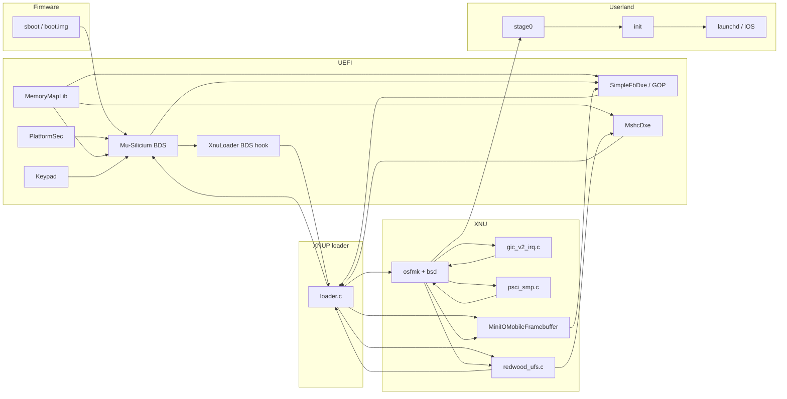
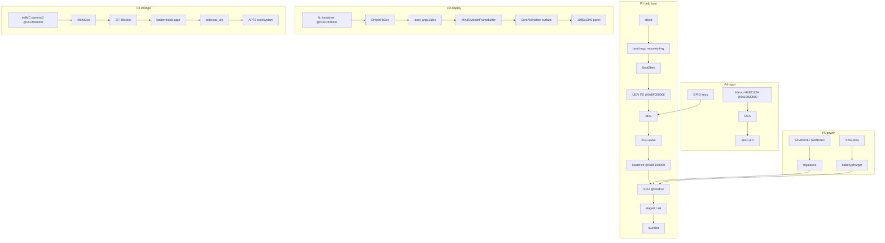

# m20lte XNU/iOS Bring-up Blueprint

**Reference architecture:** `stormtroopxyz/y2sios` @ `68fe2e922a52917ed851c1499e394fe5436365b5`
**Target:** Samsung Galaxy M20 (`m20lte`), Exynos 7904 / S5E7904
**Deliverable type:** architecture analysis + implementation plan. No source changes are proposed as already applied.
**Analysis date:** 2026-10-28

---

## 0. Verdict, scope, and evidence

### 0.1 Verdict

The port is feasible in stages, but it is not a "swap the DTS and rebuild" job. The reference design has four hard platform dependencies that do not survive the SoC change:

1. **Storage**: y2sios roots from a UFS `super` partition through a shared-page block service and, optionally, a native UFS driver. m20lte has eMMC (`dwmmc0`) and no `super` partition.
2. **Display**: y2sios hardcodes DECON/DSIM at `0x19050000`/`0x190C0000` and a 1125x2436 panel. m20lte has DECON/DSIM at `0x14860000`/`0x14870000` and a 1080x2340 video-mode panel.
3. **Power/input**: y2sios has a Qualcomm-style charger/battery path and a different touch controller. m20lte uses S2MPU08 + S2MPB03 + S2MU004 and a Himax HX83112A.
4. **Boot memory map**: the loader's payload base, log offset, download window, and resident-root arithmetic are all tuned to y2s. Several are compile-time constants that will silently corrupt m20lte if copied.

The shortest credible route to first iOS userland is:

> **UEFI display + keys → loader → XNU single-core on a non-loader core → GICv2/timer/PSCI → GOP framebuffer with CPU copy → monolithic APFS root in RAM (`md0`) → PID 1 `init` → then eMMC + big system volume → then touch/power → then GPU/Wi-Fi/audio.**

That route reaches a running PID 1 and a usable console in roughly **6–9 months** for a 2–3 person team with the y2sios tree as a reference. A lock-screen-class port with touch, battery, and the big system image is **12–18 months**. GPU/Metal, Wi-Fi/BT, audio, camera, and cellular are **24+ months** and should be treated as separate projects.

### 0.2 Confidence labels

| Label | Meaning |
|---|---|
| **V** | Verified in the reference source, target DTS, or Mu-Silicium source at the cited commit. |
| **I** | Inferred from the code/DTS; plausible but not executed on m20lte hardware. |
| **U** | Unverified; requires an on-device measurement before it can become a design input. |

### 0.3 Evidence base

| Tree | Commit | Use |
|---|---|---|
| `y2sios` | `68fe2e9` | Reference boot chain, loader, GICv2, display, UFS, userland |
| `Mu-Silicium` | `4cba43c` | UEFI base: `a10Pkg`, `S5E7885Pkg`, `MshcDxe`, `PlatformMshcLib`, `SimpleFbDxe` |
| m20 kernel DTS | `554e05f` | `exynos7904-m20lte_common.dtsi`, `exynos7885.dtsi`, `display-lcd_m20_common.dtsi`, `exynos7884-rmem.dtsi` |

### 0.4 Non-goals

- No claim that the m20lte bootloader can be unlocked on a retail unit. That is a precondition, not an engineering deliverable.
- No cellular modem, DRM/PlayReady, Apple secure services, or camera in the first userland milestone.
- No GPU acceleration in the first userland milestone; software rendering is acceptable.
- No attempt to preserve Android after the port disk is repurposed.

---

## 1. Repository graph and module centrality

### 1.1 Method

The analysis is graph-based, not file-sequential:

1. **Build-time skeleton.** Extract the include/link graph from `git ls-files` (643 files in y2sios), the DSC/FDF/INF files, and the kernel build scripts. This graph is acyclic and defines the topological build order.
2. **Runtime graph.** Extract call/ABI edges among 17 normalized modules from symbols (`nm`, `ctags`), the loader's function-pointer handoff, the shared-page protocol, and the UEFI protocol usage. This graph is cyclic because UEFI remains resident while XNU runs.
3. **Condensation.** Collapse strongly connected components (SCCs) to obtain the phase-level DAG. The runtime core is one 10-node SCC; the userland chain is a DAG tail.
4. **Centrality/coupling.** Compute afferent coupling `Ca`, efferent coupling `Ce`, instability `I = Ce/(Ca+Ce)`, and normalized betweenness centrality `BC` on the 17-node runtime graph.
5. **k-hop ego graphs.** Inspect the 2-hop neighborhoods of the loader and XNU to identify the minimum cut set for a platform port.

The graph is deliberately **module-level**, not file-level: a file-level graph on 643 files is dominated by XNU's internal include fan-out and says nothing useful about the port. The 17 modules are the units that must be frozen, replaced, or wrapped.

### 1.2 Runtime module graph (17 nodes, 27 edges)



Edge types are not all control flow:

| Type | Example | Port consequence |
|---|---|---|
| Control | `XLD -> LDR` | Entry point / handoff ABI |
| ABI | `LDR -> XNU` (`boot_args`, DT) | Must be preserved exactly |
| MMIO | `GIC -> XNU`, `MIOFB -> GOP` | Base addresses are platform-specific |
| DMA | `MIOFB -> GOP` framebuffer | Physical address and stride are platform-specific |
| Shared memory | `UFS <-> LDR` block page | Cacheability and core placement are platform-specific |
| Exec | `XNU -> S0`, `S0 -> INIT` | Root image layout is platform-specific |

### 1.3 Centrality matrix

`Ca`/`Ce` are in/out degree on the 17-node graph. `BC` is normalized betweenness (NetworkX, exact on this small graph). `I` is instability.

| Module | Layer | LOC | Ca | Ce | I | BC | Port role |
|---|---|---:|---:|---:|---:|---:|---|
| `loader.c` | loader | 5,227 | 4 | 4 | 0.50 | **0.429** | **Freeze ABI, parameterize constants, split platform code** |
| `XNU` (osfmk+bsd) | kernel | large | 3 | 5 | 0.63 | **0.321** | Reuse; add platform hooks and drivers |
| `BDS` | UEFI | large | 5 | 2 | 0.29 | 0.196 | Reuse Mu-Silicium; new board package |
| `SimpleFbDxe/GOP` | UEFI | small | 3 | 1 | 0.25 | 0.148 | Replace PCDs; add stride support |
| `stage0` | userland | 35 | 1 | 1 | 0.50 | 0.117 | Replace with monolithic-root path |
| `XnuLoader` hook | UEFI | 336 | 1 | 1 | 0.50 | 0.083 | Change payload base |
| `redwood_ufs` | kernel | 2,129 | 2 | 2 | 0.50 | 0.083 | Extend shared-page root; new transport |
| `init` | userland | 1,678 | 1 | 1 | 0.50 | 0.062 | Reuse; add flash-root mode |
| `MiniIOMobileFramebuffer` | kernel | 3,752 | 2 | 1 | 0.33 | 0.021 | Parameterize DECON/DSIM/panel |
| `MshcDxe` | UEFI | small | 2 | 1 | 0.33 | 0.019 | New board library |
| `gic_v2_irq.c` | kernel | 592 | 1 | 1 | 0.50 | 0.000 | Reuse; verify IIDR/timer |
| `psci_smp.c` | kernel | small | 1 | 1 | 0.50 | 0.000 | Reuse; verify SMC |
| `MemoryMapLib` | UEFI | 54 | 0 | 3 | 1.00 | 0.000 | **Rewrite for m20** |
| `Keypad` | UEFI | small | 0 | 1 | 1.00 | 0.000 | Reuse (GPIOs already match) |
| `PlatformSec` | UEFI | small | 0 | 1 | 1.00 | 0.000 | Reuse/verify DECON write enable |
| `boot` | firmware | n/a | 0 | 1 | 1.00 | 0.000 | Replace boot image |
| `launchd` | userland | n/a | 1 | 0 | 0.00 | 0.000 | Reuse binaries; platform services differ |

**Reading the matrix:**

- `loader.c` is the single highest-betweenness module. Every boot path crosses it. The port must **not** fork it; it must add a `struct platform platform_m20lte`, parameterize the compile-time constants, and keep the handoff ABI unchanged.
- `MemoryMapLib` has zero betweenness because it is a source, but it has maximum instability and maximum blast radius: an incorrect descriptor silently corrupts the kernel window. It is the first file to rewrite, not the last.
- `GIC`/`PSCI` have low betweenness because they are leaves in the module graph, but they are **liveness-critical**: if they are wrong, nothing else runs. Betweenness is the wrong sole metric for them; use "liveness criticality" (a failure stops all progress) as a separate axis.
- `MiniIOMobileFramebuffer` is less central than expected because the default CPU-copy path only needs `boot_args.video`; the DECON/DSIM code is gated behind `fb_flip`/`fb_te`/`fb_bl`, all default 0. This is what makes an early display bring-up possible.

### 1.4 Condensation and topological skeleton

The runtime graph has one large SCC:

```
SCC-A = {boot, bds, xnuloader, loader, gic, psci, xnu, miofb, ufs, mshc}
SCC-B = {stage0}
SCC-C = {init}
SCC-D = {launchd}
```

The condensation is a DAG:

```
SCC-A -> SCC-B -> SCC-C -> SCC-D
```

This is the formal reason a strict "topological module order" cannot be used for the runtime graph: UEFI, the loader, and XNU form a cycle by design (UEFI stays resident, the loader serves the kernel, the kernel returns to the loader). The **build-time** graph is acyclic and is the correct place for topological ordering:

```
S5E7904/S5E7885 headers
  -> m20ltePkg DSC/FDF
  -> UEFI FD (SEC -> DXE -> BDS)
  -> XNUP (loader.efi + boot entries)
  -> boot.img (BootShim + FD + XNUP)
  -> recovery.img (embed @0 + kernel @koff + root @roff)
```

**Port cut points** (minimum set of modules to touch):

1. `MemoryMapLib` (new descriptors).
2. `m20ltePkg` DSC/FDF/PCDs (new board).
3. `loader.c` platform table + constants (`PAYLOAD_BASE`, `LOG_OFFSET`, `DOWNLOAD_MAX_SIZE`, `platform_m20lte`).
4. `XnuLoader.h` payload base.
5. `gic_v2_irq.c` (verify only; likely no change).
6. `MiniIOMobileFramebuffer` (parameterize panel/DECON only when acceleration is enabled).
7. `redwood_ufs.c` (allow shared-page root).
8. `PlatformMshcLib` (new board library).
9. `stage0`/`init` (monolithic root then flash root).

### 1.5 k-hop ego graphs

**Loader, 2 hops (15 of 17 nodes):** `{bds, boot, gic, gop, keypad, loader, memmap, miofb, mshc, psci, sec, stage0, ufs, xnu, xnuloader_bds}`.

This is almost the entire graph. The loader is a **god module** by design: it is the only component that sees firmware, storage, display, and kernel handoff. The port should reduce its conceptual surface, not its line count:

- Move platform constants into `platform_m20lte`.
- Move eMMC board setup into `PlatformMshcLib`/`MshcDxe`.
- Keep `parse_payload`, `choose_window`, `run_kernel`, and the block page as the frozen core.

**XNU, 2 hops (12 nodes):** `{bds, gic, gop, init, loader, miofb, mshc, psci, stage0, ufs, xnu, xnuloader_bds}`.

XNU's neighborhood is the runtime half of the graph. The port adds drivers at its leaves; it should not change the Mach/BSD core.

---

## 2. Heterogeneous architecture and meta-path graph

### 2.1 Layer model

The system is heterogeneous in five dimensions:

| Dimension | Firmware | UEFI | Loader | XNU | Userland |
|---|---|---|---|---|---|
| Privilege | EL3/EL2 (Samsung) | EL2/EL1 | EL1 (UEFI app) | EL1 | EL0 |
| Address space | Physical + secure | Identity + UEFI VA | Identity + UEFI VA | Slid kernel VA | User VA |
| Time | sboot | UEFI timer | UEFI timer | ARM generic timer | Mach absolute time |
| Storage | eMMC boot | BlockIo | BlockIo + shared page | BSD buffer cache | APFS/VFS |
| Display | DECON/DSIM | GOP | boot_args.video | IOMobileFramebuffer | CoreAnimation |

The port must preserve the **type** of each edge while replacing its **instance** (address, controller, protocol).

### 2.2 Meta-path graph



### 2.3 Meta-paths and substitutions

| Meta-path | y2sios instance | m20lte instance | Action | Confidence |
|---|---|---|---|---|
| **P1 boot image** | recovery.img: embed@0, log@16 MiB, kernel@32 MiB, root@48 MiB | recovery.img: embed@0, log@4 MiB, kernel@12 MiB, root@30 MiB | New pack layout + size asserts | V |
| **P1 UEFI FD** | `0xE8000000`, 2 MiB, payload `0xE8100000` | `0x8F000000`, 2 MiB, payload `0x8F100000` | Change both `loader.c` and `XnuLoader.h` | V |
| **P1 kernel load** | `kpart=recovery`, `koff=32 MiB`, 16 MiB read | `kpart=recovery`, `koff=12 MiB`, 18 MiB kernel, 24 MiB staging | Add `ksize`; dynamic staging | V |
| **P1 root** | resident `super` image or `ufs_root=super` | RAM `root.apfs` (`md0`) first; later `ufs_root=system` | Monolithic root, then flash root | I |
| **P2 framebuffer** | `0xF1000000`, 1125x2436, DECON `0x19050000` | `0xEC000000`, 1080x2340, DECON `0x14860000` | MemoryMapLib + PCDs + stride | V |
| **P2 panel** | command mode, TE, DSIM `0x190C0000` | video mode, SW trigger, DSIM `0x14870000` | Keep `fb_te=0`; parameterize later | V |
| **P3 storage** | UFS `0x13100000`, LUN + `super` | eMMC `0x13500000`, GPT + `system`/`cache` | `MshcDxe` + `PlatformMshcLib` | V/I |
| **P3 root service** | native UFS driver or shared page | shared page only (no native eMMC driver initially) | Patch `redwood_ufs_root` gate | V |
| **P4 keys** | `gpa1-5/6/7` | `gpa1-5/6/7` | Reuse `KeypadDeviceLib` | V |
| **P4 touch** | different controller | Himax `0x48`, IRQ `gpa0-0`, reset `gpg2-1` | New I2C/HID driver | V |
| **P5 PMIC** | Qualcomm-style charger | S2MPU08 + S2MPB03 + S2MU004 | New drivers or defer | V |
| **P6 GPU** | Mali-G77 MP11 | Mali-G71 MP2 | Panfrost (new), not the y2s Mali driver | V |
| **P7 Wi-Fi/BT** | BCM4375 | SCSC `0x120C0000` | Unresolved; separate project | U |

### 2.4 The critical path

The critical path is **not** the CPU or the GIC; those are reusable. It is:

```
MemoryMapLib correctness
  -> UEFI boots and reports a truthful GOP + memory map
  -> loader claims a safe window and reads the kernel from recovery
  -> XNU reaches PID 1 from a RAM root
  -> eMMC block service + APFS system volume
  -> touch/power
  -> GPU
```

Every early milestone should be judged by whether it retires a row in this path. Feature work that does not (e.g., Wi-Fi) is out of scope until the path is complete.

---

## 3. Data lifecycle lattice and state machines

### 3.1 Ownership lattice

Memory objects move through a product lattice:

```
State = Owner x Content x Mapping x Trust

Owner   = { Free, Reserved, UEFI, Loader, Kernel, User }
Content = { Empty, Payload, MachO, Ramdisk, APFS, Framebuffer, Log }
Mapping = { Unmapped, Identity, Slid, Shared, DMA }
Trust   = { EL3, EL2, EL1, EL0 }
```

Ownership order (higher = more privilege / later lifecycle):

```
Free
 ├─ Reserved        (firmware/display; never allocatable)
 └─ UEFI
     └─ Loader
         └─ Kernel
             └─ User
```

`Reserved` is a side branch, not comparable with `UEFI`; it represents memory the firmware has removed from the allocator (display, Tima, modem, secure). The important invariant is:

> **No page is simultaneously writable by two owners.** In separation-logic notation:
>
> `payload * uefi_fd * uefi_runtime * kernel_window * framebuffer * shared_page`
>
> where `*` is separating conjunction and every operand denotes a disjoint physical range.

### 3.2 m20lte separation obligation

For the first boot, the heap partition must satisfy:

```
payload        [0x8F100000, 0x8F180000)      512 KiB
uefi_fd        [0x8F000000, 0x8F100000)      1 MiB
uefi_stack     [0x8F200000, 0x8F240000)      256 KiB
uefi_heap      [0x8F240000, 0x94640000)      84 MiB
kernel_window  [W, W + S)                    S >= 128 MiB
framebuffer    [0xEC000000, 0xED400000)      20 MiB
shared_page    [P, P + 0x2000)               8 KiB
```

The loader must prove `kernel_window ∩ (payload ∪ uefi_* ∪ framebuffer ∪ shared_page) = ∅`. The current `choose_window` proves only `kernel_window ∩ payload = ∅` and relies on the EFI memory map for the rest. On m20lte the map is the weak link: `Tima` at `0xB8000000`, `seclog` at `0xC0000000`, and the modem/CP reservations at `0xF5400000`/`0xFDC00000`/`0xFFC00000` must be `Reserved` in `MemoryMapLib`, not merely absent from the DTS.

### 3.3 Boot payload state machine

```
S0 ABSENT
  --(magic == XNUP)--> S1 HEADER
S1 HEADER
  --(entries terminate within header.size)--> S2 PARSED
S2 PARSED
  --(kernel != NULL or kpart != "")--> S3 KERNEL_READY
S3 KERNEL_READY
  --(Mach-O valid, entry != 0)--> S4 IMAGE_VALID
S4 IMAGE_VALID
  --(window claimed, segments fit)--> S5 WINDOW_READY
S5 WINDOW_READY
  --(segments copied, DT + boot_args written)--> S6 HANDOFF
S6 HANDOFF
  --(PSCI CPU_ON or eret)--> S7 RUNNING
S7 RUNNING
  --(panic / checkpoint / return)--> S8 RETURNED
S8 RETURNED
  --(log composed and stored)--> S9 LOGGED
S9 LOGGED
  --(reset)--> S0
```

Invariants:

- `S1 -> S2`: every entry `e` satisfies `e + 24 + align16(e.size) <= ph + 8 + ph.size`.
- `S2 -> S3`: `kpart` is a NUL-terminated string of length < 32; `koff` is block-aligned.
- `S4 -> S5`: `win_base mod 32 MiB == 0`; `win_size >= top - phys_base + 64 MiB`.
- `S5 -> S6`: `kernel_window` is disjoint from all `Reserved` and `UEFI` ranges.
- `S7`: `boot_args.commandLine` is NUL-terminated within 608 bytes.

The current code establishes the magic, the Mach-O magic, and the overlap check; it does **not** establish the entry-size, NUL-termination, or full-reservation invariants. Those are audit findings V1/V2/V3.

### 3.4 Block-page state machine

The shared page is a two-party, single-outstanding-request protocol:

```
IDLE
  --(kernel: req.seq = answer.answered + 1, len <= buffer_size)--> REQUEST
REQUEST
  --(loader observes req.seq != answer.answered)--> BUSY
BUSY
  --(storage read completes; loader cleans/invalidates caches)--> ANSWER
ANSWER
  --(loader: answer.seq = req.seq; kernel observes)--> IDLE
any
  --(error)--> ERROR
ERROR
  --(kernel resets seq / loader rebinds)--> IDLE
```

Invariants:

1. `answer.answered` is monotone non-decreasing.
2. At most one request is in flight.
3. The loader writes data only into `[buffer_pa, buffer_pa + buffer_size)`.
4. The kernel never issues `req.seq <= answer.answered`.
5. The page magic/version/size match exactly; otherwise the kernel refuses the page.
6. The page is outside the kernel window (m20lte-specific check).

The current loader enforces (1)–(3) and (5); (4) is enforced by the kernel driver; (6) is implicit and should become explicit.

### 3.5 Framebuffer state machine

```
UNKNOWN
  --(GOP locate "Display Reserved")--> RESERVED
RESERVED
  --(SimpleFbDxe init, PCDs)--> GOP_OWNED
GOP_OWNED
  --(boot_args.video written)--> KERNEL_MAPPED
KERNEL_MAPPED
  --(first IOMobileFramebuffer swap)--> CPU_COPY
CPU_COPY
  --(fb_flip=1 and DECON reads boot fb)--> SCANOUT_DOUBLE
```

m20lte stays in `CPU_COPY` for the first userland. `fb_flip`, `fb_te`, and `fb_bl` remain 0 because:

- the panel is video mode with SW trigger (`trig_mode = <1>`), not command mode with TE;
- DECON/DSIM bases are y2s-specific and would fault if mapped on m20;
- backlight is LM3630/LM3632 on I2C4, not the y2s DSIM path.

### 3.6 Data lifecycle table

| Object | Producer | Consumer | Lifetime | Free? | Invariant |
|---|---|---|---|---|---|
| XNUP payload | build | UEFI BDS + loader | boot | no | magic/size/entries |
| UEFI FD | build | SEC/DXE | boot | no | ≤1 MiB, disjoint payload |
| Kernel image | build | loader/XNU | boot | no | Mach-O segments within staging |
| `root.apfs` (RAM) | build | XNU/APFS | boot | no | size == `rsize`, 4K aligned |
| `system.apfs` (eMMC) | provision | XNU/APFS | persistent | no | partition window |
| Kernel window | loader | XNU | boot | no | 32 MiB aligned, disjoint |
| Block page | loader | XNU | boot | no | 8 KiB, cache-coherent protocol |
| Framebuffer | firmware | UEFI/XNU | boot | no | reserved, stride |
| Log ring | loader | loader/host | boot | yes after read | ≤ log slot |

---

## 4. Program slices and symbolic paths

### 4.1 Slicing criterion and PDG

A **backward slice** is computed from a criterion `(s, v)`: the set of statements that may affect variable `v` at statement `s`, following data and control dependences. The program dependence graph (PDG) nodes are statements; edges are:

- **data**: `def(v) -> use(v)`
- **control**: branch predicate -> statements in the branch
- **call**: actual -> formal, return -> caller
- **memory**: store -> load through the same alias set

The slices below use the actual y2sios line numbers so they can be replayed against the reference.

### 4.2 Slice S1: `parse_payload` (loader.c:2822–2898)

**Criterion:** `pi.kernel` at the `run_kernel` use (line 3197), and `pi.kpart[0]` at line 3198.

**Backward slice:**

```
PAYLOAD_BASE (line 23)
  -> ph = (payload_header *)PAYLOAD_BASE
  -> ph->magic, ph->size
  -> p = ph + 1 ; pend = p + ph->size
  -> loop: e = (payload_entry *)p ; e->name, e->size
  -> str_eq(e->name, "kernel"/"ramdisk"/"kpart"/...)
  -> pi->kernel = p + sizeof(*e)
  -> p += sizeof(*e) + align16(e->size)
```

**Established postcondition:** `pi.kernel` points inside the payload if a `kernel` entry exists; `pi.kpart` is copied with a bounded loop.

**Not established:**

- `ph->size <= PAYLOAD_MAX_SIZE`. A corrupt `size` makes `pend` point outside the payload; the loop can read arbitrary memory.
- `e->size <= pend - p - sizeof(*e)`. A corrupt entry size makes the next `p` jump outside; the loop can read or wrap.
- `pi.cmdline` NUL-termination. `cmdline` text is used by `starts_with` and copied into `boot_args.commandLine`; no length check.
- `pi.ramdisk_size` vs `e->size` consistency.

### 4.3 Slice S2: `choose_window` (loader.c:3068–3123)

**Criterion:** `win_size` at line 3243.

**Backward slice:**

```
win_size
  <- best_size (if > MAX_MEM_SIZE, clamped)
  <- loop over EFI memory descriptors:
       type == EfiConventionalMemory
       [lo, hi) = [phys_start, phys_start + pages*4096)
       subtract payload [PAYLOAD_BASE, PAYLOAD_BASE+PAYLOAD_MAX_SIZE)
       lo = align_up(lo, 32 MiB)
       hi = align_down(hi, 32 MiB)
       best_size = max(best_size, hi - lo)
  <- forced_base override (best_size = MAX_MEM_SIZE)
  <- allocate_pages(AllocateAddress, best_size >> 12, &claim)
  <- win_base = best_base ; win_size = best_size
```

**Path constraints:**

```
C1: GetMemoryMap succeeds with map_size <= 65536
C2: best_size > 0
C3: best_size <= MAX_MEM_SIZE (6 GiB)
C4: allocate_pages(AllocateAddress, best_size/4096) succeeds
C5: [win_base, win_base+win_size) ∩ payload = ∅
```

**m20lte instantiation:** with the a10-style map, the first DRAM block after the DXE heap is roughly `0x94640000..0xBDA00000`; after 32 MiB alignment and the Tima hole, a candidate is `0x96000000..0xBC000000` (608 MiB). The second region `0xC0000000..0x100000000` is 1 GiB and will win the `max` unless `seclog` or other reservations split it. This is why the memory map must be complete **before** the first kernel boot.

**Critical flaw:** `forced_base` sets `best_size = MAX_MEM_SIZE` and then tries to allocate 6 GiB at that address. On real hardware this fails, or worse, over-claims. The `physbase` payload entry is documented as a "testing aid"; it is not safe for m20 bring-up until it is clamped to the containing descriptor.

### 4.4 Slice S3: `run_kernel` arithmetic (loader.c:3238–3310)

Let:

- `P = win_base`
- `K = kern_hi = align_up(vm_hi + slide, 16 KiB)`
- `R = align_up(ramdisk_size, 16 KiB)`
- `S = resident_rd_size` (0 if none)
- `D = 0x10000` (DT max)
- `B = 0x4000` (boot_args page)

Code:

```
rd_pa = K
if S != 0:
    res_pa = P + 0x08000000
    require K + R <= res_pa
    dt_pa = res_pa + align_up(S, 16K)
else:
    dt_pa = rd_pa + R
top = dt_pa + D + B
require win_size >= top - P + 0x04000000
```

**Path table:**

| Case | Constraint | m20lte feasibility |
|---|---|---|
| No resident root | `win_size >= K + R + D + B - P + 64 MiB` | SAT for 608 MiB window, 18 MiB kernel, ≤12 MiB root |
| Resident root `rdpart` | `win_size > 0x38000000` (896 MiB) **and** `K+R <= 128 MiB` **and** `128 MiB + S + ... <= win_size - 64 MiB` | UNSAT for a 2.5 GB system image; SAT only for a small resident image |
| Forced base | `allocate_pages(6 GiB)` | UNSAT on 2–4 GiB hardware |

**Conclusion:** m20lte must use the **non-resident** path for the big system volume (`ufs_root=`), and a small RAM root for the first userland. The `rdpart`/resident path is only viable for images under ~100 MiB.

### 4.5 Slice S4: `redwood_ufs_root` (redwood_ufs.c:1832–1877)

**Criterion:** `ufs_root_dev` return.

**Backward slice:**

```
ufs_root_dev
  <- bdevsw_add(&ufs_root_bdevsw)
  <- ufs_root_part = part
  <- part = ufs_entry(arg)                 [requires ufs_ready]
  <- redwood_ufs_init()                    [requires ufs_shared_pa]
  <- ufs_native_on && ufs_lun[part] != 0xff
  <- size aligned, off+size <= part_bytes
```

**Path condition:**

```
ufs_root boot arg present
∧ ufs_ready
∧ part valid
∧ ufs_native_on
∧ ufs_lun[part] != 0xff
∧ (size == 0 || (off & 4095) == 0 && (size & 4095) == 0 && off+size <= part_bytes)
```

**m20lte:** the shared-page path sets `ufs_native_on = false`. Therefore the `ufs_native_on` conjunct is **UNSAT** on m20lte, and `redwood_ufs_root` returns `NODEV` even though the loader page is present and `ufs_read` can serve reads. This is the single most important kernel patch for storage.

**Minimal patch (design, not applied):**

```
- if (!ufs_native_on || ufs_lun[part] == 0xff) { ... }
+ if (!ufs_ready || (ufs_native_on && ufs_lun[part] == 0xff)) { ... }
```

The read path already branches on `ufs_native_on`: when false, it uses the loader page. The root device is read-only, so the lack of a native driver is acceptable.

### 4.6 Slice S5: GICv2 initialization (gic_v2_irq.c:518–553)

**Criterion:** `gicd_base`, `gicc_base`.

**Backward slice:**

```
gicd_base = ml_io_map(soc_base + reg[0], reg[1])
gicc_base = ml_io_map(gicc_base_reg, ...)
  <- DT interrupt-controller reg cells
  <- soc_base from boot_args / DT
  <- gic_write32(GICD_CTLR, GICD_CTLR_ENABLE)
  <- GICC_PMR = 0xff ; GICC_BPR = 0 ; GICC_CTLR = ENABLE_GRP1
  <- kprintf("gic: v2 ... IIDR 0x%08x")
```

**Path condition:** `reg` has at least four cells; both mappings non-NULL; IIDR is a plausible GIC-400 value.

**m20lte:** GICD `0x12301000`, GICC `0x12302000`, both 4 KiB; timer 26 MHz; PSCI SMC. Expected SAT. The IIDR must be read and compared; y2s's `0x0202143b` is a GIC-400 signature.

### 4.7 Slice S6: framebuffer blit (MiniIOMobileFramebuffer.cpp:3723–3731)

**Criterion:** the row `memcpy` in the CPU-copy path.

**Backward slice:**

```
vinfo.v_baseaddr, vinfo.v_rowbytes, vinfo.v_width, vinfo.v_height, vinfo.v_depth
  <- boot_args.video (loader.c:3438–3443)
  <- SCREEN.base/stride/width/height
  <- GOP mode info (SimpleFbDxe)
  <- PcdFrameBufferWidth/Height/Depth and SimpleFb's PixelsPerScanLine
```

**Path condition:**

```
v_baseaddr != 0
∧ v_depth == 32
∧ width <= v_width
∧ height <= v_height
∧ rowBytes >= width*4
```

**m20lte:** the last conjunct is the risk. `SimpleFbDxe` sets `PixelsPerScanLine = Width` (1080). If DECON scans 1088 pixels, the image is sheared by 8 pixels per row. The framebuffer size is still within the 20 MiB reservation, so there is no fault; the failure is visual and easy to misdiagnose. Add a stride PCD and a test pattern.

### 4.8 Symbolic path table

| ID | Entry | Path condition | Expected on m20lte | Verdict |
|---|---|---|---|---|
| P1 | `parse_payload` | `magic=XNUP ∧ 8+size <= 512K ∧ entries within size` | SAT if image built correctly | OK; add checks |
| P2 | `parse_payload` | `entry.size` exceeds remaining payload | SAT for corrupt image | **V1** |
| P3 | `choose_window` | `best_size >= top - P + 64 MiB` | SAT for 608 MiB / 1 GiB | OK |
| P4 | `choose_window` | `win_size > 0x38000000` (resident path) | UNSAT for 608 MiB; SAT for 1 GiB | Use non-resident |
| P5 | `run_kernel` | `koff + ksize <= recovery_size` | 12+18=30 ≤ 38 MiB SAT | OK |
| P6 | `run_kernel` | `ksize <= DOWNLOAD_MAX_SIZE` | expected 17–18 MiB > 16 MiB → **UNSAT** (measure first) | **V3** |
| P7 | `run_kernel` | `koff + ksize <= roff` | 12+18=30 ≤ 30 SAT (equality) | Tight; assert |
| P8 | `redwood_ufs_root` | `ufs_native_on` | false → **UNSAT** | **V4** |
| P9 | block service | `kernel_mpidr != loader_mpidr` | depends on `bootcpu` | **V5** |
| P10 | GIC | `gicd_base != 0 ∧ gicc_base != 0` | SAT | OK |
| P11 | GIC | `IIDR == 0x0202143b` | likely SAT (GIC-400) | Verify |
| P12 | framebuffer | `PixelsPerScanLine == Width` | may be false if stride 1088 | **V7** |
| P13 | framebuffer | `1080*2340*4 <= Display Reserved` | `0x9A3B00 <= 0x1400000` SAT | OK |
| P14 | a10 reservation | `1080*2340*4 <= 0x85A000` | `0x9A3B00 > 0x85A000` → **UNSAT** | **V6** |
| P15 | payload base | `PAYLOAD_BASE == FD_BASE + 0x100000` | m20: `0x8F100000` | **V8** |

### 4.9 Abstract interpretation of `choose_window`

Use the interval lattice `I = { [lo, hi] | lo, hi ∈ N ∪ {⊥, ⊤} }` with join = convex hull. The loop over descriptors computes:

```
best_size# = max#(best_size#, candidate#)
candidate# = [0, max(0, align_down(hi) - align_up(lo))]
```

The abstract state at the loop head is:

```
(best_base#, best_size#) ∈ (N ⊥) × I
```

The transfer function is monotone; the lattice has finite height per descriptor because each candidate is a constant. The fixed point is the maximum aligned candidate size. The implementation matches the abstraction **if** the EFI map is a partition (no overlaps) and `pages << 12` does not overflow. On m20lte, `pages` is at most ~1M, so no overflow. The missing piece is the **reservation** predicate: the abstraction assumes every `EfiConventionalMemory` descriptor is truly free. That assumption is exactly what `MemoryMapLib` must make true.

### 4.10 m20lte window arithmetic

For a 2 GiB device with the a10-style map:

```
First region:   0x80000000 .. 0xBDA00000   (944 MiB)
Second region:  0xC0000000 .. 0x100000000  (1024 MiB)
Hole:           0xBDA00000 .. 0xC0000000   (38 MiB)
DXE heap ends:  0x94640000
Tima:           0xB8000000 .. 0xB8200000   (2 MiB)
Display:        0xEC000000 .. 0xED400000   (20 MiB)
```

Candidate A (first region, after Tima split):

```
lo = align_up(0x94640000, 32 MiB) = 0x96000000
hi = align_down(0xB8000000, 32 MiB) = 0xB8000000
size = 0x22000000 = 544 MiB
```

Candidate B (after Tima, to the hole):

```
lo = 0xB8200000 -> align_up = 0xBA000000
hi = align_down(0xBDA00000, 32 MiB) = 0xBC000000
size = 0x02000000 = 32 MiB
```

Candidate C (second region, after `seclog` and the framebuffer are reserved):

```
C1: lo = align_up(0xC0000000 + 0x80000, 32 MiB) = 0xC2000000
    hi = align_down(0xEC000000, 32 MiB) = 0xEC000000
    size = 0x2A000000 = 672 MiB

C2: lo = align_up(0xED400000, 32 MiB) = 0xEE000000
    hi = 0x100000000
    size = 0x12000000 = 288 MiB
```

C1 (672 MiB) wins over candidate A (544 MiB). If `seclog` is **not** reserved, C1 grows to 704 MiB and starts at `0xC0000000`; the first 512 KiB are clobbered. If the framebuffer is **not** reserved, C1 appears to be 1 GiB and includes `0xEC000000..0xED400000`; the kernel then overwrites the live panel buffer. This is the concrete reason to enumerate both `seclog_mem` and `Display Reserved` in `MemoryMapLib`.

> The exact winner is map-dependent. The point of the arithmetic is the **obligation**, not the number: every `Reserved` range below the chosen window's end must split the candidate, or the separation invariant fails.

> **Runtime gate M1:** dump every EFI descriptor over UART, compare it against the DTS `/reserved-memory` and `/memreserve/` list, and only then freeze `MemoryMapLib`. Do not trust the arithmetic above; it is a model, not a measurement.

---

## 5. Hoare contracts and vulnerability audit

### 5.1 Notation

`{P} C {Q}` means: if `P` holds before `C` and `C` terminates, `Q` holds afterward. `wp(C, Q)` is the weakest precondition. `P => wp(C, Q)` is the proof obligation. For loops, an invariant `I` must satisfy `P => I`, `{I ∧ guard} body {I}`, and `{I ∧ ¬guard} => Q`.

### 5.2 Contracts

#### C1 — `parse_payload`

```
{ ph = PAYLOAD_BASE
  ∧ readable(ph, 8)
  ∧ ph->magic = XNUP
  ∧ ph->size ≤ PAYLOAD_MAX_SIZE - 8
  ∧ ∀e ∈ entries(ph): e + 24 + align16(e.size) ≤ ph + 8 + ph.size
  ∧ all names/text NUL-terminated within the payload }
  parse_payload(pi)
{ (pi.kernel ≠ NULL ⇒ pi.kernel ∈ payload)
  ∧ (pi.ramdisk ≠ NULL ⇒ pi.ramdisk + pi.ramdisk_size ∈ payload)
  ∧ (pi.cmdline = "" ∨ NUL-terminated(pi.cmdline))
  ∧ (pi.kpart[0] = 0 ∨ strlen(pi.kpart) < 32)
  ∧ no pointer escapes the payload }
```

**Status:** the code establishes the first and third postconditions only partially. `ph->size`, entry sizes, and NUL termination are unchecked. **V1.**

#### C2 — `choose_window`

```
{ win_size = 0
  ∧ valid_efi_map(map)
  ∧ payload ⊆ [PAYLOAD_BASE, PAYLOAD_BASE+PAYLOAD_MAX_SIZE)
  ∧ ∀r ∈ Reserved: r ∩ payload = ∅ }
  choose_window(pi)
{ win_size > 0 ⇒
    win_base mod 2^25 = 0
  ∧ [win_base, win_base+win_size) ⊆ Conventional
  ∧ [win_base, win_base+win_size) ∩ payload = ∅
  ∧ [win_base, win_base+win_size) ∩ Reserved = ∅
  ∧ allocated(win_base, win_size) }
```

**Status:** the code establishes alignment, conventional membership, payload exclusion, and allocation. It does **not** establish `Reserved` exclusion independently of the map; **V6/V9** if the map is incomplete.

#### C3 — `run_kernel`

```
{ kernel is a 64-bit Mach-O
  ∧ kernel_size ≤ staging_size
  ∧ window claimed
  ∧ win_size ≥ top - phys_base + 64 MiB }
  run_kernel
{ segments loaded at pa = va + slide
  ∧ boot_args.video = {fb_base, stride, width, height, 32}
  ∧ boot_args.commandLine NUL-terminated
  ∧ CPU enters at entry_va with the expected MMU state }
```

**Status:** Mach-O magic, `vm_lo`, entry, overlap, and window size are checked. Segment `fileoff + filesize` against the staging size is **not** checked; **V2**. `boot_args.commandLine` length is checked by the loop bound, but the source `pi.cmdline` may not be NUL-terminated; **V1b**.

#### C4 — block page service

```
{ page.magic = BLOCK_MAGIC
  ∧ page.version = BLOCK_VERSION
  ∧ page.size = sizeof(loader_block)
  ∧ page.parts ≤ BLOCK_MAX_PARTS
  ∧ req.seq = page.answer.answered + 1
  ∧ req.len ≤ page.buffer_size
  ∧ req.part < page.parts
  ∧ req.off + req.len ≤ part_bytes }
  serve(req)
{ page.answer.seq = req.seq
  ∧ (ok ⇒ data[0..len) = storage[part, off, len))
  ∧ (¬ok ⇒ page.answer.error ≠ 0)
  ∧ page.answer.answered = req.seq }
```

**Status:** magic/version/size/parts are checked in `redwood_ufs_init`; the loader checks the request fields. The write path is restricted to `darwin` with a fixed LBA range. **V10** if the loader page is inside the kernel window; **V11** if cache maintenance is omitted.

#### C5 — `gic_register`

```
{ gicd_base ≠ 0
  ∧ 32 ≤ intid < 1020
  ∧ handler ≠ NULL
  ∧ intid is an SPI (not SGI/PPI) }
  gic_register(intid, handler, edge)
{ handler[intid] = handler
  ∧ enabled(intid)
  ∧ trigger(intid) = edge
  ∧ target(intid) = current CPU }
```

**Status:** the code checks `gicd_base`, the SPI range, and `handler`. It writes priority, trigger, target, enable, and clear-pending. This contract is **established** for m20lte if the GIC bases are correct.

#### C6 — `ufs_root_strategy`

```
{ part valid
  ∧ buf is a read
  ∧ offset = blkno * bsize
  ∧ offset < size }
  strategy(bp)
{ data[0..len) = storage[part, off+offset, len)
  ∧ resid = count - len
  ∧ biodone(bp) }
```

**Status:** the code clamps `len` to the window, handles `offset == size` as EOF, sets `resid`, and calls `biodone`. **Established**, provided `ufs_read` respects the window and the shared page is coherent.

#### C7 — framebuffer blit

```
{ base ≠ 0
  ∧ depth = 32
  ∧ 0 ≤ x < x+w ≤ v_width
  ∧ 0 ≤ y < y+h ≤ v_height
  ∧ rowBytes ≥ w*4 }
  blit(surface)
{ ∀(x,y): fb[(y)*stride + x] = surface[y*rowBytes + x] }
```

**Status:** base/depth are checked; width/height are clamped. The destination stride is `vinfo.v_rowbytes`, which is only correct if GOP reports the hardware stride. **V7.**

### 5.3 `wp` calculations

**Overlap check (loader.c:3289):**

```
wp("kernel and ramdisk overlap the resident image",
   K + R <= P + 0x08000000)
= K + R <= P + 0x08000000
```

The loader checks exactly this. The missing obligation is `P + 0x08000000 + S + D + B + 64 MiB <= P + win_size`, i.e. `S <= win_size - 0x08000000 - 64 MiB - D - B`. The code checks a weaker `win_size >= top - P + 64 MiB`; it does not separately check that the resident image ends before the window end. For a 2.5 GB resident image and a 1 GiB window, the arithmetic wraps? No, it fails the earlier `win_size > 0x38000000` check if the window is 608 MiB; if the window is 1 GiB, it passes the threshold but the resident image cannot fit. The code would attempt the read and fail, not corrupt; still, the contract should be explicit.

**Window size check (loader.c:3307):**

```
wp("not enough contiguous RAM",
   win_size >= top - phys_base + 0x04000000)
= win_size >= (dt_pa + 0x10000 + 0x4000) - phys_base + 0x04000000
```

This is established.

**Payload exclusion (loader.c:3090):**

```
wp("payload not in window",
   hi <= pay_lo ∨ lo >= pay_hi)
```

The code adjusts `lo`/`hi` to exclude the payload, but only for the constant `[PAYLOAD_BASE, PAYLOAD_BASE+PAYLOAD_MAX_SIZE)`. If `ph->size` exceeds `PAYLOAD_MAX_SIZE`, the actual payload extends beyond `pay_hi` and the exclusion is incomplete. **V1b.**

### 5.4 Vulnerability and invariant audit

| ID | Severity | Finding | Violated contract | m20lte trigger | Fix | Verification |
|---|---|---|---|---|---|---|
| **V1** | Critical | `parse_payload` trusts `ph->size`, entry `size`, and text NUL termination | C1 | Corrupt/truncated XNUP in recovery; boot loop | Bound `ph->size ≤ PAYLOAD_MAX_SIZE-8`; bound each entry; require NUL | Host fuzz + on-device corrupt image |
| **V1b** | Critical | Payload exclusion uses `PAYLOAD_MAX_SIZE`, not `ph->size` | C2 | Oversized payload overlaps window | Use `ph->size` in `pay_hi` | Unit test |
| **V2** | Critical | Mach-O `fileoff+filesize` and `cmdsize`/`ncmds` unchecked | C3 | Malformed kernel image reads OOB | Validate each segment against staging size and `cmdsize` | Host fuzz |
| **V3** | Critical | `DOWNLOAD_MAX_SIZE` is 16 MiB; the m20 kernel is expected to approach or exceed it, and the loader reads a fixed 16 MiB | C3 | Truncated Mach-O; no boot | Add `ksize`; read exactly `ksize`; raise staging to 24 MiB | Build assertion + log |
| **V4** | Critical | `redwood_ufs_root` rejects `!ufs_native_on` | C6 | Shared-page root returns `NODEV`; no big system | Allow shared-page read-only window | Boot log + APFS mount |
| **V5** | Critical | Block service is native-only when the kernel runs on the loader core | C4 | `ufs=2` + same `bootcpu` → no storage | `bootcpu=auto` with `MPIDR != loader` | Log `ufs: ... native only` absent |
| **V6** | Critical | a10 `Display Reserved` is `0x85A000`, smaller than 1080x2340x4 (`0x9A3B00`) | C7 | SimpleFb writes past reservation | Set to `0x1400000` (handover size) | Memory map dump |
| **V7** | Major | `SimpleFbDxe` sets `PixelsPerScanLine = Width`; hardware may scan 1088 | C7 | Sheared image | Add `PcdFrameBufferStride`; probe DECON stride | Test pattern |
| **V8** | Critical | `PAYLOAD_BASE` hardcoded `0xE8100000` in `loader.c` and `XnuLoader.h` | C1 | m20 reads wrong address; no payload | Set `0x8F100000` in both | Boot log `payload entry` |
| **V9** | Major | `physbase` forces `MAX_MEM_SIZE` (6 GiB) allocation | C2 | Allocation fails or over-claims | Clamp to containing descriptor; add `winsize` | On-device |
| **V10** | Critical | `MemoryMapLib` lacks m20 `MSHC` at `0x13500000` and may miss `seclog`/reserved ranges | C2 | eMMC registers unmapped; kernel clobbers reserved RAM | Rewrite descriptors from DTS + runtime dump | M1 gate |
| **V11** | Major | Block page cache maintenance/barriers not proven for m20 | C4 | Stale data / lost request | `clean_dcache`/`flush_dcache` around page; `dmb` | Stress test |
| **V12** | Major | `LOG_OFFSET 0x01000000` (16 MiB) overlaps m20 kernel at 12 MiB | lifecycle | Log write corrupts kernel | Set `0x00400000`, 8 MiB log | Readback |
| **V13** | Major | `MiniIOMobileFramebuffer` hardcodes DECON `0x19050000`, DSIM `0x190C0000` | C7 | Enabling `fb_flip`/`fb_te`/`fb_bl` faults | Parameterize by platform; keep defaults 0 | Boot with flags 0 |
| **V14** | Major | GIC/PSCI/timer bases and conduit assumed | C5 | No interrupts / no SMP | Verify IIDR, CNTFRQ, PSCI SMC | M3 |
| **V15** | Major | No S2MPU08/S2MU004 support in Mu-Silicium | P5 | No battery/charging; thermal risk | New drivers or conservative charging | M7 |
| **V16** | Major | eMMC HS400 tuning not validated | C4 | Data corruption | Start HS200; add tuning gate | `fsck`/readback |
| **V17** | Major | 2/3/4 GiB RAM variants; bootloader may patch DT | C2 | Wrong window / missing RAM | Runtime map + `/memory` scan | M1 |
| **V18** | Blocker | Bootloader AVB/rollback may reject unsigned recovery | P1 | No boot | Unlock + disable verity/AVB; backup | Precondition |
| **V19** | Major | `super` partition absent; system is ext4 | P1/P3 | `ufs_root=super` fails | Provision APFS on `system`/`cache` | M6 |
| **V20** | Major | Himax touch node disabled in common DTS | P4 | No touch | Use `swa_open_04` variant or overlay | M7 |

### 5.5 Invariant audit

| Invariant | Where it must hold | Status |
|---|---|---|
| `payload ∩ window = ∅` | loader | Checked against constant, not `ph->size` (V1b) |
| `window ∩ Reserved = ∅` | loader/UEFI | Relies on map (V10) |
| `fb ∉ window` | loader | Reserved descriptor; verify |
| `shared_page ∉ window` | loader | Implicit; make explicit |
| `kern_hi + rd_size <= res_pa` | loader | Checked |
| `koff + ksize <= roff` | pack script | Not checked (V3) |
| `log_off + log_len <= koff` | pack script/loader | Not checked (V12) |
| `answer.answered` monotone | block page | Enforced by seq |
| `one request in flight` | block page | Enforced by protocol |
| `ufs_native_on ⇒ ufs_lun valid` | kernel | Checked |
| `ufs_ready ⇒ page magic/version/size` | kernel | Checked |
| `gic intid ∈ SPI range` | kernel | Checked |
| `stride >= width*4` | GOP/kernel | Not checked (V7) |
| `cmdline NUL within 608` | loader | Loop-bounded, source unchecked |

### 5.6 Verification plan for the contracts

| Contract | Static | Dynamic | Formal |
|---|---|---|---|
| C1 | Bounds checks; `-fsanitize=fuzzer` on `parse_payload` | Corrupt XNUP, check loader rejects | Bounded symbolic execution of the entry loop |
| C2 | Interval analysis of `choose_window` | Dump EFI map + window base/size | Separation obligation on the map |
| C3 | Mach-O validator | Boot log `kernel va`, `kernel loaded at` | Path table P5–P7 |
| C4 | Seq/type checks | Stress 10k reads; compare CRC | TLA+ or Promela model of the page |
| C5 | Bounds checks | IIDR, `/diagnose` IRQ counts | — |
| C6 | Window arithmetic | APFS mount + file hash | — |
| C7 | Stride assertion | Test pattern + screenshot | — |

---

## 6. m20lte platform definition

### 6.1 Hardware inventory

| Subsystem | y2sios (S20+ / Exynos 990) | m20lte (Galaxy M20 / Exynos 7904) | Confidence |
|---|---|---|---|
| SoC | S5E9830 | S5E7904 | V |
| CPU | 2x M5 + 2x A76 + 4x A55 | 2x A73 + 6x A53 | V |
| MPIDRs | `0x0..0x5, 0x100, 0x101` | A53 `0x100..0x103,0x200,0x201`; A73 `0x0,0x1` | V |
| GIC | GIC-400, `0x10101000`/`0x10102000` | GIC-400, `0x12301000`/`0x12302000` | V |
| Timer | 26 MHz | 26 MHz | V |
| PSCI | SMC | SMC | V |
| UART | none (fb console) | `serial_2 0x13820000` (Samsung UART) | V |
| Display | DECON `0x19050000`, DSIM `0x190C0000`, 1125x2436 | DECON `0x14860000`, DSIM `0x14870000`, 1080x2340 | V |
| Panel mode | command, TE | video, SW trigger | V |
| Backlight | DSIM DCS | LM3632 @ I2C4 `0x13870000`, `0x11` | V |
| Storage | UFS `0x13100000` | eMMC `dwmmc0 0x13500000`, IRQ 146 | V |
| SD | n/a | `dwmmc2 0x13550000`, IRQ 147 | V |
| PMIC | Qualcomm-style | S2MPU08 + S2MPB03 | V |
| Charger/FG | Qualcomm-style | S2MU004 | V |
| Touch | y2s touch | Himax HX83112A @ `hsi2c_5 0x13930000`, `0x48`, IRQ `gpa0-0`, reset `gpg2-1` | V |
| Keys | `gpa1-5/6/7` | `gpa1-5/6/7` | V |
| GPU | Mali-G77 MP11 | Mali-G71 MP2 | V |
| Wi-Fi/BT | BCM4375 | SCSC `0x120C0000` | U |
| Audio | Cirrus/ADSP | ABOX `0x14AF0000` | I |
| RAM | 12/16 GiB | 2/3/4 GiB | V/U |

### 6.2 UEFI memory map (m20lte)

The following is the **minimum** descriptor set. It must be reconciled with a runtime dump before the first kernel boot.

| Name | Address | Length | Type |
|---|---|---:|---|
| DRAM Test | `0x80002000` | `0x2000` | Reserved |
| UEFI FD | `0x8F000000` | `0x200000` | BsData |
| UEFI Stack | `0x8F200000` | `0x40000` | BsData |
| DXE Heap | `0x8F240000` | `0x5400000` | Conventional |
| Tima | `0xB8000000` | `0x200000` | Reserved |
| seclog | `0xC0000000` | `0x80000` | Reserved |
| Display Reserved | `0xEC000000` | `0x1400000` | Reserved |
| GICD | `0x12301000` | `0x1000` | MMIO |
| GICC | `0x12302000` | `0x1000` | MMIO |
| GICH | `0x12304000` | `0x2000` | MMIO |
| GICV | `0x12306000` | `0x2000` | MMIO |
| MSHC | `0x13500000` | `0x9000` | MMIO |
| DECON | `0x14860000` | `0x10000` | MMIO |
| DSIM | `0x14870000` | `0x1000` | MMIO |
| PMU | `0x11C80000` | `0x10000` | MMIO |
| Clock | `0x12060000` | `0x1000` | MMIO |
| GPIO | `0x11CB0000`, `0x13430000`, `0x139B0000`, `0x148F0000` | `0x1000` each | MMIO |
| I2C5 | `0x13930000` | `0x1000` | MMIO |
| UART2 | `0x13820000` | `0x100` | MMIO |
| SCSC | `0x120C0000` | `0x1000` | MMIO (optional) |

**Why each matters:**

- `seclog` at `0xC0000000` is inside the 1 GiB high block. Without it, `choose_window` starts the kernel at `0xC0000000` and the first 512 KiB of the kernel image overwrite the secure-log region.
- `Tima` at `0xB8000000` splits the first block. Without it, the kernel may claim a window that includes Tima.
- `MSHC` is absent from `a10Pkg`'s `MemoryMapLib`; `MshcDxe` cannot map the controller without it.
- `Display Reserved` must be the handover size (`0x1400000`), not the a10 size (`0x85A000`).

### 6.3 Kernel memory map

m20lte DTS (2 GiB variant):

```
/memreserve/ 0xE0000000 0xD00000;
memory@80000000 { reg = <0x0 0x80000000 0x0 0x3DA00000>; };
memory@C0000000 { reg = <0x0 0xC0000000 0x0 0x40000000>; };
```

| Region | Range | Note |
|---|---|---|
| Low DRAM | `0x80000000..0xBDA00000` | 944 MiB |
| Hole | `0xBDA00000..0xC0000000` | 38 MiB |
| High DRAM | `0xC0000000..0x100000000` | 1 GiB |
| Kernel window (candidate C1) | `0xC2000000..0xEC000000` | 672 MiB after seclog + display reservations |
| Framebuffer | `0xEC000000..0xED400000` | inside high DRAM; must be `Reserved` |

**Important:** the framebuffer at `0xEC000000` is **inside** the high DRAM range `0xC0000000..0x100000000`. If the loader picks the high block as the kernel window, the window includes the framebuffer unless the EFI map reserves it. The `Display Reserved` descriptor prevents that, but only if it is present and if `choose_window` honors it (it does, by type). This is a strong argument for dumping the map before trusting the 1 GiB block.

### 6.4 Partition layout

m20lte GPT (bytes):

| Partition | Size | Hex | Use |
|---|---:|---|---|
| boot | 32 MiB | `0x2000000` | Stock/backup boot; optional UEFI path |
| recovery | 38 MiB | `0x2600000` | Port disk (embed + log + kernel + root) |
| system | 3,565,158,400 | `0xD4800000` | APFS system volume (destructive) |
| vendor | 452,984,832 | `0x1B000000` | Leave intact |
| cache | 157,286,400 | `0x9600000` | APFS root staging / scratch |

**Primary recovery layout (layout A, committed baseline):**

| Offset | Size | Content |
|---:|---:|---|
| `0x0000000` | 4 MiB | Android boot image: BootShim + UEFI FD + XNUP |
| `0x0400000` | 8 MiB | Loader log ring (`LOG_OFFSET=0x400000`) |
| `0x0C00000` | 18 MiB | `mach.m20lte` kernel (`koff=0xC00000`, `ksize=0x1200000`) |
| `0x1E00000` | 4 MiB | `root.apfs` (`roff=0x1E00000`) |
| `0x2200000` | 4 MiB | Spare / second root slot |
| `0x2600000` | — | End |

**Fallback layout B (use if `root.apfs` > 4 MiB or embed > 4 MiB):**

| Offset | Size | Content |
|---:|---:|---|
| `0x0000000` | 4 MiB | Embed |
| `0x0400000` | 4 MiB | Log |
| `0x0800000` | 18 MiB | Kernel |
| `0x1A00000` | 12 MiB | Root |
| `0x2600000` | — | End |

**Build-time assertions (mandatory):**

```
embed_size        <= 0x400000
log_offset + log_max <= koff
koff + ksize      <= roff
roff + rsize      <= 0x2600000
root.apfs size    == rsize
kernel size       <= ksize
```

### 6.5 Boot arguments

First kernel boot (single core, RAM root):

```
cpus=1
bootcpu=auto
rd=md0
ufs=0
fb_flip=0 fb_scaler=0 fb_te=0 fb_bl=0
```

First userland (monolithic root):

```
cpus=2
bootcpu=auto
rd=md0
ufs=0
```

First eMMC root (two cores, shared page):

```
cpus=2
bootcpu=auto
ufs=2
ufs_root=system:0:<system-size>
```

Notes:

- `bootcpu=auto` is a **new** loader feature; today only `bootcpu=N` exists. It must pick an index whose MPIDR differs from the loader's.
- `cpus=1` avoids bringing up secondary cores before PSCI is verified.
- `ufs=0` avoids touching the controller before the MSHC board library is ready.
- `fb_*` remain 0; the CPU-copy path is the default.
- For the RAM-root phases, keep `rd=md0` explicit. For the flash-root phase, omit `rd` and let `ufs_root` select the root. The payload ramdisk's md index depends on whether a resident image is present (`md0` alone, `md0` resident + `md1` payload, or the reverse); patch `stage0` to probe both `md0` and `md1` rather than hardcoding one.

### 6.6 File-level delta list

| File | Change | Phase |
|---|---|---|
| `kernel/common/devices/m20lte.conf` | New profile: `FD_BASE=0x8F000000`, `FB_BASE=0xEC000000`, `GIC_V2=1` | M0 |
| `kernel/common/devices/m20lte.platform.c` | New `struct platform` with m20 MPIDRs/GIC/fb | M0 |
| `kernel/xnuloader/loader.c` | Include `m20lte.platform.c`; add to `platforms[]`; parameterize `PAYLOAD_BASE`, `LOG_OFFSET`, `DOWNLOAD_MAX_SIZE`; add `ksize`/`winsize`; `bootcpu=auto` | M2 |
| `uefi/BootManagerLib/XnuLoader.h` | `XNU_PAYLOAD_BASE 0x8F100000` | M2 |
| `uefi/Platforms/Samsung/m20ltePkg/` | New package from `a10Pkg` | M1 |
| `.../m20ltePkg/Library/MemoryMapLib/MemoryMapLib.c` | m20 descriptors | M1 |
| `.../m20ltePkg/Library/KeypadDeviceLib/` | Copy a10 (GPIO match) | M1 |
| `.../m20ltePkg/m20lte.dsc` | PCDs: 1080x2340x32, GIC, 8 cores, SMBIOS | M1 |
| `.../m20ltePkg/m20lte.fdf` | FD layout, drivers | M1 |
| `SiliciumPkg/Drivers/SimpleFbDxe/SimpleFb.c` | Add stride PCD; `PixelsPerScanLine` | M1/M4 |
| `Silicon/Samsung/S5E7870Pkg/Library/PlatformMshcLib/` | Reuse; add m20 clock/gate | M6 |
| `SamsungPkg/Drivers/MshcDxe/` | Wire `PlatformMshcLib`; add `MSHC` region | M6 |
| `kernel/xnu/files/osfmk/arm64/gic_v2_irq.c` | Verify only; no m20 base hardcode (DT-driven) | M3 |
| `kernel/xnu/files/osfmk/arm64/psci_smp.c` | Verify SMC/conduit; add m20 MPIDR map | M3 |
| `kernel/xnu/files/iokit/Kernel/MiniIOMobileFramebuffer.cpp` | Parameterize DECON/DSIM/panel; keep defaults | M4/M8 |
| `kernel/xnu/files/bsd/dev/redwood_ufs.c` | Allow shared-page `ufs_root` | M6 |
| `userland/src/stage0.c` | Monolithic-root fallback; flash-root mount | M5/M6 |
| `userland/src/init.c` | `root_apfs`/`ufs_root` mount; checks | M5/M6 |
| `kernel/y2s.sh` (or `m20.sh`) | New pack offsets; size asserts | M0/M2 |
| `kernel/common/new-device.sh` | GICv2 support; explicit MPIDR table | M0 |

---

## 7. Phased implementation plan (M0–M8)

### M0 — Foundations, profile, and build guards (1–2 weeks)

**Objective:** make the m20lte build reproducible and make every dangerous layout assumption fail at build time.

**Work:**

1. Branch `m20lte` from the y2sios snapshot. Do not modify `master`.
2. Run `kernel/common/new-device.sh m20lte <m20.dtb>`; edit the generated profile:
   - `UEFI_TARGET=m20lte`
   - `FD_BASE=0x8F000000`, `FD_SIZE=0x200000`
   - `PAYLOAD_BASE=0x8F100000` (inside the FD's unused tail; the old blueprint's
     `0xF0000000` was a staging address, not where BootShim puts XNUP)
   - `FB_BASE=0xEC000000`
   - `GIC_V2=1`
3. Create `m20ltePkg` from `a10Pkg`; rename DSC/FDF/GUID/SMBIOS.
4. Add build assertions:
   - FD ≤ 1 MiB (payload at FD+1 MiB).
   - XNUP ≤ 512 KiB.
   - embed ≤ 4 MiB.
   - `log_off + 8 MiB ≤ koff`.
   - `koff + ksize ≤ roff`.
   - `roff + rsize ≤ 0x2600000`.
   - `root.apfs` size == `rsize`.
5. Add a host-side `layout_check.py` and wire it into `build.sh`.

**Exit criteria:**

- `build.sh m20lte` completes.
- `layout_check.py` passes on a synthetic image.
- The FD fits with ≥64 KiB headroom.
- `m20ltePkg` DSC resolves all libraries.

**Risks:** FD growth from new drivers; mitigate by trimming optional DXE drivers or expanding the FD window in a later phase.

### M1 — UEFI boots, display, keys, GIC (3–5 weeks)

**Objective:** see the Mu-Silicium UI on the m20 panel and navigate it with the volume/power keys.

**Work:**

1. `MemoryMapLib`: implement §6.2. Start with `Display Reserved 0x1400000`, `MSHC`, `Tima`, `seclog`; add every DTS reserved region.
2. `SimpleFbDxe`: add `PcdFrameBufferStride` (default width; set 1088 if the panel scans padded). Set `PixelsPerScanLine = Stride`, `FrameBufferSize = Stride*Height*4`.
3. PCDs: 1080x2340x32, GIC `0x12301000`/`0x12302000`, 8 cores/2 clusters, GPIO banks, SPEEDY.
4. `KeypadDeviceLib`: verify `gpa1-5/6/7`; the a10 library already matches.
5. `PlatformSec`: verify the DECON write-enable sequence; if it writes y2s registers, make it m20-specific or skip.
6. Boot image: build an m20-compatible Android boot image with BootShim + FD + XNUP. Keep the stock boot image for rollback.
7. UART: confirm `serial_2 0x13820000` outputs UEFI debug; if not, use the framebuffer console.

**Exit criteria:**

- UEFI logo/menu visible at 1080x2340, no shear (test pattern: 1-pixel checkerboard + diagonal).
- Volume up/down/power navigate the menu.
- UART log shows the full memory map and the GOP mode.
- 10-minute idle with no display corruption or reset.
- `Display Reserved` exactly `0xEC000000..0xED400000`.

**Risks:** panel stays blank because sboot left it off; mitigate by replaying the DTS panel power sequence (GPIO `gpg2-3/6`, reset `gpg2-?`) in `PlatformSec`. AVB rejects the image; precondition check.

### M2 — Loader and first XNU entry (4–6 weeks)

**Objective:** the loader parses the XNUP, claims a safe window, reads the kernel from recovery, and jumps to XNU; XNU prints an early banner and returns a log.

**Work:**

1. Add `platform_m20lte`:
   ```c
   static const uint64_t platform_m20_mpidrs[8] = {
       0x100, 0x101, 0x102, 0x103, 0x200, 0x201, 0x0, 0x1
   };
   static const struct platform platform_m20lte = {
       .name = "m20lte",
       .io_base = 0x10000000, .io_size = 0x08000000,
       .gic_dist = 0x12301000, .gic_redist = 0x12302000,
       .gic_v2 = 1, .uart = 0, .log_other_cpu = 1,
       .cores = 8, .mpidrs = platform_m20_mpidrs,
       .small_cores = 0x3f,
       .fb_base = 0xEC000000,
       .watch_quietly = 1,
   };
   ```
2. `PAYLOAD_BASE 0x8F100000`, `PAYLOAD_MAX_SIZE 0x80000`.
3. `XNU_PAYLOAD_BASE 0x8F100000` in `XnuLoader.h`.
4. `LOG_OFFSET 0x400000`; cap log to 8 MiB.
5. Add `ksize` payload entry and `load_kernel_from_partition(part, off, size)`; staging 24 MiB at a runtime-allocated `download_base` (fallback `0xF0000000`).
6. Add `winsize` and make `physbase` clamp to the containing descriptor.
7. Add `bootcpu=auto`: choose the first core in `mpidrs` whose MPIDR != current.
8. DT: memory, CPUs, GIC, timer, UART, `chosen`. Keep it minimal; add devices incrementally.

**Exit criteria:**

- Log: `payload entry 'loader.efi' ...`, `kernel: read 0x1200000 bytes`, `largest free block ...`, `phys window ...`, `kernel va ... entry ...`.
- XNU reaches `GenericARMPE: platform "m20lte"` and prints a banner.
- Panic/return path writes the log to `recovery+0x400000` and it reads back identical.
- `bootcpu=auto` selects a different core; log shows the loader core and kernel core MPIDRs.

**Risks:** no early UART; mitigate with the framebuffer console and loader log. Window includes reserved memory; mitigate by the M1 map gate.

### M3 — Kernel core: GICv2, timer, PSCI, SMP (4–6 weeks)

**Objective:** timer interrupts, scheduler tick, and secondary cores.

**Work:**

1. Verify `gic_v2_irq.c` uses the DT bases; check IIDR, `GICD_CTLR`, `GICC_PMR/BPR/CTLR`, PPI 27/30.
2. Timer: 26 MHz, `CNTFRQ_EL0`, `CNTPCT`, tick at 100 Hz; verify against the UEFI timer.
3. PSCI: SMC conduit, `PSCI_VERSION`, `CPU_ON`, `AFFINITY_INFO`; map logical CPU index to MPIDR.
4. `psci_smp.c`: start 2 cores (1 big + 1 little) first; then all 8.
5. Set `small_cores=0x3f`; verify XNU's scheduler classifies cores correctly.
6. Add a minimal polled Samsung UART driver for early `kprintf` (optional but valuable).

**Exit criteria:**

- `gic: v2 ... IIDR 0x...` matches a GIC-400 signature.
- Timer tick is stable over 10 minutes; no spurious IRQ storm.
- `CPU_ON` returns success for each core; `/diagnose` (or log) shows 8 CPUs.
- `bootcpu=auto` + 2 cores works; block service remains available.

**Risks:** PSCI 0.2 vs 1.0 differences; GIC security group; timer PPI numbering. Mitigate with one-core first, then one secondary.

### M4 — Display path and first pixels from XNU (3–5 weeks)

**Objective:** XNU and the first user process draw to the panel through the GOP framebuffer with CPU copy.

**Work:**

1. `boot_args.video`: base `0xEC000000`, stride from GOP, 1080x2340, depth 32.
2. `MiniIOMobileFramebuffer`: keep `fb_flip=0`, `fb_scaler=0`, `fb_te=0`, `fb_bl=0`; verify no DECON/DSIM access on this path.
3. Panel size: set `fPanelWidth=1080`, `fPanelHeight=2340`; scale CoreAnimation's 1125x2436 surface (letterbox or scale).
4. Test pattern: color bars, 1-pixel checkerboard, diagonal; detect stride/shear.
5. Framebuffer console: reuse y2s's text renderer; verify early boot text.

**Exit criteria:**

- UEFI logo → XNU banner → userland console, all at native resolution.
- No shear on the checkerboard.
- `fb_dpu`/`fb_flip` logs absent (defaults 0).
- 30-minute run with no display corruption.

**Risks:** panel is video mode with SW trigger; `fb_te` cannot work. `fb_flip` may work later but is not needed for M4.

### M5 — Monolithic RAM root and PID 1 (4–6 weeks)

**Objective:** boot a single APFS image from RAM as `md0`, exec `/sbin/launchd` → `init` as PID 1, mount `/private/var`, run checks, and halt/reboot cleanly.

**Design decision:** do **not** reproduce the y2s two-image split yet. Build one `root.apfs` containing:
- `/sbin/launchd` (symlink or copy of `init`)
- `/sbin/init`
- `/etc/rc`
- test binaries
- no `/redwood` mount

This avoids needing a 2.5 GB `system.apfs` before the storage stack exists.

**Work:**

1. `userland/build.sh`: add an `M20_BRINGUP=1` mode that builds the monolithic image and sets `/sbin/launchd` to `init`.
2. `init.c`: when `base=""` (root), skip the `/redwood` assumptions; mount `/private/var` as tmpfs; run `/etc/rc`; if `launchd.ios` absent, stay as PID 1 and print checks.
3. Pack payload: `ramdisk=root.apfs`, `rd=md0`, no resident image.
4. `stage0.c`: keep for the two-image path; not used in M5.

**Exit criteria:**

- Kernel log: `apfs: mounted ...`, `exec /sbin/launchd`.
- PID 1 is `init`; console prints the check list.
- `/private/var` writable; `reboot(2)` and `halt` work.
- APFS image size == `rsize`; mount has no block-size mismatch.

**Risks:** APFS driver expects a specific container geometry; use `mkapfs.py` exactly as y2s. `init` may assume `/redwood`; audit and guard.

### M6 — eMMC, block service, and the big system volume (6–10 weeks)

**Objective:** enumerate eMMC, serve reads through the loader page, mount an APFS system volume from `system`, and reach the real iOS `launchd`.

**Work:**

1. Add `MSHC` to `MemoryMapLib`; wire `MshcDxe` to `S5E7870Pkg/PlatformMshcLib`.
2. Start at HS200 (not HS400); verify CID/CSD, extCSD, bus width 8, 400 MHz CIU.
3. Verify GPT: `boot`, `recovery`, `system`, `vendor`, `cache`; no `super`.
4. `loader.c` `ufs=2` + block page; `bootcpu=auto` ensures a different core; log the page address and partition table.
5. Patch `redwood_ufs_root` to allow shared-page read-only windows.
6. Provision APFS:
   - `cache` ← `root.apfs` (or keep RAM root).
   - `system` ← `system.apfs` (2.5–3.3 GB). **Destructive**; back up first.
7. Boot args: `ufs=2 ufs_root=system:0:<size>` (omit `rd`; let the flash root win). Patch `stage0` to probe `md0`/`md1` for the small image.
8. `init.c`: mount `/dev/ufs_root` on `/flash`; switch root or exec `/flash/sbin/launchd.ios`.

**Exit criteria:**

- `ufs: block service: N partitions ... page ...` log.
- Read 10k blocks through the page; CRC matches the same reads via UEFI BlockIo.
- APFS mounts the system volume read-only; `/sbin/launchd.ios` execs.
- No writes outside the declared window; `ufs_write=0`.

**Risks:** eMMC tuning/data corruption; start slow. Shared page coherence; add barriers. `system` APFS image too large for the partition; measure and trim.

### M7 — Input, power, thermal, battery (8–12 weeks)

**Objective:** touch, keys, battery percentage, charging, and thermal throttling in iOS.

**Work:**

1. Himax HX83112A: I2C5 `0x13930000`, address `0x48`, IRQ `gpa0-0`, reset `gpg2-1`; port the Linux Himax protocol; expose a XNU HID device.
2. Keys: kernel keypad driver for `gpa1-5/6/7`; volume/power events.
3. S2MPU08 + S2MPB03: regulator driver; read the DTS `regulators` node; enable panel/CPU rails.
4. S2MU004: charger/fuel gauge; battery data from `battery_data_m20lte_common.dtsi`; expose `IOPMrootDomain` battery.
5. Thermal: Exynos TMU; trip points; DVFS via ACPM if available; idle.
6. Suspend/resume: PSCI `SYSTEM_SUSPEND`; verify wake sources (power key, touch).

**Exit criteria:**

- Touch works in the iOS UI; multi-touch and swipe.
- Battery percentage within ±5% of Android; charging current/status.
- Thermal throttling observed under load; no shutdown.
- Suspend/resume cycles 100x without corruption.

**Risks:** PMIC register maps are undocumented; use the Android kernel drivers as reference. Touch firmware may need a firmware blob.

### M8 — Acceleration and peripherals (12–24+ weeks)

**Objective:** move from CPU copy/software rendering to DECON/DSIM, GPU, Wi-Fi/BT, audio.

**Work:**

1. DECON/DSIM: parameterize bases; enable `fb_flip` (double buffer), `fb_bl` (LM3632 brightness), and panel init for the m20 panel. `fb_te` stays 0 (video mode).
2. GPU: Mali-G71 MP2 via Panfrost; port the y2s Metal/CoreAnimation path or use software rendering until Panfrost is stable.
3. Wi-Fi/BT: identify the SCSC chip; port the firmware/transport; this is a separate project.
4. Audio: ABOX; port the codec/DAI; defer until userland is stable.
5. Camera, sensors, cellular: out of scope.

**Exit criteria:** defined per feature; do not block M5–M7 on M8.

---

## 8. Verification and test strategy

### 8.1 Static verification

| Check | Tool | Gate |
|---|---|---|
| FD ≤ 1 MiB, XNUP ≤ 512 KiB | `layout_check.py` | M0 |
| `koff+ksize ≤ roff`, `log+8M ≤ koff` | `layout_check.py` | M0 |
| Mach-O segments within staging | host parser | M2 |
| XNUP parser bounds | libFuzzer | M2 |
| GIC/PSCI/base constants | compile-time asserts | M3 |
| Framebuffer stride ≥ width*4 | runtime assert | M4 |
| Block page seq/type | runtime assert | M6 |

### 8.2 Host and QEMU

- Run the loader against a QEMU `virt` GICv2 model to exercise `parse_payload`, `choose_window`, and `run_kernel` with synthetic maps.
- Use the y2s `kernel/tools/apfs/bench-qemu.sh` to validate APFS images before flashing.
- Fuzz the XNUP parser with corrupted sizes and names; require a clean rejection, not a hang.

### 8.3 On-device gates

Each phase has a **hard gate**; do not proceed on a warning:

| Gate | Measurement | Pass |
|---|---|---|
| G1 memory map | UART dump vs DTS reserved list | every reserved range present |
| G2 display | checkerboard/diagonal | no shear, full 1080x2340 |
| G3 GIC | IIDR + 10-min tick | no spurious IRQ storm |
| G4 PSCI | CPU_ON all cores | 8/8 online |
| G5 kernel | `kernel loaded at` + banner | entry reached |
| G6 userland | PID 1 + APFS mount | `launchd`/`init` runs |
| G7 storage | 10k block CRC | identical |
| G8 power | battery/charger | ±5%, no shutdown |

### 8.4 Log signatures

Expected lines (exact strings from the reference):

```
payload entry 'loader.efi' size ...
kernel: read ... bytes from 'recovery' at c00000
largest free block ... size ...
phys window ... size ..., claim status 0
kernel va ... entry ...
kernel loaded at pa ...
gic: v2, distributor ..., cpu interface ... (IIDR 0x...)
ufs: block service: ... partitions ... page ... buffer ...
ufs: root: /dev/ufs_root is system+0, ... MB, read only ...
apfs: mounted ...
```

A missing line localizes the failure to a phase.

### 8.5 Safety and rollback

- Back up `boot`, `recovery`, `system`, `vendor`, `cache`, `misc`, and the PIT before writing.
- Never write `bootloader`, `efs`, `modem`, `persist`, or `param`.
- Keep the stock `boot.img` and a recovery image on the host.
- Use readback verification for every flash.
- Restore `misc` after recovery boots to return to Android.

---

## 9. Risk register

| Risk | Likelihood | Impact | Mitigation | Trigger |
|---|---|---|---|---|
| Bootloader rejects unsigned recovery (AVB) | High | Blocker | Unlock, disable verity/AVB, backup | M1 |
| Memory map misses a reserved range | High | Kernel corruption | Runtime dump + DTS cross-check | G1 |
| eMMC HS400 corruption | Medium | Data loss | Start HS200; CRC stress | G7 |
| Display stride mismatch | High | Sheared UI | Stride PCD + test pattern | G2 |
| FD > 1 MiB overlaps payload | Medium | No boot | Size assert; trim drivers | M0 |
| 18 MiB kernel > staging | High | No boot | `ksize` + 24 MiB staging | M2 |
| `ufs_root` native-only gate | High | No big system | Patch gate | M6 |
| Same-core block service | High | No storage | `bootcpu=auto` | M6 |
| PMIC undocumented | High | No battery/charging | Android driver reference; defer | M7 |
| GPU Panfrost immaturity | High | No acceleration | Software rendering; defer | M8 |
| 2/3/4 GiB RAM variants | Medium | Wrong window | Runtime detection | G1 |
| Panel stays off | Medium | No display | Replay panel power sequence | M1 |

---

## 10. Open questions and required measurements

These are **blocking** for the phases indicated. Do not guess.

| # | Question | How to measure | Phase |
|---|---|---|---|
| Q1 | What is the exact EFI memory map on m20lte (2/3/4 GiB)? | Loader UART dump of every descriptor | M1 |
| Q2 | What is the GOP stride? 1080 or 1088? | Read DECON `IDMA_STRIDE` or test pattern | M1 |
| Q3 | Which core does sboot run the loader on? | `MPIDR_EL1` print | M2 |
| Q4 | Does PSCI CPU_ON work on all 8 cores? | `PSCI_VERSION`, `CPU_ON` return | M3 |
| Q5 | Is the GIC IIDR `0x0202143b`? | GIC log | M3 |
| Q6 | Is CNTFRQ 26 MHz? | `CNTFRQ_EL0` print | M3 |
| Q7 | Does eMMC enumerate at 8-bit/HS200? | CID/CSD/extCSD log | M6 |
| Q8 | Does sboot leave DECON scanning the handover buffer? | DECON `DATA_PATH_CONTROL` dump | M4 |
| Q9 | What is the actual `root.apfs` size? | Build output | M0 |
| Q10 | What is the actual kernel size? | Build output | M0 |
| Q11 | Is the SCSC Wi-Fi/BT chip Broadcom, Cypress, or Samsung? | Linux `dmesg`/DT compatible | M8 |
| Q12 | Are `system`/`cache` writable without AVB blocking? | Unlock + write test | M6 |

---

## Appendix A — Exact constants

### A.1 y2sios reference

```
FD_BASE              0xE8000000
FD_SIZE              0x00200000
PAYLOAD_BASE         0xE8100000   (FD + 0x100000)
PAYLOAD_MAX_SIZE     0x00080000   (512 KiB)
PANIC_LOG_BASE       0xE8180000
DOWNLOAD_BASE        0xF0000000
DOWNLOAD_MAX_SIZE    0x01000000   (16 MiB)
RESIDENT_RD_OFFSET   0x08000000
RESIDENT_RD_RESERVE  0x30000000
BASE_ALIGN           0x02000000   (32 MiB)
MAX_MEM_SIZE         0x180000000  (6 GiB)
LOG_PARTITION        recovery
LOG_OFFSET           0x01000000   (16 MiB)
```

### A.2 m20lte target

```
FD_BASE              0x8F000000
FD_SIZE              0x00200000
PAYLOAD_BASE         0x8F100000   (FD + 0x100000)
PAYLOAD_MAX_SIZE     0x00080000   (512 KiB)
PANIC_LOG_BASE       0x8F180000
DOWNLOAD_BASE        0xF0000000   (verify free; preferably runtime-allocated)
DOWNLOAD_MAX_SIZE    0x01800000   (24 MiB)
KERNEL_OFFSET        0x00C00000   (12 MiB)
KERNEL_SIZE          0x01200000   (18 MiB)
ROOT_OFFSET          0x01E00000   (30 MiB)
ROOT_SIZE            0x00400000   (4 MiB, layout A)
LOG_OFFSET           0x00400000   (4 MiB)
LOG_MAX_SIZE         0x00800000   (8 MiB)
RECOVERY_SIZE        0x02600000   (38 MiB)
```

### A.3 m20lte register bases

```
GICD                 0x12301000
GICC                 0x12302000
GICH                 0x12304000
GICV                 0x12306000
TIMER_FREQ           26000000
UART2                0x13820000
MSHC                 0x13500000
SD                   0x13550000
DECON                0x14860000
DSIM                 0x14870000
PMU                  0x11C80000
CLOCK                0x12060000
GPIO0                0x11CB0000
GPIO1                0x13430000
GPIO2                0x139B0000
GPIO3                0x148F0000
I2C5                 0x13930000
SCSC                 0x120C0000
FB                   0xEC000000
FB_SIZE              0x01400000
```

### A.4 m20lte MPIDRs

```
index 0..5 (A53): 0x100, 0x101, 0x102, 0x103, 0x200, 0x201
index 6..7 (A73): 0x0, 0x1
small_cores:      0x3f
```

---

## Appendix B — Patch list (design only)

Ordered by dependency; none of these are applied in this document.

1. **`m20ltePkg`**: copy `a10Pkg`, rename DSC/FDF/GUID/SMBIOS, set PCDs.
2. **`MemoryMapLib`**: add `MSHC`, `seclog`, `Tima`, `Display Reserved 0x1400000`, GPIO/I2C/UART/DSIM.
3. **`SimpleFbDxe`**: stride PCD; `PixelsPerScanLine`; `FrameBufferSize`.
4. **`m20lte.platform.c`**: `struct platform` with MPIDRs/GIC/fb.
5. **`loader.c`**:
   - `PAYLOAD_BASE 0x8F100000`
   - `LOG_OFFSET 0x400000`, `LOG_MAX_SIZE 8 MiB`
   - `ksize` parsing and `load_kernel_from_partition(part, off, size)`
   - `winsize` and descriptor-clamped `physbase`
   - `bootcpu=auto`
   - `platforms[]` includes `platform_m20lte`
   - payload/entry bounds checks
   - Mach-O segment bounds checks
6. **`XnuLoader.h`**: `XNU_PAYLOAD_BASE 0x8F100000`.
7. **`redwood_ufs.c`**: allow shared-page `ufs_root`.
8. **`MiniIOMobileFramebuffer.cpp`**: parameterize DECON/DSIM/panel; keep defaults 0.
9. **`userland`**: monolithic root mode; `init` flash-root mount; size checks.
10. **`pack`**: new offsets; assertions.

---

## Appendix C — Reference paths

| Topic | Path |
|---|---|
| Loader payload/window/kernel | `kernel/xnuloader/loader.c` |
| UEFI BDS handoff | `uefi/BootManagerLib/XnuLoader.c`, `XnuLoader.h` |
| y2s memory map | `uefi/Platforms/Samsung/y2sPkg/Library/MemoryMapLib/MemoryMapLib.c` |
| a10 memory map | `mu-silicium/Platforms/Samsung/a10Pkg/Library/MemoryMapLib/MemoryMapLib.c` |
| GICv2 | `kernel/xnu/files/osfmk/arm64/gic_v2_irq.c` |
| PSCI SMP | `kernel/xnu/files/osfmk/arm64/psci_smp.c` |
| Display | `kernel/xnu/files/iokit/Kernel/MiniIOMobileFramebuffer.cpp` |
| UFS/block page | `kernel/xnu/files/bsd/dev/redwood_ufs.c` |
| Userland entry | `userland/src/stage0.c`, `userland/src/init.c` |
| m20 DTS | `exynos7904-m20lte_common.dtsi`, `exynos7885.dtsi`, `display-lcd_m20_common.dtsi` |
| m20 reserved memory | `exynos7884-rmem.dtsi` |
| eMMC board lib | `mu-silicium/Silicon/Samsung/S5E7870Pkg/Library/PlatformMshcLib/` |
| SimpleFb | `mu-silicium/Silicon/Silicium/SiliciumPkg/Drivers/SimpleFbDxe/SimpleFb.c` |
| New device generator | `kernel/common/new-device.sh` |

---

## Appendix D — One-page execution summary

```
M0  profile + m20ltePkg + layout asserts           1-2 weeks
M1  UEFI display/keys/memory map                  3-5 weeks
M2  loader + first XNU entry                      4-6 weeks
M3  GICv2 + timer + PSCI + SMP                    4-6 weeks
M4  GOP framebuffer + CPU copy                    3-5 weeks
M5  monolithic RAM root + PID 1                   4-6 weeks
M6  eMMC + block page + APFS system               6-10 weeks
M7  touch + PMIC + battery + thermal              8-12 weeks
M8  DECON/DSIM + GPU + Wi-Fi/BT + audio           12-24+ weeks
```

**Do not start M6 before G1 (memory map) and G5 (kernel banner) pass.**
**Do not start M7 before G6 (PID 1) passes.**
**Do not start M8 before G7 (storage CRC) passes.**
