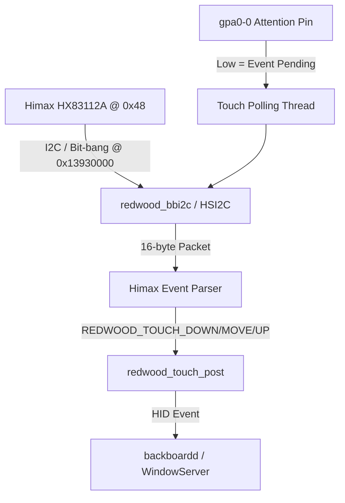

# 11 — Samsung Galaxy M20 (m20lte) Touch & Battery Architecture

**Target:** Samsung Galaxy M20 (`m20lte`, Exynos 7904 / `universal7904`)  
**Context:** Milestones M6/M7 hardware integration for XNU/Darwin.

---

## 1. Touchscreen Controller: Himax HX83112A

### 1.1 Hardware Specifications (Verified from Device Tree)

From `exynos7904-m20lte_common.dtsi` and `display-lcd_m20_common.dtsi`:

| Property | Value | Notes |
|---|---|---|
| **Controller** | Himax HX83112A | In-cell capacitive touchscreen controller |
| **Bus** | HSI2C_5 (`0x13930000`) | Standard I2C running at 400 kHz |
| **I2C Slave Address** | `0x48` (7-bit) | Standard Himax address |
| **Interrupt (ATTN)** | `gpa0-0` | ALIVE pinctrl `0x11CB0000`, bank `0x040`, pin 0 |
| **Reset (RST)** | `gpg2-1` | TOP pinctrl `0x139B0000` |
| **Panel Resolution** | 1080 x 2340 | Physical panel coordinates (`0..1079`, `0..2339`) |
| **Report Format** | 5-point multi-touch | Native Himax event packets |

### 1.2 Data Path in XNU



### 1.3 Event Reporting Implementation

The event reporting protocol hooks directly into `redwood_touch_post()`:

```c
redwood_touch_post(REDWOOD_TOUCH_DOWN, slot, x, y);
redwood_touch_post(REDWOOD_TOUCH_MOVE, slot, x, y);
redwood_touch_post(REDWOOD_TOUCH_UP, slot, x, y);
```

When fingers are released, all active slots post `REDWOOD_TOUCH_UP` to prevent stuck touches in iOS userland.

---

## 2. Battery & Charger: Samsung S2MU004

### 2.1 Hardware Specifications (Verified from Device Tree)

From `exynos7904-m20lte_common.dtsi` and `s2mu004_fuelgauge.h`:

| Property | Value | Notes |
|---|---|---|
| **IC** | Samsung S2MU004 | Multi-function PMIC + Fuel Gauge + Charger |
| **Bus** | I2C1 (`0x13840000`) | Standard I2C interface |
| **I2C Address** | `0x3D` (7-bit) | MFD core address |
| **Interrupt** | `gpa2-2` | ALIVE pinctrl `0x11CB0000`, bank `0x080`, pin 2 |
| **Battery Capacity** | 5000 mAh | Typical capacity for SM-M205F |
| **Nominal Voltage** | 3.85 V - 4.4 V | Single-cell Li-Po |

### 2.2 Register Map for Read-Only Battery Monitoring

| Register | Name | Description | Scale / Units |
|---|---|---|---|
| `0x00` | `S2MU004_REG_STATUS` | Charger & battery status | Bit flags for cable presence and charge cycle |
| `0x04` | `S2MU004_REG_RVBAT` | Battery cell voltage | 16-bit ADC value, scale: `raw * 1.25 mV` |
| `0x06` | `S2MU004_REG_RCUR_CC` | Coulomb counter current | Signed 16-bit, positive = charge, negative = discharge |
| `0x08` | `S2MU004_REG_RSOC` | Relative State of Charge | 16-bit, `raw >> 8` = integer percent (0..100%) |
| `0x0E` | `S2MU004_REG_RBATCAP` | Remaining battery capacity | 16-bit mAh |

### 2.3 Integration with `RedwoodBattery`

The driver periodically reads these registers and reports to XNU's power management subsystem via `redwood_battery_report(struct redwood_battery_state *st)`:

```c
struct redwood_battery_state bs = {
    .present = true,
    .percent = (rsoc >> 8) * 100,
    .voltage_uv = vbat_mv * 1000,
    .current_ua = cur_ma * 1000,
    .external = is_charging_plugged(status),
    .charging = is_charging_active(status),
    .temperature = 2500, // 25.0 C nominal
    .charge_mah = rbatcap,
    .full_mah = 5000,
    .design_mah = 5000,
};
redwood_battery_report(&bs);
```

This enables the native iOS status bar battery indicator, the charging bolt glyph on lock screen, and Settings > Battery statistics without modifying closed Apple frameworks.
