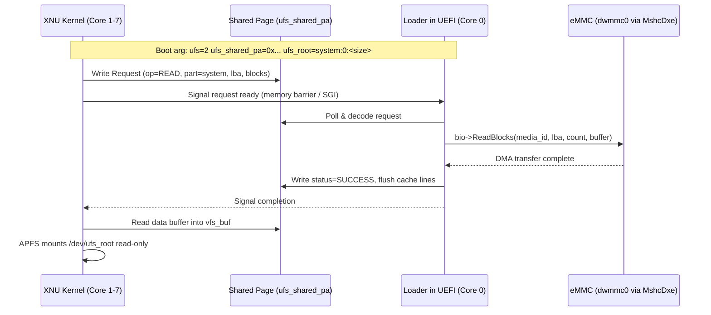

# 12 — Samsung Galaxy M20 (m20lte) eMMC Storage & System Volume Architecture

**Target:** Samsung Galaxy M20 (`m20lte`, Exynos 7904)  
**Context:** Milestones M5/M6 storage subsystem for XNU/Darwin.

---

## 1. Executive Summary

Unlike the reference platform (`y2sios`, Exynos 990) which utilizes UFS 3.0/3.1 with a dynamic `super` partition, the Galaxy M20 utilizes an **eMMC 5.1 interface (`dwmmc0` @ `0x13500000`)** with a fixed GPT partition table.

To boot the full iOS 16.5 userland without requiring a complete bare-metal Synopsys DesignWare MMC controller driver in XNU, the architecture leverages the **resident UEFI shared-page block service (`ufs=2`)**.

---

## 2. Hardware Storage Controller

From `exynos7885.dtsi` and `mu-silicium-m20lte`:

| Attribute | Specification |
|---|---|
| **Controller** | Synopsys DesignWare MMC (`dwmmc0`) |
| **MMIO Base** | `0x13500000` |
| **MMIO Size** | `0x10000` (64 KiB) |
| **Bus Width** | 8-bit DDR / HS200 |
| **Max Clock** | 200 MHz |
| **UEFI Driver** | `MshcDxe` + `PlatformMshcLib` (from `S5E7870Pkg`) |
| **Storage Medium** | 32 GB or 64 GB eMMC 5.1 |

---

## 3. The Shared-Page Block Service Architecture



### 3.1 Partition Mapping

The UEFI block service enumerates all GPT partitions using `EFI_PARTITION_INFO_PROTOCOL` and `EFI_BLOCK_IO_PROTOCOL`. On `m20lte`:

```
Unit 0 (eMMC 5.1 - 32GB / 64GB):
  Partition 1 : boot       (32 MiB)   - Stock Android kernel / recovery fallback
  Partition 2 : recovery   (38 MiB)   - Port disk (BootShim + UEFI FD + XNUP + Kernel + md0 Root)
  Partition 3 : system     (3.56 GB)  - iOS 16.5 system.apfs APFS container
  Partition 4 : vendor     (1.2 GB)   - Spare / Cryptex image storage
  Partition 5 : userdata   (24+ GB)   - Writable user data (APFS / HFS+ data volume)
```

### 3.2 Read-Only Root Mount in XNU

In `kernel/xnu/files/bsd/dev/redwood_ufs.c`:
1. `redwood_ufs_root()` parses `ufs_root=system:0:<size>` from boot arguments.
2. If `ufs_native_on == false`, it verifies that the requested partition exists in `block_shared.part[]` provided by the loader.
3. It exposes the partition as block device `/dev/ufs_root` (`major=19, minor=0`).
4. Apple APFS driver mounts `/dev/ufs_root` as `/` (read-only).
5. `/sbin/launchd.ios` executes as PID 1 to start SpringBoard.

---

## 4. Writable Storage Safety Policy

To prevent corruption of device partitions or firmware blocks:
- `ufs_write=0` is enforced by default.
- Even if writes are enabled (`ufs_write=1`), the loader strictly limits writes to pre-declared LBA ranges matching the designated `userdata` partition.
- All system partition access is strictly immutable (`MNT_RDONLY`).
