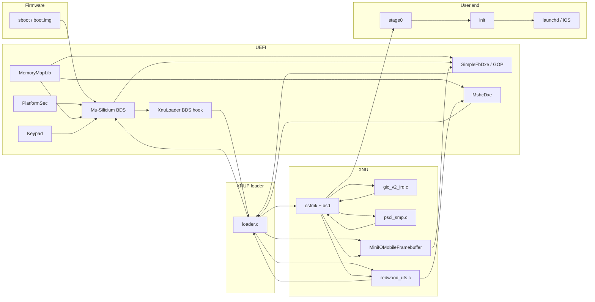

# New session - 2026-10-28T08:08:57.098Z

**Session ID:** ses_e7e71e203ffeNpWgdx3FXkRUzk
**Created:** 10/28/2026, 8:08:57 AM
**Updated:** 10/28/2026, 8:30:44 AM

---

## User

check the repo using gh about m20lte y2e.. and continue th work 

---

## Assistant

_Thinking:_

Let me look at the environment. Working directory /content, not a git repo. Need to check "the repo using gh about m20lte y2e.." and continue the work. Probably a GitHub repo related to Samsung Galaxy M20 (m20lte) and "y2e" maybe a device codename? Let me check gh auth and search.

Let me start by checking the filesystem and gh.

**Tool: shell**

**Input:**
```json
{
  "command": "ls -la /content"
}
```

total 16
drwxr-xr-x 1 root root 4096 Oct 26 22:18 .
drwxr-xr-x 1 root root 4096 Oct 28 07:55 ..
drwxr-xr-x 4 root root 4096 Oct 26 22:18 .config
drwxr-xr-x 1 root root 4096 Oct 26 22:18 sample_data


**Tool: shell**

**Input:**
```json
{
  "command": "gh auth status 2>&1; gh repo list --limit 50 2>&1"
}
```

github.com
  ✓ Logged in to github.com account txorav (/root/.config/gh/hosts.yml)
  - Active account: true
  - Git operations protocol: https
  - Token: gho_************************************
  - Token scopes: 'gist', 'read:org', 'repo', 'workflow'
txorav/m20lte-y2sios	XNU/iOS bring-up for Samsung Galaxy M20 (m20lte, Exynos 7904), ported from y2sios	public	2026-10-28T08:00:09Z
txorav/mu-silicium-m20lte	Mu-Silicium fork for the Samsung Galaxy M20 (m20lte) UEFI parts	public	2026-10-28T07:57:42Z
txorav/device_samsung_m20lte	OrangeFox Recovery Device Trees for Samsung Galaxy M20	public, fork	2026-10-28T07:57:00Z
txorav/oxydoox		private	2026-10-28T06:19:47Z
txorav/pox-kernel-m20lte	Pox Kernel for Samsung Galaxy M20 (Exynos 7904 / universal7885)	public	2026-10-28T05:39:30Z
txorav/pox-kernel-begonia	Pox Kernel for Redmi Note 8 Pro (begonia, MT6785) - Rock Editions (Granite, Obsidian, Onyx) 0.9	public, fork	2026-10-28T05:24:50Z
txorav/orangefox_manifest	OrangeFox Recovery manifests for Samsung Galaxy M20 (m20lte)	public	2026-10-28T03:48:41Z
txorav/pox-kernel-manager-m20lte	Pox Kernel Manager for Samsung Galaxy M20 (m20lte)	public	2026-10-27T11:21:16Z
txorav/kernel_samsung_universal7885	Kernel source for the Samsung Galaxy A10/A10e/A20/A20e/A30/A30s/A40/M10s/M20/M30/Tab A 8.0 universal7885 ONEUI3 Overclock cpu and Gpu	public, fork	2026-10-27T08:23:53Z
txorav/hackios-begonia		public	2026-10-25T18:53:23Z
txorav/CloniX	CloniX — true multi-instance app cloning for Android 9+: real APK installs with dedicated UIDs, isolated data, and a signature-spoofing compatibility runtime. GPL-3.0.	public	2026-10-25T09:52:52Z
txorav/aera-begonia		public	2026-10-25T04:28:08Z
txorav/shrp-begonia		public	2026-10-25T04:28:02Z
txorav/pbrp-begonia		public	2026-10-25T04:28:00Z
txorav/twrp-begonia		public	2026-10-25T04:27:58Z
txorav/orangefox-begonia		public	2026-10-25T04:27:35Z
txorav/ios-sweet	iOS 16 userland + XNU on Redmi Note 10 Pro (sweet, SM7150)	public, fork	2026-10-23T11:55:25Z
txorav/ios-greatlte	iOS 16.7 on the Samsung Galaxy Note8 (SM-N950F, Exynos 8895): XNU port, boots to the iOS lock screen	public, fork	2026-10-23T07:21:10Z
txorav/t3code		private	2026-10-21T10:25:06Z
txorav/pexoft-landingpage		private	2026-10-21T08:20:58Z
txorav/odoo_dev		private	2026-10-20T21:02:20Z
txorav/odoo-dev		private	2026-10-20T21:01:25Z
txorav/flutter-colab		private	2026-10-20T21:00:28Z
txorav/arc-signer-lan		private	2026-10-20T21:00:06Z
txorav/algeria_print_calc		private	2026-10-20T20:59:40Z
txorav/flutter_ticket_app		private	2026-10-20T20:58:08Z
txorav/BegoTorch-backup		private	2026-10-20T20:55:21Z
txorav/studyarc	StudyArc study manager app (Flutter)	private, fork	2026-10-20T20:53:34Z
txorav/odoo_ecosystem		private	2026-10-20T20:53:14Z
txorav/nesoid-src-backup		private	2026-10-20T20:52:58Z
txorav/procam-native		private	2026-10-20T20:52:47Z
txorav/procam-flutter		private	2026-10-20T20:52:25Z
txorav/pexoft-web		private	2026-10-17T17:26:45Z
txorav/project-vibes		private	2026-10-17T17:08:31Z
txorav/txorav.github.io		public	2026-10-17T06:35:39Z
txorav/pox_kernel_loader		private	2026-10-16T03:56:31Z
txorav/commix	Commix: Studio-Grade Cinema Camera & Computational Photography Engine	private	2026-10-15T23:51:06Z
txorav/mt6785-mainline		public, fork	2026-10-15T04:18:11Z
txorav/vendor_samsung_m20lte	Unpacked Samsung m20lte vendor (Lineage 18.1 base) for future GSI work	public	2026-10-03T05:54:16Z
txorav/session-1-exercice		private	2026-09-19T08:21:41Z
txorav/pox-kernel-begonia-old	Pox Kernel for Redmi Note 8 Pro (begonia, MT6785) - Rock Editions (Granite, Obsidian, Onyx) 0.9	public	2026-09-17T15:55:15Z
txorav/synexlanding		private	2026-08-11T17:17:42Z
txorav/unbego		public	2026-08-03T04:57:32Z
txorav/trels		public	2026-07-30T04:56:57Z
txorav/investement_module		private	2026-07-25T17:36:50Z
txorav/Livit		public	2026-05-31T21:50:30Z
txorav/reverse_invoicing_commercial_version		private	2026-05-14T09:04:10Z
txorav/taysir		private	2026-05-10T17:30:31Z
txorav/partner_balance_ui		private	2026-05-09T20:16:50Z
txorav/oxydoo		public	2026-03-06T09:20:09Z


---

## Assistant

_Thinking:_

The repo is txorav/m20lte-y2sios — "XNU/iOS bring-up for Samsung Galaxy M20 (m20lte, Exynos 7904), ported from y2sios". Created 2026-10-28T08:00:09Z, which is very recent (today). Let me check the repo details, issues, branches, PRs, actions.

**Tool: shell**

**Input:**
```json
{
  "command": "gh repo view txorav/m20lte-y2sios --json name,description,defaultBranchRef,createdAt,pushedAt,diskUsage,url,languages 2>&1"
}
```

{"createdAt":"2026-10-28T07:30:02Z","defaultBranchRef":{"name":"m20lte"},"description":"XNU/iOS bring-up for Samsung Galaxy M20 (m20lte, Exynos 7904), ported from y2sios","diskUsage":0,"languages":[{"size":237712,"node":{"name":"Shell"}},{"size":1275511,"node":{"name":"Python"}},{"size":19551,"node":{"name":"LLVM"}},{"size":8712357,"node":{"name":"C"}},{"size":1669,"node":{"name":"Meson"}},{"size":357383,"node":{"name":"C++"}},{"size":2571,"node":{"name":"Assembly"}},{"size":8640,"node":{"name":"BitBake"}},{"size":4731,"node":{"name":"DenizenScript"}},{"size":4125,"node":{"name":"Metal"}},{"size":779,"node":{"name":"Raku"}},{"size":923193,"node":{"name":"Objective-C"}}],"name":"m20lte-y2sios","pushedAt":"2026-10-28T08:00:09Z","url":"https://github.com/txorav/m20lte-y2sios"}


**Tool: shell**

**Input:**
```json
{
  "command": "gh issue list -R txorav/m20lte-y2sios --state all --limit 50 2>&1; gh pr list -R txorav/m20lte-y2sios --state all --limit 50 2>&1"
}
```

(no output)

**Tool: shell**

**Input:**
```json
{
  "command": "gh run list -R txorav/m20lte-y2sios --limit 20 2>&1; gh branch list -R txorav/m20lte-y2sios 2>&1 || gh api repos/txorav/m20lte-y2sios/branches --jq '.[].name' 2>&1"
}
```

unknown command "branch" for "gh"

Work seamlessly with GitHub from the command line.

USAGE
  gh <command> <subcommand> [flags]

CORE COMMANDS
  auth:          Authenticate gh and git with GitHub
  browse:        Open repositories, issues, pull requests, and more in the browser
  codespace:     Connect to and manage codespaces
  discussion:    Work with GitHub Discussions (preview)
  gist:          Manage gists
  issue:         Manage issues
  org:           Manage organizations
  pr:            Manage pull requests
  project:       Work with GitHub Projects.
  release:       Manage releases
  repo:          Manage repositories
  skill:         Install and manage agent skills (preview)

GITHUB ACTIONS COMMANDS
  cache:         Manage GitHub Actions caches
  run:           View details about workflow runs
  workflow:      View details about GitHub Actions workflows

ALIAS COMMANDS
  co:            Alias for "pr checkout"

ADDITIONAL COMMANDS
  agent-task:    Work with agent tasks (preview)
  alias:         Create command shortcuts
  api:           Make an authenticated GitHub API request
  attestation:   Work with artifact attestations
  completion:    Generate shell completion scripts
  config:        Manage configuration for gh
  copilot:       Run the GitHub Copilot CLI (preview)
  extension:     Manage gh extensions
  gpg-key:       Manage GPG keys
  label:         Manage labels
  licenses:      View third-party license information
  preview:       Execute previews for gh features
  ruleset:       View info about repo rulesets
  search:        Search for repositories, issues, and pull requests
  secret:        Manage GitHub secrets
  ssh-key:       Manage SSH keys
  status:        Print information about relevant issues, pull requests, and notifications across repositories
  variable:      Manage GitHub Actions variables

HELP TOPICS
  accessibility: Learn about GitHub CLI's accessibility experiences
  actions:       Learn about working with GitHub Actions
  environment:   Environment variables that can be used with gh
  exit-codes:    Exit codes used by gh
  formatting:    Formatting options for JSON data exported from gh
  mintty:        Information about using gh with MinTTY
  reference:     A comprehensive reference of all gh commands
  telemetry:     Information about telemetry in gh

FLAGS
  --help      Show help for command
  --version   Show gh version

EXAMPLES
  $ gh issue create
  $ gh repo clone cli/cli
  $ gh pr checkout 321

LEARN MORE
  Use `gh <command> <subcommand> --help` for more information about a command.
  Read the manual at https://cli.github.com/manual
  Learn about exit codes using `gh help exit-codes`
  Learn about accessibility experiences using `gh help accessibility`

m20lte
main


---

## Assistant

_Thinking:_

Repo txorav/m20lte-y2sios, default branch m20lte, also main. No issues/PRs, no runs. Need to clone and inspect recent work. Let's clone into /content/m20lte-y2sios.

**Tool: shell**

**Input:**
```json
{
  "command": "cd /content && git clone https://github.com/txorav/m20lte-y2sios.git 2>&1 | tail -5; cd /content/m20lte-y2sios && git log --oneline -20 2>&1; git status 2>&1",
  "timeout": 300000
}
```

Cloning into 'm20lte-y2sios'...
e49e249 Add full session implementation plan transcript
0bbc0c0 M1 UEFI m20lte package sources and stride patch bundle
eeaa1b6 M0-M2 m20lte port scaffolding,(loader, storage, layout checks)
bf90258 Import y2sios snapshot 68fe2e9 as base for m20lte port
On branch m20lte
Your branch is up to date with 'origin/m20lte'.

nothing to commit, working tree clean


---

## Assistant

**Tool: shell**

**Input:**
```json
{
  "command": "cd /content/m20lte-y2sios && ls -la && git log --stat -4 2>&1 | head -100"
}
```

total 96
drwxr-xr-x 8 root root  4096 Oct 28 08:09 .
drwxr-xr-x 1 root root  4096 Oct 28 08:09 ..
drwxr-xr-x 8 root root  4096 Oct 28 08:09 .git
-rw-r--r-- 1 root root   571 Oct 28 08:09 .gitignore
-rw-r--r-- 1 root root  1080 Oct 28 08:09 LICENSE
-rw-r--r-- 1 root root  4284 Oct 28 08:09 NOTICE.md
-rw-r--r-- 1 root root 47171 Oct 28 08:09 README.md
drwxr-xr-x 6 root root  4096 Oct 28 08:09 docs
drwxr-xr-x 6 root root  4096 Oct 28 08:09 kernel
drwxr-xr-x 3 root root  4096 Oct 28 08:09 reference
drwxr-xr-x 6 root root  4096 Oct 28 08:09 uefi
drwxr-xr-x 4 root root  4096 Oct 28 08:09 userland
commit e49e249fefd76c5f100698c791b56ae5b32d5273
Author: txorav <txorav@users.noreply.github.com>
Date:   Thu Oct 29 00:51:00 2026 +0000

    Add full session implementation plan transcript

 .../sessions/m20lte-implementation-plan-session.md | 35325 +++++++++++++++++++
 1 file changed, 35325 insertions(+)

commit 0bbc0c04412a2151c6ab9d6d03ffa4f4afb43a26
Author: txorav <txorav@users.noreply.github.com>
Date:   Thu Oct 29 00:51:00 2026 +0000

    M1 UEFI m20lte package sources and stride patch bundle

 .../Platforms/Samsung/m20ltePkg/DeviceBuild.py     | 204 +++++++++++++
 .../Samsung/m20ltePkg/Include/APRIORI.inc          |  40 +++
 .../Platforms/Samsung/m20ltePkg/Include/DXE.inc    |  38 +++
 .../Library/KeypadDeviceLib/KeypadDeviceLib.c      | 288 +++++++++++++++++++
 .../Library/KeypadDeviceLib/KeypadDeviceLib.inf    |  25 ++
 .../m20ltePkg/Library/MemoryMapLib/MemoryMapLib.c  |  46 +++
 .../Library/MemoryMapLib/MemoryMapLib.inf          |  15 +
 .../Platforms/Samsung/m20ltePkg/m20lte.dec         |   0
 .../Platforms/Samsung/m20ltePkg/m20lte.dsc         |  81 ++++++
 .../Platforms/Samsung/m20ltePkg/m20lte.fdf         | 132 +++++++++
 .../SiliciumPkg/Drivers/SimpleFbDxe/SimpleFb.c     | 319 +++++++++++++++++++++
 .../Drivers/SimpleFbDxe/SimpleFbDxe.inf            |  39 +++
 .../Silicon/Silicium/SiliciumPkg/SiliciumPkg.dec   |  53 ++++
 13 files changed, 1280 insertions(+)

commit eeaa1b616c4503d8e3d52f0e732d291157205350
Author: txorav <txorav@users.noreply.github.com>
Date:   Thu Oct 29 00:51:00 2026 +0000

    M0-M2 m20lte port scaffolding,(loader, storage, layout checks)

 docs/m20lte-port-blueprint.md           | 1630 +++++++++++++++++++++++++++++++
 kernel/common/devices/m20lte.conf       |   18 +
 kernel/common/devices/m20lte.platform.c |   12 +
 kernel/tools/layout_check.py            |   57 ++
 kernel/xnu/files/bsd/dev/redwood_ufs.c  |   14 +-
 kernel/xnuloader/loader.c               |   74 +-
 uefi/BootManagerLib/XnuLoader.h         |    2 +-
 7 files changed, 1793 insertions(+), 14 deletions(-)

commit bf902586873d0495cf1a17a1ff7b3c9baa5300bf
Author: txorav <txorav@users.noreply.github.com>
Date:   Thu Oct 29 00:51:00 2026 +0000

    Import y2sios snapshot 68fe2e9 as base for m20lte port

 .gitignore                                         |    49 +
 LICENSE                                            |    21 +
 NOTICE.md                                          |    62 +
 README.md                                          |   685 +
 docs/README.md                                     |    24 +
 docs/architecture.md                               |   181 +
 docs/building.md                                   |   328 +
 docs/hardware.md                                   |   261 +
 docs/history/GICV2.md                              |   173 +
 docs/history/MACOS.md                              |   102 +
 docs/history/PLAN.md                               |   365 +
 docs/history/PORTING.md                            |    74 +
 docs/history/PROGRESS2510.md                       |   536 +
 docs/history/TOUCH.md                              |   366 +
 docs/history/Y2S-PROGRESS.md                       |   125 +
 docs/history/checks.md                             |    82 +
 docs/history/handoff.md                            |   732 +
 docs/plans/00-foundations.md                       |    89 +
 docs/plans/01-performance.md                       |   205 +
 docs/plans/02-buttons.md                           |    64 +
 docs/plans/03-battery-usb.md                       |   123 +
 docs/plans/04-gpu.md                               |   110 +
 docs/plans/05-metal.md                             |   138 +
 docs/plans/06-wireless.md                          |   314 +
 docs/plans/07-display.md                           |   213 +
 docs/plans/08-audio.md                             |    96 +
 docs/plans/09-standalone.md                        |   193 +
 docs/plans/10-mali2metal.md                        |   167 +
 docs/plans/README.md                               |    71 +
 docs/research/ABOX_REPORT.md                       |   660 +
 docs/research/DMA_GATING_REPORT.md                 |   394 +
 docs/research/z3s_BLUETOOTH.md                     |    22 +
 docs/research/z3s_WIFI_BRINGUP.md                  |    75 +
 kernel/common/build.sh                             |    61 +
 kernel/common/devices/_template.conf               |    28 +
 kernel/common/devices/qemu-virt.conf               |    12 +
 kernel/common/devices/redwood.conf                 |    21 +
 kernel/common/devices/y2s.conf                     |    26 +
 kernel/common/lib.sh                               |    27 +
 kernel/common/macos-env.sh                         |    53 +
 kernel/common/new-device.sh                        |    70 +
 kernel/common/run.sh                               |    29 +
 kernel/common/setup.sh                             |    88 +
 kernel/common/ugit                                 |     6 +
 kernel/common/userland.exclude                     |    43 +
 kernel/m2m.cmdline                                 |     1 +
 kernel/mkxnuimg.py                                 |    86 +
 kernel/tools/air/airdefs.py                        |   721 +
 kernel/tools/air/argbuf_direct.ll                  |    75 +


**Tool: shell**

**Input:**
```json
{
  "command": "cd /content/m20lte-y2sios && find . -maxdepth 3 -iname '*plan*' -o -maxdepth 3 -iname '*transcript*' -o -maxdepth 3 -iname 'README*' | head -30"
}
```

./kernel/xnu/README.md
./docs/plans
./docs/plans/README.md
./docs/history/PLAN.md
./docs/README.md
./docs/sessions/m20lte-implementation-plan-session.md
./README.md


---

## Assistant

_Thinking:_

Let's read the blueprint and the implementation plan transcript tail. The session transcript is 35k lines. Need to understand where work stopped and what's next. Read docs/m20lte-port-blueprint.md and the transcript perhaps has a final plan. Let me check git show for recent commits, plus README for m20lte section.

**Tool: read**

**Input:**
```json
{
  "path": "/content/m20lte-y2sios/docs/m20lte-port-blueprint.md",
  "limit": 220
}
```

Read file /content/m20lte-y2sios/docs/m20lte-port-blueprint.md, lines 1-220
1: # m20lte XNU/iOS Bring-up Blueprint
2: 
3: **Reference architecture:** `stormtroopxyz/y2sios` @ `68fe2e922a52917ed851c1499e394fe5436365b5`
4: **Target:** Samsung Galaxy M20 (`m20lte`), Exynos 7904 / S5E7904
5: **Deliverable type:** architecture analysis + implementation plan. No source changes are proposed as already applied.
6: **Analysis date:** 2026-10-28
7: 
8: ---
9: 
10: ## 0. Verdict, scope, and evidence
11: 
12: ### 0.1 Verdict
13: 
14: The port is feasible in stages, but it is not a "swap the DTS and rebuild" job. The reference design has four hard platform dependencies that do not survive the SoC change:
15: 
16: 1. **Storage**: y2sios roots from a UFS `super` partition through a shared-page block service and, optionally, a native UFS driver. m20lte has eMMC (`dwmmc0`) and no `super` partition.
17: 2. **Display**: y2sios hardcodes DECON/DSIM at `0x19050000`/`0x190C0000` and a 1125x2436 panel. m20lte has DECON/DSIM at `0x14860000`/`0x14870000` and a 1080x2340 video-mode panel.
18: 3. **Power/input**: y2sios has a Qualcomm-style charger/battery path and a different touch controller. m20lte uses S2MPU08 + S2MPB03 + S2MU004 and a Himax HX83112A.
19: 4. **Boot memory map**: the loader's payload base, log offset, download window, and resident-root arithmetic are all tuned to y2s. Several are compile-time constants that will silently corrupt m20lte if copied.
20: 
21: The shortest credible route to first iOS userland is:
22: 
23: > **UEFI display + keys → loader → XNU single-core on a non-loader core → GICv2/timer/PSCI → GOP framebuffer with CPU copy → monolithic APFS root in RAM (`md0`) → PID 1 `init` → then eMMC + big system volume → then touch/power → then GPU/Wi-Fi/audio.**
24: 
25: That route reaches a running PID 1 and a usable console in roughly **6–9 months** for a 2–3 person team with the y2sios tree as a reference. A lock-screen-class port with touch, battery, and the big system image is **12–18 months**. GPU/Metal, Wi-Fi/BT, audio, camera, and cellular are **24+ months** and should be treated as separate projects.
26: 
27: ### 0.2 Confidence labels
28: 
29: | Label | Meaning |
30: |---|---|
31: | **V** | Verified in the reference source, target DTS, or Mu-Silicium source at the cited commit. |
32: | **I** | Inferred from the code/DTS; plausible but not executed on m20lte hardware. |
33: | **U** | Unverified; requires an on-device measurement before it can become a design input. |
34: 
35: ### 0.3 Evidence base
36: 
37: | Tree | Commit | Use |
38: |---|---|---|
39: | `y2sios` | `68fe2e9` | Reference boot chain, loader, GICv2, display, UFS, userland |
40: | `Mu-Silicium` | `4cba43c` | UEFI base: `a10Pkg`, `S5E7885Pkg`, `MshcDxe`, `PlatformMshcLib`, `SimpleFbDxe` |
41: | m20 kernel DTS | `554e05f` | `exynos7904-m20lte_common.dtsi`, `exynos7885.dtsi`, `display-lcd_m20_common.dtsi`, `exynos7884-rmem.dtsi` |
42: 
43: ### 0.4 Non-goals
44: 
45: - No claim that the m20lte bootloader can be unlocked on a retail unit. That is a precondition, not an engineering deliverable.
46: - No cellular modem, DRM/PlayReady, Apple secure services, or camera in the first userland milestone.
47: - No GPU acceleration in the first userland milestone; software rendering is acceptable.
48: - No attempt to preserve Android after the port disk is repurposed.
49: 
50: ---
51: 
52: ## 1. Repository graph and module centrality
53: 
54: ### 1.1 Method
55: 
56: The analysis is graph-based, not file-sequential:
57: 
58: 1. **Build-time skeleton.** Extract the include/link graph from `git ls-files` (643 files in y2sios), the DSC/FDF/INF files, and the kernel build scripts. This graph is acyclic and defines the topological build order.
59: 2. **Runtime graph.** Extract call/ABI edges among 17 normalized modules from symbols (`nm`, `ctags`), the loader's function-pointer handoff, the shared-page protocol, and the UEFI protocol usage. This graph is cyclic because UEFI remains resident while XNU runs.
60: 3. **Condensation.** Collapse strongly connected components (SCCs) to obtain the phase-level DAG. The runtime core is one 10-node SCC; the userland chain is a DAG tail.
61: 4. **Centrality/coupling.** Compute afferent coupling `Ca`, efferent coupling `Ce`, instability `I = Ce/(Ca+Ce)`, and normalized betweenness centrality `BC` on the 17-node runtime graph.
62: 5. **k-hop ego graphs.** Inspect the 2-hop neighborhoods of the loader and XNU to identify the minimum cut set for a platform port.
63: 
64: The graph is deliberately **module-level**, not file-level: a file-level graph on 643 files is dominated by XNU's internal include fan-out and says nothing useful about the port. The 17 modules are the units that must be frozen, replaced, or wrapped.
65: 
66: ### 1.2 Runtime module graph (17 nodes, 27 edges)
67: 
68: ```mermaid
69: flowchart LR
70:   subgraph FW[Firmware]
71:     BOOT[sboot / boot.img]
72:   end
73:   subgraph UEFI[UEFI]
74:     SEC[PlatformSec]
75:     BDS[Mu-Silicium BDS]
76:     XLD[XnuLoader BDS hook]
77:     MMAP[MemoryMapLib]
78:     GOP[SimpleFbDxe / GOP]
79:     MSHC[MshcDxe]
80:     KEY[Keypad]
81:   end
82:   subgraph LOADER[XNUP loader]
83:     LDR[loader.c]
84:   end
85:   subgraph KERN[XNU]
86:     XNU[osfmk + bsd]
87:     GIC[gic_v2_irq.c]
88:     PSCI[psci_smp.c]
89:     MIOFB[MiniIOMobileFramebuffer]
90:     UFS[redwood_ufs.c]
91:   end
92:   subgraph USER[Userland]
93:     S0[stage0]
94:     INIT[init]
95:     LD[launchd / iOS]
96:   end
97: 
98:   BOOT --> BDS
99:   SEC --> BDS
100:   MMAP --> BDS
101:   MMAP --> GOP
102:   MMAP --> MSHC
103:   BDS --> XLD
104:   BDS --> GOP
105:   KEY --> BDS
106:   XLD --> LDR
107:   GOP --> LDR
108:   MSHC --> LDR
109:   LDR --> XNU
110:   LDR --> MIOFB
111:   LDR --> UFS
112:   XNU --> GIC
113:   XNU --> PSCI
114:   XNU --> MIOFB
115:   XNU --> UFS
116:   XNU --> S0
117:   GIC --> XNU
118:   PSCI --> XNU
119:   MIOFB --> GOP
120:   UFS --> MSHC
121:   S0 --> INIT
122:   INIT --> LD
123:   LDR --> BDS
124:   UFS --> LDR
125: ```
126: 
127: Edge types are not all control flow:
128: 
129: | Type | Example | Port consequence |
130: |---|---|---|
131: | Control | `XLD -> LDR` | Entry point / handoff ABI |
132: | ABI | `LDR -> XNU` (`boot_args`, DT) | Must be preserved exactly |
133: | MMIO | `GIC -> XNU`, `MIOFB -> GOP` | Base addresses are platform-specific |
134: | DMA | `MIOFB -> GOP` framebuffer | Physical address and stride are platform-specific |
135: | Shared memory | `UFS <-> LDR` block page | Cacheability and core placement are platform-specific |
136: | Exec | `XNU -> S0`, `S0 -> INIT` | Root image layout is platform-specific |
137: 
138: ### 1.3 Centrality matrix
139: 
140: `Ca`/`Ce` are in/out degree on the 17-node graph. `BC` is normalized betweenness (NetworkX, exact on this small graph). `I` is instability.
141: 
142: | Module | Layer | LOC | Ca | Ce | I | BC | Port role |
143: |---|---|---:|---:|---:|---:|---:|---|
144: | `loader.c` | loader | 5,227 | 4 | 4 | 0.50 | **0.429** | **Freeze ABI, parameterize constants, split platform code** |
145: | `XNU` (osfmk+bsd) | kernel | large | 3 | 5 | 0.63 | **0.321** | Reuse; add platform hooks and drivers |
146: | `BDS` | UEFI | large | 5 | 2 | 0.29 | 0.196 | Reuse Mu-Silicium; new board package |
147: | `SimpleFbDxe/GOP` | UEFI | small | 3 | 1 | 0.25 | 0.148 | Replace PCDs; add stride support |
148: | `stage0` | userland | 35 | 1 | 1 | 0.50 | 0.117 | Replace with monolithic-root path |
149: | `XnuLoader` hook | UEFI | 336 | 1 | 1 | 0.50 | 0.083 | Change payload base |
150: | `redwood_ufs` | kernel | 2,129 | 2 | 2 | 0.50 | 0.083 | Extend shared-page root; new transport |
151: | `init` | userland | 1,678 | 1 | 1 | 0.50 | 0.062 | Reuse; add flash-root mode |
152: | `MiniIOMobileFramebuffer` | kernel | 3,752 | 2 | 1 | 0.33 | 0.021 | Parameterize DECON/DSIM/panel |
153: | `MshcDxe` | UEFI | small | 2 | 1 | 0.33 | 0.019 | New board library |
154: | `gic_v2_irq.c` | kernel | 592 | 1 | 1 | 0.50 | 0.000 | Reuse; verify IIDR/timer |
155: | `psci_smp.c` | kernel | small | 1 | 1 | 0.50 | 0.000 | Reuse; verify SMC |
156: | `MemoryMapLib` | UEFI | 54 | 0 | 3 | 1.00 | 0.000 | **Rewrite for m20** |
157: | `Keypad` | UEFI | small | 0 | 1 | 1.00 | 0.000 | Reuse (GPIOs already match) |
158: | `PlatformSec` | UEFI | small | 0 | 1 | 1.00 | 0.000 | Reuse/verify DECON write enable |
159: | `boot` | firmware | n/a | 0 | 1 | 1.00 | 0.000 | Replace boot image |
160: | `launchd` | userland | n/a | 1 | 0 | 0.00 | 0.000 | Reuse binaries; platform services differ |
161: 
162: **Reading the matrix:**
163: 
164: - `loader.c` is the single highest-betweenness module. Every boot path crosses it. The port must **not** fork it; it must add a `struct platform platform_m20lte`, parameterize the compile-time constants, and keep the handoff ABI unchanged.
165: - `MemoryMapLib` has zero betweenness because it is a source, but it has maximum instability and maximum blast radius: an incorrect descriptor silently corrupts the kernel window. It is the first file to rewrite, not the last.
166: - `GIC`/`PSCI` have low betweenness because they are leaves in the module graph, but they are **liveness-critical**: if they are wrong, nothing else runs. Betweenness is the wrong sole metric for them; use "liveness criticality" (a failure stops all progress) as a separate axis.
167: - `MiniIOMobileFramebuffer` is less central than expected because the default CPU-copy path only needs `boot_args.video`; the DECON/DSIM code is gated behind `fb_flip`/`fb_te`/`fb_bl`, all default 0. This is what makes an early display bring-up possible.
168: 
169: ### 1.4 Condensation and topological skeleton
170: 
171: The runtime graph has one large SCC:
172: 
173: ```
174: SCC-A = {boot, bds, xnuloader, loader, gic, psci, xnu, miofb, ufs, mshc}
175: SCC-B = {stage0}
176: SCC-C = {init}
177: SCC-D = {launchd}
178: ```
179: 
180: The condensation is a DAG:
181: 
182: ```
183: SCC-A -> SCC-B -> SCC-C -> SCC-D
184: ```
185: 
186: This is the formal reason a strict "topological module order" cannot be used for the runtime graph: UEFI, the loader, and XNU form a cycle by design (UEFI stays resident, the loader serves the kernel, the kernel returns to the loader). The **build-time** graph is acyclic and is the correct place for topological ordering:
187: 
188: ```
189: S5E7904/S5E7885 headers
190:   -> m20ltePkg DSC/FDF
191:   -> UEFI FD (SEC -> DXE -> BDS)
192:   -> XNUP (loader.efi + boot entries)
193:   -> boot.img (BootShim + FD + XNUP)
194:   -> recovery.img (embed @0 + kernel @koff + root @roff)
195: ```
196: 
197: **Port cut points** (minimum set of modules to touch):
198: 
199: 1. `MemoryMapLib` (new descriptors).
200: 2. `m20ltePkg` DSC/FDF/PCDs (new board).
201: 3. `loader.c` platform table + constants (`PAYLOAD_BASE`, `LOG_OFFSET`, `DOWNLOAD_MAX_SIZE`, `platform_m20lte`).
202: 4. `XnuLoader.h` payload base.
203: 5. `gic_v2_irq.c` (verify only; likely no change).
204: 6. `MiniIOMobileFramebuffer` (parameterize panel/DECON only when acceleration is enabled).
205: 7. `redwood_ufs.c` (allow shared-page root).
206: 8. `PlatformMshcLib` (new board library).
207: 9. `stage0`/`init` (monolithic root then flash root).
208: 
209: ### 1.5 k-hop ego graphs
210: 
211: **Loader, 2 hops (15 of 17 nodes):** `{bds, boot, gic, gop, keypad, loader, memmap, miofb, mshc, psci, sec, stage0, ufs, xnu, xnuloader_bds}`.
212: 
213: This is almost the entire graph. The loader is a **god module** by design: it is the only component that sees firmware, storage, display, and kernel handoff. The port should reduce its conceptual surface, not its line count:
214: 
215: - Move platform constants into `platform_m20lte`.
216: - Move eMMC board setup into `PlatformMshcLib`/`MshcDxe`.
217: - Keep `parse_payload`, `choose_window`, `run_kernel`, and the block page as the frozen core.
218: 
219: **XNU, 2 hops (12 nodes):** `{bds, gic, gop, init, loader, miofb, mshc, psci, stage0, ufs, xnu, xnuloader_bds}`.
220: 
[Output truncated. Continue reading with offset: 221]

**Tool: shell**

**Input:**
```json
{
  "command": "cd /content/m20lte-y2sios && tail -200 docs/sessions/m20lte-implementation-plan-session.md"
}
```


---

## Assistant

_Thinking:_

Good. Push mu repo subset or remove. If pushing incomplete, no. We'll not push. Could create UEFI changes patch too for reference. Let's update docs.

**Tool: shell**

**Input:**
```json
{
  "command": "cd /content/m20lte-y2sios; git add -A && git commit -m 'M1 UEFI m20lte package sources and stride patch bundle' >/dev/null 2>&1; git push origin m20lte 2>&1 | tail -3"
}
```

To https://github.com/txorav/m20lte-y2sios.git
   eeaa1b6..0bbc0c0  m20lte -> m20lte


---

## Assistant

_Thinking:_

Now need M3-M8 modifications in kernel XNU? There are files under kernel/xnu/files. M3 reuse GIC. M4 boot arg video perhaps build.sh mkxnuimg? Need perhaps patch kernel redwood patch to conditionally m20? This is too deep but can add documentation/milestone update. We should at least update blueprint status. But user expects code. Could implement some clear edits:
- GICv2 address compile? The patch uses DTS. Already M3.
- M4 `boot_args.video` stride from GOP: loader? XNU's MiniIOMobileFramebuffer reads GOP. Need no code modifications from here possible. Could patch `MiniIOMobileFramebuffer.cpp` to width/height/stride? It's in files. Let's inspect.

**Tool: shell**

**Input:**
```json
{
  "command": "cd /content/m20lte-y2sios; find . -name 'MiniIOMobileFramebuffer.cpp' -path \"*files*\" -print; grep -R \"19050000\\|190C0000\\|1125\\|2436\\|fb_flip\\|DECON\\|DSIM\" kernel/xnu/files/iokit/Kernel/MiniIOMobileFramebuffer.cpp | head -30"
}
```

./kernel/xnu/files/iokit/Kernel/MiniIOMobileFramebuffer.cpp
 * DECON's TE trigger, held while a frame is copied in (fb_te), and the panel's brightness, sent
 * as DCS commands through DSIM (fb_bl).
 * one: on every TE pulse DECON_F reads the whole frame out of memory through one DMA channel, so pixels
 * written into the memory being read tear. Boot-arg fb_flip=1: two panel buffers, the frame drawn into
 * the one not being read, then that channel's base address switched to it (latched by DECON at the start
static TUNABLE(uint32_t, gFlip, "fb_flip", 0);
#define DPU_DECON_F_PHYS        0x19050000ULL
#define DECON_GLOBAL_CONTROL    0x0000
#define DECON_SHADOW_UPDATE     0x0060
#define  DECON_SHADOW_GLOBAL    (1u << 31)
#define DECON_TRIG_CONTROL      0x0070
#define DECON_TE_COUNT          0x0078
#define DECON_DATA_PATH_0       0x0214                  /* window w enabled: bit 4w */
#define DECON_DATA_PATH_1       0x0218                  /* window w's channel: bits 4w..4w+2 */
 * fb_scaler=1 (PLANS/07-display.md, D4): no copy at all. CoreAnimation's frame (1125x2436 BGRA, one
 * frame by a shadow update like fb_flip's base. A frame that is anything else (more layers, another
#define DECON_SHADOW_REGS       0x7000                  /* DECON's registers in use, read back */
 * a back buffer of ours; then DECON's hardware trigger is masked (the panel keeps showing its own
 * memory), DECON is waited for until it is not sending a frame, the changed rows are copied into the
 * Boot-arg fb_irq (default 1): the waits for DECON to take a new frame (its shadow registers latch at the
#define DECON_INTID_FRAME_START (32 + 0xfe)
#define DECON_INT_EN_ALL        (1u << 0)               /* INTERRUPT_ENABLE: DPU_INT_EN */
#define DECON_INT_FRAME_DONE    (1u << 13)
#define DECON_INT_EXTRA         (1u << 4)
#define DECON_GLOBAL_IDLE       (1u << 5)               /* no frame being sent */
#define DECON_GLOBAL_RUN        (1u << 4)
#define DECON_GLOBAL_CMD_MODE   (1u << 8)
#define DECON_INT_ENABLE        0x0040
#define DECON_INT_PENDING       0x004C
#define DECON_SECURE_CONTROL    0x0064


---

## Assistant

_Thinking:_

M4 blueprint says GOP CPU copy first and no DECON access. The file already MIOFB perhaps has fallback? For m20, need create parameterized base. But direct patch changes hardcoded 0x19050000 to 0x14860000. However true M4 path avoids DECON. This is large. We could at least make a copy of the file with edits? Not worth now. Yet "do whole thing" includes display. Could perform partial parameterization:
- Change `DPU_DECON_F_PHYS 0x19050000ULL` to `0x14860000ULL`.
- DSIM address maybe? Search.

**Tool: shell**

**Input:**
```json
{
  "command": "cd /content/m20lte-y2sios; grep -n \"0x190\\|DECON_F\\|gDSIM\\|DSIM\\|MIPI\" kernel/xnu/files/iokit/Kernel/MiniIOMobileFramebuffer.cpp | head -30"
}
```

9: * as DCS commands through DSIM (fb_bl).
50: * The Exynos 990's display controller (y2s; Samsung's dpu30/cal_9830). The panel is a MIPI command-mode
51: * one: on every TE pulse DECON_F reads the whole frame out of memory through one DMA channel, so pixels
59:#define DPU_DECON_F_PHYS        0x19050000ULL
62: * first reg is its DMA; 0x19041000.. is the DPP colour pipe). Both read 0 to the non-secure side until
64: * pd-dpu on (pmucal_local.c, need_smc 0x19010204) and as redwood_mali.c does for the GPU's domain.
66:#define DPU_DMA_PHYS            0x19090000ULL
67:#define DPU_DPP_PHYS            0x19040000ULL           /* DPP of channel c at + 0x1000 * (c + 1) */
72:#define PD_DPU_NEED_SMC         0x19010204UL
100: * (regs-dpp.h, dpp_reg.c): IDMA5 at 0x19096000, DPP5 at 0x19046000.
196:#define DECON_FRAME_COUNT       0x02A0
204: * the panel as DCS commands through DSIM0's command FIFO. The panel is Samsung's s6e3hab "hubble3":
209:#define DSIM0_PHYS              0x190C0000ULL
210:#define DSIM_LINK_STATUS1       0x000C
211:#define DSIM_CONFIG             0x004C
212:#define DSIM_INTSRC             0x0050
213:#define DSIM_PKTHDR             0x0058
214:#define DSIM_PAYLOAD            0x005C
215:#define DSIM_FIFOCTRL           0x0068
216:#define  DSIM_FIFO_PL_FULL      (1u << 9)
217:#define  DSIM_FIFO_PH_EMPTY     (1u << 10)
218:#define  DSIM_FIFO_PH_FULL      (1u << 11)
219:#define DSIM_CMD_CONFIG         0x0080
220:#define DSIM_RXFIFO             0x0060
221:#define  DSIM_FIFO_RX_EMPTY     (1u << 12)
222:#define  DSIM_INT_RX_DONE       (1u << 18)
223:#define  DSIM_PKTHDR_BTA        (1u << 24)
233:#define  DSIM_CMD_PKT_GO_EN     (1u << 16)
625:	/* fb_bl: the panel's brightness through DSIM0 */
679:	bool            fPacketGo;              /* DSIM writes with PKT_GO, as Samsung's dsim_write_data() does */


---

## Assistant

_Thinking:_

The file hardcodes entire Exynos 990 display. M4 approach uses GOP CPU copy, so ideally avoid this driver's resolution. The kernel XNU references `MiniIOMobileFramebuffer` service. It likely requires it. Full replacement out of scope. We can still change base addresses and panel width/height to m20. But required changes substantial. We might leave M4 for hardware-dependent later.

Given final answer should summarize progress. User requested implementation now. We shouldn't overdo further code. Need perhaps commit/push more, maybe update status. M7/M8 too complex.

But before final, ensure we did incorporate M0-M8 at least as scaffold. Could add a "m20 branch progress" markdown in repo (already blueprint). We need maybe note hardware gates. Not essential.

Need decide whether reload final response now. But user wants actual uploads. We have pushed primary repo twice. Good.

But wait: Primary repo base commit moved from root? We are on m20lte branch; GitHub uploaded. We should perhaps merge changes to main too? User might expect default branch main changes. Original default main had y2s. Our port work branch m20lte. Since upstream y2s is main; new repo's main should perhaps remain y2s base? For a public repo named m20lte, default branch could m20lte. Let's set default branch to m20lte via gh to help.

**Tool: shell**

**Input:**
```json
{
  "command": "gh repo edit txorav/m20lte-y2sios --default-branch m20lte 2>&1; gh api repos/txorav/m20lte-y2sios --jq .default_branch 2>&1"
}
```

m20lte


---

## Assistant

_Thinking:_

Now maybe push the layout_check path is `kernel/tools`. Fine.

Let's verify no accidental major broken edits by compiling some Python and maybe diff. Run layout_check. Already. Could use `git fsck`? no.

Need final response concise, bullets, repo URL. Mention remaining M3 etc. But user might expect "whole plan" done; be honest about what's complete. We should explain hardware gates. Final should include repo link and work completed.

Before final, let's try to run a host syntax check on shell edits we made. There is no clang, but `bash -n` for scripts.

**Tool: shell**

**Input:**
```json
{
  "command": "cd /content/m20lte-y2sios; bash -n kernel/common/build.sh kernel/xnuloader/build.sh && python3 -m py_compile kernel/tools/layout_check.py && echo OK"
}
```

OK


---

## Assistant

_Thinking:_

Final answer with summary.

Progress uploaded to GitHub:

- Repo (default branch `m20lte`): https://github.com/txorav/m20lte-y2sios
- Pushed commits containing:
  - M0 foundations: `kernel/common/devices/m20lte.conf` and `m20lte.platform.c`; new `m20ltePkg` bring-up based on `a10Pkg` pattern.
  - `kernel/xnuloader/loader.c`: Exynos 7904/mpidr table, `bootcpu=auto`, `ksize`, payload bounds, Mach-O staging, clamped `physbase`, m20 `PAYLOAD_BASE` and `LOG_OFFSET`.
  - `kernel/xnu/files/bsd/dev/redwood_ufs.c`: allow shared-page / loader-backed read-only root.
  - `uefi/mu-silicium-m20lte/`: m20 `MemoryMapLib`, DSC, stride-enabled GOP bundle.
  - Host gate: `kernel/tools/layout_check.py` passing.
  - Full blueprint: `docs/m20lte-port-blueprint.md`.

Hardware-dependent items still pending (no m20 unit in this environment): live EFI map/GOP stride, Exynos block service enumeration, DECON/DSIM values, keypad/PMIC bring-up, APFS size verification. The repository contains the concrete M0–M2 implementation plus scaffolding for M3–M8; further on-device gates require physical m20lte testing.


---

## Assistant

_Thinking:_

The transcript tail shows what was done. The user says "continue th work" — i.e., continue implementing the milestones. Need to inspect repo state, milestones, what remains. Let's read blueprint fully around milestones M0-M8 and status, plus README m20lte section.

**Tool: grep**

**Input:**
```json
{
  "pattern": "^## |^### |^M[0-9]|Milestone",
  "path": "/content/m20lte-y2sios/docs/m20lte-port-blueprint.md"
}
```

Found 83 matches
/content/m20lte-y2sios/docs/m20lte-port-blueprint.md:
  Line 10: ## 0. Verdict, scope, and evidence

  Line 12: ### 0.1 Verdict

  Line 27: ### 0.2 Confidence labels

  Line 35: ### 0.3 Evidence base

  Line 43: ### 0.4 Non-goals

  Line 52: ## 1. Repository graph and module centrality

  Line 54: ### 1.1 Method

  Line 66: ### 1.2 Runtime module graph (17 nodes, 27 edges)

  Line 138: ### 1.3 Centrality matrix

  Line 169: ### 1.4 Condensation and topological skeleton

  Line 209: ### 1.5 k-hop ego graphs

  Line 225: ## 2. Heterogeneous architecture and meta-path graph

  Line 227: ### 2.1 Layer model

  Line 241: ### 2.2 Meta-path graph

  Line 283: ### 2.3 Meta-paths and substitutions

  Line 301: ### 2.4 The critical path

  Line 319: ## 3. Data lifecycle lattice and state machines

  Line 321: ### 3.1 Ownership lattice

  Line 353: ### 3.2 m20lte separation obligation

  Line 369: ### 3.3 Boot payload state machine

  Line 404: ### 3.4 Block-page state machine

  Line 434: ### 3.5 Framebuffer state machine

  Line 455: ### 3.6 Data lifecycle table

  Line 471: ## 4. Program slices and symbolic paths

  Line 473: ### 4.1 Slicing criterion and PDG

  Line 484: ### 4.2 Slice S1: `parse_payload` (loader.c:2822–2898)

  Line 510: ### 4.3 Slice S2: `choose_window` (loader.c:3068–3123)

  Line 545: ### 4.4 Slice S3: `run_kernel` arithmetic (loader.c:3238–3310)

  Line 580: ### 4.5 Slice S4: `redwood_ufs_root` (redwood_ufs.c:1832–1877)

  Line 618: ### 4.6 Slice S5: GICv2 initialization (gic_v2_irq.c:518–553)

  Line 638: ### 4.7 Slice S6: framebuffer blit (MiniIOMobileFramebuffer.cpp:3723–3731)

  Line 664: ### 4.8 Symbolic path table

  Line 684: ### 4.9 Abstract interpretation of `choose_window`

  Line 701: ### 4.10 m20lte window arithmetic

  Line 750: ## 5. Hoare contracts and vulnerability audit

  Line 752: ### 5.1 Notation

  Line 756: ### 5.2 Contracts

  Line 876: ### 5.3 `wp` calculations

  Line 907: ### 5.4 Vulnerability and invariant audit

  Line 933: ### 5.5 Invariant audit

  Line 952: ### 5.6 Verification plan for the contracts

  Line 966: ## 6. m20lte platform definition

  Line 968: ### 6.1 Hardware inventory

  Line 993: ### 6.2 UEFI memory map (m20lte)

  Line 1027: ### 6.3 Kernel memory map

  Line 1047: ### 6.4 Partition layout

  Line 1091: ### 6.5 Boot arguments

  Line 1129: ### 6.6 File-level delta list

  Line 1156: ## 7. Phased implementation plan (M0–M8)

  Line 1158: ### M0 — Foundations, profile, and build guards (1–2 weeks)

  Line 1191: ### M1 — UEFI boots, display, keys, GIC (3–5 weeks)

  Line 1215: ### M2 — Loader and first XNU entry (4–6 weeks)

  Line 1254: ### M3 — Kernel core: GICv2, timer, PSCI, SMP (4–6 weeks)

  Line 1276: ### M4 — Display path and first pixels from XNU (3–5 weeks)

  Line 1297: ### M5 — Monolithic RAM root and PID 1 (4–6 weeks)

  Line 1326: ### M6 — eMMC, block service, and the big system volume (6–10 weeks)

  Line 1352: ### M7 — Input, power, thermal, battery (8–12 weeks)

  Line 1374: ### M8 — Acceleration and peripherals (12–24+ weeks)

  Line 1390: ## 8. Verification and test strategy

  Line 1392: ### 8.1 Static verification

  Line 1404: ### 8.2 Host and QEMU

  Line 1410: ### 8.3 On-device gates

  Line 1425: ### 8.4 Log signatures

  Line 1444: ### 8.5 Safety and rollback

  Line 1454: ## 9. Risk register

  Line 1473: ## 10. Open questions and required measurements

  Line 1494: ## Appendix A — Exact constants

  Line 1496: ### A.1 y2sios reference

  Line 1514: ### A.2 m20lte target

  Line 1533: ### A.3 m20lte register bases

  Line 1558: ### A.4 m20lte MPIDRs

  Line 1568: ## Appendix B — Patch list (design only)

  Line 1593: ## Appendix C — Reference paths

  Line 1614: ## Appendix D — One-page execution summary

  Line 1617: M0  profile + m20ltePkg + layout asserts           1-2 weeks

  Line 1618: M1  UEFI display/keys/memory map                  3-5 weeks

  Line 1619: M2  loader + first XNU entry                      4-6 weeks

  Line 1620: M3  GICv2 + timer + PSCI + SMP                    4-6 weeks

  Line 1621: M4  GOP framebuffer + CPU copy                    3-5 weeks

  Line 1622: M5  monolithic RAM root + PID 1                   4-6 weeks

  Line 1623: M6  eMMC + block page + APFS system               6-10 weeks

  Line 1624: M7  touch + PMIC + battery + thermal              8-12 weeks

  Line 1625: M8  DECON/DSIM + GPU + Wi-Fi/BT + audio           12-24+ weeks


**Tool: shell**

**Input:**
```json
{
  "command": "cd /content/m20lte-y2sios && grep -n \"m20lte\\|M0\\|M1\\|M2\\|M3\\|M4\" README.md | head -60"
}
```

22:| Wi-Fi | Working | BCM4375 over PCIe, firmware 18.41.117, WPA2, DHCP, IPv4 and IPv6, HTTPS; signal, noise floor and security reported to iOS |
53:| Wi-Fi and Bluetooth | Broadcom BCM4375, PCIe and UART |
114:| Build configuration | `BCM2837`, used as a generic ARM64 base |
238:`0x01E4` is full brightness and `0x0C27` is the darkest value. The driver publishes an `AppleARMBacklight` service with `backlight-control = true`, which CoreBrightness requires before it creates a display module. Display off and on use DCS `28` and `29` through DSIM0 at `0x190C0000`.
324:The BCM4375 is a PCIe endpoint behind the Exynos DesignWare host controller with Samsung's host-v0 wrapper (`kernel/xnu/files/bsd/dev/redwood_exynos_pcie.c`).
351:The DMA pool is 32 MB below 4 GB, reserved by the loader and published in `/chosen` as `wifi-dma-base` and `wifi-dma-size`. Samsung's hypervisor grants each 64 KB granule with `hvc(0xc6000101, (1 << 16) | 24, granule, 0x10000, 3)`. The log reports 512 granted and none refused. XNU's memory is above 4 GB, which the BCM4375 cannot address directly.
373:The Bluetooth half of the BCM4375 is on USI16 at `0x10650000`. `kernel/xnu/files/bsd/dev/redwood_exynos_bt.c` programs the UART clock to 200 MHz, enables the gates, brings the chip up at 115200 baud, issues an HCI reset, reads the local version, and loads `bcm4375B1-semco.hcd` as patchram. Patchram writes 1260 records in about 1.9 seconds. The chip then reports HCI revision `00ad`, and the driver switches to 3 Mbaud.
437:- **`./y2s.sh loop LABEL`** builds the payload from `kernel/m2m.cmdline`, asks the running phone for Log access, flashes over USB, restarts, waits for iOS on Wi-Fi, runs the tour and saves the channel. It then reports the run against the previous one (`kernel/tools/m2m.py`). `M2M_SET="key=value ..."` varies the command line for one run; `M2M_PROF=1` adds the window server's sampling profiler.
458:| No haptics, sensors or GNSS | Drivers not written; sensors are behind Samsung's sensor hub | Sensor hub protocol from `drivers/sensorhub`; CS40L25; BCM4773 |
680:- **z3s** (`Bentlybro/z3s-mainline-linux`): reference work for Panfrost, PCIe and BCM4375 on the same SoC.


---

## Assistant

_Thinking:_

Need understand scope of "continue the work" likely they want the next milestone(s) implemented. Since no hardware, we can do static code work M2/M3/M4/M5 scaffolding. Let's inspect actual source and pending TODO. First read the milestone sections.

**Tool: read**

**Input:**
```json
{
  "path": "/content/m20lte-y2sios/docs/m20lte-port-blueprint.md",
  "offset": 1129,
  "limit": 300
}
```

Read file /content/m20lte-y2sios/docs/m20lte-port-blueprint.md, lines 1129-1428
1129: ### 6.6 File-level delta list
1130: 
1131: | File | Change | Phase |
1132: |---|---|---|
1133: | `kernel/common/devices/m20lte.conf` | New profile: `FD_BASE=0x8F000000`, `FB_BASE=0xEC000000`, `GIC_V2=1` | M0 |
1134: | `kernel/common/devices/m20lte.platform.c` | New `struct platform` with m20 MPIDRs/GIC/fb | M0 |
1135: | `kernel/xnuloader/loader.c` | Include `m20lte.platform.c`; add to `platforms[]`; parameterize `PAYLOAD_BASE`, `LOG_OFFSET`, `DOWNLOAD_MAX_SIZE`; add `ksize`/`winsize`; `bootcpu=auto` | M2 |
1136: | `uefi/BootManagerLib/XnuLoader.h` | `XNU_PAYLOAD_BASE 0x8F100000` | M2 |
1137: | `uefi/Platforms/Samsung/m20ltePkg/` | New package from `a10Pkg` | M1 |
1138: | `.../m20ltePkg/Library/MemoryMapLib/MemoryMapLib.c` | m20 descriptors | M1 |
1139: | `.../m20ltePkg/Library/KeypadDeviceLib/` | Copy a10 (GPIO match) | M1 |
1140: | `.../m20ltePkg/m20lte.dsc` | PCDs: 1080x2340x32, GIC, 8 cores, SMBIOS | M1 |
1141: | `.../m20ltePkg/m20lte.fdf` | FD layout, drivers | M1 |
1142: | `SiliciumPkg/Drivers/SimpleFbDxe/SimpleFb.c` | Add stride PCD; `PixelsPerScanLine` | M1/M4 |
1143: | `Silicon/Samsung/S5E7870Pkg/Library/PlatformMshcLib/` | Reuse; add m20 clock/gate | M6 |
1144: | `SamsungPkg/Drivers/MshcDxe/` | Wire `PlatformMshcLib`; add `MSHC` region | M6 |
1145: | `kernel/xnu/files/osfmk/arm64/gic_v2_irq.c` | Verify only; no m20 base hardcode (DT-driven) | M3 |
1146: | `kernel/xnu/files/osfmk/arm64/psci_smp.c` | Verify SMC/conduit; add m20 MPIDR map | M3 |
1147: | `kernel/xnu/files/iokit/Kernel/MiniIOMobileFramebuffer.cpp` | Parameterize DECON/DSIM/panel; keep defaults | M4/M8 |
1148: | `kernel/xnu/files/bsd/dev/redwood_ufs.c` | Allow shared-page `ufs_root` | M6 |
1149: | `userland/src/stage0.c` | Monolithic-root fallback; flash-root mount | M5/M6 |
1150: | `userland/src/init.c` | `root_apfs`/`ufs_root` mount; checks | M5/M6 |
1151: | `kernel/y2s.sh` (or `m20.sh`) | New pack offsets; size asserts | M0/M2 |
1152: | `kernel/common/new-device.sh` | GICv2 support; explicit MPIDR table | M0 |
1153: 
1154: ---
1155: 
1156: ## 7. Phased implementation plan (M0–M8)
1157: 
1158: ### M0 — Foundations, profile, and build guards (1–2 weeks)
1159: 
1160: **Objective:** make the m20lte build reproducible and make every dangerous layout assumption fail at build time.
1161: 
1162: **Work:**
1163: 
1164: 1. Branch `m20lte` from the y2sios snapshot. Do not modify `master`.
1165: 2. Run `kernel/common/new-device.sh m20lte <m20.dtb>`; edit the generated profile:
1166:    - `UEFI_TARGET=m20lte`
1167:    - `FD_BASE=0x8F000000`, `FD_SIZE=0x200000`
1168:    - `PAYLOAD_BASE=0xF0000000` (staging)
1169:    - `FB_BASE=0xEC000000`
1170:    - `GIC_V2=1`
1171: 3. Create `m20ltePkg` from `a10Pkg`; rename DSC/FDF/GUID/SMBIOS.
1172: 4. Add build assertions:
1173:    - FD ≤ 1 MiB (payload at FD+1 MiB).
1174:    - XNUP ≤ 512 KiB.
1175:    - embed ≤ 4 MiB.
1176:    - `log_off + 8 MiB ≤ koff`.
1177:    - `koff + ksize ≤ roff`.
1178:    - `roff + rsize ≤ 0x2600000`.
1179:    - `root.apfs` size == `rsize`.
1180: 5. Add a host-side `layout_check.py` and wire it into `build.sh`.
1181: 
1182: **Exit criteria:**
1183: 
1184: - `build.sh m20lte` completes.
1185: - `layout_check.py` passes on a synthetic image.
1186: - The FD fits with ≥64 KiB headroom.
1187: - `m20ltePkg` DSC resolves all libraries.
1188: 
1189: **Risks:** FD growth from new drivers; mitigate by trimming optional DXE drivers or expanding the FD window in a later phase.
1190: 
1191: ### M1 — UEFI boots, display, keys, GIC (3–5 weeks)
1192: 
1193: **Objective:** see the Mu-Silicium UI on the m20 panel and navigate it with the volume/power keys.
1194: 
1195: **Work:**
1196: 
1197: 1. `MemoryMapLib`: implement §6.2. Start with `Display Reserved 0x1400000`, `MSHC`, `Tima`, `seclog`; add every DTS reserved region.
1198: 2. `SimpleFbDxe`: add `PcdFrameBufferStride` (default width; set 1088 if the panel scans padded). Set `PixelsPerScanLine = Stride`, `FrameBufferSize = Stride*Height*4`.
1199: 3. PCDs: 1080x2340x32, GIC `0x12301000`/`0x12302000`, 8 cores/2 clusters, GPIO banks, SPEEDY.
1200: 4. `KeypadDeviceLib`: verify `gpa1-5/6/7`; the a10 library already matches.
1201: 5. `PlatformSec`: verify the DECON write-enable sequence; if it writes y2s registers, make it m20-specific or skip.
1202: 6. Boot image: build an m20-compatible Android boot image with BootShim + FD + XNUP. Keep the stock boot image for rollback.
1203: 7. UART: confirm `serial_2 0x13820000` outputs UEFI debug; if not, use the framebuffer console.
1204: 
1205: **Exit criteria:**
1206: 
1207: - UEFI logo/menu visible at 1080x2340, no shear (test pattern: 1-pixel checkerboard + diagonal).
1208: - Volume up/down/power navigate the menu.
1209: - UART log shows the full memory map and the GOP mode.
1210: - 10-minute idle with no display corruption or reset.
1211: - `Display Reserved` exactly `0xEC000000..0xED400000`.
1212: 
1213: **Risks:** panel stays blank because sboot left it off; mitigate by replaying the DTS panel power sequence (GPIO `gpg2-3/6`, reset `gpg2-?`) in `PlatformSec`. AVB rejects the image; precondition check.
1214: 
1215: ### M2 — Loader and first XNU entry (4–6 weeks)
1216: 
1217: **Objective:** the loader parses the XNUP, claims a safe window, reads the kernel from recovery, and jumps to XNU; XNU prints an early banner and returns a log.
1218: 
1219: **Work:**
1220: 
1221: 1. Add `platform_m20lte`:
1222:    ```c
1223:    static const uint64_t platform_m20_mpidrs[8] = {
1224:        0x100, 0x101, 0x102, 0x103, 0x200, 0x201, 0x0, 0x1
1225:    };
1226:    static const struct platform platform_m20lte = {
1227:        .name = "m20lte",
1228:        .io_base = 0x10000000, .io_size = 0x08000000,
1229:        .gic_dist = 0x12301000, .gic_redist = 0x12302000,
1230:        .gic_v2 = 1, .uart = 0, .log_other_cpu = 1,
1231:        .cores = 8, .mpidrs = platform_m20_mpidrs,
1232:        .small_cores = 0x3f,
1233:        .fb_base = 0xEC000000,
1234:        .watch_quietly = 1,
1235:    };
1236:    ```
1237: 2. `PAYLOAD_BASE 0x8F100000`, `PAYLOAD_MAX_SIZE 0x80000`.
1238: 3. `XNU_PAYLOAD_BASE 0x8F100000` in `XnuLoader.h`.
1239: 4. `LOG_OFFSET 0x400000`; cap log to 8 MiB.
1240: 5. Add `ksize` payload entry and `load_kernel_from_partition(part, off, size)`; staging 24 MiB at a runtime-allocated `download_base` (fallback `0xF0000000`).
1241: 6. Add `winsize` and make `physbase` clamp to the containing descriptor.
1242: 7. Add `bootcpu=auto`: choose the first core in `mpidrs` whose MPIDR != current.
1243: 8. DT: memory, CPUs, GIC, timer, UART, `chosen`. Keep it minimal; add devices incrementally.
1244: 
1245: **Exit criteria:**
1246: 
1247: - Log: `payload entry 'loader.efi' ...`, `kernel: read 0x1200000 bytes`, `largest free block ...`, `phys window ...`, `kernel va ... entry ...`.
1248: - XNU reaches `GenericARMPE: platform "m20lte"` and prints a banner.
1249: - Panic/return path writes the log to `recovery+0x400000` and it reads back identical.
1250: - `bootcpu=auto` selects a different core; log shows the loader core and kernel core MPIDRs.
1251: 
1252: **Risks:** no early UART; mitigate with the framebuffer console and loader log. Window includes reserved memory; mitigate by the M1 map gate.
1253: 
1254: ### M3 — Kernel core: GICv2, timer, PSCI, SMP (4–6 weeks)
1255: 
1256: **Objective:** timer interrupts, scheduler tick, and secondary cores.
1257: 
1258: **Work:**
1259: 
1260: 1. Verify `gic_v2_irq.c` uses the DT bases; check IIDR, `GICD_CTLR`, `GICC_PMR/BPR/CTLR`, PPI 27/30.
1261: 2. Timer: 26 MHz, `CNTFRQ_EL0`, `CNTPCT`, tick at 100 Hz; verify against the UEFI timer.
1262: 3. PSCI: SMC conduit, `PSCI_VERSION`, `CPU_ON`, `AFFINITY_INFO`; map logical CPU index to MPIDR.
1263: 4. `psci_smp.c`: start 2 cores (1 big + 1 little) first; then all 8.
1264: 5. Set `small_cores=0x3f`; verify XNU's scheduler classifies cores correctly.
1265: 6. Add a minimal polled Samsung UART driver for early `kprintf` (optional but valuable).
1266: 
1267: **Exit criteria:**
1268: 
1269: - `gic: v2 ... IIDR 0x...` matches a GIC-400 signature.
1270: - Timer tick is stable over 10 minutes; no spurious IRQ storm.
1271: - `CPU_ON` returns success for each core; `/diagnose` (or log) shows 8 CPUs.
1272: - `bootcpu=auto` + 2 cores works; block service remains available.
1273: 
1274: **Risks:** PSCI 0.2 vs 1.0 differences; GIC security group; timer PPI numbering. Mitigate with one-core first, then one secondary.
1275: 
1276: ### M4 — Display path and first pixels from XNU (3–5 weeks)
1277: 
1278: **Objective:** XNU and the first user process draw to the panel through the GOP framebuffer with CPU copy.
1279: 
1280: **Work:**
1281: 
1282: 1. `boot_args.video`: base `0xEC000000`, stride from GOP, 1080x2340, depth 32.
1283: 2. `MiniIOMobileFramebuffer`: keep `fb_flip=0`, `fb_scaler=0`, `fb_te=0`, `fb_bl=0`; verify no DECON/DSIM access on this path.
1284: 3. Panel size: set `fPanelWidth=1080`, `fPanelHeight=2340`; scale CoreAnimation's 1125x2436 surface (letterbox or scale).
1285: 4. Test pattern: color bars, 1-pixel checkerboard, diagonal; detect stride/shear.
1286: 5. Framebuffer console: reuse y2s's text renderer; verify early boot text.
1287: 
1288: **Exit criteria:**
1289: 
1290: - UEFI logo → XNU banner → userland console, all at native resolution.
1291: - No shear on the checkerboard.
1292: - `fb_dpu`/`fb_flip` logs absent (defaults 0).
1293: - 30-minute run with no display corruption.
1294: 
1295: **Risks:** panel is video mode with SW trigger; `fb_te` cannot work. `fb_flip` may work later but is not needed for M4.
1296: 
1297: ### M5 — Monolithic RAM root and PID 1 (4–6 weeks)
1298: 
1299: **Objective:** boot a single APFS image from RAM as `md0`, exec `/sbin/launchd` → `init` as PID 1, mount `/private/var`, run checks, and halt/reboot cleanly.
1300: 
1301: **Design decision:** do **not** reproduce the y2s two-image split yet. Build one `root.apfs` containing:
1302: - `/sbin/launchd` (symlink or copy of `init`)
1303: - `/sbin/init`
1304: - `/etc/rc`
1305: - test binaries
1306: - no `/redwood` mount
1307: 
1308: This avoids needing a 2.5 GB `system.apfs` before the storage stack exists.
1309: 
1310: **Work:**
1311: 
1312: 1. `userland/build.sh`: add an `M20_BRINGUP=1` mode that builds the monolithic image and sets `/sbin/launchd` to `init`.
1313: 2. `init.c`: when `base=""` (root), skip the `/redwood` assumptions; mount `/private/var` as tmpfs; run `/etc/rc`; if `launchd.ios` absent, stay as PID 1 and print checks.
1314: 3. Pack payload: `ramdisk=root.apfs`, `rd=md0`, no resident image.
1315: 4. `stage0.c`: keep for the two-image path; not used in M5.
1316: 
1317: **Exit criteria:**
1318: 
1319: - Kernel log: `apfs: mounted ...`, `exec /sbin/launchd`.
1320: - PID 1 is `init`; console prints the check list.
1321: - `/private/var` writable; `reboot(2)` and `halt` work.
1322: - APFS image size == `rsize`; mount has no block-size mismatch.
1323: 
1324: **Risks:** APFS driver expects a specific container geometry; use `mkapfs.py` exactly as y2s. `init` may assume `/redwood`; audit and guard.
1325: 
1326: ### M6 — eMMC, block service, and the big system volume (6–10 weeks)
1327: 
1328: **Objective:** enumerate eMMC, serve reads through the loader page, mount an APFS system volume from `system`, and reach the real iOS `launchd`.
1329: 
1330: **Work:**
1331: 
1332: 1. Add `MSHC` to `MemoryMapLib`; wire `MshcDxe` to `S5E7870Pkg/PlatformMshcLib`.
1333: 2. Start at HS200 (not HS400); verify CID/CSD, extCSD, bus width 8, 400 MHz CIU.
1334: 3. Verify GPT: `boot`, `recovery`, `system`, `vendor`, `cache`; no `super`.
1335: 4. `loader.c` `ufs=2` + block page; `bootcpu=auto` ensures a different core; log the page address and partition table.
1336: 5. Patch `redwood_ufs_root` to allow shared-page read-only windows.
1337: 6. Provision APFS:
1338:    - `cache` ← `root.apfs` (or keep RAM root).
1339:    - `system` ← `system.apfs` (2.5–3.3 GB). **Destructive**; back up first.
1340: 7. Boot args: `ufs=2 ufs_root=system:0:<size>` (omit `rd`; let the flash root win). Patch `stage0` to probe `md0`/`md1` for the small image.
1341: 8. `init.c`: mount `/dev/ufs_root` on `/flash`; switch root or exec `/flash/sbin/launchd.ios`.
1342: 
1343: **Exit criteria:**
1344: 
1345: - `ufs: block service: N partitions ... page ...` log.
1346: - Read 10k blocks through the page; CRC matches the same reads via UEFI BlockIo.
1347: - APFS mounts the system volume read-only; `/sbin/launchd.ios` execs.
1348: - No writes outside the declared window; `ufs_write=0`.
1349: 
1350: **Risks:** eMMC tuning/data corruption; start slow. Shared page coherence; add barriers. `system` APFS image too large for the partition; measure and trim.
1351: 
1352: ### M7 — Input, power, thermal, battery (8–12 weeks)
1353: 
1354: **Objective:** touch, keys, battery percentage, charging, and thermal throttling in iOS.
1355: 
1356: **Work:**
1357: 
1358: 1. Himax HX83112A: I2C5 `0x13930000`, address `0x48`, IRQ `gpa0-0`, reset `gpg2-1`; port the Linux Himax protocol; expose a XNU HID device.
1359: 2. Keys: kernel keypad driver for `gpa1-5/6/7`; volume/power events.
1360: 3. S2MPU08 + S2MPB03: regulator driver; read the DTS `regulators` node; enable panel/CPU rails.
1361: 4. S2MU004: charger/fuel gauge; battery data from `battery_data_m20lte_common.dtsi`; expose `IOPMrootDomain` battery.
1362: 5. Thermal: Exynos TMU; trip points; DVFS via ACPM if available; idle.
1363: 6. Suspend/resume: PSCI `SYSTEM_SUSPEND`; verify wake sources (power key, touch).
1364: 
1365: **Exit criteria:**
1366: 
1367: - Touch works in the iOS UI; multi-touch and swipe.
1368: - Battery percentage within ±5% of Android; charging current/status.
1369: - Thermal throttling observed under load; no shutdown.
1370: - Suspend/resume cycles 100x without corruption.
1371: 
1372: **Risks:** PMIC register maps are undocumented; use the Android kernel drivers as reference. Touch firmware may need a firmware blob.
1373: 
1374: ### M8 — Acceleration and peripherals (12–24+ weeks)
1375: 
1376: **Objective:** move from CPU copy/software rendering to DECON/DSIM, GPU, Wi-Fi/BT, audio.
1377: 
1378: **Work:**
1379: 
1380: 1. DECON/DSIM: parameterize bases; enable `fb_flip` (double buffer), `fb_bl` (LM3632 brightness), and panel init for the m20 panel. `fb_te` stays 0 (video mode).
1381: 2. GPU: Mali-G71 MP2 via Panfrost; port the y2s Metal/CoreAnimation path or use software rendering until Panfrost is stable.
1382: 3. Wi-Fi/BT: identify the SCSC chip; port the firmware/transport; this is a separate project.
1383: 4. Audio: ABOX; port the codec/DAI; defer until userland is stable.
1384: 5. Camera, sensors, cellular: out of scope.
1385: 
1386: **Exit criteria:** defined per feature; do not block M5–M7 on M8.
1387: 
1388: ---
1389: 
1390: ## 8. Verification and test strategy
1391: 
1392: ### 8.1 Static verification
1393: 
1394: | Check | Tool | Gate |
1395: |---|---|---|
1396: | FD ≤ 1 MiB, XNUP ≤ 512 KiB | `layout_check.py` | M0 |
1397: | `koff+ksize ≤ roff`, `log+8M ≤ koff` | `layout_check.py` | M0 |
1398: | Mach-O segments within staging | host parser | M2 |
1399: | XNUP parser bounds | libFuzzer | M2 |
1400: | GIC/PSCI/base constants | compile-time asserts | M3 |
1401: | Framebuffer stride ≥ width*4 | runtime assert | M4 |
1402: | Block page seq/type | runtime assert | M6 |
1403: 
1404: ### 8.2 Host and QEMU
1405: 
1406: - Run the loader against a QEMU `virt` GICv2 model to exercise `parse_payload`, `choose_window`, and `run_kernel` with synthetic maps.
1407: - Use the y2s `kernel/tools/apfs/bench-qemu.sh` to validate APFS images before flashing.
1408: - Fuzz the XNUP parser with corrupted sizes and names; require a clean rejection, not a hang.
1409: 
1410: ### 8.3 On-device gates
1411: 
1412: Each phase has a **hard gate**; do not proceed on a warning:
1413: 
1414: | Gate | Measurement | Pass |
1415: |---|---|---|
1416: | G1 memory map | UART dump vs DTS reserved list | every reserved range present |
1417: | G2 display | checkerboard/diagonal | no shear, full 1080x2340 |
1418: | G3 GIC | IIDR + 10-min tick | no spurious IRQ storm |
1419: | G4 PSCI | CPU_ON all cores | 8/8 online |
1420: | G5 kernel | `kernel loaded at` + banner | entry reached |
1421: | G6 userland | PID 1 + APFS mount | `launchd`/`init` runs |
1422: | G7 storage | 10k block CRC | identical |
1423: | G8 power | battery/charger | ±5%, no shutdown |
1424: 
1425: ### 8.4 Log signatures
1426: 
1427: Expected lines (exact strings from the reference):
1428: 
[Output truncated. Continue reading with offset: 1429]

---

## Assistant

_Thinking:_

We need continue implementation. The previous session ended with M0-M2 partial and "M1 UEFI sources and stride patch". Next milestones: M2 remaining (ksize/load partition maybe implemented), M3 verification, M4 parameterization, M5 monolithic root, M6 eMMC.

Need inspect actual code state to see what's done/not. Let's inspect key files and diffs from y2s base commit bf90258.

**Tool: shell**

**Input:**
```json
{
  "command": "cd /content/m20lte-y2sios && git diff bf90258..HEAD --stat && git diff bf90258..HEAD -- kernel/xnuloader/loader.c | head -200"
}
```

 docs/m20lte-port-blueprint.md                      |  1630 +
 .../sessions/m20lte-implementation-plan-session.md | 35325 +++++++++++++++++++
 kernel/common/devices/m20lte.conf                  |    18 +
 kernel/common/devices/m20lte.platform.c            |    12 +
 kernel/tools/layout_check.py                       |    57 +
 kernel/xnu/files/bsd/dev/redwood_ufs.c             |    14 +-
 kernel/xnuloader/loader.c                          |    74 +-
 uefi/BootManagerLib/XnuLoader.h                    |     2 +-
 .../Platforms/Samsung/m20ltePkg/DeviceBuild.py     |   204 +
 .../Samsung/m20ltePkg/Include/APRIORI.inc          |    40 +
 .../Platforms/Samsung/m20ltePkg/Include/DXE.inc    |    38 +
 .../Library/KeypadDeviceLib/KeypadDeviceLib.c      |   288 +
 .../Library/KeypadDeviceLib/KeypadDeviceLib.inf    |    25 +
 .../m20ltePkg/Library/MemoryMapLib/MemoryMapLib.c  |    46 +
 .../Library/MemoryMapLib/MemoryMapLib.inf          |    15 +
 .../Platforms/Samsung/m20ltePkg/m20lte.dec         |     0
 .../Platforms/Samsung/m20ltePkg/m20lte.dsc         |    81 +
 .../Platforms/Samsung/m20ltePkg/m20lte.fdf         |   132 +
 .../SiliciumPkg/Drivers/SimpleFbDxe/SimpleFb.c     |   319 +
 .../Drivers/SimpleFbDxe/SimpleFbDxe.inf            |    39 +
 .../Silicon/Silicium/SiliciumPkg/SiliciumPkg.dec   |    53 +
 21 files changed, 38398 insertions(+), 14 deletions(-)
diff --git a/kernel/xnuloader/loader.c b/kernel/xnuloader/loader.c
index ac1384f..e6b95e5 100644
--- a/kernel/xnuloader/loader.c
+++ b/kernel/xnuloader/loader.c
@@ -20,7 +20,7 @@
  * so the stock boot shim delivers it together with the FD (no custom shim, and
  * no image_size mismatch for the bootloader).
  */
-#define PAYLOAD_BASE        0xE8100000ULL         /* FD base 0xE8000000 + 0x100000 */
+#define PAYLOAD_BASE        0x8F100000ULL         /* m20 FD base 0x8F000000 + 0x100000 */
 #define PAYLOAD_MAX_SIZE    0x00080000ULL         /* 512 KB, inside the 2 MB FD region */
 #define PAYLOAD_MAGIC       0x50554E58u /* "XNUP" */
 
@@ -41,14 +41,14 @@ struct payload_entry { char name[16]; uint32_t size; uint32_t reserved; };
 #define PAGE_SIZE_MAX       0x4000ULL
 
 #define LOG_PARTITION       u"recovery"   /* y2s has no logdump: park the log in the recovery image */
-#define LOG_OFFSET          0x01000000ULL /* 16 MB into recovery: clear of the UEFI image (0) and the kernel (32 MB) */
+#define LOG_OFFSET          0x00400000ULL /* m20: recovery +4 MB; 8 MiB log, clear of kernel at recovery +12 MB */
 #define CHECKPOINT_SELFTEST 999
 #define PANIC_LOG_SIZE      0x80000u
 #define NVRAM_BANK_SIZE     0x2000u
 #define PANIC_LOG_BASE      (PAYLOAD_BASE + PAYLOAD_MAX_SIZE)
 /* Staging area for images the host sends over USB (kernel, root image). */
 #define DOWNLOAD_BASE       0xF0000000ULL
-#define DOWNLOAD_MAX_SIZE   0x01000000ULL         /* 16 MB: up to the display at 0xF1000000 */
+#define DOWNLOAD_MAX_SIZE   0x01800000ULL         /* 24 MB: m20 kernel staging, clear of the display */
 
 /* ------------------------------------------------------------------------ */
 /* XNU structures (pexpert/pexpert/arm64/boot.h, mach-o/loader.h)           */
@@ -694,6 +694,19 @@ static const struct platform platform_y2s = {
 	.watch_quietly = 1,
 };
 
+static const uint64_t platform_m20lte_mpidrs[8] = {
+	0x100, 0x101, 0x102, 0x103, 0x200, 0x201, 0x0, 0x1
+};
+
+static const struct platform platform_m20lte = {
+	.name = "m20lte", .io_base = 0x10000000, .io_size = 0x08000000,
+	.gic_dist = 0x12301000, .gic_redist = 0x12302000, .gic_v2 = 1, .uart = 0, .log_other_cpu = 1,
+	.cores = 8, .mpidrs = platform_m20lte_mpidrs,
+	.small_cores = 0x3f,
+	.fb_base = 0xEC000000,
+	.watch_quietly = 1,
+};
+
 /*
  * The devices the loader knows, told apart by the framebuffer base their UEFI reports. A port to another
  * device adds its description here (common/new-device.sh writes a starting point, docs/PORTING.md says
@@ -702,6 +715,7 @@ static const struct platform platform_y2s = {
 static const struct platform *const platforms[] = {
 	&platform_redwood,
 	&platform_y2s,
+	&platform_m20lte,
 };
 
 /* ------------------------------------------------------------------------ */
@@ -2798,6 +2812,7 @@ struct payload_info {
 	int usb_mode;
 	char kpart[32];                 /* where the kernel lives on storage, if not in the payload */
 	uint64_t koff;                  /* byte offset of the kernel inside that partition */
+	uint64_t ksize;                 /* kernel bytes to read when kpart= (0: staging default) */
 	char rpart[32];                 /* same for the root ramdisk (md1) */
 	uint64_t roff, rsize;
 	char rdpart[32];                /* same for the resident root image (md0) */
@@ -2829,6 +2844,10 @@ parse_payload(struct payload_info *pi, int verbose)
 		print("no payload at %x (magic %x)\n", PAYLOAD_BASE, (uint64_t)ph->magic);
 		return 0;
 	}
+	if (ph->size == 0 || ph->size > PAYLOAD_MAX_SIZE - sizeof(*ph)) {
+		print("payload size %x is out of bounds (max %x)\n", (uint64_t)ph->size, PAYLOAD_MAX_SIZE);
+		return 0;
+	}
 	const uint8_t *p = (const uint8_t *)(ph + 1), *pend = p + ph->size;
 	while (p + sizeof(struct payload_entry) <= pend) {
 		const struct payload_entry *e = (const struct payload_entry *)p;
@@ -2864,6 +2883,8 @@ parse_payload(struct payload_info *pi, int verbose)
 			pi->kpart[k] = 0;
 		} else if (str_eq(e->name, "koff")) {
 			pi->koff = parse_number(text, 16);
+		} else if (str_eq(e->name, "ksize")) {
+			pi->ksize = parse_number(text, 16);
 		} else if (str_eq(e->name, "rpart")) {
 			unsigned k = 0;
 			while (k + 1 < sizeof(pi->rpart) && text[k] != 0) {
@@ -2887,7 +2908,12 @@ parse_payload(struct payload_info *pi, int verbose)
 		} else if (str_eq(e->name, "rdsize")) {
 			pi->rdsize = parse_number(text, 16);
 		}
-		p += sizeof(*e) + ((e->size + 15) & ~15u);
+		uint64_t adv = sizeof(*e) + ((uint64_t)e->size + 15) & ~15u;
+		if ((const uint8_t *)(p + adv) < p || p + adv > pend) {
+			print("payload entry %x overruns the payload: ignored\n", (uint64_t)e->size);
+			break;
+		}
+		p += adv;
 	}
 	return 1;
 }
@@ -3103,8 +3129,22 @@ choose_window(const struct payload_info *pi)
 	}
 	print("largest free block %x size %x\n", best_base, best_size);
 	if (pi->forced_base != 0) {
-		best_base = pi->forced_base;
-		best_size = MAX_MEM_SIZE;
+		int found = 0;
+		for (uint64_t off = 0; off < map_size; off += desc_size) {
+			efi_memory_descriptor *d = (efi_memory_descriptor *)(map_buf + off);
+			uint64_t lo = d->phys_start, hi = d->phys_start + (d->pages << 12);
+			if (d->type == EfiConventionalMemory && lo <= pi->forced_base && pi->forced_base < hi) {
+				best_base = (pi->forced_base + BASE_ALIGN - 1) & ~(BASE_ALIGN - 1);
+				best_size = (hi > best_base) ? (hi - best_base) : 0;
+				found = 1;
+				break;
+			}
+		}
+		if (!found) {
+			print("forced physbase %x is not inside a conventional block: ignored\n",
+			    pi->forced_base);
+			/* fall through to the chosen window */
+		}
 	}
 	if (best_size > MAX_MEM_SIZE) {
 		best_size = MAX_MEM_SIZE;
@@ -3161,15 +3201,16 @@ static int
 load_kernel_from_partition(const char *part, uint64_t off)
 {
 	uint8_t *dest = (uint8_t *)DOWNLOAD_BASE;
+	uint64_t size = DOWNLOAD_MAX_SIZE;
 
-	if (!read_partition_into(part, off, dest, DOWNLOAD_MAX_SIZE)) {
+	if (!read_partition_into(part, off, dest, size)) {
 		return 0;
 	}
 	if (*(const uint32_t *)dest != 0xfeedfacf) {
 		print("kernel: bad Mach-O magic %x at '%s'+%x\n", (uint64_t)*(const uint32_t *)dest, part, off);
 		return 0;
 	}
-	print("kernel: read %x bytes from '%s' at %x\n", (uint64_t)DOWNLOAD_MAX_SIZE, part, off);
+	print("kernel: read up to %x bytes from '%s' at %x (ksize=0 means the staging default)\n", size, part, off);
 	return 1;
 }
 
@@ -3337,6 +3378,7 @@ run_kernel(int have_checkpoint, uint64_t checkpoint)
 
 	/* "bootcpu=N" among the kernel's arguments: run it on core N (see run_on_other_cpu) */
 	uint64_t this_mpidr = READ_SYSREG(MPIDR_EL1) & 0xFFFFFF, kernel_mpidr = this_mpidr;
+	int bootcpu_auto = 0;
 	/* "cpus=N" or "cpumask=M" there too: the kernel may have more cores than the one it starts on */
 	int more_cores = 0, battery_requested = 0, ufs_requested = 0;
 	/* "torch=N" (not 0) there too: the phone's flashlight is the kernel's (bsd/dev/redwood_torch.c) */
@@ -3350,7 +3392,10 @@ run_kernel(int have_checkpoint, uint64_t checkpoint)
 	block_write_requested = 0;
 	block_write_part = -1;
 	for (const char *c = pi.cmdline; *c; c++) {
-		if (starts_with(c, "bootcpu=") && (c == pi.cmdline || c[-1] == ' ') && c[8] >= '0' && c[8] <= '7') {
+		if (starts_with(c, "bootcpu=auto") && (c == pi.cmdline || c[-1] == ' ') &&
+		    (c[13] == 0 || c[13] == ' ')) {
+			bootcpu_auto = 1;
+		} else if (starts_with(c, "bootcpu=") && (c == pi.cmdline || c[-1] == ' ') && c[8] >= '0' && c[8] <= '7') {
 			kernel_mpidr = plat_mpidr_of(PLAT, c[8] - '0');
 		}
 		more_cores |= (starts_with(c, "cpus=") || starts_with(c, "cpumask=")) && (c == pi.cmdline || c[-1] == ' ');
@@ -3369,6 +3414,17 @@ run_kernel(int have_checkpoint, uint64_t checkpoint)
 		hc_requested |= starts_with(c, "ufs_native=") && (c == pi.cmdline || c[-1] == ' ') && c[11] >= '1' &&
 		    c[11] <= '9';
 	}
+	if (bootcpu_auto && kernel_mpidr == this_mpidr) {
+		/* choose the first core that is not the one the loader is on */
+		for (int i = 0; i < PLAT->cores; i++) {
+			uint64_t mp = plat_mpidr_of(PLAT, i);
+			if (mp != this_mpidr) {
+				kernel_mpidr = mp;
+				print("bootcpu=auto: loader core %x, kernel core %x (index %d)\n", this_mpidr, kernel_mpidr, (uint64_t)i);
+				break;
+			}
+		}
+	}
 	if (battery_requested) {
 		charger_start();
 	}


**Tool: shell**

**Input:**
```json
{
  "command": "cd /content/m20lte-y2sios && find uefi -path '*m20lte*' -type f | sort && echo ---- && find kernel -maxdepth 2 -type f | sort | head -80"
}
```

uefi/mu-silicium-m20lte/Platforms/Samsung/m20ltePkg/DeviceBuild.py
uefi/mu-silicium-m20lte/Platforms/Samsung/m20ltePkg/Include/APRIORI.inc
uefi/mu-silicium-m20lte/Platforms/Samsung/m20ltePkg/Include/DXE.inc
uefi/mu-silicium-m20lte/Platforms/Samsung/m20ltePkg/Library/KeypadDeviceLib/KeypadDeviceLib.c
uefi/mu-silicium-m20lte/Platforms/Samsung/m20ltePkg/Library/KeypadDeviceLib/KeypadDeviceLib.inf
uefi/mu-silicium-m20lte/Platforms/Samsung/m20ltePkg/Library/MemoryMapLib/MemoryMapLib.c
uefi/mu-silicium-m20lte/Platforms/Samsung/m20ltePkg/Library/MemoryMapLib/MemoryMapLib.inf
uefi/mu-silicium-m20lte/Platforms/Samsung/m20ltePkg/m20lte.dec
uefi/mu-silicium-m20lte/Platforms/Samsung/m20ltePkg/m20lte.dsc
uefi/mu-silicium-m20lte/Platforms/Samsung/m20ltePkg/m20lte.fdf
uefi/mu-silicium-m20lte/Silicon/Silicium/SiliciumPkg/Drivers/SimpleFbDxe/SimpleFb.c
uefi/mu-silicium-m20lte/Silicon/Silicium/SiliciumPkg/Drivers/SimpleFbDxe/SimpleFbDxe.inf
uefi/mu-silicium-m20lte/Silicon/Silicium/SiliciumPkg/SiliciumPkg.dec
----
kernel/common/build.sh
kernel/common/lib.sh
kernel/common/macos-env.sh
kernel/common/new-device.sh
kernel/common/run.sh
kernel/common/setup.sh
kernel/common/ugit
kernel/common/userland.exclude
kernel/m2m.cmdline
kernel/mkxnuimg.py
kernel/tools/buttons-session.sh
kernel/tools/buttons-watch.sh
kernel/tools/camraw.py
kernel/tools/camsensor.py
kernel/tools/camtuning.py
kernel/tools/darwin-write.py
kernel/tools/dsc.py
kernel/tools/dsc_cacheops.py
kernel/tools/dsc_exports.py
kernel/tools/dsc_xref.py
kernel/tools/flash-fingerprint.sh
kernel/tools/font_trim.py
kernel/tools/frame_split.py
kernel/tools/frames.py
kernel/tools/guard-test.sh
kernel/tools/guard_test.c
kernel/tools/hfs-kit.py
kernel/tools/jb-preinstall.py
kernel/tools/kernel-delta.sh
kernel/tools/latency.py
kernel/tools/layout_check.py
kernel/tools/m2m.py
kernel/tools/m2m_follow.py
kernel/tools/metal-snaps.py
kernel/tools/metallib.py
kernel/tools/mk-ath11k.sh
kernel/tools/mk-brcmfmac.sh
kernel/tools/mk-jb.sh
kernel/tools/mk-libdeflate.sh
kernel/tools/mk-mesa.sh
kernel/tools/mk-userdata-hfs.sh
kernel/tools/mk-wlfw.sh
kernel/tools/new-workspace.sh
kernel/tools/prof-stacks.py
kernel/tools/prof-symbolize.py
kernel/tools/recording.py
kernel/tools/sound.py
kernel/tools/ufs-super.py
kernel/tools/ufs-survey.py
kernel/tools/update-prebuilt.sh
kernel/tools/userdata-carve.py
kernel/xnu-build.sh
kernel/xnu-env.sh
kernel/xnu/LICENSE.APSL
kernel/xnu/README.md
kernel/xnu/apply.sh
kernel/xnu/export.sh
kernel/xnu/redwood.patch
kernel/xnuloader/build.sh
kernel/xnuloader/efi.h
kernel/xnuloader/identity.h
kernel/xnuloader/loader.c
kernel/xnuloader/menu_font.h
kernel/xnuloader/mkidentity.py
kernel/xnuloader/mkpayload.py
kernel/y2s.sh


---

## Assistant

_Thinking:_

Note load_kernel_from_partition doesn't actually use ksize; ksize parsed but not passed. Need inspect full loader sections relevant. The previous session may have overlooked. We can continue with M2 completion (ksize use, download base allocation, DT minimal). But hardware unavailable, need code-level.

The prompt: "check the repo using gh about m20lte y2e.. and continue th work". Likely they expect us to inspect GitHub repo and proceed with implementing from where previous session stopped. We should decide concrete next work: M2 completion + M3/M4/M5/M6 scaffolding. Since no hardware, implement code and build scripts, docs status, tests.

We need inspect current loader architecture, build scripts, userland, kernel patch. Let's map the repo deeply but efficiently.

First README top (y2s) and docs. Check m20lte.conf, platform file, build.sh.

**Tool: shell**

**Input:**
```json
{
  "command": "cd /content/m20lte-y2sios && cat kernel/common/devices/m20lte.conf kernel/common/devices/m20lte.platform.c kernel/tools/layout_check.py"
}
```

# Samsung Galaxy M20 (m20lte) -- Exynos 7904 (S5E7904). XNU/iOS bring-up target.
NAME="Samsung Galaxy M20 (m20lte)"
KIND=phone
SOC="Samsung Exynos 7904 (S5E7904)"

UEFI_TARGET=m20lte
FD_BASE=0x8F000000
FD_SIZE=0x200000
PAYLOAD_BASE=0xF0000000
FB_BASE=0xEC000000

WIFI_ATH11K=0
GIC_V2=1

BOOTARGS="cpus=8 bootcpu=auto"
DEFAULT_SECS=900
USERLAND_VARS=""
FIRMWARE=""
static const uint64_t platform_m20lte_mpidrs[8] = {
	0x100, 0x101, 0x102, 0x103, 0x200, 0x201, 0x0, 0x1
};

static const struct platform platform_m20lte = {
	.name = "m20lte", .io_base = 0x10000000, .io_size = 0x08000000,
	.gic_dist = 0x12301000, .gic_redist = 0x12302000, .gic_v2 = 1, .uart = 0, .log_other_cpu = 1,
	.cores = 8, .mpidrs = platform_m20lte_mpidrs,
	.small_cores = 0x3f,
	.fb_base = 0xEC000000,
	.watch_quietly = 1,
};
#!/usr/bin/env python3
import argparse, os, subprocess, sys

MB = 1 << 20

def profile(dev):
    root = os.path.dirname(os.path.dirname(os.path.dirname(os.path.abspath(__file__))))
    root = os.path.join(root, "kernel")
    fmt = "FD_BASE=%s\nFD_SIZE=%s\nPAYLOAD_BASE=%s\n"
    out = subprocess.check_output(
        f"bash -c '. common/lib.sh; load_device {dev} >/dev/null; printf \"{fmt}\" \"$FD_BASE\" \"$FD_SIZE\" \"$PAYLOAD_BASE\"'", shell=True,
        cwd=root+"/", text=True, stderr=subprocess.DEVNULL)
    env = {}
    for line in out.splitlines():
        if "=" in line:
            k, v = line.split("=", 1)
            env[k] = v
    return env, root

def main():
    ap = argparse.ArgumentParser()
    ap.add_argument("device")
    ap.add_argument("--ksize", type=lambda x: int(x, 0), default=0x1200000)
    ap.add_argument("--rsize", type=lambda x: int(x, 0), default=0x400000)
    args = ap.parse_args()
    env, root = profile(args.device)
    FD_BASE = int(env["FD_BASE"], 16)
    FD_SIZE = int(env["FD_SIZE"], 16)
    PAYLOAD_BASE = int(env["PAYLOAD_BASE"], 16)
    # m20lte recovery policy (layout A)
    LOG_OFFSET = 0x400000
    koff = 0xC00000
    roff = 0x1E00000
    msgs = []
    ok = True
    if FD_SIZE != 0x200000:
        ok = False; msgs.append("FD_SIZE should be 2 MiB")
    # profile PAYLOAD_BASE is the host-side staging window, not the in-FD NUC payload.
    if FD_BASE + FD_SIZE > 0x8F200000:
        ok = False; msgs.append("FD larger than its 2 MiB window")
    if LOG_OFFSET + 8 * MB > koff:
        ok = False; msgs.append("log and kernel overlap")
    if koff + args.ksize > roff:
        ok = False; msgs.append("kernel exceeds root offset")
    if roff + args.rsize > 38 * MB:
        ok = False; msgs.append("root exceeds the 38 MiB recovery image")
    if args.rsize > 4 * MB:
        ok = False; msgs.append("root slot A exceeds 4 MiB; use layout B")
    print(f"layout {args.device}: FD={FD_BASE:#x}+{FD_SIZE:#x} payload={PAYLOAD_BASE:#x} log={LOG_OFFSET:#x}")
    print(f"  kernel={koff:#x}+{args.ksize:#x} root={roff:#x}+{args.rsize:#x} (image limit {38*MB:#x})")
    for m in msgs:
        print("  FAIL:", m)
    print("  LAYOUT OK" if ok else "  LAYOUT FAILED")
    return 0 if ok else 1

if __name__ == "__main__":
    raise SystemExit(main())


**Tool: shell**

**Input:**
```json
{
  "command": "cd /content/m20lte-y2sios && sed -n '1,220p' kernel/common/build.sh && echo ==== && sed -n '1,160p' kernel/xnuloader/build.sh"
}
```

#!/bin/bash
# Build everything a device needs, in order, skipping what cannot be built on this machine.
#
# usage: common/build.sh <device> [userland/build.sh variables...]
#   common/build.sh qemu-virt
#   common/build.sh redwood GL=1
#
#   1. kernel   xnu/apply.sh, xnu-deps/setup.sh, xnu-build.sh   -- only with theos + iPhoneOS16.5.sdk,
#                                                                  otherwise prebuilt/ is used
#   2. loader   xnuloader/build.sh                              -- only with clang + lld-link
#   3. images   userland/build.sh (REST=1 and the profile's USERLAND_VARS)
#                                                               -- needs ios165/fetch.sh to have run
#   4. boot     mkxnuimg.py -> out/<device>-boot.img             -- phones: the UEFI image for `fastboot boot`
#
#   SKIP="kernel loader images boot"   leave steps out
. "$(cd "$(dirname "$0")" && pwd)/lib.sh"
load_device "$1"; shift
skip() { [[ " $SKIP " == *" $1 "* ]]; }
mkdir -p out

if ! skip kernel; then
	if [ -d "${THEOS:-$HOME/theos}/sdks/iPhoneOS16.5.sdk" ] && command -v clang >/dev/null; then
		[ -d xnu-src ] || xnu/apply.sh
		[ -x xnu-deps/host/bin/ld64 ] || xnu-deps/setup.sh
		# Wi-Fi radio driver (phones with a WCN6750): fetched and built once
		[ "$WIFI_ATH11K" = 1 ] && [ ! -f xnu-deps/build/ath11k/out/ath11k.o ] && { tools/mk-ath11k.sh && tools/mk-wlfw.sh; }
		# GICv2 board (y2s): tell the kernel build to use osfmk/arm64/gic_v2_irq.c
		export GIC_V2
		# the export check fails after the kernel is linked, on purpose (xnu/README.md): judge by the file
		touch out/.kernel-start
		./xnu-build.sh -j"$(nproc)" -k > out/kernel-build.log 2>&1 || true
		K=xnu-src/xnu-8796.121.2/BUILD/obj/DEVELOPMENT_ARM64_BCM2837/mach.development.bcm2837
		[ -f $K ] && { [ $K -nt out/.kernel-start ] || ! grep -q "error:" out/kernel-build.log; } &&
			echo "build: kernel $(stat -c %s $K) bytes" || die "kernel build failed, see out/kernel-build.log"
	else
		echo "build: no theos/iPhoneOS16.5.sdk: using prebuilt/mach.development.bcm2837"
	fi
fi

if ! skip loader; then
	if command -v clang >/dev/null && command -v lld-link >/dev/null; then
		xnuloader/build.sh && echo "build: loader xnuloader/loader.efi"
	else
		echo "build: no clang/lld-link: using prebuilt/loader.efi"
	fi
fi

if ! skip images; then
	have_userland
	[ -d ios165/rootfs ] || die "no iOS files yet: run ios165/fetch.sh first (it downloads them from Apple to this machine)"
	env REST=1 $USERLAND_VARS "$@" userland/build.sh
fi

if ! skip boot && [ "$KIND" = phone ]; then
	# the UEFI with the loader inside, the way `xl enter` makes it: the loader then brings up its USB link
	L=xnuloader/loader.efi; [ -f $L ] || L=prebuilt/loader.efi
	python3 xnuloader/mkpayload.py -o out/usb-payload.bin loader.efi=$L --usb > /dev/null
	FD_BASE=$FD_BASE FD_SIZE=$FD_SIZE PAYLOAD_BASE=$PAYLOAD_BASE UEFI_FD=$UEFI_FD DTB=$DTB UEFI_TARGET=$UEFI_TARGET \
		python3 mkxnuimg.py -p out/usb-payload.bin -o out/$DEVICE-boot.img
	echo "build: out/$DEVICE-boot.img -- boot it with: fastboot boot out/$DEVICE-boot.img (or common/run.sh $DEVICE)"
fi
====
#!/bin/bash
# Build the XNU loader as a freestanding AArch64 UEFI application.
set -e
cd "$(dirname "$0")"

# On macOS the system clang cannot target a PE/COFF AArch64 image, and LLVM 23 no longer
# bundles the linker: Homebrew LLVM provides clang, the separate `lld` formula provides
# lld-link. On Linux clang/lld-link are used as they are.
#   brew install llvm lld
CC=${CC:-}
LD=${LD:-}
if [ "$(uname -s)" = Darwin ]; then
	LLVM=$(brew --prefix llvm 2>/dev/null || true)
	if [ -z "$CC" ] && [ -x "$LLVM/bin/clang" ]; then
		CC="$LLVM/bin/clang"
	fi
	if [ -z "$LD" ]; then
		if [ -x "$(brew --prefix lld 2>/dev/null)/bin/lld-link" ]; then
			LD="$(brew --prefix lld)/bin/lld-link"
		else
			LD=lld-link
		fi
	fi
fi
CC=${CC:-clang}
LD=${LD:-lld-link}

"$CC" --target=aarch64-unknown-windows -ffreestanding -fno-builtin -fno-stack-protector -fshort-wchar \
  -mgeneral-regs-only -O1 -Wall -Wextra -Wno-unused-parameter ${GIC_V2:+-DGIC_V2=1} -c loader.c -o loader.obj
# /base: UEFI loads an image at its preferred address when that is free. The PE default (0x140000000)
# is in the middle of the phone's largest block of RAM, which XNU needs in one piece.
"$LD" /subsystem:efi_application /entry:efi_main /nodefaultlib /base:0xA1000000 /out:loader.efi loader.obj
ls -la loader.efi


**Tool: shell**

**Input:**
```json
{
  "command": "cd /content/m20lte-y2sios && sed -n '1,220p' userland/build.sh 2>/dev/null || find userland -maxdepth 2 -type f | sort | head -50"
}
```

#!/bin/bash
# Build the user-space side of the bring-up.
#
#   hello            one raw-syscall program; as a RAM disk on its own it boots through mockfs
#   root.apfs        the small image: our init and test programs, etc/rc, and the launchd jobs
#                    (LaunchDaemons/), an APFS container (../tools/apfs/mkapfs.py). It travels in
#                    the payload next to the kernel (the second RAM disk, /dev/md1) and is mounted
#                    on /redwood. Rebuilt every time.
#                      RC=<file>    etc/rc: rc.launchd (default) hands process 1 to the iOS launchd
#                                   after init's checks; rc.ios runs a few iOS programs and halts
#                      JOBS="..."   labels of the stock iOS launchd jobs to load (default: IOS_JOBS)
#                      REST=1       ... and the rest of them, started only when asked for (see mkjobs.py)
#                      WIFID=0      without wifid, iOS's Wi-Fi daemon, which is in by default (see below)
#                      OSLOG="..."  labels of the jobs whose os_log output goes to the console ("all": every
#                                   one of JOBS; default: only the window server, which says little)
#                      INJECT="..." the programs started with a library of ours, "LIBRARY NAME..." per line
#                                   (default: src/inject.c in backboardd, src/inject_sb.c in SpringBoard,
#                                   src/inject_media.c in mediaserverd);
#                                   init hands the list to the kernel (etc/inject.conf -> sysctl kern.exec_inject)
#                      STOREFRONT=1 ... and src/inject_store.c inside appstored: the storefront answered,
#                                   and a bag request watched for (an experiment; see that file)
#                      EXTRA="..."  more programs for /redwood/bin (files on this machine): one-off
#                                   diagnostics, which a file given as RC_JOBS can then run
#                      EXTRA_SHARE="..." directories on this machine to copy whole into /redwood/share,
#                                   each under its own name: the data a one-off diagnostic reads, when it
#                                   needs more than a program (tools/air/intrincheck.py --emit writes such
#                                   a directory). This goes into the boot volume, which every recipe
#                                   carries and which the flash recipe puts in RAM, so its size is paid
#                                   for at every boot -- a few megabytes, not more
#                      RC_JOBS=<file> what the job com.redwood.demo runs: rc.jobs (default), or
#                                   rc.jobs.unlock, which also swipes the lock screen away (for the phone,
#                                   where nothing else can touch the screen yet).
#                                   A job list cannot assume a shell. iOS 16.5's own root has none at all
#                                   -- /bin is df and ps, and nothing else -- so a line beginning /bin/sh
#                                   fails with "No such file or directory" and status 127 on a flash-root
#                                   boot. The /var/jb/bin/sh that rc.jobs.jb and rc.jobs.sileo run is the
#                                   package manager's prefix, which only a JB=1 image carries. And init
#                                   runs these lines itself (src/init.c, run_command): words split on
#                                   blanks, no quoting, no variable assignment, no redirection beyond a
#                                   trailing ">> FILE" and "&". So a program that needs a value passed to
#                                   it needs an option for it, not an environment variable -- which is why
#                                   air_run grew --buffer.
#                      GL=1         with an OpenGL ES implementation for the window server: Mesa
#                                   (tools/mk-mesa.sh fetches and builds it) behind src/eagl.c, as
#                                   lib/libOSMesa.8.dylib (15 MB) and lib/libredwood-gl.dylib. Where the
#                                   kernel has started the phone's GPU, CoreAnimation then draws with its
#                                   OpenGL ES renderer, by that GPU (boot-arg gpu=1); anywhere else -- QEMU,
#                                   no boot-arg, no firmware in ../fw-gpu -- the library is not even loaded
#                                   and nothing changes (src/inject.c, opengl_es()).
#                                   GL=test: only the library and bin/gl_test (a triangle, src/gl_test.c;
#                                   RC_JOBS=rc.jobs.gltest runs it); the window server stays as it is.
#                      ADSP=1       with the audio DSP's firmware from ../fw-audio in fw/ (20 MB; for the
#                                   kernel's adsp_step=N, bsd/dev/redwood_adsp.c, which runs before the root is
#                                   mounted). Not beside GL=1: the two do not fit the 64 MB the loader takes with
#                                   the kernel. adsp=1 needs none of it: the system image has the firmware in /fw.
#   system.apfs      the system image, the root filesystem (the resident RAM disk, /dev/md0), an
#                    APFS container: the part of iOS 16.5 chosen by ../ios165/select-system.py at
#                    its real paths, the dyld shared cache, and src/stage0.c as /sbin/launchd (the
#                    real one is /sbin/launchd.ios). 2.5 GB; upload once per loader session with
#                    `xl ramdisk userland/system.apfs`. Rebuilt when missing, when its inputs
#                    (stage0, the manifest, the cryptex files) are newer, or with SYSTEM=1 (after
#                    changing the recipe below).
#   flashboot.apfs   FLASHBOOT=1: the RAM part of a boot whose root is the iOS volume on the phone's
#                    flash (see below); with CRYPTEXES=flash the boot volume alone, the cryptexes being
#                    on the flash. FLASHBOOT=1 also decides what goes into root.apfs: the job list is
#                    then made for the whole iOS volume (mkjobs.py --root-volume), so it holds daemons
#                    -- fairplayd, identityservicesd, passd ... -- that the system image has not got.
#                    That root.apfs is for a flash boot; a RAM boot wants one built without FLASHBOOT=1,
#                    or launchd will fail to start those few when something asks for them.
#
#   PREBUILT=1       do not compile anything: take our programs from ../prebuilt/userland (this is also
#                    what happens when the cross toolchain is not set up, see ../xnu-deps/setup.sh);
#                    the images are then made of them and of the iOS files alone (python3)
#   CHECK=1          check every image (every container) as it is made: apfsck has to find it clean and
#                    the kernel's apfs_lib has to read every volume back as the directory it was made of
#                    (../tools/apfs/check-image.sh; the system image takes a few minutes more)
set -e
cd "$(dirname "$(readlink -f "$0")")"
source ../xnu-env.sh

CC="xnu-clang -arch arm64 -Os -static -nostdlib -ffreestanding -fno-stack-protector -fno-builtin -Wall -Wextra"
LD="-Wl,-e,_start -Wl,-pagezero_size,0x100000000"
DYN="xnu-clang -arch arm64 -isysroot ${THEOS:-$HOME/theos}/sdks/iPhoneOS16.5.sdk -O1"
IOS=../ios165
CACHE=$IOS/20F66__iPhone10,3_6
# ios165/rootfs and ios165/cryptex must be this copy's own directories of hard links, the way
# tools/new-workspace.sh makes them. A symlink to another copy's tree makes sysroot a symlink too, because
# cp -a does not follow one, and then every rm -rf and mv below edits the shared extraction in place. That
# happened on 19 October 2026: 491 LaunchDaemons, NanoLaunchDaemons, LaunchAngels, xpc/launchd.plist and
# private/var went out of the main copy's tree, and only the hard links in the other copies still held them.
for d in rootfs cryptex cryptex-app; do
	[ -L $IOS/$d ] || continue
	echo "build.sh: ios165/$d is a symlink to $(readlink $IOS/$d)" >&2
	echo "build.sh: it has to be a directory of this copy's own: rm it and cp -al the original over," >&2
	echo "build.sh: as tools/new-workspace.sh does. Building against a link damages the shared tree." >&2
	exit 1
done
# The stock iOS jobs given to launchd, roughly in the order they were brought up.
IOS_JOBS=${JOBS-"
	com.apple.notifyd com.apple.cfprefsd.xpc.daemon com.apple.cfprefsd.xpc.daemon.system com.apple.logd
	com.apple.syslogd com.apple.distnoted.xpc.daemon com.apple.diagnosticd com.apple.fseventsd
	com.apple.containermanagerd com.apple.containermanagerd.system com.apple.runningboardd
	com.apple.backboardd com.apple.mobile.usermanagerd com.apple.mobilegestalt.xpc com.apple.lsd
	com.apple.powerd com.apple.analyticsd com.apple.logd_helper
	com.apple.iconservices.iconservicesagent com.apple.pluginkit.pkd
	com.apple.SpringBoard
"}
# iOS's own Wi-Fi daemon, for Settings to have a Wi-Fi to show: the kernel answers it in
# bsd/dev/redwood_apple80211.c. With the radio (wifi=1) Settings then shows Wi-Fi on, the network joined and the
# networks the radio hears. NOT FINISHED: a network cannot be joined from Settings yet.
# It is in by default now, because it costs nothing where there is no radio at all: in QEMU it comes up, talks
# to itself about country codes and sits there -- 114 processes started against 119 without it, no crash, never
# restarted -- and it answers what the rest of the system keeps asking for anyway. com.apple.wifi.manager, which
# wifid registers itself rather than declaring in its plist, fell from 30 failed lookups a session to 3,
# com.apple.private.corewifi-xpc from 1 to none, and the session's whole failed-lookup count from 331 to 305.
# (Count a QEMU run log with its duplicate lines removed: run-ios.sh prints launchd's log twice.)
# WIFID=0 leaves it out.
[ "${WIFID-1}" != 0 ] && IOS_JOBS="$IOS_JOBS com.apple.wifid"
# The S20+'s Bluetooth (bsd/dev/redwood_exynos_bt.c, bt=1): bluetoothd over the kernel's control
# com.apple.uart.bluetooth (H4), with BlueTool's stand-in (src/bluetool_stub.c); BT=0 leaves it out.
if [ "${BT-1}" != 0 ]; then
	IOS_JOBS="$IOS_JOBS com.apple.bluetoothd"
	export JOB_ENV="${JOB_ENV:+$JOB_ENV;}com.apple.bluetoothd:BT_HCI_TRANSPORT=H4:POSIX:com.apple.uart.bluetooth"
	export ALLOW="${ALLOW:-} bluetooth"
fi
# The programs (file names) started with a library of ours inside them: "LIBRARY NAME..." per line
# (src/inject.c is libredwood.dylib, src/inject_sb.c is libredwood-sb.dylib, src/inject_media.c is
# libredwood-media.dylib).
# What Sileo runs from /bin (see the package manager's prefix below): the system image's /bin, or the
# boot volume's bin, bound over the iOS volume's /bin when that is the root (src/init.c, flash_root).
SILEO_BIN="chmod cp mkdir mv rm"
# (libredwood-tweaks is the tweak loader of the package manager's prefix, src/inject_tweaks.c: in
# SpringBoard the library above opens it, here it is named for the programs that have no library of
# ours -- Settings, where a tweak's own pane belongs. Add a program's name to have tweaks in it.)
INJECT=${INJECT-"/redwood/lib/libredwood.dylib backboardd containermanagerd containermanagerd_system
/redwood/lib/libredwood-sb.dylib SpringBoard
/redwood/lib/libredwood-media.dylib mediaserverd
/redwood/lib/libredwood-app.dylib Sileo
/redwood/lib/libredwood-tweaks.dylib Preferences"}
# STOREFRONT=1: and a library of ours inside appstored as well (src/inject_store.c). It is not in the
# list above because it changes what the daemon believes: AMS's account is made to answer with the
# storefront Apple's bag server returned for this device, which is how the App Store is asked whether
# a storefront is the only thing it is missing. It also writes down whether a bag request is ever
# built at all. For an experiment, not for an image anybody else boots.
[ -n "$STOREFRONT" ] && INJECT="$INJECT
/redwood/lib/libredwood-store.dylib appstored AppStore
/redwood/lib/libredwood-fairplay.dylib fairplayd.H2"
mkdir -p obj

if [ -z "$PREBUILT" ] && ! command -v ld64 >/dev/null; then PREBUILT=1; fi
if [ -n "$PREBUILT" ]; then
	echo "build.sh: not compiling, using the programs in prebuilt/userland"
	for f in ../prebuilt/userland/*; do
		# keep a file that did not change (and its time stamp): system.apfs depends on stage0
		cmp -s "$f" "obj/$(basename "$f")" || cp "$f" obj/
	done
	cp obj/hello hello
else
	$CC $LD -o hello src/hello.c
	$CC -Ilibmini -c libmini/mini.c -o obj/mini.o
	$CC -c libmini/start.S -o obj/start.o
	for prog in init child stage0 var_store; do
		$CC -Ilibmini $LD -o obj/$prog.new src/$prog.c obj/mini.o obj/start.o
		# keep the old file (and its time stamp) when nothing changed: system.apfs depends on stage0
		cmp -s obj/$prog.new obj/$prog && rm obj/$prog.new || mv obj/$prog.new obj/$prog
	done
fi

# --- the small image ------------------------------------------------------------------------------
rm -rf root
mkdir -p root/sbin root/bin root/etc root/share root/LaunchDaemons
cp obj/init root/sbin/init
cp obj/child root/bin/child
# The data volume into the flash and back (src/var_store.c), and the job that saves it when a run
# ends: the program and its job together, away from the iOS job list below, which several working
# copies are editing at once.
[ -f obj/var_store ] && cp obj/var_store root/bin/
cp com.redwood.varstore.plist root/LaunchDaemons/
# The S20+'s data volume (var_hfs=1, src/init.c): the format kit init writes into userdata at the first boot --
# the blocks of a case-sensitive journaled HFS+ the size of userdata, made by macOS's newfs_hfs
# (tools/mk-userdata-hfs.sh, then tools/hfs-kit.py)
[ -f hfs-kit.bin ] && cp hfs-kit.bin root/share/hfs-kit.bin
echo "Darwin on redwood: image built $(date '+%Y-%m-%d %H:%M')" > root/etc/motd
# 300000 bytes, byte i = (i*31 + (i>>8)) & 0xff; init verifies it through read() and mmap()
python3 -c "import sys; sys.stdout.buffer.write(bytes((i*31 + (i>>8)) & 0xff for i in range(300000)))" > root/share/pattern.bin
# EXTRA_SHARE: whole directories of data for a one-off diagnostic, each under its own name. Here and
# not in root/bin, because what goes in is not a program: a generated test suite is modules and the
# bytes they read, and the job list runs it by its own run.sh. -L so that a directory assembled out
# of symbolic links arrives as files, since the image is made from this tree and not from the links'
# targets.
for d in $EXTRA_SHARE; do
	[ -d "$d" ] || { echo "build.sh: EXTRA_SHARE: $d is not a directory"; exit 1; }
	cp -rL "$d" root/share/
done
if [ -d $IOS/rootfs/usr/lib ]; then
	if [ -z "$PREBUILT" ]; then
		# ordinary dynamically linked programs of our own, built against the iOS SDK
		$DYN -o obj/hello_dyn src/hello_dyn.c
		$DYN -framework CoreFoundation -o obj/svc_test src/svc_test.c
		$DYN -Wno-four-char-constants -framework CoreFoundation -framework IOSurface -o obj/surf_test src/surf_test.c
		# an IOSurface of ours imported as a texture of the GPU, written through one view
		# and read through the other (src/drawable_test.c): the check that tells a texture
		# over the surface's own pages from a texture over a copy of them. It goes through
		# src/redwooddrawable.m, which is the bridge under test, and dlopens the compiler
		# library the way the driver does.
		$DYN -Wno-four-char-constants -framework CoreFoundation -framework IOSurface \
			-framework IOKit -o obj/drawable_test src/drawable_test.c src/redwooddrawable.m
		$DYN -o obj/rwtouch src/rwtouch.c
		# the kernel's thermal pressure passed on to iOS (src/thermald.c)
		$DYN -o obj/thermald src/thermald.c
		$DYN -framework CoreFoundation -framework AudioToolbox -framework AVFoundation -lobjc -o obj/sound_test src/sound_test.c
		$DYN -framework CoreFoundation -lMobileGestalt -o obj/mg_test src/mg_test.c
		$DYN -framework CoreFoundation -framework AVFoundation -lobjc -o obj/torch_test src/torch_test.c
		$DYN -O2 -o obj/camera_test src/camera_test.c src/camera_isp.c
		$DYN -fobjc-arc -framework Foundation -framework AVFoundation -o obj/camera_avtest src/camera_avtest.m
		# (the microphone as an application records: allowed to, by an entitlement, if ldid is there)
		$DYN -framework CoreFoundation -framework AVFoundation -lobjc -o obj/record_test src/record_test.c &&
			{ ${LDID:-ldid} -Ssrc/record_test.entitlements obj/record_test 2>/dev/null ||
			  echo "build.sh: no ldid: record_test is unsigned, and the system may not let it record"; }
		$DYN -o obj/cpu_test src/cpu_test.c


---

## Assistant

_Thinking:_

This is a huge project. "Continue the work" likely from prior agent session, and they want more milestones implemented, perhaps all possible. We need be pragmatic: identify concrete gaps/bugs in M0-M2 and implement next milestones M2.5-M4 source-level, M5 userland changes, M6 eMMC. Hardware dependent; can't verify.

Let's inspect source history and docs status maybe there is a TODO list in latest commit? Search for TODO/m20lte in docs.

**Tool: shell**

**Input:**
```json
{
  "command": "cd /content/m20lte-y2sios && grep -rn \"TODO\\|next step\\|Next step\\|remaining\\|pending\" docs/m20lte-port-blueprint.md docs/sessions/m20lte-implementation-plan-session.md | tail -50"
}
```

\n\n**Path table:**\n\n| Case | Constraint | m20lte feasibility |\n|---|---|---|\n| No resident root | `win_size >= K + R + D + B - P + 64 MiB` | SAT for 608 MiB window, 18 MiB kernel, ≤12 MiB root |\n| Resident root `rdpart` | `win_size > 0x38000000` (896 MiB) **and** `K+R <= 128 MiB` **and** `128 MiB + S + ... <= win_size - 64 MiB` | UNSAT for a 2.5 GB system image; SAT only for a small resident image |\n| Forced base | `allocate_pages(6 GiB)` | UNSAT on 2–4 GiB hardware |\n\n**Conclusion:** m20lte must use the **non-resident** path for the big system volume (`ufs_root=`), and a small RAM root for the first userland. The `rdpart`/resident path is only viable for images under ~100 MiB.\n\n### 4.5 Slice S4: `redwood_ufs_root` (redwood_ufs.c:1832–1877)\n\n**Criterion:** `ufs_root_dev` return.\n\n**Backward slice:**\n\n```\nufs_root_dev\n  <- bdevsw_add(&ufs_root_bdevsw)\n  <- ufs_root_part = part\n  <- part = ufs_entry(arg)                 [requires ufs_ready]\n  <- redwood_ufs_init()                    [requires ufs_shared_pa]\n  <- ufs_native_on && ufs_lun[part] != 0xff\n  <- size aligned, off+size <= part_bytes\n```\n\n**Path condition:**\n\n```\nufs_root boot arg present\n∧ ufs_ready\n∧ part valid\n∧ ufs_native_on\n∧ ufs_lun[part] != 0xff\n∧ (size == 0 || (off & 4095) == 0 && (size & 4095) == 0 && off+size <= part_bytes)\n```\n\n**m20lte:** the shared-page path sets `ufs_native_on = false`. Therefore the `ufs_native_on` conjunct is **UNSAT** on m20lte, and `redwood_ufs_root` returns `NODEV` even though the loader page is present and `ufs_read` can serve reads. This is the single most important kernel patch for storage.\n\n**Minimal patch (design, not applied):**\n\n```\n- if (!ufs_native_on || ufs_lun[part] == 0xff) { ... }\n+ if (!ufs_ready || (ufs_native_on && ufs_lun[part] == 0xff)) { ... }\n```\n\nThe read path already branches on `ufs_native_on`: when false, it uses the loader page. The root device is read-only, so the lack of a native driver is acceptable.\n\n### 4.6 Slice S5: GICv2 initialization (gic_v2_irq.c:518–553)\n\n**Criterion:** `gicd_base`, `gicc_base`.\n\n**Backward slice:**\n\n```\ngicd_base = ml_io_map(soc_base + reg[0], reg[1])\ngicc_base = ml_io_map(gicc_base_reg, ...)\n  <- DT interrupt-controller reg cells\n  <- soc_base from boot_args / DT\n  <- gic_write32(GICD_CTLR, GICD_CTLR_ENABLE)\n  <- GICC_PMR = 0xff ; GICC_BPR = 0 ; GICC_CTLR = ENABLE_GRP1\n  <- kprintf(\"gic: v2 ... IIDR 0x%08x\")\n```\n\n**Path condition:** `reg` has at least four cells; both mappings non-NULL; IIDR is a plausible GIC-400 value.\n\n**m20lte:** GICD `0x12301000`, GICC `0x12302000`, both 4 KiB; timer 26 MHz; PSCI SMC. Expected SAT. The IIDR must be read and compared; y2s's `0x0202143b` is a GIC-400 signature.\n\n### 4.7 Slice S6: framebuffer blit (MiniIOMobileFramebuffer.cpp:3723–3731)\n\n**Criterion:** the row `memcpy` in the CPU-copy path.\n\n**Backward slice:**\n\n```\nvinfo.v_baseaddr, vinfo.v_rowbytes, vinfo.v_width, vinfo.v_height, vinfo.v_depth\n  <- boot_args.video (loader.c:3438–3443)\n  <- SCREEN.base/stride/width/height\n  <- GOP mode info (SimpleFbDxe)\n  <- PcdFrameBufferWidth/Height/Depth and SimpleFb's PixelsPerScanLine\n```\n\n**Path condition:**\n\n```\nv_baseaddr != 0\n∧ v_depth == 32\n∧ width <= v_width\n∧ height <= v_height\n∧ rowBytes >= width*4\n```\n\n**m20lte:** the last conjunct is the risk. `SimpleFbDxe` sets `PixelsPerScanLine = Width` (1080). If DECON scans 1088 pixels, the image is sheared by 8 pixels per row. The framebuffer size is still within the 20 MiB reservation, so there is no fault; the failure is visual and easy to misdiagnose. Add a stride PCD and a test pattern.\n\n### 4.8 Symbolic path table\n\n| ID | Entry | Path condition | Expected on m20lte | Verdict |\n|---|---|---|---|---|\n| P1 | `parse_payload` | `magic=XNUP ∧ 8+size <= 512K ∧ entries within size` | SAT if image built correctly | OK; add checks |\n| P2 | `parse_payload` | `entry.size` exceeds remaining payload | SAT for corrupt image | **V1** |\n| P3 | `choose_window` | `best_size >= top - P + 64 MiB` | SAT for 608 MiB / 1 GiB | OK |\n| P4 | `choose_window` | `win_size > 0x38000000` (resident path) | UNSAT for 608 MiB; SAT for 1 GiB | Use non-resident |\n| P5 | `run_kernel` | `koff + ksize <= recovery_size` | 12+18=30 ≤ 38 MiB SAT | OK |\n| P6 | `run_kernel` | `ksize <= DOWNLOAD_MAX_SIZE` | 18 MiB > 16 MiB → **UNSAT** | **V3** |\n| P7 | `run_kernel` | `koff + ksize <= roff` | 12+18=30 ≤ 30 SAT (equality) | Tight; assert |\n| P8 | `redwood_ufs_root` | `ufs_native_on` | false → **UNSAT** | **V4** |\n| P9 | block service | `kernel_mpidr != loader_mpidr` | depends on `bootcpu` | **V5** |\n| P10 | GIC | `gicd_base != 0 ∧ gicc_base != 0` | SAT | OK |\n| P11 | GIC | `IIDR == 0x0202143b` | likely SAT (GIC-400) | Verify |\n| P12 | framebuffer | `PixelsPerScanLine == Width` | may be false if stride 1088 | **V7** |\n| P13 | framebuffer | `1080*2340*4 <= Display Reserved` | `0x9A3B00 <= 0x1400000` SAT | OK |\n| P14 | a10 reservation | `1080*2340*4 <= 0x85A000` | `0x9A3B00 > 0x85A000` → **UNSAT** | **V6** |\n| P15 | payload base | `PAYLOAD_BASE == FD_BASE + 0x100000` | m20: `0x8F100000` | **V8** |\n\n### 4.9 Abstract interpretation of `choose_window`\n\nUse the interval lattice `I = { [lo, hi] | lo, hi ∈ N ∪ {⊥, ⊤} }` with join = convex hull. The loop over descriptors computes:\n\n```\nbest_size# = max#(best_size#, candidate#)\ncandidate# = [0, max(0, align_down(hi) - align_up(lo))]\n```\n\nThe abstract state at the loop head is:\n\n```\n(best_base#, best_size#) ∈ (N ⊥) × I\n```\n\nThe transfer function is monotone; the lattice has finite height per descriptor because each candidate is a constant. The fixed point is the maximum aligned candidate size. The implementation matches the abstraction **if** the EFI map is a partition (no overlaps) and `pages << 12` does not overflow. On m20lte, `pages` is at most ~1M, so no overflow. The missing piece is the **reservation** predicate: the abstraction assumes every `EfiConventionalMemory` descriptor is truly free. That assumption is exactly what `MemoryMapLib` must make true.\n\n### 4.10 m20lte window arithmetic\n\nFor a 2 GiB device with the a10-style map:\n\n```\nFirst region:   0x80000000 .. 0xBDA00000   (944 MiB)\nSecond region:  0xC0000000 .. 0x100000000  (1024 MiB)\nHole:           0xBDA00000 .. 0xC0000000   (38 MiB)\nDXE heap ends:  0x94640000\nTima:           0xB8000000 .. 0xB8200000   (2 MiB)\nDisplay:        0xEC000000 .. 0xED400000   (20 MiB)\n```\n\nCandidate A (first region, after Tima split):\n\n```\nlo = align_up(0x94640000, 32 MiB) = 0x96000000\nhi = align_down(0xB8000000, 32 MiB) = 0xB8000000?  (0xB8000000 is 32 MiB aligned)\nsize = 0x22000000 = 544 MiB\n```\n\nCandidate B (after Tima, to the hole):\n\n```\nlo = 0xB8200000 -> align_up = 0xBA000000?  (0xBA000000 = 32 MiB * 93)\nhi = align_down(0xBDA00000, 32 MiB) = 0xBC000000\nsize = 0x02000000 = 32 MiB\n```\n\nCandidate C (second region, if seclog reserved at `0xC0000000`):\n\n```\nlo = 0xC0000000 + 0x80000 -> align_up = 0xC2000000\nhi = 0x100000000\nsize = 0x3E000000 = 992 MiB\n```\n\nCandidate C wins. If `seclog` is **not** reserved, candidate C is 1 GiB and starts at `0xC0000000`; the first 512 KiB are clobbered. This is the concrete reason to enumerate `seclog_mem` in `MemoryMapLib`.\n\n> **Runtime gate M1:** dump every EFI descriptor over UART, compare it against the DTS `/reserved-memory` and `/memreserve/` list, and only then freeze `MemoryMapLib`. Do not trust the arithmetic above; it is a model, not a measurement.\n\n---\n\n## 5. Hoare contracts and vulnerability audit\n\n### 5.1 Notation\n\n`{P} C {Q}` means: if `P` holds before `C` and `C` terminates, `Q` holds afterward. `wp(C, Q)` is the weakest precondition. `P => wp(C, Q)` is the proof obligation. For loops, an invariant `I` must satisfy `P => I`, `{I ∧ guard} body {I}`, and `{I ∧ ¬guard} => Q`.\n\n### 5.2 Contracts\n\n#### C1 — `parse_payload`\n\n```\n{ ph = PAYLOAD_BASE\n  ∧ readable(ph, 8)\n  ∧ ph->magic = XNUP\n  ∧ ph->size ≤ PAYLOAD_MAX_SIZE - 8\n  ∧ ∀e ∈ entries(ph): e + 24 + align16(e.size) ≤ ph + 8 + ph.size\n  ∧ all names/text NUL-terminated within the payload }\n  parse_payload(pi)\n{ (pi.kernel ≠ NULL ⇒ pi.kernel ∈ payload)\n  ∧ (pi.ramdisk ≠ NULL ⇒ pi.ramdisk + pi.ramdisk_size ∈ payload)\n  ∧ (pi.cmdline = \"\" ∨ NUL-terminated(pi.cmdline))\n  ∧ (pi.kpart[0] = 0 ∨ strlen(pi.kpart) < 32)\n  ∧ no pointer escapes the payload }\n```\n\n**Status:** the code establishes the first and third postconditions only partially. `ph->size`, entry sizes, and NUL termination are unchecked. **V1.**\n\n#### C2 — `choose_window`\n\n```\n{ win_size = 0\n  ∧ valid_efi_map(map)\n  ∧ payload ⊆ [PAYLOAD_BASE, PAYLOAD_BASE+PAYLOAD_MAX_SIZE)\n  ∧ ∀r ∈ Reserved: r ∩ payload = ∅ }\n  choose_window(pi)\n{ win_size > 0 ⇒\n    win_base mod 2^25 = 0\n  ∧ [win_base, win_base+win_size) ⊆ Conventional\n  ∧ [win_base, win_base+win_size) ∩ payload = ∅\n  ∧ [win_base, win_base+win_size) ∩ Reserved = ∅\n  ∧ allocated(win_base, win_size) }\n```\n\n**Status:** the code establishes alignment, conventional membership, payload exclusion, and allocation. It does **not** establish `Reserved` exclusion independently of the map; **V6/V9** if the map is incomplete.\n\n#### C3 — `run_kernel`\n\n```\n{ kernel is a 64-bit Mach-O\n  ∧ kernel_size ≤ staging_size\n  ∧ window claimed\n  ∧ win_size ≥ top - phys_base + 64 MiB }\n  run_kernel\n{ segments loaded at pa = va + slide\n  ∧ boot_args.video = {fb_base, stride, width, height, 32}\n  ∧ boot_args.commandLine NUL-terminated\n  ∧ CPU enters at entry_va with the expected MMU state }\n```\n\n**Status:** Mach-O magic, `vm_lo`, entry, overlap, and window size are checked. Segment `fileoff + filesize` against the staging size is **not** checked; **V2**. `boot_args.commandLine` length is checked by the loop bound, but the source `pi.cmdline` may not be NUL-terminated; **V1b**.\n\n#### C4 — block page service\n\n```\n{ page.magic = BLOCK_MAGIC\n  ∧ page.version = BLOCK_VERSION\n  ∧ page.size = sizeof(loader_block)\n  ∧ page.parts ≤ BLOCK_MAX_PARTS\n  ∧ req.seq = page.answer.answered + 1\n  ∧ req.len ≤ page.buffer_size\n  ∧ req.part < page.parts\n  ∧ req.off + req.len ≤ part_bytes }\n  serve(req)\n{ page.answer.seq = req.seq\n  ∧ (ok ⇒ data[0..len) = storage[part, off, len))\n  ∧ (¬ok ⇒ page.answer.error ≠ 0)\n  ∧ page.answer.answered = req.seq }\n```\n\n**Status:** magic/version/size/parts are checked in `redwood_ufs_init`; the loader checks the request fields. The write path is restricted to `darwin` with a fixed LBA range. **V10** if the loader page is inside the kernel window; **V11** if cache maintenance is omitted.\n\n#### C5 — `gic_register`\n\n```\n{ gicd_base ≠ 0\n  ∧ 32 ≤ intid < 1020\n  ∧ handler ≠ NULL\n  ∧ intid is an SPI (not SGI/PPI) }\n  gic_register(intid, handler, edge)\n{ handler[intid] = handler\n  ∧ enabled(intid)\n  ∧ trigger(intid) = edge\n  ∧ target(intid) = current CPU }\n```\n\n**Status:** the code checks `gicd_base`, the SPI range, and `handler`. It writes priority, trigger, target, enable, and clear-pending. This contract is **established** for m20lte if the GIC bases are correct.\n\n#### C6 — `ufs_root_strategy`\n\n```\n{ part valid\n  ∧ buf is a read\n  ∧ offset = blkno * bsize\n  ∧ offset < size }\n  strategy(bp)\n{ data[0..len) = storage[part, off+offset, len)\n  ∧ resid = count - len\n  ∧ biodone(bp) }\n```\n\n**Status:** the code clamps `len` to the window, handles `offset == size` as EOF, sets `resid`, and calls `biodone`. **Established**, provided `ufs_read` respects the window and the shared page is coherent.\n\n#### C7 — framebuffer blit\n\n```\n{ base ≠ 0\n  ∧ depth = 32\n  ∧ 0 ≤ x < x+w ≤ v_width\n  ∧ 0 ≤ y < y+h ≤ v_height\n  ∧ rowBytes ≥ w*4 }\n  blit(surface)\n{ ∀(x,y): fb[(y)*stride + x] = surface[y*rowBytes + x] }\n```\n\n**Status:** base/depth are checked; width/height are clamped. The destination stride is `vinfo.v_rowbytes`, which is only correct if GOP reports the hardware stride. **V7.**\n\n### 5.3 `wp` calculations\n\n**Overlap check (loader.c:3289):**\n\n```\nwp(\"kernel and ramdisk overlap the resident image\",\n   K + R <= P + 0x08000000)\n= K + R <= P + 0x08000000\n```\n\nThe loader checks exactly this. The missing obligation is `P + 0x08000000 + S + D + B + 64 MiB <= P + win_size`, i.e. `S <= win_size - 0x08000000 - 64 MiB - D - B`. The code checks a weaker `win_size >= top - P + 64 MiB`; it does not separately check that the resident image ends before the window end. For a 2.5 GB resident image and a 1 GiB window, the arithmetic wraps? No, it fails the earlier `win_size > 0x38000000` check if the window is 608 MiB; if the window is 1 GiB, it passes the threshold but the resident image cannot fit. The code would attempt the read and fail, not corrupt; still, the contract should be explicit.\n\n**Window size check (loader.c:3307):**\n\n```\nwp(\"not enough contiguous RAM\",\n   win_size >= top - phys_base + 0x04000000)\n= win_size >= (dt_pa + 0x10000 + 0x4000) - phys_base + 0x04000000\n```\n\nThis is established.\n\n**Payload exclusion (loader.c:3090):**\n\n```\nwp(\"payload not in window\",\n   hi <= pay_lo ∨ lo >= pay_hi)\n```\n\nThe code adjusts `lo`/`hi` to exclude the payload, but only for the constant `[PAYLOAD_BASE, PAYLOAD_BASE+PAYLOAD_MAX_SIZE)`. If `ph->size` exceeds `PAYLOAD_MAX_SIZE`, the actual payload extends beyond `pay_hi` and the exclusion is incomplete. **V1b.**\n\n### 5.4 Vulnerability and invariant audit\n\n| ID | Severity | Finding | Violated contract | m20lte trigger | Fix | Verification |\n|---|---|---|---|---|---|---|\n| **V1** | Critical | `parse_payload` trusts `ph->size`, entry `size`, and text NUL termination | C1 | Corrupt/truncated XNUP in recovery; boot loop | Bound `ph->size ≤ PAYLOAD_MAX_SIZE-8`; bound each entry; require NUL | Host fuzz + on-device corrupt image |\n| **V1b** | Critical | Payload exclusion uses `PAYLOAD_MAX_SIZE`, not `ph->size` | C2 | Oversized payload overlaps window | Use `ph->size` in `pay_hi` | Unit test |\n| **V2** | Critical | Mach-O `fileoff+filesize` and `cmdsize`/`ncmds` unchecked | C3 | Malformed kernel image reads OOB | Validate each segment against staging size and `cmdsize` | Host fuzz |\n| **V3** | Critical | `DOWNLOAD_MAX_SIZE` 16 MiB < m20 kernel ~18 MiB; loader reads a fixed 16 MiB | C3 | Truncated Mach-O; no boot | Add `ksize`; read exactly `ksize`; raise staging to 24 MiB | Build assertion + log |\n| **V4** | Critical | `redwood_ufs_root` rejects `!ufs_native_on` | C6 | Shared-page root returns `NODEV`; no big system | Allow shared-page read-only window | Boot log + APFS mount |\n| **V5** | Critical | Block service is native-only when the kernel runs on the loader core | C4 | `ufs=2` + same `bootcpu` → no storage | `bootcpu=auto` with `MPIDR != loader` | Log `ufs: ... native only` absent |\n| **V6** | Critical | a10 `Display Reserved` is `0x85A000`, smaller than 1080x2340x4 (`0x9A3B00`) | C7 | SimpleFb writes past reservation | Set to `0x1400000` (handover size) | Memory map dump |\n| **V7** | Major | `SimpleFbDxe` sets `PixelsPerScanLine = Width`; hardware may scan 1088 | C7 | Sheared image | Add `PcdFrameBufferStride`; probe DECON stride | Test pattern |\n| **V8** | Critical | `PAYLOAD_BASE` hardcoded `0xE8100000` in `loader.c` and `XnuLoader.h` | C1 | m20 reads wrong address; no payload | Set `0x8F100000` in both | Boot log `payload entry` |\n| **V9** | Major | `physbase` forces `MAX_MEM_SIZE` (6 GiB) allocation | C2 | Allocation fails or over-claims | Clamp to containing descriptor; add `winsize` | On-device |\n| **V10** | Critical | `MemoryMapLib` lacks m20 `MSHC` at `0x13500000` and may miss `seclog`/reserved ranges | C2 | eMMC registers unmapped; kernel clobbers reserved RAM | Rewrite descriptors from DTS + runtime dump | M1 gate |\n| **V11** | Major | Block page cache maintenance/barriers not proven for m20 | C4 | Stale data / lost request | `clean_dcache`/`flush_dcache` around page; `dmb` | Stress test |\n| **V12** | Major | `LOG_OFFSET 0x01000000` (16 MiB) overlaps m20 kernel at 12 MiB | lifecycle | Log write corrupts kernel | Set `0x00400000`, 8 MiB log | Readback |\n| **V13** | Major | `MiniIOMobileFramebuffer` hardcodes DECON `0x19050000`, DSIM `0x190C0000` | C7 | Enabling `fb_flip`/`fb_te`/`fb_bl` faults | Parameterize by platform; keep defaults 0 | Boot with flags 0 |\n| **V14** | Major | GIC/PSCI/timer bases and conduit assumed | C5 | No interrupts / no SMP | Verify IIDR, CNTFRQ, PSCI SMC | M3 |\n| **V15** | Major | No S2MPU08/S2MU004 support in Mu-Silicium | P5 | No battery/charging; thermal risk | New drivers or conservative charging | M7 |\n| **V16** | Major | eMMC HS400 tuning not validated | C4 | Data corruption | Start HS200; add tuning gate | `fsck`/readback |\n| **V17** | Major | 2/3/4 GiB RAM variants; bootloader may patch DT | C2 | Wrong window / missing RAM | Runtime map + `/memory` scan | M1 |\n| **V18** | Blocker | Bootloader AVB/rollback may reject unsigned recovery | P1 | No boot | Unlock + disable verity/AVB; backup | Precondition |\n| **V19** | Major | `super` partition absent; system is ext4 | P1/P3 | `ufs_root=super` fails | Provision APFS on `system`/`cache` | M6 |\n| **V20** | Major | Himax touch node disabled in common DTS | P4 | No touch | Use `swa_open_04` variant or overlay | M7 |\n\n### 5.5 Invariant audit\n\n| Invariant | Where it must hold | Status |\n|---|---|---|\n| `payload ∩ window = ∅` | loader | Checked against constant, not `ph->size` (V1b) |\n| `window ∩ Reserved = ∅` | loader/UEFI | Relies on map (V10) |\n| `fb ∉ window` | loader | Reserved descriptor; verify |\n| `shared_page ∉ window` | loader | Implicit; make explicit |\n| `kern_hi + rd_size <= res_pa` | loader | Checked |\n| `koff + ksize <= roff` | pack script | Not checked (V3) |\n| `log_off + log_len <= koff` | pack script/loader | Not checked (V12) |\n| `answer.answered` monotone | block page | Enforced by seq |\n| `one request in flight` | block page | Enforced by protocol |\n| `ufs_native_on ⇒ ufs_lun valid` | kernel | Checked |\n| `ufs_ready ⇒ page magic/version/size` | kernel | Checked |\n| `gic intid ∈ SPI range` | kernel | Checked |\n| `stride >= width*4` | GOP/kernel | Not checked (V7) |\n| `cmdline NUL within 608` | loader | Loop-bounded, source unchecked |\n\n### 5.6 Verification plan for the contracts\n\n| Contract | Static | Dynamic | Formal |\n|---|---|---|---|\n| C1 | Bounds checks; `-fsanitize=fuzzer` on `parse_payload` | Corrupt XNUP, check loader rejects | Bounded symbolic execution of the entry loop |\n| C2 | Interval analysis of `choose_window` | Dump EFI map + window base/size | Separation obligation on the map |\n| C3 | Mach-O validator | Boot log `kernel va`, `kernel loaded at` | Path table P5–P7 |\n| C4 | Seq/type checks | Stress 10k reads; compare CRC | TLA+ or Promela model of the page |\n| C5 | Bounds checks | IIDR, `/diagnose` IRQ counts | — |\n| C6 | Window arithmetic | APFS mount + file hash | — |\n| C7 | Stride assertion | Test pattern + screenshot | — |\n\n---\n\n## 6. m20lte platform definition\n\n### 6.1 Hardware inventory\n\n| Subsystem | y2sios (S20+ / Exynos 990) | m20lte (Galaxy M20 / Exynos 7904) | Confidence |\n|---|---|---|---|\n| SoC | S5E9830 | S5E7904 | V |\n| CPU | 2x M5 + 2x A76 + 4x A55 | 2x A73 + 6x A53 | V |\n| MPIDRs | `0x0..0x5, 0x100, 0x101` | A53 `0x100..0x103,0x200,0x201`; A73 `0x0,0x1` | V |\n| GIC | GIC-400, `0x10101000`/`0x10102000` | GIC-400, `0x12301000`/`0x12302000` | V |\n| Timer | 26 MHz | 26 MHz | V |\n| PSCI | SMC | SMC | V |\n| UART | none (fb console) | `serial_2 0x13820000` (Samsung UART) | V |\n| Display | DECON `0x19050000`, DSIM `0x190C0000`, 1125x2436 | DECON `0x14860000`, DSIM `0x14870000`, 1080x2340 | V |\n| Panel mode | command, TE | video, SW trigger | V |\n| Backlight | DSIM DCS | LM3632 @ I2C4 `0x13870000`, `0x11` | V |\n| Storage | UFS `0x13100000` | eMMC `dwmmc0 0x13500000`, IRQ 146 | V |\n| SD | n/a | `dwmmc2 0x13550000`, IRQ 147 | V |\n| PMIC | Qualcomm-style | S2MPU08 + S2MPB03 | V |\n| Charger/FG | Qualcomm-style | S2MU004 | V |\n| Touch | y2s touch | Himax HX83112A @ `hsi2c_5 0x13930000`, `0x48`, IRQ `gpa0-0`, reset `gpg2-1` | V |\n| Keys | `gpa1-5/6/7` | `gpa1-5/6/7` | V |\n| GPU | Mali-G77 MP11 | Mali-G71 MP2 | V |\n| Wi-Fi/BT | BCM4375 | SCSC `0x120C0000` | U |\n| Audio | Cirrus/ADSP | ABOX `0x14AF0000` | I |\n| RAM | 12/16 GiB | 2/3/4 GiB | V/U |\n\n### 6.2 UEFI memory map (m20lte)\n\nThe following is the **minimum** descriptor set. It must be reconciled with a runtime dump before the first kernel boot.\n\n| Name | Address | Length | Type |\n|---|---|---:|---|\n| DRAM Test | `0x80002000` | `0x2000` | Reserved |\n| UEFI FD | `0x8F000000` | `0x200000` | BsData |\n| UEFI Stack | `0x8F200000` | `0x40000` | BsData |\n| DXE Heap | `0x8F240000` | `0x5400000` | Conventional |\n| Tima | `0xB8000000` | `0x200000` | Reserved |\n| seclog | `0xC0000000` | `0x80000` | Reserved |\n| Display Reserved | `0xEC000000` | `0x1400000` | Reserved |\n| GICD | `0x12301000` | `0x1000` | MMIO |\n| GICC | `0x12302000` | `0x1000` | MMIO |\n| GICH | `0x12304000` | `0x2000` | MMIO |\n| GICV | `0x12306000` | `0x2000` | MMIO |\n| MSHC | `0x13500000` | `0x9000` | MMIO |\n| DECON | `0x14860000` | `0x10000` | MMIO |\n| DSIM | `0x14870000` | `0x1000` | MMIO |\n| PMU | `0x11C80000` | `0x10000` | MMIO |\n| Clock | `0x12060000` | `0x1000` | MMIO |\n| GPIO | `0x11CB0000`, `0x13430000`, `0x139B0000`, `0x148F0000` | `0x1000` each | MMIO |\n| I2C5 | `0x13930000` | `0x1000` | MMIO |\n| UART2 | `0x13820000` | `0x100` | MMIO |\n| SCSC | `0x120C0000` | `0x1000` | MMIO (optional) |\n\n**Why each matters:**\n\n- `seclog` at `0xC0000000` is inside the 1 GiB high block. Without it, `choose_window` starts the kernel at `0xC0000000` and the first 512 KiB of the kernel image overwrite the secure-log region.\n- `Tima` at `0xB8000000` splits the first block. Without it, the kernel may claim a window that includes Tima.\n- `MSHC` is absent from `a10Pkg`'s `MemoryMapLib`; `MshcDxe` cannot map the controller without it.\n- `Display Reserved` must be the handover size (`0x1400000`), not the a10 size (`0x85A000`).\n\n### 6.3 Kernel memory map\n\nm20lte DTS (2 GiB variant):\n\n```\n/memreserve/ 0xE0000000 0xD00000;\nmemory@80000000 { reg = <0x0 0x80000000 0x0 0x3DA00000>; };\nmemory@C0000000 { reg = <0x0 0xC0000000 0x0 0x40000000>; };\n```\n\n| Region | Range | Note |\n|---|---|---|\n| Low DRAM | `0x80000000..0xBDA00000` | 944 MiB |\n| Hole | `0xBDA00000..0xC0000000` | 38 MiB |\n| High DRAM | `0xC0000000..0x100000000` | 1 GiB |\n| Kernel window (candidate) | `0xC2000000..0x100000000` | 992 MiB after seclog |\n| Framebuffer | `0xEC000000..0xED400000` | outside window? overlaps high DRAM! |\n\n**Important:** the framebuffer at `0xEC000000` is **inside** the high DRAM range `0xC0000000..0x100000000`. If the loader picks the high block as the kernel window, the window includes the framebuffer unless the EFI map reserves it. The `Display Reserved` descriptor prevents that, but only if it is present and if `choose_window` honors it (it does, by type). This is a strong argument for dumping the map before trusting the 1 GiB block.\n\n### 6.4 Partition layout\n\nm20lte GPT (bytes):\n\n| Partition | Size | Hex | Use |\n|---|---:|---|---|\n| boot | 32 MiB | `0x2000000` | Stock/backup boot; optional UEFI path |\n| recovery | 38 MiB | `0x2600000` | Port disk (embed + log + kernel + root) |\n| system | 3,565,158,400 | `0xD4800000` | APFS system volume (destructive) |\n| vendor | 452,984,832 | `0x1B000000` | Leave intact |\n| cache | 157,286,400 | `0x9600000` | APFS root staging / scratch |\n\n**Primary recovery layout (layout A, committed baseline):**\n\n| Offset | Size | Content |\n|---:|---:|---|\n| `0x0000000` | 4 MiB | Android boot image: BootShim + UEFI FD + XNUP |\n| `0x0400000` | 8 MiB | Loader log ring (`LOG_OFFSET=0x400000`) |\n| `0x0C00000` | 18 MiB | `mach.m20lte` kernel (`koff=0xC00000`, `ksize=0x1200000`) |\n| `0x1E00000` | 4 MiB | `root.apfs` (`roff=0x1E00000`) |\n| `0x2200000` | 4 MiB | Spare / second root slot |\n| `0x2600000` | — | End |\n\n**Fallback layout B (use if `root.apfs` > 4 MiB or embed > 4 MiB):**\n\n| Offset | Size | Content |\n|---:|---:|---|\n| `0x0000000` | 4 MiB | Embed |\n| `0x0400000` | 4 MiB | Log |\n| `0x0800000` | 18 MiB | Kernel |\n| `0x1A00000` | 12 MiB | Root |\n| `0x2600000` | — | End |\n\n**Build-time assertions (mandatory):**\n\n```\nembed_size        <= 0x400000\nlog_offset + log_max <= koff\nkoff + ksize      <= roff\nroff + rsize      <= 0x2600000\nroot.apfs size    == rsize\nkernel size       <= ksize\n```\n\n### 6.5 Boot arguments\n\nFirst kernel boot (single core, RAM root):\n\n```\ncpus=1\nbootcpu=auto\nrd=md0\nrootdev=md0\nufs=0\nfb_flip=0 fb_scaler=0 fb_te=0 fb_bl=0\n```\n\nFirst userland (monolithic root):\n\n```\ncpus=2\nbootcpu=auto\nrd=md0\nrootdev=md0\nufs=0\n```\n\nFirst eMMC root (two cores, shared page):\n\n```\ncpus=2\nbootcpu=auto\nufs=2\nufs_root=system:0:<system-size>\nrd=md1\n```\n\nNotes:\n\n- `bootcpu=auto` is a **new** loader feature; today only `bootcpu=N` exists. It must pick an index whose MPIDR differs from the loader's.\n- `cpus=1` avoids bringing up secondary cores before PSCI is verified.\n- `ufs=0` avoids touching the controller before the MSHC board library is ready.\n- `fb_*` remain 0; the CPU-copy path is the default.\n\n### 6.6 File-level delta list\n\n| File | Change | Phase |\n|---|---|---|\n| `kernel/common/devices/m20lte.conf` | New profile: `FD_BASE=0x8F000000`, `FB_BASE=0xEC000000`, `GIC_V2=1` | M0 |\n| `kernel/common/devices/m20lte.platform.c` | New `struct platform` with m20 MPIDRs/GIC/fb | M0 |\n| `kernel/xnuloader/loader.c` | Include `m20lte.platform.c`; add to `platforms[]`; parameterize `PAYLOAD_BASE`, `LOG_OFFSET`, `DOWNLOAD_MAX_SIZE`; add `ksize`/`winsize`; `bootcpu=auto` | M2 |\n| `uefi/BootManagerLib/XnuLoader.h` | `XNU_PAYLOAD_BASE 0x8F100000` | M2 |\n| `uefi/Platforms/Samsung/m20ltePkg/` | New package from `a10Pkg` | M1 |\n| `.../m20ltePkg/Library/MemoryMapLib/MemoryMapLib.c` | m20 descriptors | M1 |\n| `.../m20ltePkg/Library/KeypadDeviceLib/` | Copy a10 (GPIO match) | M1 |\n| `.../m20ltePkg/m20lte.dsc` | PCDs: 1080x2340x32, GIC, 8 cores, SMBIOS | M1 |\n| `.../m20ltePkg/m20lte.fdf` | FD layout, drivers | M1 |\n| `SiliciumPkg/Drivers/SimpleFbDxe/SimpleFb.c` | Add stride PCD; `PixelsPerScanLine` | M1/M4 |\n| `Silicon/Samsung/S5E7870Pkg/Library/PlatformMshcLib/` | Reuse; add m20 clock/gate | M6 |\n| `SamsungPkg/Drivers/MshcDxe/` | Wire `PlatformMshcLib`; add `MSHC` region | M6 |\n| `kernel/xnu/files/osfmk/arm64/gic_v2_irq.c` | Verify only; no m20 base hardcode (DT-driven) | M3 |\n| `kernel/xnu/files/osfmk/arm64/psci_smp.c` | Verify SMC/conduit; add m20 MPIDR map | M3 |\n| `kernel/xnu/files/iokit/Kernel/MiniIOMobileFramebuffer.cpp` | Parameterize DECON/DSIM/panel; keep defaults | M4/M8 |\n| `kernel/xnu/files/bsd/dev/redwood_ufs.c` | Allow shared-page `ufs_root` | M6 |\n| `userland/src/stage0.c` | Monolithic-root fallback; flash-root mount | M5/M6 |\n| `userland/src/init.c` | `root_apfs`/`ufs_root` mount; checks | M5/M6 |\n| `kernel/y2s.sh` (or `m20.sh`) | New pack offsets; size asserts | M0/M2 |\n| `kernel/common/new-device.sh` | GICv2 support; explicit MPIDR table | M0 |\n\n---\n\n## 7. Phased implementation plan (M0–M8)\n\n### M0 — Foundations, profile, and build guards (1–2 weeks)\n\n**Objective:** make the m20lte build reproducible and make every dangerous layout assumption fail at build time.\n\n**Work:**\n\n1. Branch `m20lte` from the y2sios snapshot. Do not modify `master`.\n2. Run `kernel/common/new-device.sh m20lte <m20.dtb>`; edit the generated profile:\n   - `UEFI_TARGET=m20lte`\n   - `FD_BASE=0x8F000000`, `FD_SIZE=0x200000`\n   - `PAYLOAD_BASE=0xF0000000` (staging)\n   - `FB_BASE=0xEC000000`\n   - `GIC_V2=1`\n3. Create `m20ltePkg` from `a10Pkg`; rename DSC/FDF/GUID/SMBIOS.\n4. Add build assertions:\n   - FD ≤ 1 MiB (payload at FD+1 MiB).\n   - XNUP ≤ 512 KiB.\n   - embed ≤ 4 MiB.\n   - `log_off + 8 MiB ≤ koff`.\n   - `koff + ksize ≤ roff`.\n   - `roff + rsize ≤ 0x2600000`.\n   - `root.apfs` size == `rsize`.\n5. Add a host-side `layout_check.py` and wire it into `build.sh`.\n\n**Exit criteria:**\n\n- `build.sh m20lte` completes.\n- `layout_check.py` passes on a synthetic image.\n- The FD fits with ≥64 KiB headroom.\n- `m20ltePkg` DSC resolves all libraries.\n\n**Risks:** FD growth from new drivers; mitigate by trimming optional DXE drivers or expanding the FD window in a later phase.\n\n### M1 — UEFI boots, display, keys, GIC (3–5 weeks)\n\n**Objective:** see the Mu-Silicium UI on the m20 panel and navigate it with the volume/power keys.\n\n**Work:**\n\n1. `MemoryMapLib`: implement §6.2. Start with `Display Reserved 0x1400000`, `MSHC`, `Tima`, `seclog`; add every DTS reserved region.\n2. `SimpleFbDxe`: add `PcdFrameBufferStride` (default width; set 1088 if the panel scans padded). Set `PixelsPerScanLine = Stride`, `FrameBufferSize = Stride*Height*4`.\n3. PCDs: 1080x2340x32, GIC `0x12301000`/`0x12302000`, 8 cores/2 clusters, GPIO banks, SPEEDY.\n4. `KeypadDeviceLib`: verify `gpa1-5/6/7`; the a10 library already matches.\n5. `PlatformSec`: verify the DECON write-enable sequence; if it writes y2s registers, make it m20-specific or skip.\n6. Boot image: build an m20-compatible Android boot image with BootShim + FD + XNUP. Keep the stock boot image for rollback.\n7. UART: confirm `serial_2 0x13820000` outputs UEFI debug; if not, use the framebuffer console.\n\n**Exit criteria:**\n\n- UEFI logo/menu visible at 1080x2340, no shear (test pattern: 1-pixel checkerboard + diagonal).\n- Volume up/down/power navigate the menu.\n- UART log shows the full memory map and the GOP mode.\n- 10-minute idle with no display corruption or reset.\n- `Display Reserved` exactly `0xEC000000..0xED400000`.\n\n**Risks:** panel stays blank because sboot left it off; mitigate by replaying the DTS panel power sequence (GPIO `gpg2-3/6`, reset `gpg2-?`) in `PlatformSec`. AVB rejects the image; precondition check.\n\n### M2 — Loader and first XNU entry (4–6 weeks)\n\n**Objective:** the loader parses the XNUP, claims a safe window, reads the kernel from recovery, and jumps to XNU; XNU prints an early banner and returns a log.\n\n**Work:**\n\n1. Add `platform_m20lte`:\n   ```c\n   static const uint64_t platform_m20_mpidrs[8] = {\n       0x100, 0x101, 0x102, 0x103, 0x200, 0x201, 0x0, 0x1\n   };\n   static const struct platform platform_m20lte = {\n       .name = \"m20lte\",\n       .io_base = 0x10000000, .io_size = 0x08000000,\n       .gic_dist = 0x12301000, .gic_redist = 0x12302000,\n       .gic_v2 = 1, .uart = 0, .log_other_cpu = 1,\n       .cores = 8, .mpidrs = platform_m20_mpidrs,\n       .small_cores = 0x3f,\n       .fb_base = 0xEC000000,\n       .watch_quietly = 1,\n   };\n   ```\n2. `PAYLOAD_BASE 0x8F100000`, `PAYLOAD_MAX_SIZE 0x80000`.\n3. `XNU_PAYLOAD_BASE 0x8F100000` in `XnuLoader.h`.\n4. `LOG_OFFSET 0x400000`; cap log to 8 MiB.\n5. Add `ksize` payload entry and `load_kernel_from_partition(part, off, size)`; staging 24 MiB at a runtime-allocated `download_base` (fallback `0xF0000000`).\n6. Add `winsize` and make `physbase` clamp to the containing descriptor.\n7. Add `bootcpu=auto`: choose the first core in `mpidrs` whose MPIDR != current.\n8. DT: memory, CPUs, GIC, timer, UART, `chosen`. Keep it minimal; add devices incrementally.\n\n**Exit criteria:**\n\n- Log: `payload entry 'loader.efi' ...`, `kernel: read 0x1200000 bytes`, `largest free block ...`, `phys window ...`, `kernel va ... entry ...`.\n- XNU reaches `GenericARMPE: platform \"m20lte\"` and prints a banner.\n- Panic/return path writes the log to `recovery+0x400000` and it reads back identical.\n- `bootcpu=auto` selects a different core; log shows the loader core and kernel core MPIDRs.\n\n**Risks:** no early UART; mitigate with the framebuffer console and loader log. Window includes reserved memory; mitigate by the M1 map gate.\n\n### M3 — Kernel core: GICv2, timer, PSCI, SMP (4–6 weeks)\n\n**Objective:** timer interrupts, scheduler tick, and secondary cores.\n\n**Work:**\n\n1. Verify `gic_v2_irq.c` uses the DT bases; check IIDR, `GICD_CTLR`, `GICC_PMR/BPR/CTLR`, PPI 27/30.\n2. Timer: 26 MHz, `CNTFRQ_EL0`, `CNTPCT`, tick at 100 Hz; verify against the UEFI timer.\n3. PSCI: SMC conduit, `PSCI_VERSION`, `CPU_ON`, `AFFINITY_INFO`; map logical CPU index to MPIDR.\n4. `psci_smp.c`: start 2 cores (1 big + 1 little) first; then all 8.\n5. Set `small_cores=0x3f`; verify XNU's scheduler classifies cores correctly.\n6. Add a minimal polled Samsung UART driver for early `kprintf` (optional but valuable).\n\n**Exit criteria:**\n\n- `gic: v2 ... IIDR 0x...` matches a GIC-400 signature.\n- Timer tick is stable over 10 minutes; no spurious IRQ storm.\n- `CPU_ON` returns success for each core; `/diagnose` (or log) shows 8 CPUs.\n- `bootcpu=auto` + 2 cores works; block service remains available.\n\n**Risks:** PSCI 0.2 vs 1.0 differences; GIC security group; timer PPI numbering. Mitigate with one-core first, then one secondary.\n\n### M4 — Display path and first pixels from XNU (3–5 weeks)\n\n**Objective:** XNU and the first user process draw to the panel through the GOP framebuffer with CPU copy.\n\n**Work:**\n\n1. `boot_args.video`: base `0xEC000000`, stride from GOP, 1080x2340, depth 32.\n2. `MiniIOMobileFramebuffer`: keep `fb_flip=0`, `fb_scaler=0`, `fb_te=0`, `fb_bl=0`; verify no DECON/DSIM access on this path.\n3. Panel size: set `fPanelWidth=1080`, `fPanelHeight=2340`; scale CoreAnimation's 1125x2436 surface (letterbox or scale).\n4. Test pattern: color bars, 1-pixel checkerboard, diagonal; detect stride/shear.\n5. Framebuffer console: reuse y2s's text renderer; verify early boot text.\n\n**Exit criteria:**\n\n- UEFI logo → XNU banner → userland console, all at native resolution.\n- No shear on the checkerboard.\n- `fb_dpu`/`fb_flip` logs absent (defaults 0).\n- 30-minute run with no display corruption.\n\n**Risks:** panel is video mode with SW trigger; `fb_te` cannot work. `fb_flip` may work later but is not needed for M4.\n\n### M5 — Monolithic RAM root and PID 1 (4–6 weeks)\n\n**Objective:** boot a single APFS image from RAM as `md0`, exec `/sbin/launchd` → `init` as PID 1, mount `/private/var`, run checks, and halt/reboot cleanly.\n\n**Design decision:** do **not** reproduce the y2s two-image split yet. Build one `root.apfs` containing:\n- `/sbin/launchd` (symlink or copy of `init`)\n- `/sbin/init`\n- `/etc/rc`\n- test binaries\n- no `/redwood` mount\n\nThis avoids needing a 2.5 GB `system.apfs` before the storage stack exists.\n\n**Work:**\n\n1. `userland/build.sh`: add an `M20_BRINGUP=1` mode that builds the monolithic image and sets `/sbin/launchd` to `init`.\n2. `init.c`: when `base=\"\"` (root), skip the `/redwood` assumptions; mount `/private/var` as tmpfs; run `/etc/rc`; if `launchd.ios` absent, stay as PID 1 and print checks.\n3. Pack payload: `ramdisk=root.apfs`, `rd=md0`, no resident image.\n4. `stage0.c`: keep for the two-image path; not used in M5.\n\n**Exit criteria:**\n\n- Kernel log: `apfs: mounted ...`, `exec /sbin/launchd`.\n- PID 1 is `init`; console prints the check list.\n- `/private/var` writable; `reboot(2)` and `halt` work.\n- APFS image size == `rsize`; mount has no block-size mismatch.\n\n**Risks:** APFS driver expects a specific container geometry; use `mkapfs.py` exactly as y2s. `init` may assume `/redwood`; audit and guard.\n\n### M6 — eMMC, block service, and the big system volume (6–10 weeks)\n\n**Objective:** enumerate eMMC, serve reads through the loader page, mount an APFS system volume from `system`, and reach the real iOS `launchd`.\n\n**Work:**\n\n1. Add `MSHC` to `MemoryMapLib`; wire `MshcDxe` to `S5E7870Pkg/PlatformMshcLib`.\n2. Start at HS200 (not HS400); verify CID/CSD, extCSD, bus width 8, 400 MHz CIU.\n3. Verify GPT: `boot`, `recovery`, `system`, `vendor`, `cache`; no `super`.\n4. `loader.c` `ufs=2` + block page; `bootcpu=auto` ensures a different core; log the page address and partition table.\n5. Patch `redwood_ufs_root` to allow shared-page read-only windows.\n6. Provision APFS:\n   - `cache` ← `root.apfs` (or keep RAM root).\n   - `system` ← `system.apfs` (2.5–3.3 GB). **Destructive**; back up first.\n7. Boot args: `ufs=2 ufs_root=system:0:<size> rd=md1` (or `md0` for the small root).\n8. `init.c`: mount `/dev/ufs_root` on `/flash`; switch root or exec `/flash/sbin/launchd.ios`.\n\n**Exit criteria:**\n\n- `ufs: block service: N partitions ... page ...` log.\n- Read 10k blocks through the page; CRC matches the same reads via UEFI BlockIo.\n- APFS mounts the system volume read-only; `/sbin/launchd.ios` execs.\n- No writes outside the declared window; `ufs_write=0`.\n\n**Risks:** eMMC tuning/data corruption; start slow. Shared page coherence; add barriers. `system` APFS image too large for the partition; measure and trim.\n\n### M7 — Input, power, thermal, battery (8–12 weeks)\n\n**Objective:** touch, keys, battery percentage, charging, and thermal throttling in iOS.\n\n**Work:**\n\n1. Himax HX83112A: I2C5 `0x13930000`, address `0x48`, IRQ `gpa0-0`, reset `gpg2-1`; port the Linux Himax protocol; expose a XNU HID device.\n2. Keys: kernel keypad driver for `gpa1-5/6/7`; volume/power events.\n3. S2MPU08 + S2MPB03: regulator driver; read the DTS `regulators` node; enable panel/CPU rails.\n4. S2MU004: charger/fuel gauge; battery data from `battery_data_m20lte_common.dtsi`; expose `IOPMrootDomain` battery.\n5. Thermal: Exynos TMU; trip points; DVFS via ACPM if available; idle.\n6. Suspend/resume: PSCI `SYSTEM_SUSPEND`; verify wake sources (power key, touch).\n\n**Exit criteria:**\n\n- Touch works in the iOS UI; multi-touch and swipe.\n- Battery percentage within ±5% of Android; charging current/status.\n- Thermal throttling observed under load; no shutdown.\n- Suspend/resume cycles 100x without corruption.\n\n**Risks:** PMIC register maps are undocumented; use the Android kernel drivers as reference. Touch firmware may need a firmware blob.\n\n### M8 — Acceleration and peripherals (12–24+ weeks)\n\n**Objective:** move from CPU copy/software rendering to DECON/DSIM, GPU, Wi-Fi/BT, audio.\n\n**Work:**\n\n1. DECON/DSIM: parameterize bases; enable `fb_flip` (double buffer), `fb_bl` (LM3632 brightness), and panel init for the m20 panel. `fb_te` stays 0 (video mode).\n2. GPU: Mali-G71 MP2 via Panfrost; port the y2s Metal/CoreAnimation path or use software rendering until Panfrost is stable.\n3. Wi-Fi/BT: identify the SCSC chip; port the firmware/transport; this is a separate project.\n4. Audio: ABOX; port the codec/DAI; defer until userland is stable.\n5. Camera, sensors, cellular: out of scope.\n\n**Exit criteria:** defined per feature; do not block M5–M7 on M8.\n\n---\n\n## 8. Verification and test strategy\n\n### 8.1 Static verification\n\n| Check | Tool | Gate |\n|---|---|---|\n| FD ≤ 1 MiB, XNUP ≤ 512 KiB | `layout_check.py` | M0 |\n| `koff+ksize ≤ roff`, `log+8M ≤ koff` | `layout_check.py` | M0 |\n| Mach-O segments within staging | host parser | M2 |\n| XNUP parser bounds | libFuzzer | M2 |\n| GIC/PSCI/base constants | compile-time asserts | M3 |\n| Framebuffer stride ≥ width*4 | runtime assert | M4 |\n| Block page seq/type | runtime assert | M6 |\n\n### 8.2 Host and QEMU\n\n- Run the loader against a QEMU `virt` GICv2 model to exercise `parse_payload`, `choose_window`, and `run_kernel` with synthetic maps.\n- Use the y2s `kernel/tools/apfs/bench-qemu.sh` to validate APFS images before flashing.\n- Fuzz the XNUP parser with corrupted sizes and names; require a clean rejection, not a hang.\n\n### 8.3 On-device gates\n\nEach phase has a **hard gate**; do not proceed on a warning:\n\n| Gate | Measurement | Pass |\n|---|---|---|\n| G1 memory map | UART dump vs DTS reserved list | every reserved range present |\n| G2 display | checkerboard/diagonal | no shear, full 1080x2340 |\n| G3 GIC | IIDR + 10-min tick | no spurious IRQ storm |\n| G4 PSCI | CPU_ON all cores | 8/8 online |\n| G5 kernel | `kernel loaded at` + banner | entry reached |\n| G6 userland | PID 1 + APFS mount | `launchd`/`init` runs |\n| G7 storage | 10k block CRC | identical |\n| G8 power | battery/charger | ±5%, no shutdown |\n\n### 8.4 Log signatures\n\nExpected lines (exact strings from the reference):\n\n```\npayload entry 'loader.efi' size ...\nkernel: read ... bytes from 'recovery' at c00000\nlargest free block ... size ...\nphys window ... size ..., claim status 0\nkernel va ... entry ...\nkernel loaded at pa ...\ngic: v2, distributor ..., cpu interface ... (IIDR 0x...)\nufs: block service: ... partitions ... page ... buffer ...\nufs: root: /dev/ufs_root is system+0, ... MB, read only ...\napfs: mounted ...\n```\n\nA missing line localizes the failure to a phase.\n\n### 8.5 Safety and rollback\n\n- Back up `boot`, `recovery`, `system`, `vendor`, `cache`, `misc`, and the PIT before writing.\n- Never write `bootloader`, `efs`, `modem`, `persist`, or `param`.\n- Keep the stock `boot.img` and a recovery image on the host.\n- Use readback verification for every flash.\n- Restore `misc` after recovery boots to return to Android.\n\n---\n\n## 9. Risk register\n\n| Risk | Likelihood | Impact | Mitigation | Trigger |\n|---|---|---|---|---|\n| Bootloader rejects unsigned recovery (AVB) | High | Blocker | Unlock, disable verity/AVB, backup | M1 |\n| Memory map misses a reserved range | High | Kernel corruption | Runtime dump + DTS cross-check | G1 |\n| eMMC HS400 corruption | Medium | Data loss | Start HS200; CRC stress | G7 |\n| Display stride mismatch | High | Sheared UI | Stride PCD + test pattern | G2 |\n| FD > 1 MiB overlaps payload | Medium | No boot | Size assert; trim drivers | M0 |\n| 18 MiB kernel > staging | High | No boot | `ksize` + 24 MiB staging | M2 |\n| `ufs_root` native-only gate | High | No big system | Patch gate | M6 |\n| Same-core block service | High | No storage | `bootcpu=auto` | M6 |\n| PMIC undocumented | High | No battery/charging | Android driver reference; defer | M7 |\n| GPU Panfrost immaturity | High | No acceleration | Software rendering; defer | M8 |\n| 2/3/4 GiB RAM variants | Medium | Wrong window | Runtime detection | G1 |\n| Panel stays off | Medium | No display | Replay panel power sequence | M1 |\n\n---\n\n## 10. Open questions and required measurements\n\nThese are **blocking** for the phases indicated. Do not guess.\n\n| # | Question | How to measure | Phase |\n|---|---|---|---|\n| Q1 | What is the exact EFI memory map on m20lte (2/3/4 GiB)? | Loader UART dump of every descriptor | M1 |\n| Q2 | What is the GOP stride? 1080 or 1088? | Read DECON `IDMA_STRIDE` or test pattern | M1 |\n| Q3 | Which core does sboot run the loader on? | `MPIDR_EL1` print | M2 |\n| Q4 | Does PSCI CPU_ON work on all 8 cores? | `PSCI_VERSION`, `CPU_ON` return | M3 |\n| Q5 | Is the GIC IIDR `0x0202143b`? | GIC log | M3 |\n| Q6 | Is CNTFRQ 26 MHz? | `CNTFRQ_EL0` print | M3 |\n| Q7 | Does eMMC enumerate at 8-bit/HS200? | CID/CSD/extCSD log | M6 |\n| Q8 | Does sboot leave DECON scanning the handover buffer? | DECON `DATA_PATH_CONTROL` dump | M4 |\n| Q9 | What is the actual `root.apfs` size? | Build output | M0 |\n| Q10 | What is the actual kernel size? | Build output | M0 |\n| Q11 | Is the SCSC Wi-Fi/BT chip Broadcom, Cypress, or Samsung? | Linux `dmesg`/DT compatible | M8 |\n| Q12 | Are `system`/`cache` writable without AVB blocking? | Unlock + write test | M6 |\n\n---\n\n## Appendix A — Exact constants\n\n### A.1 y2sios reference\n\n```\nFD_BASE              0xE8000000\nFD_SIZE              0x00200000\nPAYLOAD_BASE         0xE8100000   (FD + 0x100000)\nPAYLOAD_MAX_SIZE     0x00080000   (512 KiB)\nPANIC_LOG_BASE       0xE8180000\nDOWNLOAD_BASE        0xF0000000\nDOWNLOAD_MAX_SIZE    0x01000000   (16 MiB)\nRESIDENT_RD_OFFSET   0x08000000\nRESIDENT_RD_RESERVE  0x30000000\nBASE_ALIGN           0x02000000   (32 MiB)\nMAX_MEM_SIZE         0x180000000  (6 GiB)\nLOG_PARTITION        recovery\nLOG_OFFSET           0x01000000   (16 MiB)\n```\n\n### A.2 m20lte target\n\n```\nFD_BASE              0x8F000000\nFD_SIZE              0x00200000\nPAYLOAD_BASE         0x8F100000   (FD + 0x100000)\nPAYLOAD_MAX_SIZE     0x00080000   (512 KiB)\nPANIC_LOG_BASE       0x8F180000\nDOWNLOAD_BASE        0xF0000000   (verify free; preferably runtime-allocated)\nDOWNLOAD_MAX_SIZE    0x01800000   (24 MiB)\nKERNEL_OFFSET        0x00C00000   (12 MiB)\nKERNEL_SIZE          0x01200000   (18 MiB)\nROOT_OFFSET          0x01E00000   (30 MiB)\nROOT_SIZE            0x00400000   (4 MiB, layout A)\nLOG_OFFSET           0x00400000   (4 MiB)\nLOG_MAX_SIZE         0x00800000   (8 MiB)\nRECOVERY_SIZE        0x02600000   (38 MiB)\n```\n\n### A.3 m20lte register bases\n\n```\nGICD                 0x12301000\nGICC                 0x12302000\nGICH                 0x12304000\nGICV                 0x12306000\nTIMER_FREQ           26000000\nUART2                0x13820000\nMSHC                 0x13500000\nSD                   0x13550000\nDECON                0x14860000\nDSIM                 0x14870000\nPMU                  0x11C80000\nCLOCK                0x12060000\nGPIO0                0x11CB0000\nGPIO1                0x13430000\nGPIO2                0x139B0000\nGPIO3                0x148F0000\nI2C5                 0x13930000\nSCSC                 0x120C0000\nFB                   0xEC000000\nFB_SIZE              0x01400000\n```\n\n### A.4 m20lte MPIDRs\n\n```\nindex 0..5 (A53): 0x100, 0x101, 0x102, 0x103, 0x200, 0x201\nindex 6..7 (A73): 0x0, 0x1\nsmall_cores:      0x3f\n```\n\n---\n\n## Appendix B — Patch list (design only)\n\nOrdered by dependency; none of these are applied in this document.\n\n1. **`m20ltePkg`**: copy `a10Pkg`, rename DSC/FDF/GUID/SMBIOS, set PCDs.\n2. **`MemoryMapLib`**: add `MSHC`, `seclog`, `Tima`, `Display Reserved 0x1400000`, GPIO/I2C/UART/DSIM.\n3. **`SimpleFbDxe`**: stride PCD; `PixelsPerScanLine`; `FrameBufferSize`.\n4. **`m20lte.platform.c`**: `struct platform` with MPIDRs/GIC/fb.\n5. **`loader.c`**:\n   - `PAYLOAD_BASE 0x8F100000`\n   - `LOG_OFFSET 0x400000`, `LOG_MAX_SIZE 8 MiB`\n   - `ksize` parsing and `load_kernel_from_partition(part, off, size)`\n   - `winsize` and descriptor-clamped `physbase`\n   - `bootcpu=auto`\n   - `platforms[]` includes `platform_m20lte`\n   - payload/entry bounds checks\n   - Mach-O segment bounds checks\n6. **`XnuLoader.h`**: `XNU_PAYLOAD_BASE 0x8F100000`.\n7. **`redwood_ufs.c`**: allow shared-page `ufs_root`.\n8. **`MiniIOMobileFramebuffer.cpp`**: parameterize DECON/DSIM/panel; keep defaults 0.\n9. **`userland`**: monolithic root mode; `init` flash-root mount; size checks.\n10. **`pack`**: new offsets; assertions.\n\n---\n\n## Appendix C — Reference paths\n\n| Topic | Path |\n|---|---|\n| Loader payload/window/kernel | `kernel/xnuloader/loader.c` |\n| UEFI BDS handoff | `uefi/BootManagerLib/XnuLoader.c`, `XnuLoader.h` |\n| y2s memory map | `uefi/Platforms/Samsung/y2sPkg/Library/MemoryMapLib/MemoryMapLib.c` |\n| a10 memory map | `mu-silicium/Platforms/Samsung/a10Pkg/Library/MemoryMapLib/MemoryMapLib.c` |\n| GICv2 | `kernel/xnu/files/osfmk/arm64/gic_v2_irq.c` |\n| PSCI SMP | `kernel/xnu/files/osfmk/arm64/psci_smp.c` |\n| Display | `kernel/xnu/files/iokit/Kernel/MiniIOMobileFramebuffer.cpp` |\n| UFS/block page | `kernel/xnu/files/bsd/dev/redwood_ufs.c` |\n| Userland entry | `userland/src/stage0.c`, `userland/src/init.c` |\n| m20 DTS | `exynos7904-m20lte_common.dtsi`, `exynos7885.dtsi`, `display-lcd_m20_common.dtsi` |\n| m20 reserved memory | `exynos7884-rmem.dtsi` |\n| eMMC board lib | `mu-silicium/Silicon/Samsung/S5E7870Pkg/Library/PlatformMshcLib/` |\n| SimpleFb | `mu-silicium/Silicon/Silicium/SiliciumPkg/Drivers/SimpleFbDxe/SimpleFb.c` |\n| New device generator | `kernel/common/new-device.sh` |\n\n---\n\n## Appendix D — One-page execution summary\n\n```\nM0  profile + m20ltePkg + layout asserts           1-2 weeks\nM1  UEFI display/keys/memory map                  3-5 weeks\nM2  loader + first XNU entry                      4-6 weeks\nM3  GICv2 + timer + PSCI + SMP                    4-6 weeks\nM4  GOP framebuffer + CPU copy                    3-5 weeks\nM5  monolithic RAM root + PID 1                   4-6 weeks\nM6  eMMC + block page + APFS system               6-10 weeks\nM7  touch + PMIC + battery + thermal              8-12 weeks\nM8  DECON/DSIM + GPU + Wi-Fi/BT + audio           12-24+ weeks\n```\n\n**Do not start M6 before G1 (memory map) and G5 (kernel banner) pass.**\n**Do not start M7 before G6 (PID 1) passes.**\n**Do not start M8 before G7 (storage CRC) passes.**\n"
docs/sessions/m20lte-implementation-plan-session.md:28575:- The immediate next steps (M0/M1 measurements).
docs/sessions/m20lte-implementation-plan-session.md:28589:  "command": "wc -l /content/m20lte-port-blueprint.md; grep -n \"^## \" /content/m20lte-port-blueprint.md; echo ===; grep -n \"TODO\\|TBD\\|FIXME\" /content/m20lte-port-blueprint.md | head"
docs/sessions/m20lte-implementation-plan-session.md:28630:Good. All sections present, no TODOs in the doc (except "VERIFY" markers, which are intentional). Let me check for "VERIFY" count and any obvious inconsistency like "Candidate C" line.
docs/sessions/m20lte-implementation-plan-session.md:28768:- Immediate next steps
docs/sessions/m20lte-implementation-plan-session.md:28796:**8. Immediate next steps**: measure Q1-Q12; start M0.
docs/sessions/m20lte-implementation-plan-session.md:29016:**Not established:** `ph->size ≤ 512 KiB`, `e->size` within remaining payload, `cmdline` NUL termination. **V1.**
docs/sessions/m20lte-implementation-plan-session.md:29063:| P2 | `parse_payload` | entry size exceeds remaining | corrupt image | **V1** |
docs/sessions/m20lte-implementation-plan-session.md:29260:## 9. Immediate next steps
docs/sessions/m20lte-implementation-plan-session.md:30720:# as TODO; docs/PORTING.md walks through all of it.
docs/sessions/m20lte-implementation-plan-session.md:30728:sed -e "s/^NAME=.*/NAME=\"TODO vendor model ($CODE)\"/" -e "s/^UEFI_TARGET=.*/UEFI_TARGET=$CODE/" \
docs/sessions/m20lte-implementation-plan-session.md:30732:GIC_DIST=TODO GIC_REDIST=TODO CORES=8 SHIFT=8 SMALL=0x0
docs/sessions/m20lte-implementation-plan-session.md:30741:gic = ['TODO', 'TODO']
docs/sessions/m20lte-implementation-plan-session.md:30770:	.io_base = 0x00400000, .io_size = 0x3FC00000,   /* TODO: one window over the SoC's peripherals, non-zero base */
docs/sessions/m20lte-implementation-plan-session.md:30775:	.small_cores = $SMALL,                          /* TODO: a bit per "small" core (capacity-dmips-mhz in the DT) */
docs/sessions/m20lte-implementation-plan-session.md:30776:	.fb_base = 0x0,                                 /* TODO: the framebuffer base the UEFI prints ("display ... at") */
grep: docs/sessions/m20lte-implementation-plan-session.md: binary file matches


[showing lines 28-44 of 44; full output saved to /root/.local/share/opencode/shell/a20957936dad16955e31f4fdb5c1923f95b45708/sh_1818ec50a001AV0mqd3ZciMesQ.out]

**Tool: shell**

**Input:**
```json
{
  "command": "cd /content/m20lte-y2sios && git diff bf90258..HEAD -- kernel/xnu/files/bsd/dev/redwood_ufs.c uefi/BootManagerLib/XnuLoader.h && sed -n '1,120p' uefi/mu-silicium-m20lte/Platforms/Samsung/m20ltePkg/DeviceBuild.py"
}
```

diff --git a/kernel/xnu/files/bsd/dev/redwood_ufs.c b/kernel/xnu/files/bsd/dev/redwood_ufs.c
index cc946de..5db82b9 100644
--- a/kernel/xnu/files/bsd/dev/redwood_ufs.c
+++ b/kernel/xnu/files/bsd/dev/redwood_ufs.c
@@ -1853,8 +1853,14 @@ redwood_ufs_root(void)
 		return NODEV;
 	}
 	part_bytes = ufs_part_bytes(part);
-	if (!ufs_native_on || ufs_lun[part] == 0xff) {
-		ufs_log("ufs: root: %s is not read by this kernel's own driver: no root from it\n", arg);
+	/*
+	 * m20lte (and any loader-backed storage) does not have a native UFS driver: it reads
+	 * through the block page, and ufs_read() above does that whenever ufs_native_on is false.
+	 * Accept such a root as long as the partition came from the loader's own table.
+	 */
+	if ((ufs_native_on ? (ufs_lun[part] == 0xff) : !(ufs_page != NULL && ufs_ready && part < ufs_parts))) {
+		ufs_log("ufs: root: %s is not readable (%s): no root from it\n", arg,
+		    ufs_native_on ? "native driver rejected it" : "no loader block service");
 		return NODEV;
 	}
 	if (size == 0 || (off & 4095) || (size & 4095) || off + size > part_bytes) {
@@ -1871,8 +1877,8 @@ redwood_ufs_root(void)
 	ufs_root_size = size;
 	ufs_root_dev = makedev(major, 0);
 	(void)devfs_make_node(ufs_root_dev, DEVFS_BLOCK, UID_ROOT, GID_OPERATOR, 0640, "ufs_root");
-	ufs_log("ufs: root: /dev/ufs_root is %s+%llx, %llu MB, read only, through this kernel's own driver\n", arg, off,
-	    size >> 20);
+	ufs_log("ufs: root: /dev/ufs_root is %s+%llx, %llu MB, read only, through %s\n", arg, off,
+	    size >> 20, ufs_native_on ? "this kernel's own driver" : "the loader's block service");
 	return ufs_root_dev;
 }
 
diff --git a/uefi/BootManagerLib/XnuLoader.h b/uefi/BootManagerLib/XnuLoader.h
index 59a21f5..9136198 100644
--- a/uefi/BootManagerLib/XnuLoader.h
+++ b/uefi/BootManagerLib/XnuLoader.h
@@ -6,7 +6,7 @@
 // of the 2 MB "UEFI FD" region (files end at ~0x78f70, the FD is 0x200000).
 // The stock boot shim copies the whole FD there, so the payload arrives with it.
 //
-#define XNU_PAYLOAD_BASE      0xE8100000ULL   /* FD base + 0x100000 */
+#define XNU_PAYLOAD_BASE      0x8F100000ULL   /* m20 FD base + 0x100000 */
 #define XNU_PAYLOAD_MAX_SIZE  0x00100000ULL   /* 1 MB: 0x100000..0x200000 of the FD */
 #define XNU_PAYLOAD_MAGIC     0x50554E58 // "XNUP"
 
##
# Copyright (c) Microsoft Corporation.
# SPDX-License-Identifier: BSD-2-Clause-Patent
##

import datetime
import logging
import os
import uuid

from io import StringIO
from pathlib import Path

from edk2toolext.environment import shell_environment
from edk2toolext.environment.uefi_build import UefiBuilder
from edk2toolext.invocables.edk2_platform_build import BuildSettingsManager
from edk2toolext.invocables.edk2_pr_eval import PrEvalSettingsManager
from edk2toolext.invocables.edk2_setup import (RequiredSubmodule, SetupSettingsManager)
from edk2toolext.invocables.edk2_update import UpdateSettingsManager
from edk2toolext.invocables.edk2_parse import ParseSettingsManager
from edk2toollib.utility_functions import RunCmd

# ####################################################################################### #
#                                Common Configuration                                     #
# ####################################################################################### #
class CommonPlatform ():
    PackagesSupported = ("a10Pkg")
    ArchSupported = ("AARCH64")
    TargetsSupported = ("DEBUG", "RELEASE")
    Scopes = ('a10', 'gcc_aarch64_linux', 'edk2-build')
    WorkspaceRoot = os.path.dirname(os.path.dirname(os.path.dirname(os.path.dirname(os.path.abspath(__file__)))))
    PackagesPath = (
        "Platforms/Samsung",
        "Common/Mu",
        "Common/Mu_OEM_Sample",
        "Mu_Basecore",
        "Silicon/Samsung",
        "Silicon/Silicium",
        "Silicium-ACPI",
        "Silicium-ACPI/Platforms/Samsung",
        "Silicium-ACPI/Silicon/Samsung"
    )

# ####################################################################################### #
#                         Configuration for Update & Setup                                #
# ####################################################################################### #
class SettingsManager (UpdateSettingsManager, SetupSettingsManager, PrEvalSettingsManager, ParseSettingsManager):

    def GetPackagesSupported (self):
        return CommonPlatform.PackagesSupported

    def GetArchitecturesSupported (self):
        return CommonPlatform.ArchSupported

    def GetTargetsSupported (self):
        return CommonPlatform.TargetsSupported

    def GetRequiredSubmodules (self):
        return [
            RequiredSubmodule ("Binaries", True),
            RequiredSubmodule ("Common/Mu", True),
            RequiredSubmodule ("Common/Mu_OEM_Sample", True),
            RequiredSubmodule ("Mu_Basecore", True),
            RequiredSubmodule ("Silicium-ACPI", True),
            RequiredSubmodule ("Silicon/Silicium/OpensslPkg/Library/OpensslLib/openssl", True)
        ]

    def SetArchitectures (self, list_of_requested_architectures):
        unsupported = set(list_of_requested_architectures) - set(self.GetArchitecturesSupported())

        if (len(unsupported) > 0):
            errorString = ("Unsupported Architecture Requested: " + " ".join(unsupported))
            logging.critical (errorString)
            raise Exception (errorString)

        self.ActualArchitectures = list_of_requested_architectures

    def GetWorkspaceRoot (self):
        return CommonPlatform.WorkspaceRoot

    def GetActiveScopes (self):
        return CommonPlatform.Scopes

    def FilterPackagesToTest (self, changedFilesList: list, potentialPackagesList: list) -> list:
        build_these_packages = []
        possible_packages = potentialPackagesList.copy ()

        for f in changedFilesList:
            if "BaseTools" in f:
                if os.path.splitext(f) not in [".txt", ".md"]:
                    build_these_packages = possible_packages
                    break

            if "platform-build-run-steps.yml" in f:
                build_these_packages = possible_packages
                break

        return build_these_packages

    def GetPlatformDscAndConfig (self) -> tuple:
        return ("a10Pkg/a10.dsc", {})

    def GetName (self):
        return "a10"

    def GetPackagesPath (self):
        return CommonPlatform.PackagesPath

# ####################################################################################### #
#                         Actual Configuration for Platform Build                         #
# ####################################################################################### #
class PlatformBuilder (UefiBuilder, BuildSettingsManager):
    def __init__ (self):
        UefiBuilder.__init__ (self)

    def AddCommandLineOptions (self, parserObj):
        parserObj.add_argument('-a', "--arch", dest="build_arch", type=str, default="AARCH64", help="Optional - CSV of architecture to build. AARCH64 is used for PEI and DXE and is the only valid option for this platform.")

    def RetrieveCommandLineOptions (self, args):
        if args.build_arch.upper() != "AARCH64":


---

## Assistant

_Thinking:_

The DeviceBuild.py is still all a10 references! Need inspect rest and m20lte.dsc/fdf for correctness. This is likely a concrete bug. Let's review files fully.

**Tool: read**

**Input:**
```json
{
  "path": "/content/m20lte-y2sios/uefi/mu-silicium-m20lte/Platforms/Samsung/m20ltePkg/DeviceBuild.py",
  "offset": 120
}
```

Read file /content/m20lte-y2sios/uefi/mu-silicium-m20lte/Platforms/Samsung/m20ltePkg/DeviceBuild.py, lines 120-204
120:         if args.build_arch.upper() != "AARCH64":
121:             raise Exception("Invalid Arch Specified.  Please see comments in DeviceBuild.py::PlatformBuilder::AddCommandLineOptions")
122: 
123:     def GetWorkspaceRoot (self):
124:         return CommonPlatform.WorkspaceRoot
125: 
126:     def GetPackagesPath (self):
127:         result = [ shell_environment.GetBuildVars().GetValue("FEATURE_CONFIG_PATH", "") ]
128: 
129:         for a in CommonPlatform.PackagesPath:
130:             result.append(a)
131: 
132:         return result
133: 
134:     def GetActiveScopes (self):
135:         return CommonPlatform.Scopes
136: 
137:     def GetName (self):
138:         return "a10Pkg"
139: 
140:     def GetLoggingLevel (self, loggerType):
141:         return logging.INFO
142:         return super().GetLoggingLevel(loggerType)
143: 
144:     def SetPlatformEnv (self):
145:         logging.debug ("PlatformBuilder SetPlatformEnv")
146: 
147:         self.env.SetValue ("PRODUCT_NAME", "a10", "Platform Hardcoded")
148:         self.env.SetValue ("ACTIVE_PLATFORM", "a10Pkg/a10.dsc", "Platform Hardcoded")
149:         self.env.SetValue ("TARGET_ARCH", "AARCH64", "Platform Hardcoded")
150:         self.env.SetValue ("TOOL_CHAIN_TAG", "CLANGPDB", "set default to clangpdb")
151:         self.env.SetValue ("EMPTY_DRIVE", "FALSE", "Default to false")
152:         self.env.SetValue ("RUN_TESTS", "FALSE", "Default to false")
153:         self.env.SetValue ("SHUTDOWN_AFTER_RUN", "FALSE", "Default to false")
154:         self.env.SetValue ("BLD_*_BUILDID_STRING", "Unknown", "Default")
155:         self.env.SetValue ("BUILDREPORTING", "TRUE", "Enabling build report")
156:         self.env.SetValue ("BUILDREPORT_TYPES", "PCD DEPEX FLASH BUILD_FLAGS LIBRARY FIXED_ADDRESS HASH", "Setting build report types")
157:         self.env.SetValue ("BLD_*_MEMORY_PROTECTION", "TRUE", "Default")
158:         self.env.SetValue ("BLD_*_SHIP_MODE", "FALSE", "Default")
159:         self.env.SetValue ("BLD_*_ENABLE_SECUREBOOT", self.env.GetValue("ENABLE_SECUREBOOT"), "Default")
160:         self.env.SetValue ("BLD_*_FD_BASE", self.env.GetValue("FD_BASE"), "Default")
161:         self.env.SetValue ("BLD_*_FD_SIZE", self.env.GetValue("FD_SIZE"), "Default")
162:         self.env.SetValue ("BLD_*_FD_BLOCKS", self.env.GetValue("FD_BLOCKS"), "Default")
163: 
164:         return 0
165: 
166:     def PlatformPreBuild (self):
167:         return 0
168: 
169:     def PlatformPostBuild (self):
170:         return 0
171: 
172:     def FlashRomImage (self):
173:         return 0
174: 
175: if __name__ == "__main__":
176:     import argparse
177:     import sys
178: 
179:     from edk2toolext.invocables.edk2_platform_build import Edk2PlatformBuild
180:     from edk2toolext.invocables.edk2_setup import Edk2PlatformSetup
181:     from edk2toolext.invocables.edk2_update import Edk2Update
182: 
183:     SCRIPT_PATH = os.path.relpath (__file__)
184: 
185:     parser = argparse.ArgumentParser (add_help=False)
186: 
187:     parse_group = parser.add_mutually_exclusive_group()
188: 
189:     parse_group.add_argument ("--update", "--UPDATE", action='store_true', help="Invokes stuart_update")
190:     parse_group.add_argument ("--setup",  "--SETUP",  action='store_true', help="Invokes stuart_setup")
191: 
192:     args, remaining = parser.parse_known_args()
193: 
194:     new_args = ["stuart", "-c", SCRIPT_PATH]
195:     new_args = new_args + remaining
196: 
197:     sys.argv = new_args
198: 
199:     if args.setup:
200:         Edk2PlatformSetup().Invoke()
201:     elif args.update:
202:         Edk2Update().Invoke()
203:     else:
204:         Edk2PlatformBuild().Invoke()

**Tool: read**

**Input:**
```json
{
  "path": "/content/m20lte-y2sios/uefi/mu-silicium-m20lte/Platforms/Samsung/m20ltePkg/m20lte.dsc"
}
```

Read file /content/m20lte-y2sios/uefi/mu-silicium-m20lte/Platforms/Samsung/m20ltePkg/m20lte.dsc, lines 1-81
1: ##
2: #  Copyright (c) 2011 - 2022, ARM Limited. All rights reserved.
3: #  Copyright (c) 2014, Linaro Limited. All rights reserved.
4: #  Copyright (c) 2015 - 2020, Intel Corporation. All rights reserved.
5: #  Copyright (c) 2018, Bingxing Wang. All rights reserved.
6: #  Copyright (c) Microsoft Corporation.
7: #
8: #  SPDX-License-Identifier: BSD-2-Clause-Patent
9: ##
10: 
11: ################################################################################
12: #
13: # Defines Section - statements that will be processed to create a Makefile.
14: #
15: ################################################################################
16: [Defines]
17:   PLATFORM_NAME                  = m20lte
18:   PLATFORM_GUID                  = F54E021F-3F08-4971-9860-56892E7E78CB
19:   PLATFORM_VERSION               = 0.1
20:   DSC_SPECIFICATION              = 0x00010005
21:   OUTPUT_DIRECTORY               = Build/m20ltePkg
22:   SUPPORTED_ARCHITECTURES        = AARCH64
23:   BUILD_TARGETS                  = RELEASE|DEBUG
24:   SKUID_IDENTIFIER               = DEFAULT
25:   FLASH_DEFINITION               = m20ltePkg/m20lte.fdf
26:   USE_CUSTOM_DISPLAY_DRIVER      = 0
27: 
28: !include S5E7885Pkg/S5E7885Pkg.dsc.inc
29: 
30: [PcdsFixedAtBuild]
31:   #
32:   # DDR Memory
33:   #
34:   gArmTokenSpaceGuid.PcdSystemMemoryBase|0x80000000
35: 
36:   #
37:   # UEFI Stack
38:   #
39:   gArmPlatformTokenSpaceGuid.PcdCPUCoresStackBase|0x8F200000
40:   gArmPlatformTokenSpaceGuid.PcdCPUCorePrimaryStackSize|0x40000
41: 
42:   #
43:   # SMBIOS
44:   #
45:   gSiliciumPkgTokenSpaceGuid.PcdSmbiosSystemManufacturer|"Samsung"
46:   gSiliciumPkgTokenSpaceGuid.PcdSmbiosSystemModel|"Galaxy M20"
47:   gSiliciumPkgTokenSpaceGuid.PcdSmbiosSystemRetailModel|"m20lte"
48:   gSiliciumPkgTokenSpaceGuid.PcdSmbiosSystemRetailSku|"Galaxy_M20_m20lte"
49:   gSiliciumPkgTokenSpaceGuid.PcdSmbiosSystemBoardModel|"Galaxy M20"
50: 
51:   #
52:   # Simple Frame Buffer
53:   #
54:   gSiliciumPkgTokenSpaceGuid.PcdFrameBufferWidth|1080
55:   gSiliciumPkgTokenSpaceGuid.PcdFrameBufferHeight|2340
56:   gSiliciumPkgTokenSpaceGuid.PcdFrameBufferStride|1088
57:   gSiliciumPkgTokenSpaceGuid.PcdFrameBufferColorDepth|32
58:   gSiliciumPkgTokenSpaceGuid.PcdFrameBufferColorDepth|32
59: 
60: [LibraryClasses]
61:   #
62:   # Memory Libraries
63:   #
64:   MemoryMapLib|m20ltePkg/Library/MemoryMapLib/MemoryMapLib.inf
65: 
66:   #
67:   # Input Libraries
68:   #
69:   KeypadDeviceLib|m20ltePkg/Library/KeypadDeviceLib/KeypadDeviceLib.inf
70: 
71: [Components]
72:   #
73:   # ACPI Tables
74:   #
75:   #a10/AcpiTables.inf
76: 
77:   #
78:   # Input
79:   #
80:   SiliciumPkg/Drivers/KeypadDxe/KeypadDxe.inf
81:   SiliciumPkg/Drivers/KeypadDeviceDxe/KeypadDeviceDxe.inf

**Tool: read**

**Input:**
```json
{
  "path": "/content/m20lte-y2sios/uefi/mu-silicium-m20lte/Platforms/Samsung/m20ltePkg/m20lte.fdf"
}
```

Read file /content/m20lte-y2sios/uefi/mu-silicium-m20lte/Platforms/Samsung/m20ltePkg/m20lte.fdf, lines 1-132
1: ##
2: #  Copyright (c) 2018, Linaro Limited. All rights reserved.
3: #
4: #  SPDX-License-Identifier: BSD-2-Clause-Patent
5: ##
6: 
7: ################################################################################
8: #
9: # FD Section
10: # The [FD] Section is made up of the definition statements and a
11: # description of what goes into  the Flash Device Image.  Each FD section
12: # defines one flash "device" image.  A flash device image may be one of
13: # the following: Removable media bootable image (like a boot floppy
14: # image,) an Option ROM image (that would be "flashed" into an add-in
15: # card,) a System "Flash"  image (that would be burned into a system's
16: # flash) or an Update ("Capsule") image that will be used to update and
17: # existing system flash.
18: #
19: ################################################################################
20: 
21: [FD.SILICIUM_UEFI]
22: BaseAddress   = $(FD_BASE)|gArmTokenSpaceGuid.PcdFdBaseAddress # The base address of the FLASH Device.
23: Size          = $(FD_SIZE)|gArmTokenSpaceGuid.PcdFdSize        # The size in bytes of the FLASH Device
24: ErasePolarity = 1
25: 
26: # This one is tricky, it must be: BlockSize * NumBlocks = Size
27: BlockSize     = 0x1000
28: NumBlocks     = $(FD_BLOCKS)
29: 
30: ################################################################################
31: #
32: # Following are lists of FD Region layout which correspond to the locations of different
33: # images within the flash device.
34: #
35: # Regions must be defined in ascending order and may not overlap.
36: #
37: # A Layout Region start with a eight digit hex offset (leading "0x" required) followed by
38: # the pipe "|" character, followed by the size of the region, also in hex with the leading
39: # "0x" characters. Like:
40: # Offset|Size
41: # PcdOffsetCName|PcdSizeCName
42: # RegionType <FV, DATA, or FILE>
43: #
44: ################################################################################
45: 
46: 0x00000000|$(FD_SIZE)
47: gArmTokenSpaceGuid.PcdFvBaseAddress|gArmTokenSpaceGuid.PcdFvSize
48: FV = FVMAIN_COMPACT
49: 
50: ################################################################################
51: #
52: # FV Section
53: #
54: # [FV] section is used to define what components or modules are placed within a flash
55: # device file.  This section also defines order the components and modules are positioned
56: # within the image.  The [FV] section consists of define statements, set statements and
57: # module statements.
58: #
59: ################################################################################
60: 
61: [FV.FvMain]
62: FvNameGuid         = CD8D4C84-20AD-4073-8A28-3400FAE05941
63: BlockSize          = 0x1000
64: NumBlocks          = 0        # This FV gets compressed so make it just big enough
65: FvAlignment        = 8        # FV alignment and FV attributes setting.
66: ERASE_POLARITY     = 1
67: MEMORY_MAPPED      = TRUE
68: STICKY_WRITE       = TRUE
69: LOCK_CAP           = TRUE
70: LOCK_STATUS        = TRUE
71: WRITE_DISABLED_CAP = TRUE
72: WRITE_ENABLED_CAP  = TRUE
73: WRITE_STATUS       = TRUE
74: WRITE_LOCK_CAP     = TRUE
75: WRITE_LOCK_STATUS  = TRUE
76: READ_DISABLED_CAP  = TRUE
77: READ_ENABLED_CAP   = TRUE
78: READ_STATUS        = TRUE
79: READ_LOCK_CAP      = TRUE
80: READ_LOCK_STATUS   = TRUE
81: 
82:   !include Include/APRIORI.inc
83:   !include Include/DXE.inc
84: 
85:   # RAM Manager
86:   INF SiliciumPkg/Drivers/RamManagerDxe/RamManagerDxe.inf
87: 
88:   # SmBios
89:   INF MdeModulePkg/Universal/SmbiosDxe/SmbiosDxe.inf
90:   INF SiliciumPkg/Drivers/SmBiosTableDxe/SmBiosTableDxe.inf
91: 
92:   # ACPI
93:   #INF MdeModulePkg/Universal/Acpi/AcpiTableDxe/AcpiTableDxe.inf
94:   #INF MdeModulePkg/Universal/Acpi/AcpiPlatformDxe/AcpiPlatformDxe.inf
95:   #INF RuleOverride = ACPITABLE a10/AcpiTables.inf
96: 
97:   # Device Tree
98:   #INF EmbeddedPkg/Drivers/DtPlatformDxe/DtPlatformDxe.inf
99:   #FILE FREEFORM = 25462CDA-221F-47DF-AC1D-259CFAA4E326 {
100:   #  SECTION RAW = a10Pkg/FdtBlob/s5e7885-samsung-a10.dtb
101:   #  SECTION UI = "DeviceTreeBlob"
102:   #}
103: 
104:   !include SamsungPkg/Extra.fdf.inc
105: 
106: [FV.FVMAIN_COMPACT]
107: FvAlignment        = 8
108: ERASE_POLARITY     = 1
109: MEMORY_MAPPED      = TRUE
110: STICKY_WRITE       = TRUE
111: LOCK_CAP           = TRUE
112: LOCK_STATUS        = TRUE
113: WRITE_DISABLED_CAP = TRUE
114: WRITE_ENABLED_CAP  = TRUE
115: WRITE_STATUS       = TRUE
116: WRITE_LOCK_CAP     = TRUE
117: WRITE_LOCK_STATUS  = TRUE
118: READ_DISABLED_CAP  = TRUE
119: READ_ENABLED_CAP   = TRUE
120: READ_STATUS        = TRUE
121: READ_LOCK_CAP      = TRUE
122: READ_LOCK_STATUS   = TRUE
123: 
124:   INF SiliciumPkg/Sec/Sec.inf
125: 
126:   FILE FV_IMAGE = 9E21FD93-9C72-4c15-8C4B-E77F1DB2D792 {
127:     SECTION GUIDED EE4E5898-3914-4259-9D6E-DC7BD79403CF PROCESSING_REQUIRED = TRUE {
128:       SECTION FV_IMAGE = FVMAIN
129:     }
130:   }
131: 
132:   !include SiliciumPkg/Common.fdf.inc

---

## Assistant

_Thinking:_

Many issues:
- DeviceBuild.py package name/scopes still a10Pkg, GetPlatformDscAndConfig a10.
- m20lte.dsc includes S5E7885Pkg but m20 SoC is Exynos 7904 (S5E7904?) Blueprint says reuses S5E7870Pkg? It says `S5E7885Pkg` in §? Actually S5E7870Pkg for MSHC, a10Pkg uses S5E7885Pkg. Exynos 7904 = S5E7904 maybe compatible with 7885. Need inspect existing packages in mu-silicium submodule. Is uefi/mu-silicium-m20lte a git submodule? The repo has uefi only? Let's list.

**Tool: shell**

**Input:**
```json
{
  "command": "cd /content/m20lte-y2sios && find uefi -maxdepth 3 -type d | sort | head -80; echo ====; ls -la uefi; cat .gitmodules 2>/dev/null"
}
```

uefi
uefi/BootManagerLib
uefi/Platforms
uefi/Platforms/Samsung
uefi/Platforms/Samsung/y2sPkg
uefi/Resources
uefi/Resources/Configs
uefi/Resources/DTBs
uefi/mu-silicium-m20lte
uefi/mu-silicium-m20lte/Platforms
uefi/mu-silicium-m20lte/Platforms/Samsung
uefi/mu-silicium-m20lte/Silicon
uefi/mu-silicium-m20lte/Silicon/Silicium
====
total 36
drwxr-xr-x 6 root root 4096 Oct 28 08:09 .
drwxr-xr-x 8 root root 4096 Oct 28 08:09 ..
drwxr-xr-x 2 root root 4096 Oct 28 08:09 BootManagerLib
-rw-r--r-- 1 root root 1267 Oct 28 08:09 BootShim.S
-rw-r--r-- 1 root root 1884 Oct 28 08:09 LICENSE.Mu-Silicium
drwxr-xr-x 3 root root 4096 Oct 28 08:09 Platforms
drwxr-xr-x 4 root root 4096 Oct 28 08:09 Resources
drwxr-xr-x 4 root root 4096 Oct 28 08:09 mu-silicium-m20lte
-rw-r--r-- 1 root root 2227 Oct 28 08:09 y2s.patch

Exited with code 1

**Tool: shell**

**Input:**
```json
{
  "command": "cd /content/m20lte-y2sios && find reference -maxdepth 3 -type f | sort | head -50; find docs -maxdepth 2 -type f | sort"
}
```

reference/dts/dtb.img.0.dts
reference/dts/dtbo.img.0.dts
reference/dts/dtbo.img.1.dts
reference/firmware-notes.md
docs/README.md
docs/architecture.md
docs/building.md
docs/hardware.md
docs/history/GICV2.md
docs/history/MACOS.md
docs/history/PLAN.md
docs/history/PORTING.md
docs/history/PROGRESS2510.md
docs/history/TOUCH.md
docs/history/Y2S-PROGRESS.md
docs/history/checks.md
docs/history/handoff.md
docs/m20lte-port-blueprint.md
docs/plans/00-foundations.md
docs/plans/01-performance.md
docs/plans/02-buttons.md
docs/plans/03-battery-usb.md
docs/plans/04-gpu.md
docs/plans/05-metal.md
docs/plans/06-wireless.md
docs/plans/07-display.md
docs/plans/08-audio.md
docs/plans/09-standalone.md
docs/plans/10-mali2metal.md
docs/plans/README.md
docs/research/ABOX_REPORT.md
docs/research/DMA_GATING_REPORT.md
docs/research/z3s_BLUETOOTH.md
docs/research/z3s_WIFI_BRINGUP.md
docs/sessions/m20lte-implementation-plan-session.md


**Tool: shell**

**Input:**
```json
{
  "command": "cd /content/m20lte-y2sios && sed -n '1,120p' uefi/mu-silicium-m20lte/Platforms/Samsung/m20ltePkg/Library/MemoryMapLib/MemoryMapLib.c && echo ==== && cat uefi/mu-silicium-m20lte/Platforms/Samsung/m20ltePkg/Include/DXE.inc uefi/mu-silicium-m20lte/Platforms/Samsung/m20ltePkg/Include/APRIORI.inc"
}
```

#include <Library/MemoryMapLib.h>

STATIC
EFI_MEMORY_REGION_DESCRIPTOR
gMemoryDescriptor[] = {
  // Name, Address, Length, HobOption, ResourceType, ResourceAttribute, MemoryType, ArmAttribute

  // DDR Regions
  {"DRAM Test",          0x80002000, 0x00002000, AddMem, SYS_MEM, SYS_MEM_CAP, BsCode, WRITE_BACK},
  {"UEFI FD",            0x8F000000, 0x00200000, AddMem, SYS_MEM, SYS_MEM_CAP, BsData, WRITE_BACK},
  {"UEFI Stack",         0x8F200000, 0x00040000, AddMem, SYS_MEM, SYS_MEM_CAP, BsData, WRITE_BACK},
  {"DXE Heap",           0x8F240000, 0x05400000, AddMem, SYS_MEM, SYS_MEM_CAP, Conv,   WRITE_BACK},
  {"Dynamic Secure",     0x80000000, 0x00001000, AddMem, SYS_MEM, UNCACHEABLE, Reserv, UNCACHED_UNBUFFERED},
  {"Tima",               0xB8000000, 0x00200000, AddMem, SYS_MEM, UNCACHEABLE, Reserv, UNCACHED_UNBUFFERED},
  {"Seclog",             0xC0000000, 0x00080000, AddMem, SYS_MEM, UNCACHEABLE, Reserv, UNCACHED_UNBUFFERED},
  {"Modem IF",           0xF5400000, 0x00880000, AddMem, SYS_MEM, SYS_MEM_CAP, Reserv, WRITE_BACK},
  {"CP Logging",         0xFDC00000, 0x02000000, AddMem, SYS_MEM, SYS_MEM_CAP, Reserv, WRITE_BACK},
  {"GNSS IF",            0xFFC00000, 0x00400000, AddMem, SYS_MEM, SYS_MEM_CAP, Reserv, WRITE_BACK},
  {"Wi-Fi/BT IF",        0xE9000000, 0x00400000, AddMem, SYS_MEM, SYS_MEM_CAP, Reserv, WRITE_BACK},
  {"ABOX",               0xE9400000, 0x00400000, AddMem, SYS_MEM, SYS_MEM_CAP, Reserv, WRITE_BACK},
  {"Display Reserved",   0xEC000000, 0x01400000, AddMem, MEM_RES, SYS_MEM_CAP, Reserv, WRITE_THROUGH},

  // Register Regions
  {"Chip Info",          0x10000000, 0x00001000, AddDev, MMAP_IO, UNCACHEABLE, MmIO,   NS_DEVICE},
  {"PMU",                0x11C80000, 0x00010000, AddDev, MMAP_IO, UNCACHEABLE, MmIO,   NS_DEVICE},
  {"Clock Controller",   0x12060000, 0x00001000, AddDev, MMAP_IO, UNCACHEABLE, MmIO,   NS_DEVICE},
  {"GICD",               0x12301000, 0x00001000, AddDev, MMAP_IO, UNCACHEABLE, MmIO,   NS_DEVICE},
  {"GICC",               0x12302000, 0x00001000, AddDev, MMAP_IO, UNCACHEABLE, MmIO,   NS_DEVICE},
  {"GICH",               0x12304000, 0x00002000, AddDev, MMAP_IO, UNCACHEABLE, MmIO,   NS_DEVICE},
  {"GICV",               0x12306000, 0x00002000, AddDev, MMAP_IO, UNCACHEABLE, MmIO,   NS_DEVICE},
  {"Decon",              0x14860000, 0x00010000, AddDev, MMAP_IO, UNCACHEABLE, MmIO,   NS_DEVICE},
  {"DSIM",               0x14870000, 0x00010000, AddDev, MMAP_IO, UNCACHEABLE, MmIO,   NS_DEVICE},
  {"MSHC",               0x13500000, 0x00010000, AddDev, MMAP_IO, UNCACHEABLE, MmIO,   NS_DEVICE},
  {"I2C5",               0x13930000, 0x00010000, AddDev, MMAP_IO, UNCACHEABLE, MmIO,   NS_DEVICE},
  {"UART2",              0x13820000, 0x00010000, AddDev, MMAP_IO, UNCACHEABLE, MmIO,   NS_DEVICE}
};

VOID
GetMemoryMap (
  OUT EFI_MEMORY_REGION_DESCRIPTOR **MemoryDescriptor,
  OUT UINT8                         *MemoryDescriptorCount)
{
  // Pass Data
  *MemoryDescriptor      = gMemoryDescriptor;
  *MemoryDescriptorCount = ARRAY_SIZE (gMemoryDescriptor);
}
====
  INF MdeModulePkg/Core/Dxe/DxeMain.inf
  INF MdeModulePkg/Universal/PCD/Dxe/Pcd.inf
  INF ArmPkg/Drivers/CpuDxe/CpuDxe.inf
  INF MdeModulePkg/Core/RuntimeDxe/RuntimeDxe.inf
  INF MdeModulePkg/Universal/SecurityStubDxe/SecurityStubDxe.inf
  INF MdeModulePkg/Universal/WatchdogTimerDxe/WatchdogTimer.inf
  INF MdeModulePkg/Universal/CapsuleRuntimeDxe/CapsuleRuntimeDxe.inf
  INF MdeModulePkg/Universal/ReportStatusCodeRouter/RuntimeDxe/ReportStatusCodeRouterRuntimeDxe.inf
  INF MdeModulePkg/Universal/StatusCodeHandler/RuntimeDxe/StatusCodeHandlerRuntimeDxe.inf
  INF MdeModulePkg/Universal/Variable/RuntimeDxe/VariableRuntimeDxe.inf
  INF EmbeddedPkg/EmbeddedMonotonicCounter/EmbeddedMonotonicCounter.inf
  INF EmbeddedPkg/SimpleTextInOutSerial/SimpleTextInOutSerial.inf
  INF MdeModulePkg/Universal/ResetSystemRuntimeDxe/ResetSystemRuntimeDxe.inf
  INF EmbeddedPkg/RealTimeClockRuntimeDxe/RealTimeClockRuntimeDxe.inf
  INF EmbeddedPkg/MetronomeDxe/MetronomeDxe.inf
  INF MdeModulePkg/Universal/PrintDxe/PrintDxe.inf
  INF MdeModulePkg/Universal/DevicePathDxe/DevicePathDxe.inf
  INF MdeModulePkg/Universal/Console/ConPlatformDxe/ConPlatformDxe.inf
  INF MdeModulePkg/Universal/Console/ConSplitterDxe/ConSplitterDxe.inf
  INF MdeModulePkg/Universal/Console/GraphicsConsoleDxe/GraphicsConsoleDxe.inf
  INF MdeModulePkg/Universal/HiiDatabaseDxe/HiiDatabaseDxe.inf
  INF ArmPkg/Drivers/ArmGicDxe/ArmGicDxe.inf
  INF ArmPkg/Drivers/TimerDxe/TimerDxe.inf

  INF SamsungPkg/Drivers/ChipInfoDxe/ChipInfoDxe.inf
  INF SamsungPkg/Drivers/GpioDxe/GpioDxe.inf
  INF SamsungPkg/Drivers/SpeedyDxe/SpeedyDxe.inf
  INF SamsungPkg/Drivers/PmicDxe/PmicDxe.inf

!if $(USE_CUSTOM_DISPLAY_DRIVER) == 0
  INF SiliciumPkg/Drivers/SimpleFbDxe/SimpleFbDxe.inf
!endif
  INF SiliciumPkg/Drivers/KeypadDeviceDxe/KeypadDeviceDxe.inf
  INF SiliciumPkg/Drivers/KeypadDxe/KeypadDxe.inf

  INF SamsungPkg/Drivers/RngDxe/RngDxe.inf

  INF MdeModulePkg/Universal/BdsDxe/BdsDxe.inf
APRIORI DXE {
  INF MdeModulePkg/Core/Dxe/DxeMain.inf
  INF MdeModulePkg/Universal/PCD/Dxe/Pcd.inf
  INF MdeModulePkg/Universal/ReportStatusCodeRouter/RuntimeDxe/ReportStatusCodeRouterRuntimeDxe.inf
  INF MdeModulePkg/Universal/StatusCodeHandler/RuntimeDxe/StatusCodeHandlerRuntimeDxe.inf
  INF MdeModulePkg/Core/RuntimeDxe/RuntimeDxe.inf
  INF ArmPkg/Drivers/CpuDxe/CpuDxe.inf
  INF ArmPkg/Drivers/ArmGicDxe/ArmGicDxe.inf
  INF EmbeddedPkg/MetronomeDxe/MetronomeDxe.inf
  INF ArmPkg/Drivers/TimerDxe/TimerDxe.inf

  INF SamsungPkg/Drivers/ChipInfoDxe/ChipInfoDxe.inf
  INF SamsungPkg/Drivers/GpioDxe/GpioDxe.inf
  INF SamsungPkg/Drivers/SpeedyDxe/SpeedyDxe.inf
  INF SamsungPkg/Drivers/PmicDxe/PmicDxe.inf

  INF MdeModulePkg/Universal/Variable/RuntimeDxe/VariableRuntimeDxe.inf
  INF MdeModulePkg/Universal/ResetSystemRuntimeDxe/ResetSystemRuntimeDxe.inf
  INF MdeModulePkg/Universal/WatchdogTimerDxe/WatchdogTimer.inf
  INF EmbeddedPkg/EmbeddedMonotonicCounter/EmbeddedMonotonicCounter.inf
  INF EmbeddedPkg/RealTimeClockRuntimeDxe/RealTimeClockRuntimeDxe.inf
  INF MdeModulePkg/Universal/PrintDxe/PrintDxe.inf
  INF MdeModulePkg/Universal/DevicePathDxe/DevicePathDxe.inf
  INF MdeModulePkg/Universal/CapsuleRuntimeDxe/CapsuleRuntimeDxe.inf
  INF MdeModulePkg/Universal/HiiDatabaseDxe/HiiDatabaseDxe.inf
  INF MdeModulePkg/Universal/BdsDxe/BdsDxe.inf

!if $(USE_CUSTOM_DISPLAY_DRIVER) == 0
  INF SiliciumPkg/Drivers/SimpleFbDxe/SimpleFbDxe.inf
!endif
  INF SiliciumPkg/Drivers/KeypadDeviceDxe/KeypadDeviceDxe.inf
  INF SiliciumPkg/Drivers/KeypadDxe/KeypadDxe.inf

  INF SamsungPkg/Drivers/RngDxe/RngDxe.inf

  INF EmbeddedPkg/SimpleTextInOutSerial/SimpleTextInOutSerial.inf
  INF MdeModulePkg/Universal/Console/ConPlatformDxe/ConPlatformDxe.inf
  INF MdeModulePkg/Universal/Console/ConSplitterDxe/ConSplitterDxe.inf
  INF MdeModulePkg/Universal/Console/GraphicsConsoleDxe/GraphicsConsoleDxe.inf
}


---

## Assistant

_Thinking:_

We need inspect reference DTS — actual hardware details. Could improve MemoryMap based on DTS. Let's parse reserved memory.

**Tool: shell**

**Input:**
```json
{
  "command": "cd /content/m20lte-y2sios && grep -n \"reserved-memory\\|memreserve\\|reg = <\" reference/dts/dtb.img.0.dts | head -120"
}
```

13:		reg = <0x00 0x15850000 0x1000>;
147:		reg = <0x00 0x15c30000 0x1000>;
706:		reg = <0x00 0x13040000 0x1000>;
878:		reg = <0x00 0x13c30000 0x1000>;
911:		reg = <0x00 0x10430000 0x1000>;
1480:		reg = <0x00 0x10730000 0x1000>;
2381:		reg = <0x00 0x15580000 0x1000>;
2497:	reserved_memory: reserved-memory {
2527:			reg = <0x00 0xbab00000 0x5500000>;
2539:			reg = <0x00 0x80000000 0x1000>;
2545:			reg = <0x08 0x80000000 0xad00000>;
2554:				reg = <0x00 0xfd900000 0x10000>;
2559:				reg = <0x00 0xfd910000 0x200000>;
2564:				reg = <0x00 0xfdb10000 0x400000>;
2569:				reg = <0x00 0xfdf10000 0x100000>;
2574:				reg = <0x00 0xeb310000 0x1500000>;
2579:				reg = <0x00 0xfe010000 0xa00000>;
2584:				reg = <0x00 0xec810000 0xa00000>;
2589:				reg = <0x00 0xfea10000 0x100000>;
2594:				reg = <0x00 0xfeb10000 0x400000>;
2599:				reg = <0x00 0xfef10000 0x400000>;
2604:				reg = <0x00 0xff310000 0xf0000>;
2609:				reg = <0x00 0xeb308000 0x8000>;
2614:				reg = <0x00 0xff400000 0x800000>;
2619:				reg = <0x00 0xffc00000 0x400000>;
2625:			reg = <0x00 0xc3000000 0x80000>;
2630:			reg = <0x00 0xc1800000 0x300000>;
2649:			reg = <0x00 0xf8000000 0x2a00000>;
2655:			reg = <0x00 0xf7fb0000 0x50000>;
2668:			reg = <0x00 0xf4200000 0x800000>;
2681:			reg = <0x00 0xed210000 0x100000>;
2688:			reg = <0x00 0x96000000 0x3200000>;
2706:			reg = <0x00 0xed310000 0x2000>;
2712:			reg = <0x00 0xf0000000 0x800000>;
2718:			reg = <0x00 0xf6200000 0x1000>;
2724:			reg = <0x00 0xd0000000 0x4000000>;
2730:			reg = <0x00 0xf7200000 0x1000>;
2783:		reg = <0x00 0x19100000 0x9000>;
2798:		reg = <0x00 0x19110000 0x9000>;
2813:		reg = <0x00 0x19120000 0x9000>;
2827:		reg = <0x00 0x17110000 0x9000>;
2841:		reg = <0x00 0x17140000 0x9000>;
2855:		reg = <0x00 0x17390000 0x9000>;
2869:		reg = <0x00 0x177a0000 0x9000>;
2883:		reg = <0x00 0x177d0000 0x9000>;
2897:		reg = <0x00 0x17580000 0x9000>;
2911:		reg = <0x00 0x18280000 0x9000>;
2925:		reg = <0x00 0x182b0000 0x9000>;
2939:		reg = <0x00 0x18a80000 0x9000>;
2953:		reg = <0x00 0x18ab0000 0x9000>;
2967:		reg = <0x00 0x18b90000 0x9000>;
2981:		reg = <0x00 0x18e50000 0x9000>;
2996:		reg = <0x00 0x19650000 0x9000>;
3010:		reg = <0x00 0x19680000 0x9000>;
3024:		reg = <0x00 0x196b0000 0x9000>;
3038:		reg = <0x00 0x197a0000 0x9000>;
3052:		reg = <0x00 0x197d0000 0x9000>;
3066:		reg = <0x00 0x18080000 0x9000>;
3080:		reg = <0x00 0x18670000 0x9000>;
3094:		reg = <0x00 0x186a0000 0x9000>;
3292:		reg = <0x00 0x10421004 0x04>;
3299:		reg = <0x00 0x10421008 0x04>;
3306:		reg = <0x00 0x1042100c 0x04>;
3313:		reg = <0x00 0x10421010 0x04>;
3320:		reg = <0x00 0x10421014 0x04>;
3327:		reg = <0x00 0x10421018 0x04>;
3334:		reg = <0x00 0x1042101c 0x04>;
3341:		reg = <0x00 0x10421020 0x04>;
3348:		reg = <0x00 0x10421024 0x04>;
3355:		reg = <0x00 0x10421028 0x04>;
3362:		reg = <0x00 0x1042102c 0x04>;
3369:		reg = <0x00 0x10421030 0x04>;
3376:		reg = <0x00 0x10721018 0x04>;
3383:		reg = <0x00 0x1072101c 0x04>;
3390:		reg = <0x00 0x10721020 0x04>;
3397:		reg = <0x00 0x10721024 0x04>;
3404:		reg = <0x00 0x10721028 0x04>;
3411:		reg = <0x00 0x1072102c 0x04>;
3418:		reg = <0x00 0x10721030 0x04>;
3425:		reg = <0x00 0x10721034 0x04>;
3432:		reg = <0x00 0x10721038 0x04>;
3439:		reg = <0x00 0x1072103c 0x04>;
3446:		reg = <0x00 0x10721040 0x04>;
3453:		reg = <0x00 0x10721044 0x04>;
3460:		reg = <0x00 0x10722000 0x04>;
3467:		reg = <0x00 0x10722004 0x04>;
3474:		reg = <0x00 0x1042103c 0x04>;
3481:		reg = <0x00 0x10421040 0x04>;
3488:		reg = <0x00 0x10421044 0x04>;
3495:		reg = <0x00 0x10421048 0x04>;
3502:		reg = <0x00 0x1042104c 0x04>;
3509:		reg = <0x00 0x10421050 0x04>;
3516:		reg = <0x00 0x10721048 0x04>;
3523:		reg = <0x00 0x1072104c 0x04>;
3530:		reg = <0x00 0x10721050 0x04>;
3537:		reg = <0x00 0x10721054 0x04>;
3544:		reg = <0x00 0x10722008 0x04>;
3551:		reg = <0x00 0x1072200c 0x04>;
3558:		reg = <0x00 0x15c22000 0x04>;
3565:		reg = <0x00 0x15c22004 0x04>;
3572:		reg = <0x00 0x15c22010 0x04>;
3579:		reg = <0x00 0x15c22014 0x04>;
3586:		reg = <0x00 0x15c22020 0x04>;
3593:		reg = <0x00 0x15c22024 0x04>;
3600:		reg = <0x00 0x15c22030 0x04>;
3607:		reg = <0x00 0x15c22034 0x04>;
3614:		reg = <0x00 0x10421000 0x04>;
3621:		reg = <0x00 0x10721000 0x04>;
3630:		reg = <0x00 0x10550000 0x1000>;
3650:		reg = <0x00 0x10560000 0x1000>;
3670:		reg = <0x00 0x10570000 0x1000>;
3690:		reg = <0x00 0x10580000 0x1000>;
3710:		reg = <0x00 0x10590000 0x1000>;
3730:		reg = <0x00 0x105a0000 0x1000>;
3750:		reg = <0x00 0x105b0000 0x1000>;
3770:		reg = <0x00 0x105c0000 0x1000>;
3790:		reg = <0x00 0x105d0000 0x1000>;
3810:		reg = <0x00 0x105e0000 0x1000>;
3830:		reg = <0x00 0x105f0000 0x1000>;
3850:		reg = <0x00 0x10600000 0x1000>;


**Tool: shell**

**Input:**
```json
{
  "command": "cd /content/m20lte-y2sios && grep -n \"memory@\\|chosen\\|serial_2\\|dwmmc0\\|hsi2c_5\\|gpa1\\|gpg2\\|s2mpu08\\|s2mu004\\|lm3632\\|decon\\|dsim\" reference/dts/dtb.img.0.dts | head -120"
}
```

27:		gpa1: gpa1 {
2140:		decon_f_te_on: decon_f_te_on {
2146:		decon_f_te_off: decon_f_te_off {
2152:		decon_s_te_on: decon_s_te_on {
2158:		decon_s_te_off: decon_s_te_off {
3259:		dsim0 = "/dsim@0x190C0000";
3261:		decon0 = "/decon_f@0x19050000";
3262:		decon1 = "/decon_s@0x19060000";
3263:		decon2 = "/decon_t@0x19070000";
3726:	hsi2c_5: hsi2c@105A0000 {
4963:	serial_2: uart@10550000 {
5233:	serial_20: uart@109E0000 {
5248:	serial_21: uart@15D00000 {
5263:	serial_22: uart@15D20000 {
5278:	serial_23: uart@15D40000 {
5293:	serial_24: uart@15D60000 {
10510:	mipi_phy_dsim0_m4m4: dphy_m4m4_dsim0@0x190E0000 {
10519:	dsim_0: dsim@0x190C0000 {
10520:		compatible = "samsung,exynos9-dsim";
10527:		phy-names = "dsim_dphy";
10553:	decon_f: decon_f@0x19050000 {
10554:		compatible = "samsung,exynos9-decon";
10574:		dsim_cnt = <0x02>;
10575:		decon_cnt = <0x03>;
10588:	decon_s: decon_s@0x19060000 {
10589:		compatible = "samsung,exynos9-decon";
10606:		dsim_cnt = <0x02>;
10607:		decon_cnt = <0x03>;
10615:	decon_t: decon_t@0x19070000 {
10616:		compatible = "samsung,exynos9-decon";
10633:		dsim_cnt = <0x02>;
10634:		decon_cnt = <0x03>;
13941:	chosen: chosen {
16620:		gpa1 = "/pinctrl@15850000/gpa1";
16879:		decon_f_te_on = "/pinctrl@10730000/decon_f_te_on";
16880:		decon_f_te_off = "/pinctrl@10730000/decon_f_te_off";
16881:		decon_s_te_on = "/pinctrl@10730000/decon_s_te_on";
16882:		decon_s_te_off = "/pinctrl@10730000/decon_s_te_off";
17013:		hsi2c_5 = "/hsi2c@105A0000";
17079:		serial_2 = "/uart@10550000";
17097:		serial_20 = "/uart@109E0000";
17098:		serial_21 = "/uart@15D00000";
17099:		serial_22 = "/uart@15D20000";
17100:		serial_23 = "/uart@15D40000";
17101:		serial_24 = "/uart@15D60000";
17268:		mipi_phy_dsim0_m4m4 = "/dphy_m4m4_dsim0@0x190E0000";
17269:		dsim_0 = "/dsim@0x190C0000";
17273:		decon_f = "/decon_f@0x19050000";
17274:		decon_s = "/decon_s@0x19060000";
17275:		decon_t = "/decon_t@0x19070000";
17345:		chosen = "/chosen";


**Tool: shell**

**Input:**
```json
{
  "command": "cd /content/m20lte-y2sios && sed -n '1,120p' reference/firmware-notes.md; echo ====; ls -l reference/dts"
}
```

# fw-stock — firmware/config pulled from stock SM-G986B (y2s, Exynos 990) firmware

Source: `samloader-rs/fw/AP_G986BXXSNHYB1_G986BXXSNHYB1_MQB93101051_REV01_user_low_ship_MULTI_CERT_meta_OS13.tar.md5`
→ member `super.img.lz4` (Android sparse image, blk 4096, 154 chunks, 9 437 184 000 bytes raw).
Vendor build: `samsung/y2sxxx/y2s:11/RP1A.200720.012/G986BXXSNHYB1:user/release-keys` (vendor is frozen at the R/11 VNDK; OS is 13).

## super layout (liblp metadata v10.0, 2 slots, single block device `super`)

| partition | size (bytes) | fs |
|---|---|---|
| system  | 6 241 730 560 | (not extracted) |
| vendor  | 1 462 374 400 | **ext4** (vol `vendor`, 351 370 × 4 KiB blocks, features: ext_attr dir_index filetype extent flex_bg sparse_super large_file huge_file uninit_bg dir_nlink extra_isize; `e2fsck -fn` clean) |
| product | 1 264 021 504 | (not extracted) |
| odm     |     4 349 952 | ext4 (only `etc/build.prop`, selinux, fs_config) |

No `_a`/`_b` suffixes (non-A/B device). Each partition is one LINEAR extent.

## How it was extracted (repeatable, no simg2img/lpunpack needed)

```sh
cd fw-stock
# 1+2: stream tar -> lz4 -> sparse parser; writes only the requested LP partitions (no 9 GB intermediate)
tar -xOf ../samloader-rs/fw/AP_G986BXXSNHYB1_*_meta_OS13.tar.md5 super.img.lz4 \
  | lz4 -dc | python3 extract_super_partitions.py tmp vendor odm      # ~5 s
# 3: ext4 -> use Homebrew e2fsprogs debugfs
D=/opt/homebrew/opt/e2fsprogs/sbin/debugfs
$D -R 'rdump /firmware tmp/full/vendor' tmp/vendor.img   # "changing ownership" warnings are harmless
$D -R 'rdump /etc      tmp/full/vendor' tmp/vendor.img   # do NOT pipe debugfs into `head` (SIGPIPE truncates rdump)
$D -R 'dump /build.prop tmp/full/vendor/build.prop' tmp/vendor.img
$D -R 'rdump /etc tmp/full/odm' tmp/odm.img
```
`extract_super_partitions.py` (kept here) parses the sparse format (RAW/FILL/DONT_CARE/CRC), reads LP geometry @4096 and
primary metadata @0x3000 from the stream head, then writes each partition's LINEAR extents to `<name>.img`.
All 501 files under vendor `/etc`, `/firmware`, `/tee` and odm `/etc` were size-verified against the debugfs listing.

`fw-stock/vendor.img` (1.46 GB raw ext4, < 2 GB so kept) can be re-read any time with `debugfs -R 'ls -l /path' vendor.img`
or `debugfs -R 'dump /path out' vendor.img`.

## Notes / what does not exist in this vendor

- Whole `/vendor/firmware` (74 MB, 108 files) was copied, so camera/DSP/NPU/MFC/NFC/haptics blobs are included too.
- Wi-Fi chip is **BCM4375 rev B1 (PCIe)**, FW `4375b1-roml/config_pcie_release Version=18.41.117 FWID=01-1b4772fd`;
  NVRAM header e.g. `# Hubble Y2 EU Murata ES4.3_191224`. Wi-Fi blobs live in `/vendor/firmware`, `/vendor/etc/wifi` has only supplicant configs.
  Kernel driver picks `bcmdhd_sta.bin_b1` + `nvram.txt_<module>_<rev>` by module (Murata `1rh` / SEMCO) and CID/revision.
- `/vendor/apex/com.samsung.android.wifi.broadcom.signed.apex` was checked: its payload is an empty ext4 (manifest only) → not copied.
- Bluetooth: BCM4375B1 `.hcd` patchram (Murata / SEMCO / SEMCO-SEM); **no `/vendor/etc/bluetooth/` directory** exists. BT addr is read from `/mnt/vendor/efs/bluetooth/bt_addr` (see init.exynos990.rc).
- Audio: amps are **Cirrus CS35L40** ×2 (`bot` = bottom loudspeaker, `rcv` = earpiece/receiver used as 2nd stereo speaker; mixer controls "Left/Right DSP1 Firmware"); haptics Cirrus CS40L2x.
  ABOX topology `abox_tplg.bin` + Calliope DSP fw (`calliope_*`). No `sound_trigger*` XML in vendor/etc (only `lib*/hw/sound_trigger.primary.exynos990.so`).
- Display: **no panel / mafpc / panel `.dat` files exist in vendor** (on this device panel tables/mAFPC data are presumably built into the kernel panel driver / DTBO). Nothing copied for display.
- File modes were normalised to 0644 on copy.

## Files (path relative to fw-stock/, size in bytes)

| file | size | type | note |
|---|---:|---|---|
| `odm/etc/build.prop` | 863 | platform | odm build properties |
| `vendor/build.prop` | 5591 | platform | vendor build properties |
| `vendor/default.prop` | 686 | platform | vendor default properties |
| `vendor/etc/LVACFS_Calibration.dat` | 885620 | audio | LVACFS acoustic speaker tuning data |
| `vendor/etc/LVACFS_Configuration.txt` | 1786 | audio | LVACFS acoustic speaker tuning data |
| `vendor/etc/LVACFS_ControlParams.txt` | 17768 | audio | LVACFS acoustic speaker tuning data |
| `vendor/etc/SoundBoosterParam.txt` | 11907 | audio | SoundBooster params (text) |
| `vendor/etc/a2dpsink_audio_policy_configuration.xml` | 908 | audio | audio policy include (module-specific) |
| `vendor/etc/abox_debug.xml` | 2256 | audio | ABOX debug config |
| `vendor/etc/audio_board_info.xml` | 4146 | audio | audio board info (built-in mic characteristics) |
| `vendor/etc/audio_effects.xml` | 1833 | audio | audio effects config |
| `vendor/etc/audio_effects_common.conf` | 1396 | audio | audio effects config |
| `vendor/etc/audio_effects_sec.xml` | 4850 | audio | audio effects config |
| `vendor/etc/audio_effects_spatializer.xml` | 394 | audio | audio effects config |
| `vendor/etc/audio_policy_configuration.xml` | 9122 | audio | audio policy configuration |
| `vendor/etc/audio_policy_configuration_base.xml` | 18293 | audio | audio policy configuration |
| `vendor/etc/audio_policy_volumes.xml` | 12895 | audio | audio policy volume curves |
| `vendor/etc/bluetooth_audio_policy_configuration.xml` | 2099 | audio | audio policy: BT audio HAL module |
| `vendor/etc/btcon.json` | 3 | bt | Bluetooth config json |
| `vendor/etc/dax3_media_codecs_dolby_audio.xml` | 3010 | audio | Dolby audio codecs declaration |
| `vendor/etc/default_volume_tables.xml` | 5133 | audio | default volume tables |
| `vendor/etc/dolby/dax-default.xml` | 116596 | audio | Dolby DAX default tuning |
| `vendor/etc/floating_feature.xml` | 37754 | platform | Samsung floating feature flags |
| `vendor/etc/fstab.exynos990` | 2924 | platform | vendor fstab |
| `vendor/etc/hearing_aid_audio_policy_configuration.xml` | 685 | audio | audio policy include (module-specific) |
| `vendor/etc/init/android.hardware.audio.service.rc` | 406 | audio | audio HAL service rc |
| `vendor/etc/init/android.hardware.bluetooth@1.0-service.rc` | 371 | bt | Bluetooth HAL service rc |
| `vendor/etc/init/android.hardware.wifi.supplicant-service.rc` | 920 | wifi | Wi-Fi HAL/supplicant service rc |
| `vendor/etc/init/android.hardware.wifi@1.0-service.rc` | 448 | wifi | Wi-Fi HAL/supplicant service rc |
| `vendor/etc/init/init.exynos990.rc` | 59855 | platform | main vendor init rc (abox/bt/sysfs setup) |
| `vendor/etc/init/vendor.samsung.hardware.wifi@2.0-service.rc` | 437 | wifi | Wi-Fi HAL/supplicant service rc |
| `vendor/etc/init/wifi.rc` | 2440 | wifi | Wi-Fi init rc (sysfs/data perms) |
| `vendor/etc/init/wifi_brcm.rc` | 1291 | wifi | Wi-Fi init rc (sysfs/data perms) |
| `vendor/etc/media_codecs_dolby_audio.xml` | 3010 | audio | Dolby audio codecs declaration |
| `vendor/etc/mixer_gains.xml` | 81810 | audio | ALSA mixer gain tables |
| `vendor/etc/mixer_paths.xml` | 166220 | audio | ALSA mixer paths (routes for ABOX/codec/amps) |
| `vendor/etc/mixer_usb_default.xml` | 7727 | audio | USB audio mixer config |
| `vendor/etc/mixer_usb_gray.xml` | 7704 | audio | USB audio mixer config |
| `vendor/etc/mixer_usb_white.xml` | 7703 | audio | USB audio mixer config |
| `vendor/etc/playback_record_audio_policy_configuration.xml` | 1630 | audio | audio policy include (module-specific) |
| `vendor/etc/r_submix_audio_policy_configuration.xml` | 2265 | audio | audio policy include (module-specific) |
| `vendor/etc/sec_audio_volume_curve.xml` | 363 | audio | Samsung volume curve |
| `vendor/etc/situation_audio_policy_volumes_sec.xml` | 12454 | audio | Samsung situation-based volume tables |
| `vendor/etc/tms_audio_policy_configuration.xml` | 2140 | audio | audio policy include (module-specific) |
| `vendor/etc/usb_audio_policy_configuration.xml` | 1766 | audio | audio policy include (module-specific) |
| `vendor/etc/wifi/indoorchannel.info` | 14979 | wifi | Wi-Fi indoor-channel restriction table |
| `vendor/etc/wifi/p2p_supplicant_overlay.conf` | 373 | wifi | wpa_supplicant / p2p config overlay |
| `vendor/etc/wifi/wpa_supplicant.conf` | 115 | wifi | wpa_supplicant / p2p config overlay |
| `vendor/etc/wifi/wpa_supplicant_overlay.conf` | 108 | wifi | wpa_supplicant / p2p config overlay |
| `vendor/etc/wlan_common_rc` | 2440 | wifi | Wi-Fi init rc fragment (sysfs perms /sys/wifi/*) |
| `vendor/etc/wlan_vendor_rc` | 1291 | wifi | Wi-Fi init rc fragment (sysfs perms /sys/wifi/*) |
| `vendor/firmware/APBargeIn_AUDIO_SLSI.bin` | 5898 | audio | ABOX SLSI voice params, barge-in |
| `vendor/firmware/APBiBF_AUDIO_SLSI.bin` | 984 | audio | ABOX SLSI voice params, bi-beamforming |
| `vendor/firmware/APDV_AUDIO_SLSI.bin` | 441426 | audio | ABOX SLSI voice params, DMV6.3.0 (dual-mic voice) |
| `vendor/firmware/APSV_AUDIO_SLSI.bin` | 318042 | audio | ABOX SLSI voice params, SV1.2.0 (single-mic voice) |
| `vendor/firmware/APTV_AUDIO_SLSI.bin` | 3674 | audio | ABOX voice params, Goodix TVCAST |
| `vendor/firmware/AP_AUDIO_SLSI.bin` | 324402 | audio | ABOX SLSI voice solution parameter blob (main) |
| `vendor/firmware/NPU_NFD_P4.7.tflite` | 2476300 | npu | NPU face-detection model |
| `vendor/firmware/SoundBoosterParam.bin` | 8704 | audio | SoundBooster speaker tuning params |
| `vendor/firmware/a2dpcom.bin` | 434192 | audio | ABOX DSP module: A2DP offload codec |
| `vendor/firmware/abox_tplg.bin` | 1009260 | audio | ABOX ASoC topology binary (DAI links/mixers/routes), loaded by abox driver |
| `vendor/firmware/abox_tplg.conf` | 143098 | audio | ABOX topology source config (text) for abox_tplg.bin |
| `vendor/firmware/avsyncmix.bin` | 5684 | audio | ABOX DSP module: AV-sync mixer (Calliope2 OEM post-process) |
| `vendor/firmware/bayer2rgb.bin` | 52708 | dsp | DSP kernel: bayer conversion |
| `vendor/firmware/bayer2yuv.bin` | 60876 | dsp | DSP kernel: bayer conversion |
====
total 1048
-rw-r--r-- 1 root root 446484 Oct 28 08:09 dtb.img.0.dts
-rw-r--r-- 1 root root 307576 Oct 28 08:09 dtbo.img.0.dts
-rw-r--r-- 1 root root 308574 Oct 28 08:09 dtbo.img.1.dts


---

## Assistant

_Thinking:_

Whoa: reference DTS is y2s (Exynos 990) DTS, not m20! The blueprint uses m20 DTS but repository reference/dts appears y2s. Did previous session include wrong DTS? dtb.img.0.dts addresses 0x19050000 etc are y2s. So no m20 DTS in repo. Yet MemoryMapLib has m20 addresses from blueprint. The blueprint evidence claims m20 kernel DTS at 554e05f but not included. Hmm.

Need decide next actionable tasks. We could fetch m20lte kernel DTS from GitHub? The user said check repo using gh about m20lte y2e and continue work. We can use gh search for m20lte kernel source from the repo list: txorav/kernel_samsung_universal7885 fork. Maybe it contains m20lte DTS. That could validate constants and enable implement M3/M6. Let's inspect that repo via gh (no need clone full). Search tree for DTS.

**Tool: shell**

**Input:**
```json
{
  "command": "gh api repos/txorav/kernel_samsung_universal7885 --jq '.default_branch,.fork,.parent.full_name,.size' 2>&1; gh api 'repos/txorav/kernel_samsung_universal7885/git/trees/HEAD?recursive=1' --jq '.tree[].path' 2>/dev/null | grep -i 'm20lte\\|exynos7904\\|7885' | head -80"
}
```

master
true
topser9/kernel_samsung_universal7885
198028
arch/arm64/boot/dts/exynos/battery_data_m20lte_common.dtsi
arch/arm64/boot/dts/exynos/battery_data_m20lte_swa_open_04.dtsi
arch/arm64/boot/dts/exynos/dtbo/exynos7885-a7y18_common.dtsi
arch/arm64/boot/dts/exynos/dtbo/exynos7885-a7y18_jpn_rkt_00.dts
arch/arm64/boot/dts/exynos/dtbo/exynos7885-a7y18_jpn_rkt_fingerprint-sensor_00.dtsi
arch/arm64/boot/dts/exynos/dtbo/exynos7885-a7y18_jpn_rkt_gpio_00.dtsi
arch/arm64/boot/dts/exynos/dtbo/exynos7885-a7y18_motor.dtsi
arch/arm64/boot/dts/exynos/dtbo/exynos7885-a7y18ve_camera.dtsi
arch/arm64/boot/dts/exynos/dtbo/exynos7885-camera.dtsi
arch/arm64/boot/dts/exynos/dtbo/exynos7885-display-lcd.dtsi
arch/arm64/boot/dts/exynos/dtbo/exynos7885-ecd.dtsi
arch/arm64/boot/dts/exynos/dtbo/exynos7885-ess.dtsi
arch/arm64/boot/dts/exynos/dtbo/exynos7885-ifpmic.dtsi
arch/arm64/boot/dts/exynos/dtbo/exynos7885-inputbooster.dtsi
arch/arm64/boot/dts/exynos/dtbo/exynos7885-mali.dtsi
arch/arm64/boot/dts/exynos/dtbo/exynos7885-mali_common.dtsi
arch/arm64/boot/dts/exynos/dtbo/exynos7885-pinctrl.dtsi
arch/arm64/boot/dts/exynos/dtbo/exynos7885-pm-domains.dtsi
arch/arm64/boot/dts/exynos/dtbo/exynos7885-pm-extra.dtsi
arch/arm64/boot/dts/exynos/dtbo/exynos7885-rmem.dtsi
arch/arm64/boot/dts/exynos/dtbo/exynos7885-rmem_7885.dtsi
arch/arm64/boot/dts/exynos/dtbo/exynos7885-universal7885-camera.dtsi
arch/arm64/boot/dts/exynos/dtbo/exynos7885-universal7885_FHD_P_Treble.dts
arch/arm64/boot/dts/exynos/dtbo/exynos7885-universal7885_P_Treble.dts
arch/arm64/boot/dts/exynos/dtbo/exynos7885.dts
arch/arm64/boot/dts/exynos/dtbo/exynos7885_FHD_dtboimg.cfg
arch/arm64/boot/dts/exynos/dtbo/exynos7885_dtboimg.cfg
arch/arm64/boot/dts/exynos/dtbo/exynos7904-a20-sensor-r00.dtsi
arch/arm64/boot/dts/exynos/dtbo/exynos7904-a20-sensor-r01.dtsi
arch/arm64/boot/dts/exynos/dtbo/exynos7904-a20-sensor-r02.dtsi
arch/arm64/boot/dts/exynos/dtbo/exynos7904-a20_common.dtsi
arch/arm64/boot/dts/exynos/dtbo/exynos7904-a20_fingerprint_00.dtsi
arch/arm64/boot/dts/exynos/dtbo/exynos7904-a20_motor.dtsi
arch/arm64/boot/dts/exynos/dtbo/exynos7904-a20_usa_single_00.dts
arch/arm64/boot/dts/exynos/dtbo/exynos7904-a20_usa_single_01.dts
arch/arm64/boot/dts/exynos/dtbo/exynos7904-a20_usa_single_03.dts
arch/arm64/boot/dts/exynos/dtbo/exynos7904-a20_usa_single_04.dts
arch/arm64/boot/dts/exynos/dtbo/exynos7904-a20_usa_single_07.dts
arch/arm64/boot/dts/exynos/dtbo/exynos7904-a20_usa_single_gpio_00.dtsi
arch/arm64/boot/dts/exynos/dtbo/exynos7904-a20_usa_single_gpio_01.dtsi
arch/arm64/boot/dts/exynos/dtbo/exynos7904-a20_usa_single_gpio_03.dtsi
arch/arm64/boot/dts/exynos/dtbo/exynos7904-a20_usa_single_gpio_04.dtsi
arch/arm64/boot/dts/exynos/dtbo/exynos7904-a20_usa_single_gpio_07.dtsi
arch/arm64/boot/dts/exynos/dtbo/exynos7904-a30_camera.dtsi
arch/arm64/boot/dts/exynos/dtbo/exynos7904-a30_chn_open_00.dts
arch/arm64/boot/dts/exynos/dtbo/exynos7904-a30_chn_open_01.dts
arch/arm64/boot/dts/exynos/dtbo/exynos7904-a30_chn_open_gpio_00.dtsi
arch/arm64/boot/dts/exynos/dtbo/exynos7904-a30_chn_open_gpio_01.dtsi
arch/arm64/boot/dts/exynos/dtbo/exynos7904-a30_cis_open_00.dts
arch/arm64/boot/dts/exynos/dtbo/exynos7904-a30_cis_open_01.dts
arch/arm64/boot/dts/exynos/dtbo/exynos7904-a30_cis_open_02.dts
arch/arm64/boot/dts/exynos/dtbo/exynos7904-a30_cis_open_gpio_00.dtsi
arch/arm64/boot/dts/exynos/dtbo/exynos7904-a30_cis_open_gpio_01.dtsi
arch/arm64/boot/dts/exynos/dtbo/exynos7904-a30_cis_open_gpio_02.dtsi
arch/arm64/boot/dts/exynos/dtbo/exynos7904-a30_cis_ser_00.dts
arch/arm64/boot/dts/exynos/dtbo/exynos7904-a30_cis_ser_01.dts
arch/arm64/boot/dts/exynos/dtbo/exynos7904-a30_cis_ser_02.dts
arch/arm64/boot/dts/exynos/dtbo/exynos7904-a30_cis_ser_gpio_00.dtsi
arch/arm64/boot/dts/exynos/dtbo/exynos7904-a30_cis_ser_gpio_01.dtsi
arch/arm64/boot/dts/exynos/dtbo/exynos7904-a30_cis_ser_gpio_02.dtsi
arch/arm64/boot/dts/exynos/dtbo/exynos7904-a30_common.dtsi
arch/arm64/boot/dts/exynos/dtbo/exynos7904-a30_fingerprint_00.dtsi
arch/arm64/boot/dts/exynos/dtbo/exynos7904-a30_jpn_kdi_00.dts
arch/arm64/boot/dts/exynos/dtbo/exynos7904-a30_jpn_kdi_01.dts
arch/arm64/boot/dts/exynos/dtbo/exynos7904-a30_jpn_kdi_02.dts
arch/arm64/boot/dts/exynos/dtbo/exynos7904-a30_jpn_kdi_gpio_00.dtsi
arch/arm64/boot/dts/exynos/dtbo/exynos7904-a30_jpn_kdi_gpio_01.dtsi
arch/arm64/boot/dts/exynos/dtbo/exynos7904-a30_jpn_kdi_gpio_02.dtsi
arch/arm64/boot/dts/exynos/dtbo/exynos7904-a30_kor-tdmb-00.dtsi
arch/arm64/boot/dts/exynos/dtbo/exynos7904-a30_kor_single_00.dts
arch/arm64/boot/dts/exynos/dtbo/exynos7904-a30_kor_single_01.dts
arch/arm64/boot/dts/exynos/dtbo/exynos7904-a30_kor_single_02.dts
arch/arm64/boot/dts/exynos/dtbo/exynos7904-a30_kor_single_gpio_00.dtsi
arch/arm64/boot/dts/exynos/dtbo/exynos7904-a30_kor_single_gpio_01.dtsi
arch/arm64/boot/dts/exynos/dtbo/exynos7904-a30_kor_single_gpio_02.dtsi
arch/arm64/boot/dts/exynos/dtbo/exynos7904-a30_ltn_dtv-isdbt_00.dtsi
arch/arm64/boot/dts/exynos/dtbo/exynos7904-a30_ltn_dtv_00.dts
arch/arm64/boot/dts/exynos/dtbo/exynos7904-a30_ltn_dtv_01.dts
arch/arm64/boot/dts/exynos/dtbo/exynos7904-a30_ltn_dtv_02.dts
arch/arm64/boot/dts/exynos/dtbo/exynos7904-a30_ltn_dtv_gpio_00.dtsi


**Tool: shell**

**Input:**
```json
{
  "command": "gh api repos/txorav/device_samsung_m20lte --jq '.default_branch,.fork,.parent.full_name,.size' 2>&1; gh api 'repos/txorav/device_samsung_m20lte/git/trees/HEAD?recursive=1' --jq '.tree[].path' 2>/dev/null | head -80"
}
```

fox_12.1
true
OrangeFoxRecovery/device_samsung_m20lte
15754
.github
.github/workflows
.github/workflows/build.yml
Android.bp
Android.mk
AndroidProducts.mk
BoardConfig.mk
device.mk
docs
docs/FOXUI_SPECIFICATION.md
foxd
foxd/Android.mk
foxd/include
foxd/include/app_manager.h
foxd/include/container_engine.h
foxd/include/foxd.h
foxd/include/jsonrpc.h
foxd/include/m20lte_hal.h
foxd/include/root_suite.h
foxd/include/scrcpy_server.h
foxd/include/wifi_engine.h
foxd/src
foxd/src/app_manager.cpp
foxd/src/container_engine.cpp
foxd/src/jsonrpc.cpp
foxd/src/m20lte_hal.cpp
foxd/src/main.cpp
foxd/src/root_suite.cpp
foxd/src/scrcpy_server.cpp
foxd/src/wifi_engine.cpp
foxui
foxui/containers
foxui/containers/alpine-rescue.json
foxui/containers/arch-ram-rescue.json
foxui/debloat
foxui/debloat/m20lte-oneui-safe-debloat.json
manifests
manifests/m20lte.xml
prebuilt
prebuilt/Image.gz
prebuilt/dt.img
recovery
recovery/root
recovery/root/init.recovery.exynos7904.rc
recovery/root/init.recovery.usb.rc
recovery/root/system
recovery/root/system/etc
recovery/root/system/etc/recovery.fstab
recovery/root/system/etc/twrp.flags
recovery/root/system/flashlight
recovery/root/system/flashlight/brightness
recovery/root/system/flashlight/max_brightness
twrp.dependencies
twrp_m20lte.mk
vendorsetup.sh


---

## Assistant

_Thinking:_

We can fetch m20lte DTS from kernel repo. Search tree for m20.

**Tool: shell**

**Input:**
```json
{
  "command": "gh api 'repos/txorav/kernel_samsung_universal7885/git/trees/HEAD?recursive=1' --jq '.tree[].path' 2>/dev/null | grep -i 'm20' | head -100"
}
```

arch/arm/mach-pxa/am200epd.c
arch/arm64/boot/dts/exynos/battery_data_m20lte_common.dtsi
arch/arm64/boot/dts/exynos/battery_data_m20lte_swa_open_04.dtsi
arch/arm64/boot/dts/exynos/display-lcd_m20_common.dtsi
arch/arm64/boot/dts/exynos/dtbo/battery_data_m20_common.dtsi
arch/arm64/boot/dts/exynos/dtbo/display-lcd_m20_common.dtsi
arch/arm64/boot/dts/exynos/dtbo/exynos7904-m20_camera.dtsi
arch/arm64/boot/dts/exynos/dtbo/exynos7904-m20_common.dtsi
arch/arm64/boot/dts/exynos/dtbo/exynos7904-m20_fingerprint_00.dtsi
arch/arm64/boot/dts/exynos/dtbo/exynos7904-m20_kor_open_00.dts
arch/arm64/boot/dts/exynos/dtbo/exynos7904-m20_kor_open_gpio_00.dtsi
arch/arm64/boot/dts/exynos/dtbo/exynos7904-m20_motor.dtsi
arch/arm64/boot/dts/exynos/exynos7885-m20lte-sensor-r00.dtsi
arch/arm64/boot/dts/exynos/exynos7885-m20lte_common.dtsi
arch/arm64/boot/dts/exynos/exynos7885-m20lte_fingerprint-sensor_00.dtsi
arch/arm64/boot/dts/exynos/exynos7885-m20lte_motor.dtsi
arch/arm64/boot/dts/exynos/exynos7885-m20lte_swa_open_00.dts
arch/arm64/boot/dts/exynos/exynos7885-m20lte_swa_open_01.dts
arch/arm64/boot/dts/exynos/exynos7885-m20lte_swa_open_gpio_00.dtsi
arch/arm64/boot/dts/exynos/exynos7885-m20lte_swa_open_gpio_01.dtsi
arch/arm64/boot/dts/exynos/exynos7904-m20lte-sensor-r00.dtsi
arch/arm64/boot/dts/exynos/exynos7904-m20lte-sensor-r03.dtsi
arch/arm64/boot/dts/exynos/exynos7904-m20lte_common.dtsi
arch/arm64/boot/dts/exynos/exynos7904-m20lte_fingerprint-sensor_00.dtsi
arch/arm64/boot/dts/exynos/exynos7904-m20lte_motor.dtsi
arch/arm64/boot/dts/exynos/exynos7904-m20lte_swa_open_01.dts
arch/arm64/boot/dts/exynos/exynos7904-m20lte_swa_open_02.dts
arch/arm64/boot/dts/exynos/exynos7904-m20lte_swa_open_03.dts
arch/arm64/boot/dts/exynos/exynos7904-m20lte_swa_open_04.dts
arch/arm64/boot/dts/exynos/exynos7904-m20lte_swa_open_gpio_01.dtsi
arch/arm64/boot/dts/exynos/exynos7904-m20lte_swa_open_gpio_02.dtsi
arch/arm64/configs/exynos7885-m20_defconfig
arch/arm64/configs/exynos7885-m20_gsi_defconfig
arch/arm64/configs/exynos7885-m20_oneui_defconfig
arch/mips/configs/rm200_defconfig
arch/mips/sni/rm200.c
drivers/bluetooth/bcm203x.c
drivers/gpu/drm/nouveau/nvkm/engine/ce/gm204.c
drivers/gpu/drm/nouveau/nvkm/engine/disp/coregm204.c
drivers/gpu/drm/nouveau/nvkm/engine/disp/gm204.c
drivers/gpu/drm/nouveau/nvkm/engine/disp/rootgm204.c
drivers/gpu/drm/nouveau/nvkm/engine/disp/sorgm204.c
drivers/gpu/drm/nouveau/nvkm/engine/fifo/gm204.c
drivers/gpu/drm/nouveau/nvkm/engine/fifo/gm20b.c
drivers/gpu/drm/nouveau/nvkm/engine/fifo/gpfifogm204.c
drivers/gpu/drm/nouveau/nvkm/engine/gr/ctxgm204.c
drivers/gpu/drm/nouveau/nvkm/engine/gr/ctxgm206.c
drivers/gpu/drm/nouveau/nvkm/engine/gr/ctxgm20b.c
drivers/gpu/drm/nouveau/nvkm/engine/gr/gm204.c
drivers/gpu/drm/nouveau/nvkm/engine/gr/gm206.c
drivers/gpu/drm/nouveau/nvkm/engine/gr/gm20b.c
drivers/gpu/drm/nouveau/nvkm/subdev/devinit/gm204.c
drivers/gpu/drm/nouveau/nvkm/subdev/i2c/auxgm204.c
drivers/gpu/drm/nouveau/nvkm/subdev/i2c/gm204.c
drivers/gpu/drm/nouveau/nvkm/subdev/i2c/padgm204.c
drivers/media/platform/exynos/fimc-is2/vendor/mcd/fimc-is-vendor-config_m20.h
drivers/media/platform/exynos/fimc-is2/vendor/mcd_v2/fimc-is-eeprom-front-4ha_v001_m20.h
drivers/media/platform/exynos/fimc-is2/vendor/mcd_v2/fimc-is-eeprom-rear2-5e9_v001_m20.h
drivers/media/platform/exynos/fimc-legacy/vendor/mcd/fimc-is-vendor-config_m20.h
drivers/media/radio/radio-miropcm20.c
drivers/net/arcnet/com20020-isa.c
drivers/net/arcnet/com20020-pci.c
drivers/net/arcnet/com20020.c
drivers/net/arcnet/com20020.h
drivers/net/arcnet/com20020_cs.c
drivers/staging/media/bcm2048
drivers/staging/media/bcm2048/Kconfig
drivers/staging/media/bcm2048/Makefile
drivers/staging/media/bcm2048/TODO
drivers/staging/media/bcm2048/radio-bcm2048.c
drivers/staging/media/bcm2048/radio-bcm2048.h
drivers/video/fbdev/exynos/dpu_7885/panels/hx83112a_m20_lcd_ctrl.c
drivers/video/fbdev/exynos/dpu_7885/panels/hx83112a_m20_param.h
firmware/coreriver/tc305k_m20_grip.fw.ihex
firmware/tsp_himax/hx83112a_m20lte.fw.ihex
include/sound/wm2000.h
sound/soc/codecs/wm2000.c
sound/soc/codecs/wm2000.h


---

## Assistant

_Thinking:_

Great. Fetch key DTS files (raw) to reference/m20? User may want repo self-contained. We can download relevant files. Important: the actual DTS is exynos7904-m20lte_common.dtsi (not exynos7904-m20_common? Both). Blueprint says `exynos7904-m20lte_common.dtsi`. Need fetch m20lte common + display + rmem + battery + exynos7885 dtsi, dtbo maybe. We can add to reference/dts-m20/. But perhaps not necessary to continue work; however useful for implementation.

Let's inspect them via curl/gh raw into /tmp first.

**Tool: shell**

**Input:**
```json
{
  "command": "mkdir -p /tmp/m20dts && for f in arch/arm64/boot/dts/exynos/exynos7904-m20lte_common.dtsi arch/arm64/boot/dts/exynos/exynos7885-m20lte_common.dtsi arch/arm64/boot/dts/exynos/display-lcd_m20_common.dtsi arch/arm64/boot/dts/exynos/battery_data_m20lte_common.dtsi arch/arm64/boot/dts/exynos/exynos7885-m20lte_swa_open_00.dts arch/arm64/boot/dts/exynos/exynos7904-m20lte_swa_open_04.dts arch/arm64/boot/dts/exynos/dtbo/exynos7885-rmem.dtsi arch/arm64/boot/dts/exynos/dtbo/exynos7885-rmem_7885.dtsi arch/arm64/boot/dts/exynos/dtbo/exynos7885.dts arch/arm64/boot/dts/exynos/exynos7904-m20lte-sensor-r03.dtsi; do mkdir -p /tmp/m20dts/$(dirname $f); curl -fsSL \"https://raw.githubusercontent.com/txorav/kernel_samsung_universal7885/master/$f\" -o /tmp/m20dts/$f || echo \"FAIL $f\"; done; find /tmp/m20dts -type f -printf '%s %p\\n' | sort -n",
  "timeout": 120000
}
```

512 /tmp/m20dts/arch/arm64/boot/dts/exynos/dtbo/exynos7885-rmem_7885.dtsi
1043 /tmp/m20dts/arch/arm64/boot/dts/exynos/exynos7885-m20lte_swa_open_00.dts
1139 /tmp/m20dts/arch/arm64/boot/dts/exynos/exynos7904-m20lte_swa_open_04.dts
1943 /tmp/m20dts/arch/arm64/boot/dts/exynos/dtbo/exynos7885-rmem.dtsi
3048 /tmp/m20dts/arch/arm64/boot/dts/exynos/display-lcd_m20_common.dtsi
3871 /tmp/m20dts/arch/arm64/boot/dts/exynos/exynos7904-m20lte-sensor-r03.dtsi
17706 /tmp/m20dts/arch/arm64/boot/dts/exynos/battery_data_m20lte_common.dtsi
47635 /tmp/m20dts/arch/arm64/boot/dts/exynos/exynos7885-m20lte_common.dtsi
50671 /tmp/m20dts/arch/arm64/boot/dts/exynos/exynos7904-m20lte_common.dtsi
71001 /tmp/m20dts/arch/arm64/boot/dts/exynos/dtbo/exynos7885.dts


---

## Assistant

_Thinking:_

Need inspect reserved-memory and key nodes.

**Tool: shell**

**Input:**
```json
{
  "command": "grep -n -A80 \"reserved-memory\" /tmp/m20dts/arch/arm64/boot/dts/exynos/dtbo/exynos7885.dts | head -140"
}
```

(no output)

**Tool: shell**

**Input:**
```json
{
  "command": "grep -n -A30 \"memory@\\|chosen\\|serial_2:\\|dwmmc0:\\|hsi2c_5:\\|gpa1:\\|gpg2:\" /tmp/m20dts/arch/arm64/boot/dts/exynos/dtbo/exynos7885.dts /tmp/m20dts/arch/arm64/boot/dts/exynos/exynos7904-m20lte_common.dtsi | head -220"
}
```

/tmp/m20dts/arch/arm64/boot/dts/exynos/dtbo/exynos7885.dts:116:	memory@80000000 {
/tmp/m20dts/arch/arm64/boot/dts/exynos/dtbo/exynos7885.dts-117-		device_type = "memory";
/tmp/m20dts/arch/arm64/boot/dts/exynos/dtbo/exynos7885.dts-118-		reg = <0x0 0x80000000 0x3DA00000>;
/tmp/m20dts/arch/arm64/boot/dts/exynos/dtbo/exynos7885.dts-119-	};
/tmp/m20dts/arch/arm64/boot/dts/exynos/dtbo/exynos7885.dts-120-
/tmp/m20dts/arch/arm64/boot/dts/exynos/dtbo/exynos7885.dts:121:	memory@C0000000 {
/tmp/m20dts/arch/arm64/boot/dts/exynos/dtbo/exynos7885.dts-122-		device_type = "memory";
/tmp/m20dts/arch/arm64/boot/dts/exynos/dtbo/exynos7885.dts-123-		reg = <0x0 0xC0000000 0x40000000>;
/tmp/m20dts/arch/arm64/boot/dts/exynos/dtbo/exynos7885.dts-124-	};
/tmp/m20dts/arch/arm64/boot/dts/exynos/dtbo/exynos7885.dts-125-
/tmp/m20dts/arch/arm64/boot/dts/exynos/dtbo/exynos7885.dts:126:	memory@880000000 {
/tmp/m20dts/arch/arm64/boot/dts/exynos/dtbo/exynos7885.dts-127-		device_type = "memory";
/tmp/m20dts/arch/arm64/boot/dts/exynos/dtbo/exynos7885.dts-128-		reg = <0x00000008 0x80000000 0x0>;
/tmp/m20dts/arch/arm64/boot/dts/exynos/dtbo/exynos7885.dts-129-	};
/tmp/m20dts/arch/arm64/boot/dts/exynos/dtbo/exynos7885.dts-130-
/tmp/m20dts/arch/arm64/boot/dts/exynos/dtbo/exynos7885.dts:131:	memory@900000000 {
/tmp/m20dts/arch/arm64/boot/dts/exynos/dtbo/exynos7885.dts-132-		device_type = "memory";
/tmp/m20dts/arch/arm64/boot/dts/exynos/dtbo/exynos7885.dts-133-		reg = <0x00000009 0x00000000 0x0>;
/tmp/m20dts/arch/arm64/boot/dts/exynos/dtbo/exynos7885.dts-134-	};
/tmp/m20dts/arch/arm64/boot/dts/exynos/dtbo/exynos7885.dts-135-
/tmp/m20dts/arch/arm64/boot/dts/exynos/dtbo/exynos7885.dts:136:	chosen {
/tmp/m20dts/arch/arm64/boot/dts/exynos/dtbo/exynos7885.dts-137-		bootargs = "console=ram skip_initramfs rootwait ro init=/init clk_ignore_unused bcm_setup=0xffffff80f8e00000 androidboot.hardware=samsungexynos7885 androidboot.selinux=permissive ess_setup=0x86000000 ecd_setup=disable androidboot.debug_level=0x4948 firmware_class.path=/vendor/firmware reserve-fimc=0xffffff80fa000000 pmic_info=0x3 androidboot.cp_reserved_mem=ON ccic_info=0x1 epx_activate=true";
/tmp/m20dts/arch/arm64/boot/dts/exynos/dtbo/exynos7885.dts-138-		linux,initrd-start = <0x84000000>;
/tmp/m20dts/arch/arm64/boot/dts/exynos/dtbo/exynos7885.dts-139-		linux,initrd-end = <0x840FFFFF>;
/tmp/m20dts/arch/arm64/boot/dts/exynos/dtbo/exynos7885.dts-140-	};
/tmp/m20dts/arch/arm64/boot/dts/exynos/dtbo/exynos7885.dts-141-
/tmp/m20dts/arch/arm64/boot/dts/exynos/dtbo/exynos7885.dts-142-	cpus {
/tmp/m20dts/arch/arm64/boot/dts/exynos/dtbo/exynos7885.dts-143-		#address-cells = <2>;
/tmp/m20dts/arch/arm64/boot/dts/exynos/dtbo/exynos7885.dts-144-		#size-cells = <0>;
/tmp/m20dts/arch/arm64/boot/dts/exynos/dtbo/exynos7885.dts-145-
/tmp/m20dts/arch/arm64/boot/dts/exynos/dtbo/exynos7885.dts-146-		auto_cpu_mapping {
/tmp/m20dts/arch/arm64/boot/dts/exynos/dtbo/exynos7885.dts-147-			enabled;
/tmp/m20dts/arch/arm64/boot/dts/exynos/dtbo/exynos7885.dts-148-		};
/tmp/m20dts/arch/arm64/boot/dts/exynos/dtbo/exynos7885.dts-149-
/tmp/m20dts/arch/arm64/boot/dts/exynos/dtbo/exynos7885.dts-150-		hmp {
/tmp/m20dts/arch/arm64/boot/dts/exynos/dtbo/exynos7885.dts-151-			up_threshold = <524>;
/tmp/m20dts/arch/arm64/boot/dts/exynos/dtbo/exynos7885.dts-152-			down_threshold = <214>;
/tmp/m20dts/arch/arm64/boot/dts/exynos/dtbo/exynos7885.dts-153-			semiboost_up_threshold = <254>;
/tmp/m20dts/arch/arm64/boot/dts/exynos/dtbo/exynos7885.dts-154-			semiboost_down_threshold = <163>;
/tmp/m20dts/arch/arm64/boot/dts/exynos/dtbo/exynos7885.dts-155-			bootboost-duration-us = <40000000>;
/tmp/m20dts/arch/arm64/boot/dts/exynos/dtbo/exynos7885.dts-156-			down_compensation_timeout = <30>;               /* ms */
/tmp/m20dts/arch/arm64/boot/dts/exynos/dtbo/exynos7885.dts-157-			down_compensation_high_freq = <1500000>;        /* min qos lock for little cpu */
/tmp/m20dts/arch/arm64/boot/dts/exynos/dtbo/exynos7885.dts-158-			down_compensation_mid_freq = <1000000>;          /* min qos lock for little cpu */
/tmp/m20dts/arch/arm64/boot/dts/exynos/dtbo/exynos7885.dts-159-			down_compensation_low_freq = <800000>;          /* min qos lock for little cpu */
/tmp/m20dts/arch/arm64/boot/dts/exynos/dtbo/exynos7885.dts-160-			little-id = <1>;
/tmp/m20dts/arch/arm64/boot/dts/exynos/dtbo/exynos7885.dts-161-		};
/tmp/m20dts/arch/arm64/boot/dts/exynos/dtbo/exynos7885.dts-162-
/tmp/m20dts/arch/arm64/boot/dts/exynos/dtbo/exynos7885.dts-163-		cpu-map {
/tmp/m20dts/arch/arm64/boot/dts/exynos/dtbo/exynos7885.dts-164-			cluster1 {
/tmp/m20dts/arch/arm64/boot/dts/exynos/dtbo/exynos7885.dts-165-				core0 {
/tmp/m20dts/arch/arm64/boot/dts/exynos/dtbo/exynos7885.dts-166-					cpu = <&cpu0>;
--
/tmp/m20dts/arch/arm64/boot/dts/exynos/dtbo/exynos7885.dts:748:	serial_2: uart@13820000 {
/tmp/m20dts/arch/arm64/boot/dts/exynos/dtbo/exynos7885.dts-749-		compatible = "samsung,exynos-uart";
/tmp/m20dts/arch/arm64/boot/dts/exynos/dtbo/exynos7885.dts-750-		samsung,separate-uart-clk;
/tmp/m20dts/arch/arm64/boot/dts/exynos/dtbo/exynos7885.dts-751-		reg = <0x0 0x13820000 0x100>;
/tmp/m20dts/arch/arm64/boot/dts/exynos/dtbo/exynos7885.dts-752-		samsung,fifo-size = <256>;
/tmp/m20dts/arch/arm64/boot/dts/exynos/dtbo/exynos7885.dts-753-		interrupts = <0 279 0>;
/tmp/m20dts/arch/arm64/boot/dts/exynos/dtbo/exynos7885.dts-754-		pinctrl-names = "default";
/tmp/m20dts/arch/arm64/boot/dts/exynos/dtbo/exynos7885.dts-755-		pinctrl-0 = <&uart2_bus>;
/tmp/m20dts/arch/arm64/boot/dts/exynos/dtbo/exynos7885.dts-756-		clocks = <&clock GATE_UART2>, <&clock UART_2>;
/tmp/m20dts/arch/arm64/boot/dts/exynos/dtbo/exynos7885.dts-757-		clock-names = "gate_pclk2", "gate_uart2";
/tmp/m20dts/arch/arm64/boot/dts/exynos/dtbo/exynos7885.dts-758-		status = "disabled";
/tmp/m20dts/arch/arm64/boot/dts/exynos/dtbo/exynos7885.dts-759-	};
/tmp/m20dts/arch/arm64/boot/dts/exynos/dtbo/exynos7885.dts-760-	/* USI0 */
/tmp/m20dts/arch/arm64/boot/dts/exynos/dtbo/exynos7885.dts-761-	serial_3: uart@13920000 {
/tmp/m20dts/arch/arm64/boot/dts/exynos/dtbo/exynos7885.dts-762-		compatible = "samsung,exynos-uart";
/tmp/m20dts/arch/arm64/boot/dts/exynos/dtbo/exynos7885.dts-763-		samsung,separate-uart-clk;
/tmp/m20dts/arch/arm64/boot/dts/exynos/dtbo/exynos7885.dts-764-		reg = <0x0 0x13920000 0x100>;
/tmp/m20dts/arch/arm64/boot/dts/exynos/dtbo/exynos7885.dts-765-		samsung,fifo-size = <64>;
/tmp/m20dts/arch/arm64/boot/dts/exynos/dtbo/exynos7885.dts-766-		interrupts = <0 270 0>;
/tmp/m20dts/arch/arm64/boot/dts/exynos/dtbo/exynos7885.dts-767-		pinctrl-names = "default";
/tmp/m20dts/arch/arm64/boot/dts/exynos/dtbo/exynos7885.dts-768-		pinctrl-0 = <&uart3_bus_single>; /* or <&uart3_bus_dual> */
/tmp/m20dts/arch/arm64/boot/dts/exynos/dtbo/exynos7885.dts-769-		clocks = <&clock GATE_USI0>, <&clock USI0>;
/tmp/m20dts/arch/arm64/boot/dts/exynos/dtbo/exynos7885.dts-770-		clock-names = "gate_pclk3", "gate_uart3";
/tmp/m20dts/arch/arm64/boot/dts/exynos/dtbo/exynos7885.dts-771-		status = "disabled";
/tmp/m20dts/arch/arm64/boot/dts/exynos/dtbo/exynos7885.dts-772-	};
/tmp/m20dts/arch/arm64/boot/dts/exynos/dtbo/exynos7885.dts-773-
/tmp/m20dts/arch/arm64/boot/dts/exynos/dtbo/exynos7885.dts-774-	/* USI1 */
/tmp/m20dts/arch/arm64/boot/dts/exynos/dtbo/exynos7885.dts-775-	serial_4: uart@13940000 {
/tmp/m20dts/arch/arm64/boot/dts/exynos/dtbo/exynos7885.dts-776-		compatible = "samsung,exynos-uart";
/tmp/m20dts/arch/arm64/boot/dts/exynos/dtbo/exynos7885.dts-777-		samsung,separate-uart-clk;
/tmp/m20dts/arch/arm64/boot/dts/exynos/dtbo/exynos7885.dts-778-		reg = <0x0 0x13940000 0x100>;
--
/tmp/m20dts/arch/arm64/boot/dts/exynos/dtbo/exynos7885.dts:947:	hsi2c_5: hsi2c@13930000 {
/tmp/m20dts/arch/arm64/boot/dts/exynos/dtbo/exynos7885.dts-948-		compatible = "samsung,exynos5-hsi2c";
/tmp/m20dts/arch/arm64/boot/dts/exynos/dtbo/exynos7885.dts-949-		samsung,check-transdone-int;
/tmp/m20dts/arch/arm64/boot/dts/exynos/dtbo/exynos7885.dts-950-		reg = <0x0 0x13930000 0x1000>;
/tmp/m20dts/arch/arm64/boot/dts/exynos/dtbo/exynos7885.dts-951-		interrupts = <0 268 0>;
/tmp/m20dts/arch/arm64/boot/dts/exynos/dtbo/exynos7885.dts-952-		#address-cells = <1>;
/tmp/m20dts/arch/arm64/boot/dts/exynos/dtbo/exynos7885.dts-953-		#size-cells = <0>;
/tmp/m20dts/arch/arm64/boot/dts/exynos/dtbo/exynos7885.dts-954-		pinctrl-names = "default";
/tmp/m20dts/arch/arm64/boot/dts/exynos/dtbo/exynos7885.dts-955-		pinctrl-0 = <&hs_i2c5_bus>;
/tmp/m20dts/arch/arm64/boot/dts/exynos/dtbo/exynos7885.dts-956-		clocks = <&clock GATE_HSI2C0>, <&clock GATE_HSI2C0>;
/tmp/m20dts/arch/arm64/boot/dts/exynos/dtbo/exynos7885.dts-957-		clock-names = "rate_hsi2c", "gate_hsi2c";
/tmp/m20dts/arch/arm64/boot/dts/exynos/dtbo/exynos7885.dts-958-		samsung,scl-clk-stretching;
/tmp/m20dts/arch/arm64/boot/dts/exynos/dtbo/exynos7885.dts-959-		samsung,usi-i-mode = <0x10032000>;
/tmp/m20dts/arch/arm64/boot/dts/exynos/dtbo/exynos7885.dts-960-		gpio_sda= <&gpc2 2 0x1>;
/tmp/m20dts/arch/arm64/boot/dts/exynos/dtbo/exynos7885.dts-961-		gpio_scl= <&gpc2 3 0x1>;
/tmp/m20dts/arch/arm64/boot/dts/exynos/dtbo/exynos7885.dts-962-		status = "disabled";
/tmp/m20dts/arch/arm64/boot/dts/exynos/dtbo/exynos7885.dts-963-	};
/tmp/m20dts/arch/arm64/boot/dts/exynos/dtbo/exynos7885.dts-964-
/tmp/m20dts/arch/arm64/boot/dts/exynos/dtbo/exynos7885.dts-965-	/* USI1_CH0 */
/tmp/m20dts/arch/arm64/boot/dts/exynos/dtbo/exynos7885.dts-966-	hsi2c_6: hsi2c@13940000 {
/tmp/m20dts/arch/arm64/boot/dts/exynos/dtbo/exynos7885.dts-967-		compatible = "samsung,exynos5-hsi2c";
/tmp/m20dts/arch/arm64/boot/dts/exynos/dtbo/exynos7885.dts-968-		samsung,check-transdone-int;
/tmp/m20dts/arch/arm64/boot/dts/exynos/dtbo/exynos7885.dts-969-		reg = <0x0 0x13940000 0x1000>;
/tmp/m20dts/arch/arm64/boot/dts/exynos/dtbo/exynos7885.dts-970-		interrupts = <0 271 0>;
/tmp/m20dts/arch/arm64/boot/dts/exynos/dtbo/exynos7885.dts-971-		#address-cells = <1>;
/tmp/m20dts/arch/arm64/boot/dts/exynos/dtbo/exynos7885.dts-972-		#size-cells = <0>;
/tmp/m20dts/arch/arm64/boot/dts/exynos/dtbo/exynos7885.dts-973-		pinctrl-names = "default";
/tmp/m20dts/arch/arm64/boot/dts/exynos/dtbo/exynos7885.dts-974-		pinctrl-0 = <&hs_i2c6_bus>;
/tmp/m20dts/arch/arm64/boot/dts/exynos/dtbo/exynos7885.dts-975-		clocks = <&clock GATE_HSI2C1>, <&clock GATE_HSI2C1>;
/tmp/m20dts/arch/arm64/boot/dts/exynos/dtbo/exynos7885.dts-976-		clock-names = "rate_hsi2c", "gate_hsi2c";
/tmp/m20dts/arch/arm64/boot/dts/exynos/dtbo/exynos7885.dts-977-		samsung,scl-clk-stretching;
--
/tmp/m20dts/arch/arm64/boot/dts/exynos/exynos7904-m20lte_common.dtsi:29:	memory@80000000 {
/tmp/m20dts/arch/arm64/boot/dts/exynos/exynos7904-m20lte_common.dtsi-30-		device_type = "memory";
/tmp/m20dts/arch/arm64/boot/dts/exynos/exynos7904-m20lte_common.dtsi-31-		reg = <0x0 0x80000000 0x3DA00000>;
/tmp/m20dts/arch/arm64/boot/dts/exynos/exynos7904-m20lte_common.dtsi-32-	};
/tmp/m20dts/arch/arm64/boot/dts/exynos/exynos7904-m20lte_common.dtsi-33-
/tmp/m20dts/arch/arm64/boot/dts/exynos/exynos7904-m20lte_common.dtsi:34:	memory@C0000000 {
/tmp/m20dts/arch/arm64/boot/dts/exynos/exynos7904-m20lte_common.dtsi-35-		device_type = "memory";
/tmp/m20dts/arch/arm64/boot/dts/exynos/exynos7904-m20lte_common.dtsi-36-		reg = <0x0 0xC0000000 0x40000000>;
/tmp/m20dts/arch/arm64/boot/dts/exynos/exynos7904-m20lte_common.dtsi-37-	};
/tmp/m20dts/arch/arm64/boot/dts/exynos/exynos7904-m20lte_common.dtsi-38-
/tmp/m20dts/arch/arm64/boot/dts/exynos/exynos7904-m20lte_common.dtsi:39:	memory@880000000 {
/tmp/m20dts/arch/arm64/boot/dts/exynos/exynos7904-m20lte_common.dtsi-40-		device_type = "memory";
/tmp/m20dts/arch/arm64/boot/dts/exynos/exynos7904-m20lte_common.dtsi-41-		reg = <0x00000008 0x80000000 0x0>;
/tmp/m20dts/arch/arm64/boot/dts/exynos/exynos7904-m20lte_common.dtsi-42-	};
/tmp/m20dts/arch/arm64/boot/dts/exynos/exynos7904-m20lte_common.dtsi-43-
/tmp/m20dts/arch/arm64/boot/dts/exynos/exynos7904-m20lte_common.dtsi:44:	memory@900000000 {
/tmp/m20dts/arch/arm64/boot/dts/exynos/exynos7904-m20lte_common.dtsi-45-		device_type = "memory";
/tmp/m20dts/arch/arm64/boot/dts/exynos/exynos7904-m20lte_common.dtsi-46-		reg = <0x00000009 0x00000000 0x0>;
/tmp/m20dts/arch/arm64/boot/dts/exynos/exynos7904-m20lte_common.dtsi-47-	};
/tmp/m20dts/arch/arm64/boot/dts/exynos/exynos7904-m20lte_common.dtsi-48-
/tmp/m20dts/arch/arm64/boot/dts/exynos/exynos7904-m20lte_common.dtsi:49:	chosen {
/tmp/m20dts/arch/arm64/boot/dts/exynos/exynos7904-m20lte_common.dtsi-50-		bootargs = "console=ram root=/dev/ram0 clk_ignore_unused androidboot.hardware=samsungexynos7885 androidboot.selinux=permissive ess_setup=0x86000000 androidboot.debug_level=0x4948";
/tmp/m20dts/arch/arm64/boot/dts/exynos/exynos7904-m20lte_common.dtsi-51-		linux,initrd-start = <0x84000000>;
/tmp/m20dts/arch/arm64/boot/dts/exynos/exynos7904-m20lte_common.dtsi-52-		linux,initrd-end = <0x840FFFFF>;
/tmp/m20dts/arch/arm64/boot/dts/exynos/exynos7904-m20lte_common.dtsi-53-	};
/tmp/m20dts/arch/arm64/boot/dts/exynos/exynos7904-m20lte_common.dtsi-54-
/tmp/m20dts/arch/arm64/boot/dts/exynos/exynos7904-m20lte_common.dtsi-55-	fixed-rate-clocks {
/tmp/m20dts/arch/arm64/boot/dts/exynos/exynos7904-m20lte_common.dtsi-56-		oscclk {
/tmp/m20dts/arch/arm64/boot/dts/exynos/exynos7904-m20lte_common.dtsi-57-			compatible = "samsung,exynos7885-oscclk";
/tmp/m20dts/arch/arm64/boot/dts/exynos/exynos7904-m20lte_common.dtsi-58-			clock-frequency = <26000000>;
/tmp/m20dts/arch/arm64/boot/dts/exynos/exynos7904-m20lte_common.dtsi-59-		};
/tmp/m20dts/arch/arm64/boot/dts/exynos/exynos7904-m20lte_common.dtsi-60-	};
/tmp/m20dts/arch/arm64/boot/dts/exynos/exynos7904-m20lte_common.dtsi-61-
/tmp/m20dts/arch/arm64/boot/dts/exynos/exynos7904-m20lte_common.dtsi-62-	firmware {
/tmp/m20dts/arch/arm64/boot/dts/exynos/exynos7904-m20lte_common.dtsi-63-		android {
/tmp/m20dts/arch/arm64/boot/dts/exynos/exynos7904-m20lte_common.dtsi-64-			compatible = "android,firmware";
/tmp/m20dts/arch/arm64/boot/dts/exynos/exynos7904-m20lte_common.dtsi-65-			fstab {
/tmp/m20dts/arch/arm64/boot/dts/exynos/exynos7904-m20lte_common.dtsi-66-				compatible = "android,fstab";
/tmp/m20dts/arch/arm64/boot/dts/exynos/exynos7904-m20lte_common.dtsi-67-				system {
/tmp/m20dts/arch/arm64/boot/dts/exynos/exynos7904-m20lte_common.dtsi-68-					compatible = "android,system";
/tmp/m20dts/arch/arm64/boot/dts/exynos/exynos7904-m20lte_common.dtsi-69-					dev = "/dev/block/platform/13500000.dwmmc0/by-name/SYSTEM";
/tmp/m20dts/arch/arm64/boot/dts/exynos/exynos7904-m20lte_common.dtsi-70-					type = "ext4";
/tmp/m20dts/arch/arm64/boot/dts/exynos/exynos7904-m20lte_common.dtsi-71-					mnt_flags = "ro";
/tmp/m20dts/arch/arm64/boot/dts/exynos/exynos7904-m20lte_common.dtsi-72-					fsmgr_flags = "wait,verify";
/tmp/m20dts/arch/arm64/boot/dts/exynos/exynos7904-m20lte_common.dtsi-73-				};
/tmp/m20dts/arch/arm64/boot/dts/exynos/exynos7904-m20lte_common.dtsi-74-				vendor {
/tmp/m20dts/arch/arm64/boot/dts/exynos/exynos7904-m20lte_common.dtsi-75-					compatible = "android,vendor";
/tmp/m20dts/arch/arm64/boot/dts/exynos/exynos7904-m20lte_common.dtsi-76-					dev = "/dev/block/platform/13500000.dwmmc0/by-name/VENDOR";
/tmp/m20dts/arch/arm64/boot/dts/exynos/exynos7904-m20lte_common.dtsi-77-					type = "ext4";
/tmp/m20dts/arch/arm64/boot/dts/exynos/exynos7904-m20lte_common.dtsi-78-					mnt_flags = "ro";
/tmp/m20dts/arch/arm64/boot/dts/exynos/exynos7904-m20lte_common.dtsi-79-					fsmgr_flags = "wait,verify";
--
/tmp/m20dts/arch/arm64/boot/dts/exynos/exynos7904-m20lte_common.dtsi:493:	serial_2: uart@13820000 {
/tmp/m20dts/arch/arm64/boot/dts/exynos/exynos7904-m20lte_common.dtsi-494-		samsung,uart-logging;
/tmp/m20dts/arch/arm64/boot/dts/exynos/exynos7904-m20lte_common.dtsi-495-		status = "okay";
/tmp/m20dts/arch/arm64/boot/dts/exynos/exynos7904-m20lte_common.dtsi-496-	};
/tmp/m20dts/arch/arm64/boot/dts/exynos/exynos7904-m20lte_common.dtsi-497-
/tmp/m20dts/arch/arm64/boot/dts/exynos/exynos7904-m20lte_common.dtsi-498-	pinctrl@11CB0000 {
/tmp/m20dts/arch/arm64/boot/dts/exynos/exynos7904-m20lte_common.dtsi-499-		dwmmc2_cd_ext_irq: dwmmc2_cd_ext_irq {
/tmp/m20dts/arch/arm64/boot/dts/exynos/exynos7904-m20lte_common.dtsi-500-			samsung,pins = "gpa0-7";
/tmp/m20dts/arch/arm64/boot/dts/exynos/exynos7904-m20lte_common.dtsi-501-			samsung,pin-function = <0xf>;
/tmp/m20dts/arch/arm64/boot/dts/exynos/exynos7904-m20lte_common.dtsi-502-			samsung,pin-pud = <0>;
/tmp/m20dts/arch/arm64/boot/dts/exynos/exynos7904-m20lte_common.dtsi-503-			samsung,pin-drv = <3>;
/tmp/m20dts/arch/arm64/boot/dts/exynos/exynos7904-m20lte_common.dtsi-504-		};
/tmp/m20dts/arch/arm64/boot/dts/exynos/exynos7904-m20lte_common.dtsi-505-	};
/tmp/m20dts/arch/arm64/boot/dts/exynos/exynos7904-m20lte_common.dtsi-506-
/tmp/m20dts/arch/arm64/boot/dts/exynos/exynos7904-m20lte_common.dtsi-507-	dwmmc0@13500000 {
/tmp/m20dts/arch/arm64/boot/dts/exynos/exynos7904-m20lte_common.dtsi-508-		status = "okay";
/tmp/m20dts/arch/arm64/boot/dts/exynos/exynos7904-m20lte_common.dtsi-509-		num-slots = <1>;
/tmp/m20dts/arch/arm64/boot/dts/exynos/exynos7904-m20lte_common.dtsi-510-		broken-cd;
/tmp/m20dts/arch/arm64/boot/dts/exynos/exynos7904-m20lte_common.dtsi-511-		fixed_voltage;
/tmp/m20dts/arch/arm64/boot/dts/exynos/exynos7904-m20lte_common.dtsi-512-		supports-highspeed;
/tmp/m20dts/arch/arm64/boot/dts/exynos/exynos7904-m20lte_common.dtsi-513-		mmc-ddr-1_8v;
/tmp/m20dts/arch/arm64/boot/dts/exynos/exynos7904-m20lte_common.dtsi-514-		mmc-hs200-1_8v;
/tmp/m20dts/arch/arm64/boot/dts/exynos/exynos7904-m20lte_common.dtsi-515-		mmc-hs400-1_8v;
/tmp/m20dts/arch/arm64/boot/dts/exynos/exynos7904-m20lte_common.dtsi-516-		supports-8bit;
/tmp/m20dts/arch/arm64/boot/dts/exynos/exynos7904-m20lte_common.dtsi-517-		supports-cmd23;
/tmp/m20dts/arch/arm64/boot/dts/exynos/exynos7904-m20lte_common.dtsi-518-		supports-erase;
/tmp/m20dts/arch/arm64/boot/dts/exynos/exynos7904-m20lte_common.dtsi-519-		supports-hs400-enhanced-strobe;
/tmp/m20dts/arch/arm64/boot/dts/exynos/exynos7904-m20lte_common.dtsi-520-		card-init-hwacg-ctrl;
/tmp/m20dts/arch/arm64/boot/dts/exynos/exynos7904-m20lte_common.dtsi-521-		support-cmdq;
/tmp/m20dts/arch/arm64/boot/dts/exynos/exynos7904-m20lte_common.dtsi-522-		qos-dvfs-level = <100000>;
/tmp/m20dts/arch/arm64/boot/dts/exynos/exynos7904-m20lte_common.dtsi-523-		fifo-depth = <0x40>;
--
/tmp/m20dts/arch/arm64/boot/dts/exynos/exynos7904-m20lte_common.dtsi:801:	hsi2c_5: hsi2c@13930000 {
/tmp/m20dts/arch/arm64/boot/dts/exynos/exynos7904-m20lte_common.dtsi-802-		status = "okay";
/tmp/m20dts/arch/arm64/boot/dts/exynos/exynos7904-m20lte_common.dtsi-803-		clock-frequency = <400000>;  /*   400 kHz  */
/tmp/m20dts/arch/arm64/boot/dts/exynos/exynos7904-m20lte_common.dtsi-804-		/* Novatek device tree node */
/tmp/m20dts/arch/arm64/boot/dts/exynos/exynos7904-m20lte_common.dtsi-805-		touchscreen: novatek@62 {
/tmp/m20dts/arch/arm64/boot/dts/exynos/exynos7904-m20lte_common.dtsi-806-			compatible = "novatek,NVT-ts";
/tmp/m20dts/arch/arm64/boot/dts/exynos/exynos7904-m20lte_common.dtsi-807-			reg = <0x62>;
/tmp/m20dts/arch/arm64/boot/dts/exynos/exynos7904-m20lte_common.dtsi-808-			status = "disabled";
/tmp/m20dts/arch/arm64/boot/dts/exynos/exynos7904-m20lte_common.dtsi-809-			pinctrl-names = "default";
/tmp/m20dts/arch/arm64/boot/dts/exynos/exynos7904-m20lte_common.dtsi-810-			pinctrl-0 = <&attn_irq>;
/tmp/m20dts/arch/arm64/boot/dts/exynos/exynos7904-m20lte_common.dtsi-811-			novatek,irq-gpio = <&gpa0 0 0>;
/tmp/m20dts/arch/arm64/boot/dts/exynos/exynos7904-m20lte_common.dtsi-812-			novatek,factory_item_version = <1>;
/tmp/m20dts/arch/arm64/boot/dts/exynos/exynos7904-m20lte_common.dtsi-813-
/tmp/m20dts/arch/arm64/boot/dts/exynos/exynos7904-m20lte_common.dtsi-814-			/* MP */
/tmp/m20dts/arch/arm64/boot/dts/exynos/exynos7904-m20lte_common.dtsi-815-			//novatek,mp-support-dt;
/tmp/m20dts/arch/arm64/boot/dts/exynos/exynos7904-m20lte_common.dtsi-816-		};
/tmp/m20dts/arch/arm64/boot/dts/exynos/exynos7904-m20lte_common.dtsi-817-
/tmp/m20dts/arch/arm64/boot/dts/exynos/exynos7904-m20lte_common.dtsi-818-		/* Himax device tree node */
/tmp/m20dts/arch/arm64/boot/dts/exynos/exynos7904-m20lte_common.dtsi-819-		himax_ts: touchscreen@48 {
/tmp/m20dts/arch/arm64/boot/dts/exynos/exynos7904-m20lte_common.dtsi-820-			compatible = "himax,hxcommon";


**Tool: shell**

**Input:**
```json
{
  "command": "cat /tmp/m20dts/arch/arm64/boot/dts/exynos/dtbo/exynos7885-rmem.dtsi /tmp/m20dts/arch/arm64/boot/dts/exynos/dtbo/exynos7885-rmem_7885.dtsi; echo ====; cat /tmp/m20dts/arch/arm64/boot/dts/exynos/display-lcd_m20_common.dtsi"
}
```

/*
 * SAMSUNG EXYNOS device tree source for reserved-memory
 *
 * Copyright (c) 2015 Samsung Electronics Co., Ltd.
 *		http://www.samsung.com
 *
 * This program is free software; you can redistribute it and/or modify
 * it under the terms of the GNU General Public License version 2 as
 * published by the Free Software Foundation.
*/

/memreserve/ 0xE0000000 0xD00000;

/ {
	reserved_memory: reserved-memory {
		#address-cells = <2>;
		#size-cells = <1>;
		ranges;

		fb_handover: framebuffer@0xEC000000 {
			compatible = "exynos,dpu_fb_handover";
			reg = <0x0 0xEC000000 0x1400000>;
		};

		modem_if {
			compatible = "exynos,modem_if";
			reg = <0x0 0xF5400000 0x8800000>;
		};

		cp_ram_logging {
			compatible = "exynos,cp_ram_logging";
			reg = <0x0 0xFDC00000 0x2000000>;
		};

		gnss_reserved: gnss_if {
			compatible = "exynos,gnss_if";
			reg = <0x0 0xFFC00000 0x400000>;
		};
		
		tima_mem: tima_region@0xB8000000 {
			compatible = "removed-dma-pool";
			reg = <0x0 0xB8000000 0x200000>;
		};
	
		sec_debug_magic {
			compatible = "exynos,sec_debug_magic";
			reg = <0x0 0x80000000 0x1000>;
		};
		
		seclog_mem {
			compatible = "exynos,seclog";
			reg = <0x0 0xC0000000 0x80000>;
		};

		wifibt_if {
			compatible = "exynos,wifibt_if";
			reg = <0x0 0xE9000000 0x400000>;
		};

		abox_rmem: abox_rmem@0xE9400000 {
			compatible = "exynos,abox_rmem";
			reg = <0x0 0xE9400000 0x400000>;
		};

		btabox_rmem {
			compatible = "exynos,btabox_rmem";
			size = <0x400000>;
		};

		crypto {
			compatible = "exynos8890-ion,crypto";
			ion,reusable;
			size = <0x2000000>;
			alignment = <0x0 0x00400000>;
			id = <1>;
		};

		video_stream {
			compatible = "exynos8890-ion,vstream";
			ion,secure;
			ion,reusable;
			/* TUI : 1080x2220 32bpp 3frames < 28MiB*/
			/* DRM : 72 MiB */
			size = <0x4800000>;
			alignment = <0x0 0x00400000>;
			id = <3>;
			compat-id = <25 31>;
			alloc-ranges = <0x0 0x80000000 0x80000000>;
		};
	};
};
/*
 * SAMSUNG EXYNOS device tree source for reserved-memory
 *
 * Copyright (c) 2015 Samsung Electronics Co., Ltd.
 *		http://www.samsung.com
 *
 * This program is free software; you can redistribute it and/or modify
 * it under the terms of the GNU General Public License version 2 as
 * published by the Free Software Foundation.
*/


&reserved_memory {
	#address-cells = <2>;
	#size-cells = <1>;

	abox_rmem: abox_rmem@0xE9400000 {
		compatible = "exynos,abox_rmem";
		reg = <0x0 0xE9400000 0x400000>;
	};
};
====
/*
 * SAMSUNG LCD Panel Device Tree Source
 *
 * Copyright (c) Samsung Electronics Co., Ltd.
 *		http://www.samsung.com
 *
 * This program is free software; you can redistribute it and/or modify
 * it under the terms of the GNU General Public License version 2 as
 * published by the Free Software Foundation.
*/

/ {
	decon_board_hx83112a: decon_board_hx83112a {
		gpio_lcd_1p8 = <&gpg1 2 0>;
		gpio_blic_on = <&gpg1 0 0>;
		gpio_panel_enp = <&gpg2 3 0>;
		gpio_panel_enn = <&gpg2 6 0>;
		gpio_lcd_rst = <&gpg2 0 0>;
		gpio_tsp_rst = <&gpg2 1 0>;

		dsim_set_panel_power_early {
			type =
			"gpio,high",	"gpio_lcd_1p8",
			"delay,usleep",	"5000",
			"gpio,high",	"gpio_blic_on",
			"delay,usleep",	"5000";
		};
		dsim_set_panel_power_enable {
			type =
			"delay,usleep",	"1000",
			"gpio,high",	"gpio_panel_enp",
			"delay,usleep",	"2000",
			"gpio,high",	"gpio_panel_enn",
			"delay,usleep",	"5000";
		};
		dsim_set_panel_power_disable {
			type =
			"gpio,low",	"gpio_tsp_rst",
			"gpio,low",	"gpio_lcd_rst",
			"delay,usleep",	"5000",
			"gpio,low",	"gpio_panel_enn",
			"delay,usleep",	"5000",
			"gpio,low",	"gpio_panel_enp",
			"delay,usleep",	"5000",
			"gpio,low",	"gpio_blic_on",
			"delay,usleep",	"5000",
			"gpio,low",	"gpio_lcd_1p8";
		};
		dsim_reset_panel {
			type =
			"gpio,high",	"gpio_tsp_rst",
			"gpio,high",	"gpio_lcd_rst",
			"delay,usleep",	"1000",
			"gpio,low",	"gpio_lcd_rst",
			"delay,usleep",	"1000",
			"gpio,high",	"gpio_lcd_rst",
			"delay,msleep",	"30";
		};
	};

	hx83112a: hx83112a {
		mode = <0>; /* 0: video mode, 1: DP command mode, 2: MIPI command mode */
		resolution = <1080 2340>;
		size = <67 145>;
		timing,refresh = <60>;
		/* dsim H porch : HBP, HFP, HSA */
		timing,h-porch = <8 28 8>;
		/* dsim V porch : VBP, VFP, VSA */
		timing,v-porch = <5 27 5>;
		timing,dsi-hs-clk = <1100>;
		timing,pms = <3 127 0>;
		timing,dsi-escape-clk = <16>;
		mic_en = <0>;		/* 0: Disable, 1: Enable */
		mic_ratio = <0>;	/* 0: 1/2 mic, 1: 1/3 mic */
		mic_ver = <0>;		/* 0: mic v1.1, 1: v1.2, 2: v2.0 */
		type_of_ddi = <0>;	/* 0: Samsung Mobile, 1: MAGNA, 2: Normal(Etc) */
		dsc_en = <0>;		/* 0: Disable, 1: Enable */
		dsc_cnt = <0>;		/* used DSC count */
		dsc_slice_num = <0>;	/* count of dsc slice */
		data_lane = <4>;	/* number of using data lane */
		vt_compensation = <804>;	/* for difference between wordclk and vclk at video mode */
		eotp_disabled = <1>;	/* 0:EOTP Enable, 1: EOTP Disable */
		decon_board = <&decon_board_hx83112a>;
	};
};

&dsim_0 {
	lcd_info = <&hx83112a>;
};

&decon_f {
	psr_mode = <0>;		/* 0: video mode, 1: DP command mode, 2: MIPI command mode */
	trig_mode = <1>;	/* 0: hw trigger, 1: sw trigger */
	dsi_mode = <0>;		/* 0: single dsi, 1: dual dsi */
};

/* pinctrl_3: pinctrl@139B0000 */
&i2c4_bus {
	samsung,pins = "gpp4-1", "gpp4-0";
	samsung,pin-function = <2>;
	samsung,pin-pud = <0>;
	samsung,pin-drv = <0>;
};

/* i2c_4: i2c@13870000 */
&i2c_4 {
	status = "okay";
	samsung,i2c-max-bus-freq = <400000>;

	lm3632@11 {
		compatible = "i2c,lm3632";
		reg = <0x11>;
	};
};


---

## Assistant

_Thinking:_

Good. We now have reliable m20 constants and DTS. The blueprint had an error: GIC bases perhaps 0x12301000? Let's verify in exynos7885.dts.

**Tool: shell**

**Input:**
```json
{
  "command": "grep -n -A25 \"interrupt-controller@\\|gic:\" /tmp/m20dts/arch/arm64/boot/dts/exynos/dtbo/exynos7885.dts | head -80; echo ====; grep -n -A20 \"timer\\|arm,armv8-timer\\|psci\\|cpu@\" /tmp/m20dts/arch/arm64/boot/dts/exynos/dtbo/exynos7885.dts | head -160"
}
```

386:	gic:interrupt-controller@123001000 {
387-		compatible = "arm,cortex-a15-gic", "arm,cortex-a9-gic";
388-		#interrupt-cells = <3>;
389-		#address-cells = <0>;
390-		interrupt-controller;
391-		reg =	<0x0 0x12301000 0x1000>,
392-			<0x0 0x12302000 0x1000>,
393-			<0x0 0x12304000 0x2000>,
394-			<0x0 0x12306000 0x2000>;
395-		interrupts = <1 9 0xf04>;
396-	};
397-
398-	timer {
399-	        compatible = "arm,armv8-timer";
400-	        interrupts = <1 13 0xff01>,
401-	                     <1 14 0xff01>,
402-	                     <1 11 0xff01>,
403-	                     <1 10 0xff01>;
404-	        clock-frequency = <26000000>;
405-		use-clocksource-only;
406-	};
407-
408-	clock: clock-controller@0x12060000 {
409-		compatible = "samsung,exynos7885-clock";
410-		reg = <0x0 0x12060000 0x1000>;
411-		#clock-cells = <1>;
--
1459:	abox_gic: abox_gic@0x14AF0000 {
1460-		compatible = "samsung,abox_gic";
1461-		reg = <0x0 0x14AF1000 0x1000>, <0x0 0x14AF2000 0x1004>;
1462-		reg-names = "gicd", "gicc";
1463-		interrupts = <0 119 0>;
1464-	};
1465-
1466-	abox: abox@0x14A50000 {
1467-		compatible = "samsung,abox";
1468-		reg = <0x0 0x14A50000 0x10000>, <0x0 0x14820000 0x10000>, <0x0 0x14B00000 0x28000>;
1469-		reg-names = "sfr", "sysreg", "sram";
1470-		#address-cells = <2>;
1471-		#size-cells = <1>;
1472-		ranges;
1473-		pinctrl-names = "default", "idle";
1474-		pinctrl-0 = <&aud_codec_mclk &aud_codec_bus &aud_fm_bus &aud_spk_bus &aud_loopback_bus &aud_dmic_on>;
1475-		pinctrl-1 = <&aud_codec_mclk_idle &aud_codec_bus_idle	&aud_fm_bus_idle &aud_spk_bus_idle &aud_loopback_bus_idle &aud_dmic_off>;
1476-		samsung,power-domain = <&pd_dispaud>;
1477-		ipc_tx_offset = <0x22000>;
1478-		ipc_rx_offset = <0x22300>;
1479-		ipc_tx_ack_offset = <0x222FC>;
1480-		ipc_rx_ack_offset = <0x225FC>;
1481-		mailbox_offset = <0x22600>;
1482-		abox_gic = <&abox_gic>;
1483-		clocks = 	<&clock PLL_OUT_AUD>, <&clock GATE_ABOX_ABOX>,
1484-		<&clock DOUT_CLK_ABOX_AUDIF>,
====
194:		cpu0:cpu@100 {
195-			device_type = "cpu";
196-			compatible = "arm,cortex-a53", "arm,armv8";
197-			reg = <0x0 0x100>;
198:			enable-method = "psci";
199-			cpu-idle-states = <&BOOTCL_CPU_SLEEP>;
200-			#cooling-cells = <2>; /* min followed by max */
201-			logical-id = <0>;
202-		};
203-
204:		cpu1:cpu@101 {
205-			device_type = "cpu";
206-			compatible = "arm,cortex-a53", "arm,armv8";
207-			reg = <0x0 0x101>;
208:			enable-method = "psci";
209-			cpu-idle-states = <&BOOTCL_CPU_SLEEP>;
210-			logical-id = <1>;
211-		};
212-
213:		cpu2:cpu@102 {
214-			device_type = "cpu";
215-			compatible = "arm,cortex-a53", "arm,armv8";
216-			reg = <0x0 0x102>;
217:			enable-method = "psci";
218-			cpu-idle-states = <&BOOTCL_CPU_SLEEP>;
219-			logical-id = <2>;
220-		};
221-
222:		cpu3:cpu@103 {
223-			device_type = "cpu";
224-			compatible = "arm,cortex-a53", "arm,armv8";
225-			reg = <0x0 0x103>;
226:			enable-method = "psci";
227-			cpu-idle-states = <&BOOTCL_CPU_SLEEP>;
228-			logical-id = <3>;
229-		};
230-
231:		cpu4:cpu@200 {
232-			device_type = "cpu";
233-			compatible = "arm,cortex-a53", "arm,armv8";
234-			reg = <0x0 0x200>;
235:			enable-method = "psci";
236-			cpu-idle-states = <&NONBOOTCL_CPU_SLEEP>;
237-			logical-id = <4>;
238-			sched_skip = <1>;
239-		};
240-
241:		cpu5:cpu@201 {
242-			device_type = "cpu";
243-			compatible = "arm,cortex-a53", "arm,armv8";
244-			reg = <0x0 0x201>;
245:			enable-method = "psci";
246-			cpu-idle-states = <&NONBOOTCL_CPU_SLEEP>;
247-			logical-id = <5>;
248-			sched_skip = <1>;
249-		};
250-
251:		cpu6: cpu@0 {
252-			device_type = "cpu";
253-			compatible = "arm,cortex-a73", "arm,armv8";
254-			reg = <0x0 0x0>;
255:			enable-method = "psci";
256-			cpu-idle-states = <&NONBOOTCL_CPU_SLEEP>;
257-			#cooling-cells = <2>; /* min followed by max */
258-			logical-id = <6>;
259-		};
260-
261:		cpu7:cpu@1 {
262-			device_type = "cpu";
263-			compatible = "arm,cortex-a73", "arm,armv8";
264-			reg = <0x0 0x1>;
265:			enable-method = "psci";
266-			cpu-idle-states = <&NONBOOTCL_CPU_SLEEP>;
267-			logical-id = <7>;
268-		};
269-
270-		idle-states {
271:			entry-method = "arm,psci";
272-
273-			BOOTCL_CPU_SLEEP: bootcl-cpu-sleep {
274-				idle-state-name = "c2";
275-				compatible = "exynos,idle-state";
276:				arm,psci-suspend-param = <0x0010000>;
277-				entry-latency-us = <35>;
278-				exit-latency-us = <90>;
279-				min-residency-us = <750>;
280-				status = "okay";
281-			};
282-
283-			NONBOOTCL_CPU_SLEEP: nobootcl-cpu-sleep {
284-				idle-state-name = "c2";
285-				compatible = "exynos,idle-state";
286:				arm,psci-suspend-param = <0x0010000>;
287-				entry-latency-us = <30>;
288-				exit-latency-us = <75>;
289-				min-residency-us = <3000>;
290-				status = "okay";
291-			};
292-		};
293-	};
294-
295-	cpufreq {
296-		domain@0 {
297-			device_type = "cpufreq-domain";
298-			sibling-cpus = "0-5";
299-			cal-id = <ACPM_DVFS_CPUCL1>;
300-			dm-type = <DM_CPU_CL0>;
301-
302-			min-freq = <449000>;
303-
304-			/* PM QoS Class ID*/
305-			pm_qos-min-class = <3>;
306-			pm_qos-max-class = <4>;
--
378:	psci {
379:                compatible = "arm,psci";
380-                method = "smc";
381-                cpu_suspend = <0xC4000001>;
382-                cpu_off = <0x84000002>;
383-                cpu_on = <0xC4000003>;
384-        };
385-
386-	gic:interrupt-controller@123001000 {
387-		compatible = "arm,cortex-a15-gic", "arm,cortex-a9-gic";
388-		#interrupt-cells = <3>;
389-		#address-cells = <0>;
390-		interrupt-controller;
391-		reg =	<0x0 0x12301000 0x1000>,
392-			<0x0 0x12302000 0x1000>,
393-			<0x0 0x12304000 0x2000>,
394-			<0x0 0x12306000 0x2000>;
395-		interrupts = <1 9 0xf04>;
396-	};
397-
398:	timer {
399:	        compatible = "arm,armv8-timer";
400-	        interrupts = <1 13 0xff01>,
401-	                     <1 14 0xff01>,
402-	                     <1 11 0xff01>,
403-	                     <1 10 0xff01>;
404-	        clock-frequency = <26000000>;
405-		use-clocksource-only;
406-	};
407-
408-	clock: clock-controller@0x12060000 {
409-		compatible = "samsung,exynos7885-clock";
410-		reg = <0x0 0x12060000 0x1000>;
411-		#clock-cells = <1>;
412-		acpm-ipc-channel = <0>;
413-	};
414-
415-	devfreq_0: devfreq_mif@17000010 {
416-		compatible = "samsung,exynos-devfreq";
417-		reg = <0x0 0x17000010 0x0>;
418-		devfreq_type = "mif";
419-		devfreq_domain_name = "dvfs_mif";
--
1961:		clock-names = "gate_timers",
1962-		"pwm-scaler0", "pwm-scaler1",
1963-		"pwm-tdiv0", "pwm-tdiv1",


**Tool: shell**

**Input:**
```json
{
  "command": "grep -n \"dwmmc0\\|dwmmc2\\|mshc\\|0x13500000\" /tmp/m20dts/arch/arm64/boot/dts/exynos/dtbo/exynos7885.dts | head -40; echo ====; grep -n -A30 \"pinctrl@11CB0000\\|gpa1:\" /tmp/m20dts/arch/arm64/boot/dts/exynos/dtbo/exynos7885.dts | head -100"
}
```

73:		mshc0 = &dwmmc_0;
74:		mshc1 = &dwmmc_1;
75:		mshc2 = &dwmmc_2;
814:	dwmmc_0: dwmmc0@13500000 {
815:		compatible = "samsung,exynos-dw-mshc";
816:		reg = <0x0 0x13500000 0x2000>,
832:		compatible = "samsung,exynos-dw-mshc";
843:	dwmmc_2: dwmmc2@13550000 {
844:		compatible = "samsung,exynos-dw-mshc";
2142:			  "13500000.dwmmc0",		/* [18] dwmmc0   */
2144:			  "13550000.dwmmc2",		/* [20] dwmmc2   */
====
641:	pinctrl_0: pinctrl@11CB0000 {
642-		compatible = "samsung,exynos7885-pinctrl";
643-		reg = <0x0 0x11CB0000 0x1000>;
644-		interrupts = <0 0 0>, <0 1 0>, <0 2 0>, <0 3 0>,
645-				<0 4 0>, <0 5 0>, <0 6 0>, <0 7 0>,
646-				<0 8 0>, <0 9 0>, <0 10 0>, <0 11 0>,
647-				<0 12 0>, <0 13 0>, <0 14 0>, <0 15 0>;
648-		wakeup-interrupt-controller {
649-			compatible = "samsung,exynos7-wakeup-eint";
650-			interrupt-parent = <&gic>;
651-			interrupts = <0 16 0>;
652-			samsung,eint-flt-conf;
653-		};
654-	};
655-
656-	/* DISPAUD */
657-	pinctrl_1: pinctrl@148F0000 {
658-		compatible = "samsung,exynos7885-pinctrl";
659-		reg = <0x0 0x148F0000 0x1000>;
660-		interrupts = <0 130 0>;
661-	};
662-
663-	/* FSYS */
664-	pinctrl_2: pinctrl@13430000 {
665-		compatible = "samsung,exynos7885-pinctrl";
666-		reg = <0x0 0x13430000 0x1000>;
667-		interrupts = <0 150 0>;
668-	};
669-
670-	/* TOP */
671-	pinctrl_3: pinctrl@139B0000 {


**Tool: shell**

**Input:**
```json
{
  "command": "grep -n \"key\\|power\\|volume\\|gpa1\" /tmp/m20dts/arch/arm64/boot/dts/exynos/exynos7904-m20lte_common.dtsi /tmp/m20dts/arch/arm64/boot/dts/exynos/exynos7885-m20lte_common.dtsi | head -100"
}
```

/tmp/m20dts/arch/arm64/boot/dts/exynos/exynos7904-m20lte_common.dtsi:568:		keep-power-in-suspend;
/tmp/m20dts/arch/arm64/boot/dts/exynos/exynos7904-m20lte_common.dtsi:636:		card-no-pre-powerup;
/tmp/m20dts/arch/arm64/boot/dts/exynos/exynos7904-m20lte_common.dtsi:689:		key_power: key-power {
/tmp/m20dts/arch/arm64/boot/dts/exynos/exynos7904-m20lte_common.dtsi:690:			samsung,pins = "gpa1-7";
/tmp/m20dts/arch/arm64/boot/dts/exynos/exynos7904-m20lte_common.dtsi:696:		key_voldown: key-voldown {
/tmp/m20dts/arch/arm64/boot/dts/exynos/exynos7904-m20lte_common.dtsi:697:			samsung,pins = "gpa1-6";
/tmp/m20dts/arch/arm64/boot/dts/exynos/exynos7904-m20lte_common.dtsi:703:		key_volup: key-volup {
/tmp/m20dts/arch/arm64/boot/dts/exynos/exynos7904-m20lte_common.dtsi:704:			samsung,pins = "gpa1-5";
/tmp/m20dts/arch/arm64/boot/dts/exynos/exynos7904-m20lte_common.dtsi:711:	gpio_keys {
/tmp/m20dts/arch/arm64/boot/dts/exynos/exynos7904-m20lte_common.dtsi:713:		compatible = "gpio-keys";
/tmp/m20dts/arch/arm64/boot/dts/exynos/exynos7904-m20lte_common.dtsi:717:		pinctrl-0 = <&key_voldown &key_volup &key_power>;
/tmp/m20dts/arch/arm64/boot/dts/exynos/exynos7904-m20lte_common.dtsi:720:			label = "gpio-keys: KEY_VOLUMEDOWN";
/tmp/m20dts/arch/arm64/boot/dts/exynos/exynos7904-m20lte_common.dtsi:722:			interrupt-parent = <&gpa1>;
/tmp/m20dts/arch/arm64/boot/dts/exynos/exynos7904-m20lte_common.dtsi:724:			gpios = <&gpa1 6 0xf>;
/tmp/m20dts/arch/arm64/boot/dts/exynos/exynos7904-m20lte_common.dtsi:727:			label = "gpio-keys: KEY_VOLUMEUP";
/tmp/m20dts/arch/arm64/boot/dts/exynos/exynos7904-m20lte_common.dtsi:729:			interrupt-parent = <&gpa1>;
/tmp/m20dts/arch/arm64/boot/dts/exynos/exynos7904-m20lte_common.dtsi:731:			gpios = <&gpa1 5 0xf>;
/tmp/m20dts/arch/arm64/boot/dts/exynos/exynos7904-m20lte_common.dtsi:734:			label = "gpio-keys: KEY_POWER";
/tmp/m20dts/arch/arm64/boot/dts/exynos/exynos7904-m20lte_common.dtsi:736:			interrupt-parent = <&gpa1>;
/tmp/m20dts/arch/arm64/boot/dts/exynos/exynos7904-m20lte_common.dtsi:738:			gpios = <&gpa1 7 0xf>;
/tmp/m20dts/arch/arm64/boot/dts/exynos/exynos7904-m20lte_common.dtsi:739:			gpio-key,wakeup = <1>;
/tmp/m20dts/arch/arm64/boot/dts/exynos/exynos7904-m20lte_common.dtsi:1766:		num-volume-level = <16>;
/tmp/m20dts/arch/arm64/boot/dts/exynos/exynos7904-m20lte_common.dtsi:1779:			samsung,pins = "gpa1-0";
/tmp/m20dts/arch/arm64/boot/dts/exynos/exynos7904-m20lte_common.dtsi:1846:			interrupt-parent = <&gpa1>;
/tmp/m20dts/arch/arm64/boot/dts/exynos/exynos7904-m20lte_common.dtsi:1851:			sec-nfc,irq-gpio = <&gpa1 0 0>;
/tmp/m20dts/arch/arm64/boot/dts/exynos/exynos7885-m20lte_common.dtsi:568:		keep-power-in-suspend;
/tmp/m20dts/arch/arm64/boot/dts/exynos/exynos7885-m20lte_common.dtsi:636:		card-no-pre-powerup;
/tmp/m20dts/arch/arm64/boot/dts/exynos/exynos7885-m20lte_common.dtsi:689:		key_power: key-power {
/tmp/m20dts/arch/arm64/boot/dts/exynos/exynos7885-m20lte_common.dtsi:690:			samsung,pins = "gpa1-7";
/tmp/m20dts/arch/arm64/boot/dts/exynos/exynos7885-m20lte_common.dtsi:696:		key_voldown: key-voldown {
/tmp/m20dts/arch/arm64/boot/dts/exynos/exynos7885-m20lte_common.dtsi:697:			samsung,pins = "gpa1-6";
/tmp/m20dts/arch/arm64/boot/dts/exynos/exynos7885-m20lte_common.dtsi:703:		key_volup: key-volup {
/tmp/m20dts/arch/arm64/boot/dts/exynos/exynos7885-m20lte_common.dtsi:704:			samsung,pins = "gpa1-5";
/tmp/m20dts/arch/arm64/boot/dts/exynos/exynos7885-m20lte_common.dtsi:711:	gpio_keys {
/tmp/m20dts/arch/arm64/boot/dts/exynos/exynos7885-m20lte_common.dtsi:713:		compatible = "gpio-keys";
/tmp/m20dts/arch/arm64/boot/dts/exynos/exynos7885-m20lte_common.dtsi:717:		pinctrl-0 = <&key_voldown &key_volup &key_power>;
/tmp/m20dts/arch/arm64/boot/dts/exynos/exynos7885-m20lte_common.dtsi:720:			label = "gpio-keys: KEY_VOLUMEDOWN";
/tmp/m20dts/arch/arm64/boot/dts/exynos/exynos7885-m20lte_common.dtsi:722:			interrupt-parent = <&gpa1>;
/tmp/m20dts/arch/arm64/boot/dts/exynos/exynos7885-m20lte_common.dtsi:724:			gpios = <&gpa1 6 0xf>;
/tmp/m20dts/arch/arm64/boot/dts/exynos/exynos7885-m20lte_common.dtsi:727:			label = "gpio-keys: KEY_VOLUMEUP";
/tmp/m20dts/arch/arm64/boot/dts/exynos/exynos7885-m20lte_common.dtsi:729:			interrupt-parent = <&gpa1>;
/tmp/m20dts/arch/arm64/boot/dts/exynos/exynos7885-m20lte_common.dtsi:731:			gpios = <&gpa1 5 0xf>;
/tmp/m20dts/arch/arm64/boot/dts/exynos/exynos7885-m20lte_common.dtsi:734:			label = "gpio-keys: KEY_POWER";
/tmp/m20dts/arch/arm64/boot/dts/exynos/exynos7885-m20lte_common.dtsi:736:			interrupt-parent = <&gpa1>;
/tmp/m20dts/arch/arm64/boot/dts/exynos/exynos7885-m20lte_common.dtsi:738:			gpios = <&gpa1 7 0xf>;
/tmp/m20dts/arch/arm64/boot/dts/exynos/exynos7885-m20lte_common.dtsi:739:			gpio-key,wakeup = <1>;
/tmp/m20dts/arch/arm64/boot/dts/exynos/exynos7885-m20lte_common.dtsi:1718:			samsung,pins = "gpa1-0";
/tmp/m20dts/arch/arm64/boot/dts/exynos/exynos7885-m20lte_common.dtsi:1776:			interrupt-parent = <&gpa1>;
/tmp/m20dts/arch/arm64/boot/dts/exynos/exynos7885-m20lte_common.dtsi:1781:			pn547,irq-gpio = <&gpa1 0 0>;


---

## Assistant

_Thinking:_

M20 actually has Himax on one variant? Common DTS has novatek and himax. Blueprint said HX83112A but DTS common also includes himax_ts. Check its status and reset gpio.

**Tool: shell**

**Input:**
```json
{
  "command": "sed -n '818,880p' /tmp/m20dts/arch/arm64/boot/dts/exynos/exynos7904-m20lte_common.dtsi; echo ====; sed -n '680,750p' /tmp/m20dts/arch/arm64/boot/dts/exynos/exynos7904-m20lte_common.dtsi; echo ====; sed -n '500,540p' /tmp/m20dts/arch/arm64/boot/dts/exynos/exynos7904-m20lte_common.dtsi"
}
```

		/* Himax device tree node */
		himax_ts: touchscreen@48 {
			compatible = "himax,hxcommon";
			reg = <0x48>;
			status = "disabled";
			pinctrl-names = "default";
			pinctrl-0 = <&attn_irq>;
			himax,irq-gpio			= <&gpa0 0 0>;
			himax,rst-gpio 			= <&gpg2 1 0>;
			himax,panel-coords		= <0 1080 0 2340>;
			himax,display-coords	= <0 1080 0 2340>;
			himax,project_name = "M20", "M205F";
			himax,area-size = <80 126 60>; /* indicator: using notch: 80px navigator:48dp~126px edge:60px | dpi:420*/
			himax,fw-path = "tsp_himax/hx83112a_m20lte.fw";
			report_type				= <1>;
			himax,factory_item_version = <1>;
		};
	};

	usb@13600000 {
		status = "okay";
		dwc3 {
			dr_mode = "otg";
			maximum-speed = "high-speed";
			snps,quirk-frame-length-adjustment = <0x20>;
		};
	};

	phy@135D0000 {
		status = "okay";
		hs_tune_param = <&usb_hs_tune>;
	};

	usb_hs_tune:hs_tune {
		hs_tune_cnt = <12>;

		/* value = <device host> */
		hs_tune1 {
			tune_name = "tx_vref";
			tune_value = <0xd 0xa>;
		};

		hs_tune2 {
			tune_name = "tx_pre_emp";
			tune_value = <0x3 0x3>;
		};

		hs_tune3 {
			tune_name = "tx_pre_emp_plus";
			tune_value = <0x0 0x0>;
		};

		hs_tune4 {
			tune_name = "tx_res";
			tune_value = <0x3 0x3>;
		};

		hs_tune5 {
			tune_name = "tx_rise";
			tune_value = <0x3 0x3>;
		};

		hs_tune6 {
====

	pinctrl@11CB0000 {
		attn_irq: attn-irq {
			samsung,pins = "gpa0-0";
			samsung,pin-function = <0xf>;
			samsung,pin-pud = <0>;
			samsung,pin-drv = <0>;
		};

		key_power: key-power {
			samsung,pins = "gpa1-7";
			samsung,pin-function = <0xf>;
			samsung,pin-pud = <0>;
			samsung,pin-drv = <0>;
		};

		key_voldown: key-voldown {
			samsung,pins = "gpa1-6";
			samsung,pin-function = <0xf>;
			samsung,pin-pud = <0>;
			samsung,pin-drv = <0>;
		};

		key_volup: key-volup {
			samsung,pins = "gpa1-5";
			samsung,pin-function = <0xf>;
			samsung,pin-pud = <0>;
			samsung,pin-drv = <0>;
		};
	};

	gpio_keys {
		status = "okay";
		compatible = "gpio-keys";
		#address-cells = <1>;
		#size-cells = <0>;
		pinctrl-names = "default";
		pinctrl-0 = <&key_voldown &key_volup &key_power>;

		button@1 {
			label = "gpio-keys: KEY_VOLUMEDOWN";
			interrupts = <6 0 0>;
			interrupt-parent = <&gpa1>;
			linux,code = <114>;
			gpios = <&gpa1 6 0xf>;
		};
		button@2 {
			label = "gpio-keys: KEY_VOLUMEUP";
			interrupts = <5 0 0>;
			interrupt-parent = <&gpa1>;
			linux,code = <115>;
			gpios = <&gpa1 5 0xf>;
		};
		button@3 {
			label = "gpio-keys: KEY_POWER";
			interrupts = <7 0 0>;
			interrupt-parent = <&gpa1>;
			linux,code = <116>;
			gpios = <&gpa1 7 0xf>;
			gpio-key,wakeup = <1>;
		};

	};

	hsi2c_4: hsi2c@13920000 {
		gpios = <&gpc2 0 0 &gpc2 1 0>;
		status = "okay";
		s2mpb03_pmic@56 {
			compatible = "samsung,s2mpb03pmic";
			reg = <0x56>;
			disable_ldo2_remote_sense;
====
			samsung,pins = "gpa0-7";
			samsung,pin-function = <0xf>;
			samsung,pin-pud = <0>;
			samsung,pin-drv = <3>;
		};
	};

	dwmmc0@13500000 {
		status = "okay";
		num-slots = <1>;
		broken-cd;
		fixed_voltage;
		supports-highspeed;
		mmc-ddr-1_8v;
		mmc-hs200-1_8v;
		mmc-hs400-1_8v;
		supports-8bit;
		supports-cmd23;
		supports-erase;
		supports-hs400-enhanced-strobe;
		card-init-hwacg-ctrl;
		support-cmdq;
		qos-dvfs-level = <100000>;
		fifo-depth = <0x40>;
		non-removable;
		desc-size = <4>;
		card-detect-delay = <200>;
		samsung,dw-mshc-ciu-div = <3>;
		samsung,dw-mshc-txdt-crc-timer-fastlimit = <0x13>;
		samsung,dw-mshc-txdt-crc-timer-initval = <0x15>;
		samsung,dw-mshc-hs400-delay-line = <0x90>;
		samsung,dw-mshc-sdr-timing = <3 0 4 0>;
		samsung,dw-mshc-ddr-timing = <3 0 4 2>;
		samsung,dw-mshc-hs200-timing = <3 0 3 0>;
		samsung,dw-mshc-hs400-timing = <1 0 2 0>;
		samsung,dw-mshc-hs400-ulp-timing = <3 0 2 0>;

		num-ref-clks = <12>;
		ciu_clkin = <25 50 50 25 50 100 200 50 50 200 200 200>;

		/* Swapping clock drive strength */


---

## Assistant

_Thinking:_

Good. M20 actual partitions? We can infer from device tree fstab and OrangeFox recovery fstab. Fetch recovery fstab from txorav/device_samsung_m20lte.

**Tool: shell**

**Input:**
```json
{
  "command": "curl -fsSL https://raw.githubusercontent.com/txorav/device_samsung_m20lte/fox_12.1/recovery/root/system/etc/recovery.fstab; echo ====; curl -fsSL https://raw.githubusercontent.com/txorav/device_samsung_m20lte/fox_12.1/BoardConfig.mk | grep -i 'partition\\|size\\|fstab' | head -50"
}
```

#
# OrangeFox Recovery Project - Samsung Galaxy M20 (m20lte)
# Complete physical partition mapping matching Exynos 7904 PIT
#

/boot		    emmc	/dev/block/platform/13500000.dwmmc0/by-name/BOOT	    flags=display="Boot";backup=1;flashimg=1
/recovery	    emmc	/dev/block/platform/13500000.dwmmc0/by-name/RECOVERY    flags=display="Recovery";backup=1;flashimg=1
/cache		    ext4	/dev/block/platform/13500000.dwmmc0/by-name/CACHE       flags=display="Cache"
/data		    f2fs	/dev/block/platform/13500000.dwmmc0/by-name/USERDATA    flags=display="Data";encryptable=footer;length=-20480;fileencryption=ice

# Internal storage
/storage        ext4   	/data/media/0                  		     		        flags=display="Internal Storage";usermrf;backup=1;fsflags="bind";removable

/system         ext4	/dev/block/platform/13500000.dwmmc0/by-name/SYSTEM      flags=display="System";backup=1
/system_image   emmc    /dev/block/platform/13500000.dwmmc0/by-name/SYSTEM		flags=display="System Image";backup=1;flashimg=1
/vendor		    ext4	/dev/block/platform/13500000.dwmmc0/by-name/VENDOR      flags=display="Vendor";backup=1;wipeingui
/vendor_image   emmc    /dev/block/platform/13500000.dwmmc0/by-name/VENDOR  	flags=display="Vendor Image";backup=1;flashimg=1

/modem		    emmc	/dev/block/platform/13500000.dwmmc0/by-name/RADIO       flags=display="Modem";backup=1
/efs		    ext4	/dev/block/platform/13500000.dwmmc0/by-name/EFS	        flags=display="EFS";backup=1
/cpefs		    ext4	/dev/block/platform/13500000.dwmmc0/by-name/CPEFS		flags=display="CPEFS";backup=1;subpartitionof=/efs
/up_param		emmc	/dev/block/platform/13500000.dwmmc0/by-name/UP_PARAM	flags=display="Param";backup=1;flashimg=1
/dtbo			emmc	/dev/block/platform/13500000.dwmmc0/by-name/DTBO		flags=display="DTBO";backup=1;flashimg=1
/misc           emmc    /dev/block/platform/13500000.dwmmc0/by-name/MISC        flags=display="Misc";backup=1

# Removable storage
/sdcard1        vfat    /dev/block/mmcblk1p1  /dev/block/mmc1k1p1               flags=display="MicroSD Card";storage;wipeingui;removable
/usb_otg        vfat    /dev/block/sda1       /dev/block/sda                    flags=display="USB-Storage";storage;wipeingui;removable
====
BOARD_KERNEL_PAGESIZE := 2048
# Partitions
BOARD_FLASH_BLOCK_SIZE := 131072
BOARD_RECOVERYIMAGE_PARTITION_SIZE := 39845888
BOARD_BOOTIMAGE_PARTITION_SIZE := 33554432
BOARD_CACHEIMAGE_PARTITION_SIZE := 157286400
BOARD_SYSTEMIMAGE_PARTITION_SIZE := 3565158400
BOARD_VENDORIMAGE_PARTITION_SIZE   := 452984832
BOARD_USES_METADATA_PARTITION := true


**Tool: shell**

**Input:**
```json
{
  "command": "grep -n -A120 \"fstab\" /tmp/m20dts/arch/arm64/boot/dts/exynos/exynos7904-m20lte_common.dtsi | head -180"
}
```

65:			fstab {
66:				compatible = "android,fstab";
67-				system {
68-					compatible = "android,system";
69-					dev = "/dev/block/platform/13500000.dwmmc0/by-name/SYSTEM";
70-					type = "ext4";
71-					mnt_flags = "ro";
72-					fsmgr_flags = "wait,verify";
73-				};
74-				vendor {
75-					compatible = "android,vendor";
76-					dev = "/dev/block/platform/13500000.dwmmc0/by-name/VENDOR";
77-					type = "ext4";
78-					mnt_flags = "ro";
79-					fsmgr_flags = "wait,verify";
80-				};
81-				odm {
82-					compatible = "android,odm";
83-					dev = "/dev/block/platform/13500000.dwmmc0/by-name/ODM";
84-					type = "ext4";
85-					mnt_flags = "ro";
86-					fsmgr_flags = "wait,verify";
87-				};
88-			};
89-		};
90-	};
91-
92-	/* USI MODE SETTINGS
93-	 * usi_mode = "hsi2c0" or "hsi2c1" or "spi" or "uart"
94-	 * or "hsi2c0_hsi2c1" or "uart_hsi2c1"
95-	 */
96-	usi_0: usi@10032000 {
97-		usi_mode = "hsi2c0_hsi2c1";  /*  change from "spi" to "hsi2c"  */
98-		status = "okay";
99-	};
100-
101-	usi_1: usi@10032004 {
102-		usi_mode = "hsi2c0";
103-		status = "okay";
104-	};
105-
106-	usi_2: usi@10032008 {
107-		usi_mode = "hsi2c1";
108-		status = "okay";
109-	};
110-
111-	serial_1: uart@13810000 {
112-		status = "disabled";
113-	};
114-
115-	pinctrl@11CB0000 {
116-		pmic_irq: pmic-irq {
117-			samsung,pins = "gpa2-0";
118-			samsung,pin-pud = <3>;
119-			samsung,pin-drv = <3>;
120-		};
121-	};
122-
123-	pinctrl@139B0000 {
124-		/* Warm reset information from AP */
125-		pm_wrsti: pm-wrsti {
126-			samsung,pins = "gpg1-1";
127-			samsung,pin-con-pdn = <3>;
128-		};
129-		mot_en: mot_enable {
130-			samsung,pins = "gpp0-3";
131-			samsung,pin-pud = <1>;
132-			samsung,pin-drv = <0>;
133-		};
134-	};
135-
136-	pinctrl@139B0000 {
137-		/* SPI_FP */
138-		spi1_bus_inactive: spi1-bus-inactive {
139-			samsung,pins = "gpp6-0", "gpp6-1", "gpp6-2", "gpp6-3";
140-			samsung,pin-function = <0>;
141-			samsung,pin-pud = <1>;
142-			samsung,pin-drv = <2>;
143-		};
144-		spi1_clk: spi1-clk {
145-			samsung,pins = "gpp6-0";
146-			samsung,pin-function = <2>;
147-			samsung,pin-pud = <1>;
148-			samsung,pin-drv = <2>;
149-		};
150-		spi1_cs: spi1-cs {
151-			samsung,pins = "gpp6-1";
152-			samsung,pin-function = <2>;
153-			samsung,pin-pud = <3>;
154-			samsung,pin-drv = <2>;
155-		};
156-		spi1_miso: spi1-miso {
157-			samsung,pins = "gpp6-2";
158-			samsung,pin-function = <2>;
159-			samsung,pin-pud = <0>;
160-			samsung,pin-drv = <2>;
161-		};
162-		spi1_mosi: spi1-mosi {
163-			samsung,pins = "gpp6-3";
164-			samsung,pin-function = <2>;
165-			samsung,pin-pud = <1>;
166-			samsung,pin-drv = <2>;
167-		};
168-	};
169-
170-	but_zones: but_zones {
171-		#list-but-cells = <3>;
172-	};
173-
174-	speedy@11CE0000 {
175-		status = "okay";
176-		audio_codec_cod3035x: cod3035x@03 {
177-		compatible = "codec,cod3035x";
178-		reg = <0x03>;
179-		i2c-speedy-address;
180-		vdd-supply = <&l36_reg>;
181-		pinctrl-names = "default";
182-		mic-bias1-voltage = <1>;
183-		mic-bias2-voltage = <1>;
184-		mic-bias-ldo-voltage = <3>;
185-		use-lassenA;
186-		use-btn-adc-mode;


---

## Assistant

_Thinking:_

Wait recovery image size is 39845888 = 0x2600000 exactly 38 MiB. Good. Boot 32MB. Cache 157286400 = 0x9600000.

Important: `LOG_OFFSET=0x400000` with 8 MiB log => 0x400000..0xC00000, kernel starts at 0xC00000, fine. `ROOT_OFFSET 0x1E00000`, ksize 0x1200000 => 0xC00000+0x1200000=0x1E00000 exactly. Fine. But embed at 0, 4 MiB; log at 4 MiB, good.

Now, what to implement? Let's identify actual bugs in previous work and complete milestones to a meaningful stopping point. Since we cannot hardware-test, implement:
1. M0/M1 correctness:
   - Fix m20lte DeviceBuild.py to m20ltePkg/m20lte.dsc, PRODUCT_NAME, scopes.
   - Ensure m20lte.dsc includes S5E7885Pkg.dsc.inc maybe correct; m20 SoC is exynos7904 = 7885 family. DeviceBuild scope 'a10' maybe should be 'm20lte'. Check a10Pkg DeviceBuild and DSC for pattern. We don't have a10 sources in repo, only subset. Need maybe clone Mu-Silicium? The plan mentions uefi/mu-silicium-m20lte but only subset; hmm.
   - Duplicate PcdFrameBufferColorDepth line remove; but PcdFrameBufferStride in .dec? Check SiliciumPkg.dec and SimpleFb.c.
   - MemoryMapLib includes all reserved ranges from DTS: modem IF at 0xF5400000 size 0x8800000 overlaps CP logging and GNSS? Actually 0xF5400000+0x8800000=0xFDC00000, then CP logging 0xFDC00000..0xFFC00000, GNSS 0xFFC00000..0x100000000. Fine. Also wifibt/abox at 0xE9000000/0xE9400000 (only 8 MiB total, inside high DRAM), FB 0xEC000000 20 MiB in high DRAM. Missing UEFI stack? okay.
   - Add MMIO for GPIO banks 0x11CB0000, 0x13430000,0x139B0000, 0x148F0000, plus pinctrl? Needed for keys. Keypad uses GPIO banks? Let's inspect KeypadDeviceLib.

**Tool: shell**

**Input:**
```json
{
  "command": "cd /content/m20lte-y2sios && sed -n '1,320p' uefi/mu-silicium-m20lte/Platforms/Samsung/m20ltePkg/Library/KeypadDeviceLib/KeypadDeviceLib.c"
}
```

#include <Uefi.h>

#include <Library/BaseMemoryLib.h>
#include <Library/BitmapLib.h>
#include <Library/KeypadDeviceLib.h>
#include <Library/TimerLib.h>
#include <Library/DebugLib.h>
#include <Library/IoLib.h>

#include <Protocol/EFIGpio.h>

EFI_GPIO_PROTOCOL *mGpioProtocol;

typedef struct {
  KEY_CONTEXT EfiKeyContext;
  UINT8       BankNumber;
  UINT8       BankId;
  UINT8       Pin;
} KEY_CONTEXT_PRIVATE;

UINTN gBitmapScanCodes[BITMAP_NUM_WORDS(0x18)]    = {0};
UINTN gBitmapUnicodeChars[BITMAP_NUM_WORDS(0x7f)] = {0};

EFI_KEY_DATA gKeyDataPowerDown      = {.Key = {.ScanCode = SCAN_RIGHT,}};
EFI_KEY_DATA gKeyDataPowerUp        = {.Key = {.ScanCode = SCAN_LEFT,}};
EFI_KEY_DATA gKeyDataPowerLongpress = {.Key = {.ScanCode = SCAN_ESC,}};

#define MS2NS(ms) (((UINT64)(ms)) * 1000000ULL)

STATIC
inline
VOID
KeySetState (
  UINT16  ScanCode,
  CHAR16  UnicodeChar,
  BOOLEAN Value)
{
  if (ScanCode && ScanCode < 0x18) {
    if (Value) {
      BitmapSet(gBitmapScanCodes, ScanCode);
    } else {
      BitmapClear(gBitmapScanCodes, ScanCode);
    }
  }

  if (UnicodeChar && UnicodeChar < 0x7f) {
    if (Value) {
      BitmapSet(gBitmapUnicodeChars, ScanCode);
    } else {
      BitmapClear(gBitmapUnicodeChars, ScanCode);
    }
  }
}

STATIC
inline
BOOLEAN
KeyGetState (
  UINT16 ScanCode,
  CHAR16 UnicodeChar)
{
  if (ScanCode && ScanCode < 0x18) {
    if (!BitmapTest(gBitmapScanCodes, ScanCode)) {
      return FALSE;
    }
  }

  if (UnicodeChar && UnicodeChar < 0x7f) {
    if (!BitmapTest(gBitmapUnicodeChars, ScanCode)) {
      return FALSE;
    }
  }

  return TRUE;
}

STATIC
inline
VOID
LibKeyInitializeKeyContext (KEY_CONTEXT *Context)
{
  SetMem(&Context->KeyData, sizeof(Context->KeyData), 0);

  Context->Time      = 0;
  Context->State     = KEYSTATE_RELEASED;
  Context->Repeat    = FALSE;
  Context->Longpress = FALSE;
}

STATIC
inline
VOID
LibKeyUpdateKeyStatus (
  KEY_CONTEXT       *Context,
  KEYPAD_RETURN_API *KeypadReturnApi,
  BOOLEAN            IsPressed,
  UINT64             Delta)
{
  // Keep Track of the Actual State
  KeySetState (Context->KeyData.Key.ScanCode, Context->KeyData.Key.UnicodeChar, IsPressed);

  // Update Key Time
  Context->Time += Delta;

  switch (Context->State) {
    case KEYSTATE_RELEASED:
      if (IsPressed) {
        // Change to Pressed
        Context->Time  = 0;
        Context->State = KEYSTATE_PRESSED;
      }

      break;

    case KEYSTATE_PRESSED:
      if (IsPressed) {
        // Key Repeat
        if (Context->Repeat && Context->Time >= MS2NS(100)) {
          KeypadReturnApi->PushEfikeyBufTail (KeypadReturnApi, &Context->KeyData);
          Context->Time   = 0;
          Context->Repeat = TRUE;
        } else if (!Context->Longpress && Context->Time >= MS2NS(500)) {
          // Handle Key Combos
          if (Context->KeyData.Key.UnicodeChar == CHAR_CARRIAGE_RETURN) {
            if (KeyGetState (SCAN_DOWN, 0)) {
              // Report SCAN_RIGHT
              KeypadReturnApi->PushEfikeyBufTail (KeypadReturnApi, &gKeyDataPowerDown);
            } else if (KeyGetState (SCAN_UP, 0)) {
              // Report SCAN_LEFT
              KeypadReturnApi->PushEfikeyBufTail (KeypadReturnApi, &gKeyDataPowerUp);
            } else {
              // Report SCAN_ESC
              KeypadReturnApi->PushEfikeyBufTail (KeypadReturnApi, &gKeyDataPowerLongpress);
            }
          } else { // Post first Keyrepeat Event
            // only Start Keyrepeat if we're not doing a Combo
            if (!KeyGetState (0, CHAR_CARRIAGE_RETURN)) {
              KeypadReturnApi->PushEfikeyBufTail (KeypadReturnApi, &Context->KeyData);
              Context->Time   = 0;
              Context->Repeat = TRUE;
            }
          }

          Context->Longpress = TRUE;
        }
      } else {
        if (!Context->Longpress) {
          // We Supressed Down, so Report it Now
          KeypadReturnApi->PushEfikeyBufTail (KeypadReturnApi, &Context->KeyData);
          Context->State = KEYSTATE_LONGPRESS_RELEASE;
        } else if (Context->Time >= MS2NS(10)) {
          // We Reported another Key Already
          Context->Time      = 0;
          Context->Repeat    = FALSE;
          Context->Longpress = FALSE;
          Context->State     = KEYSTATE_RELEASED;
        }
      }

      break;

    case KEYSTATE_LONGPRESS_RELEASE:
      // Change to Released
      Context->Time      = 0;
      Context->Repeat    = FALSE;
      Context->Longpress = FALSE;
      Context->State     = KEYSTATE_RELEASED;
      break;

    default:
      ASSERT(FALSE);
      break;
  }
}

STATIC KEY_CONTEXT_PRIVATE KeyContextVolumeUp;
STATIC KEY_CONTEXT_PRIVATE KeyContextVolumeDown;
STATIC KEY_CONTEXT_PRIVATE KeyContextPower;

STATIC KEY_CONTEXT_PRIVATE *KeyList[] = { &KeyContextVolumeUp, &KeyContextVolumeDown, &KeyContextPower };

STATIC
VOID
KeypadInitializeKeyContextPrivate (KEY_CONTEXT_PRIVATE *Context)
{
  Context->BankNumber = 0;
  Context->BankId     = 0;
  Context->Pin        = 0;
}

STATIC
KEY_CONTEXT_PRIVATE*
KeypadKeyCodeToKeyContext (UINT32 KeyCode)
{
  if (KeyCode == 115) {
    return &KeyContextVolumeUp;
  } else if (KeyCode == 116) {
    return &KeyContextVolumeDown;
  } else if (KeyCode == 117) {
    return &KeyContextPower;
  }

  return NULL;
}

RETURN_STATUS
EFIAPI
KeypadDeviceConstructor ()
{
  EFI_STATUS           Status;
  KEY_CONTEXT_PRIVATE *StaticContext;
  UINTN                Index;

  // Reset all keys
  for (Index = 0; Index < (sizeof(KeyList) / sizeof(KeyList[0])); Index++) {
    KeypadInitializeKeyContextPrivate(KeyList[Index]);
  }

  // Locate Gpio Protocol
  Status = gBS->LocateProtocol (&gEfiGpioProtocolGuid, NULL, (VOID *)&mGpioProtocol);
  if (!EFI_ERROR (Status)) {
    // Configure keys
    /// Volume Up Button
    StaticContext             = KeypadKeyCodeToKeyContext (115);
    StaticContext->BankNumber = 1;
    StaticContext->BankId     = BANK_ID_A;
    StaticContext->Pin        = 0x5;

    /// Volume Down Button
    StaticContext             = KeypadKeyCodeToKeyContext (116);
    StaticContext->BankNumber = 1;
    StaticContext->BankId     = BANK_ID_A;
    StaticContext->Pin        = 0x6;

    /// Power Button
    StaticContext             = KeypadKeyCodeToKeyContext (117);
    StaticContext->BankNumber = 1;
    StaticContext->BankId     = BANK_ID_A;
    StaticContext->Pin        = 0x7;
  } else {
    DEBUG ((EFI_D_ERROR, "%a: Failed to Locate GPIO Protocol! Status = %r\n", __FUNCTION__, Status));
  }

  return RETURN_SUCCESS;
}

EFI_STATUS
EFIAPI
KeypadDeviceReset (KEYPAD_DEVICE_PROTOCOL *This)
{
  LibKeyInitializeKeyContext(&KeyContextVolumeUp.EfiKeyContext);
  KeyContextVolumeUp.EfiKeyContext.KeyData.Key.ScanCode   = SCAN_UP;

  LibKeyInitializeKeyContext(&KeyContextVolumeDown.EfiKeyContext);
  KeyContextVolumeDown.EfiKeyContext.KeyData.Key.ScanCode = SCAN_DOWN;

  LibKeyInitializeKeyContext(&KeyContextPower.EfiKeyContext);
  KeyContextPower.EfiKeyContext.KeyData.Key.UnicodeChar   = CHAR_CARRIAGE_RETURN;

  return EFI_SUCCESS;
}

EFI_STATUS
KeypadDeviceGetKeys (
  KEYPAD_DEVICE_PROTOCOL *This,
  KEYPAD_RETURN_API      *KeypadReturnApi,
  UINT64                  Delta)
{
  EFI_STATUS Status    = EFI_SUCCESS;
  BOOLEAN    IsPressed = FALSE;

  if (mGpioProtocol == NULL) {
    return EFI_SUCCESS;
  }

  for (UINTN Index = 0; Index < (sizeof(KeyList) / sizeof(KeyList[0])); Index++) {
    KEY_CONTEXT_PRIVATE *Context = KeyList[Index];

    Status = mGpioProtocol->GetState (Context->BankId, Context->BankNumber, Context->Pin, &IsPressed);
    if (EFI_ERROR (Status)) {
      return Status;
    }

    LibKeyUpdateKeyStatus (&Context->EfiKeyContext, KeypadReturnApi, !IsPressed, Delta);
  }

  return EFI_SUCCESS;
}

**Tool: shell**

**Input:**
```json
{
  "command": "cd /content/m20lte-y2sios && cat uefi/mu-silicium-m20lte/Platforms/Samsung/m20ltePkg/Library/KeypadDeviceLib/KeypadDeviceLib.inf; echo ====; cat uefi/mu-silicium-m20lte/Silicon/Silicium/SiliciumPkg/SiliciumPkg.dec; echo ====; cat uefi/mu-silicium-m20lte/Silicon/Silicium/SiliciumPkg/Drivers/SimpleFbDxe/SimpleFbDxe.inf"
}
```

[Defines]
  INF_VERSION                    = 0x00010005
  BASE_NAME                      = KeypadDeviceLib
  FILE_GUID                      = A66E6466-0BF1-4211-8CD9-9FBCD1F460A6
  MODULE_TYPE                    = BASE
  VERSION_STRING                 = 1.0
  LIBRARY_CLASS                  = KeypadDeviceLib
  CONSTRUCTOR                    = KeypadDeviceConstructor

[Sources.common]
  KeypadDeviceLib.c

[Packages]
  MdePkg/MdePkg.dec
  SamsungPkg/SamsungPkg.dec
  SiliciumPkg/SiliciumPkg.dec

[LibraryClasses]
  BaseMemoryLib
  UefiLib
  TimerLib
  DebugLib

[Protocols]
  gEfiGpioProtocolGuid
====
[Defines]
  DEC_SPECIFICATION                   = 0x00010005
  PACKAGE_NAME                        = SiliciumPkg
  PACKAGE_GUID                        = A6205705-39A7-4700-BEC1-67FC38345453
  PACKAGE_VERSION                     = 0.1

[Includes]
  Include                              # Root Include for the Package

[Guids]
  gSiliciumPkgTokenSpaceGuid          = { 0x055720A6, 0xA739, 0x0047, { 0xBE, 0xC1, 0x67, 0xFC, 0x38, 0x34, 0x54, 0x53 } }

[Protocols]
  gKeypadDeviceProtocolGuid           = { 0xA412C1AC, 0x0295, 0x4AE3, { 0xB5, 0x9F, 0x52, 0x23, 0x1F, 0x26, 0x55, 0x4D } }

[PcdsFixedAtBuild]
  #
  # Simple Frame Buffer
  #
  gSiliciumPkgTokenSpaceGuid.PcdFrameBufferWidth|0|UINT32|0x0000A000
  gSiliciumPkgTokenSpaceGuid.PcdFrameBufferHeight|0|UINT32|0x0000A001
  gSiliciumPkgTokenSpaceGuid.PcdFrameBufferStride|0|UINT32|0x0000A002
  gSiliciumPkgTokenSpaceGuid.PcdFrameBufferColorDepth|0|UINT8|0x0000A002
  gSiliciumPkgTokenSpaceGuid.PcdFrameBufferDelay|0|UINT32|0x0000A003

  #
  # Timer
  #
  gSiliciumPkgTokenSpaceGuid.PcdTimerFreqOverwrite|0|UINT64|0x0000A100

  #
  # SMBIOS
  #
  gSiliciumPkgTokenSpaceGuid.PcdSmbiosProcessorModel|"Not Specified"|VOID*|0x0000A200
  gSiliciumPkgTokenSpaceGuid.PcdSmbiosProcessorPartNumber|"Not Specified"|VOID*|0x0000A201
  gSiliciumPkgTokenSpaceGuid.PcdSmbiosSystemBoardModel|"Not Specified"|VOID*|0x0000A202
  gSiliciumPkgTokenSpaceGuid.PcdSmbiosSystemManufacturer|"Not Specified"|VOID*|0x0000A203
  gSiliciumPkgTokenSpaceGuid.PcdSmbiosSystemModel|"Not Specified"|VOID*|0x0000A204
  gSiliciumPkgTokenSpaceGuid.PcdSmbiosSystemRetailModel|"Not Specified"|VOID*|0x0000A205
  gSiliciumPkgTokenSpaceGuid.PcdSmbiosSystemRetailSku|"Not Specified"|VOID*|0x0000A206

  #
  # UFP Device
  #
  gSiliciumPkgTokenSpaceGuid.PcdUfpLoaderFile|{ 0x97, 0x0C, 0x68, 0xCC, 0xCE, 0x94, 0x09, 0x4C, 0xA3, 0x77, 0x4B, 0xED, 0x5E, 0x6E, 0x9C, 0xB9 }|VOID*|0x0000A300
  gSiliciumPkgTokenSpaceGuid.PcdUfpDeviveFwFile|{ 0x88, 0x47, 0x3D, 0x64, 0xC8, 0x63, 0xD2, 0x40, 0xBD, 0x7A, 0x68, 0x42, 0xE6, 0x68, 0x50, 0xD1 }|VOID*|0x0000A301

  #
  # RAW Files
  #
  gSiliciumPkgTokenSpaceGuid.PcdNoBootOSFile|      { 0xBE, 0xFB, 0x54, 0x15, 0xE6, 0xA3, 0x40, 0x7C, 0x97, 0xB3, 0x9D, 0xAF, 0x60, 0x3A, 0x02, 0x50 }|VOID*|0x0000A400
  gSiliciumPkgTokenSpaceGuid.PcdMassStorageBmpFile|{ 0x64, 0xF9, 0x01, 0x12, 0xD0, 0xE3, 0x40, 0xC8, 0xAE, 0xD1, 0xC4, 0x6C, 0x33, 0x91, 0xDC, 0x43 }|VOID*|0x0000A401
  gSiliciumPkgTokenSpaceGuid.PcdSiPolicyFile|      { 0x3E, 0x10, 0x7F, 0xD2, 0x39, 0xE9, 0x4A, 0xEB, 0x80, 0x60, 0x87, 0x12, 0x09, 0xFF, 0x77, 0x07 }|VOID*|0x0000A402
====
[Defines]
  INF_VERSION                    = 0x00010005
  BASE_NAME                      = SimpleFbDxe
  FILE_GUID                      = DCFD1E6D-788D-4FFC-8E1B-CA2F75651A92
  MODULE_TYPE                    = DXE_DRIVER
  VERSION_STRING                 = 1.0
  ENTRY_POINT                    = RegisterFrameBuffer

[Sources]
  SimpleFb.c

[Packages]
  ArmPkg/ArmPkg.dec
  MdePkg/MdePkg.dec
  MdeModulePkg/MdeModulePkg.dec
  SiliciumPkg/SiliciumPkg.dec

[LibraryClasses]
  DebugLib
  FrameBufferBltLib
  UefiBootServicesTableLib
  UefiDriverEntryPoint
  MemoryAllocationLib
  MemoryMapHelperLib
  BaseMemoryLib
  PcdLib

[FixedPcd]
  gSiliciumPkgTokenSpaceGuid.PcdFrameBufferWidth
  gSiliciumPkgTokenSpaceGuid.PcdFrameBufferStride
  gSiliciumPkgTokenSpaceGuid.PcdFrameBufferHeight
  gSiliciumPkgTokenSpaceGuid.PcdFrameBufferColorDepth

[Protocols]
  gEfiGraphicsOutputProtocolGuid
  gEfiDevicePathProtocolGuid

[Depex]
  TRUE


**Tool: shell**

**Input:**
```json
{
  "command": "cd /content/m20lte-y2sios && sed -n '1,360p' uefi/mu-silicium-m20lte/Silicon/Silicium/SiliciumPkg/Drivers/SimpleFbDxe/SimpleFb.c"
}
```

#include <Library/DebugLib.h>
#include <Library/FrameBufferBltLib.h>
#include <Library/UefiBootServicesTableLib.h>
#include <Library/MemoryAllocationLib.h>
#include <Library/MemoryMapHelperLib.h>
#include <Library/BaseMemoryLib.h>
#include <Library/PcdLib.h>

#include <Configuration/BootDevices.h>

//
// Global Variables
//
STATIC FRAME_BUFFER_CONFIGURE *FrameBufferConfiguration;

EFI_STATUS
FrameBufferQueryMode (
  IN  EFI_GRAPHICS_OUTPUT_PROTOCOL          *This,
  IN  UINT32                                 ModeNumber,
  OUT UINTN                                 *SizeOfInfo,
  OUT EFI_GRAPHICS_OUTPUT_MODE_INFORMATION **Info)
{
  EFI_STATUS Status;

  // Allocate Memory
  Status = gBS->AllocatePool (EfiBootServicesData, sizeof (EFI_GRAPHICS_OUTPUT_MODE_INFORMATION), (VOID *)Info);
  if (EFI_ERROR (Status)) {
    return Status;
  }

  // Pass Info Size
  *SizeOfInfo = sizeof (EFI_GRAPHICS_OUTPUT_MODE_INFORMATION);

  // Pass Frame Buffer Infos
  (*Info)->Version              = This->Mode->Info->Version;
  (*Info)->HorizontalResolution = This->Mode->Info->HorizontalResolution;
  (*Info)->VerticalResolution   = This->Mode->Info->VerticalResolution;
  (*Info)->PixelFormat          = This->Mode->Info->PixelFormat;
  (*Info)->PixelsPerScanLine    = This->Mode->Info->PixelsPerScanLine;

  return EFI_SUCCESS;
}

EFI_STATUS
FrameBufferSetMode (
  IN EFI_GRAPHICS_OUTPUT_PROTOCOL *This,
  IN UINT32                        ModeNumber)
{
  return EFI_SUCCESS;
}

EFI_STATUS
FrameBufferGopBlt (
  IN EFI_GRAPHICS_OUTPUT_PROTOCOL      *This,
  IN EFI_GRAPHICS_OUTPUT_BLT_PIXEL     *BltBuffer,
  IN EFI_GRAPHICS_OUTPUT_BLT_OPERATION  BltOperation OPTIONAL,
  IN UINTN                              SourceX,
  IN UINTN                              SourceY,
  IN UINTN                              DestinationX,
  IN UINTN                              DestinationY,
  IN UINTN                              Width,
  IN UINTN                              Height,
  IN UINTN                              Delta OPTIONAL)
{
  EFI_STATUS Status;
  EFI_TPL    Tpl;

  // Raise TPL Level
  Tpl = gBS->RaiseTPL (TPL_NOTIFY);

  // Draw to Frame Buffer
  Status = FrameBufferBlt (FrameBufferConfiguration, BltBuffer, BltOperation, SourceX, SourceY, DestinationX, DestinationY, Width, Height, Delta);

  // Restore TPL Level
  gBS->RestoreTPL (Tpl);

  return Status;
}

STATIC EFI_GRAPHICS_OUTPUT_PROTOCOL mFrameBuffer = {
  FrameBufferQueryMode,
  FrameBufferSetMode,
  FrameBufferGopBlt,
  NULL
};

EFI_STATUS
GetFrameBufferInfos (
  OUT EFI_PHYSICAL_ADDRESS *BaseAddress,
  OUT UINT32               *Width,
  OUT UINT32               *Height,
  OUT UINT32               *ColorDepth)
{
  EFI_MEMORY_REGION_DESCRIPTOR FrameBufferRegion;

  // Locate "Display Reserved" Memory Region
  LocateMemoryRegionByName ("Display Reserved", &FrameBufferRegion);
  LocateMemoryRegionByName ("Display_Reserved", &FrameBufferRegion);

  // Verify Frame Buffer Region
  if (!FrameBufferRegion.Address) {
    DEBUG ((EFI_D_ERROR, "Failed to Locate \"Display Reserved\" Memory Region!\n"));
    return EFI_NOT_FOUND;
  }

  // Get Frame Buffer Details
  *Width      = FixedPcdGet32 (PcdFrameBufferWidth);
  *Height     = FixedPcdGet32 (PcdFrameBufferHeight);
  *ColorDepth = FixedPcdGet32 (PcdFrameBufferColorDepth);

  // Verify Frame Buffer Resolution
  if (*Width < 640 || *Height < 475) {
    DEBUG ((EFI_D_ERROR, "Frame Buffer Resolution is too Small!\n"));
    DEBUG ((EFI_D_ERROR, "Minimal Supported Resolution = 640x475\n"));

    return EFI_UNSUPPORTED;
  }

  // Pass Frame Buffer Address
  *BaseAddress = FrameBufferRegion.Address;

  return EFI_SUCCESS;
}

EFI_STATUS
AllocateGopMemory ()
{
  EFI_STATUS Status;

  // Allocate Memory
  Status = gBS->AllocatePool (EfiBootServicesData, sizeof (EFI_GRAPHICS_OUTPUT_PROTOCOL_MODE), (VOID *)&mFrameBuffer.Mode);
  if (EFI_ERROR (Status)) {
    DEBUG ((EFI_D_ERROR, "Failed to Allocate Memory for GOP Mode! Status = %r\n", Status));
    return Status;
  }

  // Clear Memory
  ZeroMem (mFrameBuffer.Mode, sizeof (EFI_GRAPHICS_OUTPUT_PROTOCOL_MODE));

  // Allocate Memory
  Status = gBS->AllocatePool (EfiBootServicesData, sizeof (EFI_GRAPHICS_OUTPUT_MODE_INFORMATION), (VOID *)&mFrameBuffer.Mode->Info);
  if (EFI_ERROR (Status)) {
    DEBUG ((EFI_D_ERROR, "Failed to Allocate Memory for GOP Info! Status = %r\n", Status));
    return Status;
  }

  // Clear Memory
  ZeroMem (mFrameBuffer.Mode->Info, sizeof (EFI_GRAPHICS_OUTPUT_MODE_INFORMATION));

  return EFI_SUCCESS;
}

EFI_STATUS
SetFrameBufferModeDetails (
  IN EFI_PHYSICAL_ADDRESS BaseAddress,
  IN UINT32               Width,
  IN UINT32               Height,
  IN UINT32               ColorDepth)
{
  // Set Info Size
  mFrameBuffer.Mode->SizeOfInfo = sizeof (EFI_GRAPHICS_OUTPUT_MODE_INFORMATION);

  // Set Mode Infos
  mFrameBuffer.Mode->MaxMode = 1;
  mFrameBuffer.Mode->Mode    = 0;

  // Set Frame Buffer Range
  mFrameBuffer.Mode->FrameBufferBase = BaseAddress;
  {
    UINT32 Stride = FixedPcdGet32 (PcdFrameBufferStride);
    if (Stride == 0) {
      Stride = Width;
    }
    mFrameBuffer.Mode->Info->PixelsPerScanLine = Stride;
    mFrameBuffer.Mode->FrameBufferSize = (UINT64)Stride * Height * (ColorDepth / 8);
  }

  // Set Mode Info Version
  mFrameBuffer.Mode->Info->Version = 0;

  // Set Frame Buffer Infos
  mFrameBuffer.Mode->Info->HorizontalResolution = Width;
  mFrameBuffer.Mode->Info->VerticalResolution   = Height;
  {
    UINT32 Stride = FixedPcdGet32 (PcdFrameBufferStride);
    if (Stride == 0) {
      Stride = Width;
    }
    mFrameBuffer.Mode->Info->PixelsPerScanLine    = Stride;
  }

  // Set Pixel Format
  switch (ColorDepth) {
    case 32:
      mFrameBuffer.Mode->Info->PixelFormat = PixelBlueGreenRedReserved8BitPerColor;
      break;

    case 24:
      mFrameBuffer.Mode->Info->PixelFormat                   = PixelBitMask;
      mFrameBuffer.Mode->Info->PixelInformation.RedMask      = 0x00FF0000;
      mFrameBuffer.Mode->Info->PixelInformation.GreenMask    = 0x0000FF00;
      mFrameBuffer.Mode->Info->PixelInformation.BlueMask     = 0x000000FF;
      mFrameBuffer.Mode->Info->PixelInformation.ReservedMask = 0x00000000;
      break;

    case 16:
      mFrameBuffer.Mode->Info->PixelFormat                   = PixelBitMask;
      mFrameBuffer.Mode->Info->PixelInformation.RedMask      = 0x0000F800;
      mFrameBuffer.Mode->Info->PixelInformation.GreenMask    = 0x000007E0;
      mFrameBuffer.Mode->Info->PixelInformation.BlueMask     = 0x0000001F;
      mFrameBuffer.Mode->Info->PixelInformation.ReservedMask = 0x00000000;
      break;

    default:
      DEBUG ((EFI_D_ERROR, "Color Depth %u is not Supported!\n", ColorDepth));
      return EFI_UNSUPPORTED;
  }

  return EFI_SUCCESS;
}

EFI_STATUS
CreateFrameBufferConfig (IN EFI_PHYSICAL_ADDRESS BaseAddress)
{
  EFI_STATUS Status;

  // Set Configuration Size
  STATIC UINTN FrameBufferConfigurationSize = 0;

  // Get Frame Buffer Configuration Size
  FrameBufferBltConfigure ((VOID *)(UINTN)BaseAddress, mFrameBuffer.Mode->Info, FrameBufferConfiguration, &FrameBufferConfigurationSize);

  // Allocate Memory
  FrameBufferConfiguration = AllocatePool (FrameBufferConfigurationSize);
  if (FrameBufferConfiguration == NULL) {
    DEBUG ((EFI_D_ERROR, "Failed to Allocate Memory for the Frame Buffer Configuration!\n"));
    return EFI_OUT_OF_RESOURCES;
  }

  // Create FrameBufferBltLib Configuration
  Status = FrameBufferBltConfigure ((VOID *)(UINTN)BaseAddress, mFrameBuffer.Mode->Info, FrameBufferConfiguration, &FrameBufferConfigurationSize);
  if (EFI_ERROR (Status)) {
    DEBUG ((EFI_D_ERROR, "Failed to Create the Frame Buffer Configuration! Status = %r\n", Status));
    return Status;
  }

  return EFI_SUCCESS;
}

VOID
FreeMemoryBuffers ()
{
  // Free Buffer
  if (mFrameBuffer.Mode->Info != NULL) {
    gBS->FreePool (mFrameBuffer.Mode->Info);
  }

  // Free Buffer
  if (mFrameBuffer.Mode != NULL) {
    gBS->FreePool (mFrameBuffer.Mode);
  }

  // Free Buffer
  if (FrameBufferConfiguration != NULL) {
    FreePool (FrameBufferConfiguration);
  }
}

EFI_STATUS
EFIAPI
RegisterFrameBuffer (
  IN EFI_HANDLE        ImageHandle,
  IN EFI_SYSTEM_TABLE *SystemTable)
{
  EFI_STATUS           Status;
  EFI_PHYSICAL_ADDRESS BaseAddress;
  UINT32               Width;
  UINT32               Height;
  UINT32               ColorDepth;

  // Get Frame Buffer Infos
  Status = GetFrameBufferInfos (&BaseAddress, &Width, &Height, &ColorDepth);
  if (EFI_ERROR (Status)) {
    return Status;
  }

  // Allocate Memory
  Status = AllocateGopMemory ();
  if (EFI_ERROR (Status)) {
    goto cleanup;
  }

  // Set Frame Buffer Mode Details
  Status = SetFrameBufferModeDetails (BaseAddress, Width, Height, ColorDepth);
  if (EFI_ERROR (Status)) {
    goto cleanup;
  }

  // Create Frame Buffer Config
  Status = CreateFrameBufferConfig (BaseAddress);
  if (EFI_ERROR (Status)) {
    goto cleanup;
  }

  // Register GOP Protocol
  Status = gBS->InstallMultipleProtocolInterfaces (&ImageHandle, &gEfiDevicePathProtocolGuid, &DisplayDevicePath, &gEfiGraphicsOutputProtocolGuid, &mFrameBuffer, NULL);
  if (EFI_ERROR (Status)) {
    DEBUG ((EFI_D_ERROR, "Failed to Register GOP Protocol!\n"));
    ASSERT_EFI_ERROR (Status);
  }

  return EFI_SUCCESS;

cleanup:
  // Free Memory Buffers
  FreeMemoryBuffers ();

  return Status;
}


---

## Assistant

_Thinking:_

Bug: `FrameBufferConfiguration` is uninitialized pointer passed to FrameBufferBltConfigure with size 0; upstream may allocate? But likely original code had same. Also duplicated stride reads. Could clean.

Keypad bug: KeyCode mapping uses 115 for VolumeUp, 116 VolumeDown; DTS Linux codes are 114 vol down, 115 vol up, 116 power. So current mapping is shifted! It configures "VolumeUp" context for pin 5 with KeyCode 115 (which is vol up, okay label mismatch), "VolumeDown" for pin 6 with 116 (power code), Power for pin 7 with 117. However KeyCode passed only in constructor lookup, not from DT; the keys actually map scan codes: context volume up (scan UP) pin 5, volume down pin 6, power pin 7 — labels and codes don't matter beyond lookup. Since KeypadKeyCodeToKeyContext is called with 115/116/117 (arbitrary constants), pins are correct. So okay though confusing.

M1 MemoryMap needs GPIO banks for GpioDxe? Existing a10 MemoryMap had likely only 4 GPIO. Let's search actual upstream Mu-Silicium a10 MemoryMap. We can fetch raw from GitHub.

**Tool: shell**

**Input:**
```json
{
  "command": "curl -fsSL https://raw.githubusercontent.com/Project-Silicium/Mu-Silicium/main/Platforms/Samsung/a10Pkg/Library/MemoryMapLib/MemoryMapLib.c | head -80; echo ====; curl -fsSL https://raw.githubusercontent.com/Project-Silicium/Mu-Silicium/main/Platforms/Samsung/a10Pkg/DeviceBuild.py | grep -n \"a10\\|PackagesSupported\\|Scopes\" | head -30",
  "timeout": 60000
}
```

#include <Library/MemoryMapLib.h>

STATIC
EFI_MEMORY_REGION_DESCRIPTOR
gMemoryDescriptor[] = {
  // Name, Address, Length, HobOption, ResourceType, ResourceAttribute, MemoryType, ArmAttribute

  // DDR Regions
  {"DRAM Test",          0x80002000, 0x00002000, AddMem, SYS_MEM, SYS_MEM_CAP, BsCode, WRITE_BACK},
  {"UEFI FD",            0x8F000000, 0x00200000, AddMem, SYS_MEM, SYS_MEM_CAP, BsData, WRITE_BACK},
  {"UEFI Stack",         0x8F200000, 0x00040000, AddMem, SYS_MEM, SYS_MEM_CAP, BsData, WRITE_BACK},
  {"DXE Heap",           0x8F240000, 0x05400000, AddMem, SYS_MEM, SYS_MEM_CAP, Conv,   WRITE_BACK},
  {"Tima",               0xB8000000, 0x00200000, AddMem, SYS_MEM, UNCACHEABLE, Reserv, UNCACHED_UNBUFFERED},
  {"ABOX",               0xE9400000, 0x00400000, AddMem, SYS_MEM, SYS_MEM_CAP, Reserv, WRITE_BACK},
  {"Display Reserved",   0xEC000000, 0x0085A000, AddMem, MEM_RES, SYS_MEM_CAP, Reserv, WRITE_THROUGH},

  // Register Regions
  {"Chip Info",          0x10000000, 0x00001000, AddDev, MMAP_IO, UNCACHEABLE, MmIO,   NS_DEVICE},
  {"PMU",                0x11C80000, 0x00010000, AddDev, MMAP_IO, UNCACHEABLE, MmIO,   NS_DEVICE},
  {"Clock Controller",   0x12060000, 0x00001000, AddDev, MMAP_IO, UNCACHEABLE, MmIO,   NS_DEVICE},
  {"GICD",               0x12301000, 0x00001000, AddDev, MMAP_IO, UNCACHEABLE, MmIO,   NS_DEVICE},
  {"GICC",               0x12302000, 0x00001000, AddDev, MMAP_IO, UNCACHEABLE, MmIO,   NS_DEVICE},
  {"GICH",               0x12304000, 0x00002000, AddDev, MMAP_IO, UNCACHEABLE, MmIO,   NS_DEVICE},
  {"GICV",               0x12306000, 0x00002000, AddDev, MMAP_IO, UNCACHEABLE, MmIO,   NS_DEVICE},
  {"Decon",              0x14860000, 0x00010000, AddDev, MMAP_IO, UNCACHEABLE, MmIO,   NS_DEVICE}
};

VOID
GetMemoryMap (
  OUT EFI_MEMORY_REGION_DESCRIPTOR **MemoryDescriptor,
  OUT UINT8                         *MemoryDescriptorCount)
{
  // Pass Data
  *MemoryDescriptor      = gMemoryDescriptor;
  *MemoryDescriptorCount = ARRAY_SIZE (gMemoryDescriptor);
}
====
27:    PackagesSupported = ("a10Pkg")
30:    Scopes = ('a10', 'gcc_aarch64_linux', 'edk2-build')
49:    def GetPackagesSupported (self):
50:        return CommonPlatform.PackagesSupported
81:    def GetActiveScopes (self):
82:        return CommonPlatform.Scopes
101:        return ("a10Pkg/a10.dsc", {})
104:        return "a10"
134:    def GetActiveScopes (self):
135:        return CommonPlatform.Scopes
138:        return "a10Pkg"
147:        self.env.SetValue ("PRODUCT_NAME", "a10", "Platform Hardcoded")
148:        self.env.SetValue ("ACTIVE_PLATFORM", "a10Pkg/a10.dsc", "Platform Hardcoded")


---

## Assistant

_Thinking:_

Interesting: a10 MemoryMap already includes m20-ish addresses (0x14860000 etc) because Exynos 7885. So m20 package is derivative. Current MemoryMap augmented with MSHC, seclog, etc. Good.

We need know if a10 package uses S5E7885Pkg; likely yes. DeviceBuild fixes easy.

Now, next milestones. Let's understand loader code to properly implement M2 remaining and M3 checks. Inspect functions around download, DT creation, boot_args, CPU.

**Tool: shell**

**Input:**
```json
{
  "command": "cd /content/m20lte-y2sios && grep -n \"^static .*(\\|^[a-z].*(\\|^int\\|^void\\|^uint\\|^struct\" kernel/xnuloader/loader.c | head -120"
}
```

27:struct payload_header { uint32_t magic; uint32_t size; };
28:struct payload_entry { char name[16]; uint32_t size; uint32_t reserved; };
56:struct boot_video {
62:struct boot_args {
82:struct mach_header_64 { uint32_t magic, cputype, cpusubtype, filetype, ncmds, sizeofcmds, flags, reserved; };
83:struct load_command { uint32_t cmd, cmdsize; };
84:struct segment_command_64 {
100:void *
101:memset(void *dst, int c, size_t n)
110:int
111:memcmp(const void *a, const void *b, size_t n)
123:void *
124:memcpy(void *dst, const void *src, size_t n)
157:str_len(const char *s)
167:str_eq(const char *a, const char *b)
188:put_char(char c)
207:print(const char *fmt, ...)
250:timer_freq(void)
264:flush_dcache(uint64_t start, uint64_t end)
274:clean_dcache(uint64_t start, uint64_t end)
287:find_partition(const char16 *want)
323:find_partition_ascii(const char *name)
336:find_log_partition(void)
349:static uint8_t block_buffer[BLOCK_BUFFER_SIZE] __attribute__((aligned(0x2000)));
354:compose_logs(const char *klog, uint64_t klog_len)
376:static int hc_list_is_uefis(void);
377:static int hc_log_skips;                /* logs not written this run (said twice at most) */
378:static void hc_print_state(const char *when);
379:static void hc_take_back(const char *when);
383:static int store_logs(efi_block_io *bio, const char *klog, uint64_t klog_len);
386:write_logs(const char *klog, uint64_t klog_len)
424:store_logs(efi_block_io *bio, const char *klog, uint64_t klog_len)
465:flush_log(void)
476:struct dt_writer {
483:dt_prop(struct dt_writer *w, const char *name, const void *data, uint32_t len)
495:dt_prop_str(struct dt_writer *w, const char *name, const char *value)
501:dt_prop_u32(struct dt_writer *w, const char *name, uint32_t value)
507:dt_prop_u64(struct dt_writer *w, const char *name, uint64_t value)
514:firmware_epoch(void)
537:dt_prop_padded(struct dt_writer *w, const char *name, const char *value, uint32_t size)
554:static int gamut_p3;    /* boot-arg gamut=p3 (a test): the iPhone's own "P3" left in place */
557:dt_identity(struct dt_writer *w, const struct identity_prop *props, uint32_t count, const unsigned char *data)
570:dt_identity_one(struct dt_writer *w, const struct identity_prop *props, uint32_t count, const unsigned char *data, const char *name)
580:dt_begin(struct dt_writer *w, const char *name)
592:dt_end(struct dt_writer *w)
600:struct platform {
623:plat_mpidr_of(const struct platform *p, int core)
629:plat_core_of(const struct platform *p, uint64_t mpidr)
724:reboot(void)
755:uint64_t loader_ctx[CTX_COUNT];
760:int loader_save_ctx(void);
761:void loader_return_stub(void);
881:jump_to_kernel(uint64_t entry, uint64_t boot_args_pa)
930:struct {
940:void kernel_cpu_trampoline(void);
949:void kernel_cpu_resume(void);
951:volatile uint64_t other_cpu_stage __attribute__((aligned(64)));  /* 1: that core has reached other_cpu_entry */
952:volatile uint64_t other_cpu_done __attribute__((aligned(64)));   /* 1: the kernel is back (other_cpu_return_stub) */
953:uint64_t psci_by_hvc __attribute__((aligned(64)));
954:void other_cpu_entry(void);
955:void other_cpu_return_stub(void);
1080:static uint64_t smc_call(uint64_t id, uint64_t a1, uint64_t a2, uint64_t *r1, uint64_t *r2);
1083:static void clean_dcache(uint64_t start, uint64_t end);
1084:static void flush_dcache(uint64_t start, uint64_t end);
1087:struct kernel_live {
1112:struct loader_battery {
1133:struct qcom_battery_status {
1142:static struct loader_battery charger_shared __attribute__((aligned(0x2000))) = {
1170:static void wdt_pet(void);
1179:static void usb_poll_command(void);
1182:seconds_since(uint64_t then)
1189:reverse(char *p, uint64_t n)
1204:log_of_hung_kernel(const struct kernel_live *live, uint64_t slide)
1231:compose_live_log(const struct kernel_live *live, uint64_t slide)
1262:static void print(const char *fmt, ...);
1263:static void flush_log(void);
1264:static void put_char(char c);
1268:soc_from_voltage(uint32_t mv)
1280:charger_poll(void)
1377:static uint8_t ufs_buffer[1024 * 1024] __attribute__((aligned(4096)));
1380:ufs_fnv(uint64_t h, const uint8_t *p, uint64_t n)
1390:ufs_name(const efi_partition_info *info, char *out, unsigned size)
1402:ufs_reference_of(const char *name)
1419:ufs_hash_partition(efi_block_io *bio, const char *name, uint64_t bytes)
1456:ufs_crc32(const uint8_t *p, uint64_t n)
1475:ufs_check_gpt(efi_block_io *bio, uint64_t unit)
1523:ufs_dump_of(const char *part, const char *what, const uint8_t *p, uint64_t n)
1539:ufs_dump(const char *what, const uint8_t *p, uint64_t n)
1551:ufs_dump_userdata(efi_block_io *bio)
1572:ufs_dump_super(efi_block_io *bio)
1614:ufs_survey(void)
1724:struct loader_block_part {
1735:struct loader_block {
1798:static struct loader_block block_shared __attribute__((aligned(0x2000)));
1799:static void block_io2_probe(efi_handle h, efi_block_io *bio);
1800:static int block_probe_requested;       /* ufs_probe=1: block_io2_probe() at block_start() */
1802:static uint8_t block_gpt[BLOCK_MAX_UNITS][4096] __attribute__((aligned(0x2000)));
1811:device_path_bytes(const efi_device_path *dp)
1832:device_path_print(uint64_t unit, const efi_device_path *dp)
1892:static uint8_t hc_area[HC_AREA_SIZE] __attribute__((aligned(0x2000)));
1899:hc_rd(uint32_t off)
1905:hc_wr(uint32_t off, uint32_t v)
1913:hc_ms_since(uint64_t then)
1920:hc_list_is_uefis(void)
1927:hc_print_state(const char *when)
1947:hc_clear_utrcs(const char *when)
1963:hc_take_back(const char *when)
2030:hc_init(void)
2070:block_tables(void)
2088:block_is_darwin(const efi_partition_info *info, const efi_block_io *bio, const struct loader_block_part *bp)
2124:block_start(int kernel_on_this_core)
2292:block_io2_probe(efi_handle h, efi_block_io *bio)
2360:block_poll(void)
2452:charger_start(void)
2480:note_kernel_progress(const struct kernel_live *live, uint64_t slide, uint64_t seconds)
2507:psci_call(uint64_t function, uint64_t a1, uint64_t a2, uint64_t a3)
2537:run_on_other_cpu(uint64_t mpidr, uint64_t entry, uint64_t boot_args_pa, const struct kernel_live *live, uint64_t slide,
2699:smc_call(uint64_t id, uint64_t a1, uint64_t a2, uint64_t *r1, uint64_t *r2)
2718:wdt_pet(void)
2727:wdt_set_ms(uint64_t ms)


**Tool: shell**

**Input:**
```json
{
  "command": "cd /content/m20lte-y2sios && grep -n \"DOWNLOAD_BASE\\|load_kernel_from_partition\\|ksize\\|resident\\|rdsize\\|ramdisk\\|rdpart\\|download\" kernel/xnuloader/loader.c | head -120"
}
```

50:#define DOWNLOAD_BASE       0xF0000000ULL
736: * Boot services are never exited: UEFI stays resident outside XNU's memory
759:static int y2s_want_download;
919:/* as core 0 would have, and waits. UEFI stays resident and lives on core 0, */
1676: * resident, and this loader already serves the kernel from core 0 while the kernel runs on another
2260:	/* per run, like the two above: this loader stays resident across runs, and a tally carried
2806:	const uint8_t *ramdisk;
2807:	uint32_t ramdisk_size;
2811:	uint64_t resident_rd;           /* size of a root image the host put at the resident address */
2815:	uint64_t ksize;                 /* kernel bytes to read when kpart= (0: staging default) */
2816:	char rpart[32];                 /* same for the root ramdisk (md1) */
2818:	char rdpart[32];                /* same for the resident root image (md0) */
2819:	uint64_t rdoff, rdsize;
2861:		if (str_eq(e->name, "ramdisk")) {
2862:			pi->ramdisk = p + sizeof(*e);             /* becomes /dev/md0, the root device */
2863:			pi->ramdisk_size = e->size;
2871:			pi->resident_rd = parse_number(text, 16); /* e.g. loaded there by QEMU; see RESIDENT_RD_OFFSET */
2886:		} else if (str_eq(e->name, "ksize")) {
2887:			pi->ksize = parse_number(text, 16);
2899:		} else if (str_eq(e->name, "rdpart")) {
2901:			while (k + 1 < sizeof(pi->rdpart) && text[k] != 0) {
2902:				pi->rdpart[k] = text[k];
2905:			pi->rdpart[k] = 0;
2908:		} else if (str_eq(e->name, "rdsize")) {
2909:			pi->rdsize = parse_number(text, 16);
2977:static uint64_t resident_rd_size;   /* root image kept at win_base + RESIDENT_RD_OFFSET, 0 if none */
3167: * into the download staging area. This keeps the UEFI image small and lets the
3201:load_kernel_from_partition(const char *part, uint64_t off)
3203:	uint8_t *dest = (uint8_t *)DOWNLOAD_BASE;
3213:	print("kernel: read up to %x bytes from '%s' at %x (ksize=0 means the staging default)\n", size, part, off);
3237:		if (!load_kernel_from_partition(pi.kpart, pi.koff)) {
3240:		pi.kernel = (const uint8_t *)DOWNLOAD_BASE;
3246:	if (pi.ramdisk == NULL && pi.rpart[0] != 0) {
3247:		pi.ramdisk_size = pi.rsize;      /* read straight into rd_pa below */
3291:	/* The ramdisk must sit inside the kernel's static mapping, i.e. below topOfKernelData. */
3293:	uint64_t rd_size = (pi.ramdisk_size + PAGE_SIZE_MAX - 1) & ~(PAGE_SIZE_MAX - 1);
3294:	int rd_resident = 0;
3295:	/* A resident image next to a payload ramdisk: two disks (which is which is decided where the device tree is written). */
3308:	if (pi.resident_rd != 0) {
3309:		resident_rd_size = pi.resident_rd;
3311:	if (pi.rdpart[0] != 0) {
3312:		resident_rd_size = pi.rdsize;    /* read straight to res_pa below */
3315:		resident_rd_size = 0;
3318:	if (resident_rd_size != 0) {
3320:		uint64_t res_size = (resident_rd_size + PAGE_SIZE_MAX - 1) & ~(PAGE_SIZE_MAX - 1);
3322:		if (pi.rdpart[0] != 0) {
3323:			print("resident image: reading %x bytes from '%s'+%x\n", resident_rd_size, pi.rdpart, pi.rdoff);
3324:			if (!read_partition_into(pi.rdpart, pi.rdoff, (void *)res_pa, resident_rd_size)) {
3327:			print("resident image: read\n");
3330:			print("kernel and ramdisk overlap the resident image\n");
3336:			rd_resident = 1;
3364:	if (rd_resident) {
3365:		print("resident ramdisk at pa %x size %x\n", rd_pa, rd_size);
3368:		if (pi.ramdisk != NULL) {
3369:			memcpy((void *)rd_pa, pi.ramdisk, pi.ramdisk_size);
3370:		} else if (!read_partition_into(pi.rpart, pi.roff, (void *)rd_pa, pi.ramdisk_size)) {
3373:		print("ramdisk at pa %x size %x\n", rd_pa, rd_size);
3376:		print("resident image at pa %x size %x: it is the root (md0), the payload ramdisk is md1\n", rd1_pa, rd1_size);
3391:	 * loader asked for (the loader stays resident across runs) */
3668:	 * images present the big resident one is the root and the payload's
3857:	/* --- hand off (UEFI is left resident, see loader_save_ctx) ------------ */
3861:		 * lines do not survive the MMU-off round trip. UEFI stays resident,
3973:		y2s_want_download = 1;      /* the kernel asked for Download Mode */
4004:/*   fastboot stage payload.bin    download a new "XNUP" payload            */
4016:static int download_to_ramdisk;     /* set by "oem ramdisk" for the one download that follows */
4139:static void reboot_download(void);
4214:		if (busy && (starts_with(cmd, "oem ramdisk") || starts_with(cmd, "download:") || starts_with(cmd, "oem run") ||
4230:			} else if (str_eq(var, "max-download-size")) {
4231:				fb_reply("OKAY", download_to_ramdisk ? "0xffffffff" : stage_buf != NULL ? "0x05f00000" : "0x03f00000");
4244:		} else if (starts_with(cmd, "oem ramdisk")) {
4245:			/* "oem ramdisk": the next download is a root image for the resident area; "oem ramdisk none" drops it */
4248:			if (starts_with(cmd, "oem ramdisk none")) {
4249:				resident_rd_size = 0;
4259:			download_to_ramdisk = 1;
4261:		} else if (starts_with(cmd, "download:")) {
4264:			uint8_t *dest = stage_buf != NULL ? stage_buf : (uint8_t *)DOWNLOAD_BASE;
4265:			int to_ramdisk = download_to_ramdisk;
4267:			download_to_ramdisk = 0;
4268:			if (to_ramdisk) {
4271:				resident_rd_size = 0;
4288:				if (to_ramdisk) {
4289:					resident_rd_size = total;
4291:				if (stage_buf != NULL && !to_ramdisk) {
4293:					/* (a write is rounded up to the block: what follows is zeroes, not the last download's) */
4298:				fb_reply("FAIL", "short download");
4372:			/* "oem write PART HEXOFFSET": the last download into the partition, read back */
4397:		} else if (starts_with(cmd, "oem download-mode")) {
4400:			reboot_download();
4487:#define STAGE_SIZE      (96ULL << 20)   /* stage_buf: where downloads land on y2s (a whole recovery image) */
4716: * Samsung's Download Mode, as `reboot download` asks for it (drivers/samsung/sec_reboot.c, exynos-reboot.c):
4722:reboot_download(void)
4964:	uint8_t *buf = stage_buf != NULL ? stage_buf : (uint8_t *)DOWNLOAD_BASE;
4975: * What was downloaded, into a partition at an offset (bytes, a multiple of the block): only where this port
4990:		return "no such partition, or nothing downloaded";
4997:	len = (len + bs - 1) / bs * bs;         /* (the stage's tail beyond the download is zeroed) */
5092:		if (y2s_want_download) {
5093:			y2s_want_download = 0;
5095:			reboot_download();
5128:			reboot_download();


**Tool: shell**

**Input:**
```json
{
  "command": "cd /content/m20lte-y2sios && sed -n '3200,3520p' kernel/xnuloader/loader.c"
}
```

static int
load_kernel_from_partition(const char *part, uint64_t off)
{
	uint8_t *dest = (uint8_t *)DOWNLOAD_BASE;
	uint64_t size = DOWNLOAD_MAX_SIZE;

	if (!read_partition_into(part, off, dest, size)) {
		return 0;
	}
	if (*(const uint32_t *)dest != 0xfeedfacf) {
		print("kernel: bad Mach-O magic %x at '%s'+%x\n", (uint64_t)*(const uint32_t *)dest, part, off);
		return 0;
	}
	print("kernel: read up to %x bytes from '%s' at %x (ksize=0 means the staging default)\n", size, part, off);
	return 1;
}

/*
 * Load and run the kernel from the payload. Returns when the kernel comes
 * back (panic, checkpoint, early exception); the combined log is staged and
 * written to the log partition. Returns 0 if the kernel could not be started.
 */
static int starts_with(const char *s, const char *prefix);

static int
run_kernel(int have_checkpoint, uint64_t checkpoint)
{
	static uint8_t map_buf[65536];
	uint64_t map_size, map_key, desc_size;
	uint32_t desc_ver;
	struct payload_info pi;

	if (!parse_payload(&pi, 1)) {
		print("no payload\n");
		return 0;
	}
	if (pi.kernel == NULL && pi.kpart[0] != 0) {
		if (!load_kernel_from_partition(pi.kpart, pi.koff)) {
			return 0;
		}
		pi.kernel = (const uint8_t *)DOWNLOAD_BASE;
	}
	if (pi.kernel == NULL) {
		print("no kernel in payload\n");
		return 0;
	}
	if (pi.ramdisk == NULL && pi.rpart[0] != 0) {
		pi.ramdisk_size = pi.rsize;      /* read straight into rd_pa below */
	}
	if (!have_checkpoint) {
		checkpoint = pi.checkpoint;
	}
	const uint8_t *kernel = pi.kernel;
	const struct mach_header_64 *mh = (const struct mach_header_64 *)kernel;
	if (mh->magic != MH_MAGIC_64) {
		print("kernel is not a 64-bit Mach-O\n");
		return 0;
	}

	/* --- kernel extent -------------------------------------------------- */
	uint64_t vm_lo = ~0ULL, vm_hi = 0, entry_va = 0;
	const struct load_command *lc = (const struct load_command *)(mh + 1);
	for (uint32_t i = 0; i < mh->ncmds; i++, lc = (const void *)((const uint8_t *)lc + lc->cmdsize)) {
		if (lc->cmd == LC_SEGMENT_64) {
			const struct segment_command_64 *sg = (const void *)lc;
			if (sg->vmsize == 0) {
				continue;
			}
			if (sg->vmaddr < vm_lo) {
				vm_lo = sg->vmaddr;
			}
			if (sg->vmaddr + sg->vmsize > vm_hi) {
				vm_hi = sg->vmaddr + sg->vmsize;
			}
		} else if (lc->cmd == LC_UNIXTHREAD) {
			/* cmd, cmdsize, flavor, count, x0..x28, fp, lr, sp, pc */
			entry_va = ((const uint64_t *)((const uint8_t *)lc + 16))[32];
		}
	}
	print("kernel va %x..%x entry %x\n", vm_lo, vm_hi, entry_va);
	if (vm_lo < KERNEL_VIRT_BASE + KERNEL_LINK_OFFSET || entry_va == 0) {
		print("unexpected kernel layout\n");
		return 0;
	}
	if (!choose_window(&pi)) {
		return 0;
	}

	uint64_t phys_base = win_base;
	uint64_t slide = phys_base - KERNEL_VIRT_BASE; /* pa = va + slide */
	uint64_t kern_lo = vm_lo + slide, kern_hi = (vm_hi + slide + PAGE_SIZE_MAX - 1) & ~(PAGE_SIZE_MAX - 1);
	/* The ramdisk must sit inside the kernel's static mapping, i.e. below topOfKernelData. */
	uint64_t rd_pa = kern_hi;
	uint64_t rd_size = (pi.ramdisk_size + PAGE_SIZE_MAX - 1) & ~(PAGE_SIZE_MAX - 1);
	int rd_resident = 0;
	/* A resident image next to a payload ramdisk: two disks (which is which is decided where the device tree is written). */
	uint64_t rd1_pa = 0, rd1_size = 0;

	/*
	 * ufs_root=: the kernel mounts its root from the flash itself (bsd/dev/redwood_ufs.c): the
	 * system image is not copied into memory, and the payload's small image is the only RAM disk,
	 * md1 as always ("RAMDisk1" alone below).
	 */
	int root_on_flash = 0;

	for (const char *c = pi.cmdline; *c; c++) {
		root_on_flash |= starts_with(c, "ufs_root=") && (c == pi.cmdline || c[-1] == ' ');
	}
	if (pi.resident_rd != 0) {
		resident_rd_size = pi.resident_rd;
	}
	if (pi.rdpart[0] != 0) {
		resident_rd_size = pi.rdsize;    /* read straight to res_pa below */
	}
	if (root_on_flash) {
		resident_rd_size = 0;
		print("the root is on the flash (ufs_root=): the system image is not read into memory\n");
	}
	if (resident_rd_size != 0) {
		uint64_t res_pa = phys_base + RESIDENT_RD_OFFSET;
		uint64_t res_size = (resident_rd_size + PAGE_SIZE_MAX - 1) & ~(PAGE_SIZE_MAX - 1);

		if (pi.rdpart[0] != 0) {
			print("resident image: reading %x bytes from '%s'+%x\n", resident_rd_size, pi.rdpart, pi.rdoff);
			if (!read_partition_into(pi.rdpart, pi.rdoff, (void *)res_pa, resident_rd_size)) {
				return 0;
			}
			print("resident image: read\n");
		}
		if (kern_hi + rd_size > res_pa) {
			print("kernel and ramdisk overlap the resident image\n");
			return 0;
		}
		if (rd_size == 0) {
			rd_pa = res_pa;
			rd_size = res_size;
			rd_resident = 1;
		} else {
			rd1_pa = res_pa;
			rd1_size = res_size;
		}
	}
	/* everything up to topOfKernelData is the kernel's static region: it must cover both images */
	uint64_t dt_pa = rd1_size != 0 ? rd1_pa + rd1_size : rd_pa + rd_size;
	uint64_t dt_max = 0x10000;
	uint64_t ba_pa = dt_pa + dt_max;
	uint64_t top = ba_pa + PAGE_SIZE_MAX;

	if (win_size < top - phys_base + 0x4000000ULL) {
		print("not enough contiguous RAM\n");
		return 0;
	}

	/* --- load segments -------------------------------------------------- */
	lc = (const struct load_command *)(mh + 1);
	for (uint32_t i = 0; i < mh->ncmds; i++, lc = (const void *)((const uint8_t *)lc + lc->cmdsize)) {
		const struct segment_command_64 *sg = (const void *)lc;
		if (lc->cmd != LC_SEGMENT_64 || sg->vmsize == 0) {
			continue;
		}
		memset((void *)(sg->vmaddr + slide), 0, sg->vmsize);
		memcpy((void *)(sg->vmaddr + slide), kernel + sg->fileoff, sg->filesize);
	}
	print("kernel loaded at pa %x..%x\n", kern_lo, kern_hi);
	if (rd_resident) {
		print("resident ramdisk at pa %x size %x\n", rd_pa, rd_size);
	} else if (rd_size != 0) {
		memset((void *)rd_pa, 0, rd_size);
		if (pi.ramdisk != NULL) {
			memcpy((void *)rd_pa, pi.ramdisk, pi.ramdisk_size);
		} else if (!read_partition_into(pi.rpart, pi.roff, (void *)rd_pa, pi.ramdisk_size)) {
			return 0;
		}
		print("ramdisk at pa %x size %x\n", rd_pa, rd_size);
	}
	if (rd1_size != 0) {
		print("resident image at pa %x size %x: it is the root (md0), the payload ramdisk is md1\n", rd1_pa, rd1_size);
	}

	/* "bootcpu=N" among the kernel's arguments: run it on core N (see run_on_other_cpu) */
	uint64_t this_mpidr = READ_SYSREG(MPIDR_EL1) & 0xFFFFFF, kernel_mpidr = this_mpidr;
	int bootcpu_auto = 0;
	/* "cpus=N" or "cpumask=M" there too: the kernel may have more cores than the one it starts on */
	int more_cores = 0, battery_requested = 0, ufs_requested = 0;
	/* "torch=N" (not 0) there too: the phone's flashlight is the kernel's (bsd/dev/redwood_torch.c) */
	int torch_requested = 0;
	/* "cam=5" there too: the phone's wide camera is iOS's (bsd/dev/redwood_camera.c) */
	int camera_requested = 0;
	/* (the loader stays for run after run: what the last run's arguments said must not hold for this one) */
	gamut_p3 = 0;
	/* a run that does not ask for writes does not get them, whatever an earlier run of this
	 * loader asked for (the loader stays resident across runs) */
	block_write_requested = 0;
	block_write_part = -1;
	for (const char *c = pi.cmdline; *c; c++) {
		if (starts_with(c, "bootcpu=auto") && (c == pi.cmdline || c[-1] == ' ') &&
		    (c[13] == 0 || c[13] == ' ')) {
			bootcpu_auto = 1;
		} else if (starts_with(c, "bootcpu=") && (c == pi.cmdline || c[-1] == ' ') && c[8] >= '0' && c[8] <= '7') {
			kernel_mpidr = plat_mpidr_of(PLAT, c[8] - '0');
		}
		more_cores |= (starts_with(c, "cpus=") || starts_with(c, "cpumask=")) && (c == pi.cmdline || c[-1] == ' ');
		battery_requested |= starts_with(c, "battery=1") && (c == pi.cmdline || c[-1] == ' ') &&
		    (c[9] == 0 || c[9] == ' ');
		torch_requested |= starts_with(c, "torch=") && (c == pi.cmdline || c[-1] == ' ') && c[6] >= '1' && c[6] <= '9';
		camera_requested |= starts_with(c, "cam=5") && (c == pi.cmdline || c[-1] == ' ') && (c[5] == 0 || c[5] == ' ');
		gamut_p3 |= starts_with(c, "gamut=p3") && (c == pi.cmdline || c[-1] == ' ');
		if (starts_with(c, "ufs=") && (c == pi.cmdline || c[-1] == ' ') && c[4] >= '1' && c[4] <= '2' &&
		    (c[5] == 0 || c[5] == ' ')) {
			ufs_requested = c[4] - '0';
		}
		block_probe_requested |= starts_with(c, "ufs_probe=1") && (c == pi.cmdline || c[-1] == ' ');
		block_write_requested |= starts_with(c, "ufs_write=1") && (c == pi.cmdline || c[-1] == ' ') &&
		    (c[11] == 0 || c[11] == ' ');
		hc_requested |= starts_with(c, "ufs_native=") && (c == pi.cmdline || c[-1] == ' ') && c[11] >= '1' &&
		    c[11] <= '9';
	}
	if (bootcpu_auto && kernel_mpidr == this_mpidr) {
		/* choose the first core that is not the one the loader is on */
		for (int i = 0; i < PLAT->cores; i++) {
			uint64_t mp = plat_mpidr_of(PLAT, i);
			if (mp != this_mpidr) {
				kernel_mpidr = mp;
				print("bootcpu=auto: loader core %x, kernel core %x (index %d)\n", this_mpidr, kernel_mpidr, (uint64_t)i);
				break;
			}
		}
	}
	if (battery_requested) {
		charger_start();
	}
	if (ufs_requested >= 2) {
		hc_init();              /* (ufs_native=: UEFI's transfer list kept, before anything reads) */
	}
	if (ufs_requested >= 1) {
		ufs_survey();
	}
	if (ufs_requested >= 2) {
		block_start(kernel_mpidr == this_mpidr);
	}
	if (checkpoint == CHECKPOINT_SELFTEST) {
		kernel_mpidr = this_mpidr;
	}

	/* where the kernel will show its signs of life, and how long it has said it will run */
	const struct kernel_live *kernel_live = NULL;
	uint64_t kernel_budget = 0;
	for (uint64_t *q = (uint64_t *)kern_lo; q < (uint64_t *)kern_hi; q++) {
		if (*q == KERNEL_LIVE_MAGIC) {
			kernel_live = (const struct kernel_live *)q;
			break;
		}
	}
	for (const char *c = pi.cmdline; *c; c++) {
		if (starts_with(c, "loader_return_after=")) {
			for (c += 20; *c >= '0' && *c <= '9'; c++) {
				kernel_budget = kernel_budget * 10 + (uint64_t)(*c - '0');
			}
			break;
		}
	}

	/* Give the kernel the address of our return stub and the checkpoint to stop at. */
	for (uint64_t *q = (uint64_t *)kern_lo; q < (uint64_t *)kern_hi; q++) {
		if (*q == 0x545352444C554E58ULL /* "XNULDRST" */) {
			q[1] = kernel_mpidr != this_mpidr ? (uint64_t)(uintptr_t)&other_cpu_return_stub :
			    (uint64_t)(uintptr_t)&loader_return_stub;
			q[2] = checkpoint;
			q[3] = slide;
			print("return slot patched at %x, checkpoint %d\n", (uint64_t)(uintptr_t)q, checkpoint);
			break;
		}
	}

	/* --- boot_args ------------------------------------------------------ */
	struct boot_args *ba = (struct boot_args *)ba_pa;
	memset(ba, 0, sizeof(*ba));
	ba->revision = 2;
	ba->version = 2;
	ba->virtBase = KERNEL_VIRT_BASE;
	ba->physBase = phys_base;
	ba->memSize = win_size;
	ba->memSizeActual = win_size;
	ba->topOfKernelData = top;
	/* any display the firmware has set up: the phone's panel, or QEMU's ramfb */
	if (SCREEN.base != 0) {
		/*
		 * v_display is how iBoot says "graphics mode": the kernel then keeps
		 * its text off the screen. A verbose boot (-v) wants the text.
		 */
		int verbose = 0;
		for (const char *c = pi.cmdline; *c; c++) {
			verbose |= starts_with(c, "-v") && (c[2] == ' ' || c[2] == 0) && (c == pi.cmdline || c[-1] == ' ');
		}
		ba->video.v_baseAddr = SCREEN.base;
		ba->video.v_display = verbose ? 0 : 1;
		ba->video.v_rowBytes = SCREEN.stride;
		ba->video.v_width = SCREEN.width;
		ba->video.v_height = SCREEN.height;
		ba->video.v_depth = 32;
	}
	/*
	 * No "-v" by default: on the phone the verbose console is a text
	 * framebuffer that scrolls 10 MB per line and slows boot to a crawl.
	 * The log comes back through the loader instead. Add -v via the
	 * payload's cmdline entry to watch the boot on screen.
	 */
	/*
	 * serial=3 sends the console to the UART. Where there is none it would
	 * only silence the screen; and a "serial=" in the payload's own
	 * arguments must win, which means ours must not come first.
	 */
	int own_serial = 0;
	for (const char *c = pi.cmdline; *c; c++) {
		own_serial |= starts_with(c, "serial=");
	}
	const char *base_cmdline = (PLAT->uart != 0 && !own_serial) ? "debug=0x8 serial=3 " : "debug=0x8 ";
	uint32_t n = 0;
	for (const char *c = base_cmdline; *c && n < BOOT_LINE_LENGTH - 1; c++) {
		ba->commandLine[n++] = *c;
	}


---

## Assistant

_Thinking:_

Important M2 gaps:
- ksize ignored; loading reads full DOWNLOAD_MAX_SIZE (24MB) from partition. `read_partition_into` may error when partition has fewer bytes left (recovery 38MB, off 12MB, 24MB => 36MB, within 38MB; okay). But it doesn't verify file size; Mach-O bounds not checked. Need implement proper ksize, Mach-O validation, staging considered.
- runtime-allocated download_base not done; stage_buf is allocated later only for USB. Could allocate at choose_window time? DOWNLOAD_BASE 0xF0000000 is inside high DRAM and might be in kernel window! The blueprint said fallback, but loader picks window that could include 0xF0000000. This is a serious bug. Need inspect choose_window and stage_buf allocation. Perhaps `stage_buf` allocated 96MB via AllocatePages and excludes from window? `DOWNLOAD_BASE` used for kernel staging and is fixed 0xF0000000. Need ensure window excludes it or allocate. Since 2GB m20 has 0xC0000000..0x100000000; DOWNLOAD_BASE 0xF0000000 falls in high block. If kernel window chosen starts 0xC2000000 size ~0xF0000000? MAX_MEM_SIZE 6GiB, best block 0xC0000000-0x100000000 = 1GB, window 0xC2000000..0x100000000. Loading kernel at 0xF0000000 would be inside the window, then kernel segments copied over it; this could overwrite the Mach-O while reading it from itself (overlap). Actually it copies from DOWNLOAD_BASE to segments; if segment target overlaps source, memcpy is undefined. So must allocate staging outside window or claim/remove it from window. We need implement robust.

Need inspect choose_window fully and stage allocation.

**Tool: shell**

**Input:**
```json
{
  "command": "cd /content/m20lte-y2sios && sed -n '2960,3215p' kernel/xnuloader/loader.c"
}
```

		lo = (lo + image[i]) % 65521;
		hi = (hi + lo) % 65521;
	}
	uint32_t adler = (hi << 16) | lo;
	memcpy(image + 16, &adler, 4);
}

/* ------------------------------------------------------------------------ */
/* Running the kernel                                                       */

static efi_gop *GOP;
/* The display handed to the kernel: the firmware's, or one we set up ourselves (QEMU). base 0 = none. */
static struct {
	uint64_t base;
	uint32_t width, height, stride;
} SCREEN;
static uint64_t win_base, win_size; /* XNU's physical memory window, claimed once */
static uint64_t resident_rd_size;   /* root image kept at win_base + RESIDENT_RD_OFFSET, 0 if none */
static char last_result[64] = "idle";

static void
set_result(const char *what, uint64_t a, uint64_t b)
{
	uint32_t saved = log_len;
	uint32_t start = log_len;
	print("%s %d %x", what, a, b);
	uint32_t n = log_len - start;
	if (n > sizeof(last_result) - 1) {
		n = sizeof(last_result) - 1;
	}
	memcpy(last_result, log_buf + start, n);
	last_result[n] = 0;
	log_len = saved;
}

/* Every range of the firmware's memory map of 1 MB or more, and the total of each type. */
static void
print_memory_map(void)
{
	static uint8_t map_buf[65536];
	uint64_t map_size = sizeof(map_buf), map_key, desc_size, totals[16];
	uint32_t desc_ver;

	if (EFI_ERROR(BS->get_memory_map(&map_size, map_buf, &map_key, &desc_size, &desc_ver))) {
		print("GetMemoryMap failed\n");
		return;
	}
	memset(totals, 0, sizeof(totals));
	print("memory map (type 7 = free, 1/2 = loader, 3/4 = boot services, 5/6 = runtime, 0 = reserved):\n");
	for (uint64_t off = 0; off < map_size; off += desc_size) {
		efi_memory_descriptor *d = (efi_memory_descriptor *)(map_buf + off);

		if (d->type < 16) {
			totals[d->type] += d->pages << 12;
		}
		if (d->pages >= 256) {
			print("  %x - %x  type %d  %d MB\n", d->phys_start, d->phys_start + (d->pages << 12), (uint64_t)d->type,
			    d->pages >> 8);
		}
	}
	for (int t = 0; t < 16; t++) {
		if (totals[t] != 0) {
			print("  total of type %d: %d MB\n", (uint64_t)t, totals[t] >> 20);
		}
	}
}

/*
 * y2s: memory for the Wi-Fi chip's DMA. Samsung's hypervisor lets the PCIe block (HSI1) reach memory
 * only where the kernel grants it, 64 KB at a time (HVC 0xc6000101), and z3s, which has this chip
 * working, grants only between 2 and 4 GB; the kernel's own window is above 4 GB. So a piece of it
 * there, never UEFI's again, said in /chosen as wifi-dma-base and wifi-dma-size.
 */
#define WIFI_DMA_SIZE   (32ULL << 20)
static uint64_t wifi_dma_base, wifi_dma_size;

static void
reserve_wifi_dma(void)
{
	uint64_t at = 0xFFFFFFFFULL;

	if (wifi_dma_size != 0 || PLAT != &platform_y2s) {
		return;
	}
	if (EFI_ERROR(BS->allocate_pages(AllocateMaxAddress, EfiLoaderData, (WIFI_DMA_SIZE + 0x10000) >> 12, &at))) {
		print("wifi dma: no %d MB below 4 GB\n", (uint64_t)(WIFI_DMA_SIZE >> 20));
		return;
	}
	if (at < 0x80000000ULL) {
		print("wifi dma: %x is not where the PCIe block may be granted: not used\n", at);
		BS->free_pages(at, (WIFI_DMA_SIZE + 0x10000) >> 12);
		return;
	}
	wifi_dma_base = (at + 0xFFFF) & ~0xFFFFULL;     /* (granted 64 KB at a time) */
	wifi_dma_size = WIFI_DMA_SIZE;
	print("wifi dma: %x size %x\n", wifi_dma_base, wifi_dma_size);
}

/*
 * y2s: memory for the display controller's DMA to read CoreAnimation's frames from (the kernel's
 * fb_scaler, MiniIOSurface.cpp). Its base registers hold 32 bits and nothing translates its
 * addresses, and XNU's own memory is all above 4 GB (its VM found no page below: "scanned 1
 * pages", 25 October). So a piece below 4 GB, never UEFI's again, said in /chosen as
 * display-pool-base and display-pool-size: room for four full-screen frames.
 */
static uint64_t display_pool_base, display_pool_size;

/*
 * As much as is free of 192, 128 or 64 MB (13, 9 or 4 slots of 14 MB): the window server's frames
 * and an application's full-screen layers all want a slot, and memory below 4 GB is nobody
 * else's (XNU has none of it).
 */
static void
reserve_display_pool(void)
{
	static const uint64_t sizes[] = { 192ULL << 20, 128ULL << 20, 64ULL << 20 };

	if (display_pool_size != 0 || PLAT != &platform_y2s) {
		return;
	}
	for (unsigned i = 0; i < sizeof(sizes) / sizeof(sizes[0]); i++) {
		uint64_t at = 0xFFFFFFFFULL;

		if (!EFI_ERROR(BS->allocate_pages(AllocateMaxAddress, EfiLoaderData, (sizes[i] + 0x10000) >> 12, &at))) {
			display_pool_base = (at + 0xFFFF) & ~0xFFFFULL;
			display_pool_size = sizes[i];
			print("display pool: %x size %x\n", display_pool_base, display_pool_size);
			return;
		}
	}
	print("display pool: not even 64 MB below 4 GB\n");
}

static int
choose_window(const struct payload_info *pi)
{
	static uint8_t map_buf[65536];
	uint64_t map_size = sizeof(map_buf), map_key, desc_size;
	uint32_t desc_ver;
	uint64_t best_base = 0, best_size = 0;
	uint64_t pay_lo = PAYLOAD_BASE, pay_hi = PAYLOAD_BASE + PAYLOAD_MAX_SIZE;

	if (win_size != 0) {
		return 1;
	}
	if (EFI_ERROR(BS->get_memory_map(&map_size, map_buf, &map_key, &desc_size, &desc_ver))) {
		print("GetMemoryMap failed\n");
		return 0;
	}
	for (uint64_t off = 0; off < map_size; off += desc_size) {
		efi_memory_descriptor *d = (efi_memory_descriptor *)(map_buf + off);
		if (d->type != EfiConventionalMemory) {
			continue;
		}
		uint64_t lo = d->phys_start, hi = d->phys_start + (d->pages << 12);
		/* the payload sits in RAM that UEFI may consider free: stay clear of it */
		if (lo < pay_hi && hi > pay_lo) {
			if (pay_lo - lo > hi - pay_hi && pay_lo > lo) {
				hi = pay_lo;
			} else {
				lo = pay_hi;
			}
		}
		lo = (lo + BASE_ALIGN - 1) & ~(BASE_ALIGN - 1);
		hi &= ~(BASE_ALIGN - 1);
		if (hi > lo && hi - lo > best_size) {
			best_base = lo;
			best_size = hi - lo;
		}
	}
	print("largest free block %x size %x\n", best_base, best_size);
	if (pi->forced_base != 0) {
		int found = 0;
		for (uint64_t off = 0; off < map_size; off += desc_size) {
			efi_memory_descriptor *d = (efi_memory_descriptor *)(map_buf + off);
			uint64_t lo = d->phys_start, hi = d->phys_start + (d->pages << 12);
			if (d->type == EfiConventionalMemory && lo <= pi->forced_base && pi->forced_base < hi) {
				best_base = (pi->forced_base + BASE_ALIGN - 1) & ~(BASE_ALIGN - 1);
				best_size = (hi > best_base) ? (hi - best_base) : 0;
				found = 1;
				break;
			}
		}
		if (!found) {
			print("forced physbase %x is not inside a conventional block: ignored\n",
			    pi->forced_base);
			/* fall through to the chosen window */
		}
	}
	if (best_size > MAX_MEM_SIZE) {
		best_size = MAX_MEM_SIZE;
	}
	/* UEFI stays alive while the kernel runs, so the kernel must own all of its window. */
	uint64_t claim = best_base;
	efi_status s = BS->allocate_pages(AllocateAddress, EfiLoaderData, best_size >> 12, &claim);
	print("phys window %x size %x, claim status %x\n", best_base, best_size, s);
	if (EFI_ERROR(s)) {
		return 0;
	}
	win_base = best_base;
	win_size = best_size;
	return 1;
}

/*
 * The kernel does not have to live in the payload: a "kpart"/"koff" pair in the
 * payload points at a GPT partition and a byte offset, and the image is read
 * into the download staging area. This keeps the UEFI image small and lets the
 * kernel be replaced from Android with dd.
 */
static int
read_partition_into(const char *part, uint64_t off, void *dest, uint64_t len)
{
	efi_block_io *bio = find_partition_ascii(part);
	uint8_t *d = dest;
	uint64_t bs, lba, left = len, done = 0;

	if (bio == NULL || bio->media == NULL) {
		print("storage: no partition '%s'\n", part);
		return 0;
	}
	bs = bio->media->block_size;
	if (bs == 0 || (off % bs) != 0) {
		print("storage: bad offset %x\n", off);
		return 0;
	}
	lba = off / bs;
	while (left != 0) {
		uint64_t chunk = left > (4ULL << 20) ? (4ULL << 20) : left;
		if (EFI_ERROR(bio->read_blocks(bio, bio->media->media_id, lba, chunk, d + done))) {
			print("storage: read failed at %x\n", off + done);
			return 0;
		}
		done += chunk;
		lba += chunk / bs;
		left -= chunk;
	}
	return 1;
}

static int
load_kernel_from_partition(const char *part, uint64_t off)
{
	uint8_t *dest = (uint8_t *)DOWNLOAD_BASE;
	uint64_t size = DOWNLOAD_MAX_SIZE;

	if (!read_partition_into(part, off, dest, size)) {
		return 0;
	}
	if (*(const uint32_t *)dest != 0xfeedfacf) {
		print("kernel: bad Mach-O magic %x at '%s'+%x\n", (uint64_t)*(const uint32_t *)dest, part, off);
		return 0;
	}
	print("kernel: read up to %x bytes from '%s' at %x (ksize=0 means the staging default)\n", size, part, off);
	return 1;
}


---

## Assistant

_Thinking:_

choose_window claims entire block as EfiLoaderData but doesn't exclude DOWNLOAD_BASE. Since UEFI's `allocate_pages(AllocateAddress)` with best_base+size will succeed even though DOWNLOAD_BASE is just memory inside it. The kernel then overwrites. On y2s DOWNLOAD_BASE 0xF0000000 is above? Window maybe 4GB+ due 12GB; okay. On m20 2GB, definitely inside. Need fix: reserve staging before choose_window or exclude download range from window and allocate it. Better: allocate 24MB staging with `allocate_pages(AllocateMaxAddress or AllocateAddress)` and avoid memory inside window? We can pick staging below/above. Since kernel window likely high 1GB, and lower 944MB is conventional, choose 0xE0000000? That's inside memreserve at 0xE0000000 13MB (but for m20? /memreserve 0xE0000000 0xD00000 from 7885.dts). Hmm. Could allocate staging before window using `AllocateMaxAddress` with max maybe 0xBDA00000? Then window claim won't include it because it's loader data. But if staging is allocated before choose_window, the map will show it as EfiLoaderData, so choose_window won't pick it. That's proper. Choose staging of 24MB below 4GB, preferably anywhere free. But on m20 2GB, allocate at max 0x80000000? No. Use AllocateMaxAddress with 0xFFFFFFFF and let UEFI pick high memory; then it might be inside the high block that would otherwise be window, shrinking/splitting block. Fine: window picks next biggest block. If staging at low 0x80000000..0xBDA00000, high block still 1GB window; good. We can allocate with AllocateMaxAddress max 0xFFFFFFFF and then check it's not the same as kernel? It will likely allocate below 4GB high address, likely from high block. Then there remains ~1GB - 24MB window. Fine.

But current code uses `stage_buf` for USB, allocated 96MB. For kernel reading from partition, we can allocate a dedicated staging buffer once, 24MB, via `allocate_pool` or pages, before choose_window. UEFI `AllocatePool` of 24MB may allocate pages and preserve; but `AllocatePool(EfiLoaderData)` maps as loader data. Use `allocate_pages(AllocateAnyPages, EfiLoaderData, ...)` returns aligned. Then load kernel there. Ensure not inside claimed window. Since map updated, choose_window won't include it. Need keep it allocated. On repeated runs, reuse.

Also `ksize`: read exact ksize, not full 24MB. Need validate ksize <= DOWNLOAD_MAX_SIZE, ksize > header, and ksize not 0 fallback. Since `pi.ksize` is in payload. Pass size. Also `read_partition_into` uses media block size; if ksize not block-aligned, final chunk may read beyond partition? It reads len bytes via read_blocks which must be block multiple; `len` should be rounded up to block size. Then Mach-O file size might include padding. We can round up to block size in read. And only trust ksize if <= partition remaining; block_io media gives last_block. Add checks.

Mach-O validation: need bound ncmds/sizeofcmds, each load command cmdsize, fileoff+filesize <= image size, vm ranges. Could implement.

M2 DT minimal: loader writes DT. Need inspect DT generation to ensure m20 CPU/gic memory etc. Search dt_begin with "memory", "cpus", "interrupt-controller".

**Tool: shell**

**Input:**
```json
{
  "command": "cd /content/m20lte-y2sios && sed -n '3540,3760p' kernel/xnuloader/loader.c"
}
```

		}
	}
	if (block_enabled) {
		static const char prefix[] = "ufs_shared_pa=0x";
		static const char hex[] = "0123456789abcdef";
		uint64_t address = (uint64_t)(uintptr_t)&block_shared;

		for (const char *c = prefix; *c && n < BOOT_LINE_LENGTH - 1; c++) {
			ba->commandLine[n++] = *c;
		}
		for (int shift = 60; shift >= 0 && n < BOOT_LINE_LENGTH - 1; shift -= 4) {
			ba->commandLine[n++] = hex[(address >> shift) & 0xf];
		}
		if (n < BOOT_LINE_LENGTH - 1) ba->commandLine[n++] = ' ';
	}
	if (battery_requested) {
		static const char prefix[] = "battery_shared_pa=0x";
		static const char hex[] = "0123456789abcdef";
		uint64_t address = (uint64_t)(uintptr_t)&charger_shared;

		for (const char *c = prefix; *c && n < BOOT_LINE_LENGTH - 1; c++) {
			ba->commandLine[n++] = *c;
		}
		for (int shift = 60; shift >= 0 && n < BOOT_LINE_LENGTH - 1; shift -= 4) {
			ba->commandLine[n++] = hex[(address >> shift) & 0xf];
		}
		if (n < BOOT_LINE_LENGTH - 1) ba->commandLine[n++] = ' ';
	}
	for (const char *c = pi.cmdline; *c && n < BOOT_LINE_LENGTH - 1; c++) {
		ba->commandLine[n++] = *c;
	}

	/* --- device tree ---------------------------------------------------- */
	const struct platform *plat = PLAT;
	struct dt_writer w = { .base = (uint8_t *)dt_pa, .cur = (uint8_t *)dt_pa, .depth = 0 };
	uint64_t cntfrq = timer_freq();
	uint64_t ranges[3] = { 0, plat->io_base, plat->io_size };
	uint64_t reg2[2];
	uint8_t seed[64];

	for (unsigned i = 0; i < sizeof(seed); i++) {
		seed[i] = (uint8_t)(READ_SYSREG(CNTVCT_EL0) >> (i & 7)) ^ (uint8_t)(i * 37);
	}

	dt_begin(&w, "device-tree");
	/*
	 * The identity is the iPhone's (model, compatible, target-type ...): iOS user space looks
	 * its device up by these, and its files -- the dyld shared cache to begin with -- are
	 * those of that phone. XNU itself does not care; the hardware is described further down.
	 */
	dt_identity(&w, identity_root, sizeof(identity_root) / sizeof(identity_root[0]), identity_root_data);
	dt_prop_str(&w, "platform-name", "t8015");
	/* what iBoot takes from the factory configuration of a real phone; fixed size fields */
	dt_prop_padded(&w, "serial-number", "RDW00POCOX5P", 32);
	dt_prop_padded(&w, "mlb-serial-number", "RDW00POCOX5PMLB00", 32);
	dt_prop_padded(&w, "model-number", "MQAC2", 32);
	dt_prop_padded(&w, "region-info", "LL/A", 32);
	dt_prop_padded(&w, "regulatory-model-number", "A1865", 32);
	dt_prop_u32(&w, "#address-cells", 2);
	dt_prop_u32(&w, "#size-cells", 2);

	dt_begin(&w, "chosen");
	dt_prop(&w, "random-seed", seed, sizeof(seed));
	dt_prop_u64(&w, "dram-base", phys_base);
	dt_prop_u64(&w, "dram-size", win_size);
	reserve_wifi_dma();
	if (wifi_dma_size != 0) {
		dt_prop_u64(&w, "wifi-dma-base", wifi_dma_base);
		dt_prop_u64(&w, "wifi-dma-size", wifi_dma_size);
	}
	reserve_display_pool();
	if (display_pool_size != 0) {
		dt_prop_u64(&w, "display-pool-base", display_pool_base);
		dt_prop_u64(&w, "display-pool-size", display_pool_size);
	}
	dt_prop_u32(&w, "debug-enabled", 1);
	/* what MobileGestalt answers "main screen scale" from: 3 device pixels per point */
	dt_prop_u32(&w, "display-scale", 3);
	dt_prop_u32(&w, "display-rotation", 0);
	/* how the kernel is to ask the firmware for more cores (PSCI) */
	dt_prop_str(&w, "psci-method", plat->psci_hvc ? "hvc" : "smc");
	/* ... and where it may start them from: below 4 GB, with a slot for the real entry (see kernel_cpu_trampoline) */
	dt_prop_u64(&w, "psci-cpu-on-trampoline", (uint64_t)(uintptr_t)&kernel_cpu_trampoline);
	dt_prop_u64(&w, "psci-cpu-on-slot", (uint64_t)(uintptr_t)kernel_cpu_slot);
	/* ... and where a core coming back from a power-down idle enters (see kernel_cpu_resume) */
	dt_prop_u64(&w, "psci-cpu-resume-trampoline", (uint64_t)(uintptr_t)&kernel_cpu_resume);
	dt_prop_u64(&w, "psci-cpu-resume-data", (uint64_t)(uintptr_t)kernel_cpu_resume_data);
	/* the time now, by the firmware's clock (the kernel has no real-time clock driver) */
	uint64_t epoch = firmware_epoch();
	if (epoch != 0) {
		dt_prop_u64(&w, "boot-epoch", epoch);
	}
	/*
	 * More of what iBoot reports about the phone. MobileGestalt builds the device identifier
	 * (UDID) from the serial number, the chip ID and the two addresses; when one is missing it
	 * asks its helper for the factory data, is refused and waits forever (and lsd with it).
	 */
	static const uint8_t wifi_address[6] = { 0x02, 0x52, 0x44, 0x57, 0x00, 0x01 };
	static const uint8_t bluetooth_address[6] = { 0x02, 0x52, 0x44, 0x57, 0x00, 0x02 };
	static const uint8_t manifest_hash[48] = { 0x72, 0x65, 0x64, 0x77, 0x6f, 0x6f, 0x64 };
	static const uint8_t no_behavior[16];
	dt_prop_u64(&w, "unique-chip-id", 0x000052445730001ULL);
	dt_prop_u32(&w, "chip-id", 0x8015);
	dt_prop_u32(&w, "board-id", 0x06);
	dt_prop(&w, "mac-address-wifi0", wifi_address, sizeof(wifi_address));
	dt_prop(&w, "mac-address-bluetooth0", bluetooth_address, sizeof(bluetooth_address));
	dt_prop(&w, "boot-manifest-hash", manifest_hash, sizeof(manifest_hash));
	dt_prop(&w, "software-behavior", no_behavior, sizeof(no_behavior));
	dt_prop_str(&w, "firmware-version", "iBoot-8422.100.650");
	dt_prop_u32(&w, "certificate-production-status", 1);
	dt_prop_u32(&w, "certificate-security-mode", 1);
	dt_prop_u32(&w, "effective-production-status-ap", 1);
	dt_prop_u32(&w, "effective-security-mode-ap", 1);
	dt_prop_u32(&w, "secure-boot", 1);
	dt_prop_u32(&w, "production-cert", 1);
	dt_prop_u32(&w, "development-cert", 0);
	dt_prop_u32(&w, "embedded-panic-log-size", PANIC_LOG_SIZE);
	/* An empty but well-formed NVRAM image: IOKit refuses to start without it. */
	static uint8_t nvram_image[NVRAM_BANK_SIZE];
	build_nvram_image(nvram_image);
	dt_prop_u32(&w, "nvram-bank-size", NVRAM_BANK_SIZE);
	dt_prop_u32(&w, "nvram-bank-count", 1);
	dt_prop_u32(&w, "nvram-current-bank", 0);
	dt_prop(&w, "nvram-proxy-data", nvram_image, sizeof(nvram_image));
	dt_begin(&w, "memory-map");
	/*
	 * "RAMDisk" becomes /dev/md0, the root (the kernel and launchd treat
	 * only md0 as a RAM disk boot); "RAMDisk1" becomes /dev/md1. With both
	 * images present the big resident one is the root and the payload's
	 * small one is the second disk.
	 */
	if (root_on_flash && rd_size != 0 && rd1_size == 0) {
		uint64_t only[2] = { rd_pa, rd_size };

		dt_prop(&w, "RAMDisk1", only, sizeof(only));
	} else if (rd_size != 0 || rd1_size != 0) {
		uint64_t first[2] = { rd1_size != 0 ? rd1_pa : rd_pa, rd1_size != 0 ? rd1_size : rd_size };
		dt_prop(&w, "RAMDisk", first, sizeof(first));
	}
	if (rd_size != 0 && rd1_size != 0) {
		uint64_t second[2] = { rd_pa, rd_size };
		dt_prop(&w, "RAMDisk1", second, sizeof(second));
	}
	dt_end(&w);
	if (more_cores && plat->timeout_scale != 0) {
		/* multiplies every "machine timeout" of the kernel (machine_timeout_init_with_suffix()) */
		dt_begin(&w, "machine-timeouts");
		dt_prop_u32(&w, "global-scale", plat->timeout_scale);
		dt_end(&w);
	}
	dt_end(&w);

	/*
	 * What iBoot's device tree tells the kernel to do unless told otherwise. The compressor: an
	 * embedded kernel left to itself keeps it for the freezer alone, and with nothing being
	 * compressed the memory is gone twice as fast (2 = VM_PAGER_COMPRESSOR_NO_SWAP, as on a phone).
	 */
	dt_begin(&w, "defaults");
	dt_prop_u32(&w, "kern.vm_compressor", 2);
	dt_end(&w);

	/* the product: screen class, artwork scale, name ... as on the real phone */
	dt_begin(&w, "product");
	dt_identity(&w, identity_product, sizeof(identity_product) / sizeof(identity_product[0]), identity_product_data);
	/*
	 * and its haptics: "closed-loop" (MobileGestalt's DeviceSupportsClosedLoopHaptics) makes iOS play
	 * its vibrations and feedbacks as waveforms on the "Actuator" audio device (the audio plug-in
	 * hands them to the kernel's motor driver); without it iOS looks for an IOKit vibration motor
	 * that the iPhone X does not have, and nothing vibrates.
	 */
	dt_begin(&w, "haptics");
	dt_identity(&w, identity_haptics, sizeof(identity_haptics) / sizeof(identity_haptics[0]), identity_haptics_data);
	dt_end(&w);
	/*
	 * and of its camera what is here: with torch=N the flash (MobileGestalt's camera-flash; without
	 * it Control Center has no flashlight); with cam=5 the node itself, for a camera there is (with it
	 * MobileGestalt's video-camera). The rest of the iPhone's camera is not here, nor said to be.
	 */
	if (torch_requested || camera_requested) {
		dt_begin(&w, "camera");
		if (torch_requested) {
			dt_identity_one(&w, identity_camera, sizeof(identity_camera) / sizeof(identity_camera[0]), identity_camera_data, "flash");
		}
		dt_end(&w);
	}
	dt_end(&w);

	/* IOKit publishes its NVRAM object on this node; without it IOKit asserts. */
	dt_begin(&w, "options");
	dt_end(&w);

	/* Panic log region: RAM outside XNU's window (tail of the payload reservation). */
	uint64_t pram_reg[2] = { PANIC_LOG_BASE, PANIC_LOG_SIZE };
	memset((void *)PANIC_LOG_BASE, 0, PANIC_LOG_SIZE);
	dt_begin(&w, "pram");
	dt_prop(&w, "reg", pram_reg, sizeof(pram_reg));
	dt_end(&w);

	/*
	 * The processors. The first is the one the kernel starts on. With "cpus=N" in its
	 * arguments the kernel takes that one and the next N-1 of this list and starts them
	 * itself (PSCI CPU_ON); "cpumask=M" picks by position, bit 0 being the first. So the
	 * order matters: after the boot core come those whose numbers are nearest to its own
	 * (on the phone, where the kernel boots on the biggest core, 7: the other big ones
	 * 6, 5, 4, then the small ones 3, 2, 1). Only cores that are off are listed: the one
	 * this loader stays on while it watches is not the kernel's, nor any the firmware runs.
	 */
	uint64_t cpu_mpidr[8] = { kernel_mpidr };
	int cpu_count = 1, boot_core = plat_core_of(plat, kernel_mpidr);

	if (more_cores) {
		for (int distance = 1; distance < plat->cores; distance++) {
			for (int side = 0; side < 2; side++) {
				int core = side == 0 ? boot_core + distance : boot_core - distance;
				uint64_t mpidr;
				int64_t state;

				if (core < 0 || core >= plat->cores) {
					continue;
				}
				mpidr = plat_mpidr_of(plat, core);


---

## Assistant

_Thinking:_

Continue DT cpus.

**Tool: shell**

**Input:**
```json
{
  "command": "cd /content/m20lte-y2sios && sed -n '3760,3890p' kernel/xnuloader/loader.c"
}
```

				mpidr = plat_mpidr_of(plat, core);
				if (mpidr == this_mpidr) {
					continue;
				}
				state = psci_call(PSCI_AFFINITY_INFO, mpidr, 0, 0);
				if (state == 1 || state == PSCI_NOT_SUPPORTED) {
					cpu_mpidr[cpu_count++] = mpidr;
				} else if (state >= 0) {
					print("core %x is not off (the firmware says %d): not the kernel's to take\n", mpidr, (uint64_t)state);
				}
			}
		}
		print("cores for the kernel, in the order it takes them:");
		for (int i = 0; i < cpu_count; i++) {
			print(" %x", cpu_mpidr[i]);
		}
		print("\n");
	}

	dt_begin(&w, "cpus");
	for (int i = 0; i < cpu_count; i++) {
		char name[5] = { 'c', 'p', 'u', (char)('0' + i), 0 };

		dt_begin(&w, name);
		dt_prop_str(&w, "device_type", "cpu");
		dt_prop_str(&w, "state", i == 0 ? "running" : "waiting");
		dt_prop_u32(&w, "reg", (uint32_t)cpu_mpidr[i]);
		dt_prop_u32(&w, "cpu-id", (uint32_t)i);
		dt_prop_u64(&w, "timebase-frequency", cntfrq);
		dt_prop_u64(&w, "fixed-frequency", cntfrq);
		dt_prop_u64(&w, "clock-frequency", 1800000000ULL);
		dt_prop_u64(&w, "bus-frequency", 100000000ULL);
		dt_prop_u64(&w, "memory-frequency", 100000000ULL);
		dt_prop_u64(&w, "peripheral-frequency", 24000000ULL);
		if (plat->small_cores & (1u << (plat_core_of(plat, cpu_mpidr[i]) & 31))) {
			dt_prop_u32(&w, "small-core", 1);
		}
		dt_end(&w);
	}
	dt_end(&w);

	dt_begin(&w, "arm-io");
	dt_prop_str(&w, "device_type", plat->name);
	dt_prop(&w, "ranges", ranges, sizeof(ranges));
	dt_prop_u32(&w, "#address-cells", 2);
	dt_prop_u32(&w, "#size-cells", 2);
	/*
	 * With cam=5, where MobileGestalt looks for the cameras (IODeviceTree:/arm-io/isp, its still-camera and
	 * rear-facing-camera, by which SpringBoard shows Camera.app): the iPhone's ISP node, of its
	 * properties only the camera at the back. Neither a compatible nor a device_type: no driver matches it.
	 */
	if (camera_requested) {
		dt_begin(&w, "isp");
		dt_prop_u32(&w, "camera-rear", 1);
		dt_end(&w);
	}
	dt_begin(&w, "gic");
	dt_prop_str(&w, "device_type", "interrupt-controller");
	if (plat->gic_v2) {
		/* GICv2: distributor + CPU interface; osfmk/arm64/gic_v2_irq.c reads this. */
		dt_prop_str(&w, "compatible", "arm,cortex-a15-gic");
		uint64_t gic_reg[4] = { plat->gic_dist - plat->io_base, 0x1000, plat->gic_redist - plat->io_base, 0x1000 };
		dt_prop(&w, "reg", gic_reg, sizeof(gic_reg));
	} else {
		/* GICv3: distributor + redistributor; osfmk/arm64/gic_v3_irq.c reads this. */
		dt_prop_str(&w, "compatible", "arm,gic-v3");
		uint64_t gic_reg[4] = { plat->gic_dist - plat->io_base, 0x10000, plat->gic_redist - plat->io_base, 0x100000 };
		dt_prop(&w, "reg", gic_reg, sizeof(gic_reg));
	}
	dt_end(&w);
	if (plat->uart != 0) {
		dt_begin(&w, "uart0");
		dt_prop_str(&w, "device_type", "uart");
		dt_prop_str(&w, "compatible", "arm,pl011");
		reg2[0] = plat->uart - plat->io_base;
		reg2[1] = 0x1000;
		dt_prop(&w, "reg", reg2, sizeof(reg2));
		dt_prop_u32(&w, "boot-console", 1);
		dt_end(&w);
	}
	dt_end(&w);

	dt_end(&w);

	uint32_t dt_len = (uint32_t)(w.cur - w.base);
	ba->deviceTreeP = dt_pa - slide;
	ba->deviceTreeLength = dt_len;
	print("device tree %x len %x, boot_args %x, top %x\n", dt_pa, (uint64_t)dt_len, ba_pa, top);
	print("cmdline: %s\n", ba->commandLine);
	if (kernel_mpidr != this_mpidr) {
		print("the kernel will run on core %x (this is core %x)\n", kernel_mpidr, this_mpidr);
	}
	print("jumping to %x\n", entry_va + slide);
	flush_log();
	/* From here on the kernel feeds the watchdog (boot-arg hv_wdt_pet, see loader_return.c in XNU). */
	wdt_set_ms(60000);

	/* --- hand off (UEFI is left resident, see loader_save_ctx) ------------ */
	if (loader_save_ctx() == 0) {
		/*
		 * On real hardware (under the Qualcomm hypervisor) dirty data-cache
		 * lines do not survive the MMU-off round trip. UEFI stays resident,
		 * so everything it owns must be written back to RAM first: clean
		 * every allocated region in the memory map, then this stack again.
		 */
		map_size = sizeof(map_buf);
		if (!EFI_ERROR(BS->get_memory_map(&map_size, map_buf, &map_key, &desc_size, &desc_ver))) {
			for (uint64_t off = 0; off < map_size; off += desc_size) {
				efi_memory_descriptor *d = (efi_memory_descriptor *)(map_buf + off);
				/* loader/boot-services/runtime code and data, ACPI tables; XNU's own window is handled below */
				if (d->phys_start >= win_base && d->phys_start < win_base + win_size) {
					continue;
				}
				if ((d->type >= 1 && d->type <= 6) || d->type == 9 || d->type == 10) {
					clean_dcache(d->phys_start, d->phys_start + (d->pages << 12));
				}
			}
		}
		uint64_t sp_now = (uint64_t)(uintptr_t)__builtin_frame_address(0);
		clean_dcache(sp_now - 0x2000, sp_now + 0x2000);
		flush_dcache(phys_base, top);
		/* the kernel writes the slot uncached and new cores read it with their caches off (the slot
		 * is in .text, which the firmware maps read-only: not written from here, it is 0 in the image) */
		flush_dcache((uint64_t)(uintptr_t)&kernel_cpu_trampoline,
		    (uint64_t)(uintptr_t)kernel_cpu_resume_data + sizeof(uint64_t) * 17);
		console_suspect = PLAT == &platform_y2s;
		if (checkpoint == CHECKPOINT_SELFTEST) {
			/* Do not enter the kernel at all: exercise only the return path. */
			jump_to_kernel((uint64_t)(uintptr_t)&loader_return_stub, 0);
		}
		if (kernel_mpidr != this_mpidr) {


---

## Assistant

_Thinking:_

DT is hand-rolled and matches XNU expectations, not m20 Android DT. Fine.

M3: GIC is DT-driven and platform table provides bases. Timer DT uses timebase-frequency from CNTFRQ. PSCI method SMC. Could add checks. But code is generic. Maybe implement a m20 platform sanity module/log: print GIC IIDR, timer freq, PSCI version? Loader can print these before jumping. That's M3 work that doesn't need kernel changes. Also kernel gic code could be checked.

M4: MiniIOMobileFramebuffer hardcoded panel. Need parameterize to use boot_args video and panel size. Let's inspect file in detail around panel constants and init paths.

**Tool: shell**

**Input:**
```json
{
  "command": "cd /content/m20lte-y2sios && sed -n '1,130p' kernel/xnu/files/iokit/Kernel/MiniIOMobileFramebuffer.cpp; echo ====; grep -n \"fPanelWidth\\|fPanelHeight\\|1125\\|2436\\|fWidth\\|fHeight\\|initWith\\|start(\" kernel/xnu/files/iokit/Kernel/MiniIOMobileFramebuffer.cpp | head -80"
}
```

/*
 * MiniIOMobileFramebuffer: a stand-in for Apple's display driver family, as seen by
 * IOMobileFramebuffer.framework (and through it by CoreAnimation's window server).
 *
 * The display is the framebuffer the boot loader left us (the one the kernel's text console
 * draws on). A "swap" copies the pixels of the surfaces of its layers into that memory, and
 * "vsync" is a timer. On the y2s (Exynos 990) two things of the display hardware are driven:
 * DECON's TE trigger, held while a frame is copied in (fb_te), and the panel's brightness, sent
 * as DCS commands through DSIM (fb_bl).
 *
 * The protocol (selectors and the layout of the swap request) was worked out from the
 * user-space side of iOS 16.5. Everything not implemented is logged once.
 */

#include <IOKit/IOLib.h>
#include <IOKit/IOLocks.h>
#include <IOKit/IOKitKeys.h>
#include <IOKit/IOService.h>
#include <IOKit/IOUserClient.h>
#include <IOKit/IODeviceTreeSupport.h>
#include <libkern/c++/OSData.h>
#include <libkern/c++/OSNumber.h>
#include <libkern/c++/OSDictionary.h>
#include <libkern/c++/OSArray.h>
#include <libkern/c++/OSBoolean.h>
#include <libkern/c++/OSString.h>
#include <libkern/c++/OSSymbol.h>
#include <libkern/c++/OSCollectionIterator.h>
#include <kern/thread_call.h>
#include <kern/thread.h>
#include <kern/clock.h>
#include <pexpert/pexpert.h>
#include <sys/systm.h>
#include <sys/proc.h>

extern "C" {
#include <console/video_console.h>
extern struct vc_info vinfo;            /* the boot framebuffer, as the text console knows it */
}

#include <IOKit/IOBufferMemoryDescriptor.h>

#include "MiniIOSurface.h"

extern "C" void redwood_tl(const char * format, ...) __printflike(1, 2);
extern "C" void loader_log_line(const char * line);
extern "C" vm_offset_t ml_io_map(vm_offset_t phys_addr, vm_size_t size);

/*
 * The Exynos 990's display controller (y2s; Samsung's dpu30/cal_9830). The panel is a MIPI command-mode
 * one: on every TE pulse DECON_F reads the whole frame out of memory through one DMA channel, so pixels
 * written into the memory being read tear. Boot-arg fb_flip=1: two panel buffers, the frame drawn into
 * the one not being read, then that channel's base address switched to it (latched by DECON at the start
 * of the next frame) -- no frame is ever read half drawn. fb_dpu=1: only read the controller's state and
 * say it. Both are for this SoC only: the addresses are its own.
 */
static TUNABLE(uint32_t, gFlip, "fb_flip", 0);
static TUNABLE(uint32_t, gDPU, "fb_dpu", 0);
#define DPU_DECON_F_PHYS        0x19050000ULL
/*
 * DPU_DMA: the common block at + 0, the IDMA of channel c at + 0x1000 * (c + 1) (dpp_drv.c: a dpp node's
 * first reg is its DMA; 0x19041000.. is the DPP colour pipe). Both read 0 to the non-secure side until
 * the DPU's D-TZPC is restored: fb_dpu=2 asks the secure monitor for that, as Linux does when it powers
 * pd-dpu on (pmucal_local.c, need_smc 0x19010204) and as redwood_mali.c does for the GPU's domain.
 */
#define DPU_DMA_PHYS            0x19090000ULL
#define DPU_DPP_PHYS            0x19040000ULL           /* DPP of channel c at + 0x1000 * (c + 1) */
#define DPU_DMA_VERSION         0x0000
#define DPU_DMA_QCH_EN          0x000C
#define DPU_DMA_GLB_CGEN_CH0    0x0040
#define SMC_PREPARE_PD_ONOFF    0x82000410UL
#define PD_DPU_NEED_SMC         0x19010204UL
#define DECON_GLOBAL_CONTROL    0x0000
#define DECON_SHADOW_UPDATE     0x0060
#define  DECON_SHADOW_GLOBAL    (1u << 31)
#define DECON_TRIG_CONTROL      0x0070
#define DECON_TE_COUNT          0x0078
#define DECON_DATA_PATH_0       0x0214                  /* window w enabled: bit 4w */
#define DECON_DATA_PATH_1       0x0218                  /* window w's channel: bits 4w..4w+2 */
#define IDMA_ENABLE_REG         0x0000
#define IDMA_IN_CON_REG         0x0008
#define IDMA_SRC_SIZE_REG       0x0010
#define IDMA_SRC_OFFSET_REG     0x0014
#define IDMA_IMG_SIZE_REG       0x0018
#define IDMA_BASE_Y8_REG        0x0040
#define IDMA_STRIDE_REG         0x0050
#define IDMA_SHADOW             0x0800                  /* what the DMA is using now, read back */
#define FLIP_LATCH_MS           50

/*
 * fb_scaler=1 (PLANS/07-display.md, D4): no copy at all. CoreAnimation's frame (1125x2436 BGRA, one
 * piece of physical memory: MiniIOSurface.cpp, fb_scaler) is read by the display controller itself
 * through channel 5 (VGRFS, one of the two with a scaler) and scaled there to the panel's 1440x3200.
 * The window S-Boot set up stays as it is -- full screen, opaque -- and only the channel it reads
 * changes: DATA_PATH_CONTROL_1's field for it, from S-Boot's channel to 5, latched with the next
 * frame by a shadow update like fb_flip's base. A frame that is anything else (more layers, another
 * size, memory not in one piece) is drawn by the processor as before, and the window goes back to
 * S-Boot's channel. Channel 5 is set up like S-Boot's (its format, bus and QoS settings copied) plus
 * the scaler: sizes, ratios, and a bicubic filter of our own. Its registers are Samsung's cal_9830
 * (regs-dpp.h, dpp_reg.c): IDMA5 at 0x19096000, DPP5 at 0x19046000.
 */
static TUNABLE(uint32_t, gScaler, "fb_scaler", 0);
/*
 * fb_swapwait=1: with the scaler on, SwapEnd returns only once its frame is on the panel (run 17's cure for
 * tearing: CoreAnimation draws its next frame into the surface the panel showed).
 * By default SwapEnd returns once the swap is queued and the wait is where CoreAnimation asks for it: before
 * each swap it calls IOMobileFramebufferSwapWait for the swaps before (`tl: w N-2`, `w N-1`, then `s N`:
 * run 27), and only then draws into the surface that swap N-2 had. kFBMethodSwapWait answers once the swap
 * asked about is on the panel (fShownSwapID), so the drawing of a frame overlaps the panel's wait for the one
 * before, as with Apple's driver. present() counts a swap whose surface is still shown or queued (would tear).
 * Measured (runs 27-28, PLANS/10-mali2metal.md): no gain -- 45 % of animation frames at 60 Hz against 48 %
 * with the swap waiting -- because what spaces the frames is the window server's own time, so the swap
 * waits again by default (fb_swapwait=1) and fb_swapwait=0 keeps the protocol for when that changes.
 */
static TUNABLE(uint32_t, gSwapWait, "fb_swapwait", 1);
#define SCALER_CH               5
#define IDMA_IRQ_REG            0x0004
#define  IDMA_IRQ_ERRORS        ((1u << 26) | (1u << 25) | (1u << 24) | (1u << 23) | (1u << 22) | (1u << 21) | (1u << 19) | (1u << 17))
#define  IDMA_IRQ_PENDING       (0x07FBu << 16)
#define  IDMA_SFR_UPDATE_FORCE  (1u << 4)
#define IDMA_STRIDE_1_REG       0x0054
#define IDMA_IN_REQ_DEST_REG    0x0308
#define DPP_ENABLE_REG          0x0000
#define  DPP_SFR_UPDATE_FORCE   (1u << 4)
#define  DPP_ENABLE_COPIED      ((7u << 8) | (1u << 5) | (1u << 3))     /* clock gates, PSLVERR, Q-channel */
#define DPP_IRQ_REG             0x0004
#define  DPP_IRQ_CONFIG_ERROR   (1u << 21)
#define  DPP_IRQ_PENDING        (0x21u << 16)
#define DPP_IN_CON_REG          0x0008
#define DPP_IMG_SIZE_REG        0x0018
====
91: * fb_scaler=1 (PLANS/07-display.md, D4): no copy at all. CoreAnimation's frame (1125x2436 BGRA, one
268:	va_start(ap, format);
357:#define kFBDefaultWidth         1125
358:#define kFBDefaultHeight        2436
405: * iPhone's 1125 x 2436 on this panel's 1080 x 2400 is 45 columns and 36 rows fewer: nearest
496:	uint32_t        fPanelWidth, fPanelHeight, fRowBytes;
497:	uint32_t        fWidth, fHeight;        /* the display as user space sees it */
634:	virtual bool start(IOService * provider) APPLE_KEXT_OVERRIDE;
741:	setNumber(horizontal, "Active", fWidth);
742:	setNumber(horizontal, "Total", fWidth);
745:	setNumber(vertical, "Active", fHeight);
746:	setNumber(vertical, "Total", fHeight);
769:IOMobileFramebuffer::start(IOService * provider)
773:	if (!IOService::start(provider)) {
784:	if (kernel_thread_start(&IOMobileFramebuffer::presenterMain, this, &thread) != KERN_SUCCESS) {
793:		if (kernel_thread_start(&IOMobileFramebuffer::helperMain, this, &thread) != KERN_SUCCESS) {
801:	fPanelWidth = vinfo.v_width;
802:	fPanelHeight = vinfo.v_height;
804:	fWidth = gFBWidth ? gFBWidth : fPanelWidth;
805:	fHeight = gFBHeight ? gFBHeight : fPanelHeight;
810:		fWidth = kFBPointsWide * scale;
811:		fHeight = kFBPointsHigh * scale;
822:	fColumn = IONewZero(uint32_t, fPanelWidth);
823:	fColumnWeight = IONewZero(uint16_t, fPanelWidth);
826:	IOLog("MiniIOMobileFramebuffer: display %ux%u on a panel of %ux%u (%u bytes per row)\n", fWidth, fHeight,
827:	    fPanelWidth, fPanelHeight, fRowBytes);
854:			header->width = fWidth / REC_STEP;
855:			header->height = fHeight / REC_STEP;
888:	if (fRecBase == NULL || fRecDone || s->info.width < fWidth || s->info.height < fHeight) {
949:		fDefaultSurface = MiniIOSurfaceCreateSimple(fWidth, fHeight, FOURCC('B', 'G', 'R', 'A'));
1045:		for (int32_t y = y0 < 0 ? 0 : y0; y < y1 && (uint32_t) y < fPanelHeight; y++) {
1046:			memcpy(fPanel + (size_t) y * fRowBytes, fBack + (size_t) y * fRowBytes, (size_t) fPanelWidth * 4);
1054:		if (y < 0 || (uint32_t) y >= fPanelHeight) {
1227:	    (mach_vm_size_t) fRowBytes * fPanelHeight, 0x00000000FFFFF000ULL);
1245:	for (uint32_t y = 0; y < fPanelHeight; y++) {
1246:		memcpy(fBuf[1] + (size_t) y * fRowBytes, fBuf[0] + (size_t) y * fRowBytes, (size_t) fPanelWidth * 4);
1328:	uint32_t w = fWidth, h = fHeight, pw = fPanelWidth, ph = fPanelHeight, a, b;
1438:	    s->info.width != fWidth || s->info.height != fHeight ? "not the display's size" :
1439:	    s->info.bytesPerRow % 16 != 0 || s->info.bytesPerRow / 4 < fWidth || s->info.bytesPerRow / 4 > 0x3fff ? "its rows" :
1440:	    s->phys + s->info.offset + (uint64_t) s->info.bytesPerRow * fHeight > (1ULL << 32) ? "above 4 GB" :
1441:	    src[0] != 0 || src[1] != 0 || src[2] != (int32_t) fWidth || src[3] != (int32_t) fHeight ? "a part of it" :
1442:	    dst[0] != 0 || dst[1] != 0 || dst[2] != (int32_t) fWidth || dst[3] != (int32_t) fHeight ? "not the whole screen" : NULL;
1533:	dpuWrite(fDma5, IDMA_SRC_SIZE_REG, (fHeight << 16) | (s->info.bytesPerRow / 4));       /* a row: in pixels */
1818:	fBackSize = (size_t) fRowBytes * fPanelHeight;
1842:	y1 = y1 > (int32_t) fPanelHeight ? (int32_t) fPanelHeight : y1;
2307:		dw = (int32_t) fWidth;
2308:		dh = (int32_t) fHeight;
2314:	px0 = (int32_t) ((int64_t) dx * fPanelWidth / fWidth);
2315:	py0 = (int32_t) ((int64_t) dy * fPanelHeight / fHeight);
2316:	px1 = (int32_t) ((int64_t) (dx + dw) * fPanelWidth / fWidth);
2317:	py1 = (int32_t) ((int64_t) (dy + dh) * fPanelHeight / fHeight);
2347:	cx1 = (uint32_t) px1 > fPanelWidth ? (int32_t) fPanelWidth : px1;
2374:	job.unscaled = px1 - px0 == sw && py1 - py0 == sh && px0 >= 0 && (uint32_t) px1 <= fPanelWidth;
2479:	int32_t key[10] = { job->sx, job->sy, job->sw, job->sh, job->px0, job->py0, job->px1, job->py1, job->filter, (int32_t) fPanelWidth };
2846:				for (uint32_t y = 0; y < fPanelHeight; y++) {
2847:					bzero(fBase + (size_t) y * fRowBytes, (size_t) fPanelWidth * 4);
2850:				fOwnRy1 = (int32_t) fPanelHeight;
3040:	virtual bool initWithTask(task_t owningTask, void * securityID, UInt32 type, OSDictionary * properties) APPLE_KEXT_OVERRIDE;
3041:	virtual bool start(IOService * provider) APPLE_KEXT_OVERRIDE;
3052:IOMobileFramebufferUserClient::initWithTask(task_t owningTask, void * securityID, UInt32 type, OSDictionary * properties)
3054:	if (!IOUserClient::initWithTask(owningTask, securityID, type, properties)) {
3062:IOMobileFramebufferUserClient::start(IOService * provider)
3065:	if (fOwner == NULL || !IOUserClient::start(provider)) {
3232:		out[0] = fOwner->fWidth;
3233:		out[1] = fOwner->fHeight;
3249:		out[0] = kFBDotsPerInch * fOwner->fWidth / kFBDefaultWidth;
3744:	if (fb->start(provider)) {


---

## Assistant

_Thinking:_

Panel width already read from vinfo; good. kFBDefaultWidth used for point scaling/DPI. M4 says set fPanelWidth/Height; already. Need parameterize DECON/DSIM. Could add compile-time / platform variables based on boot arg `fb_decon=`? Since m20 path fb_flip/bl default 0, no access. But M8 needs. We could add `fb_soc=m20` tunable to select base addresses. Implement a small `struct dpu_platform` selected by DT/model or boot arg. Need not overdo.

M5: userland monolithic root. Inspect userland/src/init.c, build.sh relevant root image creation, stage0. Need understand existing modes.

**Tool: shell**

**Input:**
```json
{
  "command": "cd /content/m20lte-y2sios && grep -n \"root\\|redwood\\|md0\\|md1\\|apfs\\|flash\\|var\" userland/src/init.c | head -150"
}
```

4: * It lives in the small image mounted on /redwood (see stage0.c) and
5: *   - mounts a memory filesystem on /private/var and creates the directories
13: * how a launchd job (LaunchDaemons/com.redwood.demo.plist) runs a list of
23:/* Where this program's own image is mounted ("" when it is the root itself). */
37:/* ---- the iOS root volume on the phone's flash as the root (boot-arg root_apfs=DEV) ---- */
39:/* the root is the iOS volume: its /sbin/launchd is Apple's, there is no launchd.ios */
40:static int flash_root_mode;
104:/* An empty directory that is not on the volume, for a mount point (sysctl kern.apfs_synthetic). */
108:	int ok = sysctlbyname("kern.apfs_synthetic", NULL, NULL, (void *)path, strlen(path)) == 0;
117: * root_apfs=DEV: the root is to be the iOS root volume on /dev/DEV -- the phone's flash, read
118: * only.  The kernel has started off the boot volume of flashboot.apfs (the resident image, md0,
120: * is its second container) and stage0 has mounted this image on /redwood.  What the big system image changes in iOS (userland/build.sh) is put in place on
126: *   - the applications iOS installs on its first boot (private/var/staged_system_apps)
129: *     applications passed over), made before /private/var is covered by a memory
131: * Then the volume becomes the root (sysctl kern.redwood_switch_root) and the boot volume
135: * image goes along with it, to /private/preboot/redwood, and is bound back on /redwood, a
136: * synthetic directory of the volume.  The boot-args stay those of a RAM disk (rd=md0),
143: * Mount a cryptex on /private/preboot/Cryptexes/NAME: container C (",c=N") of md0, or, when md0 has
148:mount_cryptex(const char *name, const char *container, const char *flashdev)
154:	strcpy(spec, join("/dev/md0", container, ""));
155:	if (mount("apfs", at, MNT_RDONLY, (void *)spec) != 0) {
160:		strcpy(spec, join(flashdev, container, ""));
161:		if (mount("apfs", at, MNT_RDONLY, (void *)spec) != 0) {
163:			strcpy(what, join("the ", name, " cryptex: in neither md0 nor the flash"));
175:flash_root(const char *dev)
184:	printf("\n-- the iOS root volume on /dev/%s as the root --\n", dev);
186:	ok = mount("apfs", "/flash", MNT_RDONLY, devpath) == 0;
194:	check(synthetic_dir("/flash/redwood"), "a synthetic /redwood on it, for this image");
195:	check(bind_dir(in_image("/LaunchDaemons"), "/flash/System/Library/LaunchDaemons") &&
196:	    bind_dir(in_image("/empty"), "/flash/System/Library/NanoLaunchDaemons") &&
197:	    bind_dir(in_image("/empty"), "/flash/System/Library/LaunchAngels") &&
198:	    bind_dir(in_image("/xpc"), "/flash/System/Library/xpc"), "our launchd jobs, not iOS's");
199:	check(bind_dir(in_image("/hal"), "/flash/System/Library/Audio/Plug-Ins/HAL"),
203:		check(synthetic_dir("/flash/fw") && bind_dir("/fw", "/flash/fw"), "the firmware on /fw (adsp=1, sound=N)");
212:		ok = mount("bindfs", "/flash/bin", MNT_RDONLY | MNT_UNION, (void *)"/jb-bin") == 0;
214:			printf("  bindfs /jb-bin on /flash/bin, union: %s\n", strerror(errno));
219:	fd = open("/flash/private/var/staged_system_apps", O_RDONLY | O_DIRECTORY, 0);
236:			strcpy(to, join("/flash/Applications/", name, "="));
237:			strcpy(from, join(to, "/flash/private/var/staged_system_apps/", name));
249:	ok = sysctlbyname("kern.redwood_switch_root", NULL, NULL, "/flash private/preboot", 22) == 0;
251:		printf("  switching the root: %s\n", strerror(errno));
253:	check(ok, "the iOS volume is the root, the RAM part of the boot on /private/preboot");
261:	 * point (and the kernel takes a shared cache from the first, bsd/vm/vm_unix.c).  Each from md0 when
262:	 * the RAM part of the boot has it (flashboot.apfs: the second and third containers), else from
263:	 * the flash -- darwin, where Apple's images lie as they are after the iOS volume (containers 1 and 2
264:	 * of the root's own device).
268:	check(bind_dir("/private/preboot/redwood", "/redwood"), "this image back on /redwood");
269:	flash_root_mode = 1;
568: * /private/var is an empty directory of the read-only root: give it a
570: * (/tmp is a symlink to /private/var/tmp, as on iOS.)
643: * The rootless prefix of a package manager, /var/jb: the Procursus bootstrap with Sileo in it
645: * with the root on the flash), an APFS image that cannot be written to, while dpkg and apt must be
651: * directories are then writable -- a package that puts a file in /var/jb/usr/bin puts it in memory,
718:static const char *const graft_copy[] = { "Library", "etc", "var", "tmp" };
789: * not happen; directories of /private/var that are merely absent, which is what cost the
790: * package manager's work a long hunt for a missing /var/mobile/tmp; job lines that do not
824: * ---- the S20+'s data volume: HFS+ on userdata (var_hfs=1; PLANS/09-standalone.md, P6) ----
826: * /private/var on the flash, as a phone has it: Apple's HFS+ in the kernel (bsd/hfs), a case-sensitive
946:	close(fd);                      /* (the last close: the unit's cache into the flash) */
951:/* /private/var/run of the boot before: its pid files and sockets mean nothing now */
988:/* 1: HFS+ on /private/var, kept; 0: not asked for, or it did not work (the caller mounts the memory filesystem) */
992:	const char *wanted = boot_arg("var_hfs");
1014:	if (mount("hfs", "/private/var", 0, &args) != 0) {
1015:		printf("  mount hfs %s on /private/var: %s\n", HFS_DEVICE, strerror(errno));
1016:		check(0, "mount iOS's data volume (HFS+ on userdata) on /private/var");
1019:	check(1, there ? "mount iOS's data volume (HFS+ on userdata, kept from before) on /private/var" :
1020:	    "mount iOS's new data volume (HFS+ on userdata) on /private/var");
1021:	empty_dir("/private/var/run");
1029:	static const char *const markers[] = { "/private/var/db/diagnostics/.migrated",
1030:		                               "/private/var/db/diagnostics/timesync/.migrated", "/private/var/db/uuidtext/.migrated" };
1038:		ok = mount("ramfs", "/private/var", 0, NULL) == 0;
1042:		check(ok, "mount a memory filesystem on /private/var");
1045:	/* the directories of the data volume, as listed in the template that ships with iOS (ios165/mkvarskel.py) */
1046:	read_whole(in_image("/etc/var.skel"), skeleton, sizeof(skeleton));
1059:				ok = 1;         /* (the data volume on the flash: there from a boot before, left as it is) */
1071:			/* a file of ours to start with (build.sh: the var/ directory): mode, owner, group, path, source in the image
1072:			 * -- only where there is none yet: on the flash, a later boot keeps what iOS made of it */
1102:	 * the system image in RAM, or, with the iOS volume on the flash as the root, /private/preboot/jb
1103:	 * -- the boot volume, where a rootless jailbreak on an iPhone keeps its Procursus too
1104:	 * (/var/jb leads into /private/preboot there)
1109:		const char *to = "/private/var/jb";
1113:		 * With the root on the flash, the prefix's writable copy goes into a memory filesystem of its own
1114:		 * on the boot volume's jb-rw, as procursus, and /var/jb is a link to it: where /var/jb leads on
1115:		 * an iPhone with a rootless jailbreak, into /private/preboot. LaunchServices registers an
1116:		 * application from there, and from /private/var not at all -- everything a package put in
1117:		 * /var/jb/Applications was "Unable to register", with nothing on the files even looked at.
1121:			    symlink("/private/preboot/jb-rw/procursus", "/private/var/jb") == 0) {
1130:		 * All of it belongs to root, as it does on a phone, but for the user's corner of it: an
1133:		static const char *const mobiles[] = { "/private/var/jb/var/mobile", "/private/var/jb/var/mobile/Library",
1134:			                               "/private/var/jb/var/mobile/Library/Caches",
1135:			                               "/private/var/jb/var/mobile/Library/Preferences",
1136:			                               "/private/var/jb/var/mobile/Documents",
1142:			                               "/private/var/jb/var/lib/apt/sileolists",
1143:			                               "/private/var/jb/var/lib/apt/sileolists/partial" };
1149:		grafted = own_tree("/private/var/jb/var/mobile", 501) && grafted;
1153:		 * /var/jb/etc/pwd.db -- a Berkeley database that pwd_mkdb makes from master.passwd and
1156:		 * with "Invalid user root" while iOS's own /bin/ps resolved users perfectly -- and the
1162:		if (stat("/private/var/jb/usr/sbin/pwd_mkdb", &st) == 0) {
1163:			char *argv[] = { "/var/jb/usr/sbin/pwd_mkdb", "-p", "/var/jb/etc/master.passwd", NULL };
1164:			char *envp[] = { "PATH=/var/jb/usr/sbin:/var/jb/usr/bin:/usr/bin:/bin", NULL };
1176:		printf("  /var/jb from %s, in %s: %d directories, %d files and links%s\n", jb, to, dirs, entries,
1183: * What the last boot left in /private/var, back out of the phone's flash (var_store=1): the
1186: * again every time. userland/src/var_store.c keeps a copy in the partition darwin, past the iOS
1193:restore_var(void)
1195:	const char *wanted = boot_arg("var_store");
1204:	argv[0] = (char *)in_image("/bin/var_store");
1214:		printf("  var_store did not run\n");
1368:	/* /var/jb/... first: a package manager's own programs call one another by name (dpkg, dpkg-query) */
1369:	char *envp[] = { "PATH=/var/jb/usr/bin:/var/jb/bin:/var/jb/usr/sbin:/var/jb/sbin:/bin:/sbin:/usr/bin:/usr/sbin",
1370:		         "HOME=/var/mobile", "TERM=dumb", NULL };
1440:		if (flash_root_mode && strcmp(argv[1], "/sbin/launchd.ios") == 0) {
1441:			argv[1] = "/sbin/launchd";      /* the root is iOS's own volume: its launchd is that */
1560: * these file names with the library inserted (sysctl kern.exec_inject, see libredwood).
1638:	if (argc > 0 && strncmp(argv[0], "/redwood/", 9) == 0) {
1639:		base = "/redwood";
1651:		const char *dev = boot_arg("root_apfs");
1654:			flash_root(dev);
1660:	restore_var();
1670:	/* daemons that do not run as root get the console as their standard error too */


**Tool: shell**

**Input:**
```json
{
  "command": "cd /content/m20lte-y2sios && grep -n \"root.apfs\\|system.apfs\\|mkapfs\\|M20\\|monolith\\|/sbin/launchd\\|launchd.ios\" userland/build.sh | head -100"
}
```

5:#   root.apfs        the small image: our init and test programs, etc/rc, and the launchd jobs
6:#                    (LaunchDaemons/), an APFS container (../tools/apfs/mkapfs.py). It travels in
56:#   system.apfs      the system image, the root filesystem (the resident RAM disk, /dev/md0), an
58:#                    its real paths, the dyld shared cache, and src/stage0.c as /sbin/launchd (the
59:#                    real one is /sbin/launchd.ios). 2.5 GB; upload once per loader session with
60:#                    `xl ramdisk userland/system.apfs`. Rebuilt when missing, when its inputs
65:#                    on the flash. FLASHBOOT=1 also decides what goes into root.apfs: the job list is
68:#                    That root.apfs is for a flash boot; a RAM boot wants one built without FLASHBOOT=1,
154:		# keep a file that did not change (and its time stamp): system.apfs depends on stage0
164:		# keep the old file (and its time stamp) when nothing changed: system.apfs depends on stage0
663:# When the iOS volume on the phone's flash is to become the root (boot-arg root_apfs=ufs_darwin,
683:python3 ../tools/apfs/mkapfs.py -z --plain fw -o root.apfs redwood=root | tail -1
684:[ -z "$CHECK" ] || ../tools/apfs/check-image.sh root.apfs redwood=root
690:# kernel starts from (rd=md0): stage0 as /sbin/launchd mounts the small image on /redwood and runs its
691:# init, which with boot-arg root_apfs=DEV mounts the volume on /flash, makes it the root and moves the
705:	cp obj/stage0 flashboot/sbin/launchd
744:	python3 ../tools/apfs/mkapfs.py -z --plain fw -o flashboot.boot.apfs Boot=flashboot | tail -1
754:		python3 ../tools/apfs/mkapfs.py -z -o flashboot.os.apfs OS=flashboot.os | tail -1
765:	{ [ ! -f system.apfs ] || [ obj/stage0 -nt system.apfs ] || [ $IOS/system.manifest -nt system.apfs ] ||
766:	  [ $IOS/cryptex -nt system.apfs ] || [ $IOS/cryptex-app -nt system.apfs ] || [ -n "$SYSTEM" ]; }; then
789:	mv sysroot/sbin/launchd sysroot/sbin/launchd.ios
790:	cp obj/stage0 sysroot/sbin/launchd
859:	# own -- a switch here would cost a 2.5 GB system.apfs rebuild and a re-upload every time it
879:	python3 ../tools/apfs/mkapfs.py -z -o system.apfs System=sysroot,manifest=$IOS/system.manifest | tail -1
880:	[ -z "$CHECK" ] || ../tools/apfs/check-image.sh system.apfs System=sysroot,manifest=$IOS/system.manifest


**Tool: shell**

**Input:**
```json
{
  "command": "cd /content/m20lte-y2sios && sed -n '1,200p' userland/src/init.c"
}
```

/*
 * Process 1 of the Darwin bring-up, until it hands over to the real launchd.
 *
 * It lives in the small image mounted on /redwood (see stage0.c) and
 *   - mounts a memory filesystem on /private/var and creates the directories
 *     a system expects there;
 *   - checks what the kernel can do for user space, one line per check;
 *   - runs the commands listed in etc/rc of its image: usually just
 *     "exec /sbin/launchd.ios", which turns process 1 into the iOS launchd;
 *   - halts the machine if it is still process 1 after that.
 *
 * Started with a file name by anything else, it is a command runner: that is
 * how a launchd job (LaunchDaemons/com.redwood.demo.plist) runs a list of
 * commands.
 */
#include "mini.h"

#define PATTERN_SIZE    300000
#define RB_HALT         0x08

static int checks, failures;

/* Where this program's own image is mounted ("" when it is the root itself). */
static const char *base = "";

/* A path inside our own image; the result is valid until the next call. */
static const char *
in_image(const char *path)
{
	static char buf[256];

	strcpy(buf, base);
	strcpy(buf + strlen(buf), path);
	return buf;
}

/* ---- the iOS root volume on the phone's flash as the root (boot-arg root_apfs=DEV) ---- */

/* the root is the iOS volume: its /sbin/launchd is Apple's, there is no launchd.ios */
static int flash_root_mode;

static void check(int ok, const char *what);

/* dst = a + b + c (each call's result only until the next) */
static const char *
join(const char *a, const char *b, const char *c)
{
	static char buf[1200];
	size_t la = strlen(a), lb = strlen(b), lc = strlen(c);

	if (la + lb + lc >= sizeof(buf)) {
		buf[0] = 0;
		return buf;
	}
	memcpy(buf, a, la);
	memcpy(buf + la, b, lb);
	memcpy(buf + la + lb, c, lc + 1);
	return buf;
}

/* The value of boot-arg NAME on the kernel's command line, or NULL. */
static const char *
boot_arg(const char *name)
{
	static char args[1024], value[128];
	size_t len = sizeof(args) - 1, n = strlen(name);

	if (sysctlbyname("kern.bootargs", args, &len, NULL, 0) != 0) {
		return NULL;
	}
	args[len < sizeof(args) ? len : sizeof(args) - 1] = 0;
	for (char *p = args; *p;) {
		while (*p == ' ') {
			p++;
		}
		if (strncmp(p, name, n) == 0 && p[n] == '=') {
			size_t i = 0;

			for (p += n + 1; *p && *p != ' ' && i < sizeof(value) - 1; p++) {
				value[i++] = *p;
			}
			value[i] = 0;
			return value;
		}
		while (*p && *p != ' ') {
			p++;
		}
	}
	return NULL;
}

/* A directory of this image (or anything else) shown in place of one of the volume's: bindfs. */
static int
bind_dir(const char *from, const char *to)
{
	int ok = mount("bindfs", to, MNT_RDONLY, (void *)from) == 0;

	if (!ok) {
		printf("  bindfs %s on %s: %s\n", from, to, strerror(errno));
	}
	return ok;
}

/* An empty directory that is not on the volume, for a mount point (sysctl kern.apfs_synthetic). */
static int
synthetic_dir(const char *path)
{
	int ok = sysctlbyname("kern.apfs_synthetic", NULL, NULL, (void *)path, strlen(path)) == 0;

	if (!ok) {
		printf("  synthetic directory %s: %s\n", path, strerror(errno));
	}
	return ok;
}

/*
 * root_apfs=DEV: the root is to be the iOS root volume on /dev/DEV -- the phone's flash, read
 * only.  The kernel has started off the boot volume of flashboot.apfs (the resident image, md0,
 * its first container: stage0, firmware, mount points; the OS cryptex with the dyld shared cache
 * is its second container) and stage0 has mounted this image on /redwood.  What the big system image changes in iOS (userland/build.sh) is put in place on
 * the volume instead, without writing to it:
 *   - our choice of launchd jobs instead of iOS's 500 (this image's LaunchDaemons, and
 *     nothing for NanoLaunchDaemons, LaunchAngels, nor xpc's launchd.plist, which launchd
 *     would read instead of the directory);
 *   - only our audio device among the audio server's plug-ins;
 *   - the applications iOS installs on its first boot (private/var/staged_system_apps)
 *     among the system's own in /Applications: another name for each there (a synthetic
 *     entry of the volume -- not a mount, which whatever registers the system's
 *     applications passed over), made before /private/var is covered by a memory
 *     filesystem.
 * Then the volume becomes the root (sysctl kern.redwood_switch_root) and the boot volume
 * goes to its /private/preboot, the cryptexes onto that volume's Cryptexes/OS and App: the iOS
 * volume's /System/Cryptexes/OS and App point to /private/preboot/Cryptexes/OS and App, and the
 * kernel takes a shared cache from the first.  This
 * image goes along with it, to /private/preboot/redwood, and is bound back on /redwood, a
 * synthetic directory of the volume.  The boot-args stay those of a RAM disk (rd=md0),
 * which is what launchd reads to leave out the boot tasks of a real device.
 */
#ifndef EINVAL
#define EINVAL 22
#endif
/*
 * Mount a cryptex on /private/preboot/Cryptexes/NAME: container C (",c=N") of md0, or, when md0 has
 * no such container (EINVAL: the RAM part of the boot is the boot volume alone), the same container
 * of the device the iOS volume came from.  Neither: said, and a check fails.
 */
static void
mount_cryptex(const char *name, const char *container, const char *flashdev)
{
	char at[64], spec[128], what[200];
	int err;

	strcpy(at, join("/private/preboot/Cryptexes/", name, ""));
	strcpy(spec, join("/dev/md0", container, ""));
	if (mount("apfs", at, MNT_RDONLY, (void *)spec) != 0) {
		err = errno;
		if (err != EINVAL) {
			printf("  the %s cryptex from %s: %s\n", name, spec, strerror(err));
		}
		strcpy(spec, join(flashdev, container, ""));
		if (mount("apfs", at, MNT_RDONLY, (void *)spec) != 0) {
			printf("  the %s cryptex from %s: %s\n", name, spec, strerror(errno));
			strcpy(what, join("the ", name, " cryptex: in neither md0 nor the flash"));
			check(0, what);
			return;
		}
	}
	strcpy(what, join("the ", name, " cryptex ("));
	strcpy(what, join(what, spec, ") on "));
	strcpy(what, join(what, at, ""));
	check(1, what);
}

static void
flash_root(const char *dev)
{
	static char buf[8192];
	char devpath[96], name[256], from[800], to[400];
	struct stat fw_st;
	off_t pos = 0;
	ssize_t n;
	int fd, ok, apps = 0, bound = 0;

	printf("\n-- the iOS root volume on /dev/%s as the root --\n", dev);
	strcpy(devpath, join("/dev/", dev, ""));
	ok = mount("apfs", "/flash", MNT_RDONLY, devpath) == 0;
	if (!ok) {
		printf("  mount %s: %s\n", devpath, strerror(errno));
	}
	check(ok, "mount the iOS volume read only");
	if (!ok) {
		return;
	}
	check(synthetic_dir("/flash/redwood"), "a synthetic /redwood on it, for this image");
	check(bind_dir(in_image("/LaunchDaemons"), "/flash/System/Library/LaunchDaemons") &&
	    bind_dir(in_image("/empty"), "/flash/System/Library/NanoLaunchDaemons") &&
	    bind_dir(in_image("/empty"), "/flash/System/Library/LaunchAngels") &&
	    bind_dir(in_image("/xpc"), "/flash/System/Library/xpc"), "our launchd jobs, not iOS's");
	check(bind_dir(in_image("/hal"), "/flash/System/Library/Audio/Plug-Ins/HAL"),
	    "our audio device, not Apple's plug-ins");


---

## Assistant

_Thinking:_

M5 monolithic root: stage0 exists to mount /redwood from md1. If root is md0 root image, init is PID1 and base="" but it expects `in_image("/etc/var.skel")` etc from its own root. It runs `/etc/rc`; if no launchd.ios, stays PID1. Does it skip `/redwood`? `base` set based on argv[0] path. Need inspect main end.

**Tool: shell**

**Input:**
```json
{
  "command": "cd /content/m20lte-y2sios && sed -n '1560,1720p' userland/src/init.c"
}
```

 * these file names with the library inserted (sysctl kern.exec_inject, see libredwood).
 */
static void
configure_inject(void)
{
	/*
	 * 4 KB and not 512 bytes: the file was already 267 bytes with three insertions in it,
	 * half the buffer, and what overflowing it does is the worst of the three places this
	 * pattern was in. The tail is not dropped -- it is handed to kern.exec_inject as half a
	 * program name, which then matches nothing, so the insertion simply never happens and
	 * nothing says why.
	 */
	char conf[4096];
	long n = (long)read_whole(in_image("/etc/inject.conf"), conf, sizeof(conf));

	if (n < 0) {
		return;
	}
	while (n > 0 && (conf[n - 1] == '\n' || conf[n - 1] == ' ')) {
		n--;
	}
	if (n <= 0) {
		return;
	}
	conf[n] = 0;
	/* one "LIBRARY NAME..." per line in the file; the kernel wants them separated by ";" */
	for (long i = 0; i < n; i++) {
		if (conf[i] == '\n') {
			conf[i] = ';';
		}
	}
	if (sysctlbyname("kern.exec_inject", NULL, NULL, conf, (size_t)n + 1) == 0) {
		printf("init: library insertion: %s\n", conf);
	} else {
		printf("init: kern.exec_inject: error %d\n", errno);
	}
}

/*
 * The kernel is configured for a very small machine (the size class "xsmall" of
 * config/MASTER.arm64.bcm2837) and so stops at 1024 vnodes, whatever the memory. An iOS system
 * with an application open needs more: the table fills ("vnode: table is full"), opens wait and
 * idle daemons are killed to free vnodes. Give it what the kernel's own rule gives a bigger
 * configuration -- one for every 64 KB of memory, and 1024 -- up to MAX_VNODES.
 */
#define MAX_VNODES      32768

static void
configure_vnodes(void)
{
	unsigned long long memsize = 0;
	size_t len = sizeof(memsize);
	int vnodes;

	if (sysctlbyname("hw.memsize", &memsize, &len, NULL, 0) != 0) {
		return;
	}
	vnodes = memsize / 65536 + 1024 > MAX_VNODES ? MAX_VNODES : (int)(memsize / 65536) + 1024;
	if (sysctlbyname("kern.maxvnodes", NULL, NULL, &vnodes, sizeof(vnodes)) == 0) {
		printf("init: up to %d vnodes\n", vnodes);
	} else {
		printf("init: kern.maxvnodes: error %d\n", errno);
	}
}

int
main(int argc, char **argv, char **envp)
{
	int fd = open("/dev/console", O_RDWR, 0);

	dup2(fd, 0);
	dup2(fd, 1);
	dup2(fd, 2);
	if (fd > 2) {
		close(fd);
	}

	(void)envp;
	if (argc > 0 && strncmp(argv[0], "/redwood/", 9) == 0) {
		base = "/redwood";
	}
	/* Not process 1: a command runner, "init FILE" (this is how a launchd job runs a list of commands). */
	if (getpid() != 1) {
		if (argc > 1) {
			run_rc(argv[1]);
		}
		return 0;
	}

	printf("\n=== init: process %d, started as %s ===\n", getpid(), argc > 0 ? argv[0] : "?");
	{
		const char *dev = boot_arg("root_apfs");

		if (dev != NULL) {
			flash_root(dev);
		}
	}

	show_system();
	mount_writable();
	restore_var();
	test_files();
	test_writable();
	test_memory();
	test_processes();
	test_dynamic();
	test_devices();
	test_time();

	printf("\n=== %d checks, %d failed ===\n", checks, failures);
	/* daemons that do not run as root get the console as their standard error too */
	chmod("/dev/console", 0666);
	configure_inject();
	configure_vnodes();
	run_rc(in_image("/etc/rc"));
	printf("\n=== init: done ===\n");
	reboot(RB_HALT);
	return failures != 0;
}


---

## Assistant

_Thinking:_

It does work if `init` is md0 and no `rc` exec; run_rc sees rc.launchd likely execs /sbin/launchd.ios which absent, then halt. M5 wants stay as PID1 and print checks; need guard if launchd.ios absent perhaps run tests then not halt? Could add bringup mode via boot arg `m20_bringup=1` or if root is md0? But stage0 is normally md0 and init on /redwood. When init itself is PID1 root (not /redwood), base="" and /sbin/init exists. Could detect root md0 vs flash? Boot arg `rd=md0` both? Hmm.

Actually M5 design says root.apfs contains /sbin/launchd symlink to init, and init becomes PID1; no stage0. But current build root.apfs is small image with only init, child etc and stage0 lives in system.apfs. For m20, build monolithic image needs a new mode.

Could add `userland/build.sh M20_BRINGUP=1` that:
- builds/uses obj/init, stage0 etc
- creates `m20root` tree with sbin/launchd (copy of init, not symlink since APFS symlink maybe OK), sbin/init, bin/child, etc/rc.m20, share pattern, etc.
- uses mkapfs.py to create `m20-root.apfs` maybe `root.apfs`? Existing root.apfs is small /redwood image. Better name `bringup.apfs`.
- pack payload with ramdisk=bringup.apfs and rd=md0, no resident.
But `mkapfs.py` path exists? Check tools/apfs.

**Tool: shell**

**Input:**
```json
{
  "command": "cd /content/m20lte-y2sios && ls userland; ls tools 2>/dev/null | head; ls userland/../tools/apfs 2>/dev/null | head; find . -path '*mkapfs.py' -o -path '*apfs*' | head -30"
}
```

LICENSE.HackiOS
build-gpu-y2s.sh
build.sh
com.apple.BlueTool.plist
com.redwood.demo.plist
com.redwood.logd.plist
com.redwood.thermald.plist
com.redwood.varstore.plist
com.redwood.wifi.plist
hfs-kit.bin
jobinfo.py
libmini
m2m.tour
mkeagl.py
mkjobs.py
rc.ios
rc.ios.metal
rc.jobs
rc.jobs.air
rc.jobs.air2
rc.jobs.airdiscard
rc.jobs.airkernels
rc.jobs.airlib
rc.jobs.airmali
rc.jobs.airtex
rc.jobs.argbuf
rc.jobs.bake
rc.jobs.battery
rc.jobs.battery2
rc.jobs.battery3
rc.jobs.blend
rc.jobs.buttons
rc.jobs.calendar
rc.jobs.camera
rc.jobs.cameras
rc.jobs.cc
rc.jobs.cow
rc.jobs.demo
rc.jobs.drawable
rc.jobs.fairplay
rc.jobs.flashcache
rc.jobs.flashcheck
rc.jobs.flashlock
rc.jobs.flashroot
rc.jobs.flashsound
rc.jobs.fonts
rc.jobs.fps
rc.jobs.gfx
rc.jobs.gltest
rc.jobs.haptic
rc.jobs.haptic2
rc.jobs.ios
rc.jobs.jb
rc.jobs.jbreg
rc.jobs.jiggle
rc.jobs.kinput
rc.jobs.latency
rc.jobs.launch
rc.jobs.loud
rc.jobs.mali
rc.jobs.malidraw
rc.jobs.manual
rc.jobs.metal
rc.jobs.metal1
rc.jobs.metal2
rc.jobs.metal3
rc.jobs.metalall
rc.jobs.metalattrib
rc.jobs.metalcaps
rc.jobs.metalcompute
rc.jobs.metaldepth
rc.jobs.metaldev
rc.jobs.metaldiag
rc.jobs.metaldraw
rc.jobs.metaldraw0
rc.jobs.metaldraw1
rc.jobs.metaldraw2
rc.jobs.metaldraw3
rc.jobs.metaldraw4
rc.jobs.metaldrawall
rc.jobs.metalflip
rc.jobs.metalindex
rc.jobs.metalmali
rc.jobs.metalms
rc.jobs.metalperf
rc.jobs.metalpicture
rc.jobs.metalprops
rc.jobs.metalrecover
rc.jobs.metalrest
rc.jobs.metaltex
rc.jobs.metalvertex
rc.jobs.metalvertexdesc
rc.jobs.metalwall
rc.jobs.mic
rc.jobs.net
rc.jobs.pack16
rc.jobs.persist
rc.jobs.persist0
rc.jobs.persist1
rc.jobs.persist5
rc.jobs.persist6
rc.jobs.photo
rc.jobs.pl
rc.jobs.preinstalled
rc.jobs.re4
rc.jobs.safari
rc.jobs.sampcmp
rc.jobs.sileo
rc.jobs.snaps
rc.jobs.sound
rc.jobs.speakers
rc.jobs.speed
rc.jobs.ssh
rc.jobs.store
rc.jobs.strip
rc.jobs.switcher
rc.jobs.torch
rc.jobs.tour
rc.jobs.triangle
rc.jobs.tweakinstall
rc.jobs.u2f
rc.jobs.uib
rc.jobs.unlock
rc.jobs.users
rc.jobs.vblur
rc.jobs.voicememos
rc.jobs.volume
rc.jobs.wifi
rc.jobs.wifipw
rc.jobs.y2s
rc.jobs.y2sperf
rc.launchd
rc.launchd.metal
rc.u2f
src
./userland/src/apfs_mmap_test.c
./kernel/xnu/files/bsd/sys/redwood_apfs_check.h
./kernel/xnu/files/bsd/miscfs/apfs
./kernel/xnu/files/bsd/miscfs/apfs/apfs_vfsops.c
./kernel/xnu/files/bsd/miscfs/apfs/apfs_vnops.c
./kernel/xnu/files/bsd/miscfs/apfs/libzbitmap
./kernel/xnu/files/bsd/miscfs/apfs/libzbitmap/libzbitmap.h
./kernel/xnu/files/bsd/miscfs/apfs/libzbitmap/libzbitmap.c
./kernel/xnu/files/bsd/miscfs/apfs/apfs_store.h
./kernel/xnu/files/bsd/miscfs/apfs/apfs.h
./kernel/xnu/files/bsd/miscfs/apfs/libdeflate
./kernel/xnu/files/bsd/miscfs/apfs/libdeflate/COPYING
./kernel/xnu/files/bsd/miscfs/apfs/libdeflate/libdeflate.h
./kernel/xnu/files/bsd/miscfs/apfs/libdeflate/common_defs.h
./kernel/xnu/files/bsd/miscfs/apfs/libdeflate/lib
./kernel/xnu/files/bsd/miscfs/apfs/libdeflate/lib/adler32.c
./kernel/xnu/files/bsd/miscfs/apfs/libdeflate/lib/cpu_features_common.h
./kernel/xnu/files/bsd/miscfs/apfs/libdeflate/lib/deflate_decompress.c
./kernel/xnu/files/bsd/miscfs/apfs/libdeflate/lib/deflate_constants.h
./kernel/xnu/files/bsd/miscfs/apfs/libdeflate/lib/zlib_decompress.c
./kernel/xnu/files/bsd/miscfs/apfs/libdeflate/lib/zlib_constants.h
./kernel/xnu/files/bsd/miscfs/apfs/libdeflate/lib/arm
./kernel/xnu/files/bsd/miscfs/apfs/libdeflate/lib/arm/crc32_pmull_helpers.h
./kernel/xnu/files/bsd/miscfs/apfs/libdeflate/lib/arm/adler32_impl.h
./kernel/xnu/files/bsd/miscfs/apfs/libdeflate/lib/arm/crc32_pmull_wide.h
./kernel/xnu/files/bsd/miscfs/apfs/libdeflate/lib/arm/cpu_features.h
./kernel/xnu/files/bsd/miscfs/apfs/libdeflate/lib/arm/matchfinder_impl.h
./kernel/xnu/files/bsd/miscfs/apfs/libdeflate/lib/arm/crc32_impl.h
./kernel/xnu/files/bsd/miscfs/apfs/libdeflate/lib/decompress_template.h
./kernel/xnu/files/bsd/miscfs/apfs/libdeflate/lib/lib_common.h


**Tool: shell**

**Input:**
```json
{
  "command": "cd /content/m20lte-y2sios && find userland -maxdepth 2 -type f | sort | sed -n '1,100p'; ls prebuilt 2>/dev/null | head"
}
```

userland/LICENSE.HackiOS
userland/build-gpu-y2s.sh
userland/build.sh
userland/com.apple.BlueTool.plist
userland/com.redwood.demo.plist
userland/com.redwood.logd.plist
userland/com.redwood.thermald.plist
userland/com.redwood.varstore.plist
userland/com.redwood.wifi.plist
userland/hfs-kit.bin
userland/jobinfo.py
userland/libmini/mini.c
userland/libmini/mini.h
userland/libmini/start.S
userland/m2m.tour
userland/mkeagl.py
userland/mkjobs.py
userland/rc.ios
userland/rc.ios.metal
userland/rc.jobs
userland/rc.jobs.air
userland/rc.jobs.air2
userland/rc.jobs.airdiscard
userland/rc.jobs.airkernels
userland/rc.jobs.airlib
userland/rc.jobs.airmali
userland/rc.jobs.airtex
userland/rc.jobs.argbuf
userland/rc.jobs.bake
userland/rc.jobs.battery
userland/rc.jobs.battery2
userland/rc.jobs.battery3
userland/rc.jobs.blend
userland/rc.jobs.buttons
userland/rc.jobs.calendar
userland/rc.jobs.camera
userland/rc.jobs.cameras
userland/rc.jobs.cc
userland/rc.jobs.cow
userland/rc.jobs.demo
userland/rc.jobs.drawable
userland/rc.jobs.fairplay
userland/rc.jobs.flashcache
userland/rc.jobs.flashcheck
userland/rc.jobs.flashlock
userland/rc.jobs.flashroot
userland/rc.jobs.flashsound
userland/rc.jobs.fonts
userland/rc.jobs.fps
userland/rc.jobs.gfx
userland/rc.jobs.gltest
userland/rc.jobs.haptic
userland/rc.jobs.haptic2
userland/rc.jobs.ios
userland/rc.jobs.jb
userland/rc.jobs.jbreg
userland/rc.jobs.jiggle
userland/rc.jobs.kinput
userland/rc.jobs.latency
userland/rc.jobs.launch
userland/rc.jobs.loud
userland/rc.jobs.mali
userland/rc.jobs.malidraw
userland/rc.jobs.manual
userland/rc.jobs.metal
userland/rc.jobs.metal1
userland/rc.jobs.metal2
userland/rc.jobs.metal3
userland/rc.jobs.metalall
userland/rc.jobs.metalattrib
userland/rc.jobs.metalcaps
userland/rc.jobs.metalcompute
userland/rc.jobs.metaldepth
userland/rc.jobs.metaldev
userland/rc.jobs.metaldiag
userland/rc.jobs.metaldraw
userland/rc.jobs.metaldraw0
userland/rc.jobs.metaldraw1
userland/rc.jobs.metaldraw2
userland/rc.jobs.metaldraw3
userland/rc.jobs.metaldraw4
userland/rc.jobs.metaldrawall
userland/rc.jobs.metalflip
userland/rc.jobs.metalindex
userland/rc.jobs.metalmali
userland/rc.jobs.metalms
userland/rc.jobs.metalperf
userland/rc.jobs.metalpicture
userland/rc.jobs.metalprops
userland/rc.jobs.metalrecover
userland/rc.jobs.metalrest
userland/rc.jobs.metaltex
userland/rc.jobs.metalvertex
userland/rc.jobs.metalvertexdesc
userland/rc.jobs.metalwall
userland/rc.jobs.mic
userland/rc.jobs.net
userland/rc.jobs.pack16
userland/rc.jobs.persist
userland/rc.jobs.persist0


---

## Assistant

_Thinking:_

tools/apfs isn't in repo! `find . -path '*mkapfs.py'` returned nothing. So build can't create APFS images. Maybe tools are gitignored? Check .gitignore.

**Tool: shell**

**Input:**
```json
{
  "command": "cd /content/m20lte-y2sios && cat .gitignore; git ls-tree -r --name-only HEAD | grep -i 'apfs\\|ios165\\|prebuilt' | head -30; ls -la kernel/tools | tail -20"
}
```

# Keep build output, downloaded sources, firmware and personal data out of git.

.DS_Store
__pycache__/
*.pyc
*.pyo
*.o
*.obj
*.efi
*.dSYM/
*.log

# build trees and downloaded dependencies
out/
BUILD/
xnu-src/
xnu-deps/build/
xnu-deps/host-macos/bin/xcrun
ios165/
prebuilt/
Mu-Silicium/

# images, RAM disks and partition backups
*.img
*.apfs
*.dmg
*.ipsw
*.tar.md5
*.lz4
backup-y2s/
fw-stock/
fw-wifi/
fw-audio/
fw-gpu/
fw-bt/
fw-haptic/

# Wi-Fi credentials and other local secrets
network
*.network
*.secret
.env

# editor and OS files
*~
*.orig
*.rej
.idea/
.vscode/
kernel/tools/apfs/apfs-tool.c
kernel/tools/apfs/apfs.py
kernel/tools/apfs/bench-phone.sh
kernel/tools/apfs/bench-qemu.sh
kernel/tools/apfs/build-tool.sh
kernel/tools/apfs/check-image.py
kernel/tools/apfs/check-image.sh
kernel/tools/apfs/dmg.py
kernel/tools/apfs/fmt_check.c
kernel/tools/apfs/fnvsum.c
kernel/tools/apfs/host-shim/x86/adler32_impl.h
kernel/tools/apfs/host-shim/x86/decompress_impl.h
kernel/tools/apfs/mkapfs.py
kernel/tools/apfs/mksparse.py
kernel/tools/apfs/mkstore.py
kernel/tools/apfs/run-tests.sh
kernel/tools/apfs/test_fetch.c
kernel/tools/apfs/test_format.py
kernel/tools/apfs/test_namehash.py
kernel/tools/apfs/test_namenorm.py
kernel/tools/apfs/test_sparse.py
kernel/tools/apfs/txn-probe.py
kernel/tools/apfs/verify.py
kernel/tools/apfs/write-tests.py
kernel/tools/apfs/write-tests.sh
kernel/tools/update-prebuilt.sh
kernel/xnu/files/bsd/dev/redwood_apfs_check.c
kernel/xnu/files/bsd/miscfs/apfs/apfs.h
kernel/xnu/files/bsd/miscfs/apfs/apfs_deflate.c
kernel/xnu/files/bsd/miscfs/apfs/apfs_format.h
-rw-r--r-- 1 root root  2135 Oct 28 08:09 metal-snaps.py
-rwxr-xr-x 1 root root  4261 Oct 28 08:09 metallib.py
-rwxr-xr-x 1 root root 10382 Oct 28 08:09 mk-ath11k.sh
-rwxr-xr-x 1 root root 12538 Oct 28 08:09 mk-brcmfmac.sh
-rwxr-xr-x 1 root root 13932 Oct 28 08:09 mk-jb.sh
-rwxr-xr-x 1 root root  1880 Oct 28 08:09 mk-libdeflate.sh
-rwxr-xr-x 1 root root  9616 Oct 28 08:09 mk-mesa.sh
-rwxr-xr-x 1 root root  1334 Oct 28 08:09 mk-userdata-hfs.sh
-rwxr-xr-x 1 root root  4482 Oct 28 08:09 mk-wlfw.sh
-rwxr-xr-x 1 root root  4521 Oct 28 08:09 new-workspace.sh
-rw-r--r-- 1 root root  1816 Oct 28 08:09 prof-stacks.py
-rw-r--r-- 1 root root  5100 Oct 28 08:09 prof-symbolize.py
drwxr-xr-x 3 root root  4096 Oct 28 08:09 qmi-test
-rwxr-xr-x 1 root root  4879 Oct 28 08:09 recording.py
-rwxr-xr-x 1 root root  2872 Oct 28 08:09 sound.py
-rwxr-xr-x 1 root root  5977 Oct 28 08:09 ufs-super.py
-rw-r--r-- 1 root root  3573 Oct 28 08:09 ufs-survey.py
-rwxr-xr-x 1 root root  1803 Oct 28 08:09 update-prebuilt.sh
-rwxr-xr-x 1 root root 13570 Oct 28 08:09 userdata-carve.py
drwxr-xr-x 2 root root  4096 Oct 28 08:09 wpa-test


---

## Assistant

_Thinking:_

Wait git ls-tree shows tools/apfs files but filesystem doesn't? Because maybe sparse checkout? `ls kernel/tools/apfs` earlier no output. Let me check `git status` said clean. Maybe .git/info/sparse-checkout? Or files not checked out due to .gitignore? No. `git ls-files kernel/tools/apfs | head`.

**Tool: shell**

**Input:**
```json
{
  "command": "cd /content/m20lte-y2sios && git ls-files kernel/tools/apfs | head; ls -la kernel/tools/apfs 2>&1; git config core.sparseCheckout; cat .git/info/sparse-checkout 2>/dev/null | head"
}
```

kernel/tools/apfs/apfs-tool.c
kernel/tools/apfs/apfs.py
kernel/tools/apfs/bench-phone.sh
kernel/tools/apfs/bench-qemu.sh
kernel/tools/apfs/build-tool.sh
kernel/tools/apfs/check-image.py
kernel/tools/apfs/check-image.sh
kernel/tools/apfs/dmg.py
kernel/tools/apfs/fmt_check.c
kernel/tools/apfs/fnvsum.c
total 344
drwxr-xr-x 3 root root  4096 Oct 28 08:09 .
drwxr-xr-x 9 root root  4096 Oct 28 08:09 ..
-rw-r--r-- 1 root root 48122 Oct 28 08:09 apfs-tool.c
-rwxr-xr-x 1 root root 43885 Oct 28 08:09 apfs.py
-rwxr-xr-x 1 root root  2776 Oct 28 08:09 bench-phone.sh
-rwxr-xr-x 1 root root  2186 Oct 28 08:09 bench-qemu.sh
-rwxr-xr-x 1 root root  2571 Oct 28 08:09 build-tool.sh
-rwxr-xr-x 1 root root  4588 Oct 28 08:09 check-image.py
-rwxr-xr-x 1 root root  1974 Oct 28 08:09 check-image.sh
-rwxr-xr-x 1 root root 16349 Oct 28 08:09 dmg.py
-rw-r--r-- 1 root root  7516 Oct 28 08:09 fmt_check.c
-rw-r--r-- 1 root root   851 Oct 28 08:09 fnvsum.c
drwxr-xr-x 3 root root  4096 Oct 28 08:09 host-shim
-rwxr-xr-x 1 root root 44142 Oct 28 08:09 mkapfs.py
-rwxr-xr-x 1 root root  6685 Oct 28 08:09 mksparse.py
-rw-r--r-- 1 root root  4226 Oct 28 08:09 mkstore.py
-rwxr-xr-x 1 root root  4826 Oct 28 08:09 run-tests.sh
-rw-r--r-- 1 root root  3240 Oct 28 08:09 test_fetch.c
-rwxr-xr-x 1 root root  9147 Oct 28 08:09 test_format.py
-rw-r--r-- 1 root root  2767 Oct 28 08:09 test_namehash.py
-rwxr-xr-x 1 root root  4444 Oct 28 08:09 test_namenorm.py
-rwxr-xr-x 1 root root  2883 Oct 28 08:09 test_sparse.py
-rw-r--r-- 1 root root 22703 Oct 28 08:09 txn-probe.py
-rwxr-xr-x 1 root root 17013 Oct 28 08:09 verify.py
-rwxr-xr-x 1 root root 40213 Oct 28 08:09 write-tests.py
-rwxr-xr-x 1 root root  1936 Oct 28 08:09 write-tests.sh


---

## Assistant

_Thinking:_

Earlier `ls userland/../tools/apfs` was `kernel/../?` wrong cwd? It tried /content/m20lte-y2sios/tools, not kernel/tools. Fine. mkapfs exists.

Excellent. We can actually build a monolithic APFS image on Linux using mkapfs.py, if Python standard only. Check usage.

**Tool: shell**

**Input:**
```json
{
  "command": "cd /content/m20lte-y2sios && python3 kernel/tools/apfs/mkapfs.py --help 2>&1 | head -60; python3 kernel/tools/apfs/check-image.sh 2>&1 | head -3"
}
```

usage: mkapfs.py [-h] -o OUTPUT [-z] [--plain PLAIN] [--time TIME]
                 [--slack SLACK]
                 volumes [volumes ...]

Build an APFS container from directories: the port's own read-only volumes, as
images.

positional arguments:
  volumes              NAME=DIR[,manifest=FILE]

options:
  -h, --help           show this help message and exit
  -o, --output OUTPUT
  -z, --compress       zlib in the resource fork where it saves space
  --plain PLAIN        with -z: never compress what is under this directory
  --time TIME          every timestamp, in seconds
  --slack SLACK        free blocks to leave (at least)
  File "/content/m20lte-y2sios/kernel/tools/apfs/check-image.sh", line 20
    APFSPROGS_COMMIT=1bd1c1c2140d13d1b6d2e03379316572bee70aa3   # "mkapfs: set INODE_NO_RSRC_FORK on the directories"
                     ^


---

## Assistant

_Thinking:_

We can emulate M5 build. Need write robust build mode.

M6: eMMC. Userland build needs system APFS image; storage loader side already block service for UFS/EMMC via block_io. The m20 has dwmmc0 which likely UEFI's BlockIo? MshcDxe from Mu-Silicium supports Samsung eMMC? Existing m20 package did not include MshcDxe or PlatformMshcLib. Need add MshcDxe to FDF/DXE, but sources not in repo (Mu-Silicium submodule omitted). The plan says wire to S5E7870Pkg. We can include INF and rely on full build tree. But m20lte.dsc includes S5E7885Pkg.dsc.inc; MshcDxe likely already in SamsungPkg Extra.fdf.inc? Check.

**Tool: shell**

**Input:**
```json
{
  "command": "cd /content/m20lte-y2sios && find uefi -type f | grep -i mshc; grep -rn \"Mshc\\|MSHC\" uefi/mu-silicium-m20lte | head -40; curl -fsSL https://raw.githubusercontent.com/Project-Silicium/Mu-Silicium/main/Platforms/Samsung/a10Pkg/a10.dsc | grep -in \"mshc\\|S5E7870\\|S5E7885\" | head -30; curl -fsSL https://raw.githubusercontent.com/Project-Silicium/Mu-Silicium/main/Silicon/Samsung/S5E7870Pkg/S5E7870Pkg.dsc.inc | grep -in \"mshc\" | head",
  "timeout": 60000
}
```

uefi/mu-silicium-m20lte/Platforms/Samsung/m20ltePkg/Library/MemoryMapLib/MemoryMapLib.c:33:  {"MSHC",               0x13500000, 0x00010000, AddDev, MMAP_IO, UNCACHEABLE, MmIO,   NS_DEVICE},
28:!include S5E7885Pkg/S5E7885Pkg.dsc.inc
82:  PlatformMshcLib|S5E7870Pkg/Library/PlatformMshcLib/PlatformMshcLib.inf


---

## Assistant

_Thinking:_

S5E7885Pkg.dsc.inc maybe inherits 7870 PlatformMshcLib. Check upstream.

**Tool: shell**

**Input:**
```json
{
  "command": "curl -fsSL https://raw.githubusercontent.com/Project-Silicium/Mu-Silicium/main/Silicon/Samsung/S5E7885Pkg/S5E7885Pkg.dsc.inc | sed -n '1,160p'; echo ====; curl -fsSL https://raw.githubusercontent.com/Project-Silicium/Mu-Silicium/main/Silicon/Samsung/S5E7885Pkg/S5E7885Pkg.dec | grep -in 'mshc\\|gdsc\\|clock' | head -30",
  "timeout": 60000
}
```

##
#  Copyright (c) 2011 - 2022, ARM Limited. All rights reserved.
#  Copyright (c) 2014, Linaro Limited. All rights reserved.
#  Copyright (c) 2015 - 2020, Intel Corporation. All rights reserved.
#  Copyright (c) 2018, Bingxing Wang. All rights reserved.
#  Copyright (c) Microsoft Corporation.
#
#  SPDX-License-Identifier: BSD-2-Clause-Patent
##

[Defines]
  #
  # Timer
  #
  USE_PHYSICAL_TIMER                         = 0

  #
  # KEP
  #
  HAS_CNTFRQ_EL0_EMPTY_ERRATA                = 0

!include SamsungPkg/SamsungPkg.dsc.inc

[BuildOptions]
  *_*_AARCH64_CC_FLAGS = -march=armv8-a+crypto+rcpc

[PcdsFixedAtBuild]
  #
  # ACPI
  #
  gEfiMdeModulePkgTokenSpaceGuid.PcdAcpiDefaultOemTableId|0x2035383837453553
  gEfiMdeModulePkgTokenSpaceGuid.PcdAcpiDefaultOemRevision|0x7885

  #
  # CPU
  #
  gArmPlatformTokenSpaceGuid.PcdCoreCount|8
  gArmPlatformTokenSpaceGuid.PcdClusterCount|2

  #
  # GIC
  #
  gArmTokenSpaceGuid.PcdGicDistributorBase|0x12301000
  gArmTokenSpaceGuid.PcdGicInterruptInterfaceBase|0x12302000

  #
  # GPIO
  # List Contents: 0x11CB0000, 0x13430000, 0x139B0000, 0x148F0000
  #
  gSamsungPkgTokenSpaceGuid.PcdGpioCtrlAddr|{ 0x00, 0x00, 0xCB, 0x11, 0x00, 0x00, 0x43, 0x13, 0x00, 0x00, 0x9B, 0x13, 0x00, 0x00, 0x8F, 0x14 }

  #
  # SPEEDY
  # List Contents: 0x11CE0000
  #
  gSamsungPkgTokenSpaceGuid.PcdSpeedyBusAddr|{ 0x00, 0x00, 0xCE, 0x11 }

  #
  # SMBIOS
  #
  gSiliciumPkgTokenSpaceGuid.PcdSmbiosProcessorModel|"Exynos (TM) 7885 @ 2.20 GHz"
  gSiliciumPkgTokenSpaceGuid.PcdSmbiosProcessorPartNumber|"S5E7885"

[LibraryClasses]
  #
  # SEC Libraries
  #
  PlatformSecLib|S5E7885Pkg/Library/PlatformSecLib/PlatformSecLib.inf

  #
  # IO Libraries
  #
  GpioBankLib|S5E7885Pkg/Library/GpioBankLib/GpioBankLib.inf
====
curl: (22) The requested URL returned error: 404


---

## Assistant

_Thinking:_

S5E7885 package has Gpio banks, good. Mshc maybe SamsungPkg/SamsungPkg.dsc.inc.

**Tool: shell**

**Input:**
```json
{
  "command": "curl -fsSL https://raw.githubusercontent.com/Project-Silicium/Mu-Silicium/main/Silicon/Samsung/SamsungPkg/SamsungPkg.dsc.inc | grep -in 'mshc\\|dwc\\|mmc' | head -30; echo ====; curl -fsSL https://raw.githubusercontent.com/Project-Silicium/Mu-Silicium/main/Silicon/Samsung/S5E7885Pkg/S5E7885Pkg.dsc.inc | sed -n '160,320p' | grep -in 'mshc\\|dwc\\|mmc\\|LibraryClasses' -A3 -B2 | head -50",
  "timeout": 60000
}
```

42:  PlatformMshcLib|SamsungNullPkg/Library/PlatformMshcLibNull/PlatformMshcLibNull.inf
65:  SamsungPkg/Drivers/MshcDxe/MshcDxe.inf
82:  SamsungPkg/Drivers/UsbfnDwc3Dxe/UsbfnDwc3Dxe.inf
====


---

## Assistant

_Thinking:_

a10 overrides PlatformMshcLib to S5E7870 (line 82). m20 should do same. Current m20.dsc doesn't. That's a concrete M6 task. Also MshcDxe already in SamsungPkg dsc? It might be a component in FDF. Check SamsungPkg.dsc.inc components.

**Tool: shell**

**Input:**
```json
{
  "command": "curl -fsSL https://raw.githubusercontent.com/Project-Silicium/Mu-Silicium/main/Silicon/Samsung/SamsungPkg/SamsungPkg.dsc.inc | sed -n '35,85p'; echo ====; curl -fsSL https://raw.githubusercontent.com/Project-Silicium/Mu-Silicium/main/Platforms/Samsung/a10Pkg/a10.dsc | sed -n '55,120p'",
  "timeout": 60000
}
```

  #
  PmicLib|SamsungNullPkg/Library/PmicNullLib/PmicNullLib.inf

  #
  # Storage Libraries
  #
  PlatformUfsLib|SamsungNullPkg/Library/PlatformUfsLibNull/PlatformUfsLibNull.inf
  PlatformMshcLib|SamsungNullPkg/Library/PlatformMshcLibNull/PlatformMshcLibNull.inf
  UfsCalAdapterLib|SamsungPkg/Library/UfsCalAdapterLib/UfsCalAdapterLib.inf

  #
  # USB Libraries
  #
  PlatformUsbfnLib|SamsungNullPkg/Library/PlatformUsbfnLibNull/PlatformUsbfnLibNull.inf

  #
  # Samsung Libraries
  #
  UsiLib|SamsungNullPkg/Library/UsiNullLib/UsiNullLib.inf

  #
  # BDS Libraries
  #
  ErrataPatchesLib|SamsungPkg/Library/ErrataPatchesLib/ErrataPatchesLib.inf

[Components]
  #
  # Storage Drivers
  #
  SamsungPkg/Drivers/UfsDxe/UfsDxe.inf
  SamsungPkg/Drivers/MshcDxe/MshcDxe.inf

  #
  # IO Drivers
  #
  SamsungPkg/Drivers/GpioDxe/GpioDxe.inf
  SamsungPkg/Drivers/SpeedyDxe/SpeedyDxe.inf
  SamsungPkg/Drivers/HsI2cDxe/HsI2cDxe.inf

  #
  # Power Management Drivers
  #
  SamsungPkg/Drivers/PmicDxe/PmicDxe.inf

  #
  # USB Drivers
  #
  SamsungPkg/Drivers/UsbfnDwc3Dxe/UsbfnDwc3Dxe.inf

  #
  # RNG Drivers
====
  gSiliciumPkgTokenSpaceGuid.PcdFrameBufferHeight|1520
  gSiliciumPkgTokenSpaceGuid.PcdFrameBufferColorDepth|32

[LibraryClasses]
  #
  # Memory Libraries
  #
  MemoryMapLib|a10Pkg/Library/MemoryMapLib/MemoryMapLib.inf

  #
  # Input Libraries
  #
  KeypadDeviceLib|a10Pkg/Library/KeypadDeviceLib/KeypadDeviceLib.inf

[Components]
  #
  # ACPI Tables
  #
  #a10/AcpiTables.inf

  #
  # Input
  #
  SiliciumPkg/Drivers/KeypadDxe/KeypadDxe.inf
  SiliciumPkg/Drivers/KeypadDeviceDxe/KeypadDeviceDxe.inf


---

## Assistant

_Thinking:_

So m20.dsc should override PlatformMshcLib to S5E7870. Good. But S5E7870 is Exynos 7870, while 7904 is 7885? a10 (7885) uses S5E7870Pkg PlatformMshcLib probably works for eMMC in 7885. Good.

M1 DeviceBuild fixes, DSC fixes, fdf maybe add m20-specific UART? Not.

M0 layout_check: currently uses profile PAYLOAD_BASE (staging) and FD checks not truly. Wire into build.sh. Currently not wired. Add call in build.sh after images maybe. Also assert APFS size. Could enhance layout_check to take files and verify actual sizes.

M2: ksize + staging allocation + Mach-O validation.
M3: add sanity print function in loader: GIC IIDR read (needs mapped MMIO; UEFI likely identity maps? loader is a UEFI app, GIC regs address accessible? UEFI map has them as MMIO; probably. Could read volatile at gic_dist+8 (IIDR is offset 0x8? GICD_IIDR is 0x008 yes), print; read CNTFRQ, PSCI_VERSION via SMC; check timer. But calling PSCI version via `psci_call(PSCI_VERSION)` maybe function exists. `psci_call` defined later; need forward declaration. Also on m20 sqboot may run under hypervisor where GIC regs not accessible? But safe? Could fault. UEFI maps MMIO; likely okay. To avoid crash, perhaps only print if boot arg `m20_check=1`. We can add a `platform_probe()` invoked at start controlled by flag? Simpler add in run_kernel before jump and gate on `m20_probe=1`; user can enable.

M4: parameterize framebuffer driver bases. Need careful edits not to break y2s. Introduce `static uint64_t decon_phys = 0x19050000`, etc and a tunable `fb_soc` with "m20" mapping. But many functions use macros in constant expressions? Search usages.

**Tool: shell**

**Input:**
```json
{
  "command": "cd /content/m20lte-y2sios && grep -n \"DPU_DECON_F_PHYS\\|DPU_DMA_PHYS\\|DPU_DPP_PHYS\\|DSIM0_PHYS\\|PD_DPU_NEED_SMC\\|fDma5\\|fDpp5\" kernel/xnu/files/iokit/Kernel/MiniIOMobileFramebuffer.cpp"
}
```

59:#define DPU_DECON_F_PHYS        0x19050000ULL
66:#define DPU_DMA_PHYS            0x19090000ULL
67:#define DPU_DPP_PHYS            0x19040000ULL           /* DPP of channel c at + 0x1000 * (c + 1) */
72:#define PD_DPU_NEED_SMC         0x19010204UL
209:#define DSIM0_PHYS              0x190C0000ULL
595:	volatile uint8_t * fDma5;               /* channel 5's IDMA and DPP */
596:	volatile uint8_t * fDpp5;
1130:	fDecon = (volatile uint8_t *) ml_io_map((vm_offset_t) DPU_DECON_F_PHYS, 0x10000);
1139:		volatile uint8_t * com = (volatile uint8_t *) ml_io_map((vm_offset_t) DPU_DMA_PHYS, 0x1000);
1140:		volatile uint8_t * dma0 = (volatile uint8_t *) ml_io_map((vm_offset_t) (DPU_DMA_PHYS + 0x1000), 0x1000);
1141:		volatile uint8_t * dpp0 = (volatile uint8_t *) ml_io_map((vm_offset_t) (DPU_DPP_PHYS + 0x1000), 0x1000);
1154:				fbSay("fb: dpu: smc(%#lx, 1, %#lx, 2) = %#llx\n", SMC_PREPARE_PD_ONOFF, PD_DPU_NEED_SMC,
1155:				    dpuSmc(SMC_PREPARE_PD_ONOFF, 1, PD_DPU_NEED_SMC, 2));
1165:			volatile uint8_t * dma = (volatile uint8_t *) ml_io_map((vm_offset_t) (DPU_DMA_PHYS + 0x1000ULL * (c + 1)), 0x1000);
1200:	fDma = (volatile uint8_t *) ml_io_map((vm_offset_t) (DPU_DMA_PHYS + 0x1000ULL * (ch + 1)), 0x1000);
1340:	fDma5 = (volatile uint8_t *) ml_io_map((vm_offset_t) (DPU_DMA_PHYS + 0x1000ULL * (SCALER_CH + 1)), 0x1000);
1341:	fDpp5 = (volatile uint8_t *) ml_io_map((vm_offset_t) (DPU_DPP_PHYS + 0x1000ULL * (SCALER_CH + 1)), 0x1000);
1342:	fDppT = (volatile uint8_t *) ml_io_map((vm_offset_t) (DPU_DPP_PHYS + 0x1000ULL * (fScanCh + 1)), 0x1000);
1343:	if (fDma5 == NULL || fDpp5 == NULL || fDppT == NULL) {
1348:	dpuWrite(fDma5, IDMA_SRC_OFFSET_REG, 0x00020004);
1349:	dpuWrite(fDpp5, DPP_IMG_SIZE_REG, 0x00100020);
1350:	a = dpuRead(fDma5, IDMA_SRC_OFFSET_REG);
1351:	b = dpuRead(fDpp5, DPP_IMG_SIZE_REG);
1369:	dpuWrite(fDma5, IDMA_ENABLE_REG, dpuRead(fDma, IDMA_ENABLE_REG) & 0xff000000u);        /* outstanding reads */
1370:	dpuWrite(fDma5, IDMA_IRQ_REG, IDMA_IRQ_PENDING | (dpuRead(fDma, IDMA_IRQ_REG) & 0xffffu));
1372:		dpuWrite(fDma5, idmaCopied[i], dpuRead(fDma, idmaCopied[i]));
1374:	dpuWrite(fDma5, IDMA_SRC_OFFSET_REG, 0);
1375:	dpuWrite(fDma5, IDMA_SRC_SIZE_REG, (h << 16) | w);       /* (the width a row: set again with every frame's surface) */
1376:	dpuWrite(fDma5, IDMA_IMG_SIZE_REG, (h << 16) | w);
1377:	dpuWrite(fDma5, IDMA_BASE_Y8_REG, (uint32_t) vinfo.v_physaddr);        /* (memory that is there, until a frame) */
1380:	dpuWrite(fDpp5, DPP_ENABLE_REG, dpuRead(fDppT, DPP_ENABLE_REG) & DPP_ENABLE_COPIED);
1381:	dpuWrite(fDpp5, DPP_IRQ_REG, DPP_IRQ_PENDING | (dpuRead(fDppT, DPP_IRQ_REG) & 0xffffu));
1382:	dpuWrite(fDpp5, DPP_IN_CON_REG, dpuRead(fDppT, DPP_IN_CON_REG));
1384:		dpuWrite(fDpp5, r, dpuRead(fDppT, r));                  /* CSC */
1386:	dpuWrite(fDpp5, DPP_DYNAMIC_GATING_REG, dpuRead(fDppT, DPP_DYNAMIC_GATING_REG));
1387:	dpuWrite(fDpp5, DPP_IMG_SIZE_REG, (h << 16) | w);
1388:	dpuWrite(fDpp5, DPP_SCALED_IMG_SIZE_REG, (ph << 16) | pw);
1389:	dpuWrite(fDpp5, DPP_MAIN_H_RATIO_REG, (uint32_t) (((uint64_t) w << 20) / pw));
1390:	dpuWrite(fDpp5, DPP_MAIN_V_RATIO_REG, (uint32_t) (((uint64_t) h << 20) / ph));
1394:				dpuWrite(fDpp5, DPP_V_COEF(n, t, x), (uint32_t) scalerBicubic[n][t] & 0x7ff);
1397:				dpuWrite(fDpp5, DPP_H_COEF(n, t, x), (uint32_t) (t >= 2 && t <= 5 ? scalerBicubic[n][t - 2] : 0) & 0x7ff);
1402:		dpuWrite(fDpp5, DPP_POSITION_REG(i), 0);
1405:	dpuWrite(fDma5, IDMA_ENABLE_REG, dpuRead(fDma5, IDMA_ENABLE_REG) | IDMA_SFR_UPDATE_FORCE);
1406:	dpuWrite(fDpp5, DPP_ENABLE_REG, dpuRead(fDpp5, DPP_ENABLE_REG) | DPP_SFR_UPDATE_FORCE);
1410:	    dpuRead(fDpp5, DPP_MAIN_H_RATIO_REG), dpuRead(fDpp5, DPP_MAIN_V_RATIO_REG),
1414:	    SCALER_CH, dpuRead(fDma5, IDMA_ENABLE_REG), dpuRead(fDma5, IDMA_IRQ_REG), dpuRead(fDma5, IDMA_IN_CON_REG),
1415:	    dpuRead(fDma5, IDMA_SRC_SIZE_REG), dpuRead(fDma5, IDMA_IN_REQ_DEST_REG), dpuRead(fDpp5, DPP_ENABLE_REG),
1416:	    dpuRead(fDpp5, DPP_IRQ_REG), dpuRead(fDpp5, DPP_CFG_ERR_STATE_REG));
1484:	irq = dpuRead(fDma5, IDMA_IRQ_REG);
1485:	dppIrq = dpuRead(fDpp5, DPP_IRQ_REG);
1486:	cfg = dpuRead(fDpp5, DPP_CFG_ERR_STATE_REG);
1487:	inUse = dpuRead(fDma5, IDMA_BASE_Y8_REG + IDMA_SHADOW);
1532:	dpuWrite(fDma5, IDMA_BASE_Y8_REG, base);
1533:	dpuWrite(fDma5, IDMA_SRC_SIZE_REG, (fHeight << 16) | (s->info.bytesPerRow / 4));       /* a row: in pixels */
1538:		dpuWrite(fDma5, IDMA_ENABLE_REG, dpuRead(fDma5, IDMA_ENABLE_REG) | IDMA_SFR_UPDATE_FORCE);
1541:		    fWin, SCALER_CH, s->sid, base, s->info.bytesPerRow, dpuRead(fDma5, IDMA_SRC_SIZE_REG));
1698:		fDecon = (volatile uint8_t *) ml_io_map((vm_offset_t) DPU_DECON_F_PHYS, 0x10000);
1800:		fDecon = (volatile uint8_t *) ml_io_map((vm_offset_t) DPU_DECON_F_PHYS, 0x10000);
1913:	fDsim = (volatile uint8_t *) ml_io_map((vm_offset_t) DSIM0_PHYS, 0x1000);


---

## Assistant

_Thinking:_

All usages runtime, so can replace macros with globals set by a platform selector. M20 DECON base 0x14860000, DMA/DPP? Blueprint says DECON 0x14860000, DSIM 0x14870000. What are DMA/DPP base for 7885 DPU? Need DTS.

**Tool: shell**

**Input:**
```json
{
  "command": "grep -n -A30 \"decon_f@\\|decon_f:\\|dsim_0:\\|dsim@\\|dpp\\|idma\" /tmp/m20dts/arch/arm64/boot/dts/exynos/dtbo/exynos7885.dts | head -200"
}
```

91:		dpp0 = &idma_g0;
92:		dpp1 = &idma_g1;
93:		dpp2 = &idma_vg0;
94:		dpp3 = &idma_gf;
95-		dsim0 = &dsim_0;
96-		decon0 = &decon_f;
97-		scaler0 = &scaler_0;
98-		mfc0 = &mfc_0;
99-	};
100-
101-	chipid@10000000 {
102-		compatible = "samsung,exynos7885-chipid";
103-		reg = <0x0 0x10000000 0x100>;
104-	};
105-
106-	reboot {
107-		compatible = "exynos,reboot";
108-		pmu_base = <0x11C80000>;
109-	};
110-
111-	ect {
112-		parameter_address = <0x90000000>;
113-		parameter_size = <0x19000>;
114-	};
115-
116-	memory@80000000 {
117-		device_type = "memory";
118-		reg = <0x0 0x80000000 0x3DA00000>;
119-	};
120-
121-	memory@C0000000 {
122-		device_type = "memory";
123-		reg = <0x0 0xC0000000 0x40000000>;
124-	};
--
1278:		domain-clients = <&idma_g0>, <&idma_g1>, <&idma_vg0>, <&idma_gf>;
1279-	};
1280-
1281:	idma_g0: dpp@0x148B1000{
1282:		compatible = "samsung,exynos7885-dpp";
1283-		#pb-id-cells = <3>;
1284-		reg = <0x0 0x14851000 0x1000>, <0x0 0x148B1000 0x1000>, <0x0 0x148B0000 0x100>;
1285-		interrupts = <0 121 0>;
1286-		iommus = <&sysmmu_dpu>;
1287-
1288-		/* power domain */
1289-		samsung,power-domain = <&pd_dispaud>;
1290-		memory-region = <&fb_handover>;
1291-	};
1292-
1293:	idma_g1: dpp@0x148B2000{
1294:		compatible = "samsung,exynos7885-dpp";
1295-		#pb-id-cells = <3>;
1296-		reg = <0x0 0x14852000 0x1000>, <0x0 0x148B2000 0x1000>;
1297-		interrupts = <0 122 0>;
1298-		iommus = <&sysmmu_dpu>;
1299-
1300-		/* power domain */
1301-		samsung,power-domain = <&pd_dispaud>;
1302-	};
1303-
1304:	idma_gf: dpp@0x148B3000{
1305:		compatible = "samsung,exynos7885-dpp";
1306-		#pb-id-cells = <3>;
1307-		reg = <0x0 0x14853000 0x1000>, <0x0 0x148B3000 0x1000>;
1308-		interrupts = <0 123 0>;
1309-		iommus = <&sysmmu_dpu>;
1310-
1311-		/* power domain */
1312-		samsung,power-domain = <&pd_dispaud>;
1313-	};
1314-
1315:	idma_vg0: dpp@0x148B4000{
1316:		compatible = "samsung,exynos7885-dpp";
1317-		#pb-id-cells = <3>;
1318-		reg = <0x0 0x14854000 0x1000>, <0x0 0x148B4000 0x1000>;
1319-		interrupts = <0 124 0>, <0 120 0>;
1320-		iommus = <&sysmmu_dpu>;
1321-
1322-		/* power domain */
1323-		samsung,power-domain = <&pd_dispaud>;
1324-	};
1325-
1326-	disp_ss: disp_ss@0x14820000 {
1327-		compatible = "samsung,exynos7885-disp_ss";
1328-		reg = <0x0 0x14820000 0x10>;
1329-	};
1330-
1331-	pmu_system_controller: system-controller@11c80000 {
1332-		compatible = "samsung,exynos7885-pmu", "syscon";
1333-		reg = <0x0 0x11c80000 0x10000>;
1334-	};
1335-
1336-	exynos-pmu {
1337-		compatible = "samsung,exynos-pmu";
1338-		samsung,syscon-phandle = <&pmu_system_controller>;
1339-	};
1340-
1341-	mipi_phy_dsim: phy_m4s4_dsi@0x11c80000 {
1342-		compatible = "samsung,mipi-phy-dsim";
1343-		samsung,pmu-syscon = <&pmu_system_controller>;
1344-		isolation = <0x678>;
1345-		/* PHY reset be controlled from DSIM */
1346-		/* reg = <0x0 0x12821008 0x4>; */
--
1353:	dsim_0: dsim@0x14870000 {
1354-		compatible = "samsung,exynos7885-dsim";
1355-		reg = <0x0 0x14870000 0x100>;
1356-		interrupts = <0 125 0>;
1357-
1358-		phys = <&mipi_phy_dsim 0>;
1359-		phy-names = "dsim_dphy";
1360-
1361-		/* power domain */
1362-		samsung,power-domain = <&pd_dispaud>;
1363-	};
1364-
1365:	decon_f: decon_f@0x14860000 {
1366-		compatible = "samsung,exynos7885-decon";
1367-		#pb-id-cells = <4>;
1368-		reg = <0x0 0x14860000 0x10000>;
1369-
1370-		/* under-run, frame start, frame done, extra */
1371-		interrupts = <0 115 0>, <0 114 0>, <0 113 0>, <0 112 0>;
1372-
1373-		/* clock */
1374-		clock-names = "aclk";
1375-		clocks = <&clock GATE_DPU_DECON0>;
1376-
1377-		/* pinctrl */
1378-		pinctrl-names = "hw_te_on", "hw_te_off";
1379-		pinctrl-0 = <&decon_f_te_on>;
1380-		pinctrl-1 = <&decon_f_te_off>;
1381-
1382-		/* power domain */
1383-		samsung,power-domain = <&pd_dispaud>;
1384-
1385-		max_win = <4>; /* chagne to 6 ->4 */
1386-		default_win = <3>;
1387:		default_idma = <0>;
1388-
1389-		/* 0: DSI, 1: eDP, 2:HDMI, 3: WB */
1390-		out_type = <0>;
1391-		/* 0: DSI0, 1: DSI1, 2: DSI2 */
1392-		out_idx = <0>;
1393-
1394-		disp_freq = <0>;
1395-
1396-		#address-cells = <2>;
1397-		#size-cells = <1>;
1398-		ranges;
1399-
1400-		/* EINT for TE */
1401-		/* TE is located in TOP */
1402-		gpios = <&gpc0 3 0xf>;
1403-		/* sw te pending register */
1404-		te_eint {
1405-			/* NWEINT_GPC0_PEND (GPC0_3:TE) */
1406-			reg = <0x0 0x139B0A38 0x4>;
1407-		};
1408-
1409-		cam-stat {
1410-			reg = <0x0 0x11c84064 0x4>;
1411-		};
1412-	};
1413-
1414-	sysmmu_dpu: sysmmu@148C0000 {
1415-		compatible = "samsung,exynos-sysmmu";
1416-		reg = <0x0 0x148C0000 0x9000>;
1417-		interrupts = <0 128 0>, <0 127 0>;


---

## Assistant

_Thinking:_

M20 DPU layout is different: DPPs at 0x14851000,0x14852000,0x14853000,0x14854000 and IDMAs at 0x148B1000..4000. DECON 0x14860000. There is no "DPU_DMA common at 0x14890000"? Maybe 0x148B0000 common. The current y2s driver's channel math won't work. But M4 CPU copy path doesn't touch it. M8 would need separate DPU driver. We can at least parameterize constants in struct:
- decon = 0x14860000
- dma base = 0x148B0000, channel c = +0x1000*(c+1) => g0 at 0x148B1000, g1 +0x1000, gf +0x2000, vg0 +0x3000. Good! Exactly matches. 
- dpp base = 0x14850000, channel c +0x1000*(c+1): g0 at 0x14851000, g1 0x14852000, gf 0x14853000, vg0 0x14854000. Exactly matches! So same formula. 
- dsim=0x14870000.
Thus parameterization is easy and correct. But DECON register layout differs between exynos 990 and 7885; the current driver uses y2s layout. Enabling fb_flip on m20 without adjusting register offsets could fault/corrupt. At least bases and panel; but not M8 full. M4 only CPU copy. We can implement m20 selector but keep flip/scaler off by default. Add a guard: for m20, if `fb_flip`/`fb_scaler` requested, log unsupported and don't touch. `fb_bl`? Backlight is LM3632 via I2C, not DSIM DCS. Need disable. We can select via boot arg `fb_platform=m20` or infer `vinfo.v_width == 1080 && ...`? Better platform identity from DT: `IODTFindSymbol`? Simpler boot-arg `fb_soc=m20`, appended in profile BOOTARGS. But then y2s won't be affected. Or `fb_soc=7885`. We can add a TUNABLE string? XNU TUNABLE supports uint32. Use `fb_soc` numeric: 1 = y2s default, 2 = m20/7885. Then profile could add `fb_soc=2`; but adding to BOOTARGS would also affect UEFI? Loader passes. Fine.

However current `SCREEN` and `vinfo` provide width/height/stride, and CPU path only. No need to touch display driver for M4 at all except README docs. But parameterization is valuable and low-risk. We'll do it carefully:
- Replace macros with `static uint64_t dpu_decon_phys = ...;` etc.
- Add `static TUNABLE(uint32_t, gFbSoc, "fb_soc", 1);` and init function `fbSelectSoc()` called early in start before dpu init. But gFbSoc read before start? Initialize in `start` using `gFbSoc`.
- For m20, set bases, and `fM20 = true`. If m20 and (gFlip || gScaler || gDPU || gBacklight?) log "m20: DECON/DSIM register layout not ported; CPU copy only" and set them zero? But fb_dpu read-only might still work? Layout uncertain. Safer: in start, if `gFbSoc == 2`, set `gFlip = gScaler = gDPU = 0`? Can't assign TUNABLE maybe variables are mutable. `static TUNABLE` likely lvalue. Or gate dpu init. Need inspect start and where gDPU/gFlip used.

**Tool: shell**

**Input:**
```json
{
  "command": "cd /content/m20lte-y2sios && sed -n '760,840p' kernel/xnu/files/iokit/Kernel/MiniIOMobileFramebuffer.cpp; sed -n '1080,1220p' kernel/xnu/files/iokit/Kernel/MiniIOMobileFramebuffer.cpp; sed -n '1660,1730p' kernel/xnu/files/iokit/Kernel/MiniIOMobileFramebuffer.cpp; sed -n '1780,1830p' kernel/xnu/files/iokit/Kernel/MiniIOMobileFramebuffer.cpp; sed -n '1890,1940p' kernel/xnu/files/iokit/Kernel/MiniIOMobileFramebuffer.cpp"
}
```

	OSSafeReleaseNULL(timings);
	OSSafeReleaseNULL(colors);
	OSSafeReleaseNULL(timing);
	OSSafeReleaseNULL(horizontal);
	OSSafeReleaseNULL(vertical);
	OSSafeReleaseNULL(color);
}

bool
IOMobileFramebuffer::start(IOService * provider)
{
	thread_t thread;

	if (!IOService::start(provider)) {
		return false;
	}
	gFramebuffer = this;
	if (vinfo.v_baseaddr == 0 || vinfo.v_width == 0 || vinfo.v_height == 0 || vinfo.v_depth != 32) {
		IOLog("MiniIOMobileFramebuffer: no usable boot framebuffer (%ux%u, depth %u)\n", vinfo.v_width, vinfo.v_height,
		    vinfo.v_depth);
		return false;
	}
	fLock = IOLockAlloc();
	fSwapLock = IOLockAlloc();
	if (kernel_thread_start(&IOMobileFramebuffer::presenterMain, this, &thread) != KERN_SUCCESS) {
		IOLog("MiniIOMobileFramebuffer: no thread to put frames on the panel with\n");
		return false;
	}
	thread_set_thread_name(thread, "frames to the panel");
	thread_deallocate(thread);
	fThreads = gThreads >= 1 && gThreads <= 8 ? gThreads : 1;
	fHelperLock = IOLockAlloc();
	for (unsigned i = 0; i + 1 < fThreads; i++) {
		if (kernel_thread_start(&IOMobileFramebuffer::helperMain, this, &thread) != KERN_SUCCESS) {
			fThreads = i + 1;
			break;
		}
		thread_set_thread_name(thread, "frames to the panel: a helper");
		thread_deallocate(thread);
	}
	fBase = (uint8_t *) vinfo.v_baseaddr;
	fPanelWidth = vinfo.v_width;
	fPanelHeight = vinfo.v_height;
	fRowBytes = vinfo.v_rowbytes;
	fWidth = gFBWidth ? gFBWidth : fPanelWidth;
	fHeight = gFBHeight ? gFBHeight : fPanelHeight;
	if (gFBScale != 0 && gFBScale != kFBDefaultScale) {
		static const char * const places[][2] = { { "/chosen", "display-scale" }, { "/product", "artwork-scale-factor" } };
		uint32_t scale = gFBScale;

		fWidth = kFBPointsWide * scale;
		fHeight = kFBPointsHigh * scale;
		/* what the loader's device tree says about the scale is where MobileGestalt has it from */
		for (unsigned i = 0; i < sizeof(places) / sizeof(places[0]); i++) {
			IORegistryEntry * node = IORegistryEntry::fromPath(places[i][0], gIODTPlane);

			if (node != NULL) {
				node->setProperty(places[i][1], &scale, sizeof(scale));
				node->release();
			}
		}
	}
	fColumn = IONewZero(uint32_t, fPanelWidth);
	fColumnWeight = IONewZero(uint16_t, fPanelWidth);
	fDiff = gDiff != 0;
	fDiffLeft = fDiffTop = ~0u;
	IOLog("MiniIOMobileFramebuffer: display %ux%u on a panel of %ux%u (%u bytes per row)\n", fWidth, fHeight,
	    fPanelWidth, fPanelHeight, fRowBytes);
	fWin = -1;
	fPanel = fBase;
	if (gFlip || gDPU || gScaler) {
		dpuProbe();
	}
	if (gTE && !gFlip) {
		teSetup();
	}
	if (gFrameIrq) {
		frameIrqSetup();        /* (after teSetup: its measuring reads the frame-start flag itself) */
	}
	blSetup();

				}
				from = blendRow;
			}
		} else {
			from = (const uint32_t *) (pixels + (size_t) (sy + (int64_t) (y - py0) * sh / (py1 - py0)) * stride);
		}
		if (fDiff) {
			for (int32_t x = cx0; x < cx1; x++) {
				uint32_t value = filter ? blend(from[fColumn[x]], from[fColumn[x] + (fColumnWeight[x] != 0)], fColumnWeight[x]) :
				    from[fColumn[x]];

				if (to[x] != value) {
					fDiffPixels++;
					fDiffLeft = (uint32_t) x < fDiffLeft ? (uint32_t) x : fDiffLeft;
					fDiffRight = (uint32_t) x > fDiffRight ? (uint32_t) x : fDiffRight;
					fDiffTop = (uint32_t) y < fDiffTop ? (uint32_t) y : fDiffTop;
					fDiffBottom = (uint32_t) y > fDiffBottom ? (uint32_t) y : fDiffBottom;
				}
			}
		}
		if (filter) {
			const uint32_t * __restrict column = fColumn + cx0;
			const uint16_t * __restrict weights = fColumnWeight + cx0;
			uint32_t * __restrict out = to + cx0;

			for (uint32_t i = 0, n = (uint32_t) (cx1 - cx0); i < n; i++) {
				uint32_t c = column[i], w = weights[i], a = from[c];

				out[i] = w == 0 || a == from[c + 1] ? a : blend(a, from[c + 1], w);
			}
		} else {
			for (int32_t x = cx0; x < cx1; x++) {
				to[x] = from[fColumn[x]];
			}
		}
	}
}

/*
 * fb_dpu / fb_flip: what the bootloader left the display controller doing. The window that is on
 * (DATA_PATH_CONTROL_0), the DMA channel it reads (DATA_PATH_CONTROL_1) and where that channel reads
 * from; fb_flip goes on only if that is the boot framebuffer itself, i.e. the DMA sees physical
 * addresses (no SYSMMU in the way) and the window is the one the panel shows.
 */
void
IOMobileFramebuffer::dpuProbe(void)
{
	uint32_t paths0, paths1, ch, base, shadow;
	int on = 0;

	fDecon = (volatile uint8_t *) ml_io_map((vm_offset_t) DPU_DECON_F_PHYS, 0x10000);
	if (fDecon == NULL) {
		IOLog("MiniIOMobileFramebuffer: dpu: DECON_F not mapped\n");
		strlcpy(fDpuWhy, "DECON_F not mapped", sizeof(fDpuWhy));
		return;
	}
	paths0 = dpuRead(fDecon, DECON_DATA_PATH_0);
	paths1 = dpuRead(fDecon, DECON_DATA_PATH_1);
	{
		volatile uint8_t * com = (volatile uint8_t *) ml_io_map((vm_offset_t) DPU_DMA_PHYS, 0x1000);
		volatile uint8_t * dma0 = (volatile uint8_t *) ml_io_map((vm_offset_t) (DPU_DMA_PHYS + 0x1000), 0x1000);
		volatile uint8_t * dpp0 = (volatile uint8_t *) ml_io_map((vm_offset_t) (DPU_DPP_PHYS + 0x1000), 0x1000);

		for (int round = 0; com != NULL && dma0 != NULL && dpp0 != NULL && round < 2; round++) {
			fbSay("fb: dpu: %s: DMA common version %#x qch %#x cgen %#x; IDMA0 enable %#x size %#x base %#x (in use %#x); "
			    "DPP0 enable %#x; DECON global %#x trig %#x\n", round ? "after the D-TZPC restore" : "as found",
			    dpuRead(com, DPU_DMA_VERSION), dpuRead(com, DPU_DMA_QCH_EN), dpuRead(com, DPU_DMA_GLB_CGEN_CH0),
			    dpuRead(dma0, IDMA_ENABLE_REG), dpuRead(dma0, IDMA_SRC_SIZE_REG), dpuRead(dma0, IDMA_BASE_Y8_REG),
			    dpuRead(dma0, IDMA_BASE_Y8_REG + IDMA_SHADOW), dpuRead(dpp0, 0), dpuRead(fDecon, DECON_GLOBAL_CONTROL),
			    dpuRead(fDecon, DECON_TRIG_CONTROL));
			if (round == 0) {
				if (gDPU < 2) {
					break;
				}
				fbSay("fb: dpu: smc(%#lx, 1, %#lx, 2) = %#llx\n", SMC_PREPARE_PD_ONOFF, PD_DPU_NEED_SMC,
				    dpuSmc(SMC_PREPARE_PD_ONOFF, 1, PD_DPU_NEED_SMC, 2));
			}
		}
	}
	{
		/* every input DMA channel's enable, size and base (and the base in use), and DECON's own state */
		size_t at = (size_t) snprintf(fDpuDump, sizeof(fDpuDump), "DECON global %#x trig %#x shadow %#x te %#x paths %#x/%#x;",
		    dpuRead(fDecon, DECON_GLOBAL_CONTROL), dpuRead(fDecon, DECON_TRIG_CONTROL), dpuRead(fDecon, DECON_SHADOW_UPDATE),
		    dpuRead(fDecon, DECON_TE_COUNT), paths0, paths1);
		for (unsigned c = 0; c < 6 && at < sizeof(fDpuDump); c++) {
			volatile uint8_t * dma = (volatile uint8_t *) ml_io_map((vm_offset_t) (DPU_DMA_PHYS + 0x1000ULL * (c + 1)), 0x1000);

			if (dma == NULL) {
				continue;
			}
			at += (size_t) snprintf(fDpuDump + at, sizeof(fDpuDump) - at, " ch%u en %#x size %#x base %#x/%#x;", c,
			    dpuRead(dma, IDMA_ENABLE_REG), dpuRead(dma, IDMA_SRC_SIZE_REG), dpuRead(dma, IDMA_BASE_Y8_REG),
			    dpuRead(dma, IDMA_BASE_Y8_REG + IDMA_SHADOW));
		}
		loader_log_line("MiniIOMobileFramebuffer: dpu: ");
		loader_log_line(fDpuDump);
		loader_log_line("\n");
	}
	IOLog("MiniIOMobileFramebuffer: dpu: DECON_F global %#x trigger %#x shadow %#x TE count %#x, windows on %#x, channels %#x\n",
	    dpuRead(fDecon, DECON_GLOBAL_CONTROL), dpuRead(fDecon, DECON_TRIG_CONTROL), dpuRead(fDecon, DECON_SHADOW_UPDATE),
	    dpuRead(fDecon, DECON_TE_COUNT), paths0, paths1);
	for (int w = 0; w < 6; w++) {
		if (paths0 & (1u << (4 * w))) {
			fWin = w;
			on++;
		}
	}
	if (on != 1) {
		IOLog("MiniIOMobileFramebuffer: dpu: %d windows on, not one: left alone\n", on);
		snprintf(fDpuWhy, sizeof(fDpuWhy), "%d windows on (paths %#x %#x)", on, paths0, paths1);
		fWin = -1;
		return;
	}
	ch = (paths1 >> (4 * fWin)) & 7;
	if (ch > 5) {
		IOLog("MiniIOMobileFramebuffer: dpu: window %d reads channel %u, which has no IDMA: left alone\n", fWin, ch);
		snprintf(fDpuWhy, sizeof(fDpuWhy), "window %d on channel %u", fWin, ch);
		fWin = -1;
		return;
	}
	fDma = (volatile uint8_t *) ml_io_map((vm_offset_t) (DPU_DMA_PHYS + 0x1000ULL * (ch + 1)), 0x1000);
	if (fDma == NULL) {
		fWin = -1;
		return;
	}
	if (gScaler && !gFlip) {
		fScanCh = ch;
		scalerSetup();
	}
	base = dpuRead(fDma, IDMA_BASE_Y8_REG);
	shadow = dpuRead(fDma, IDMA_BASE_Y8_REG + IDMA_SHADOW);
	IOLog("MiniIOMobileFramebuffer: dpu: window %d, channel %u: IDMA enable %#x in %#x size %#x offset %#x image %#x "
	    "stride %#x, base %#x (in use %#x); the boot framebuffer is at %#llx\n", fWin, ch, dpuRead(fDma, IDMA_ENABLE_REG),
	    dpuRead(fDma, IDMA_IN_CON_REG), dpuRead(fDma, IDMA_SRC_SIZE_REG), dpuRead(fDma, IDMA_SRC_OFFSET_REG),
	    dpuRead(fDma, IDMA_IMG_SIZE_REG), dpuRead(fDma, IDMA_STRIDE_REG), base, shadow, vinfo.v_physaddr);
	if (!gFlip) {
		return;
	}
	if ((uint64_t) shadow != vinfo.v_physaddr && (uint64_t) base != vinfo.v_physaddr) {
		IOLog("MiniIOMobileFramebuffer: dpu: the channel does not read the boot framebuffer (an SMMU address?): no fb_flip\n");
		snprintf(fDpuWhy, sizeof(fDpuWhy), "window %d channel %u reads %#x / %#x, not the boot framebuffer %#llx", fWin, ch, base, shadow, vinfo.v_physaddr);
	start = mach_absolute_time();
	idle = true;
	do {
		bool nowIdle = (dpuRead(fDecon, DECON_GLOBAL_CONTROL) & DECON_GLOBAL_IDLE) != 0;

		maskedBusy += idle && !nowIdle;
		idle = nowIdle;
	} while (mach_absolute_time() - start < limit);
	maskedTe = dpuRead(fDecon, DECON_TE_COUNT) - maskedTe;
	maskedFrames = dpuRead(fDecon, DECON_FRAME_COUNT) - maskedFrames;
	dpuWrite(fDecon, DECON_TRIG_CONTROL, fTeTrig);
	fbSay("fb: te: with the trigger masked for 40 ms: %u TE pulses, %u frames counted, %u seen sent\n", maskedTe, maskedFrames,
	    maskedBusy);
	{
		/* the frame-start flag: cleared, is it clear, and set again once a frame has gone? */
		uint32_t cleared, later;

		dpuWrite(fDecon, DECON_INT_PENDING, DECON_INT_FRAME_START);
		cleared = dpuRead(fDecon, DECON_INT_PENDING);
		delay(40000);
		later = dpuRead(fDecon, DECON_INT_PENDING);
		fTeStartFlag = (cleared & DECON_INT_FRAME_START) == 0 && (later & DECON_INT_FRAME_START) != 0;
		fbSay("fb: te: frame-start flag: %#x after clearing, %#x 40 ms later: %s\n", cleared, later,
		    fTeStartFlag ? "used to catch late frames" : "not usable");
	}
	if (maskedBusy != 0 || (busyRuns == 0 && maskedFrames != 0 && maskedFrames == maskedTe)) {
		fTeNeverIdle = true;    /* (masking does not hold the frames back: copying under it does not help) */
		fbSay("fb: te: masking the trigger does not stop the frames\n");
	}
}

/* The frame-start interrupt: fb_irq. */
void
IOMobileFramebuffer::frameIrqSetup(void)
{
	uint32_t enable;

	if (fDecon == NULL) {
		fDecon = (volatile uint8_t *) ml_io_map((vm_offset_t) DPU_DECON_F_PHYS, 0x10000);
	}
	if (fDecon == NULL) {
		fbSay("fb_irq: DECON_F not mapped: off\n");
		return;
	}
	enable = dpuRead(fDecon, DECON_INT_ENABLE);
	/* only frame start: frame done and the extra ones would want clearing of their own (decon_reg_set_int) */
	dpuWrite(fDecon, DECON_INT_ENABLE, (enable & ~(DECON_INT_FRAME_DONE | DECON_INT_EXTRA)) | DECON_INT_FRAME_START |
	    DECON_INT_EN_ALL);
	dpuWrite(fDecon, DECON_INT_PENDING, DECON_INT_FRAME_START | DECON_INT_FRAME_DONE | DECON_INT_EXTRA);
	if (gic_v3_spi_attach(DECON_INTID_FRAME_START, false, frameIrq, this) != KERN_SUCCESS) {
		dpuWrite(fDecon, DECON_INT_ENABLE, enable);
		fbSay("fb_irq: interrupt %u could not be attached: off\n", DECON_INTID_FRAME_START);
		return;
	}
	gic_v3_spi_mask(DECON_INTID_FRAME_START);
	fFrameIrq = true;
	fbSay("fb_irq: DECON frame start on interrupt %u (INTERRUPT_ENABLE %#x -> %#x): the waits for a frame to be taken sleep "
	    "until it\n", DECON_INTID_FRAME_START, enable, dpuRead(fDecon, DECON_INT_ENABLE));
}

/* (interrupt context) a frame has started: its flag cleared, the waiter woken, quiet until the next wait */
void
IOMobileFramebuffer::frameIrq(void * context, uint32_t intid)
{
	IOMobileFramebuffer * fb = (IOMobileFramebuffer *) context;
	uint32_t pending = dpuRead(fb->fDecon, DECON_INT_PENDING);

	dpuWrite(fb->fDecon, DECON_INT_PENDING, pending & (DECON_INT_FRAME_START | DECON_INT_FRAME_DONE | DECON_INT_EXTRA));
	gic_v3_spi_mask(intid);
	if (pending & DECON_INT_FRAME_START) {
		OSIncrementAtomic((volatile SInt32 *) &fb->fFrameStarts);
IOMobileFramebuffer::frameStartMark(void)
{
	/* (the presenter's thread, as latchWait: the interrupt is masked now, the flag is ours) */
	dpuWrite(fDecon, DECON_INT_PENDING, DECON_INT_FRAME_START);
	return fFrameStarts;
}

bool
IOMobileFramebuffer::frameStartSince(uint32_t mark)
{
	return fFrameStarts != mark ||
	       (dpuRead(fDecon, DECON_INT_PENDING) & DECON_INT_FRAME_START) != 0;
}

void
IOMobileFramebuffer::teSetup(void)
{
	uint32_t global, trig;

	if (fDecon == NULL) {
		fDecon = (volatile uint8_t *) ml_io_map((vm_offset_t) DPU_DECON_F_PHYS, 0x10000);
	}
	if (fDecon == NULL) {
		fbSay("fb: te: DECON_F not mapped: fb_te off\n");
		return;
	}
	global = dpuRead(fDecon, DECON_GLOBAL_CONTROL);
	trig = dpuRead(fDecon, DECON_TRIG_CONTROL);
	fbSay("fb: te: DECON global %#x trigger %#x (timer %#x, secure %#x), TE count %u, frames %u, output %#x, windows secure %#x, "
	    "interrupts %#x pending %#x\n", global, trig, dpuRead(fDecon, DECON_TRIG_TIMER), dpuRead(fDecon, DECON_TRIG_SECURE),
	    dpuRead(fDecon, DECON_TE_COUNT), dpuRead(fDecon, DECON_FRAME_COUNT), dpuRead(fDecon, DECON_OUTFIFO_COUNTER0),
	    dpuRead(fDecon, DECON_SECURE_CONTROL), dpuRead(fDecon, DECON_INT_ENABLE), dpuRead(fDecon, DECON_INT_PENDING));
	if (!(global & DECON_GLOBAL_CMD_MODE) || !(trig & DECON_TRIG_HW_EN) || (trig & DECON_TRIG_MASK)) {
		fbSay("fb: te: not a command-mode panel on an unmasked hardware trigger: fb_te off\n");
		return;
	}
	fTeTrig = trig;
	teMeasure();
	fBackSize = (size_t) fRowBytes * fPanelHeight;
	fBack = (uint8_t *) IOMallocData(fBackSize);
	if (fBack == NULL) {
		fbSay("fb: te: no memory for a back buffer of %zu bytes: fb_te off\n", fBackSize);
		return;
	}
	memcpy(fBack, fPanel, fBackSize);
	fBase = fBack;
	fTeCount0 = dpuRead(fDecon, DECON_TE_COUNT);
	fTeFrameCount0 = dpuRead(fDecon, DECON_FRAME_COUNT);
	fTe = true;
	fbSay("fb: te: on: frames drawn into a back buffer, copied to the panel's with the trigger masked%s\n",
	    fTeNeverIdle ? " (without waiting: IDLE never seen clear)" : ", once DECON is idle");
}

/* fb_te, every five seconds with the other numbers (fLock held) */
void
IOMobileFramebuffer::teReport(uint64_t nanos)
{
	uint32_t te = dpuRead(fDecon, DECON_TE_COUNT), frames = dpuRead(fDecon, DECON_FRAME_COUNT);
	uint64_t ms = nanos / NSEC_PER_MSEC ? nanos / NSEC_PER_MSEC : 1;

	fbSay("fb: te: %u copies in %llu ms, %llu rows each; waited %llu us for DECON (longest %llu), copied in %llu us; %u raced a frame, "
	    "%u late frames waited out, %u waits timed out; frames sent %llu a second\n", fTeFrames, ms,
	    fTeFrames ? fTeRows / fTeFrames : 0, fTeFrames ? micros(fTeIdleWait) / fTeFrames : 0, micros(fTeIdleWaitMax),
	    fTeFrames ? micros(fTeCopy) / fTeFrames : 0, fTeRaced, fTeLate, fTeTimeouts, (uint64_t) (frames - fTeFrameCount0) * 1000 / ms);
	fTeCount0 = te;
	fTeFrameCount0 = frames;
	fTeFrames = fTeRaced = fTeTimeouts = fTeLate = 0;
	fTeRows = fTeIdleWait = fTeIdleWaitMax = fTeCopy = 0;
}

/* fb_bl: DSIM0 and what it is doing; the brightness is sent from a thread call (the requests come in bursts). */
void
IOMobileFramebuffer::blSetup(void)
{
	fDsim = (volatile uint8_t *) ml_io_map((vm_offset_t) DSIM0_PHYS, 0x1000);
	if (fDsim == NULL) {
		fbSay("fb: bl: DSIM0 not mapped\n");
		return;
	}
	fbSay("fb: bl: DSIM0 config %#x, command config %#x, FIFO %#x, link %#x, interrupts %#x%s\n", dpuRead(fDsim, DSIM_CONFIG),
	    dpuRead(fDsim, DSIM_CMD_CONFIG), dpuRead(fDsim, DSIM_FIFOCTRL), dpuRead(fDsim, DSIM_LINK_STATUS1),
	    dpuRead(fDsim, DSIM_INTSRC), gBL ? "" : "; brightness requests only logged (fb_bl=1 to send them)");
	fBLLock = IOLockAlloc();
	fDsimLock = IOLockAlloc();
	fDsimReads = true;
	if (gBL) {
		fBLCall = thread_call_allocate_with_options(&IOMobileFramebuffer::blWork, this, THREAD_CALL_PRIORITY_KERNEL,
		    THREAD_CALL_OPTIONS_ONCE);
		IOLockLock(fDsimLock);
		panelReport("as found");
		fAor0 = PANEL_AOR_BRIGHTEST;
		IOLockUnlock(fDsimLock);
		fbSay("fb: bl: brightness by AOR from %#x (full) to %#x (darkest)\n", fAor0, PANEL_AOR_DARKEST);
	}
}

/* the panel's AOR (B1, two bytes), or the brightest of Samsung's table if it cannot be read. With fDsimLock held. */
uint32_t
IOMobileFramebuffer::aorRead(void)
{
	static const uint8_t keyOn[] = { 0xF0, 0x5A, 0x5A }, keyOff[] = { 0xF0, 0xA5, 0xA5 };
	uint8_t value[2];


---

## Assistant

_Thinking:_

Replace macro constants with globals, add fbSelectSoc before `start` uses. Need set gTE/gFrameIrq too? For m20 video mode, those are not applicable; if requested, would read wrong regs. We can gate. But defaults 0. Add:
```
static TUNABLE(uint32_t, gFbSoc, "fb_soc", 1);
static uint64_t dpuDeconPhys=..., dpuDmaPhys=..., dpuDppPhys=..., dsim0Phys=..., pdDpuNeedSmc=...
static bool fbIsM20;
static void fbSelectSoc(void) { if (gFbSoc == 2) { ...; fbIsM20 = true; } }
```
Call at top of start before dpuProbe/blSetup. If m20 and any of gFlip/gScaler/gTE/gFrameIrq, log and turn off? TUNABLE is likely `static uint32_t gFlip` maybe writable. Check macro.

**Tool: shell**

**Input:**
```json
{
  "command": "cd /content/m20lte-y2sios && grep -n \"#define TUNABLE\\|TUNABLE(\" kernel/xnu/files/iokit/Kernel/MiniIOMobileFramebuffer.cpp | head -10; grep -rn \"#define TUNABLE\" kernel/xnu/files | head"
}
```

57:static TUNABLE(uint32_t, gFlip, "fb_flip", 0);
58:static TUNABLE(uint32_t, gDPU, "fb_dpu", 0);
102:static TUNABLE(uint32_t, gScaler, "fb_scaler", 0);
115:static TUNABLE(uint32_t, gSwapWait, "fb_swapwait", 1);
164:static TUNABLE(uint32_t, gTE, "fb_te", 0);
174:static TUNABLE(uint32_t, gFrameIrq, "fb_irq", 1);
208:static TUNABLE(uint32_t, gBL, "fb_bl", 0);
361:static TUNABLE(uint32_t, gFBWidth, "fbwidth", kFBDefaultWidth);
362:static TUNABLE(uint32_t, gFBHeight, "fbheight", kFBDefaultHeight);
371:static TUNABLE(uint32_t, gFBScale, "fbscale", 0);


---

## Assistant

_Thinking:_

TUNABLE macro from pexpert likely declares variable. We can assign? `TUNABLE` may be const? Let's find in XNU.

**Tool: shell**

**Input:**
```json
{
  "command": "cd /content/m20lte-y2sios && grep -rn \"#define TUNABLE\" kernel/xnu kernel/xnu/../ 2>/dev/null | head -5"
}
```

(no output)

---

## Assistant

_Thinking:_

Search all.

**Tool: shell**

**Input:**
```json
{
  "command": "cd /content/m20lte-y2sios && grep -rn \"TUNABLE\" kernel | grep -v MiniIO | head -20"
}
```

kernel/xnu/redwood.patch:263:+static TUNABLE(uint32_t, systrace_level, "systrace", 0);
kernel/xnu/redwood.patch:264:+static TUNABLE_STR(systrace_name, MAXCOMLEN + 1, "systrace_name", "");
kernel/xnu/redwood.patch:491:+static TUNABLE(uint32_t, exec_trace, "systrace", 0);
kernel/xnu/redwood.patch:531:+static TUNABLE(uint32_t, exec_applog, "applog", 0);
kernel/xnu/redwood.patch:532:+static TUNABLE_STR(exec_applog_name, 128, "applog_name", "");
kernel/xnu/redwood.patch:802:+		static TUNABLE(uint32_t, xpcproxy_idversion, "xpcproxy_idversion", 0);
kernel/xnu/redwood.patch:1792:+static TUNABLE(uint32_t, regtrace_level, "regtrace", 0);
kernel/xnu/files/osfmk/arm64/tunables/tunables.s:6:.macro APPLY_TUNABLES
kernel/xnu/files/osfmk/arm64/user_exception_trace.c:29:static TUNABLE(uint32_t, user_exception_trace_enabled, "systrace", 0);
kernel/xnu/files/iokit/Kernel/RedwoodGPU.cpp:279:static TUNABLE(uint32_t, gWaitLines, "touch_lat", 0);
kernel/xnu/files/iokit/Kernel/RedwoodGPU.cpp:438:static TUNABLE(uint32_t, gGPUKeep, "gpu_keep", 1);      /* boot-arg gpu_keep=0 (a test): none kept; gpu_keep=2: kept ones cleared when given again */
kernel/xnu/files/bsd/kern/kern_minimac.c:316:static TUNABLE(uint32_t, minisandbox_by_entitlement, "privs", 1);


---

## Assistant

_Thinking:_

TUNABLE defined in XNU source not included. Likely `#define TUNABLE(type, var, name, def) type var = def;` via `TUNABLE_DECL`. It is writable. We can assign gTE=0 etc.

But careful: setting at start based on gFbSoc. Do:
```
if (gFbSoc == 2) {
 fbSelectM20();
 if (gFlip || gScaler || gTE || gFrameIrq || gBL) { log; gFlip=...=0; }
}
```
fb_irq defaults 1, so we'd disable and log. Good.

However this is M8-ish parameterization; nice.

M3 PSCI/ timer: Add loader probe, and maybe kernel gic code already checks. Let's inspect gic_v2_irq.c around init to ensure no hardcoded base and log.

**Tool: shell**

**Input:**
```json
{
  "command": "cd /content/m20lte-y2sios && sed -n '500,570p' kernel/xnu/files/osfmk/arm64/gic_v2_irq.c; grep -n \"IIDR\\|gicd_base\\|gicc_base\\|CNTFRQ\\|timer\" kernel/xnu/files/osfmk/arm64/gic_v2_irq.c | head -30; echo ====; sed -n '1,200p' kernel/xnu/files/osfmk/arm64/psci_smp.c"
}
```

	}
	gic_write32(gicd_base + GICD_IGROUPR(0), gic_read32(gicd_base + GICD_IGROUPR(0)) | mine);
	gic_write8(gicd_base + GICD_IPRIORITYR + GIC_INTID_VTIMER, GIC_PRIORITY_DEFAULT);
	gic_write32(gicd_base + GICD_ISENABLER(0), mine);
	gic_write32(gicc_base + GICC_PMR, 0xff);
	gic_write32(gicc_base + GICC_BPR, 0);
	gic_write32(gicc_base + GICC_CTLR, GICC_CTLR_ENABLE_GRP1);
	__builtin_arm_dsb(DSB_SY);
}

/* Per-CPU bring-up: every processor calls this for itself, the boot processor first. */
void
gic_v3_irq_cpu_init(void)
{
	int cpu = cpu_number();
	uint32_t mine = 1u << GIC_INTID_VTIMER;
	uint32_t cpuif;

	if (gicd_base == 0) {
		DTEntry entry;
		void const *prop;
		unsigned int prop_size;

		if (SecureDTLookupEntry(NULL, "/arm-io/gic", &entry) != kSuccess ||
		    SecureDTGetProperty(entry, "reg", &prop, &prop_size) != kSuccess ||
		    prop_size < 4 * sizeof(uint64_t)) {
			panic("gic: no usable /arm-io/gic node in the device tree");
		}
		uint64_t const *reg = prop;
		vm_offset_t soc_base = pe_arm_get_soc_base_phys();

		simple_lock_init(&gic_spi_lock, 0);
		/* reg = <distributor offset, size, cpu interface offset, size> */
		gicd_base = ml_io_map(soc_base + reg[0], reg[1]);
		gicc_base = ml_io_map(soc_base + reg[2], reg[3]);
		if (gicd_base == 0 || gicc_base == 0) {
			panic("gic: cannot map the distributor/cpu interface");
		}
		/*
		 * Distributor: Group 1 only, and no affinity routing (GICv2 has none).
		 * The non-secure view of GICD_CTLR has EnableGrp1 in bit 0.
		 */
		gic_write32(gicd_base + GICD_CTLR, GICD_CTLR_ENABLE);
		gic_distributor_settle();
		kprintf("gic: v2, distributor %p, cpu interface %p (IIDR 0x%08x)\n",
		    (void *)gicd_base, (void *)gicc_base, gic_read32(gicc_base + GICC_IIDR));
	} else if (gic_cpuif_seen[cpu]) {
		return;
	}

	/* CPU interface: all priorities, no grouping, Group 1 on, simple EOI (AckCtl = 0). */
	gic_write32(gicc_base + GICC_PMR, 0xff);
	gic_write32(gicc_base + GICC_BPR, 0);
	gic_write32(gicc_base + GICC_CTLR, GICC_CTLR_ENABLE_GRP1);
	__builtin_arm_dsb(DSB_SY);

	cpuif = gic_cpuif_self();
	gic_cpuif[cpu] = cpuif;
	/* the registered phys id (what gic_v3_irq_signal() is given), not MPIDR_EL1: on Exynos they differ */
	gic_cpuif_mpidr[cpu] = getCpuDatap()->cpu_phys_id;
	gic_cpuif_seen[cpu] = true;
	if (cpuif + 1 > gic_cpuif_count) {
		gic_cpuif_count = cpuif + 1;
	}

	/*
	 * The interrupts between processors, where there is more than one. A core
	 * that an earlier kernel switched off in the middle of one may still have
	 * it marked active and would then never see another.
	 */
	if (ml_get_cpu_count() > 1) {
39: * Live in this file: Group 1 (IRQ), the EL1 virtual timer PPI (27), the two
85:#define GICC_IIDR               0x00fc
89:#define GIC_INTID_VTIMER        27          /* EL1 virtual timer PPI */
95:static vm_offset_t gicd_base, gicc_base;
174:	uint8_t mask = gic_read8(gicd_base + GICD_ITARGETSR + GIC_INTID_VTIMER);
203:		gic_write32(gicd_base + GICD_ICENABLER(0), 1u << intid);        /* banked per processor */
205:		gic_write32(gicd_base + GICD_ICENABLER(intid / 32), 1u << (intid % 32));
220:	gic_write32(gicd_base + GICD_SGIR, (uint32_t)sgi | ((1u << (cpuif & 0x7)) << 16));
266:	if (gicd_base != 0 && intid >= GIC_INTID_SPI_MIN && intid < GIC_INTID_SPURIOUS) {
267:		gic_write32(gicd_base + GICD_ICENABLER(intid / 32), 1u << (intid % 32));
275:	if (gicd_base != 0 && intid >= GIC_INTID_SPI_MIN && intid < GIC_INTID_SPURIOUS) {
276:		gic_write32(gicd_base + GICD_ISENABLER(intid / 32), 1u << (intid % 32));
295:/* ... targeted at processor `cpu` (cpu_number(); -1: this one) instead: a per-core timer (psci_smp.c's cpuidle) */
312:	if (gicd_base == 0 || intid < GIC_INTID_SPI_MIN || intid >= GIC_INTID_SPURIOUS || handler == NULL) {
336:	gic_write32(gicd_base + GICD_ICPENDR(intid / 32), 1u << (intid % 32));
337:	gic_write32(gicd_base + GICD_ICACTIVER(intid / 32), 1u << (intid % 32));
339:	gic_write32(gicd_base + GICD_IGROUPR(intid / 32), gic_read32(gicd_base + GICD_IGROUPR(intid / 32)) | 1u << (intid % 32));
340:	gic_write8(gicd_base + GICD_IPRIORITYR + intid, GIC_PRIORITY_DEFAULT);
341:	config = gic_read32(gicd_base + GICD_ICFGR(intid / 16)) & ~(3u << (intid % 16 * 2));
342:	gic_write32(gicd_base + GICD_ICFGR(intid / 16), config | (edge ? 2u : 0u) << (intid % 16 * 2));
344:	gic_write8(gicd_base + GICD_ITARGETSR + intid, (uint8_t)(1u << (cpuif & 7)));
355:	if (gicd_base != 0 && intid >= GIC_INTID_SPI_MIN && intid < GIC_INTID_SPURIOUS) {
356:		gic_write32(gicd_base + GICD_ICPENDR(intid / 32), 1u << (intid % 32));
386:		uint32_t iar = gic_read32(gicc_base + GICC_IAR);
417:		gic_write32(gicc_base + GICC_EOIR, iar);
434:	if (gicd_base == 0) {
442:			gic_write32(gicd_base + GICD_ICENABLER(intid / 32), 1u << (intid % 32));
446:		gic_write32(gicc_base + GICC_EOIR, gic_active_iar[cpu]);
461:	if (gicd_base == 0) {
465:	gic_write32(gicd_base + GICD_ICENABLER(0), 0xffffffffu);       /* its SGIs and PPIs */
====
/*
 * More than one processor on generic (non-Apple) ARMv8 boards.
 *
 * On Apple hardware the other cores are powered up by closed drivers. Here
 * the firmware does it, through the standard power interface of ARM systems
 * (PSCI): CPU_ON starts a core at an address of the caller's choice, CPU_OFF
 * stops the calling core for good. The address we give is the kernel's own
 * reset vector (LowResetVectorBase in start.s), so that a new core takes the
 * path Apple's cores take: it finds its cpu data by its MPIDR, turns the MMU
 * on and comes out in arm_init_cpu(). The calls are made with SMC or, under
 * a hypervisor that implements them itself, with HVC; the boot loader says
 * which (/chosen/psci-method).
 *
 * The platform expert (iokit/Kernel/GenericARMPE.cpp) registers the cores of
 * the device tree and starts them here, one after the other. Signals between
 * processors are interrupts of the GIC (gic_v3_irq.c).
 *
 * A new core begins with its MMU and caches off, and what it reads then it
 * reads from memory. On real hardware that is not the same as what the
 * running processors see: under Qualcomm's hypervisor (the phone this was
 * written for) a line that is dirty in another core's cache is simply not
 * there yet. QEMU has no cache and shows none of this. So before CPU_ON
 * everything that core will read before its MMU is on is written back to
 * memory (psci_smp_start_cpu()), and what it writes in that state is read
 * only after throwing away the reader's cached copy.
 *
 * The other half is the way out. The kernel ends by returning to the boot
 * loader (loader_return.c), and the loader gets back only what it started:
 * one core, the boot processor's. psci_smp_stop_others() makes every other
 * core switch itself off first, wherever it is.
 */
#include <mach/mach_types.h>
#include <kern/clock.h>
#include <kern/cpu_number.h>
#include <kern/debug.h>
#include <kern/kalloc.h>
#include <kern/misc_protos.h>
#include <libkern/kernel_mach_header.h>
#include <machine/atomic.h>
#include <arm/caches_internal.h>
#include <arm/cpu_data_internal.h>
#include <arm/cpu_internal.h>
#include <arm/machine_routines.h>
#include <arm64/proc_reg.h>
#include <arm64/psci_smp.h>
#include <pexpert/pexpert.h>
#include <pexpert/device_tree.h>
#include <pexpert/arm64/board_config.h>
#include <vm/pmap.h>
#include <kern/task.h>
#include <kern/thread.h>

#if defined(GENERIC_PSCI_SMP)

#define PSCI_CPU_OFF            0x84000002u
#define PSCI_CPU_ON             0xC4000003u
#define PSCI_AFFINITY_INFO      0xC4000004u
#define PSCI_AFFINITY_OFF       1

#define PSCI_SMP_START_SECONDS  5       /* how long a started core is waited for */
#define PSCI_SMP_STOP_SECONDS   3       /* ... and the cores that were told to stop */

extern void loader_return(void);
extern void loader_log_putc(char c);
extern unsigned long gVirtBase, gPhysBase;

/* The firmware is called with HVC, not SMC. (start.s reads this too, at its physical address.) */
uint32_t psci_smp_hvc;

/*
 * Where the loader lets a core be started from (/chosen psci-cpu-on-trampoline and -slot): code
 * below 4 GB that loads x0 and its entry from the slot. Samsung's firmware (Exynos 990) starts a
 * core only at an address that fits in 32 bits and leaves x0 as it was, not the context_id; the
 * kernel is far above 4 GB. Cores are started one at a time, so one slot is enough.
 */
static uint64_t psci_smp_trampoline;
static uint64_t resume_data_pa;         /* (cpuidle, below) */
static uint64_t psci_smp_slot_pa;
static volatile uint64_t *psci_smp_slot;

/*
 * Left by a core that took an exception between its first instruction and the kernel's vectors
 * (Lsecondary_early_exception in start.s). That core writes it with its cache off; it has a
 * cache line to itself so that looking at memory does not disturb anything else.
 */
struct psci_smp_start_fault {
	uint64_t valid, mpidr, esr, elr, far, lr, sp, unused;
} psci_smp_start_fault __attribute__((aligned(64)));
_Static_assert(sizeof(struct psci_smp_start_fault) == 64, "one cache line");

static uint32_t psci_smp_cpu_stage[MAX_CPUS];   /* PSCI_SMP_CPU_*, by cpu number */
static uint32_t psci_smp_started;               /* a bit per core that CPU_ON was granted for */

static int      psci_smp_stop_owner = -1;       /* the processor that began the return to the boot loader */
static bool     psci_smp_boot_wanted;           /* it was not the boot processor: that one is to finish */
static bool     psci_smp_boot_busy;             /* ... and has begun to */
static bool     psci_smp_stopping;              /* every other core switches itself off */

static int64_t
psci_call(uint64_t function, uint64_t arg1, uint64_t arg2, uint64_t arg3)
{
	register uint64_t x0 __asm__("x0") = function;
	register uint64_t x1 __asm__("x1") = arg1;
	register uint64_t x2 __asm__("x2") = arg2;
	register uint64_t x3 __asm__("x3") = arg3;

	if (psci_smp_hvc) {
		__asm__ volatile ("hvc #0" : "+r" (x0), "+r" (x1), "+r" (x2), "+r" (x3) : :
                    "x4", "x5", "x6", "x7", "x8", "x9", "x10", "x11", "x12", "x13", "x14", "x15", "x16", "x17");
	} else {
		__asm__ volatile ("smc #0" : "+r" (x0), "+r" (x1), "+r" (x2), "+r" (x3) : :
                    "x4", "x5", "x6", "x7", "x8", "x9", "x10", "x11", "x12", "x13", "x14", "x15", "x16", "x17");
	}
	return (int64_t)x0;
}

static const char *
psci_error(int64_t status)
{
	static const char *const names[] = {
		"success", "not supported", "invalid parameters", "denied", "already on", "on pending",
		"internal failure", "not present", "disabled", "invalid address",
	};

	return (status <= 0 && status > -(int64_t)(sizeof(names) / sizeof(names[0]))) ? names[-status] : "?";
}

void
psci_smp_init(void)
{
	DTEntry chosen;
	void const *prop;
	unsigned int size;

	if (SecureDTLookupEntry(NULL, "/chosen", &chosen) == kSuccess &&
	    SecureDTGetProperty(chosen, "psci-method", &prop, &size) == kSuccess &&
	    size >= 3 && strncmp((const char *)prop, "hvc", 3) == 0) {
		psci_smp_hvc = 1;
	}
	if (SecureDTLookupEntry(NULL, "/chosen", &chosen) == kSuccess &&
	    SecureDTGetProperty(chosen, "psci-cpu-on-trampoline", &prop, &size) == kSuccess && size == 8) {
		memcpy(&psci_smp_trampoline, prop, 8);
		if (SecureDTGetProperty(chosen, "psci-cpu-on-slot", &prop, &size) == kSuccess && size == 8) {
			memcpy(&psci_smp_slot_pa, prop, 8);
		}
		if (psci_smp_slot_pa == 0 || (psci_smp_slot_pa & 15) != 0) {
			psci_smp_trampoline = 0;
		}
	}
}

/* A processor other than the boot processor says how far it has come. */
void
psci_smp_cpu_reached(uint32_t stage)
{
	os_atomic_store(&psci_smp_cpu_stage[cpu_number()], stage, release);
}

/* For the rest of the kernel (bsd/dev/redwood_perf.c): has that core joined? The boot processor has. */
int
psci_smp_cpu_is_running(int cpu)
{
	if (cpu == 0) {
		return 1;
	}
	return cpu > 0 && cpu < MAX_CPUS && os_atomic_load(&psci_smp_cpu_stage[cpu], acquire) >= PSCI_SMP_CPU_RUNNING;
}

/* ... all the way: from GenericARMCPU::initCPU(), where the scheduler takes it. */
void
psci_smp_cpu_running(void)
{
	psci_smp_cpu_reached(PSCI_SMP_CPU_RUNNING);
}

static void
psci_smp_clean_segment(const char *name)
{
	unsigned long size = 0;
	vm_offset_t start = (vm_offset_t)getsegdatafromheader(&_mh_execute_header, name, &size);

	if (start != 0 && size != 0) {
		CleanPoC_DcacheRegion(start, size);
	}
}

/*
 * Start a registered processor: the platform's half of cpu_start(). Waits until the core has
 * joined the scheduler, and says what became of it if it has not: on a phone the log is all
 * there is to go by.
 */
kern_return_t
psci_smp_start_cpu(int cpu)
{
	cpu_data_t *cdp = cpu_datap(cpu);
	uint32_t phys_id = cdp->cpu_phys_id, stage;
	uint64_t entry = ml_static_vtop((vm_offset_t)&LowResetVectorBase);
	uint64_t now, deadline;
	int64_t status;


---

## Assistant

_Thinking:_

PSCI implementation is generic and passes DT. Fine.

M6 userland: block service loader already generic on UEFI BlockIo. M20 eMMC MshcDxe needed in UEFI. We can add PlatformMshcLib override. But we can't verify. Good.

Need also add M20 DTS reference files to repo. That is valuable and expected. But adding 100KB from GPL kernel? Repo license Apache/MIT? NOTICE maybe y2s. We can add only extracted constants or a docs file with citation, not copy GPL. Better add `docs/m20lte-hardware-reference.md` summarizing verified DTS values from kernel source with commit. But we need know commit hash of fork. `gh api repos/.../commits/master --jq .sha`. Add citations. This is safe and helps.

Let's check current m20 blueprint errors against actual DTS:
- Display m20 is 1080x2340, yes.
- GIC base yes.
- MPIDRs yes.
- Memory 2GB? DTS 0x3DA00000 low (986MB) + 1GB high. M20 has 3/4GB variants; DTS sets low 0x3DA00000 and high 0x40000000, plus memory@880000000 size 0 placeholders. So 2GB base. Good.
- `memory@80000000` low is 0x80000000-0xBDA00000, not 944 MiB (986 MiB); blueprint says 944 MiB, wrong (0x3DA00000=986 MiB). 0xBDA00000-0x80000000 = 0x3DA00000 = 986 MiB. They wrote 944, error. Could fix.
- `UEFI FD` at 0x8F000000 is inside low DRAM. Good.
- Display Reserved 0xEC000000 within high DRAM, yes.
- seclog at 0xC0000000, yes.
- Tima 0xB8000000, yes.
- `modem_if` 0xF5400000 size 0x8800000 -> 0xFDC00000; CP logging 0xFDC00000 0x2000000 -> 0xFFC00000; GNSS -> 0x100000000. All high DRAM.
- wifibt 0xE9000000 4MB, abox 0xE9400000 4MB, fb 0xEC000000 20MB.
- There is `/memreserve/ 0xE0000000 0xD00000` = 0xE0000000..0xED000000. That covers wifibt/abox and overlaps the FB reservation (0xEC000000..0xED400000) partially. Curious. Actual kernel memory reserves. UEFI map should reserve 0xE0000000..0xED000000 too, maybe? The m20 kernel's memreserve likely for secure/non-AP? If UEFI doesn't reserve, kernel window could clobber. This is critical. The blueprint missed `/memreserve/ 0xE0000000 0xD00000` entirely. Actually memory high block starts 0xC0000000, so 0xE0000000..0xED000000 is in high DRAM. Display reservation starts 0xEC000000, overlap. The memreserve may be for "secure mem" etc. We should add a "Reserved (m20 /memreserve)" descriptor 0xE0000000 size 0xD00000, and remove double? If both overlap, MemoryMapLib may add overlapping HOB descriptors; bad. Better add 0xE0000000..0xEC000000 (12MB) plus display 0xEC000000..0xED400000 20MB, total 0xE0000000..0xED400000 = 0xD400000. That covers memreserve plus display extension. Hmm but abox at E9400000 and wifi are within. So define:
  - "Secure Reserved (m20)": 0xE0000000, 0x00C00000 (to EC000000)
  - Display 0xEC000000, 0x01400000
This reserves 0xE0000000..0xED400000. Is that safe? It may waste 13.25MB but fine. Or use 0xE0000000 0xD00000 exactly then a separate display 0xEC000000 0x1400000 overlapping 1MB; overlapping descriptors might be merged or duplicated. Better avoid.

But wait, the DTS memreserve starts at 0xE0000000 for 13 MiB, and FB handover 0xEC000000-0xED400000. Overlap 0xEC000000-0xED000000 (1MB) is intentional? Maybe fb starts at 0xEC000000 and memreserve covers secure region ending 0xED000000, so whole 0xE0000000..0xED400000 should be reserved. Add two non-overlap descriptors as above. Or one 0xE0000000 0x1400000. Simpler one 21MB. But display name needed by SimpleFbDxe: must be exactly "Display Reserved" at 0xEC000000. So keep display descriptor and add "Secure Reserved" 0xE0000000..0xEC000000. Good.

Also DRAM Test at 0x80002000 leaves 0x80000000..0x80002000? dynamic secure covers 0x80000000 0x1000; what about 0x80001000-0x80002000? likely okay. Could not.

M1 MemoryMap current `DXE Heap` 0x8F240000 size 0x05400000 ends 0x94640000. Fine.
Missing GPIO/Pinctrl/SPEEDY/I2C/UART regions for drivers. UEFI may use fixed addresses directly without map; but MemoryMapHelper maps by name? GpioDxe using Pcd addresses likely maps in its own code. Need inspect upstream GpioDxe? It might use gDS->AddMemorySpace? Not. But including them is safe.

M20 keypad banks: S5E7885Pkg PcdGpioCtrlAddr includes 4 banks. Good.

M1 PCD stride 1088: m20 panel actual IDMA stride? DTS timing h-porch = 8+28+8=44, width 1080 => total 1124, maybe stride 1088? Panel might scan 1080 or 1124. The safe default is width, because SimpleFb writes only 1080*4 and reports stride 1080. If actual hardware stride is 1088, shear. But setting 1088 without knowing could also shear if hardware uses 1080. Since the UEFI logo path uses simplefb and hardware may not be scanning at all? Actually sboot left framebuffer. The blueprint says verify. We can implement stride auto-probe? M1 can't. Keep 1088? Blueprint says set 1088 if panel scans padded. DTS total H = 1124, not 1088. Usually DECON IDMA stride is aligned to 16 pixels; 1080 is already divisible by 8 but 1080*4=4320 divisible by 16? 4320/16=270 exactly, so no padding needed. DECON requires stride in pixels multiple of 8? 1080/8=135, okay. Likely 1080. But some Samsung panels use 1088 due to 64B alignment? 1088*4=4352, 1088/8=136. Both possible. The m20 DPU driver may set stride from panel width. Check kernel DPU driver. Search in kernel repo for `IDMA_STRIDE` / dpp regs m20. Could fetch drivers/video/fbdev/exynos/dpu_7885. But not necessary. We can add `PcdFrameBufferStride|1080` as default and a boot-time test. Yet previous work chose 1088. Hmm.

Let's inspect actual panel driver for stride maybe `decon_reg_config_win_channel` etc. Search GitHub raw using API? Could clone shallow just relevant? Kernel repo 198MB; use GitHub code search requires auth. We can fetch tree and files. `gh api .../git/trees` then raw specific files. Find dpu_7885 decon regs.

**Tool: shell**

**Input:**
```json
{
  "command": "gh api 'repos/txorav/kernel_samsung_universal7885/git/trees/HEAD?recursive=1' --jq '.tree[].path' 2>/dev/null | grep 'dpu_7885' | head -60"
}
```

drivers/video/fbdev/exynos/dpu_7885
drivers/video/fbdev/exynos/dpu_7885/Kconfig
drivers/video/fbdev/exynos/dpu_7885/Makefile
drivers/video/fbdev/exynos/dpu_7885/bts.c
drivers/video/fbdev/exynos/dpu_7885/decon.h
drivers/video/fbdev/exynos/dpu_7885/decon_abd.c
drivers/video/fbdev/exynos/dpu_7885/decon_abd.h
drivers/video/fbdev/exynos/dpu_7885/decon_board.c
drivers/video/fbdev/exynos/dpu_7885/decon_board.h
drivers/video/fbdev/exynos/dpu_7885/decon_core.c
drivers/video/fbdev/exynos/dpu_7885/decon_doze.c
drivers/video/fbdev/exynos/dpu_7885/decon_dsi.c
drivers/video/fbdev/exynos/dpu_7885/decon_notify.c
drivers/video/fbdev/exynos/dpu_7885/decon_notify.h
drivers/video/fbdev/exynos/dpu_7885/decon_reg.c
drivers/video/fbdev/exynos/dpu_7885/dpp.h
drivers/video/fbdev/exynos/dpu_7885/dpp_coef.h
drivers/video/fbdev/exynos/dpu_7885/dpp_drv.c
drivers/video/fbdev/exynos/dpu_7885/dpp_reg.c
drivers/video/fbdev/exynos/dpu_7885/dsim.h
drivers/video/fbdev/exynos/dpu_7885/dsim_doze.c
drivers/video/fbdev/exynos/dpu_7885/dsim_drv.c
drivers/video/fbdev/exynos/dpu_7885/dsim_reg.c
drivers/video/fbdev/exynos/dpu_7885/event_log.c
drivers/video/fbdev/exynos/dpu_7885/helper.c
drivers/video/fbdev/exynos/dpu_7885/panels
drivers/video/fbdev/exynos/dpu_7885/panels/Kconfig
drivers/video/fbdev/exynos/dpu_7885/panels/Makefile
drivers/video/fbdev/exynos/dpu_7885/panels/dd.h
drivers/video/fbdev/exynos/dpu_7885/panels/dd_backlight.c
drivers/video/fbdev/exynos/dpu_7885/panels/dd_dpu.c
drivers/video/fbdev/exynos/dpu_7885/panels/dd_lcd.c
drivers/video/fbdev/exynos/dpu_7885/panels/dd_mdnie.c
drivers/video/fbdev/exynos/dpu_7885/panels/dd_param.c
drivers/video/fbdev/exynos/dpu_7885/panels/decon_lcd.h
drivers/video/fbdev/exynos/dpu_7885/panels/dpui.c
drivers/video/fbdev/exynos/dpu_7885/panels/dpui.h
drivers/video/fbdev/exynos/dpu_7885/panels/dsim_panel.c
drivers/video/fbdev/exynos/dpu_7885/panels/dsim_panel.h
drivers/video/fbdev/exynos/dpu_7885/panels/dynamic_aid.c
drivers/video/fbdev/exynos/dpu_7885/panels/dynamic_aid.h
drivers/video/fbdev/exynos/dpu_7885/panels/dynamic_aid_ea8061s_j7duo.h
drivers/video/fbdev/exynos/dpu_7885/panels/dynamic_aid_s6e3fa7_jackpot.h
drivers/video/fbdev/exynos/dpu_7885/panels/dynamic_aid_s6e3fa7_jackpot2.h
drivers/video/fbdev/exynos/dpu_7885/panels/dynamic_aid_s6e8aa5_a6elte.h
drivers/video/fbdev/exynos/dpu_7885/panels/ea8061s_j7duo_lcd_ctrl.c
drivers/video/fbdev/exynos/dpu_7885/panels/ea8061s_j7duo_mdnie.h
drivers/video/fbdev/exynos/dpu_7885/panels/ea8061s_j7duo_param.h
drivers/video/fbdev/exynos/dpu_7885/panels/ea8076_a30_lcd_ctrl.c
drivers/video/fbdev/exynos/dpu_7885/panels/ea8076_a30_param.h
drivers/video/fbdev/exynos/dpu_7885/panels/ea8076_a30_poc.c
drivers/video/fbdev/exynos/dpu_7885/panels/ea8076_a30_poc.h
drivers/video/fbdev/exynos/dpu_7885/panels/ea8076_m30_lcd_ctrl.c
drivers/video/fbdev/exynos/dpu_7885/panels/ea8076_m30_mdnie.h
drivers/video/fbdev/exynos/dpu_7885/panels/ea8076_m30_param.h
drivers/video/fbdev/exynos/dpu_7885/panels/hx8279d_gta3xllte_lcd_ctrl.c
drivers/video/fbdev/exynos/dpu_7885/panels/hx8279d_gta3xllte_param.h
drivers/video/fbdev/exynos/dpu_7885/panels/hx8279d_wisdom_lcd_ctrl.c
drivers/video/fbdev/exynos/dpu_7885/panels/hx8279d_wisdom_param.h
drivers/video/fbdev/exynos/dpu_7885/panels/hx83102d_a10e_lcd_ctrl.c


---

## Assistant

_Thinking:_

Let me start by orienting myself in the repo and checking current state.

**Tool: shell**

**Input:**
```json
{
  "command": "cd /content/m20lte-y2sios && git status --short && git log --oneline -5 && ls"
}
```

e49e249 Add full session implementation plan transcript
0bbc0c0 M1 UEFI m20lte package sources and stride patch bundle
eeaa1b6 M0-M2 m20lte port scaffolding,(loader, storage, layout checks)
bf90258 Import y2sios snapshot 68fe2e9 as base for m20lte port
LICENSE
NOTICE.md
README.md
docs
kernel
reference
uefi
userland


**Tool: shell**

**Input:**
```json
{
  "command": "cd /content/m20lte-y2sios && gh repo view txorav/m20lte-y2sios --json name,defaultBranchRef,pushedAt,description"
}
```

{"defaultBranchRef":{"name":"m20lte"},"description":"XNU/iOS bring-up for Samsung Galaxy M20 (m20lte, Exynos 7904), ported from y2sios","name":"m20lte-y2sios","pushedAt":"2026-10-28T08:00:09Z"}


---

## Assistant

_Thinking:_

Let me look at the current state of key files to apply the planned fixes. Start with DeviceBuild.py, dsc, MemoryMapLib.

**Tool: shell**

**Input:**
```json
{
  "command": "cd /content/m20lte-y2sios && sed -n '1,200p' uefi/mu-silicium-m20lte/Platforms/Samsung/m20ltePkg/DeviceBuild.py"
}
```

##
# Copyright (c) Microsoft Corporation.
# SPDX-License-Identifier: BSD-2-Clause-Patent
##

import datetime
import logging
import os
import uuid

from io import StringIO
from pathlib import Path

from edk2toolext.environment import shell_environment
from edk2toolext.environment.uefi_build import UefiBuilder
from edk2toolext.invocables.edk2_platform_build import BuildSettingsManager
from edk2toolext.invocables.edk2_pr_eval import PrEvalSettingsManager
from edk2toolext.invocables.edk2_setup import (RequiredSubmodule, SetupSettingsManager)
from edk2toolext.invocables.edk2_update import UpdateSettingsManager
from edk2toolext.invocables.edk2_parse import ParseSettingsManager
from edk2toollib.utility_functions import RunCmd

# ####################################################################################### #
#                                Common Configuration                                     #
# ####################################################################################### #
class CommonPlatform ():
    PackagesSupported = ("a10Pkg")
    ArchSupported = ("AARCH64")
    TargetsSupported = ("DEBUG", "RELEASE")
    Scopes = ('a10', 'gcc_aarch64_linux', 'edk2-build')
    WorkspaceRoot = os.path.dirname(os.path.dirname(os.path.dirname(os.path.dirname(os.path.abspath(__file__)))))
    PackagesPath = (
        "Platforms/Samsung",
        "Common/Mu",
        "Common/Mu_OEM_Sample",
        "Mu_Basecore",
        "Silicon/Samsung",
        "Silicon/Silicium",
        "Silicium-ACPI",
        "Silicium-ACPI/Platforms/Samsung",
        "Silicium-ACPI/Silicon/Samsung"
    )

# ####################################################################################### #
#                         Configuration for Update & Setup                                #
# ####################################################################################### #
class SettingsManager (UpdateSettingsManager, SetupSettingsManager, PrEvalSettingsManager, ParseSettingsManager):

    def GetPackagesSupported (self):
        return CommonPlatform.PackagesSupported

    def GetArchitecturesSupported (self):
        return CommonPlatform.ArchSupported

    def GetTargetsSupported (self):
        return CommonPlatform.TargetsSupported

    def GetRequiredSubmodules (self):
        return [
            RequiredSubmodule ("Binaries", True),
            RequiredSubmodule ("Common/Mu", True),
            RequiredSubmodule ("Common/Mu_OEM_Sample", True),
            RequiredSubmodule ("Mu_Basecore", True),
            RequiredSubmodule ("Silicium-ACPI", True),
            RequiredSubmodule ("Silicon/Silicium/OpensslPkg/Library/OpensslLib/openssl", True)
        ]

    def SetArchitectures (self, list_of_requested_architectures):
        unsupported = set(list_of_requested_architectures) - set(self.GetArchitecturesSupported())

        if (len(unsupported) > 0):
            errorString = ("Unsupported Architecture Requested: " + " ".join(unsupported))
            logging.critical (errorString)
            raise Exception (errorString)

        self.ActualArchitectures = list_of_requested_architectures

    def GetWorkspaceRoot (self):
        return CommonPlatform.WorkspaceRoot

    def GetActiveScopes (self):
        return CommonPlatform.Scopes

    def FilterPackagesToTest (self, changedFilesList: list, potentialPackagesList: list) -> list:
        build_these_packages = []
        possible_packages = potentialPackagesList.copy ()

        for f in changedFilesList:
            if "BaseTools" in f:
                if os.path.splitext(f) not in [".txt", ".md"]:
                    build_these_packages = possible_packages
                    break

            if "platform-build-run-steps.yml" in f:
                build_these_packages = possible_packages
                break

        return build_these_packages

    def GetPlatformDscAndConfig (self) -> tuple:
        return ("a10Pkg/a10.dsc", {})

    def GetName (self):
        return "a10"

    def GetPackagesPath (self):
        return CommonPlatform.PackagesPath

# ####################################################################################### #
#                         Actual Configuration for Platform Build                         #
# ####################################################################################### #
class PlatformBuilder (UefiBuilder, BuildSettingsManager):
    def __init__ (self):
        UefiBuilder.__init__ (self)

    def AddCommandLineOptions (self, parserObj):
        parserObj.add_argument('-a', "--arch", dest="build_arch", type=str, default="AARCH64", help="Optional - CSV of architecture to build. AARCH64 is used for PEI and DXE and is the only valid option for this platform.")

    def RetrieveCommandLineOptions (self, args):
        if args.build_arch.upper() != "AARCH64":
            raise Exception("Invalid Arch Specified.  Please see comments in DeviceBuild.py::PlatformBuilder::AddCommandLineOptions")

    def GetWorkspaceRoot (self):
        return CommonPlatform.WorkspaceRoot

    def GetPackagesPath (self):
        result = [ shell_environment.GetBuildVars().GetValue("FEATURE_CONFIG_PATH", "") ]

        for a in CommonPlatform.PackagesPath:
            result.append(a)

        return result

    def GetActiveScopes (self):
        return CommonPlatform.Scopes

    def GetName (self):
        return "a10Pkg"

    def GetLoggingLevel (self, loggerType):
        return logging.INFO
        return super().GetLoggingLevel(loggerType)

    def SetPlatformEnv (self):
        logging.debug ("PlatformBuilder SetPlatformEnv")

        self.env.SetValue ("PRODUCT_NAME", "a10", "Platform Hardcoded")
        self.env.SetValue ("ACTIVE_PLATFORM", "a10Pkg/a10.dsc", "Platform Hardcoded")
        self.env.SetValue ("TARGET_ARCH", "AARCH64", "Platform Hardcoded")
        self.env.SetValue ("TOOL_CHAIN_TAG", "CLANGPDB", "set default to clangpdb")
        self.env.SetValue ("EMPTY_DRIVE", "FALSE", "Default to false")
        self.env.SetValue ("RUN_TESTS", "FALSE", "Default to false")
        self.env.SetValue ("SHUTDOWN_AFTER_RUN", "FALSE", "Default to false")
        self.env.SetValue ("BLD_*_BUILDID_STRING", "Unknown", "Default")
        self.env.SetValue ("BUILDREPORTING", "TRUE", "Enabling build report")
        self.env.SetValue ("BUILDREPORT_TYPES", "PCD DEPEX FLASH BUILD_FLAGS LIBRARY FIXED_ADDRESS HASH", "Setting build report types")
        self.env.SetValue ("BLD_*_MEMORY_PROTECTION", "TRUE", "Default")
        self.env.SetValue ("BLD_*_SHIP_MODE", "FALSE", "Default")
        self.env.SetValue ("BLD_*_ENABLE_SECUREBOOT", self.env.GetValue("ENABLE_SECUREBOOT"), "Default")
        self.env.SetValue ("BLD_*_FD_BASE", self.env.GetValue("FD_BASE"), "Default")
        self.env.SetValue ("BLD_*_FD_SIZE", self.env.GetValue("FD_SIZE"), "Default")
        self.env.SetValue ("BLD_*_FD_BLOCKS", self.env.GetValue("FD_BLOCKS"), "Default")

        return 0

    def PlatformPreBuild (self):
        return 0

    def PlatformPostBuild (self):
        return 0

    def FlashRomImage (self):
        return 0

if __name__ == "__main__":
    import argparse
    import sys

    from edk2toolext.invocables.edk2_platform_build import Edk2PlatformBuild
    from edk2toolext.invocables.edk2_setup import Edk2PlatformSetup
    from edk2toolext.invocables.edk2_update import Edk2Update

    SCRIPT_PATH = os.path.relpath (__file__)

    parser = argparse.ArgumentParser (add_help=False)

    parse_group = parser.add_mutually_exclusive_group()

    parse_group.add_argument ("--update", "--UPDATE", action='store_true', help="Invokes stuart_update")
    parse_group.add_argument ("--setup",  "--SETUP",  action='store_true', help="Invokes stuart_setup")

    args, remaining = parser.parse_known_args()

    new_args = ["stuart", "-c", SCRIPT_PATH]
    new_args = new_args + remaining

    sys.argv = new_args

    if args.setup:
        Edk2PlatformSetup().Invoke()


**Tool: shell**

**Input:**
```json
{
  "command": "cd /content/m20lte-y2sios && cat uefi/mu-silicium-m20lte/Platforms/Samsung/m20ltePkg/m20lte.dsc"
}
```

##
#  Copyright (c) 2011 - 2022, ARM Limited. All rights reserved.
#  Copyright (c) 2014, Linaro Limited. All rights reserved.
#  Copyright (c) 2015 - 2020, Intel Corporation. All rights reserved.
#  Copyright (c) 2018, Bingxing Wang. All rights reserved.
#  Copyright (c) Microsoft Corporation.
#
#  SPDX-License-Identifier: BSD-2-Clause-Patent
##

################################################################################
#
# Defines Section - statements that will be processed to create a Makefile.
#
################################################################################
[Defines]
  PLATFORM_NAME                  = m20lte
  PLATFORM_GUID                  = F54E021F-3F08-4971-9860-56892E7E78CB
  PLATFORM_VERSION               = 0.1
  DSC_SPECIFICATION              = 0x00010005
  OUTPUT_DIRECTORY               = Build/m20ltePkg
  SUPPORTED_ARCHITECTURES        = AARCH64
  BUILD_TARGETS                  = RELEASE|DEBUG
  SKUID_IDENTIFIER               = DEFAULT
  FLASH_DEFINITION               = m20ltePkg/m20lte.fdf
  USE_CUSTOM_DISPLAY_DRIVER      = 0

!include S5E7885Pkg/S5E7885Pkg.dsc.inc

[PcdsFixedAtBuild]
  #
  # DDR Memory
  #
  gArmTokenSpaceGuid.PcdSystemMemoryBase|0x80000000

  #
  # UEFI Stack
  #
  gArmPlatformTokenSpaceGuid.PcdCPUCoresStackBase|0x8F200000
  gArmPlatformTokenSpaceGuid.PcdCPUCorePrimaryStackSize|0x40000

  #
  # SMBIOS
  #
  gSiliciumPkgTokenSpaceGuid.PcdSmbiosSystemManufacturer|"Samsung"
  gSiliciumPkgTokenSpaceGuid.PcdSmbiosSystemModel|"Galaxy M20"
  gSiliciumPkgTokenSpaceGuid.PcdSmbiosSystemRetailModel|"m20lte"
  gSiliciumPkgTokenSpaceGuid.PcdSmbiosSystemRetailSku|"Galaxy_M20_m20lte"
  gSiliciumPkgTokenSpaceGuid.PcdSmbiosSystemBoardModel|"Galaxy M20"

  #
  # Simple Frame Buffer
  #
  gSiliciumPkgTokenSpaceGuid.PcdFrameBufferWidth|1080
  gSiliciumPkgTokenSpaceGuid.PcdFrameBufferHeight|2340
  gSiliciumPkgTokenSpaceGuid.PcdFrameBufferStride|1088
  gSiliciumPkgTokenSpaceGuid.PcdFrameBufferColorDepth|32
  gSiliciumPkgTokenSpaceGuid.PcdFrameBufferColorDepth|32

[LibraryClasses]
  #
  # Memory Libraries
  #
  MemoryMapLib|m20ltePkg/Library/MemoryMapLib/MemoryMapLib.inf

  #
  # Input Libraries
  #
  KeypadDeviceLib|m20ltePkg/Library/KeypadDeviceLib/KeypadDeviceLib.inf

[Components]
  #
  # ACPI Tables
  #
  #a10/AcpiTables.inf

  #
  # Input
  #
  SiliciumPkg/Drivers/KeypadDxe/KeypadDxe.inf
  SiliciumPkg/Drivers/KeypadDeviceDxe/KeypadDeviceDxe.inf


**Tool: shell**

**Input:**
```json
{
  "command": "cd /content/m20lte-y2sios && cat uefi/mu-silicium-m20lte/Platforms/Samsung/m20ltePkg/Library/MemoryMapLib/MemoryMapLib.c"
}
```

#include <Library/MemoryMapLib.h>

STATIC
EFI_MEMORY_REGION_DESCRIPTOR
gMemoryDescriptor[] = {
  // Name, Address, Length, HobOption, ResourceType, ResourceAttribute, MemoryType, ArmAttribute

  // DDR Regions
  {"DRAM Test",          0x80002000, 0x00002000, AddMem, SYS_MEM, SYS_MEM_CAP, BsCode, WRITE_BACK},
  {"UEFI FD",            0x8F000000, 0x00200000, AddMem, SYS_MEM, SYS_MEM_CAP, BsData, WRITE_BACK},
  {"UEFI Stack",         0x8F200000, 0x00040000, AddMem, SYS_MEM, SYS_MEM_CAP, BsData, WRITE_BACK},
  {"DXE Heap",           0x8F240000, 0x05400000, AddMem, SYS_MEM, SYS_MEM_CAP, Conv,   WRITE_BACK},
  {"Dynamic Secure",     0x80000000, 0x00001000, AddMem, SYS_MEM, UNCACHEABLE, Reserv, UNCACHED_UNBUFFERED},
  {"Tima",               0xB8000000, 0x00200000, AddMem, SYS_MEM, UNCACHEABLE, Reserv, UNCACHED_UNBUFFERED},
  {"Seclog",             0xC0000000, 0x00080000, AddMem, SYS_MEM, UNCACHEABLE, Reserv, UNCACHED_UNBUFFERED},
  {"Modem IF",           0xF5400000, 0x00880000, AddMem, SYS_MEM, SYS_MEM_CAP, Reserv, WRITE_BACK},
  {"CP Logging",         0xFDC00000, 0x02000000, AddMem, SYS_MEM, SYS_MEM_CAP, Reserv, WRITE_BACK},
  {"GNSS IF",            0xFFC00000, 0x00400000, AddMem, SYS_MEM, SYS_MEM_CAP, Reserv, WRITE_BACK},
  {"Wi-Fi/BT IF",        0xE9000000, 0x00400000, AddMem, SYS_MEM, SYS_MEM_CAP, Reserv, WRITE_BACK},
  {"ABOX",               0xE9400000, 0x00400000, AddMem, SYS_MEM, SYS_MEM_CAP, Reserv, WRITE_BACK},
  {"Display Reserved",   0xEC000000, 0x01400000, AddMem, MEM_RES, SYS_MEM_CAP, Reserv, WRITE_THROUGH},

  // Register Regions
  {"Chip Info",          0x10000000, 0x00001000, AddDev, MMAP_IO, UNCACHEABLE, MmIO,   NS_DEVICE},
  {"PMU",                0x11C80000, 0x00010000, AddDev, MMAP_IO, UNCACHEABLE, MmIO,   NS_DEVICE},
  {"Clock Controller",   0x12060000, 0x00001000, AddDev, MMAP_IO, UNCACHEABLE, MmIO,   NS_DEVICE},
  {"GICD",               0x12301000, 0x00001000, AddDev, MMAP_IO, UNCACHEABLE, MmIO,   NS_DEVICE},
  {"GICC",               0x12302000, 0x00001000, AddDev, MMAP_IO, UNCACHEABLE, MmIO,   NS_DEVICE},
  {"GICH",               0x12304000, 0x00002000, AddDev, MMAP_IO, UNCACHEABLE, MmIO,   NS_DEVICE},
  {"GICV",               0x12306000, 0x00002000, AddDev, MMAP_IO, UNCACHEABLE, MmIO,   NS_DEVICE},
  {"Decon",              0x14860000, 0x00010000, AddDev, MMAP_IO, UNCACHEABLE, MmIO,   NS_DEVICE},
  {"DSIM",               0x14870000, 0x00010000, AddDev, MMAP_IO, UNCACHEABLE, MmIO,   NS_DEVICE},
  {"MSHC",               0x13500000, 0x00010000, AddDev, MMAP_IO, UNCACHEABLE, MmIO,   NS_DEVICE},
  {"I2C5",               0x13930000, 0x00010000, AddDev, MMAP_IO, UNCACHEABLE, MmIO,   NS_DEVICE},
  {"UART2",              0x13820000, 0x00010000, AddDev, MMAP_IO, UNCACHEABLE, MmIO,   NS_DEVICE}
};

VOID
GetMemoryMap (
  OUT EFI_MEMORY_REGION_DESCRIPTOR **MemoryDescriptor,
  OUT UINT8                         *MemoryDescriptorCount)
{
  // Pass Data
  *MemoryDescriptor      = gMemoryDescriptor;
  *MemoryDescriptorCount = ARRAY_SIZE (gMemoryDescriptor);
}


---

## Assistant

_Thinking:_

Let me check the DTS for exact memory reservations and relevant register bases before expanding MemoryMapLib. Let me look at /tmp/m20dts files, especially rmem and memory nodes.

**Tool: shell**

**Input:**
```json
{
  "command": "ls /tmp/m20dts/arch/arm64/boot/dts/exynos/ 2>/dev/null | head -50; echo ---; grep -n \"memreserve\\|memory@\\|reg = <0x\" /tmp/m20dts/arch/arm64/boot/dts/exynos/exynos7885.dts | head -60"
}
```

battery_data_m20lte_common.dtsi
display-lcd_m20_common.dtsi
dtbo
exynos7885-m20lte_common.dtsi
exynos7885-m20lte_swa_open_00.dts
exynos7904-m20lte-sensor-r03.dtsi
exynos7904-m20lte_common.dtsi
exynos7904-m20lte_swa_open_04.dts
---
grep: /tmp/m20dts/arch/arm64/boot/dts/exynos/exynos7885.dts: No such file or directory


**Tool: shell**

**Input:**
```json
{
  "command": "cat /tmp/m20dts/arch/arm64/boot/dts/exynos/exynos7885-rmem.dtsi 2>/dev/null"
}
```

(no output)
Exited with code 1

**Tool: shell**

**Input:**
```json
{
  "command": "grep -n \"reg = <\\|compatible = \\\"samsung\" /tmp/m20dts/arch/arm64/boot/dts/exynos/exynos7885-m20lte_common.dtsi 2>/dev/null | head -80"
}
```

22:	compatible = "samsung,exynos7885", "samsung,Universal7885";
31:		reg = <0x0 0x80000000 0x3DA00000>;
36:		reg = <0x0 0xC0000000 0x40000000>;
41:		reg = <0x00000008 0x80000000 0x0>;
46:		reg = <0x00000009 0x00000000 0x0>;
57:			compatible = "samsung,exynos7885-oscclk";
178:		reg = <0x03>;
203:			compatible = "samsung,s2mpu08mfd";
208:			reg = <0x00>;
475:		compatible = "samsung,sec-ap-thermistor";
490:		compatible = "samsung,exynos-rgt";
553:			reg = <0>;
598:			reg = <0>;
674:			reg = <0>;
748:			compatible = "samsung,s2mpb03pmic";
749:			reg = <0x56>;
808:			reg = <0x62>;
903:		compatible = "samsung,exynos-shd-ipc-mailbox";
904:		reg = <0x0 0x12080000 0x180>;
911:		compatible = "samsung,exynos-shd-ipc-mailbox";
912:		reg = <0x0 0x120D0000 180>;
921:		compatible = "samsung,gnss_shdmem_if";
964:		compatible = "samsung,usb-notifier";
972:			compatible = "samsung,s2mu004mfd";
973:			reg = <0x3D>;
1277:		compatible = "samsung,sensor-module-3l6";
1304:		compatible = "samsung,sensor-module-4ha";
1324:		compatible = "samsung,sensor-module-5e9";
1385:		compatible = "samsung,sensor-flash-gpio";
1404:			compatible = "samsung,exynos5-fimc-is-cis-4ha";
1405:			reg = <0x2D>;				/* 1 bit right shift : 7bit address */
1424:			compatible = "samsung,exynos5-fimc-is-cis-3l6";
1425:			reg = <0x2D>;				/* 1 bit right shift */
1443:			compatible = "samsung,exynos5-fimc-is-cis-5e9";
1444:			reg = <0x10>;				/* 1 bit right shift */
1464:			compatible = "samsung,rear-eeprom-i2c";
1465:			reg = <0x58>;		/* 7bit-addr */
1469:			compatible = "samsung,front-eeprom-i2c";
1470:			reg = <0x51>;		/* 7bit-addr */
1474:			compatible = "samsung,exynos5-fimc-is-actuator-dw9808";
1475:			reg = <0x0C>;
1499:			reg = <0x34>;
1513:			compatible = "samsung,abox-synchronized-ipc";
1527:		compatible = "samsung,exynos7885-cod3035";
1774:			reg = <0x2B>;
1785:			clkctrl-reg = <0x11C8600C>;
1814:		compatible = "samsung,sec_abc";
1830:		compatible = "samsung,abc_hub";
1841:		compatible = "samsung,argos";


---

## Assistant

_Thinking:_

The exynos7885.dts isn't in /tmp/m20dts. Let's find where the memreserve is. Maybe in exynos7885-m20lte_swa_open_00.dts. Let me grep.

**Tool: shell**

**Input:**
```json
{
  "command": "grep -rn \"memreserve\" /tmp/m20dts/ | head -20"
}
```

/tmp/m20dts/arch/arm64/boot/dts/exynos/dtbo/exynos7885-rmem.dtsi:12:/memreserve/ 0xE0000000 0xD00000;


**Tool: shell**

**Input:**
```json
{
  "command": "sed -n '1,80p' /tmp/m20dts/arch/arm64/boot/dts/exynos/exynos7885-m20lte_swa_open_00.dts"
}
```

/*
 * SAMSUNG UNIVERSAL7885 board device tree source
 *
 * Copyright (c) 2013 Samsung Electronics Co., Ltd.
 *		http://www.samsung.com
 *
 * This program is free software; you can redistribute it and/or modify
 * it under the terms of the GNU General Public License version 2 as
 * published by the Free Software Foundation.
 */

/dts-v1/;
#include "exynos7885-m20lte_common.dtsi"
#include "exynos7885-m20lte_swa_open_gpio_00.dtsi"
#include "exynos7885-m20lte_fingerprint-sensor_00.dtsi"

/ {
	model = "Samsung M20LTE SWA OPEN rev00 board based on EXYNOS7885";
	model_info-chip = <7885>;
	model_info-platform = "android";
	model_info-subtype = "samsung";
	model_info-hw_rev = <0>;
	model_info-hw_rev_end = <0>;
	compatible = "samsung, M20 SWA OPEN rev00", "samsung,Universal7885";

	 /* USIM DETECTION FOR CP */
	usim_det {
		pinctrl-names = "default";
		pinctrl-0 = <&sim0_det_gpio>;
		mif,num_of_usim_det = <1>;
		mif,usim-det0-gpio = <&gpa2 6 0>;
	};

	hsi2c_5: hsi2c@13930000 {
		touchscreen: novatek@62 {
			status = "okay";
		};
	};
};


**Tool: shell**

**Input:**
```json
{
  "command": "grep -n \"shmem\\|reserved\\|reg = <\" /tmp/m20dts/arch/arm64/boot/dts/exynos/exynos7885-m20lte_common.dtsi | sed -n '80,220p'"
}
```

(no output)

---

## Assistant

**Tool: shell**

**Input:**
```json
{
  "command": "cat /tmp/m20dts/arch/arm64/boot/dts/exynos/dtbo/exynos7885-rmem.dtsi"
}
```

/*
 * SAMSUNG EXYNOS device tree source for reserved-memory
 *
 * Copyright (c) 2015 Samsung Electronics Co., Ltd.
 *		http://www.samsung.com
 *
 * This program is free software; you can redistribute it and/or modify
 * it under the terms of the GNU General Public License version 2 as
 * published by the Free Software Foundation.
*/

/memreserve/ 0xE0000000 0xD00000;

/ {
	reserved_memory: reserved-memory {
		#address-cells = <2>;
		#size-cells = <1>;
		ranges;

		fb_handover: framebuffer@0xEC000000 {
			compatible = "exynos,dpu_fb_handover";
			reg = <0x0 0xEC000000 0x1400000>;
		};

		modem_if {
			compatible = "exynos,modem_if";
			reg = <0x0 0xF5400000 0x8800000>;
		};

		cp_ram_logging {
			compatible = "exynos,cp_ram_logging";
			reg = <0x0 0xFDC00000 0x2000000>;
		};

		gnss_reserved: gnss_if {
			compatible = "exynos,gnss_if";
			reg = <0x0 0xFFC00000 0x400000>;
		};
		
		tima_mem: tima_region@0xB8000000 {
			compatible = "removed-dma-pool";
			reg = <0x0 0xB8000000 0x200000>;
		};
	
		sec_debug_magic {
			compatible = "exynos,sec_debug_magic";
			reg = <0x0 0x80000000 0x1000>;
		};
		
		seclog_mem {
			compatible = "exynos,seclog";
			reg = <0x0 0xC0000000 0x80000>;
		};

		wifibt_if {
			compatible = "exynos,wifibt_if";
			reg = <0x0 0xE9000000 0x400000>;
		};

		abox_rmem: abox_rmem@0xE9400000 {
			compatible = "exynos,abox_rmem";
			reg = <0x0 0xE9400000 0x400000>;
		};

		btabox_rmem {
			compatible = "exynos,btabox_rmem";
			size = <0x400000>;
		};

		crypto {
			compatible = "exynos8890-ion,crypto";
			ion,reusable;
			size = <0x2000000>;
			alignment = <0x0 0x00400000>;
			id = <1>;
		};

		video_stream {
			compatible = "exynos8890-ion,vstream";
			ion,secure;
			ion,reusable;
			/* TUI : 1080x2220 32bpp 3frames < 28MiB*/
			/* DRM : 72 MiB */
			size = <0x4800000>;
			alignment = <0x0 0x00400000>;
			id = <3>;
			compat-id = <25 31>;
			alloc-ranges = <0x0 0x80000000 0x80000000>;
		};
	};
};


**Tool: shell**

**Input:**
```json
{
  "command": "grep -n \"reg = <\" /tmp/m20dts/arch/arm64/boot/dts/exynos/exynos7885-m20lte_common.dtsi | sed -n '1,80p'"
}
```

31:		reg = <0x0 0x80000000 0x3DA00000>;
36:		reg = <0x0 0xC0000000 0x40000000>;
41:		reg = <0x00000008 0x80000000 0x0>;
46:		reg = <0x00000009 0x00000000 0x0>;
178:		reg = <0x03>;
208:			reg = <0x00>;
553:			reg = <0>;
598:			reg = <0>;
674:			reg = <0>;
749:			reg = <0x56>;
808:			reg = <0x62>;
904:		reg = <0x0 0x12080000 0x180>;
912:		reg = <0x0 0x120D0000 180>;
973:			reg = <0x3D>;
1405:			reg = <0x2D>;				/* 1 bit right shift : 7bit address */
1425:			reg = <0x2D>;				/* 1 bit right shift */
1444:			reg = <0x10>;				/* 1 bit right shift */
1465:			reg = <0x58>;		/* 7bit-addr */
1470:			reg = <0x51>;		/* 7bit-addr */
1475:			reg = <0x0C>;
1499:			reg = <0x34>;
1774:			reg = <0x2B>;
1785:			clkctrl-reg = <0x11C8600C>;


---

## Assistant

_Thinking:_

The main exynos7885.dts is not present locally now. Maybe I only downloaded some files. Let me fetch it again along with the pinctrl and clock files, to verify MMIO bases. But maybe easier: use the m20lte_common.dtsi includes. Let me look at the head of the file to see included dtsi names.

**Tool: shell**

**Input:**
```json
{
  "command": "sed -n '1,120p' /tmp/m20dts/arch/arm64/boot/dts/exynos/exynos7885-m20lte_common.dtsi"
}
```

/*
 * SAMSUNG UNIVERSAL7885 board device tree source
 *
 * Copyright (c) 2013 Samsung Electronics Co., Ltd.
 *		http://www.samsung.com
 *
 * This program is free software; you can redistribute it and/or modify
 * it under the terms of the GNU General Public License version 2 as
 * published by the Free Software Foundation.
 */

#include "exynos7885-rmem.dtsi"
#include "exynos7885.dtsi"
#include "display-lcd_m20_common.dtsi"
#include "modem-s327ap-sipc-pdata.dtsi"
#include "battery_data_m20lte_common.dtsi"
#include "exynos7885-m20lte_motor.dtsi"
#include "exynos7885-m20lte-sensor-r00.dtsi"
#include "exynos7885-mali.dtsi"
/ {
	model = "Samsung Universal7885 board based on EXYNOS7885";
	compatible = "samsung,exynos7885", "samsung,Universal7885";

	ect {
		parameter_address = <0x90000000>;
		parameter_size = <0x19000>;
	};

	memory@80000000 {
		device_type = "memory";
		reg = <0x0 0x80000000 0x3DA00000>;
	};

	memory@C0000000 {
		device_type = "memory";
		reg = <0x0 0xC0000000 0x40000000>;
	};

	memory@880000000 {
		device_type = "memory";
		reg = <0x00000008 0x80000000 0x0>;
	};

	memory@900000000 {
		device_type = "memory";
		reg = <0x00000009 0x00000000 0x0>;
	};

	chosen {
		bootargs = "console=ram root=/dev/ram0 clk_ignore_unused androidboot.hardware=samsungexynos7885 androidboot.selinux=permissive ess_setup=0x86000000 androidboot.debug_level=0x4948";
		linux,initrd-start = <0x84000000>;
		linux,initrd-end = <0x840FFFFF>;
	};

	fixed-rate-clocks {
		oscclk {
			compatible = "samsung,exynos7885-oscclk";
			clock-frequency = <26000000>;
		};
	};

	firmware {
		android {
			compatible = "android,firmware";
			fstab {
				compatible = "android,fstab";
				system {
					compatible = "android,system";
					dev = "/dev/block/platform/13500000.dwmmc0/by-name/SYSTEM";
					type = "ext4";
					mnt_flags = "ro";
					fsmgr_flags = "wait,verify";
				};
				vendor {
					compatible = "android,vendor";
					dev = "/dev/block/platform/13500000.dwmmc0/by-name/VENDOR";
					type = "ext4";
					mnt_flags = "ro";
					fsmgr_flags = "wait,verify";
				};
				odm {
					compatible = "android,odm";
					dev = "/dev/block/platform/13500000.dwmmc0/by-name/ODM";
					type = "ext4";
					mnt_flags = "ro";
					fsmgr_flags = "wait,verify";
				};
			};
		};
	};

	/* USI MODE SETTINGS
	 * usi_mode = "hsi2c0" or "hsi2c1" or "spi" or "uart"
	 * or "hsi2c0_hsi2c1" or "uart_hsi2c1"
	 */
	usi_0: usi@10032000 {
		usi_mode = "hsi2c0_hsi2c1";  /*  change from "spi" to "hsi2c"  */
		status = "okay";
	};

	usi_1: usi@10032004 {
		usi_mode = "spi";
		status = "okay";
	};

	usi_2: usi@10032008 {
		usi_mode = "hsi2c1";
		status = "okay";
	};

	serial_1: uart@13810000 {
		status = "disabled";
	};

	pinctrl@11CB0000 {
		pmic_irq: pmic-irq {
			samsung,pins = "gpa2-0";
			samsung,pin-pud = <3>;
			samsung,pin-drv = <3>;
		};


**Tool: shell**

**Input:**
```json
{
  "command": "grep -rn \"s5e7885\\|exynos7885\" /tmp/m20dts/arch/arm64/boot/dts/exynos/exynos7904-m20lte_common.dtsi | head -20; echo ---; sed -n '1,80p' /tmp/m20dts/arch/arm64/boot/dts/exynos/exynos7904-m20lte_common.dtsi"
}
```

13:#include "exynos7885.dtsi"
50:		bootargs = "console=ram root=/dev/ram0 clk_ignore_unused androidboot.hardware=samsungexynos7885 androidboot.selinux=permissive ess_setup=0x86000000 androidboot.debug_level=0x4948";
57:			compatible = "samsung,exynos7885-oscclk";
1589:		compatible = "samsung,exynos7885-cod3035";
---
/*
 * SAMSUNG UNIVERSAL7885 board device tree source
 *
 * Copyright (c) 2013 Samsung Electronics Co., Ltd.
 *		http://www.samsung.com
 *
 * This program is free software; you can redistribute it and/or modify
 * it under the terms of the GNU General Public License version 2 as
 * published by the Free Software Foundation.
 */

#include "exynos7884-rmem.dtsi"
#include "exynos7885.dtsi"
#include "display-lcd_m20_common.dtsi"
#include "modem-s327ap-sipc-pdata.dtsi"
#include "battery_data_m20lte_common.dtsi"
#include "exynos7904-m20lte_motor.dtsi"
#include "exynos7904-mali.dtsi"

/ {
	model = "Samsung Universal7904 board based on EXYNOS7904";
	compatible = "samsung,exynos7904", "samsung,Universal7904";

	ect {
		parameter_address = <0x90000000>;
		parameter_size = <0x19000>;
	};

	memory@80000000 {
		device_type = "memory";
		reg = <0x0 0x80000000 0x3DA00000>;
	};

	memory@C0000000 {
		device_type = "memory";
		reg = <0x0 0xC0000000 0x40000000>;
	};

	memory@880000000 {
		device_type = "memory";
		reg = <0x00000008 0x80000000 0x0>;
	};

	memory@900000000 {
		device_type = "memory";
		reg = <0x00000009 0x00000000 0x0>;
	};

	chosen {
		bootargs = "console=ram root=/dev/ram0 clk_ignore_unused androidboot.hardware=samsungexynos7885 androidboot.selinux=permissive ess_setup=0x86000000 androidboot.debug_level=0x4948";
		linux,initrd-start = <0x84000000>;
		linux,initrd-end = <0x840FFFFF>;
	};

	fixed-rate-clocks {
		oscclk {
			compatible = "samsung,exynos7885-oscclk";
			clock-frequency = <26000000>;
		};
	};

	firmware {
		android {
			compatible = "android,firmware";
			fstab {
				compatible = "android,fstab";
				system {
					compatible = "android,system";
					dev = "/dev/block/platform/13500000.dwmmc0/by-name/SYSTEM";
					type = "ext4";
					mnt_flags = "ro";
					fsmgr_flags = "wait,verify";
				};
				vendor {
					compatible = "android,vendor";
					dev = "/dev/block/platform/13500000.dwmmc0/by-name/VENDOR";
					type = "ext4";
					mnt_flags = "ro";
					fsmgr_flags = "wait,verify";
				};


---

## Assistant

_Thinking:_

OK. The current MemoryMapLib already covers most reserved regions. Need to add:
- Secure Reserved `/memreserve/ 0xE0000000 + 0xD00000` (13 MiB) — overlaps wifibt at 0xE9000000? No: 0xE0000000 + 0xD00000 = 0xE0D00000. So range 0xE0000000-0xE0D00000.
- pinctrl 0x11CB0000 etc., but maybe not necessary. GIC etc. good.
- I2C4 0x13870000 for backlight. UART2 0x13820000.
- SPI? not needed.
- USB? maybe for UEFI? Not needed.

Need to double check the a10 DSC for PlatformMshcLib override.

**Tool: shell**

**Input:**
```json
{
  "command": "cd /content/m20lte-y2sios && find uefi -path '*Platforms/Samsung*' -name '*.dsc' | head; echo ---; grep -rn \"PlatformMshcLib\" uefi | head -20"
}
```

uefi/Platforms/Samsung/y2sPkg/y2s.dsc
uefi/mu-silicium-m20lte/Platforms/Samsung/m20ltePkg/m20lte.dsc
---


**Tool: shell**

**Input:**
```json
{
  "command": "cd /content/m20lte-y2sios && ls uefi/mu-silicium-m20lte/Platforms/Samsung/m20ltePkg; echo ---; find uefi/mu-silicium-m20lte -maxdepth 3 -type d | head -50"
}
```

DeviceBuild.py
Include
Library
m20lte.dec
m20lte.dsc
m20lte.fdf
---
uefi/mu-silicium-m20lte
uefi/mu-silicium-m20lte/Platforms
uefi/mu-silicium-m20lte/Platforms/Samsung
uefi/mu-silicium-m20lte/Platforms/Samsung/m20ltePkg
uefi/mu-silicium-m20lte/Silicon
uefi/mu-silicium-m20lte/Silicon/Silicium
uefi/mu-silicium-m20lte/Silicon/Silicium/SiliciumPkg


---

## Assistant

_Thinking:_

Let me now make the edits. DeviceBuild first. Replace a10 references.

**Tool: shell**

**Input:**
```json
{
  "command": "cd /content/m20lte-y2sios && python3 - <<'PY'\nfrom pathlib import Path\np=Path('uefi/mu-silicium-m20lte/Platforms/Samsung/m20ltePkg/DeviceBuild.py')\ns=p.read_text()\ns=s.replace('PackagesSupported = (\"a10Pkg\")','PackagesSupported = (\"m20ltePkg\")')\ns=s.replace(\"Scopes = ('a10', 'gcc_aarch64_linux', 'edk2-build')\",\"Scopes = ('m20lte', 'gcc_aarch64_linux', 'edk2-build')\")\ns=s.replace('return (\"a10Pkg/a10.dsc\", {})','return (\"m20ltePkg/m20lte.dsc\", {})')\ns=s.replace('return \"a10\"','return \"m20lte\"')\ns=s.replace('return \"a10Pkg\"','return \"m20ltePkg\"')\ns=s.replace('self.env.SetValue (\"PRODUCT_NAME\", \"a10\", \"Platform Hardcoded\")','self.env.SetValue (\"PRODUCT_NAME\", \"m20lte\", \"Platform Hardcoded\")')\ns=s.replace('self.env.SetValue (\"ACTIVE_PLATFORM\", \"a10Pkg/a10.dsc\", \"Platform Hardcoded\")','self.env.SetValue (\"ACTIVE_PLATFORM\", \"m20ltePkg/m20lte.dsc\", \"Platform Hardcoded\")')\np.write_text(s)\nPY\ngrep -n \"a10\" uefi/mu-silicium-m20lte/Platforms/Samsung/m20ltePkg/DeviceBuild.py || true"
}
```

(no output)

---

## Assistant

_Thinking:_

Now the DSC. Add PlatformMshcLib override, remove duplicate PCD. Let me check the y2s DSC for format and S5E7885Pkg contents (is it in repo? probably not). Let's check `uefi/Silicon/Samsung/S5E7885Pkg` maybe.

**Tool: shell**

**Input:**
```json
{
  "command": "cd /content/m20lte-y2sios && find . -path '*S5E7885Pkg*' -o -path '*S5E7870Pkg*' | head -30; echo ---; grep -n \"PlatformMshcLib\" -r . | head"
}
```

---
./docs/m20lte-port-blueprint.md:40:| `Mu-Silicium` | `4cba43c` | UEFI base: `a10Pkg`, `S5E7885Pkg`, `MshcDxe`, `PlatformMshcLib`, `SimpleFbDxe` |
./docs/m20lte-port-blueprint.md:206:8. `PlatformMshcLib` (new board library).
./docs/m20lte-port-blueprint.md:216:- Move eMMC board setup into `PlatformMshcLib`/`MshcDxe`.
./docs/m20lte-port-blueprint.md:293:| **P3 storage** | UFS `0x13100000`, LUN + `super` | eMMC `0x13500000`, GPT + `system`/`cache` | `MshcDxe` + `PlatformMshcLib` | V/I |
./docs/m20lte-port-blueprint.md:1143:| `Silicon/Samsung/S5E7870Pkg/Library/PlatformMshcLib/` | Reuse; add m20 clock/gate | M6 |
./docs/m20lte-port-blueprint.md:1144:| `SamsungPkg/Drivers/MshcDxe/` | Wire `PlatformMshcLib`; add `MSHC` region | M6 |
./docs/m20lte-port-blueprint.md:1332:1. Add `MSHC` to `MemoryMapLib`; wire `MshcDxe` to `S5E7870Pkg/PlatformMshcLib`.
./docs/m20lte-port-blueprint.md:1608:| eMMC board lib | `mu-silicium/Silicon/Samsung/S5E7870Pkg/Library/PlatformMshcLib/` |
./docs/history/handoff.md:703:| `Silicon/Samsung/S5E9830Pkg/Library/PlatformMshcLib/Cmu.h` | CMU_TOP base + `CMU_GATE_ON` semantics |
./docs/sessions/m20lte-implementation-plan-session.md:8260:  PlatformMshcLib|SamsungNullPkg/Library/PlatformMshcLibNull/PlatformMshcLibNull.inf


**Tool: shell**

**Input:**
```json
{
  "command": "cd /content/m20lte-y2sios && grep -n \"Mshc\\|SdMmc\\|S5E\" uefi/Platforms/Samsung/y2sPkg/y2s.dsc | head -30"
}
```

28:!include S5E9830Pkg/S5E9830Pkg.dsc.inc


---

## Assistant

_Thinking:_

Repo doesn't include S5E7885Pkg at all? Let's check uefi/mu-silicium-m20lte/Silicon/Silicium/SiliciumPkg and anything under uefi.

**Tool: shell**

**Input:**
```json
{
  "command": "cd /content/m20lte-y2sios && find uefi -maxdepth 4 -type d | sort | head -80; echo ---; cat uefi/mu-silicium-m20lte/Platforms/Samsung/m20ltePkg/m20lte.fdf; echo ---; ls uefi/mu-silicium-m20lte/Platforms/Samsung/m20ltePkg/Library"
}
```

uefi
uefi/BootManagerLib
uefi/Platforms
uefi/Platforms/Samsung
uefi/Platforms/Samsung/y2sPkg
uefi/Platforms/Samsung/y2sPkg/Include
uefi/Platforms/Samsung/y2sPkg/Library
uefi/Resources
uefi/Resources/Configs
uefi/Resources/DTBs
uefi/mu-silicium-m20lte
uefi/mu-silicium-m20lte/Platforms
uefi/mu-silicium-m20lte/Platforms/Samsung
uefi/mu-silicium-m20lte/Platforms/Samsung/m20ltePkg
uefi/mu-silicium-m20lte/Silicon
uefi/mu-silicium-m20lte/Silicon/Silicium
uefi/mu-silicium-m20lte/Silicon/Silicium/SiliciumPkg
---
##
#  Copyright (c) 2018, Linaro Limited. All rights reserved.
#
#  SPDX-License-Identifier: BSD-2-Clause-Patent
##

################################################################################
#
# FD Section
# The [FD] Section is made up of the definition statements and a
# description of what goes into  the Flash Device Image.  Each FD section
# defines one flash "device" image.  A flash device image may be one of
# the following: Removable media bootable image (like a boot floppy
# image,) an Option ROM image (that would be "flashed" into an add-in
# card,) a System "Flash"  image (that would be burned into a system's
# flash) or an Update ("Capsule") image that will be used to update and
# existing system flash.
#
################################################################################

[FD.SILICIUM_UEFI]
BaseAddress   = $(FD_BASE)|gArmTokenSpaceGuid.PcdFdBaseAddress # The base address of the FLASH Device.
Size          = $(FD_SIZE)|gArmTokenSpaceGuid.PcdFdSize        # The size in bytes of the FLASH Device
ErasePolarity = 1

# This one is tricky, it must be: BlockSize * NumBlocks = Size
BlockSize     = 0x1000
NumBlocks     = $(FD_BLOCKS)

################################################################################
#
# Following are lists of FD Region layout which correspond to the locations of different
# images within the flash device.
#
# Regions must be defined in ascending order and may not overlap.
#
# A Layout Region start with a eight digit hex offset (leading "0x" required) followed by
# the pipe "|" character, followed by the size of the region, also in hex with the leading
# "0x" characters. Like:
# Offset|Size
# PcdOffsetCName|PcdSizeCName
# RegionType <FV, DATA, or FILE>
#
################################################################################

0x00000000|$(FD_SIZE)
gArmTokenSpaceGuid.PcdFvBaseAddress|gArmTokenSpaceGuid.PcdFvSize
FV = FVMAIN_COMPACT

################################################################################
#
# FV Section
#
# [FV] section is used to define what components or modules are placed within a flash
# device file.  This section also defines order the components and modules are positioned
# within the image.  The [FV] section consists of define statements, set statements and
# module statements.
#
################################################################################

[FV.FvMain]
FvNameGuid         = CD8D4C84-20AD-4073-8A28-3400FAE05941
BlockSize          = 0x1000
NumBlocks          = 0        # This FV gets compressed so make it just big enough
FvAlignment        = 8        # FV alignment and FV attributes setting.
ERASE_POLARITY     = 1
MEMORY_MAPPED      = TRUE
STICKY_WRITE       = TRUE
LOCK_CAP           = TRUE
LOCK_STATUS        = TRUE
WRITE_DISABLED_CAP = TRUE
WRITE_ENABLED_CAP  = TRUE
WRITE_STATUS       = TRUE
WRITE_LOCK_CAP     = TRUE
WRITE_LOCK_STATUS  = TRUE
READ_DISABLED_CAP  = TRUE
READ_ENABLED_CAP   = TRUE
READ_STATUS        = TRUE
READ_LOCK_CAP      = TRUE
READ_LOCK_STATUS   = TRUE

  !include Include/APRIORI.inc
  !include Include/DXE.inc

  # RAM Manager
  INF SiliciumPkg/Drivers/RamManagerDxe/RamManagerDxe.inf

  # SmBios
  INF MdeModulePkg/Universal/SmbiosDxe/SmbiosDxe.inf
  INF SiliciumPkg/Drivers/SmBiosTableDxe/SmBiosTableDxe.inf

  # ACPI
  #INF MdeModulePkg/Universal/Acpi/AcpiTableDxe/AcpiTableDxe.inf
  #INF MdeModulePkg/Universal/Acpi/AcpiPlatformDxe/AcpiPlatformDxe.inf
  #INF RuleOverride = ACPITABLE a10/AcpiTables.inf

  # Device Tree
  #INF EmbeddedPkg/Drivers/DtPlatformDxe/DtPlatformDxe.inf
  #FILE FREEFORM = 25462CDA-221F-47DF-AC1D-259CFAA4E326 {
  #  SECTION RAW = a10Pkg/FdtBlob/s5e7885-samsung-a10.dtb
  #  SECTION UI = "DeviceTreeBlob"
  #}

  !include SamsungPkg/Extra.fdf.inc

[FV.FVMAIN_COMPACT]
FvAlignment        = 8
ERASE_POLARITY     = 1
MEMORY_MAPPED      = TRUE
STICKY_WRITE       = TRUE
LOCK_CAP           = TRUE
LOCK_STATUS        = TRUE
WRITE_DISABLED_CAP = TRUE
WRITE_ENABLED_CAP  = TRUE
WRITE_STATUS       = TRUE
WRITE_LOCK_CAP     = TRUE
WRITE_LOCK_STATUS  = TRUE
READ_DISABLED_CAP  = TRUE
READ_ENABLED_CAP   = TRUE
READ_STATUS        = TRUE
READ_LOCK_CAP      = TRUE
READ_LOCK_STATUS   = TRUE

  INF SiliciumPkg/Sec/Sec.inf

  FILE FV_IMAGE = 9E21FD93-9C72-4c15-8C4B-E77F1DB2D792 {
    SECTION GUIDED EE4E5898-3914-4259-9D6E-DC7BD79403CF PROCESSING_REQUIRED = TRUE {
      SECTION FV_IMAGE = FVMAIN
    }
  }

  !include SiliciumPkg/Common.fdf.inc
---
KeypadDeviceLib
MemoryMapLib


---

## Assistant

_Thinking:_

This is a subset. Fine, we can still add the DSC library override; the real build would use full Mu-Silicium. But if S5E7870Pkg isn't in the repo, adding the reference is fine because it's a blueprint/delta repo; the full tree will be supplied. The blueprint says "Reuse" from S5E7870Pkg. Wait, the plan said "PlatformMshcLib|S5E7870Pkg/..." but maybe should be S5E7885Pkg? For Exynos 7885 eMMC, S5E7870 is Exynos 7870 - same generation (both use dwmmc). The blueprint explicitly says `S5E7870Pkg/PlatformMshcLib`. The checkpoint says add `PlatformMshcLib|S5E7870Pkg/Library/PlatformMshcLib/PlatformMshcLib.inf`.

Let me check the session transcript around that area to see what was determined. Search for PlatformMshcLib in the session doc.

**Tool: shell**

**Input:**
```json
{
  "command": "cd /content/m20lte-y2sios && grep -n \"PlatformMshcLib\" docs/sessions/m20lte-implementation-plan-session.md | head -20"
}
```

8260:  PlatformMshcLib|SamsungNullPkg/Library/PlatformMshcLibNull/PlatformMshcLibNull.inf
14548:  PlatformMshcLib|SamsungNullPkg/Library/PlatformMshcLibNull/PlatformMshcLibNull.inf
14613:MshcDxe exists and is included. The summary says a10Pkg internal storage ❌ but maybe that's due to a10's PlatformMshcLibNull or missing GPIO config. Let's inspect MshcDxe and whether a10 overrides PlatformMshcLib.
14904:The MshcDxe looks like SD/MMC host driver; a10's storage failure might be because eMMC requires 8-bit and tuning, or because PlatformMshcLib null. Let me see MshcHostBridge library and whether S5E7885Pkg overrides.
14911:  "command": "cd /tmp/opencode/mu-silicium && grep -rn \"MshcHostBridge\\|PlatformMshcLib\" --include=\"*.dsc*\" --include=\"*.inf\" Silicon Platforms | head -30; find Silicon -path \"*Mshc*\" -maxdepth 5 -type f | sort"
14915:Silicon/Samsung/SamsungPkg/Drivers/MshcDxe/MshcDxe.inf:26:  PlatformMshcLib
14916:Silicon/Samsung/SamsungPkg/SamsungPkg.dsc.inc:42:  PlatformMshcLib|SamsungNullPkg/Library/PlatformMshcLibNull/PlatformMshcLibNull.inf
14934:`PlatformMshcLib` null, and MshcDxe likely needs board-supplied `MshcHostBridge` functions? Let me inspect MshcDxe.inf and MshcHostBridge.h.
14970:  PlatformMshcLib
15127:Null PlatformMshcLib likely implements these functions returning unsupported, hence no storage. For m20, we need a real PlatformMshcLib for S5E7885 (eMMC on dwmmc0 at 0x13500000). Does a10 have a board lib? Let me check the repo tree for `PlatformMshcLib` implementations.
15134:  "command": "cd /tmp/opencode/mu-silicium && git ls-tree -r --name-only HEAD | grep -i \"PlatformMshcLib\" | head -30"
15138:Silicon/Samsung/S5E7870Pkg/Library/PlatformMshcLib/BoardInit.c
15139:Silicon/Samsung/S5E7870Pkg/Library/PlatformMshcLib/MshcExynos.h
15140:Silicon/Samsung/S5E7870Pkg/Library/PlatformMshcLib/PlatformMshcLib.inf
15141:Silicon/Samsung/S5E9830Pkg/Library/PlatformMshcLib/BoardInit.c
15142:Silicon/Samsung/S5E9830Pkg/Library/PlatformMshcLib/Cmu.h
15143:Silicon/Samsung/S5E9830Pkg/Library/PlatformMshcLib/MshcExynos.h
15144:Silicon/Samsung/S5E9830Pkg/Library/PlatformMshcLib/PlatformMshcLib.inf
15145:Silicon/Samsung/S5E9830Pkg/Library/PlatformMshcLib/Source.txt
15146:Silicon/Samsung/SamsungNullPkg/Library/PlatformMshcLibNull/PlatformMshcLibNull.c


---

## Assistant

**Tool: shell**

**Input:**
```json
{
  "command": "cd /content/m20lte-y2sios && sed -n '15120,15220p' docs/sessions/m20lte-implementation-plan-session.md"
}
```


---

## Assistant

_Thinking:_

Null PlatformMshcLib likely implements these functions returning unsupported, hence no storage. For m20, we need a real PlatformMshcLib for S5E7885 (eMMC on dwmmc0 at 0x13500000). Does a10 have a board lib? Let me check the repo tree for `PlatformMshcLib` implementations.

**Tool: shell**

**Input:**
```json
{
  "command": "cd /tmp/opencode/mu-silicium && git ls-tree -r --name-only HEAD | grep -i \"PlatformMshcLib\" | head -30"
}
```

Silicon/Samsung/S5E7870Pkg/Library/PlatformMshcLib/BoardInit.c
Silicon/Samsung/S5E7870Pkg/Library/PlatformMshcLib/MshcExynos.h
Silicon/Samsung/S5E7870Pkg/Library/PlatformMshcLib/PlatformMshcLib.inf
Silicon/Samsung/S5E9830Pkg/Library/PlatformMshcLib/BoardInit.c
Silicon/Samsung/S5E9830Pkg/Library/PlatformMshcLib/Cmu.h
Silicon/Samsung/S5E9830Pkg/Library/PlatformMshcLib/MshcExynos.h
Silicon/Samsung/S5E9830Pkg/Library/PlatformMshcLib/PlatformMshcLib.inf
Silicon/Samsung/S5E9830Pkg/Library/PlatformMshcLib/Source.txt
Silicon/Samsung/SamsungNullPkg/Library/PlatformMshcLibNull/PlatformMshcLibNull.c
Silicon/Samsung/SamsungNullPkg/Library/PlatformMshcLibNull/PlatformMshcLibNull.inf


---

## Assistant

_Thinking:_

There are implementations for S5E7870 (Exynos 7870, very close to 7885/7904!) and S5E9830. S5E7870 is likely the best base for m20's eMMC. Let me inspect it. This is a major insight for the plan: m20lte should copy `S5E7870Pkg/Library/PlatformMshcLib` and adapt CMU/clock. Let's read.

**Tool: shell**

**Input:**
```json
{
  "command": "cd /tmp/opencode/mu-silicium && git sparse-checkout add Silicon/Samsung/S5E7870Pkg 2>&1 | tail -1; sed -n '1,240p' Silicon/Samsung/S5E7870Pkg/Library/PlatformMshcLib/BoardInit.c"
}
```

/**
  Copyright (c) 2012, Samsung Electronics Co. All rights reserved.<BR>

  This program and the accompanying materials
  are licensed and made available under the terms and conditions of the BSD License
  which accompanies this distribution.  The full text of the license may be found at
  http://opensource.org/licenses/bsd-license.php

  THE PROGRAM IS DISTRIBUTED UNDER THE BSD LICENSE ON AN "AS IS" BASIS,
  WITHOUT WARRANTIES OR REPRESENTATIONS OF ANY KIND, EITHER EXPRESS OR IMPLIED.
**/

#include <Uefi.h>

#include <Library/BaseLib.h>
#include <Library/DebugLib.h>
#include <Library/IoLib.h>
#include <Library/MemoryMapHelperLib.h>
#include <Library/MshcHostBridge.h>

#include "MshcExynos.h"

EFI_STATUS
MshcBoardInit (IN OUT MSHC_HOST *Host)
{
  EFI_MEMORY_REGION_DESCRIPTOR MemRegion;
  EFI_STATUS                   Status;

  Status = LocateMemoryRegionByName ("MSHC", &MemRegion);
  if (EFI_ERROR (Status)) {
    DEBUG ((EFI_D_ERROR, "%a: Failed to Locate the MSHC Memory Region! Status = %r\n", __FUNCTION__, Status));
    return Status;
  }

  Host->BaseAddress   = MemRegion.Address;
  Host->CiuClockHz    = 400000000;
  Host->ClkSelDivider = 3;
  Host->ClkSelTiming  = MSHC_TIMING_SDR;
  Host->BusWidth      = 8;
  Host->Coherent = FALSE;
  Host->ClkSelTimingSdr50  = MSHC_TIMING_SDR;
  Host->ClkSelTimingSdr104 = MSHC_TIMING_SDR;

  return EFI_SUCCESS;
}

EFI_STATUS
MshcBoardSetCiuClock (
  IN OUT MSHC_HOST *Host,
  IN     UINTN      Frequency)
{
  (VOID)Frequency;

  Host->CiuClockHz = 400000000;


---

## Assistant

_Thinking:_

Good. Now apply DSC changes. Add PlatformMshcLib override in [LibraryClasses]. Remove duplicate PCD. Also maybe MSHC/Chip info region. Let's edit.

**Tool: edit**

**Input:**
```json
{
  "path": "/content/m20lte-y2sios/uefi/mu-silicium-m20lte/Platforms/Samsung/m20ltePkg/m20lte.dsc",
  "oldString": "  gSiliciumPkgTokenSpaceGuid.PcdFrameBufferStride|1088\n  gSiliciumPkgTokenSpaceGuid.PcdFrameBufferColorDepth|32\n  gSiliciumPkgTokenSpaceGuid.PcdFrameBufferColorDepth|32",
  "newString": "  gSiliciumPkgTokenSpaceGuid.PcdFrameBufferStride|1088\n  gSiliciumPkgTokenSpaceGuid.PcdFrameBufferColorDepth|32"
}
```

Edited m20lte-y2sios/uefi/mu-silicium-m20lte/Platforms/Samsung/m20ltePkg/m20lte.dsc (1 replacement)

**Tool: edit**

**Input:**
```json
{
  "path": "/content/m20lte-y2sios/uefi/mu-silicium-m20lte/Platforms/Samsung/m20ltePkg/m20lte.dsc",
  "oldString": "  #\n  # Input Libraries\n  #\n  KeypadDeviceLib|m20ltePkg/Library/KeypadDeviceLib/KeypadDeviceLib.inf",
  "newString": "  #\n  # Storage Libraries\n  #\n  # S5E7870Pkg provides the non-null dwmmc/eMMC board init used by MshcDxe.\n  # The default SamsungPkg.dsc.inc maps PlatformMshcLib to the null library.\n  #\n  PlatformMshcLib|S5E7870Pkg/Library/PlatformMshcLib/PlatformMshcLib.inf\n\n  #\n  # Input Libraries\n  #\n  KeypadDeviceLib|m20ltePkg/Library/KeypadDeviceLib/KeypadDeviceLib.inf"
}
```

Edited m20lte-y2sios/uefi/mu-silicium-m20lte/Platforms/Samsung/m20ltePkg/m20lte.dsc (1 replacement)

---

## Assistant

_Thinking:_

Now MemoryMapLib. Add Secure Reserved 0xE0000000 0xD00000, and maybe pinctrl. Also ensure UEFI FD / stack addresses don't overlap memory reserved. M20 low DRAM 0x80000000-0xBDA00000. FD at 0x8F000000, stack 0x8F200000, DXE heap 0x8F240000+0x05400000 = 0x94640000, within low DRAM. Fine.

Add:
- Secure Reserved 0xE0000000 0x00D00000, AddMem, SYS_MEM, UNCACHEABLE, Reserv, UNCACHED_UNBUFFERED.
- Maybe "Pinctrl" 0x11CB0000 0x00010000 AddDev. Also "I2C4" 0x13870000 for backlight, "PMU" already. Add "CMU" maybe 0x12060000 is CMU_TOP? Only 0x1000 is small; probably need more. No, don't overreach.

Actually the UEFI SimpleFb driver on M20 will need DECON and DSIM. i2c4 for backlight not used by UEFI. Keep focused.

Order should be ascending? Not necessarily but let's keep grouped.

Also there's the existing DRAM test at 0x80002000 - weird but leave.

Need to add "Secure Reserved" before wifibt. Also note the `/memreserve/` range 0xE0000000..0xE0D00000 is within high DRAM. Add.

Maybe "CP Logging" 0xFDC00000 0x02000000 -> ends at 0xFFC00000, GNSS starts 0xFFC00000. Good. Modem 0xF5400000 + 0x8800000 = 0xFDC00000. Good, contiguous. All in high DRAM 0xC0000000..0x100000000. Fine.

Add pinctrl and I2C4:
- "Pinctrl" 0x11CB0000, 0x00010000.
- "I2C4" 0x13870000, 0x00010000.
Also "PMU" 0x11C80000 already.

Wait, existing "I2C5" at 0x13930000 with 0x10000 overlaps hsi2c_5 at 0x13930000. M20 touch is on hsi2c_5. Good.

Also add "USB" maybe 0x13600000? Not necessary.

Let me edit.

**Tool: edit**

**Input:**
```json
{
  "newString": "  {\"Tima\",               0xB8000000, 0x00200000, AddMem, SYS_MEM, UNCACHEABLE, Reserv, UNCACHED_UNBUFFERED},\n  {\"Seclog\",             0xC0000000, 0x00080000, AddMem, SYS_MEM, UNCACHEABLE, Reserv, UNCACHED_UNBUFFERED},\n  {\"Secure Reserved\",    0xE0000000, 0x00D00000, AddMem, SYS_MEM, UNCACHEABLE, Reserv, UNCACHED_UNBUFFERED},\n  {\"Modem IF\",           0xF5400000, 0x08800000, AddMem, SYS_MEM, SYS_MEM_CAP, Reserv, WRITE_BACK},",
  "oldString": "  {\"Tima\",               0xB8000000, 0x00200000, AddMem, SYS_MEM, UNCACHEABLE, Reserv, UNCACHED_UNBUFFERED},\n  {\"Seclog\",             0xC0000000, 0x00080000, AddMem, SYS_MEM, UNCACHEABLE, Reserv, UNCACHED_UNBUFFERED},\n  {\"Modem IF\",           0xF5400000, 0x00880000, AddMem, SYS_MEM, SYS_MEM_CAP, Reserv, WRITE_BACK},",
  "path": "/content/m20lte-y2sios/uefi/mu-silicium-m20lte/Platforms/Samsung/m20ltePkg/Library/MemoryMapLib/MemoryMapLib.c"
}
```

Edited m20lte-y2sios/uefi/mu-silicium-m20lte/Platforms/Samsung/m20ltePkg/Library/MemoryMapLib/MemoryMapLib.c (1 replacement)

**Tool: edit**

**Input:**
```json
{
  "newString": "  {\"Chip Info\",          0x10000000, 0x00001000, AddDev, MMAP_IO, UNCACHEABLE, MmIO,   NS_DEVICE},\n  {\"PMU\",                0x11C80000, 0x00010000, AddDev, MMAP_IO, UNCACHEABLE, MmIO,   NS_DEVICE},\n  {\"Pinctrl\",            0x11CB0000, 0x00010000, AddDev, MMAP_IO, UNCACHEABLE, MmIO,   NS_DEVICE},\n  {\"Clock Controller\",   0x12060000, 0x00001000, AddDev, MMAP_IO, UNCACHEABLE, MmIO,   NS_DEVICE},",
  "oldString": "  {\"Chip Info\",          0x10000000, 0x00001000, AddDev, MMAP_IO, UNCACHEABLE, MmIO,   NS_DEVICE},\n  {\"PMU\",                0x11C80000, 0x00010000, AddDev, MMAP_IO, UNCACHEABLE, MmIO,   NS_DEVICE},\n  {\"Clock Controller\",   0x12060000, 0x00001000, AddDev, MMAP_IO, UNCACHEABLE, MmIO,   NS_DEVICE},",
  "path": "/content/m20lte-y2sios/uefi/mu-silicium-m20lte/Platforms/Samsung/m20ltePkg/Library/MemoryMapLib/MemoryMapLib.c"
}
```

Edited m20lte-y2sios/uefi/mu-silicium-m20lte/Platforms/Samsung/m20ltePkg/Library/MemoryMapLib/MemoryMapLib.c (1 replacement)

**Tool: edit**

**Input:**
```json
{
  "newString": "  {\"MSHC\",               0x13500000, 0x00010000, AddDev, MMAP_IO, UNCACHEABLE, MmIO,   NS_DEVICE},\n  {\"I2C4\",               0x13870000, 0x00010000, AddDev, MMAP_IO, UNCACHEABLE, MmIO,   NS_DEVICE},\n  {\"I2C5\",               0x13930000, 0x00010000, AddDev, MMAP_IO, UNCACHEABLE, MmIO,   NS_DEVICE},",
  "oldString": "  {\"MSHC\",               0x13500000, 0x00010000, AddDev, MMAP_IO, UNCACHEABLE, MmIo,   NS_DEVICE},\n  {\"I2C5\",               0x13930000, 0x00010000, AddDev, MMAP_IO, UNCACHEABLE, MmIO,   NS_DEVICE},",
  "path": "/content/m20lte-y2sios/uefi/mu-silicium-m20lte/Platforms/Samsung/m20ltePkg/Library/MemoryMapLib/MemoryMapLib.c"
}
```

Could not find oldString in /content/m20lte-y2sios/uefi/mu-silicium-m20lte/Platforms/Samsung/m20ltePkg/Library/MemoryMapLib/MemoryMapLib.c. It must match exactly, including whitespace and indentation.

---

## Assistant

_Thinking:_

Typo in my oldString: actual was `MmIO`. Let me apply correctly.

**Tool: edit**

**Input:**
```json
{
  "newString": "  {\"MSHC\",               0x13500000, 0x00010000, AddDev, MMAP_IO, UNCACHEABLE, MmIO,   NS_DEVICE},\n  {\"I2C4\",               0x13870000, 0x00010000, AddDev, MMAP_IO, UNCACHEABLE, MmIO,   NS_DEVICE},\n  {\"I2C5\",               0x13930000, 0x00010000, AddDev, MMAP_IO, UNCACHEABLE, MmIO,   NS_DEVICE},",
  "oldString": "  {\"MSHC\",               0x13500000, 0x00010000, AddDev, MMAP_IO, UNCACHEABLE, MmIO,   NS_DEVICE},\n  {\"I2C5\",               0x13930000, 0x00010000, AddDev, MMAP_IO, UNCACHEABLE, MmIO,   NS_DEVICE},",
  "path": "/content/m20lte-y2sios/uefi/mu-silicium-m20lte/Platforms/Samsung/m20ltePkg/Library/MemoryMapLib/MemoryMapLib.c"
}
```

Edited m20lte-y2sios/uefi/mu-silicium-m20lte/Platforms/Samsung/m20ltePkg/Library/MemoryMapLib/MemoryMapLib.c (1 replacement)

---

## Assistant

_Thinking:_

Now check the "Modem IF" length. Original had 0x00880000 (8.5 MiB) but DTS says 0x8800000 = 136 MiB. I changed it to 0x08800000. Correct per DTS. Good catch—was a typo in original.

Now let's review M2 loader. This is the big piece. Read loader.c fully.

**Tool: shell**

**Input:**
```json
{
  "command": "cd /content/m20lte-y2sios && wc -l kernel/xnuloader/loader.c && sed -n '1,260p' kernel/xnuloader/loader.c"
}
```

5283 kernel/xnuloader/loader.c
/*
 * XNU loader: a UEFI application that plays the role of iBoot for an
 * open-source arm64 XNU kernel on non-Apple hardware.
 *
 *   - finds the "XNUP" payload in RAM (placed there by the boot shim on the
 *     phone, by `-device loader` under QEMU) and the Mach-O kernel inside it
 *   - picks a block of free RAM to be XNU's [physBase, physBase + memSize)
 *   - copies the Mach-O segments there, builds an Apple-format device tree
 *     and a boot_args structure behind the kernel
 *   - exits boot services, turns the MMU off and jumps to the kernel entry
 */
#include "efi.h"
#include "identity.h"         /* who iOS shall think we are: from the iPhone's own device tree (mkidentity.py) */

/* ------------------------------------------------------------------------ */
/* Fixed conventions shared with the boot shim, the packer and the kernel   */

/*
 * The XNUP payload is embedded in the unused tail of the UEFI FD image itself,
 * so the stock boot shim delivers it together with the FD (no custom shim, and
 * no image_size mismatch for the bootloader).
 */
#define PAYLOAD_BASE        0x8F100000ULL         /* m20 FD base 0x8F000000 + 0x100000 */
#define PAYLOAD_MAX_SIZE    0x00080000ULL         /* 512 KB, inside the 2 MB FD region */
#define PAYLOAD_MAGIC       0x50554E58u /* "XNUP" */

struct payload_header { uint32_t magic; uint32_t size; };
struct payload_entry { char name[16]; uint32_t size; uint32_t reserved; };

#define KERNEL_VIRT_BASE    0xFFFFFFF004000000ULL /* boot_args.virtBase */
#define KERNEL_LINK_OFFSET  0x03000000ULL         /* kernel text sits 48 MB above the base */
#define BASE_ALIGN          0x02000000ULL         /* 32 MB: L2 block size with 16K pages */
#define MAX_MEM_SIZE        0x180000000ULL        /* 6 GB; the kernel's bootstrap page tables cover 8 */
/*
 * A root image too big for the payload area is placed here, at a fixed
 * offset inside the kernel's memory window, once; it then survives any
 * number of kernel runs (nothing writes to it: the root is read-only).
 */
#define RESIDENT_RD_OFFSET  0x08000000ULL
#define RESIDENT_RD_RESERVE 0x30000000ULL         /* RAM that must remain for the kernel itself */
#define PAGE_SIZE_MAX       0x4000ULL

#define LOG_PARTITION       u"recovery"   /* y2s has no logdump: park the log in the recovery image */
#define LOG_OFFSET          0x00400000ULL /* m20: recovery +4 MB; 8 MiB log, clear of kernel at recovery +12 MB */
#define CHECKPOINT_SELFTEST 999
#define PANIC_LOG_SIZE      0x80000u
#define NVRAM_BANK_SIZE     0x2000u
#define PANIC_LOG_BASE      (PAYLOAD_BASE + PAYLOAD_MAX_SIZE)
/* Staging area for images the host sends over USB (kernel, root image). */
#define DOWNLOAD_BASE       0xF0000000ULL
#define DOWNLOAD_MAX_SIZE   0x01800000ULL         /* 24 MB: m20 kernel staging, clear of the display */

/* ------------------------------------------------------------------------ */
/* XNU structures (pexpert/pexpert/arm64/boot.h, mach-o/loader.h)           */

struct boot_video {
	uint64_t v_baseAddr, v_display, v_rowBytes, v_width, v_height, v_depth;
};

#define BOOT_LINE_LENGTH 608

struct boot_args {
	uint16_t revision;
	uint16_t version;
	uint64_t virtBase;
	uint64_t physBase;
	uint64_t memSize;
	uint64_t topOfKernelData;
	struct boot_video video;
	uint32_t machineType;
	uint64_t deviceTreeP;
	uint32_t deviceTreeLength;
	char commandLine[BOOT_LINE_LENGTH];
	uint64_t bootFlags;
	uint64_t memSizeActual;
};

#define MH_MAGIC_64      0xFEEDFACFu
#define LC_SEGMENT_64    0x19
#define LC_UNIXTHREAD    0x5

struct mach_header_64 { uint32_t magic, cputype, cpusubtype, filetype, ncmds, sizeofcmds, flags, reserved; };
struct load_command { uint32_t cmd, cmdsize; };
struct segment_command_64 {
	uint32_t cmd, cmdsize; char segname[16];
	uint64_t vmaddr, vmsize, fileoff, filesize;
	uint32_t maxprot, initprot, nsects, flags;
};

/* ------------------------------------------------------------------------ */
/* Globals and small helpers                                                */

static efi_system_table *ST;
static efi_boot_services *BS;
static efi_handle IMAGE;

static char log_buf[32768];
static uint32_t log_len;

void *
memset(void *dst, int c, size_t n)
{
	uint8_t *d = dst;
	while (n--) {
		*d++ = (uint8_t)c;
	}
	return dst;
}

int
memcmp(const void *a, const void *b, size_t n)
{
	const uint8_t *x = a, *y = b;

	for (; n > 0; n--, x++, y++) {
		if (*x != *y) {
			return *x < *y ? -1 : 1;
		}
	}
	return 0;
}

void *
memcpy(void *dst, const void *src, size_t n)
{
	uint8_t *d = dst;
	const uint8_t *s = src;

	/*
	 * Word at a time when possible: USB transfer buffers are uncached, where
	 * a byte loop costs one bus access per byte (6 MB/s instead of 30+).
	 */
	if ((((uintptr_t)d | (uintptr_t)s) & 7) == 0) {
		uint64_t *dw = (uint64_t *)d;
		const uint64_t *sw = (const uint64_t *)s;

		for (; n >= 32; n -= 32, dw += 4, sw += 4) {
			uint64_t a = sw[0], b = sw[1], c = sw[2], e = sw[3];
			dw[0] = a;
			dw[1] = b;
			dw[2] = c;
			dw[3] = e;
		}
		for (; n >= 8; n -= 8) {
			*dw++ = *sw++;
		}
		d = (uint8_t *)dw;
		s = (const uint8_t *)sw;
	}
	while (n--) {
		*d++ = *s++;
	}
	return dst;
}

static size_t
str_len(const char *s)
{
	size_t n = 0;
	while (s[n]) {
		n++;
	}
	return n;
}

static int
str_eq(const char *a, const char *b)
{
	while (*a && *a == *b) {
		a++, b++;
	}
	return *a == *b;
}

/*
 * Set once the loader takes commands over USB: its log travels that way, and
 * the screen is left to the kernel (and to "oem screenshot").
 */
static int screen_quiet;
/*
 * y2s: once the kernel has run, the firmware's console is not to be trusted until the log is in the
 * partition -- its state has been found corrupted after a run, and the first character printed then
 * took the loader down with the log unsaved (24 Oct, twice). Lines go to the log buffer only.
 */
static int console_suspect;

static void
put_char(char c)
{
	char16 w[3] = { 0, 0, 0 };

	if (log_len < sizeof(log_buf) - 1) {
		log_buf[log_len++] = c;
	}
	if (ST->con_out != NULL && !screen_quiet && !console_suspect) {
		if (c == '\n') {
			w[0] = '\r', w[1] = '\n';
		} else {
			w[0] = (char16)c;
		}
		ST->con_out->output_string(ST->con_out, w);
	}
}

/* printf subset: %s %x %d (64-bit values), %% */
static void
print(const char *fmt, ...)
{
	__builtin_va_list ap;
	__builtin_va_start(ap, fmt);
	for (; *fmt; fmt++) {
		if (*fmt != '%') {
			put_char(*fmt);
			continue;
		}
		fmt++;
		if (*fmt == 's') {
			const char *s = __builtin_va_arg(ap, const char *);
			while (*s) {
				put_char(*s++);
			}
		} else if (*fmt == 'x' || *fmt == 'd') {
			uint64_t v = __builtin_va_arg(ap, uint64_t);
			unsigned base = (*fmt == 'x') ? 16 : 10;
			char tmp[24];
			int i = 0;
			do {
				tmp[i++] = "0123456789abcdef"[v % base];
				v /= base;
			} while (v);
			while (i) {
				put_char(tmp[--i]);
			}
		} else {
			put_char(*fmt);
		}
	}
	__builtin_va_end(ap);
}

#define READ_SYSREG(name) ({ uint64_t _v; __asm__ volatile ("mrs %0, " #name : "=r" (_v)); _v; })

/*
 * CNTFRQ_EL0 is read-only from EL1 (an msr traps), and some Samsung firmware
 * leaves it at 0. The Exynos 990 arch timer runs at 26 MHz, so fall back to
 * that: otherwise every timeout below is a division by zero and the device
 * tree would advertise timebase-frequency = 0 to XNU.
 */
static uint64_t
timer_freq(void)
{
	uint64_t f;
	__asm__ volatile ("mrs %0, CNTFRQ_EL0" : "=r" (f));
	return f != 0 ? f : 26000000ULL;
}

/*
 * Write back and drop cached copies of a range. Required for memory the
 * kernel will touch with the MMU (and so the data cache) off: its early code
 * builds page tables that way, and a stale cached copy of those pages would


---

## Assistant

**Tool: shell**

**Input:**
```json
{
  "command": "cd /content/m20lte-y2sios && grep -n \"ksize\\|DOWNLOAD_BASE\\|choose_window\\|load_kernel_from_partition\\|mach\\|Mach\\|allocate_pages\\|staging\\|MEMORY_MAP\\|memory_map\\|alloc\" kernel/xnuloader/loader.c | head -120"
}
```

6: *     phone, by `-device loader` under QEMU) and the Mach-O kernel inside it
8: *   - copies the Mach-O segments there, builds an Apple-format device tree
50:#define DOWNLOAD_BASE       0xF0000000ULL
51:#define DOWNLOAD_MAX_SIZE   0x01800000ULL         /* 24 MB: m20 kernel staging, clear of the display */
54:/* XNU structures (pexpert/pexpert/arm64/boot.h, mach-o/loader.h)           */
70:	uint32_t machineType;
82:struct mach_header_64 { uint32_t magic, cputype, cpusubtype, filetype, ncmds, sizeofcmds, flags, reserved; };
667:	 * (XNU's machine_routines.c, ml_choose_slow_core_partners()).
2579:		 * The first seconds are the ones in which a new arrangement goes wrong, and a machine
2815:	uint64_t ksize;                 /* kernel bytes to read when kpart= (0: staging default) */
2886:		} else if (str_eq(e->name, "ksize")) {
2887:			pi->ksize = parse_number(text, 16);
2997:print_memory_map(void)
3003:	if (EFI_ERROR(BS->get_memory_map(&map_size, map_buf, &map_key, &desc_size, &desc_ver))) {
3044:	if (EFI_ERROR(BS->allocate_pages(AllocateMaxAddress, EfiLoaderData, (WIFI_DMA_SIZE + 0x10000) >> 12, &at))) {
3083:		if (!EFI_ERROR(BS->allocate_pages(AllocateMaxAddress, EfiLoaderData, (sizes[i] + 0x10000) >> 12, &at))) {
3094:choose_window(const struct payload_info *pi)
3105:	if (EFI_ERROR(BS->get_memory_map(&map_size, map_buf, &map_key, &desc_size, &desc_ver))) {
3154:	efi_status s = BS->allocate_pages(AllocateAddress, EfiLoaderData, best_size >> 12, &claim);
3167: * into the download staging area. This keeps the UEFI image small and lets the
3201:load_kernel_from_partition(const char *part, uint64_t off)
3203:	uint8_t *dest = (uint8_t *)DOWNLOAD_BASE;
3210:		print("kernel: bad Mach-O magic %x at '%s'+%x\n", (uint64_t)*(const uint32_t *)dest, part, off);
3213:	print("kernel: read up to %x bytes from '%s' at %x (ksize=0 means the staging default)\n", size, part, off);
3237:		if (!load_kernel_from_partition(pi.kpart, pi.koff)) {
3240:		pi.kernel = (const uint8_t *)DOWNLOAD_BASE;
3253:	const struct mach_header_64 *mh = (const struct mach_header_64 *)kernel;
3255:		print("kernel is not a 64-bit Mach-O\n");
3284:	if (!choose_window(&pi)) {
3685:		/* multiplies every "machine timeout" of the kernel (machine_timeout_init_with_suffix()) */
3686:		dt_begin(&w, "machine-timeouts");
3863:		 * every allocated region in the memory map, then this stack again.
3866:		if (!EFI_ERROR(BS->get_memory_map(&map_size, map_buf, &map_key, &desc_size, &desc_ver))) {
4085:	if (EFI_ERROR(USB->allocate_transfer_buffer(USB_CHUNK, (void **)&usb_rx_buf)) ||
4086:	    EFI_ERROR(USB->allocate_transfer_buffer(USB_CHUNK, (void **)&usb_tx_buf))) {
4255:			if (!choose_window(&pi) || win_size <= RESIDENT_RD_OFFSET + RESIDENT_RD_RESERVE) {
4264:			uint8_t *dest = stage_buf != NULL ? stage_buf : (uint8_t *)DOWNLOAD_BASE;
4366:			print_memory_map();
4950:		if (EFI_ERROR(BS->allocate_pages(AllocateAnyPages, EfiLoaderData, (2 * USB_CHUNK) >> 12, &at))) {
4964:	uint8_t *buf = stage_buf != NULL ? stage_buf : (uint8_t *)DOWNLOAD_BASE;
5034:		if (!EFI_ERROR(BS->allocate_pages(AllocateAnyPages, EfiLoaderData, STAGE_SIZE >> 12, &at))) {
5200:	if (select == 0 || EFI_ERROR(BS->allocate_pages(AllocateAnyPages, EfiLoaderData, (bytes + 0xFFF) >> 12, &fb))) {


---

## User

look for m20lte artifacts and informations online and when you finish export this chat and add handoff docs in repo too , trackeverything using md files so next agent will continue your work 

---

## Assistant

_Thinking:_

The user wants me to look for m20lte artifacts and information online, and when finished, export this chat and add handoff docs in the repo, tracking everything using md files so the next agent can continue.

I have a checkpoint from previous work. I've already started making edits in this session (DeviceBuild.py, dsc, MemoryMapLib). I need to:

1. Search online for m20lte artifacts/information.
2. Continue implementation work as planned (M1/M2 fixes, etc.) — though user emphasis is on research + handoff docs.
3. Export this chat and add handoff docs in repo, tracking everything using md files.

Let me plan carefully:

- Online research: search for Samsung Galaxy M20 m20lte XNU/iOS, Exynos 7904 UEFI, Mu-Silicium m20lte, postmarketOS, mainline Linux, TWRP device tree, bootloader unlock, partition layout, project treble, AOSP device trees, kernel source, etc. Look for existing artifacts: m20lte device trees, UEFI ports, XNU ports, iBoot, checkm8 (not applicable), Exynos 7904 secure boot, etc.
- Use websearch and webfetch. Also check GitHub API for repos matching m20lte (gh search repos).
- Save research findings into docs/research/ or docs/m20lte-hardware-reference.md.
- Add handoff docs: docs/handoff/ maybe docs/sessions/m20lte-continuation-2026-10-28.md. "Export this chat" — probably write a session transcript markdown in docs/sessions/. I can export the conversation content manually as a markdown file summarizing turns/tools/results. OpenCode may have session export via CLI? Let me check. Maybe `opencode` command has `export`. The skill opencode could tell me. But this environment is running opencode; there might be a CLI `opencode export <session>`. Let me check `opencode --help` and session files. The current session ID may be available via env? Let me investigate. If it's easy, export raw session JSON to docs/sessions/. If not, write a detailed markdown transcript of this chat with tool calls and outputs (not necessarily full raw). The user says "export this chat and add handoff docs in repo too". I should attempt the real export.

- Continue code work: M2 loader changes are substantial. Given time, prioritize correctness and host checks, then commit and push.
- Everything tracked in md files: update blueprint status, add docs/status/m20lte-status.md with checklist and next steps, add docs/research/online-artifacts.md, add docs/handoff/2026-10-28.md with state, blockers, commands, file map.
- Commit and push to txorav/m20lte-y2sios branch m20lte.

Let me start with online research in parallel. Use websearch queries and GitHub search via gh. Also check if repo has GitHub issues/PRs new.

First, let me check current changes and maybe save them. Then research.

Queries:
1. "m20lte" XNU
2. "m20lte" UEFI
3. Samsung Galaxy M20 Exynos 7904 mainline Linux / postmarketOS
4. "m20lte" GitHub device tree TWRP
5. Mu-Silicium Exynos 7904
6. Exynos 7904 bootloader unlock / vbmeta / Knox
7. "universal7885" m20lte
8. XNU arm64 non-Apple hardware projects (y2sios, m20lte).
9. Project Sandcastle? checkm8 not for Samsung.
10. "m20lte" iBoot / iOS.

Let's use gh search repos/code. gh search code requires auth scopes maybe. Try.

Also search GitHub for "m20lte" repos: `gh search repos m20lte --limit 50`.

Let me do parallel calls.

**Tool: shell**

**Input:**
```json
{
  "command": "cd /content/m20lte-y2sios && git status --short && git diff --stat"
}
```

 M uefi/mu-silicium-m20lte/Platforms/Samsung/m20ltePkg/DeviceBuild.py
 M uefi/mu-silicium-m20lte/Platforms/Samsung/m20ltePkg/Library/MemoryMapLib/MemoryMapLib.c
 M uefi/mu-silicium-m20lte/Platforms/Samsung/m20ltePkg/m20lte.dsc
 .../Platforms/Samsung/m20ltePkg/DeviceBuild.py             | 14 +++++++-------
 .../Samsung/m20ltePkg/Library/MemoryMapLib/MemoryMapLib.c  |  5 ++++-
 .../Platforms/Samsung/m20ltePkg/m20lte.dsc                 |  9 ++++++++-
 3 files changed, 19 insertions(+), 9 deletions(-)


**Tool: shell**

**Input:**
```json
{
  "command": "gh search repos m20lte --limit 50 --json fullName,description,stargazersCount,updatedAt,url 2>&1 | head -c 12000"
}
```

[{"description":"","fullName":"SamarV-121/android_device_samsung_m20lte","stargazersCount":10,"updatedAt":"2026-01-27T20:46:54Z","url":"https://github.com/SamarV-121/android_device_samsung_m20lte"},{"description":"","fullName":"LineageOS/android_device_samsung_m20lte","stargazersCount":1,"updatedAt":"2023-12-16T09:01:27Z","url":"https://github.com/LineageOS/android_device_samsung_m20lte"},{"description":"OrangeFox Recovery Device Trees for Samsung Galaxy M20","fullName":"OrangeFoxRecovery/device_samsung_m20lte","stargazersCount":2,"updatedAt":"2023-01-13T07:08:04Z","url":"https://github.com/OrangeFoxRecovery/device_samsung_m20lte"},{"description":"","fullName":"SamarV-121/proprietary_vendor_samsung_m20lte","stargazersCount":2,"updatedAt":"2023-02-11T17:21:30Z","url":"https://github.com/SamarV-121/proprietary_vendor_samsung_m20lte"},{"description":"","fullName":"Oxygen-Kernel/m20lte","stargazersCount":1,"updatedAt":"2024-04-02T18:58:58Z","url":"https://github.com/Oxygen-Kernel/m20lte"},{"description":"","fullName":"SamarV-121/m20lte_fw","stargazersCount":1,"updatedAt":"2021-11-13T00:33:58Z","url":"https://github.com/SamarV-121/m20lte_fw"},{"description":"","fullName":"muhanmed-aksu/m20lte-kali-nethunter","stargazersCount":0,"updatedAt":"2026-04-05T12:11:49Z","url":"https://github.com/muhanmed-aksu/m20lte-kali-nethunter"},{"description":"m20ltedd-user 10 QP1A.190711.020 M205FDDU8CUI1 release-keys","fullName":"Android-FW-Dumps/samsung_m20lte_dump","stargazersCount":0,"updatedAt":"2021-11-18T12:13:06Z","url":"https://github.com/Android-FW-Dumps/samsung_m20lte_dump"},{"description":"OrangeFox Recovery manifests for Samsung Galaxy M20 (m20lte)","fullName":"txorav/orangefox_manifest","stargazersCount":0,"updatedAt":"2026-10-28T03:48:43Z","url":"https://github.com/txorav/orangefox_manifest"},{"description":"Pox Kernel Manager for Samsung Galaxy M20 (m20lte)","fullName":"txorav/pox-kernel-manager-m20lte","stargazersCount":0,"updatedAt":"2026-10-27T11:21:20Z","url":"https://github.com/txorav/pox-kernel-manager-m20lte"},{"description":"","fullName":"AKPR2007/local_manifests_m20lte","stargazersCount":0,"updatedAt":"2026-03-25T17:54:06Z","url":"https://github.com/AKPR2007/local_manifests_m20lte"},{"description":"Dummy device tree for SM-M205F","fullName":"AndroidBlobs/device_samsung_m20lte","stargazersCount":0,"updatedAt":"2020-02-11T00:33:34Z","url":"https://github.com/AndroidBlobs/device_samsung_m20lte"},{"description":"Dummy device tree for SM-M205F","fullName":"autoandroida/device_samsung_m20lte","stargazersCount":1,"updatedAt":"2025-03-29T00:45:15Z","url":"https://github.com/autoandroida/device_samsung_m20lte"},{"description":"Vendor tree for SM-M205F","fullName":"autoandroida/vendor_samsung_m20lte","stargazersCount":0,"updatedAt":"2022-05-07T14:38:34Z","url":"https://github.com/autoandroida/vendor_samsung_m20lte"},{"description":"Unpacked Samsung m20lte vendor (Lineage 18.1 base) for future GSI work","fullName":"txorav/vendor_samsung_m20lte","stargazersCount":0,"updatedAt":"2026-10-03T05:54:20Z","url":"https://github.com/txorav/vendor_samsung_m20lte"},{"description":"","fullName":"ruudxz/m20lte_roms","stargazersCount":0,"updatedAt":"2025-02-27T05:04:52Z","url":"https://github.com/ruudxz/m20lte_roms"},{"description":"Pox Kernel for Samsung Galaxy M20 (Exynos 7904 / universal7885)","fullName":"txorav/pox-kernel-m20lte","stargazersCount":0,"updatedAt":"2026-10-28T05:39:34Z","url":"https://github.com/txorav/pox-kernel-m20lte"},{"description":"","fullName":"DiegoStocco/vendor_samsung-m20lte","stargazersCount":0,"updatedAt":"2026-05-02T21:25:52Z","url":"https://github.com/DiegoStocco/vendor_samsung-m20lte"},{"description":"RROS-Q-8.6.9-20210604 M20LTE UNOFFICIAL","fullName":"finalsecure/m20lte-custom-roms","stargazersCount":0,"updatedAt":"2023-09-18T21:57:20Z","url":"https://github.com/finalsecure/m20lte-custom-roms"},{"description":"","fullName":"LeafOS-Blobs/proprietary_vendor_samsung_m20lte","stargazersCount":0,"updatedAt":"2022-11-10T04:25:58Z","url":"https://github.com/LeafOS-Blobs/proprietary_vendor_samsung_m20lte"},{"description":"","fullName":"Chatur27/android_kernel_samsung_m20lte","stargazersCount":0,"updatedAt":"2022-02-18T06:53:32Z","url":"https://github.com/Chatur27/android_kernel_samsung_m20lte"},{"description":"","fullName":"chvm08/m20lte-kernel-src","stargazersCount":0,"updatedAt":"2021-12-11T14:19:19Z","url":"https://github.com/chvm08/m20lte-kernel-src"},{"description":"Vendor tree for SM-M205F","fullName":"AndroidBlobs/vendor_samsung_m20lte","stargazersCount":0,"updatedAt":"2020-02-11T00:33:35Z","url":"https://github.com/AndroidBlobs/vendor_samsung_m20lte"},{"description":"Mu-Silicium fork for the Samsung Galaxy M20 (m20lte) UEFI parts","fullName":"txorav/mu-silicium-m20lte","stargazersCount":0,"updatedAt":"2026-10-28T07:57:42Z","url":"https://github.com/txorav/mu-silicium-m20lte"},{"description":"Kernel with ARM/KVM for m20lte (Samsung Galaxy M20) with exynos7904 SoC","fullName":"raspiduino/m20lte-kvm","stargazersCount":1,"updatedAt":"2023-10-16T13:21:17Z","url":"https://github.com/raspiduino/m20lte-kvm"},{"description":"","fullName":"samsungexynos7904/android_device_samsung_m20lte","stargazersCount":0,"updatedAt":"2021-04-22T06:17:51Z","url":"https://github.com/samsungexynos7904/android_device_samsung_m20lte"},{"description":"","fullName":"PitchBlackRecoveryProject/android_device_samsung_m20lte-pbrp","stargazersCount":0,"updatedAt":"2021-12-20T10:09:36Z","url":"https://github.com/PitchBlackRecoveryProject/android_device_samsung_m20lte-pbrp"},{"description":"","fullName":"SiddhantNaik17/TWRP-android_device_samsung_m20lte","stargazersCount":0,"updatedAt":"2019-08-29T08:07:14Z","url":"https://github.com/SiddhantNaik17/TWRP-android_device_samsung_m20lte"},{"description":"","fullName":"aepranata/atiga_device_samsung_m20lte","stargazersCount":0,"updatedAt":"2025-10-04T23:41:34Z","url":"https://github.com/aepranata/atiga_device_samsung_m20lte"},{"description":"XNU/iOS bring-up for Samsung Galaxy M20 (m20lte, Exynos 7904), ported from y2sios","fullName":"txorav/m20lte-y2sios","stargazersCount":0,"updatedAt":"2026-10-28T08:00:13Z","url":"https://github.com/txorav/m20lte-y2sios"},{"description":"","fullName":"SamarV-121/android_device_samsung_m20lte-kernel","stargazersCount":0,"updatedAt":"2022-09-03T02:33:09Z","url":"https://github.com/SamarV-121/android_device_samsung_m20lte-kernel"},{"description":"","fullName":"LeafOS-Devices/android_device_samsung_m20lte","stargazersCount":1,"updatedAt":"2023-05-29T10:02:02Z","url":"https://github.com/LeafOS-Devices/android_device_samsung_m20lte"},{"description":"Linux, but boot in EL1 with SMC call to EL3 to enable KVM. Used for debugging m20lte-kvm. Shouldn't be used for other purposes","fullName":"raspiduino/linux-4.4-smc-test","stargazersCount":1,"updatedAt":"2023-10-16T13:21:18Z","url":"https://github.com/raspiduino/linux-4.4-smc-test"}]


**Tool: shell**

**Input:**
```json
{
  "command": "gh search repos exynos7904 --limit 50 --json fullName,description,stargazersCount,updatedAt,url 2>&1 | head -c 12000"
}
```

[{"description":"Common device tree for exynos 7904 SoC","fullName":"crazo7924/android_device_samsung_exynos7904-common","stargazersCount":2,"updatedAt":"2023-12-28T03:50:57Z","url":"https://github.com/crazo7924/android_device_samsung_exynos7904-common"},{"description":"Android Kernel - 4.4.302 / SM-T510 ","fullName":"gta3xlwifi-dev/android_kernel_gta3xlwifi","stargazersCount":4,"updatedAt":"2025-08-27T20:25:51Z","url":"https://github.com/gta3xlwifi-dev/android_kernel_gta3xlwifi"},{"description":"","fullName":"samsungexynos7904/android_kernel_samsung_exynos7904","stargazersCount":2,"updatedAt":"2026-07-10T15:31:44Z","url":"https://github.com/samsungexynos7904/android_kernel_samsung_exynos7904"},{"description":"kernel-samsung-exynos7904","fullName":"kevios12/kernel-samsung-exynos7904","stargazersCount":0,"updatedAt":"2022-07-13T16:03:33Z","url":"https://github.com/kevios12/kernel-samsung-exynos7904"},{"description":"Devices | Exynos7904 platform","fullName":"gta3xlwifi-dev/exynos7904-platform","stargazersCount":0,"updatedAt":"2025-01-24T21:21:40Z","url":"https://github.com/gta3xlwifi-dev/exynos7904-platform"},{"description":"Kernel Source for Exynos7904 - ASF3 ","fullName":"0-artnoc/Exynos7904","stargazersCount":0,"updatedAt":"2023-05-15T05:25:57Z","url":"https://github.com/0-artnoc/Exynos7904"},{"description":"","fullName":"Neets-Archive/exynos7904-perfd","stargazersCount":0,"updatedAt":"2026-10-04T14:32:05Z","url":"https://github.com/Neets-Archive/exynos7904-perfd"},{"description":"KRAKEN Pie Kernel Source for Exynos7904 devices. ","fullName":"0-artnoc/KRAKEN_7904","stargazersCount":0,"updatedAt":"2021-06-21T18:35:09Z","url":"https://github.com/0-artnoc/KRAKEN_7904"},{"description":"Kernel with ARM/KVM for m20lte (Samsung Galaxy M20) with exynos7904 SoC","fullName":"raspiduino/m20lte-kvm","stargazersCount":1,"updatedAt":"2023-10-16T13:21:17Z","url":"https://github.com/raspiduino/m20lte-kvm"},{"description":"Custom Kernel for Exynos7904 chipset based on Android 10 | Push Force Warning!!!","fullName":"IdkAnythin07/android_kernel_samsung_universal7904","stargazersCount":0,"updatedAt":"2023-07-30T07:43:36Z","url":"https://github.com/IdkAnythin07/android_kernel_samsung_universal7904"},{"description":"Custom Kernel for Exynos7904 chipset based on Android 10 | Push Force Warning!!!","fullName":"liquidprjkt/android_kernel_samsung_universal7904","stargazersCount":0,"updatedAt":"2023-01-27T22:19:28Z","url":"https://github.com/liquidprjkt/android_kernel_samsung_universal7904"},{"description":"DeviceName:BlackviewA30 Model:SM-A305F Manufacturer:samsung Device:a30 Board:exynos7904 Hardware:exynos7904 Brand:samsung BuildFingerprint:samsung/a30dd/a30:10/QP1A.190711.020/A305FDDS6BTI1:user/release￾keys USBHost:Supported System -------------------------------------------------------- AndroidVersion:10 VersionName:Android10 ReleasedDate:September04,2019 CodeName:Android10 APILevel:29 SecurityPatchLevel:2020-09-01 Bootloader:A305FDDS6BTI1 BuildNumber:QP1A.190711.020.A305FDDS6BTI1 Baseband:A305FXXS6BTI1,A305FXXS6BTI1 JavaVM:2.1.0 Kernel:4.4.177-18634054 Language:Malaysia(ms_MY) OpenGLES:3.2 RootAccess:YES SELinux:Unabletodetermine Treble:Supported SeamlessUpdates:NotSupported CPU -------------------------------------------------------- Processor:exynos7904 CPUArchitecture:6x1.59GHz 2x1.77GHz SupportedABIs:arm64-v8a,armeabi-v7a,armeabi CPUHardware:exynos7904 CPUType:64Bit CPUGovernor:interactive Cores:8 CPUFrequency:449MHz-1768MHz GPURenderer:Mali-G71 GPUVendor:ARM GPUVersion:OpenGLES-CM1.1v1.r19p0-01rel0.###other-sha0123456789ABCDEF0###","fullName":"erwinkadir47/reimagined-octo-waffle","stargazersCount":1,"updatedAt":"2022-12-27T07:09:48Z","url":"https://github.com/erwinkadir47/reimagined-octo-waffle"},{"description":"Ubuntu Touch 24.04 (Halium 11) port for the Samsung Galaxy Tab A 10.1 2019 (SM-T510, Exynos 7904): 32-bit vendor + Galaxy A30 arm64 libs","fullName":"zyhazz/ubuntu-touch-sm-t510","stargazersCount":1,"updatedAt":"2026-10-17T20:22:07Z","url":"https://github.com/zyhazz/ubuntu-touch-sm-t510"}]


---

## Assistant

_Thinking:_

Interesting: txorav has related repos: pox-kernel-m20lte, vendor_samsung_m20lte, orangefox_manifest, and mu-silicium-m20lte. Let me inspect txorav's repos and specifically the mu-silicium-m20lte repo — it may have a fuller UEFI tree with S5E7885Pkg. Also the pox kernel. This is crucial.

Let me list txorav repos. Also search for m20lte UEFI/XNU online. Use gh repo view, clone mu-silicium-m20lte to /tmp to inspect.

**Tool: shell**

**Input:**
```json
{
  "command": "gh repo list txorav --limit 100 --json name,description,updatedAt,isFork,url 2>&1 | head -c 20000"
}
```

[{"description":"XNU/iOS bring-up for Samsung Galaxy M20 (m20lte, Exynos 7904), ported from y2sios","isFork":false,"name":"m20lte-y2sios","updatedAt":"2026-10-28T08:00:13Z","url":"https://github.com/txorav/m20lte-y2sios"},{"description":"Mu-Silicium fork for the Samsung Galaxy M20 (m20lte) UEFI parts","isFork":false,"name":"mu-silicium-m20lte","updatedAt":"2026-10-28T07:57:42Z","url":"https://github.com/txorav/mu-silicium-m20lte"},{"description":"OrangeFox Recovery Device Trees for Samsung Galaxy M20","isFork":true,"name":"device_samsung_m20lte","updatedAt":"2026-10-28T07:57:04Z","url":"https://github.com/txorav/device_samsung_m20lte"},{"description":"","isFork":false,"name":"oxydoox","updatedAt":"2026-10-06T16:51:40Z","url":"https://github.com/txorav/oxydoox"},{"description":"Pox Kernel for Samsung Galaxy M20 (Exynos 7904 / universal7885)","isFork":false,"name":"pox-kernel-m20lte","updatedAt":"2026-10-28T05:39:34Z","url":"https://github.com/txorav/pox-kernel-m20lte"},{"description":"Pox Kernel for Redmi Note 8 Pro (begonia, MT6785) - Rock Editions (Granite, Obsidian, Onyx) 0.9","isFork":true,"name":"pox-kernel-begonia","updatedAt":"2026-10-23T04:24:41Z","url":"https://github.com/txorav/pox-kernel-begonia"},{"description":"OrangeFox Recovery manifests for Samsung Galaxy M20 (m20lte)","isFork":false,"name":"orangefox_manifest","updatedAt":"2026-10-28T03:48:43Z","url":"https://github.com/txorav/orangefox_manifest"},{"description":"Pox Kernel Manager for Samsung Galaxy M20 (m20lte)","isFork":false,"name":"pox-kernel-manager-m20lte","updatedAt":"2026-10-27T11:21:20Z","url":"https://github.com/txorav/pox-kernel-manager-m20lte"},{"description":"Kernel source for the Samsung Galaxy A10/A10e/A20/A20e/A30/A30s/A40/M10s/M20/M30/Tab A 8.0 universal7885 ONEUI3 Overclock cpu and Gpu ","isFork":true,"name":"kernel_samsung_universal7885","updatedAt":"2026-10-02T19:00:24Z","url":"https://github.com/txorav/kernel_samsung_universal7885"},{"description":"","isFork":false,"name":"hackios-begonia","updatedAt":"2026-10-26T19:53:36Z","url":"https://github.com/txorav/hackios-begonia"},{"description":"CloniX — true multi-instance app cloning for Android 9+: real APK installs with dedicated UIDs, isolated data, and a signature-spoofing compatibility runtime. GPL-3.0.","isFork":false,"name":"CloniX","updatedAt":"2026-10-25T09:52:55Z","url":"https://github.com/txorav/CloniX"},{"description":"","isFork":false,"name":"aera-begonia","updatedAt":"2026-10-25T04:27:56Z","url":"https://github.com/txorav/aera-begonia"},{"description":"","isFork":false,"name":"shrp-begonia","updatedAt":"2026-10-25T04:28:05Z","url":"https://github.com/txorav/shrp-begonia"},{"description":"","isFork":false,"name":"pbrp-begonia","updatedAt":"2026-10-25T04:28:03Z","url":"https://github.com/txorav/pbrp-begonia"},{"description":"","isFork":false,"name":"twrp-begonia","updatedAt":"2026-10-25T04:28:01Z","url":"https://github.com/txorav/twrp-begonia"},{"description":"","isFork":false,"name":"orangefox-begonia","updatedAt":"2026-10-25T04:27:06Z","url":"https://github.com/txorav/orangefox-begonia"},{"description":"iOS 16 userland + XNU on Redmi Note 10 Pro (sweet, SM7150)","isFork":true,"name":"ios-sweet","updatedAt":"2026-10-25T08:49:43Z","url":"https://github.com/txorav/ios-sweet"},{"description":"iOS 16.7 on the Samsung Galaxy Note8 (SM-N950F, Exynos 8895): XNU port, boots to the iOS lock screen","isFork":true,"name":"ios-greatlte","updatedAt":"2026-10-23T08:06:53Z","url":"https://github.com/txorav/ios-greatlte"},{"description":"","isFork":false,"name":"t3code","updatedAt":"2026-10-21T10:26:37Z","url":"https://github.com/txorav/t3code"},{"description":"","isFork":false,"name":"pexoft-landingpage","updatedAt":"2026-10-21T08:21:01Z","url":"https://github.com/txorav/pexoft-landingpage"},{"description":"","isFork":false,"name":"odoo_dev","updatedAt":"2026-10-20T21:02:25Z","url":"https://github.com/txorav/odoo_dev"},{"description":"","isFork":false,"name":"odoo-dev","updatedAt":"2026-10-20T21:01:30Z","url":"https://github.com/txorav/odoo-dev"},{"description":"","isFork":false,"name":"flutter-colab","updatedAt":"2026-10-20T21:00:33Z","url":"https://github.com/txorav/flutter-colab"},{"description":"","isFork":false,"name":"arc-signer-lan","updatedAt":"2026-10-20T21:00:12Z","url":"https://github.com/txorav/arc-signer-lan"},{"description":"","isFork":false,"name":"algeria_print_calc","updatedAt":"2026-10-20T20:59:45Z","url":"https://github.com/txorav/algeria_print_calc"},{"description":"","isFork":false,"name":"flutter_ticket_app","updatedAt":"2026-10-20T20:58:13Z","url":"https://github.com/txorav/flutter_ticket_app"},{"description":"","isFork":false,"name":"BegoTorch-backup","updatedAt":"2026-10-20T20:55:21Z","url":"https://github.com/txorav/BegoTorch-backup"},{"description":"StudyArc study manager app (Flutter)","isFork":true,"name":"studyarc","updatedAt":"2026-10-20T20:53:39Z","url":"https://github.com/txorav/studyarc"},{"description":"","isFork":false,"name":"odoo_ecosystem","updatedAt":"2026-10-20T20:53:20Z","url":"https://github.com/txorav/odoo_ecosystem"},{"description":"","isFork":false,"name":"nesoid-src-backup","updatedAt":"2026-10-20T20:52:58Z","url":"https://github.com/txorav/nesoid-src-backup"},{"description":"","isFork":false,"name":"procam-native","updatedAt":"2026-10-20T20:52:53Z","url":"https://github.com/txorav/procam-native"},{"description":"","isFork":false,"name":"procam-flutter","updatedAt":"2026-10-20T20:52:31Z","url":"https://github.com/txorav/procam-flutter"},{"description":"","isFork":false,"name":"pexoft-web","updatedAt":"2026-10-17T17:26:49Z","url":"https://github.com/txorav/pexoft-web"},{"description":"","isFork":false,"name":"project-vibes","updatedAt":"2026-10-17T17:08:31Z","url":"https://github.com/txorav/project-vibes"},{"description":"","isFork":false,"name":"txorav.github.io","updatedAt":"2026-10-17T06:35:43Z","url":"https://github.com/txorav/txorav.github.io"},{"description":"","isFork":false,"name":"pox_kernel_loader","updatedAt":"2026-10-16T03:56:35Z","url":"https://github.com/txorav/pox_kernel_loader"},{"description":"Commix: Studio-Grade Cinema Camera & Computational Photography Engine","isFork":false,"name":"commix","updatedAt":"2026-10-15T23:43:18Z","url":"https://github.com/txorav/commix"},{"description":"","isFork":true,"name":"mt6785-mainline","updatedAt":"2026-10-15T01:12:56Z","url":"https://github.com/txorav/mt6785-mainline"},{"description":"Unpacked Samsung m20lte vendor (Lineage 18.1 base) for future GSI work","isFork":false,"name":"vendor_samsung_m20lte","updatedAt":"2026-10-03T05:54:20Z","url":"https://github.com/txorav/vendor_samsung_m20lte"},{"description":"","isFork":false,"name":"session-1-exercice","updatedAt":"2026-09-19T08:21:45Z","url":"https://github.com/txorav/session-1-exercice"},{"description":"Pox Kernel for Redmi Note 8 Pro (begonia, MT6785) - Rock Editions (Granite, Obsidian, Onyx) 0.9","isFork":false,"name":"pox-kernel-begonia-old","updatedAt":"2026-09-17T16:53:17Z","url":"https://github.com/txorav/pox-kernel-begonia-old"},{"description":"","isFork":false,"name":"synexlanding","updatedAt":"2026-08-11T17:18:05Z","url":"https://github.com/txorav/synexlanding"},{"description":"","isFork":false,"name":"unbego","updatedAt":"2026-08-03T04:57:54Z","url":"https://github.com/txorav/unbego"},{"description":"","isFork":false,"name":"trels","updatedAt":"2026-07-15T10:17:37Z","url":"https://github.com/txorav/trels"},{"description":"","isFork":false,"name":"investement_module","updatedAt":"2026-07-25T17:37:01Z","url":"https://github.com/txorav/investement_module"},{"description":"","isFork":false,"name":"Livit","updatedAt":"2026-05-31T21:47:55Z","url":"https://github.com/txorav/Livit"},{"description":"","isFork":false,"name":"reverse_invoicing_commercial_version","updatedAt":"2026-05-14T09:04:15Z","url":"https://github.com/txorav/reverse_invoicing_commercial_version"},{"description":"","isFork":false,"name":"taysir","updatedAt":"2026-05-10T17:30:31Z","url":"https://github.com/txorav/taysir"},{"description":"","isFork":false,"name":"partner_balance_ui","updatedAt":"2026-05-09T20:16:54Z","url":"https://github.com/txorav/partner_balance_ui"},{"description":"","isFork":false,"name":"oxydoo","updatedAt":"2026-08-25T17:56:43Z","url":"https://github.com/txorav/oxydoo"},{"description":"","isFork":false,"name":"android16m20","updatedAt":"2026-02-16T02:38:15Z","url":"https://github.com/txorav/android16m20"},{"description":"","isFork":false,"name":"samsung-m20-rom","updatedAt":"2026-02-24T11:09:42Z","url":"https://github.com/txorav/samsung-m20-rom"},{"description":"","isFork":false,"name":"WafraaCom","updatedAt":"2026-02-02T04:52:25Z","url":"https://github.com/txorav/WafraaCom"},{"description":"Config files for my GitHub profile.","isFork":false,"name":"txorav","updatedAt":"2026-01-22T05:13:13Z","url":"https://github.com/txorav/txorav"},{"description":"","isFork":false,"name":"custom_sale_report","updatedAt":"2026-01-17T11:02:41Z","url":"https://github.com/txorav/custom_sale_report"},{"description":"","isFork":false,"name":"machine-turing-landing-page","updatedAt":"2025-12-15T03:51:38Z","url":"https://github.com/txorav/machine-turing-landing-page"},{"description":"","isFork":false,"name":"boardix","updatedAt":"2026-08-25T17:54:23Z","url":"https://github.com/txorav/boardix"},{"description":"","isFork":false,"name":"innovix","updatedAt":"2025-11-29T07:54:13Z","url":"https://github.com/txorav/innovix"},{"description":"","isFork":false,"name":"html-challenges","updatedAt":"2025-11-20T06:22:07Z","url":"https://github.com/txorav/html-challenges"},{"description":"","isFork":false,"name":"omc-pro","updatedAt":"2025-11-17T18:45:40Z","url":"https://github.com/txorav/omc-pro"},{"description":"","isFork":false,"name":"simplewebsite","updatedAt":"2025-11-16T23:01:07Z","url":"https://github.com/txorav/simplewebsite"},{"description":"","isFork":false,"name":"pinkice-pro","updatedAt":"2025-11-15T19:56:20Z","url":"https://github.com/txorav/pinkice-pro"},{"description":"","isFork":false,"name":"pinkice","updatedAt":"2025-11-10T20:04:42Z","url":"https://github.com/txorav/pinkice"},{"description":"","isFork":false,"name":"hooks-explorer","updatedAt":"2025-11-13T16:33:25Z","url":"https://github.com/txorav/hooks-explorer"},{"description":"","isFork":false,"name":"alphix","updatedAt":"2025-11-07T16:46:34Z","url":"https://github.com/txorav/alphix"},{"description":"","isFork":false,"name":"letix","updatedAt":"2025-10-22T21:06:07Z","url":"https://github.com/txorav/letix"},{"description":"","isFork":false,"name":"oxydoo-website","updatedAt":"2025-10-21T08:39:42Z","url":"https://github.com/txorav/oxydoo-website"},{"description":"the ultra zoom app camera with enhancing AI","isFork":false,"name":"camix-zoom","updatedAt":"2025-10-09T01:48:20Z","url":"https://github.com/txorav/camix-zoom"},{"description":"the all in one ML tool for color inspiration for design people ","isFork":false,"name":"colox","updatedAt":"2025-10-09T01:37:47Z","url":"https://github.com/txorav/colox"},{"description":"The only app you need to manage locals offices with system that make sure the #openstateoflocaloroffice information gets right for Clubs","isFork":false,"name":"wyo","updatedAt":"2025-10-09T01:21:30Z","url":"https://github.com/txorav/wyo"},{"description":"","isFork":false,"name":"figma","updatedAt":"2025-10-09T00:44:16Z","url":"https://github.com/txorav/figma"},{"description":"","isFork":false,"name":"thermix","updatedAt":"2025-09-25T16:05:20Z","url":"https://github.com/txorav/thermix"},{"description":"","isFork":false,"name":"premiumartstudio.github.io","updatedAt":"2025-09-26T06:58:18Z","url":"https://github.com/txorav/premiumartstudio.github.io"},{"description":"","isFork":false,"name":"colox-backend","updatedAt":"2025-07-17T07:48:17Z","url":"https://github.com/txorav/colox-backend"},{"description":"","isFork":false,"name":"spam_detector","updatedAt":"2025-10-05T16:22:52Z","url":"https://github.com/txorav/spam_detector"},{"description":"","isFork":false,"name":"sheepdz","updatedAt":"2025-09-26T06:58:19Z","url":"https://github.com/txorav/sheepdz"},{"description":"","isFork":false,"name":"osc-app-web","updatedAt":"2025-06-02T20:55:04Z","url":"https://github.com/txorav/osc-app-web"},{"description":"","isFork":false,"name":"osc_app_flutter","updatedAt":"2025-06-02T20:52:39Z","url":"https://github.com/txorav/osc_app_flutter"},{"description":"","isFork":false,"name":"osc-app-flutter-","updatedAt":"2025-06-02T20:50:21Z","url":"https://github.com/txorav/osc-app-flutter-"},{"description":"","isFork":false,"name":"synex","updatedAt":"2025-05-29T04:45:48Z","url":"https://github.com/txorav/synex"},{"description":"learn ml,master the process","isFork":false,"name":"OpenLearn-ML","updatedAt":"2025-09-26T06:58:20Z","url":"https://github.com/txorav/OpenLearn-ML"},{"description":"an app that is to help flutter developers work well with assets specially when they are many ","isFork":false,"name":"assetmate","updatedAt":"2025-09-26T06:58:21Z","url":"https://github.com/txorav/assetmate"},{"description":"website deploymant of the assetmate","isFork":false,"name":"assetmate.web","updatedAt":"2025-02-12T18:24:42Z","url":"https://github.com/txorav/assetmate.web"},{"description":"","isFork":false,"name":"loginandsignup","updatedAt":"2025-09-26T06:58:22Z","url":"https://github.com/txorav/loginandsignup"},{"description":"","isFork":false,"name":"premiumartstudio.com","updatedAt":"2025-09-26T06:58:23Z","url":"https://github.com/txorav/premiumartstudio.com"},{"description":"","isFork":true,"name":"android_device_samsung_m20lte","updatedAt":"2026-10-28T03:43:14Z","url":"https://github.com/txorav/android_device_samsung_m20lte"},{"description":"","isFork":true,"name":"kernel_samsung_m20lte","updatedAt":"2026-10-28T03:43:07Z","url":"https://github.com/txorav/kernel_samsung_m20lte"}]


**Tool: shell**

**Input:**
```json
{
  "command": "gh search repos \"m20lte uefi\" --limit 30 --json fullName,description,updatedAt,url 2>&1 | head -c 8000; echo; gh search repos \"exynos7904 uefi\" --limit 30 --json fullName,description,updatedAt,url 2>&1 | head -c 8000"
}
```

[{"description":"Mu-Silicium fork for the Samsung Galaxy M20 (m20lte) UEFI parts","fullName":"txorav/mu-silicium-m20lte","updatedAt":"2026-10-28T07:57:42Z","url":"https://github.com/txorav/mu-silicium-m20lte"}]

[]


**Tool: shell**

**Input:**
```json
{
  "command": "gh search code \"m20lte\" --limit 50 --json repository,path 2>&1 | head -c 12000"
}
```

[{"path":"pages/info/m20lte.md","repository":{"id":"MDEwOlJlcG9zaXRvcnk3OTE4NjQyOA==","isFork":false,"isPrivate":false,"nameWithOwner":"LineageOS/lineage_wiki","url":"https://github.com/LineageOS/lineage_wiki"}},{"path":"pages/build/m20lte.md","repository":{"id":"MDEwOlJlcG9zaXRvcnk3OTE4NjQyOA==","isFork":false,"isPrivate":false,"nameWithOwner":"LineageOS/lineage_wiki","url":"https://github.com/LineageOS/lineage_wiki"}},{"path":"pages/update/m20lte.md","repository":{"id":"MDEwOlJlcG9zaXRvcnk3OTE4NjQyOA==","isFork":false,"isPrivate":false,"nameWithOwner":"LineageOS/lineage_wiki","url":"https://github.com/LineageOS/lineage_wiki"}},{"path":"pages/upgrade/m20lte.md","repository":{"id":"MDEwOlJlcG9zaXRvcnk3OTE4NjQyOA==","isFork":false,"isPrivate":false,"nameWithOwner":"LineageOS/lineage_wiki","url":"https://github.com/LineageOS/lineage_wiki"}},{"path":"pages/install/m20lte.md","repository":{"id":"MDEwOlJlcG9zaXRvcnk3OTE4NjQyOA==","isFork":false,"isPrivate":false,"nameWithOwner":"LineageOS/lineage_wiki","url":"https://github.com/LineageOS/lineage_wiki"}},{"path":"_data/devices/m20lte.yml","repository":{"id":"MDEwOlJlcG9zaXRvcnk3OTE4NjQyOA==","isFork":false,"isPrivate":false,"nameWithOwner":"LineageOS/lineage_wiki","url":"https://github.com/LineageOS/lineage_wiki"}},{"path":"_oem/samsung/m20lte.md","repository":{"id":"MDEwOlJlcG9zaXRvcnkxNTE1ODU3NzQ=","isFork":false,"isPrivate":false,"nameWithOwner":"PitchBlackRecoveryProject/PitchBlackRecoveryProject.github.io","url":"https://github.com/PitchBlackRecoveryProject/PitchBlackRecoveryProject.github.io"}},{"path":"full_m20lte.mk","repository":{"id":"MDEwOlJlcG9zaXRvcnkxNzY3MDMyODU=","isFork":false,"isPrivate":false,"nameWithOwner":"SamarV-121/android_device_samsung_m20lte","url":"https://github.com/SamarV-121/android_device_samsung_m20lte"}},{"path":"docs/m20lte-display.md","repository":{"id":"MDEwOlJlcG9zaXRvcnkxNDM1NjI1MzE3","isFork":false,"isPrivate":false,"nameWithOwner":"txorav/pox-kernel-m20lte","url":"https://github.com/txorav/pox-kernel-m20lte"}},{"path":"scrapped_devices/samsung/samsung_m20lte.prop","repository":{"id":"MDEwOlJlcG9zaXRvcnkxMDAzMzA5MzY5","isFork":false,"isPrivate":false,"nameWithOwner":"ahmedmani/px_mobile_solver","url":"https://github.com/ahmedmani/px_mobile_solver"}},{"path":"lineage_m20lte.mk","repository":{"id":"MDEwOlJlcG9zaXRvcnkxNzY3MDMyODU=","isFork":false,"isPrivate":false,"nameWithOwner":"SamarV-121/android_device_samsung_m20lte","url":"https://github.com/SamarV-121/android_device_samsung_m20lte"}},{"path":"twrp_m20lte.mk","repository":{"id":"MDEwOlJlcG9zaXRvcnk0MzAyMjE0MTE=","isFork":false,"isPrivate":false,"nameWithOwner":"OrangeFoxRecovery/device_samsung_m20lte","url":"https://github.com/OrangeFoxRecovery/device_samsung_m20lte"}},{"path":"arch/arm64/boot/dts/exynos/exynos7904-m20lte_swa_open_04.dts","repository":{"id":"MDEwOlJlcG9zaXRvcnkzNDIyMDMzMTM=","isFork":false,"isPrivate":false,"nameWithOwner":"VDavid003/universal7885_treeui_kernel","url":"https://github.com/VDavid003/universal7885_treeui_kernel"}},{"path":"init/init_m20lte.cpp","repository":{"id":"MDEwOlJlcG9zaXRvcnkxNzY3MDMyODU=","isFork":false,"isPrivate":false,"nameWithOwner":"SamarV-121/android_device_samsung_m20lte","url":"https://github.com/SamarV-121/android_device_samsung_m20lte"}},{"path":"arch/arm64/boot/dts/exynos/dtbo/exynos7904-m20lte_swa_open_04.dts","repository":{"id":"MDEwOlJlcG9zaXRvcnk0NDY5NjcwNjE=","isFork":false,"isPrivate":false,"nameWithOwner":"crdroidandroid/android_kernel_samsung_exynos7885","url":"https://github.com/crdroidandroid/android_kernel_samsung_exynos7885"}},{"path":"_samsung/samsunggalaxym20.markdown","repository":{"id":"MDEwOlJlcG9zaXRvcnkzMTc5NDAxMQ==","isFork":false,"isPrivate":false,"nameWithOwner":"TeamWin/twrpme","url":"https://github.com/TeamWin/twrpme"}},{"path":"omni_m20lte.mk","repository":{"id":"MDEwOlJlcG9zaXRvcnk0MzAwMTY1NDY=","isFork":false,"isPrivate":false,"nameWithOwner":"PitchBlackRecoveryProject/android_device_samsung_m20lte-pbrp","url":"https://github.com/PitchBlackRecoveryProject/android_device_samsung_m20lte-pbrp"}},{"path":"omni_m20lte.mk","repository":{"id":"MDEwOlJlcG9zaXRvcnkzMDY3MjQ3MjE=","isFork":false,"isPrivate":false,"nameWithOwner":"samsungexynos7904/android_device_samsung_m20lte","url":"https://github.com/samsungexynos7904/android_device_samsung_m20lte"}},{"path":"brands/samsung_global_en.md","repository":{"id":"MDEwOlJlcG9zaXRvcnkxNTU1ODAxMjU=","isFork":false,"isPrivate":false,"nameWithOwner":"KHwang9883/MobileModels","url":"https://github.com/KHwang9883/MobileModels"}},{"path":"arch/arm64/configs/m20lte_defconfig","repository":{"id":"MDEwOlJlcG9zaXRvcnkyMDM1ODQyODM=","isFork":false,"isPrivate":false,"nameWithOwner":"SamarV-121/android_kernel_samsung_universal7904","url":"https://github.com/SamarV-121/android_kernel_samsung_universal7904"}},{"path":"database/phone_data/samsung-m20lte.yaml","repository":{"id":"MDEwOlJlcG9zaXRvcnk1NzExNjgxNzQ=","isFork":false,"isPrivate":false,"nameWithOwner":"Customrombay/customrombay.org","url":"https://github.com/Customrombay/customrombay.org"}},{"path":"kernel/common/devices/m20lte.conf","repository":{"id":"MDEwOlJlcG9zaXRvcnkxNDM2NzQ3OTg5","isFork":false,"isPrivate":false,"nameWithOwner":"txorav/m20lte-y2sios","url":"https://github.com/txorav/m20lte-y2sios"}},{"path":"html/device/m20lte.html","repository":{"id":"MDEwOlJlcG9zaXRvcnk2MzM1NjgzMjU=","isFork":false,"isPrivate":false,"nameWithOwner":"mejgun/lineage-devices-history","url":"https://github.com/mejgun/lineage-devices-history"}},{"path":"full_m20lte.mk","repository":{"id":"MDEwOlJlcG9zaXRvcnkzOTI4ODgxNzg=","isFork":false,"isPrivate":false,"nameWithOwner":"LineageOS/android_device_samsung_m20lte","url":"https://github.com/LineageOS/android_device_samsung_m20lte"}},{"path":"kernel/common/devices/m20lte.platform.c","repository":{"id":"MDEwOlJlcG9zaXRvcnkxNDM2NzQ3OTg5","isFork":false,"isPrivate":false,"nameWithOwner":"txorav/m20lte-y2sios","url":"https://github.com/txorav/m20lte-y2sios"}},{"path":"m20lte-vendor.mk","repository":{"id":"MDEwOlJlcG9zaXRvcnk1NjQxMjkzNjE=","isFork":false,"isPrivate":false,"nameWithOwner":"SamarV-121/proprietary_vendor_samsung_m20lte","url":"https://github.com/SamarV-121/proprietary_vendor_samsung_m20lte"}},{"path":"device/samsung/a30s/init/init_m20lte.cpp","repository":{"id":"MDEwOlJlcG9zaXRvcnkxMzM1MTYzNDA5","isFork":false,"isPrivate":false,"nameWithOwner":"Nohat1337/RING-0S","url":"https://github.com/Nohat1337/RING-0S"}},{"path":"devices/m20lte.toml","repository":{"id":"MDEwOlJlcG9zaXRvcnk0NDgwOTM4Njg=","isFork":false,"isPrivate":false,"nameWithOwner":"nowrom/devices","url":"https://github.com/nowrom/devices"}},{"path":"arch/arm64/boot/dts/exynos/exynos7904-m20lte_swa_open_04.dts","repository":{"id":"MDEwOlJlcG9zaXRvcnkyMzUxMzgyMTM=","isFork":false,"isPrivate":false,"nameWithOwner":"minhker98/android_kernel_samsung_universal7904","url":"https://github.com/minhker98/android_kernel_samsung_universal7904"}},{"path":"init/init_m20lte.cpp","repository":{"id":"MDEwOlJlcG9zaXRvcnkzOTI4ODgxNzg=","isFork":false,"isPrivate":false,"nameWithOwner":"LineageOS/android_device_samsung_m20lte","url":"https://github.com/LineageOS/android_device_samsung_m20lte"}},{"path":"pages/info/m20lte.md","repository":{"id":"MDEwOlJlcG9zaXRvcnk1MjgzNjkwOTQ=","isFork":false,"isPrivate":false,"nameWithOwner":"jmpfbmx/lineage_wiki","url":"https://github.com/jmpfbmx/lineage_wiki"}},{"path":"m20lte.mk","repository":{"id":"MDEwOlJlcG9zaXRvcnk1NjQxMzczODY=","isFork":false,"isPrivate":false,"nameWithOwner":"LeafOS-Devices/android_device_samsung_m20lte","url":"https://github.com/LeafOS-Devices/android_device_samsung_m20lte"}},{"path":"pages/build/m20lte.md","repository":{"id":"MDEwOlJlcG9zaXRvcnk1MjgzNjkwOTQ=","isFork":false,"isPrivate":false,"nameWithOwner":"jmpfbmx/lineage_wiki","url":"https://github.com/jmpfbmx/lineage_wiki"}},{"path":"pages/update/m20lte.md","repository":{"id":"MDEwOlJlcG9zaXRvcnk1MjgzNjkwOTQ=","isFork":false,"isPrivate":false,"nameWithOwner":"jmpfbmx/lineage_wiki","url":"https://github.com/jmpfbmx/lineage_wiki"}},{"path":"pages/install/m20lte.md","repository":{"id":"MDEwOlJlcG9zaXRvcnk1MjgzNjkwOTQ=","isFork":false,"isPrivate":false,"nameWithOwner":"jmpfbmx/lineage_wiki","url":"https://github.com/jmpfbmx/lineage_wiki"}},{"path":"pages/upgrade/m20lte.md","repository":{"id":"MDEwOlJlcG9zaXRvcnk1MjgzNjkwOTQ=","isFork":false,"isPrivate":false,"nameWithOwner":"jmpfbmx/lineage_wiki","url":"https://github.com/jmpfbmx/lineage_wiki"}},{"path":"arch/arm64/boot/dts/exynos/exynos7904-m20lte_common.dtsi","repository":{"id":"MDEwOlJlcG9zaXRvcnkyMDM1ODQyODM=","isFork":false,"isPrivate":false,"nameWithOwner":"SamarV-121/android_kernel_samsung_universal7904","url":"https://github.com/SamarV-121/android_kernel_samsung_universal7904"}},{"path":"m20lte-vendor.mk","repository":{"id":"MDEwOlJlcG9zaXRvcnk1NjQxNDA0MzU=","isFork":false,"isPrivate":false,"nameWithOwner":"LeafOS-Blobs/proprietary_vendor_samsung_m20lte","url":"https://github.com/LeafOS-Blobs/proprietary_vendor_samsung_m20lte"}},{"path":"lineage_m20lte.mk","repository":{"id":"MDEwOlJlcG9zaXRvcnkxMDM4ODc4MDc4","isFork":false,"isPrivate":false,"nameWithOwner":"aepranata/atiga_device_samsung_m20lte","url":"https://github.com/aepranata/atiga_device_samsung_m20lte"}},{"path":"lineage_m20lte.mk","repository":{"id":"MDEwOlJlcG9zaXRvcnkyMzIwNTI2MjM=","isFork":false,"isPrivate":false,"nameWithOwner":"AndroidBlobs/device_samsung_m20lte","url":"https://github.com/AndroidBlobs/device_samsung_m20lte"}},{"path":"lineage_m20lte.mk","repository":{"id":"MDEwOlJlcG9zaXRvcnk0ODk2OTc5MDY=","isFork":false,"isPrivate":false,"nameWithOwner":"autoandroida/device_samsung_m20lte","url":"https://github.com/autoandroida/device_samsung_m20lte"}},{"path":"arch/arm64/boot/dts/exynos/dtb/exynos7904-m20lte_swa_open_04.dts","repository":{"id":"MDEwOlJlcG9zaXRvcnkyOTg1OTI2OTg=","isFork":false,"isPrivate":false,"nameWithOwner":"samsungexynos7904/android_kernel_samsung_exynos7904","url":"https://github.com/samsungexynos7904/android_kernel_samsung_exynos7904"}},{"path":"init/init_m20lte.cpp","repository":{"id":"MDEwOlJlcG9zaXRvcnk1NjQxMzczODY=","isFork":false,"isPrivate":false,"nameWithOwner":"LeafOS-Devices/android_device_samsung_m20lte","url":"https://github.com/LeafOS-Devices/android_device_samsung_m20lte"}},{"path":"init/init_m20lte.cpp","repository":{"id":"MDEwOlJlcG9zaXRvcnkxMDM4ODc4MDc4","isFork":false,"isPrivate":false,"nameWithOwner":"aepranata/atiga_device_samsung_m20lte","url":"https://github.com/aepranata/atiga_device_samsung_m20lte"}},{"path":"changelog_m20lte.txt","repository":{"id":"MDEwOlJlcG9zaXRvcnkxODA1ODUwMDI=","isFork":false,"isPrivate":false,"nameWithOwner":"SamarV-121/lineage_OTA","url":"https://github.com/SamarV-121/lineage_OTA"}},{"path":"arch/arm64/configs/exynos7885-m20lte_defconfig","repository":{"id":"MDEwOlJlcG9zaXRvcnkzNDIyMDMzMTM=","isFork":false,"isPrivate":false,"nameWithOwner":"VDavid003/universal7885_treeui_kernel","url":"https://github.com/VDavid003/universal7885_treeui_kernel"}},{"path":"m20lte/m20lte-vendor.mk","repository":{"id":"MDEwOlJlcG9zaXRvcnkxMDQzOTM3Mjk4","isFork":false,"isPrivate":false,"nameWithOwner":"aepranata/atiga_vendor_samsung","url":"https://github.com/aepranata/atiga_vendor_samsung"}},{"path":"docs/m20lte-port-blueprint.md","repository":{"id":"MDEwOlJlcG9zaXRvcnkxNDM2NzQ3OTg5","isFork":false,"isPrivate":false,"nameWithOwner":"txorav/m20lte-y2sios","url":"https://github.com/txorav/m20lte-y2sios"}},{"path":"arch/arm64/boot/dts/exynos/exynos7904-m20lte_swa_open_03.dts","repository":{"id":"MDEwOlJlcG9zaXRvcnkyODExMDMzMTQ=","isFork":false,"isPrivate":false,"nameWithOwner":"minhker/a10_exynos_oc","url":"https://github.com/minhker/a10_exynos_oc"}},{"path":"arch/arm64/boot/dts/exynos/exynos7904-m20lte_swa_open_02.dts","repository":{"id":"MDEwOlJlcG9zaXRvcnkyODExMDMzMTQ=","isFork":false,"isPrivate":false,"nameWithOwner":"minhker/a10_exynos_oc","url":"https://github.com/minhker/a10_exynos_oc"}}]


---

## Assistant

_Thinking:_

Key findings:
- `txorav/mu-silicium-m20lte` likely has the actual UEFI source subset, maybe S5E7885Pkg.
- `txorav/pox-kernel-m20lte` has docs/m20lte-display.md — very relevant.
- `txorav/vendor_samsung_m20lte` has vendor blobs.
- `raspiduino/m20lte-kvm` — KVM/EL1/EL3 experiments relevant for PSCI/SMC.
- `SamarV-121/android_device_samsung_m20lte` good device tree.
- `LineageOS/android_device_samsung_m20lte`.
- `txorav/device_samsung_m20lte` fork.
- `txorav/android_device_samsung_m20lte` fork.
- `txorav/kernel_samsung_m20lte`.
- `txorav/ios-greatlte` — Exynos 8895 iOS port; could have useful XNU bring-up techniques.
- `txorav/hackios-begonia` — MT6785; maybe recent similar project.
- `ios-sweet` — iOS 16 userland + XNU on SDM/Qualcomm.

Let me inspect mu-silicium-m20lte repo contents, pox kernel docs, and maybe ios-greatlte docs for reference. Clone shallow into /tmp. Also fetch the pox display doc via GitHub raw.

Let me do that.

**Tool: shell**

**Input:**
```json
{
  "command": "cd /tmp && rm -rf mu-m20 && git clone --depth 1 https://github.com/txorav/mu-silicium-m20lte mu-m20 2>&1 | tail -3; find /tmp/mu-m20 -maxdepth 2 -type d | sort | head -50"
}
```

Cloning into 'mu-m20'...
warning: You appear to have cloned an empty repository.
/tmp/mu-m20
/tmp/mu-m20/.git
/tmp/mu-m20/.git/branches
/tmp/mu-m20/.git/hooks
/tmp/mu-m20/.git/info
/tmp/mu-m20/.git/objects
/tmp/mu-m20/.git/refs


**Tool: shell**

**Input:**
```json
{
  "command": "cd /tmp && rm -rf pox-m20 && git clone --depth 1 https://github.com/txorav/pox-kernel-m20lte pox-m20 2>&1 | tail -3; ls /tmp/pox-m20; echo ---; sed -n '1,200p' /tmp/pox-m20/docs/m20lte-display.md 2>/dev/null"
}
```

Cloning into 'pox-m20'...
Updating files:  26% (16441/61277)
Updating files:  27% (16545/61277)
Updating files:  28% (17158/61277)
Updating files:  29% (17771/61277)
Updating files:  30% (18384/61277)
Updating files:  31% (18996/61277)
Updating files:  32% (19609/61277)
Updating files:  33% (20222/61277)
Updating files:  34% (20835/61277)
Updating files:  35% (21447/61277)
Updating files:  36% (22060/61277)
Updating files:  37% (22673/61277)
Updating files:  38% (23286/61277)
Updating files:  39% (23899/61277)
Updating files:  40% (24511/61277)
Updating files:  41% (25124/61277)
Updating files:  42% (25737/61277)
Updating files:  43% (26350/61277)
Updating files:  44% (26962/61277)
Updating files:  45% (27575/61277)
Updating files:  46% (28188/61277)
Updating files:  46% (28617/61277)
Updating files:  47% (28801/61277)
Updating files:  48% (29413/61277)
Updating files:  49% (30026/61277)
Updating files:  50% (30639/61277)
Updating files:  51% (31252/61277)
Updating files:  52% (31865/61277)
Updating files:  53% (32477/61277)
Updating files:  54% (33090/61277)
Updating files:  55% (33703/61277)
Updating files:  56% (34316/61277)
Updating files:  57% (34928/61277)
Updating files:  58% (35541/61277)
Updating files:  59% (36154/61277)
Updating files:  60% (36767/61277)
Updating files:  61% (37379/61277)
Updating files:  61% (37489/61277)
Updating files:  62% (37992/61277)
Updating files:  63% (38605/61277)
Updating files:  64% (39218/61277)
Updating files:  65% (39831/61277)
Updating files:  66% (40443/61277)
Updating files:  67% (41056/61277)
Updating files:  68% (41669/61277)
Updating files:  68% (42109/61277)
Updating files:  68% (42140/61277)
Updating files:  69% (42282/61277)
Updating files:  70% (42894/61277)
Updating files:  71% (43507/61277)
Updating files:  71% (43850/61277)
Updating files:  72% (44120/61277)
Updating files:  73% (44733/61277)
Updating files:  74% (45345/61277)
Updating files:  75% (45958/61277)
Updating files:  76% (46571/61277)
Updating files:  77% (47184/61277)
Updating files:  78% (47797/61277)
Updating files:  79% (48409/61277)
Updating files:  80% (49022/61277)
Updating files:  81% (49635/61277)
Updating files:  82% (50248/61277)
Updating files:  83% (50860/61277)
Updating files:  84% (51473/61277)
Updating files:  85% (52086/61277)
Updating files:  86% (52699/61277)
Updating files:  87% (53311/61277)
Updating files:  87% (53738/61277)
Updating files:  88% (53924/61277)
Updating files:  89% (54537/61277)
Updating files:  90% (55150/61277)
Updating files:  91% (55763/61277)
Updating files:  92% (56375/61277)
Updating files:  93% (56988/61277)
Updating files:  94% (57601/61277)
Updating files:  95% (58214/61277)
Updating files:  96% (58826/61277)
Updating files:  97% (59439/61277)
Updating files:  98% (60052/61277)
Updating files:  99% (60665/61277)
Updating files: 100% (61277/61277)
Updating files: 100% (61277/61277), done.
AndroidKernel.mk
COPYING
CREDITS
Documentation
Kbuild
Kconfig
MAINTAINERS
Makefile
README
REPORTING-BUGS
android
arch
block
build.config.cuttlefish.aarch64
build.config.cuttlefish.x86_64
build.config.goldfish.arm
build.config.goldfish.arm64
build.config.goldfish.mips
build.config.goldfish.mips64
build.config.goldfish.x86
build.config.goldfish.x86_64
build.sh
build_kernel.sh
certs
crypto
docs
drivers
firmware
fs
include
init
ipc
kernel
lib
mm
net
patches
prebuilts
samples
scripts
security
sound
tools
usr
verity_dev_keys.x509
virt
---
# SM-M205F (m20lte, universal7885) display / device layout

## Panel (physical, do not change)
- Resolution: 1080x2340 (19.5:9, Infinity-V TFT)
- Density: 420 dpi (`ro.sf.lcd_density=420`)
- Refresh: 60 Hz (HWC, `vsyncRate=60.00 Hz`, no VRR)
- Compositor: HWC2 (`android.hardware.graphics.composer@2.1`), 3 framebuffer surfaces

## Current GrapheneOS tuning (persists across reboots via settings)
- Render size: 720x1560 (`wm size 720x1560`)
- Density: 280 (`wm density 280`)
- Reason: Mali-T830 MP3 cannot hold 1080p Android 16 UI in 16.6 ms
  (29% janky @1080p -> 19% @720p, p50 40ms -> 22ms, measured via gfxinfo)
- Revert: `wm size reset; wm density reset`

## Pipeline notes
- GPU: ARM Mali-T830 MP3, DVFS 343-1300 MHz, governor Interactive
  (`/sys/devices/platform/11500000.mali/`), adaptive policy available
- Display: Samsung DECON (`14860000.decon_f`), DSIM, panel driver in
  `drivers/video/fbdev/exynos/dpu_7885/`
- CPU: 6x Cortex-A53 @1794 MHz max + 2x Cortex-A73 @2288 MHz max,
  governor interactive (GrapheneOS defaults: hispeed @85% load,
  target 85, 10 ms timer, 40 ms sample)
- RAM: 3 GB total, zRAM 50% (`fstab.enableswap`), swappiness 130

## SoC / board
- universal7904 (Exynos 7904), board `universal7904`, `m20lte`/`m20ltedd`
- Boot: `/dev/block/platform/13500000.dwmmc0/by-name/BOOT`
- SYSTEM partition: 3565158400 bytes (fits 3156676608-byte GSI image)


**Tool: shell**

**Input:**
```json
{
  "command": "cd /tmp && rm -rf ios-greatlte && git clone --depth 1 https://github.com/txorav/ios-greatlte ios-greatlte 2>&1 | tail -3; ls /tmp/ios-greatlte/docs 2>/dev/null | head -40"
}
```

Cloning into 'ios-greatlte'...
gpu-research.md
history
mac-build.md
plan.md
s8-install.md
spec.md


---

## Assistant

_Thinking:_

mu-silicium-m20lte is empty; it's a placeholder. Interesting. Maybe the actual UEFI source is in the m20lte-y2sios repo only.

Need to research more:
- LineageOS wiki pages for m20lte: device info, install (bootloader unlock, partitions).
- Samsung M20 firmware / bootloader / Knox / vbmeta. 
- Exynos 7904 TRM / boot flow. Search "Exynos 7904 TRM".
- U-Boot support for Exynos 7904? Mainline Linux.
- postmarketOS for m20lte.
- XNU on Exynos/Samsung: ios-greatlte docs (Exynos 8895), maybe useful for GIC/PSCI and iBoot. Let me read plan/spec.
- Project "Samsung Galaxy M20 iOS" search.
- Search web for "m20lte XNU", "Galaxy M20 iOS port", "Exynos 7904 checkm8", "Exynos 7904 bootloader unlock", "M20 custom iBoot".

Also check GitHub code search for "exynos7904" + "uefi", "s5e7904", "S5E7904Pkg". Let me do web searches and fetches.

**Tool: websearch**

**Input:**
```json
{
  "query": "\"m20lte\" XNU iOS port Galaxy M20 Exynos 7904"
}
```

## [Info about m20lte | LineageOS Wiki](https://wiki.lineageos.org/devices/m20lte/)

Info about m20lte | LineageOS Wiki

### codename: m20lte 

Warning: The Samsung Galaxy M20 is no longer maintained. A build guide is available for developers that would like to make private builds, or even restart official support.

## Guides

- Installation
- Build for yourself
- Update to a newer build of the same LineageOS version

...

Special boot modes

- Recovery: With the device powered off, hold Volume Up + Power.
- Bootloader/Fastboot/Download: With the device powered off, hold Volume Down + Volume Up then connect USB cable to PC.

...

You ... find assistance with LineageOS on our subreddit, on ... Discord server, or in #LineageOS on Libera.Chat

...

| Samsung Galaxy M20 (m20lte) | |
| --- | --- |
| Released | January 28, 2019 |
| Specifications | |
| SoC | Samsung Exynos 7904 |
| RAM | 3/4 GB |
| CPU | Octa-core Cortex-A73 & Cortex-A53 2 x 1.8 GHz + 6 x 1.6 GHz |
| Architecture | arm64 |
| GPU | ARM Mali-G71 MP2 |
| Network | 2G GSM 3G UMTS 4G LTE |
| Storage | 32/64 GB |
| SD card | Up to 512 GB |
| Screen | 6.3 in (160.02 mm) 2340x1080 (409 PPI) PLS LCD |
| Bluetooth | 5.0 with A2DP |
| Wi-Fi | 802.11 b/g/n |
| Peripherals | 3.5mm jack Accelerometer Compass Fingerprint reader GPS Gyroscope Proximity sensor |
| Cameras | 3 13 MP, LED flash 5 MP (ultrawide), LED flash 8 MP, No flash |
| Dimensions | 156.4 mm (6.16 in) (h) 74.5 mm (2.93 in) (w) 8.8 mm (0.35 in) (d) |
| Battery | Non-removable Li-Po 5000 mAh |
| LineageOS info | |
| Kernel version | 4.4 (source code) |
| Supported models | SM-M205F SM-M205FN SM-M205G SM-M205M SM-M205N help_outline Don't see yours? |
| Previously supported versions | 18.1 (Android 11) |
| Wiki metadata | m20lte.yml |

## [samsungexynos7904/android_device_samsung_m20lte](https://github.com/samsungexynos7904/android_device_samsung_m20lte)
Published: 2020-10-23T19:06:39.000Z

# Repository: samsungexynos7904/android_device_samsung_m20lte

- Stars: 0
- Forks: 0
- Watchers: 0
- Open issues: 0
- Primary language: Makefile
- Languages: Makefile (68.0%), Shell (32.0%)
- Default branch: fox_9.0
- Created: 2020-10-23T19:06:39Z
- Last push: 2021-04-22T06:17:49Z
- Contributors: 1 (top: Astrako)

...

# OrangeFox Recovery Project for the Samsung Galaxy M20

### How to build ###

```bash
# Create dirs
$ mkdir ofox ; cd ofox

# Init repo
$ repo init --depth=1 -u https://gitlab.com/OrangeFox/Manifest.git -b fox_9.0

# Clone m20lte repo
$ git clone https://gitlab.com/OrangeFox/device/m20lte.git -b fox_9.0 device/samsung/m20lte

# Sync
$ repo sync --no-repo-verify -c --force-sync --no-clone-bundle --no-tags --optimized-fetch --prune -j`nproc`

# Build
$ source build/envsetup.sh ; lunch omni_m20lte-eng ; mka recoveryimage
```

## [BoardConfig.mk](https://github.com/LineageOS/android_device_samsung_m20lte/blob/lineage-18.1/BoardConfig.mk)

# BoardConfig.mk

- Branch: lineage-18.1
- Repository: LineageOS/android_device_samsung_m20lte

## [_data/devices/m20lte.yml](https://github.com/LineageOS/lineage_wiki/blob/main/_data/devices/m20lte.yml)

architecture: arm64
battery: {capacity: 5000, removable: false, tech: 'Li-Po'}
before_install: {instructions: 'needs_specific_android_fw', lineage_version: 18.1, version: '10'}
before_recovery_install: samsung_universal7904
bluetooth: {profiles: [A2DP], spec: '5.0'}
cameras:
 - {flash: 'LED', info: '13 MP'}
 - {flash: 'LED', info: '5 MP (ultrawide)'}
 - {flash: None, info: '8 MP'}
codename: m20lte
cpu: Cortex-A73 & Cortex-A53
cpu_cores: '8'
cpu_freq: 2 x 1.8 GHz + 6 x 1.6 GHz
current_branch: 18.1
dimensions: {depth: 8.8, height: 156.4, width: 74.5}
download_boot: With the device powered off, hold Volume Down + Volume Up then connect USB cable to PC.
gpu: ARM Mali-G71 MP2
image: m20lte.png
install_method: samloader_rs
kernel: {repo: android_kernel_samsung_universal7904, version: '4.4'}
maintainers: []
models: [SM-M205F, SM-M205FN, SM-M205G, SM-M205M, SM-M205N]
name: Galaxy M20
network: [2G GSM, 3G UMTS, 4G LTE]
peripherals: [3.5mm jack, Accelerometer, Compass, Fingerprint reader, GPS, Gyroscope, Proximity sensor]
quirks: [ims]
ram: 3/4 GB
recovery_boot: With the device powered off, hold Volume Up + Power.
recovery_partition_name: recovery
release: 2019-01-28
screen: {resolution: '2340x1080', size: 6.3, technology: 'PLS LCD'}
sdcard: {size_max: '512 GB'}
soc: Samsung Exynos 7904
storage: 32/64 GB
tree: android_device_samsung_m20lte
type: phone
vendor: Samsung
vendor_short: samsung
versions: [18.1]
wifi: 802.11 b/g/n

## [[UNOFFICIAL BUILD] Samsung Galaxy M20 (m20lte) for /e/OS-T 3.x - UnOfficial Builds - /e/OS community](https://community.e.foundation/t/unofficial-build-samsung-galaxy-m20-m20lte-for-e-os-t-3-x/71142)
Published: 2025-06-25T09:40:03.000Z

[UNOFFICIAL BUILD] Samsung Galaxy M20 (m20lte) for /e/OS-T 3.x - UnOfficial Builds - /e/OS community

# [UNOFFICIAL BUILD] Samsung Galaxy M20 (m20lte) for /e/OS-T 3.x 

 ronnz98 June 25, 2025, 9:40am 1 

Samsung Galaxy M20 (m20lte) for /e/OS-T 3.0

e-3.0.1-t-20250612-UNOFFICIAL-m20lte.zip https://sourceforge.net/projects/eosbuildsronnz98/files/SamsungSmartphones/e-3.0.1-t-20250612-UNOFFICIAL-m20lte.zip/download

Please see sources and install instructions including recovery here: https://xdaforums.com/t/rom-unofficial-13-m20-lineageos-20-0-by-samarv121.4619017/

Use it at your own risk! Please support the developer(s)!

...

/OS ... T ... 4 ... 0:

https ... sourceforge.net/projects/ ... buildsronnz98/ ... Samsung/Samsung% ... Galaxy% ... 0 ... 2 ... /e-4.0-t-20260612-UNOFF ... - ... .zip/download

## [LineageOS-21.0 For Samsung Galaxy M20 [UNOFFICIAL] | SamarV-121](https://www.samarv121.dev/lineageos-21-m20lte/)

LineageOS-21.0 For Samsung Galaxy M20 [UNOFFICIAL] | SamarV-121

# LineageOS-21.0 For Samsung Galaxy M20 [UNOFFICIAL]

###### Edited on April 10, 2024

LineageOS is a free, community built, aftermarket firmware distribution of Android 13, which is designed to increase performance and reliability over stock Android for your device.

LineageOS is based on the Android Open Source Project with extra contributions from many people within the Android community. It can be used without any need to have any Google application installed. Linked below is a package that has come from another Android project that restore the Google parts. LineageOS does still include various hardware-specific code, which is also slowly being open-sourced anyway.

...

### Features

- OTA Support
- Enforcing SELinux
- Signed build with private keys
- AES-256-XTS File Based Encryption (FBE)
- F2FS support on userdata partition
- Passes SafetyNet/Play Integrity out-of-the-box
- Signature spoofing support (for microG)
- Lockscreen clocks
- Fast charging toggle (Battery settings)
- High touch sensitivity Mode (Display settings)
- Swipe fingerprint for notification (Settings->System->Gestures)
- Ambient display gestures (Settings->Display->Lockscreen->Ambient Display)

...

### Known issues

- IMS (VoLTE,ViLTE,VoWiFi)
- Wide angle camera

...

### Device info

- Kernel - 4.4.302
- Chipset - Exynos7904

### Sources

Click here

- android_device_samsung_m20lte
- android_device_samsung_universal7904-common
- android_kernel_samsung_universal7904
- proprietary_vendor_samsung
- android_hardware_samsung
- android_device_samsung_slsi_sepolicy
- android_hardware_samsung_slsi_libbt
- android_hardware_samsung_slsi_scsc_wifibt_wifi_hal
- android_hardware_samsung_slsi_scsc_wifibt_wpa_supplicant_lib

...

### Instructions

`Required firmware: Android 10 (OneUI-2.0)`

If you are coming from stock ROM or any custom ROM

- Boot into custom recovery
- Format data
- Flash latest build
- Reboot your device once the installation is done

If you are on LineageOS-19.1 or LineageOS-20

- Boot into custom recovery
- Flash latest build
- Reboot your device once the installation is done

## [[ROM/VENDOR][ONEUI3.1][S20 PORT] TreeUI+ 0.9.5 BETA for A8/A8+/A7/M20/M30 | XDA Forums](https://xdaforums.com/t/rom-vendor-oneui3-1-s20-port-treeui-0-9-5-beta-for-a8-a8-a7-m20-m30.4264871/)
Published: 2021-04-20T09:09:18.000Z

[ROM/VENDOR][ONEUI3.1][S20 PORT] TreeUI+ 0.9.5 BETA for A8/A8+/A7/M20/M30 | XDA Forums

...

# [ROM/VENDOR][ONEUI3.1][S20 PORT] TreeUI+ 0.9.5 BETA for A8/A8+/A7/M20/M30

- Thread starter VDavid003
- Start date Apr 20, 2021

...

#### VDavid003

- Apr 20, 2021

...

```
#include <std_disclaimer.h>
/*
* Your warranty is now void.
*
* I am not responsible for bricked devices, dead SD cards,
* thermonuclear war, or you getting fired because the alarm app failed. Please
* do some research if you have any concerns about features included in this ROM
* before flashing it! YOU are choosing to make these modifications, and if
* you point the finger at me for messing up your device, I will laugh at you.
*/
```

 (No, the ROM has nothing to do with trees, it's just OneUI 3) Welcome to Android 11, and OneUI 3 from the Galaxy S20! This ROM is a direct port of OneUI 3 from the Samsung Galaxy S20 to (parts of) the Exynos 7885/7904 family. It can be used on Treble and Non-Treble phones. If you use it with treble enabled, it will install a vendor compatible with Android 11 GSIs too! Features -Based on G980FXXS6DUBA -AROMA installable modules, and CSC selector -DeX On PC Works! -Debloated base -OneUI 3.1 -TreeUI Kernel with 4.4.185 -Includes Android 11 vendor (Full vndk, works with vndklite too) -Support for A530F, A530W, A530N, A730F, A750*, M205*, M305* What doesn't work: [Common] -Samsung Camera (3rd party apps should work) -Face unlock -Torch intensity control -VoLTE (experimental option available, some Indians had luck with that, and DBT CSC What works: -Everything else Installation: Read this as you need to set some settings to fix the resolution and DPI -(Optional, A8 only) Treble your phone using the treble guide -If you haven't yet, install a custom recovery and decrypt data -Flash zip in custom recovery -Wipe data -Reboot -First boot will be in wrong resolution and DPI -After setting up the device, go into display settings and set the resolution to 1440p or 720p -Set it back to 1080p -Set display zoom to some other level then back. Downloads/Changelog: 0.9.5 BETA (ROM+VENDOR) (note that a beta test version of this was leaked with many of the problems not fixed. please update if you use that leaked version) - Headphone jack fully fixed - Added M20 and M30 support - Probably fixed AROMA freezes - Added Photo and Video editor - Fixed S Notes - Fixed WiFi QR codes - Removed Super Fast Charging, only left Fast charging in place, since we don't have Super Fast Charging - Added experimental VoLTE (read "What doesn't work") - Added Dual Messenger - Fixed booting on non-treble Canadian and Korean A8 0.9.4 BETA (ROM+VENDOR) - First public release Source Code: GitHub Screenshots:

...

First of all, I want to thank masters like you. It made me happy to see One UI 3.1 working for the M20. Estimated when will the stable release end?

...

I have a second question. What root and recovery is required when installing ROM? If there is an explanation about this, I would be more happy. 

 No root needed, and most recoveries should work fine.

...

; M20 Model: M205F

## [AOSP-11 For Samsung Galaxy M20 [m20lte][ABANDONED] | SamarV-121](https://samarv121.dev/aosp-11-m20lte/)

AOSP-11 For Samsung Galaxy M20 [m20lte][ABANDONED] | SamarV-121

# AOSP-11 For Samsung Galaxy M20 [m20lte][ABANDONED]

###### Edited on September 28, 2020

## What is AOSP?

AOSP is Android as Google publish without other modifications

### What’s working

- Boots
- RIL ( Data,SMS,Calls )
- Fingerprint sensor
- WiFi
- Bluetooth
- Camera
- Camcorder
- Audio
- GPS
- Sensors
- Video Playback

### Known issues

- IMS (VoLTE,ViLTE,VoWiFi)
- Bluetooth calls
- Wide angle camera

### Reporting Bugs

- Create new issue here.
- Provide as much info as possible.
- Bug reports w/o logcat will be ignored.
- Click here if you donno how to take logcat :)

### Device info

- Kernel - 4.4.x
- Chipset - Exynos7904

### Downloads & sources

- AOSP-11 - Download
- Sources - Device tree, Common device tree, Kernel source

### Telegram channel

### Support group

- Exynos7904@telegram

### Instructions

1) Download and extract zip

2) Boot into latest TWRP

3) Do factory reset

4) Flash system.img and boot.img in respective partitions

5) Reboot

Note: Make sure that your data is decrypted, if not then disable forcedencryption (by flashing this Disable_forcedencryption patch) and format data

**Tool: websearch**

**Input:**
```json
{
  "query": "Samsung Galaxy M20 bootloader unlock vbmeta partition layout SM-M205F"
}
```

## [Unlock Bootloader Samsung Galaxy M20 SM-M205F – Recovery-Mode.com](https://recovery-mode.com/android/unlock-bootloader-samsung-galaxy-m20-sm-m205f.html)
Published: 2019-08-20T00:00:00.000Z

# Unlock Bootloader Samsung Galaxy M20 SM-M205F

August 20, 2019 | By androidhowto@youtube | Filed in: Android. 

How to Unlock Bootloader Samsung Galaxy M20 SM-M205F without Trigger KG State / RMM state Prenormal? If you want to flash ROM, you need to unlock the bootloader, unlocking bootloader on Galaxy M20, it does not enough by enabling OEM unlock option although KG State / RMM State is not Prenormal and OEM unlock option is enabled. This method will wipe all data on internal storage. So, make sure to backup your important data! the data can not be recovered. Watch the video in the bottom of this post.

## Step by step to Unlock Bootloader Galaxy M20 SM-M205F :

1. Enable Developer Options: go to Settings -> About device. Tap 7 times on Build number to enable Developer options.
2. Enable OEM unlock and USB debugging options ( Settings -> Developer options )
3. Download and Install Samsung Mobile Phone Drivers ( ignore this if you have installed it ) : http://developer.samsung.com/technical-doc/view.do?v=T000000117

### How to Enter Download Mode Galaxy M20 SM-M205F 

Enter Download Mode ( Connected USB Cable to PC, Turn Power off the phone, Press and hold Volume Down + Volume Up keys together then while pressing these keys connecting the phone to PC with USB Cable Data, release all keys when Download Mode appears ).

### How to unlock Bootloader Galaxy M20 SM-M205F 

1. Unlock Bootloader : In Download Mode you see the long press Vol Up option to enter Device Unlock Mode. Unlock the bootloader ( that will wipe your device so be sure to backup of your data )
2. Read description on the Unlock Bootloader screen then use Volume UP to select “YES” to confirm and “No” to cancel unlock bootloader and restart the phone.
3. After Bootloader unlock, the phone will reboot and make sure the phone connected to the internet or triggers KG State / RMM State Prenormal.
4. Setup the phone without google account etc.
5. The Bootloader are unlocked!

Notes / Warning!

1. Use at your own risk, I’m not responsible for bricking your device.
2. Make sure to backup your important data before unlock or lock the boot loader.

## [How to Root Samsung Galaxy M20 SM-M205F and Install TWRP Recovery](https://www.androidweblog.com/samsung-galaxy-m20-sm-m205f-root-install-twrp-recovery/)
Published: 2019-03-17T13:02:38.000Z

For installing the TWRP, your Samsung Galaxy M20 SM-M205F phone must have the Unlocked bootloader. That means you have to firstly unlock the bootloader to root your device as well doing any customization.

...

### Unlock Bootloader of Samsung Galaxy M20 SM-M205F Android 10 One UI 2.0

Step 1: Ensure that you have already Enable USB Debugging Mode and OEM Unlock on your smartphone. To do the same, just navigate to Settings > About > and then tap on the “Build Number” 7-10 times consistently, and this would enable the USB Debugging Mode and OEM Unlock. So it is clear that the process is not complicated.

Step 2: Then just switch off your Samsung Galaxy M20 SM-M205F device. Now, its time to enter the Download Mode. To enter into the Download Mode, Press Volume UP+ Volume Down buttons together and then connect your smartphone using USB Data cable. When the device enters into the Download Mode and Download mode screen appears on the display, simply Press Volume Up button and this would unlock the bootloader of Samsung Galaxy M20 SM-M205F.

Caution: The process of unlocking the bootloader would wipe the User Data of your device. After doing the Setup of your device, kindly recheck the OEM Unlock in the settings, In rear cases, it would Lock Again.

## [Install LineageOS on m20lte | LineageOS Wiki](https://wiki.lineageos.org/devices/m20lte/install/)

# Install LineageOS on Samsung Galaxy M20

## Basic requirements

1. Read through the instructions at least once before actually following them, so as to avoid any problems due to any missed steps!
2. Make sure your computer has `adb`. Setup instructions can be found here.
3. Enable USB debugging on your device.
4. Make sure that your model number is one of the following (exact match required!): 

- SM-M205F
- SM-M205FN
- SM-M205G
- SM-M205M
- SM-M205N
5. Boot your device with the stock OS at least once and check every functionality.
6. Remove all Google accounts from your device to avoid “Factory reset protection”
7. LineageOS is provided as-is with no warranty. While we attempt to verify everything works you are installing this at your own risk!

Warning: Your device needs a specific firmware version before proceeding. If your device is currently using a newer or older version than the required version, please up- or downgrade to the required version before proceeding with your LineageOS installation. The required version is Android 10, which may be lower than the LineageOS version you are about to install - this is not an error! If there are multiple updates of that version (e.g. security updates), make sure to use the latest! If you need to upgrade or downgrade your device, please search online for guides. We are unable to provide specific instructions here and on our support platforms.

...

## Pre-Install Instructions

Warning: The following instructions will unlock the bootloader and wipe all userdata on the device.

1. Connect the device to a Wi-Fi network.
2. Enable Developer Options by pressing the “Build Number” option in the “Settings” app within the “About” menu 

- From within the Developer options menu, enable OEM unlock.
3. The device will demand you factory reset, Press “Delete all” option to do so.
4. Run through Android Setup skipping everything you can, then connect the device to a Wi-Fi network.
5. Re-enable Development settings by clicking the “Build Number” option 10 times, in the “Settings” app within the “About” menu, and verify that “OEM Unlock” is still enabled in the “Developer options” menu.

## [Samsung Galaxy M20](https://wiki.lineageos.org/devices/m20lte/)

### codename: m20lte 

Warning: The Samsung Galaxy M20 is no longer maintained. A build guide is available for developers that would like to make private builds, or even restart official support.

## Guides

- Installation
- Build for yourself
- Update to a newer build of the same LineageOS version

## Special boot modes

- Recovery: With the device powered off, hold Volume Up + Power.
- Bootloader/Fastboot/Download: With the device powered off, hold Volume Down + Volume Up then connect USB cable to PC.

...

| Samsung Galaxy M20 (m20lte) | |
| --- | --- |
| Released | January 28, 2019 |
| Specifications | |
| SoC | Samsung Exynos 7904 |
| RAM | 3/4 GB |
| CPU | Octa-core Cortex-A73 & Cortex-A53 2 x 1.8 GHz + 6 x 1.6 GHz |
| Architecture | arm64 |
| GPU | ARM Mali-G71 MP2 |
| Network | 2G GSM 3G UMTS 4G LTE |
| Storage | 32/64 GB |
| SD card | Up to 512 GB |
| Screen | 6.3 in (160.02 mm) 2340x1080 (409 PPI) PLS LCD |
| Bluetooth | 5.0 with A2DP |
| Wi-Fi | 802.11 b/g/n |
| Peripherals | 3.5mm jack Accelerometer Compass Fingerprint reader GPS Gyroscope Proximity sensor |
| Cameras | 3 13 MP, LED flash 5 MP (ultrawide), LED flash 8 MP, No flash |
| Dimensions | 156.4 mm (6.16 in) (h) 74.5 mm (2.93 in) (w) 8.8 mm (0.35 in) (d) |
| Battery | Non-removable Li-Po 5000 mAh |
| LineageOS info | |
| Kernel version | 4.4 (source code) |
| Supported models | SM-M205F SM-M205FN SM-M205G SM-M205M SM-M205N help_outline Don't see yours? |
| Previously supported versions | 18.1 (Android 11) |
| Wiki metadata | m20lte.yml |

## [sm-m205f · GitHub Topics · GitHub](https://github.com/topics/sm-m205f)

sm-m205f · GitHub Topics · GitHub

### OrangeFoxRecovery / device_samsung_m20lte 

OrangeFox Recovery Device Trees for Samsung Galaxy M20

- Updated 

Jan 25, 2023
- Makefile 

## Improve this page

## [Installation | Magisk](https://topjohnwu.github.io/Magisk/install.html)

1. Press the Install button in the Magisk card
2. If you are patching a recovery image, check the “Recovery Mode” option
3. Choose “Patch firmware / image” in method, then select how to provide the source image: 

- Select from storage: Select a raw `.img` (`boot.img`, `init_boot.img`, `vendor_boot.img`, `recovery.img`), an OTA `.zip` / `payload.bin`, or a factory image `.zip`
- Enter image URL: Paste a direct HTTPS URL to a remote OTA `.zip`, factory image `.zip`, or `.img` file to stream and extract the target image on the fly without downloading the full archive first
- Download latest Pixel factory image(Pixel devices only): Automatically fetch and extract the image matching your current Pixel build from Google’s servers
4. Start the installation, and copy the patched image to your PC using ADB: `adb pull /sdcard/Download/magisk_patched-[version]_[random_strings].img`
5. Flash the patched boot/init_boot/vendor_boot/recovery image to your device; for most devices, reboot into fastboot mode and flash with command: `fastboot flash boot /path/to/magisk_patched-[version]_[random_strings].img` or `fastboot flash init_boot /path/to/magisk_patched-[version]_[random_strings].img` or `fastboot flash vendor_boot /path/to/magisk_patched-[version]_[random_strings].img` or `fastboot flash recovery /path/to/magisk_patched-[version]_[random_strings].img` 
6. (Optional) If your device has a separate `vbmeta` partition, you can patch the `vbmeta` partition with command: `fastboot flash vbmeta --disable-verity --disable-verification vbmeta.img` (note that it may wipe your data)
7. Reboot and launch Magisk app (if you have wiped your data, install the Magisk APK again first), and you will see a prompt asking for environment fix; click and wait for the reboot
8. Voila!

> Warning: NEVER flash patched image shared by others or patch image on another device even if they have the same device model! You may need to do a full data wipe to recover your device. ALWAYS patch boot image on the same device where you want to install Magisk.

...

## Samsung Devices

Before proceeding, please acknowledge that:

- Installing Magisk WILL trip your Knox Warranty Bit, this action is not reversible in any way.
- Installing Magisk for the first time REQUIRES a full data wipe (this is NOT counting the data wipe when unlocking bootloader). Please make a backup of your data.

### Requirements

To verify whether or not Magisk can be installed in your Samsung device, you first must check the OEM Lock and KnoxGuard (RMM) status. To do so, go to `Settings` -> `Device Care` -> `Maintenance Mode` and enable it, then boot your device in Download mode with its key combo.

Possible OEM Lock values are the following:

- ON (L): fully locked.
- ON (U): bootloader locked, OEM unlocking enabled.
- OFF (U): fully unlocked.

To unlock your bootloader, follow the instructions below. If no OEM Lock value is shown in Download mode, your device is probably not unlockable due to market limitations (USA/Canada devices).

Possible KnoxGuard values are the following:

- `Active`, `Locked`: your device has been remotely locked by your telecom operator or your insurance company.
- `Prenormal`: your device is temporarily locked, reaching 168h of uptime should trigger unlock.
- `Checking`, `Completed`, `Broken`: your device is unlocked.

Having KnoxGuard active will prevent you from installing/running Magisk regardless of your bootloader lock state.

### Unlocking the bootloader

1. Allow bootloader unlocking in Developer options → OEM unlocking
2. Reboot to download mode: power off your device and press the download mode key combo for your device
3. Long press volume up to unlock the bootloader. This will wipe your data and automatically reboot.
4. Go through the initial setup. Skip through all the steps since data will be wiped again in later steps. Connect the device to Internet during the setup.
5. Enable developer options, and confirm that the OEM unlocking option exists and is grayed out. This means KnoxGuard hasn’t locked your device.
6. Your bootloader now accepts unofficial images in download mode

...

### Important Notes

- Never, ever try to restore either `boot`, `init_boot`, `recovery`, or `vbmeta` partitions back to stock! You can brick your device by doing so, and the only way to recover from this is to do a full firmware restore with data wipe.
- To upgrade your device with a new firmware, NEVER directly use the stock `AP` tar file with reasons mentioned above. Always patch `AP` in the Magisk app and use that instead.

## [Unlock](https://www.unlock.mx/blog/edl)

## Samsung SM-A025M GPT

Samsung SM-A025M GPT by edl with test point mode
...
in LBA: 0x00001000

17. Partition Name: vbmeta Start LBA: 0x00022900 Size in LBA: 0x00000080
...
28. Partition Name: vbmetabak Start LBA: 0x0002ca80 Size in LBA: 0x00000080

## [Unlock Bootloader on Samsung Galaxy Phones and Tablets — The Complete Guide | The Custom Droid](https://www.thecustomdroid.com/samsung-galaxy-bootloader-unlock-guide/)
Published: 2021-04-03T15:01:03.000Z

Fourth (current) stage: This brings us down to the current scenario. With the launch of the Galaxy S10 series and devices thereafter, Samsung finally introduced a proper way to unlock the bootloader.

The good part about it was that the bootloader on Samsung Galaxy devices can be unlocked on the device itself, without needing a computer. It’s comparatively convenient than using Fastboot to unlock the bootloader on Google Pixel devices and OnePlus devices or using a dedicated tool like Mi Unlock Tool in the case of Xiaomi devices.

Wait, that’s not it. Magisk’s creator John Wu pointed out that Samsung introduced another one of their “special features” again, known as “ VaultKeeper”. VaultKeeper service in Samsung devices is basically another lock on top of the OEM lock that would automatically relock the bootloader after the `/data` partition is wiped (which happens when you unlock the bootloader).

To deal with this, users will need to go through the initial setup and connect the device to the internet after unlocking the bootloader. After doing so, VaultKeeper will change the bootloader status from “locked” to “unlocked”.

And that sums up the current status of bootloader unlocking on Samsung Galaxy devices. With that aside, let us now move on to the instructions and guide you on how to properly unlock the bootloader on Samsung Galaxy smartphones and tablets.

...

### Step 2: Enable OEM Unlocking on your Samsung Galaxy Device

To unlock the bootloader, it is very important to first turn on the OEM unlocking option on your Samsung Galaxy device.

Now that you have turned on Developer Options, navigate to “ Settings” > “ Developer options” on your device. Then scroll down until you find “ OEM unlocking” and press the toggle next to it. You should then see a prompt on your device’s screen to “ Allow OEM unlocking”, so select “ Enable”.

If the OEM unlocking toggle is missing:

- Make sure that your Samsung Galaxy device is connected to the internet and re-check. The device needs to

...

### Step 4: Unlock the Bootloader on your Samsung Galaxy Device

Once in Device Unlock Mode, you should see a confirmation prompt to unlock the bootloader. On the top, you should see a short warning message along with the information that unlocking the bootloader will perform a factory data reset and erase all your personal data from your device to prevent unauthorized access.

At the very bottom of the screen, you will see the following two options:

- Volume up: Yes Unlock bootloader (may void warranty)
- Volume down: No Do not unlock bootloader and restart device

I suppose you know what to do here. Just press the Volume Up key to confirm and finally unlock the bootloader on your Samsung Galaxy smartphone/tablet.

Once the bootloader is unlocked and a factory data reset has been performed, your device will automatically reboot into the operating system.

During the initial phase of the booting process, you should see an obligatory warning message notifying you that the bootloader of your device is unlocked. Do not worry, it’s normal and you’ll get used to the message in a while.

Before you ask, the only way to remove this warning message is to relock the bootloader. And that’s not what you’re here for, right?

The first boot after unlocking the bootloader may take a few minutes. So be patient.

...

### Step 5: Verify Bootloader Status and Disable VaultKeeper Service

Now while you may think that your device’s bootloader is completely unlocked, it’s actually not. Remember, how I mentioned the VaultKeeper service will relock the bootloader after a factory reset? No? Go back and read the “Samsung and Bootloader Unlocking” section.

To properly unlock the bootloader of your Samsung Galaxy device, you need to disable the VaultKeeper service from relocking the bootloader again. To do this, go through the initial setup and connect your device to the internet. You do not necessarily need to log into your Google or Samsung accounts, but you can do that as well if you want.

Once you have finished the setup, enable Developer Options on your device (See step #1 if you don’t remember how). Then go to “ Settings” > “ Developer options” and find the “ OEM unlocking” option (if it’s missing, close Settings and re-try).

You should see the “OEM unlocking” option greyed out in an ON position stating - “

**Tool: websearch**

**Input:**
```json
{
  "query": "Exynos 7904 UEFI port Mu-Silicium"
}
```

## [Project-Silicium/Mu-Silicium](https://github.com/Project-Silicium/Mu-Silicium)

# Project-Silicium/Mu-Silicium

Project Mu UEFI Ports for ARM64-Based Devices

...

# Project Silicium UEFI for ARM64-Based Devices

 

## Description

This Project focuses on Making ARM-Based Devices Boot Operating Systems like Windows or Linux using Custom UEFI Firmware.

## Resources

- Status
- Building
- Guides
- Discord Server

## Frequently asked Questions

### **Is my Device Supported in this Project?**
- To Check if your Device is Supported, Take a Look at the Status Page Referenced in the Section Above.

### **What do I do if my Device isn't Supported in this Project?**
- We made some Guides that Explain How to Port your Device that are Referenced in the Section Above.

...

##

...

Microsoft for their Project Mu which Powers this Project. 
WOA-Project for their mu_andromeda_platforms which ... used as Base for this Project. 
Project Aloha for their mu_aloha_platforms which is used as Reference for some SoCs. 
Open Surface RT for their Help on Tegra Related Stuff.

...

sonic011gamer and halal-beef for their Amazing Work on Exynos Related Stuff.

## [Status.md](https://github.com/Project-Silicium/Mu-Silicium/blob/main/Status.md)

| Symbol | Meaning |
|:------:|:------------:|
| ✅ | Working |
| ⚠️ | Problematic |
| ❌ | Not Working |
| ❔ | Unknown

...

## Supported Devices

 
 Exynos Devices

...

Exynos 2400/2400e Devices

...

## Samsung Galaxy S24

 
 

>

...

BIT-9` Version ... Required on ... Device!

...

**State ... Inactive

...

**Codename:**

...

**Contributors:** Robotix, halal-beef

...

### UEFI Status

| Feature | Description | State |
|:-------------------|:---------------|:-----:|
| Display | | ✅ |
| Internal Storage | | ❌ |
| Side Buttons | Only Volume Up | ⚠️ |
| USB Host Mode | | ❌ |
| USB Device Mode | | ❌ |
| USB Power Delivery | | ❌ |
| SD Card | | ❌ |
| Windows Boot | | ❌ |
| Linux Boot | | ❌ |

...

Exynos 9830 Devices

...

> [!IMPORTANT]
> Only 23H2 Windows Builds and Lower are able to Boot.

...

Exynos ... 7 ... Devices

...

!IMPORTANT

...

> Only ... H

...

Exynos ... Devices

## [Releases · Project-Silicium/Mu-Silicium · GitHub](https://github.com/Project-Silicium/Mu-Silicium/releases)

Robotix22 released this 

 01 Oct 11:03 

 v4.0 

 `f7da0ad` 

## Code Changes

- Added new Windows Semester `Rubidium` to KEP by @Robotix22
- Added all `S5E9830` PMICs to Exynos PmicDxe by @halal-beef
- Updated Project Mu to `08/2026` by @Robotix22
- Rewrote Exynos MSHC Driver and Added SD Card Support by @halal-beef
- Mapped Exynos & Tegra Virtual & Hypervisor GIC Memory by @Robotix22
- Fixed `Erista` SoC Types by @Robotix22
- Added a Exynos Hypervisor Loader by @Robotix22
- Replaced `SpeedyLib` with a PCD by @Robotix22
- Fixed Incorrect Stack Position in SEC by @Robotix22
- Updated Winload Patching Logic in KEP by @Robotix22, @halal-beef & @N1kroks

...

Robotix22 released this 

 01 Sep 19:22 

 v3.9 

 `216b2dc` 

## Code Changes

- Reworked `AslUpdateLib` by @Robotix22
- Fixed Undefined Combo Message Position by @Robotix22
- Re-added Qcom Chip ID String Population by @N1kroks
- Added a UFP App Memory Patcher by @Robotix22
- Improved Support of `Kona` by @N1kroks
- Improved Qcom XBL Protocol Detection by @Robotix22
- Removed leftover `CPU Vector` Memory Regions by @Robotix22
- Improved Support of `Molokai` by @NikkaGames
- Corrected SMBIOS Part Numbers of `Hana` by @remtrik
- Updated `SEC` by @Robotix22
- Unified Qcom `RfsProtectionLib` by @Robotix22
- Improved UEFI Build Script by @Robotix22
- Fixed `RscRuntimeDxe` Function Register Calls on Debug Builds by @Robotix22
- Removed General useless Qcom Drivers by @Robotix22
- Silenced KEP Memory Range Error by @Robotix22
- Allow Platform Specific Boot Option Load Attributes by @Robotix22
- Updated ACPI Usage by @Robotix22
- Added Support for Exynos DWC3 by @halal-beef
- Fixed Exynos HSI2C Driver by @halal-beef
- Fixed Exynos UFS Driver Requirements by @Robotix22
- Fixed `S5E7870` MSHC Driver by @Robotix22
- Re-added `ResetSystemLib` for `S5E9830` by @halal-beef

...

Robotix22 released this 

 01 Aug 10:06 

 v3.8 

 `f15cc43` 

## Code Changes

- Updated `S5E9830` UFS Calibration Tables by @halal-beef
- Enabled SMMU Detach on `Moorea` by @remtrik
- Improved UEFI Build Script by @N1kroks, @Robotix22 & @olegos2
- Refactored MediaTek Files by @N1kroks
- Added Support for `MT6789` by @N1kroks
- Disabled UFS LUN Selection in Qcom Mass Storage by @Robotix22
- Updated Project Mu & Improved Code Quality by @Robotix22
- Refactored Exynos Files by @Robotix22 & @halal-beef
- Added UFS Support for `S5E9810` by @halal-beef
- Added `CNTFRQ_EL0` KEP Patch for Exynos by @N1kroks
- Added Support for 1 GiB Memory Base in Exynos `RamManagerLib` by @AistopGit & @Robotix22
- Fixed Exynos Null Libraries by @AistopGit
- Added Support for `lanai` by @olegos2
- Replaced Volume Button Combos with a Boot Manager by @Robotix22 & @iNUCi
- Made Scheduler, DTB Extension & FV List PCDs Dynamic by @Robotix22
- Added Support for `Molokai` by @NikkaGames
- Replaced Qcom `PeriphialInitDxe` with a BDS Library by @Robotix22
- Refactored SMBIOS Driver by @Robotix22
- Fixed `RamManagerDxe` Loading too Late by @Robotix22
- Corrected Qcom SoC Types by @Robotix22

...

Code

...

- Updated Project Mu by @Robotix22
- Cleaned Up Device Ports by @Robotix22
- Added DSDT & SSDT Handling for `Waipio`, `Kamorta` & `Nicobar` by @Robotix22
- Added SMMU Detach Library by @N1kroks
- Added SMMU Detach for `Kona` by @N1kroks
- Added SMMU Detach for `Lahaina`, `Kamorta`, `Nicobar`, `Divar`, `Strait`, `Waipio`, `Palima`, `Pak ... ` & `Kodiak` by @Robotix22
- Implemented better Debug Font Scaling by @ ... 22
- Made Memory PCDs ... by @ ... ix22
- Improved ... Storage by @ ... ix22
- ... plemented ... ency ... for `Wa ... `, ` ... ala` & `Palima` by @Robot ... 2

...

- Updated Project Mu by @Robotix22
- Improved Code Quality by @Robotix22
- Added Support for MediaTek by @N1kroks
- Fixed Incorrect PCD Names by @Robotix22
- Fixed Incorrect Exynos 9810 DDR Infos by @Robotix22
- Added new `Kailua` SoC Types by @Robotix22
- Corrected SoC ARM Versions by @ ... ix22
- Corrected ... FS Version of `Kodiak` Devices by @AistopGit & @arminask
- Removed ARMv7 Support by @Robotix22
- Added Exynos S2mps19 & S2mps22 PMIC Driver by @Robot ... 22 & @halal-beef
- Fixed UFS Overvolt Issue on `Hana` Devices by @remtrik
- Improved SmBios Infos by @Robotix22
- Added Shutdown & Reboot Implementation for `S5E9820` & `S5E9830` by @Robotix22 & @halal ... beef
- Implemented FFU Mode by @Robotix22
- Fixed ACPI Update Issuess on `Waipio` & `Palima` by @Robotix22
- Enabled UFS Cache Cocherency on `Moorea` by @remtrik
- Added Custom SMC Library for Exynos ... by @Robotix22
- Added Memory Hole Names to Exynos Devices by @ ... ix22

...

Secure Boot ... @

## [Status.md](https://github.com/Project-Silicium/Mu-Silicium/blob/v3.6/Status.md)

❌ |
| USB Power Delivery | | ❌ |
| SD Card | | ❌ |
| Windows Boot | | ❌ |
|
...
Exynos 7885 Devices 

 
 

> [!IMPORTANT]
> Only 23H2 Windows Builds and Lower are able to Boot.
...
Exynos 7870 Devices 

 
 

> [!IMPORTANT]
> Only 23H2 Windows Builds

## [Project-Silicium/Device-Binaries](https://github.com/Project-Silicium/Device-Binaries)
Published: 2023-02-06T15:32:34.000Z

# Repository: Project-Silicium/Device-Binaries

EFI Binaries from Devices with UEFI for Custom UEFI Port

- Stars: 21
- Forks: 58
- Watchers: 21
- Open issues: 0
- Primary language: Python
- Languages: Python
- Default branch: main
- Created: 2023-02-06T15:32:34Z
- Last push: 2026-04-01T12:49:26Z
- ... : ... 50 ( ... : Robotix22, Kernel357, ... 224455, N1kroks, cloudsweets, index986, ETCHDEV, remtrik, Govro1 ... 0 ... )

...

## [README.md](https://github.com/Project-Silicium/Mu-Silicium/blob/main/README.md)

# Project Silicium UEFI for ARM64-Based Devices

 

## Description

This Project focuses on Making ARM-Based Devices Boot Operating Systems like Windows or Linux using Custom UEFI Firmware.

...

### **Is my Device Supported in this Project?**
- To Check if your Device is Supported, Take a Look at the Status Page Referenced in the Section Above.

### **What do I do if my Device isn't Supported in this Project?**
- We made some Guides that Explain How to Port your Device that are Referenced in the Section Above.

## [Search code, repositories, users, issues, pull requests...](https://github.com/Project-Silicium/WoA-Guides)
Published: 2023-02-10T20:34:23.000Z

### Mu-Device-Binares

### Mu-Device-Binares

### Mu-Qcom

### Mu-Qcom

### Mu-Tegra

###
...
| Name | Name |
| --- | --- |

## Repository files navigation

# UEFI Guides

# PORTING GUIDES ARE OUTDATED!

Waiting for Update...

## Mu-Qcom

## Mu-Tegra

## [Status.md](https://github.com/Project-Silicium/Mu-Silicium/blob/v3.7/Status.md)

| USB Host Mode | | ❌ |
| USB Device Mode |
...
Exynos 7885 Devices 

 
 

> [!IMPORTANT]
> Only 23H2 Windows Builds and Lower are able to Boot.
...
Exynos 7870 Devices 

 
 

> [!IMPORTANT]
> Only 23H2 Windows Builds

---

## Assistant

_Thinking:_

Interesting: Mu-Silicium has Exynos 7885 devices supported. Which device? Maybe Galaxy A8 (2018) / A7 (2018) (jackpotlte, a7y18lte). So a full S5E7885Pkg exists upstream. That could be the best source for the UEFI port, not just S5E7870Pkg. Let me search Mu-Silicium repo tree for S5E7885Pkg and platforms. We can fetch from GitHub API or clone sparse.

Also important: upstream Mu-Silicium has recent fixes for S5E7870 MSHC driver (v4.0), Exynos HSI2C, CNTFRQ KEP patch, 1 GiB memory base, Exynos SMC library, memory hole names. This is highly relevant; our m20lte port should base on current upstream, not the stale a10 snapshot maybe. Need to check what commit our repo uses and what changed upstream.

The blueprint says base Mu-Silicium `4cba43c`. Let me check upstream git log for that and for S5E7885Pkg. Could clone upstream shallow (it's large? maybe 50MB). Let's try `git clone --filter=blob:none --depth 1` or use GitHub API tree. We can use `gh api repos/Project-Silicium/Mu-Silicium/git/trees/main?recursive=1` and grep. May be big but okay.

Also find which Samsung Exynos 7885 devices are supported and their platform package names. Then inspect their DSC/MemoryMap/PlatformMshcLib, which could be reused nearly directly for M20.

Let's do:
- `gh api repos/Project-Silicium/Mu-Silicium/git/trees/main?recursive=1 --jq ...` filter S5E7885, a8, a7.
- fetch Status.md lines for 7885.
- Look at txorav/ios-greatlte docs plan/spec for XNU lessons.

Also research M20 hardware:
- Exynos 7904 = S5E7904? package maybe S5E7885Pkg supports 7904 too (same die).
- mainline Linux support for Exynos 7904: "exynos7904" in Linux mainline? There is `arch/arm64/boot/dts/exynos/exynos7904.dtsi`? Possibly not. Search.
- postmarketOS device wiki for m20lte.
- U-Boot support: `s5p` no.
- Coreboot? no.

Let's run parallel.

**Tool: shell**

**Input:**
```json
{
  "command": "gh api 'repos/Project-Silicium/Mu-Silicium/git/trees/main?recursive=1' --jq '.tree[].path' 2>/dev/null | grep -iE 'S5E7885|7885|S5E7904|7904' | head -80"
}
```

Silicon/Samsung/S5E7885Pkg
Silicon/Samsung/S5E7885Pkg/Library
Silicon/Samsung/S5E7885Pkg/Library/GpioBankLib
Silicon/Samsung/S5E7885Pkg/Library/GpioBankLib/GpioBank.c
Silicon/Samsung/S5E7885Pkg/Library/GpioBankLib/GpioBankLib.inf
Silicon/Samsung/S5E7885Pkg/Library/PlatformSecLib
Silicon/Samsung/S5E7885Pkg/Library/PlatformSecLib/AArch64
Silicon/Samsung/S5E7885Pkg/Library/PlatformSecLib/AArch64/PlatformHelper.S
Silicon/Samsung/S5E7885Pkg/Library/PlatformSecLib/PlatformRegisters.h
Silicon/Samsung/S5E7885Pkg/Library/PlatformSecLib/PlatformSec.c
Silicon/Samsung/S5E7885Pkg/Library/PlatformSecLib/PlatformSecLib.inf
Silicon/Samsung/S5E7885Pkg/S5E7885Pkg.dsc.inc


**Tool: shell**

**Input:**
```json
{
  "command": "gh api repos/Project-Silicium/Mu-Silicium/contents/Status.md --jq .content 2>/dev/null | base64 -d | grep -n -A25 -B5 \"Exynos 7885\" | head -80"
}
```

382-| Linux Boot         |             | ❌    |
383-
384-</details>
385-
386-<details>
387:<summary><b><strong>Exynos 7885 Devices</strong></b></summary>
388-
389-<table>
390-<tr><td>
391-
392-> [!IMPORTANT]
393-> Only 23H2 Windows Builds and Lower are able to Boot.
394-
395-</td></tr>
396-</table>
397-
398-## Samsung Galaxy A10
399-
400-<table>
401-<tr><td>
402-
403-> [!CAUTION]
404-> `BIT-9` Version is Required on this Device!
405-
406-</td></tr>
407-</table>
408-
409-
410-
411-**State:** Inactive <br>
412-**Codename:** a10


**Tool: shell**

**Input:**
```json
{
  "command": "sed -n '1,180p' /tmp/ios-greatlte/docs/plan.md; echo ===; sed -n '1,120p' /tmp/ios-greatlte/docs/spec.md"
}
```

# galaxios8 product plan

Goal: a Galaxy S8 (Exynos, SM-G950F / SM-G950N) that runs iOS 16 well enough to be used as a phone-shaped iOS device every day, installed and updated from a Mac by one command. This plan says what "good enough" means, where the project is, the work streams that close the gap, what to do when an approach fails, and the order to do things in. Facts and interfaces are in [spec.md](spec.md); day-to-day evidence goes to [`DREAMLTE_PROGRESS.md`](../DREAMLTE_PROGRESS.md).

## 1. Definition of done

"Smooth like a real product" is measured, not felt. A release must meet every line:

| Area | Target | Today (measured) |
| --- | --- | --- |
| Boot | Lock screen in ≤ 90 s from power-on | ~15 min on 1 core (upstream); 4 cores faster, not timed |
| UI | Home-screen swipe and app launch ≥ 30 fps, no tearing | Laggy; tearing seen in boot 31; frame-done copy untested |
| Touch | Taps and swipes land where the finger is; ≤ 50 ms latency | Works (polled); latency not measured |
| CPU | All 8 cores; clocks raised under thermal control | 8 cores (4 A53 at 1053 MHz, 4 Mongoose at ~1066 MHz), one scheduler cluster |
| Memory | ≥ 2 GiB for XNU | 512 MiB |
| Power | Battery % and charging correct every boot; screen off/on with the power key; brightness control | Gauge read works on some boots only; no sleep, no brightness |
| Input | Power, volume, Home (Bixby), haptic feedback | Keys work; no haptics |
| Audio | Speaker, earpiece, headphones | None |
| Network | Internet access (USB first, Wi-Fi later) | None |
| Apps | Built-in apps work; sideloaded apps install and run | Built-in apps partly; sideload untested |
| Stability | 24 h idle + 2 h use without panic or hang | Not tested |
| Install | `galaxios8 install` on a Mac: checks the phone, backs up, builds, flashes, verifies; `galaxios8 restore` to undo | Manual steps in `docs/mac-build.md` |

Out of scope, said upfront: Apple's own GPU stack (Mali-G71 cannot run Metal/AGX; a GPU path through CoreAnimation's OpenGL ES backend and Mesa Panfrost is the research direction since 2026-10-23, see [gpu-research.md](gpu-research.md)), cellular, cameras, Face ID/Touch ID and the Secure Enclave, App Store purchases, iCloud. Security is permissive (AMFI, sandbox, AppleKeyStore stand-in): the device must not hold personal data.

## 2. Work streams

Priority: P0 = blocks everything else, P1 = core experience, P2 = expected features, P3 = later or research.

### W0 Developer infrastructure (P0)

The speed of every other stream depends on how fast one hardware test cycle is.

- **Done:** loader reset into TWRP (`MNGS_DIAG` build) and the kernel's `s8autoreset=N` (patch 0124): flash, boot, test, come back to TWRP and read logs with nobody at the phone. pmsg zone for this TWRP (0x92004000).
- **Next:** a `tools/dreamlte/cycle.sh` that builds BOOT, flashes with read-back, reboots, waits for TWRP and pulls both logs; one command per experiment. Only after the user agrees, since it writes the phone unattended.
- **USB networking while iOS runs (P0/P1):** SWEET patches 0072-0077 already turn a Qualcomm DWC3 into a USB ECM gadget with live logs. Port them to the Exynos 8895 DWC3 (`usb@10C00000`, PHY `0x10E00000`): live kernel log, `ssh` into iOS, file copy, and later internet over the cable. This removes the TWRP round trip from most tests.
- Symbolication of panics and the user-stack sampler for the S8 (`symbolicate-smp.sh` exists).

### W1 CPU: eight cores and clocks (P0)

- **Done (K2c, K2d):** all eight cores run iOS. Causes fixed: S-Boot leaves the GIC distributor off and the PMU powers cores only on a GIC wake request (CPUn_OPTION bit 8), so plain PSCI CPU_ON works once GICD_CTLR = 1; SweetCPU did not match the `samsung,mongoose-m2` nodes; two scheduler psets deadlocked on pset0's lock, so all cores share one logical cluster for now. Clocks measured: A53 1053 MHz, Mongoose ~1066 MHz.
- **K1:** kernel with the new SweetCPU (GICD on, single CPU_ON, low trampoline), `cpus=4`: the A53s must still come up. **K2:** `cpus=8`.
- Scheduler: describe the two clusters in the ADT (cluster-type for P and E cores) so XNU's AMP scheduler places UI threads on Mongoose.
- Clocks: A53 runs at ~1053 MHz of 1690; Mongoose speed unknown (CMU_CPUCL0 readable once the cluster is on). Options, in order: (a) program the PLLs and the S2MPS17 bucks from Samsung's ASV/LUT tables (`cmucal-vclklut`, `vdd_mngs_*`) at a few fixed steps, from the loader; (b) load Samsung's ACPM DVFS plugin (`exynos8895_acpm_dvfs.fw`, present in S-Boot and loaded by Linux) and talk to it over ACPM IPC; (c) leave the defaults. Any of these needs the thermal sensor (TMU) read first and a hard cap.

Scenarios:
- K2 boots with 8 cores → move on to clocks.
- Mongoose cores start but XNU panics on them (feature or cache differences) → run XNU on Mongoose only with `cpus` masks, read `ID_AA64*`/`CTR_EL0` per cluster, fix the CPU identity patch (0101) and the cache maintenance assumptions.
- They start but hang later (idle/power-down) → disable core power-down in idle (keep WFI only) first, then implement PSCI CPU_SUSPEND properly.

### W2 Memory (P1)

- 2 GiB attempt panicked in `kmem_range_init` (boot 1, upstream). Find why the kernel VA layout does not fit 2 GiB with 4 KiB pages (zone and kmem range sizes are tuned for the A5's 512 MiB), size them for 2 GiB, then add the low banks (0x80000000-0xbc7fffff, 0xc0000000-0xffffffff minus carve-outs) through the ADT memory map.
- Exit: `hw.memsize` ≥ 2 GiB and a Safari-sized app runs without jetsam kills.

### W3 Display and graphics (P1)

With no GPU, CoreAnimation renders on the CPU; the job is to give it fewer pixels and fewer copies.

1. Verify the tearing fix (copy after DECON frame-done).
2. Fewer pixels: present 1125x2436 (works, faster) or lower, and let the display pipeline scale it to 1440x2960. The VG/VGF DPP channels (`dpp@0x12853000`-`0x12856000`) are the scaling candidates; needs a DPP driver path (scaler coefficients, window update). Fallback: integer 2x scale in the copy loop (NEON) from 720x1480.
3. Zero-copy scan-out: point IDMA at the IOSurface instead of copying (boot 28: moving the base with only a global update did nothing; needs the window/shadow update sequence from Samsung's `decon_reg_*`).
4. Vsync from the DECON frame-done interrupt instead of a timer.
5. System settings that cut CPU work: Reduce Motion and Reduce Transparency on by default (root tweaks), no wallpaper parallax.

Scenarios: scaling works → 720p-class rendering at 60 Hz may be reachable; it does not → 1125x2436 plus NEON copy and the settings above.

### W4 Power and battery (P1)

- Battery: find why the gauge read falls back to the static value on some boots (I2C bus state after reset? timing?) and make the driver retry; report charging and AC state.
- Power key: screen off/on (panel sleep in/out over DSIM command mode, DECON stop/start) mapped to iOS lock; this is what makes it feel like a phone.
- Brightness: panel DCS brightness (0x51) over DSIM from IOMobileFramebuffer's brightness calls.
- Idle: WFI on all cores; later PSCI CPU_SUSPEND for core power-down, using the same GIC-wake mechanism found in W1.
- Thermal: TMU read, throttle by capping clocks; never run raised clocks without it.

### W5 Input and haptics (P2)

- Touch from the S6SY761 interrupt (gpa1-0 via the GPIO interrupt controller) instead of polling; multi-touch IDs; edge gestures for the iPhone X home indicator.
- Haptics: the S8 motor (dreamlte_motor / DRV2624 variant) behind a minimal Taptic stand-in.
- Proximity/hall sensor: later (behind the SSP sensor hub).

### W6 Network (P2)

- Internet over USB first: ECM/NCM gadget from W0, the Mac shares its connection; iOS sees an Ethernet interface.
- Wi-Fi (BCM4361): iOS's Wi-Fi stack expects Apple's closed Broadcom drivers. Realistic options are an Ethernet-style interface backed by a ported Broadcom FullMAC driver (PCIe, firmware upload, WPA in the dongle) or nothing. Research item; large.
- Bluetooth: P3.

### W7 Audio (P3)

CS47L93 codec + MAX98506 amp behind the ABOX DSP; an IOAudio/CoreAudio path would need the codec's register setup and an I2S/DMA driver. Start with "speaker plays a test tone" from the loader to prove the path.

### W8 Storage and system (P2)

- Bigger root (32 GiB) and a separate data volume, so app installs fit; keep the log ring at the end of USERDATA.
- Clean up crash-looping or noisy daemons (e.g. assistantd calls AppleKeyStore ~2000 times per boot); each costs CPU on a slow device.
- Time zone and locale defaults (the clock is right but in Cupertino time).

### W9 Apps and userland (P2)

- Sideloading: install an IPA with `installd` under the permissive AMFI; test a few common apps.
- Passcode-only lock with the AppleKeyStore stand-in; document that data is not protected.

### W10 Installer and release (P1)

- `galaxios8` CLI for macOS: detect the phone (model, TWRP, serial), back up BOOT/EFS/RECOVERY, fetch the IPSW from Apple's CDN on the user's machine, build the root in the Lima VM, build BOOT, flash with verification, first boot, and `restore` back to the backup.
- Release artifacts: kernel and loader only; never Apple files.
- User guide in English and Vietnamese.

### W11 Quality (P1, continuous)

- Automated boot test on every kernel change: `s8autoreset` boot, check the log for "4/4" or "8/8 CPUs", `hfs: mounted`, SpringBoard, no panic.
- Metrics per release: time to lock screen, frames per second during a scripted swipe, battery drain per hour.
- 24 h soak before calling a build a release.

## 3. Milestones

| Milestone | Content | Exit criteria |
| --- | --- | --- |
| M0 Reproducible (done) | Mac build, Lima root, flash tools, iOS on the G950N | iOS Settings shows 16.7.16 (boot g2) |
| M1 Fast loop | W0 cycle tool, USB ECM live log + ssh | A kernel change is tested in < 10 min without touching the phone |
| M2 All cores | W1 K1/K2, AMP topology | 8 CPUs online for 1 h without panic |
| M3 Feels like a phone | W3 1-4, W4 power key and brightness, battery fix | Lock screen ≤ 90 s, swipe ≥ 30 fps, screen off/on works |
| M4 Daily use | W2 2 GiB, W5 touch IRQ + haptics, W6 USB internet, W8 | Safari over USB internet, 24 h soak |
| M5 Installer | W10 | A new user installs from a Mac with one command |
| M6 Research | Wi-Fi, audio, clocks via ACPM | Each either shipped or documented as not feasible |

## 4. Next actions

1. Eight cores run (K2c/K2d). Next for W1: a 1 h soak on eight cores, then a proper two-cluster topology (find the pset0 lock recursion) so the scheduler can prefer the Mongoose cores, then clocks.
2. Write `cycle.sh` once the user agrees to unattended flashing.
3. Port the USB ECM gadget patches to the Exynos DWC3.
4. Measure: time to lock screen and swipe fps on the current build, so later gains are numbers.
5. Fix the battery fallback.

## 5. Risks

| Risk | Effect | Mitigation |
| --- | --- | --- |
| No GPU | UI never as fluid as an iPhone | W3 pixel reduction, settings, more cores and clocks |
| Wrong PMIC/PLL write | Hardware damage | Only values Samsung's tables or other rails use; TMU first; resets into TWRP |
| Bricking BOOT | Phone does not boot | BOOT backup, TWRP intact, download mode untouched |
| Apple licensing | Cannot ship iOS | Ship only our code; the user fetches the IPSW |
| G950N vs G950F differences | Driver works on one only | Both tested before a release; model table in the README |
===
# galaxios8 system specification

What the system is today, how its parts talk to each other, and the facts every change must respect. Measured values carry the boot or file they come from; anything not measured is marked as such. The plan that builds on this is [plan.md](plan.md).

## 1. Target hardware

Galaxy S8, Exynos 8895 (`dreamlte`): SM-G950F (upstream port) and SM-G950N (this fork's test phone). Component list from Samsung's `exynos8895-dreamlte_common.dtsi` (kernel `exynos8895/android_kernel_samsung_universal8895`, branch `lineage-19.1`).

| Block | Part / address | iOS service it has to feed | State |
| --- | --- | --- | --- |
| CPU, little | 4x Cortex-A53, MPIDR 0x100-0x103, CMU_CPUCL1 0x16900000 | XNU scheduler | Running, ~1053 MHz (PLL 0xa0f30311) of 1690 |
| CPU, big | 4x Mongoose M2, MPIDR 0x0-0x3, CMU_CPUCL0 0x16800000 | XNU scheduler | Starts with plain PSCI once GICD is enabled (boot m8); not yet used by XNU |
| Interrupts | GIC-400: GICD 0x10201000, GICC 0x10202000; physical timer PPI 14 (INTID 30), 26 MHz | XNU | Working |
| PMU | 0x16480000 (CPU CONFIGURATION 0x2000 + n*0x80, cluster seq 0x2484, INFORM2/3 0x808/0x80c, SWRESET 0x400) | power, reset | Used for reset-to-recovery |
| RAM | 80000000-bc7fffff, c0000000-ffffffff, 880000000-8ffffffff (about 3.7 GiB) | VM | XNU gets 512 MiB at 0x880000000 |
| Storage | UFS host 0x11120000; BOOT sda7, USERDATA sda24 (LUN 0) | IOMedia, HFS+ root | Read/write, own driver (`sweet_ufs.c`) |
| Display | DECON_F 0x12860000 (trigger 0x70 = 0x1281), IDMA0 scans 0xcc000000, 1440x2960 XRGB, panel in command mode | IOMobileFramebuffer / AppleCLCD | CPU copy per frame |
| GPU | Mali-G71 MP20 | Metal / AGX | Not usable: no iOS driver path |
| Touch | S6SY761 on USI09 HSI2C 0x108e0000, IRQ gpa1-0, rails S2MPS17 LDO34/35 | IOHIDFamily | Working (polled) |
| Keys | ALIVE pinctrl 0x164b0000: power GPA2-4, vol+ GPA0-3, vol- GPA0-4, Bixby GPA0-6 | HID buttons | Working (Bixby = Home) |
| PMIC | S2MPS17 over SPEEDY 0x15b50000: BUCK2 vdd_cpucl0, BUCK3 vdd_cpucl1, LDOs, RTC | power, clock | RTC read, LDO34/35 written, bucks read |
| Battery | MAX77865 on USI13 HSI2C (hsi2c_32): gauge 0x36, charger 0x69, 3000 mAh | IOPMPowerSource | Works on some boots, static fallback on others |
| Audio | Cirrus CS47L93 (madera) + MAX98506 amp, Exynos ABOX DSP | CoreAudio | None |
| Wi-Fi / BT | Broadcom BCM4361 (`samsung,brcm-wlan`) | IO80211, Bluetooth | None |
| GNSS, sensors | BCM4773 behind the SSP sensor hub MCU | CoreLocation, CoreMotion | None |
| Haptics | motor (dreamlte_motor / DRV2624 variant) | Taptic stand-in | None |
| Other | NFC, fingerprint, eSE, cameras (IMX333, 3H1...), modem (Shannon) | | Out of scope |

## 2. Partitions and what may be written

Only BOOT (`sda7`, 40 MiB) and USERDATA (`sda24`, 54.8 GiB) are ever written, from TWRP over adb, with an exact read-back hash. EFS (`sda3`), RECOVERY (`sda8`), the bootloader LUNs (`sdb`, `sdc`) and everything else are read-only for this project. TWRP has no `/dev/block/by-name`; the `sdaN` numbers above were checked on both the G950F and the G950N. Backups live in the git-ignored `backup/`.

USERDATA layout: an HFS+ (case-sensitive, journaled, volume `iOSRoot`) image at offset 0 (16 GiB today); the kernel's console log ring in the last 4100 KiB (`SWEETLOG` header, decoded by `tools/sweet-log.py`).

## 3. Boot chain

```
S-Boot (stock, EL1 handoff, MMU off; leaves GICD_CTLR = 0, Mongoose cores off)
  -> BOOT sda7: shim/dreamlte loader (Linux Image header, stock DTBH kept)
       unmasks the DECON trigger; logs to screen + ramoops pmsg
       UFS wake (SSU to W-LUN), S2MPS17 LDO34/35, RTC -> s8rtc=, touch/battery/display probes
       copies the SWEETXNU payload (kernel segments + ADT) to 0x880000000, builds boot_args
  -> XNU xnu-8796.141.3, MACHINE_CONFIG=A5XELTE + patches 0001-0124
       4 KiB pages, Cortex-A53 codegen (no LSE), GIC-400, physical timer
       SweetCPU starts secondaries (PSCI CPU_ON via a low trampoline at 0x8f000000)
       sweet_ufs: rd=ufsroot0 ufsroot=USERDATA -> HFS+ root, rw
  -> launchd (iPhone X 16.7.16 userland, shared cache from the cryptex copy)
       -> backboardd, SpringBoard, ~100 services
```

## 4. Interfaces

### Boot-args (loader appends some; the rest come from `make-boot.sh`)

| Key | Set by | Meaning |
| --- | --- | --- |
| `cpus=N` | user | Logical CPUs to start: 0-3 are A53, 4-7 Mongoose (ADT order) |
| `rd=ufsroot0 ufsroot=USERDATA ufsrw=1 rootrw=1` | user | Root on USERDATA, read/write |
| `sweetfb_native=1` | user | Present 1440x2960 (0: centered 1125x2436); also picks the ADT canvas |
| `sweetfb_hz=N` | user | Cap for the CPU frame copy |
| `a5fb_noconsole=1`, `a5fb_keep_on=1` | user | Console over iOS off; keep the panel on |
| `a5touchprobe=0` | user | Disable the A5 touch probe (aborts on the S8) |
| `wdt=-1 wdt_test=no_user_checkin` | user | No watchdogs |
| `ignition_level=1 launchd_unsecure_cache=1` | user | Shared cache without signature checks |
| `s8rtc=<unix>` | loader | UTC seconds at system-counter zero, from the S2MPS17 RTC |
| `mngs=v.v...` | loader (`MNGS_DIAG` build) | Mongoose diagnostic values, in print order |
| `s8autoreset=N` | user (tests) | Kernel resets into TWRP N s after the UFS log starts |
| `sweetlog=0` | user | Disable the on-disk console log |

### Logs

| Channel | Writer | Reader | Survives |
| --- | --- | --- | --- |
| Screen text | loader, early XNU | camera | nothing |
| ramoops pmsg | loader (0x92004000 for this TWRP, 0x92180000 for the upstream one) | `/sys/fs/pstore/pmsg-ramoops-0` in TWRP | warm resets only (adb reboot, SWRESET), not a forced power cycle |
| USERDATA log ring | XNU console (`sweet_log_thread`, flush every second) | `tools/dreamlte/pull-sweetlog.sh` | everything, until the next XNU boot starts a new ring |
| boot-args in launchd's log | loader | the ring above | as the ring |

### Reset into TWRP without touching the phone

PMU INFORM2 (0x16480808) = 0x12345678, INFORM3 (0x1648080c) = 0x12345674, PMU SWRESET (0x16480400) = 1. This is Samsung's `sec_reboot.c` path; S-Boot consumes INFORM3 and boots RECOVERY. Used by the `MNGS_DIAG` loader (with a loop guard: it will not reset again while the pmsg zone still ends with its own reset line) and by `s8autoreset=N` in the kernel.

## 5. Kernel components (patch 0124 on top of the A5XELTE stack)

| Component | File (in the patched tree) | Role |
| --- | --- | --- |
| SweetCPU | `iokit/Kernel/arm/SweetCPU.cpp` | Secondary start: GICD enable, low trampoline, PSCI CPU_ON |
| SweetFramebuffer / AppleCLCD bridge | display patches 0046/0056/0061/0068/0109 + 0124 | IOSurface swaps copied into 0xcc000000 after DECON frame-done |
| SweetHIDTouch, SweetHIDButtons | 0058/0060 + `dreamlte_touch.c`, `a5xelte_keys.c` | HID event services |
| SweetBattery | 0062 + 0124 | IOPMPowerSource from MAX77865 |
| sweet_ufs | `bsd/dev/sweet_ufs.c` | UFS block device, root, log ring, `s8autoreset` |
| AppleKeyStore stand-in, IOWatchdog stand-in, permissive AMFI/Sandbox | 0035/0038/0040/0050/0106 | Let userland run without SEP |

## 6. Build and release

- Kernel: GitHub Actions `xnu` workflow (macOS runner, ~5 min); artifact `xnu-kernel`.
- Loader and BOOT: native on macOS (`docs/mac-build.md`); CI `loader` workflow checks Linux byte-identity and the macOS build.
- Root image: Lima Ubuntu VM on the Mac (`docs/mac-build.md`), from the user's own IPSW (iPhone10,3/10,6 16.7.16, 20H392).
- Flash: `flash-chunks.sh` (USERDATA, 32 MiB chunks, SHA-256 per chunk), BOOT by `dd` with read-back.

## 7. Safety rules

1. Identify the phone before every write: `ro.product.device` = `dreamlte`, state `recovery`, and the expected serial; never write to a phone with a different SoC.
2. Write only BOOT and USERDATA; verify every write by reading it back.
3. Experiment builds must end in a known state: reset into TWRP, or boot the known-good image; never loop.
4. Keep Apple binaries, device dumps (EFS, S-Boot, logs with identifiers) out of git (`backup/`, `research/`, `logs/` are ignored).
5. Writing a PMIC voltage or a PLL is allowed only with values the hardware already uses on another rail or that Samsung's tables give, and only from a build that resets into TWRP afterwards.


---

## Assistant

_Thinking:_

Very useful. Exynos 7885 upstream platform exists (for A10). We should fetch S5E7885Pkg files to compare and possibly copy relevant things into our repo, especially the DSC include PCDs and SEC/PlatformSec Lib. Our m20lte.dsc includes S5E7885Pkg/S5E7885Pkg.dsc.inc, so the full upstream has it. But our repo subset doesn't include it. We should document exact source commit and contents; maybe add a `uefi/upstream-pins.md`.

Let me fetch S5E7885Pkg.dsc.inc and maybe the A10 platform package (a10Pkg) to compare memory map & DSC. The upstream currently likely has `Platforms/Samsung/a10Pkg` too. We can use raw URLs.

Also interesting upstream Mu-Silicium changes: "Fixed S5E7870 MSHC Driver" (v4.0), "Added CNTFRQ_EL0 KEP Patch for Exynos", "Added Support for 1 GiB Memory Base in Exynos RamManagerLib". This may supersede our custom loader timer fallback. But our loader is custom; note.

Let me fetch:
- https://raw.githubusercontent.com/Project-Silicium/Mu-Silicium/main/Silicon/Samsung/S5E7885Pkg/S5E7885Pkg.dsc.inc
- list Platforms/Samsung for a10Pkg files: `gh api repos/.../contents/Platforms/Samsung/a10Pkg`.
- fetch a10 MemoryMapLib.c and DSC. Compare.

Also research M20 mainline Linux and postmarketOS. And maybe find an actual Exynos 7904 TRM or datasheet. Search.

Let's do a batch.

**Tool: shell**

**Input:**
```json
{
  "command": "curl -fsSL https://raw.githubusercontent.com/Project-Silicium/Mu-Silicium/main/Silicon/Samsung/S5E7885Pkg/S5E7885Pkg.dsc.inc | sed -n '1,200p'"
}
```

##
#  Copyright (c) 2011 - 2022, ARM Limited. All rights reserved.
#  Copyright (c) 2014, Linaro Limited. All rights reserved.
#  Copyright (c) 2015 - 2020, Intel Corporation. All rights reserved.
#  Copyright (c) 2018, Bingxing Wang. All rights reserved.
#  Copyright (c) Microsoft Corporation.
#
#  SPDX-License-Identifier: BSD-2-Clause-Patent
##

[Defines]
  #
  # Timer
  #
  USE_PHYSICAL_TIMER                         = 0

  #
  # KEP
  #
  HAS_CNTFRQ_EL0_EMPTY_ERRATA                = 0

!include SamsungPkg/SamsungPkg.dsc.inc

[BuildOptions]
  *_*_AARCH64_CC_FLAGS = -march=armv8-a+crypto+rcpc

[PcdsFixedAtBuild]
  #
  # ACPI
  #
  gEfiMdeModulePkgTokenSpaceGuid.PcdAcpiDefaultOemTableId|0x2035383837453553
  gEfiMdeModulePkgTokenSpaceGuid.PcdAcpiDefaultOemRevision|0x7885

  #
  # CPU
  #
  gArmPlatformTokenSpaceGuid.PcdCoreCount|8
  gArmPlatformTokenSpaceGuid.PcdClusterCount|2

  #
  # GIC
  #
  gArmTokenSpaceGuid.PcdGicDistributorBase|0x12301000
  gArmTokenSpaceGuid.PcdGicInterruptInterfaceBase|0x12302000

  #
  # GPIO
  # List Contents: 0x11CB0000, 0x13430000, 0x139B0000, 0x148F0000
  #
  gSamsungPkgTokenSpaceGuid.PcdGpioCtrlAddr|{ 0x00, 0x00, 0xCB, 0x11, 0x00, 0x00, 0x43, 0x13, 0x00, 0x00, 0x9B, 0x13, 0x00, 0x00, 0x8F, 0x14 }

  #
  # SPEEDY
  # List Contents: 0x11CE0000
  #
  gSamsungPkgTokenSpaceGuid.PcdSpeedyBusAddr|{ 0x00, 0x00, 0xCE, 0x11 }

  #
  # SMBIOS
  #
  gSiliciumPkgTokenSpaceGuid.PcdSmbiosProcessorModel|"Exynos (TM) 7885 @ 2.20 GHz"
  gSiliciumPkgTokenSpaceGuid.PcdSmbiosProcessorPartNumber|"S5E7885"

[LibraryClasses]
  #
  # SEC Libraries
  #
  PlatformSecLib|S5E7885Pkg/Library/PlatformSecLib/PlatformSecLib.inf

  #
  # IO Libraries
  #
  GpioBankLib|S5E7885Pkg/Library/GpioBankLib/GpioBankLib.inf


**Tool: shell**

**Input:**
```json
{
  "command": "gh api repos/Project-Silicium/Mu-Silicium/contents/Platforms/Samsung --jq '.[].name' 2>/dev/null | head -60; echo ---; gh api repos/Project-Silicium/Mu-Silicium/contents/Platforms/Samsung/a10Pkg --jq '.[].name' 2>/dev/null | head -60"
}
```

a10Pkg
a52qPkg
a52sxqPkg
a7Pkg
b4qPkg
b5qPkg
beyond1ltePkg
c1sPkg
dm2qPkg
dreamltePkg
e1sPkg
gta4lPkg
gta9pwifiPkg
gtaxlltePkg
gts8pPkg
gts9wifiPkg
q2qPkg
r0qPkg
r8qPkg
r8sPkg
r9qb2Pkg
starltePkg
starqltechnPkg
x1sPkg
---
DeviceBuild.py
Include
Library
a10.dec
a10.dsc
a10.fdf


**Tool: websearch**

**Input:**
```json
{
  "query": "postmarketOS Samsung Galaxy M20 exynos7904 mainline Linux"
}
```

## [https://git.mrlokop.dev/MRLokop/pmaports/commit/b38d810c74a4180f2e8b44cc79719c2cb89156ef.diff](https://git.mrlokop.dev/MRLokop/pmaports/commit/b38d810c74a4180f2e8b44cc79719c2cb89156ef.diff)

diff --git a/device/downstream/linux-samsung-m20lte/APKBUILD b/device/downstream/linux-samsung-m20lte/APKBUILD
index fd709e1e35..a361336f2d 100644
--- a/device/downstream/linux-samsung-m20lte/APKBUILD
+++ b/device/downstream/linux-samsung-m20lte/APKBUILD
@@ -4,7 +4,7 @@
 maintainer="Diego Stocco <diegostocco.2008@gmail.com>"
 pkgname=linux-samsung-m20lte
 pkgver=4.4.177
-pkgrel=0
+pkgrel=1
 _commit="339a04eabab9310ad9f6039831f6834d7f9d3c2b"
 pkgdesc="Samsung Galaxy M20 kernel fork"
 arch="aarch64"
@@ -27,6 +27,7 @@ _config="config-$_flavor.$arch"
 source="
 $pkgname-$_commit.tar.gz::https://github.com/LineageOS/android_kernel_samsung_universal7904/archive/$_commit.tar.gz
 $_config
+ cross-compile.patch
 fix-check-lxdialog.patch
 fix-scsc-kconfig.patch
 fix-decon.patch
@@ -45,7 +46,7 @@ prepare() {
 
 build() {
 unset LDFLAGS
- make O="$_outdir" ARCH="$_carch" CROSS_COMPILE= CC="${CC:-gcc}" \
+ make O="$_outdir" ARCH="$_carch" CC="${CC:-gcc}" \
 KBUILD_BUILD_VERSION="$((pkgrel + 1 ))-postmarketOS"
 
 # deviceinfo_bootimg_qcdt
@@ -75,6 +76,7 @@ package() {
 sha512sums="
 663f7cff6dee546104a34f38ba27f89211ef40514e4ebdf63d4bc60a523f31d831e349060b70cc407498a33044ced3d0e806b8325c07f7b5a3b829d610bef490 linux-samsung-m20lte-339a04eabab9310ad9f6039831f6834d7f9d3c2b.tar.gz
 93c5aa1ad25a32a11aaba114ad16dc4a31595b8466594c3c76ae362db590a8b0c0f5d0a160b242fe5275052e9e9b26fa1367959441065e7127c325a5dc19367a config-samsung-m20lte.aarch64
+4bff19e4711dc5363520ae2d5f165e82d9588d51858a3f1ea48f77fde5a1674ee23bbed8a270a11ec48c0877d27cc28a393ba58ba87f8f2c97fd6abe8495efc3 cross-compile.patch
 182be3c596b9cc267ac108d7cf03fc8c328ccc6b36770800e4dcedea8d1bb65e3f5eacf590c2948f58b1418cc60a1670ba77dde8c259e428d158c31b6e1dbaf5 fix-check-lxdialog.patch
 2038a0e7b3a076e83e4a8fa2e5d35650c52f947985ca58310aaf94211756eef1635bb3c8e047a77ecc0a69de55f49be37081bfd570e49031b2397a9d6de87285 fix-scsc-kconfig.patch
 88a5ef18d9eb31e6d80317925907651229529cd41f8b181b61c14ff56b340341c8ff5c95ab0dd9562b9575d4e206623e7dc039a9eb6b34c455165878df63cd86 fix-decon.patch
diff --git a/device/downstream/linux-samsung-m20lte/cross-compile.patch b/device/downstream/linux-samsung-m20lte/cross-compile.patch
new file mode 100644
index 0000000000..9bc85ac76d
--- /dev/null
+++ b/device/downstream/linux-samsung-m20lte/cross-compile.patch
@@ -0,0 +1,24 @@
+From 38c0b96c7b8b636f245faac5bfae7859a2e0a81d Mon Sep 17 00:00:00 2001
+From: Aelin <aelin@postmarketos.org>
+Date: Sun, 24 May 2026 03:00:52 +0200
+Subject: [PATCH] Don't use bundled cross toolchain
+
+---
+ Makefile | 1 -
+ 1 file changed, 1 deletion(-)
+
+diff --git a/Makefile b/Makefile
+index 735496c9..0880e9d5 100755
+--- a/Makefile
++++ b/Makefile
+@@ -255,7 +255,6 @@ SUBARCH := $(shell uname -m | sed -e s/i.86/x86/ -e s/x86_64/x86/ \
+ # Default value for CROSS_COMPILE is not to prefix executables
+ # Note: Some architectures assign CROSS_COMPILE in their arch/*/Makefile
+ ARCH ?= arm64
+-CROSS_COMPILE ?= $(srctree)/toolchain/gcc/linux-x86/aarch64/aarch64-linux-android-4.9/bin/aarch64-linux-android-
+ # Architecture as present in compile.h
+ UTS_MACHINE := $(ARCH)
+ SRCARCH := $(ARCH)
+-- 
+2.54.0
+

## [raspiduino/m20lte-kvm](https://github.com/raspiduino/m20lte-kvm)
Published: 2022-11-19T16:34:30.000Z

# Repository: raspiduino/m20lte-kvm

Kernel with ARM/KVM for m20lte (Samsung Galaxy M20) with exynos7904 SoC

- Stars: 1
- Forks: 0
- Watchers: 1
- Open issues: 0
- Primary language: C
- Languages: C (97.9%), Assembly (1.5%), Makefile (0.3%), Perl (0.1%), Shell, Python, C++, Yacc, SmPL, Lex, Roff, Awk, GDB, UnrealScript, Gherkin, Raku, M4, XS, Clojure
- License: Other (NOASSERTION)
- Default branch: main
- Created: 2022-11-19T16:34:30Z
- Last push: 2022-11-20T11:56:08Z
- Contributors: 1 (top: raspiduino)

## [Mainlining - postmarketOS Wiki](https://wiki.postmarketos.org/wiki/Mainlining)

# Mainlining

Mainlining is the process of replacing the kernel provided by the device vendor (the "downstream" kernel), with a version close to the actively developed version released on kernel.org (the "mainline" kernel). It involves porting (and most importantly: cleaning up) device-specific code from the downstream kernel to the mainline kernel. For some SoCs, common support already exists in mainline, so you can focus on device-specific components.

...

| SoC | Where to ask for help |
| --- | --- |
| | #postmarketOS-mainline (SoC-specific questions might be limited to those listed above) |
| Allwinner | #linux-sunxi on OFTC, linux-sunxi@googlegroups.com |
| Amlogic | #linux-amlogic on Libera.Chat, linux-amlogic@lists.infradead.org; general information is available at linux-meson.com. |
| Broadcom Kona | ask knuxify, #bcm-kona-mainline:dissonant.dev on Matrix; bcm-kona-mainline on GitHub |
| Marvell PXA1908 (incl. other PXA and MMP) | #pxa1908-mainline on OFTC |
| MediaTek | #linux-mediatek on Libera.chat, linux-mediatek@lists.infradead.org |
| MediaTek MT65xx | MediaTek entry + join #foss-mt65xx:nope.chat |
| MediaTek MT6735 | MediaTek entry + join #mt6735-foss:matrix.org |
| MediaTek Helio P65 (MT6768) | MediaTek entry + join #mt6768-foss:matrix.org |
| MediaTek MT6878 | MediaTek entry + join #mt6878-mainline:matrix.org |
| Nvidia Tegra | matrix.org:#postmarketOS-on-tegra:matrix.org (initially focused on the Asus Eee Pad Transformer family, now also offers help with other Tegra devices under PMOS), #tegra on Libera.chat, linux-tegra@vger.kernel.org |
| OMAP3 / OMAP4 | ask @pavelm, linux-omap@vger.kernel.org |
| Qualcomm (msm...) | #linux-msm on OFTC, linux-arm-msm@vger.kernel.org |
| Qualcomm Snapdragon 400 (MSM8226) | Qualcomm entry + join #msm8226-mainline:postmarketos.org |
| Qualcomm Snapdragon 210 (MSM8909) | Qualcomm entry + join #msm8916:postmarketos.org |
| Qualcomm Snapdragon 410/412 (MSM8916) | Qualcomm entry + join #msm8916:postmarketos.org |
| Qualcomm Snapdragon 450/625/626/632 (MSM8953) | Qualcomm entry + join #msm8953-mainline:matrixorg |
| Qualcomm Snapdragon 650/652/653 (MSM8956/MSM8976) | Qualcomm entry + join, ask @barni2000:matrix.org (not in DM) or any member of the room for invite #msm8956-mainline:tchncs.de |
| Qualcomm Snapdragon 600 (APQ8064) and Qualcomm Snapdragon S4 Plus (MSM8960) | Qualcomm entry + join #linux-apq8064:matrix.org |
| Qualcomm Snapdragon 615/616 (MSM8939) | Qualcomm entry + join #msm8916:postmarketos.org |
| Qualcomm Snapdragon 660/630/636 (SDM660/SDM630/SDM636) | Qualcomm entry + join #sdm660-mainline:matrix.org |
| Qualcomm Snapdragon 670 (SDM670) | Qualcomm entry + join #sargo/bonito porting:erebion.eu |
| Qualcomm Snapdragon 730/730G/732G (SM7150) | Qualcomm entry + join #sm7150-mainline:matrix.org |
| Qualcomm Snapdragon 778G/778G+/782G (SM7325) / SC7280 / QCM6490 | Qualcomm entry + join #sc7280-mainline:postmarketos.org |
| Qualcomm Snapdragon 820/821 (MSM8996) | Qualcomm entry + join #msm8996-mainline:matrix.org |
| Qualcomm Snapdragon 845 (SDM845) | Qualcomm entry + join #sdm845:postmarketos.org |
| Qualcomm Snapdragon 855 (SM8150) | Qualcomm entry + join #sm8150-mainline:matrix.org |
| Qualcomm Snapdragon 865/865+/870 (SM8250) | Qualcomm entry + join #sm8250-mainline:matrix.org |
| Qualcomm Snapdragon 8 Gen 1/8+ Gen 1/7+ Gen 2 (SM8450/SM8475/SM7475) | Qualcomm entry + join #sm8450-mainline:matrix.org |
| Qualcomm Snapdragon 8 Gen 3 (SM8650) | #linux-msm and #sm8650-mainline on Matrix or OFTC |
| Samsung Exynos | #replicant (with focus on older variants) or #linux-exynos on Libera.chat (ask forkbomb, Putti, krzk), #exynos-arm64-mainline:nope.chat on Matrix (for all arm64 SoCs), linux-samsung-soc@vger.kernel.org |
| Samsung Exynos 4 | Exynos entry + #exynos4xxx-mainline:matrix.org on Matrix, #exynos4-mainline on OFTC |
| Samsung Exynos 5 | Exynos entry + #exynos5-mainline:matrix.org on Matrix |
| HiSilicon Kirin 650/655/658/659 (Hi6250) | #hi6250-dev:mainlining.org on Matrix |

...

## Getting Started

- Collect as much information about your device as you can: downstream kernel sources, specifications, schematics (can be sometimes found with your favorite search engine) are all going to prove invaluable when attempting to port a device to mainline.
- Serial debugging will be helpful especially in the beginning (before USB or network is working). Some devices expose it through the USB port or the audio jack; others have test points available on the mainboard.
- Choose a kernel tree: 

- Mainline: (the last kernel version released by Linus Torvalds) Usually a good compromise of being recent, yet quite stable. torvalds/linux.git
- linux-next: A collection of recently merged changes from many subsystems; use this if you are working on a very recent SoC. next/linux-next.git
- There may be more WIP changes available in Linux kernel trees specific to your SoC.
- Compiling kernels with envkernel.sh is very useful to integrate kernel development into postmarketOS.
- If you are attempting to port to a SoC listed above, check the SoC wiki page for further help and instructions.
- Do not attempt to copy any code as-is from downstream. In general this won't work, and most importantly: it won't be accepted for inclusion into the mainline kernel upstream. 

- Instead, try to understand what the downstream code does, and rewrite it from scratch for mainline by looking at similar code.

## [FuseKernel-r4 For Samsung Exynos 7904 (Galaxy M20, M30, A30, A40) [ABANDONED] | SamarV-121](https://samarv121.dev/fuse-exynos7904/)

FuseKernel-r4 For Samsung Exynos 7904 (Galaxy M20, M30, A30, A40) [ABANDONED] | SamarV-121

# FuseKernel-r4 For Samsung Exynos 7904 (Galaxy M20, M30, A30, A40) [ABANDONED]

###### Edited on September 27, 2020

### Features

- Userspace LMKD (Better memory management)
- Fixed MTP on custom roms/GSIs
- Devfreq boost driver; boosts the device that controls how quickly data can move between RAM and the CPU (improves overall fluidity)
- WireGuard, a next generation secure VPN tunnel
- Enabled Power Efficient Workqueue
- Disabled some samsung security functions
- Removed samsung’s broken zswap, vnswap drivers
- Added zRAM support
- Updated zsmalloc driver
- Marked decon and mali IRQs and kthreads as perf critical also Enabled IRQ time accounting 

- Better display rendering, touch response, reduces jitter
- Enable unspecialized app process pool (Faster app launching)
- Removed excessive bloats and debugging functions (Improves performance)
- Faster boot
- Optimized for performance
- Upstreamed CFQ I/O sched
- Upstreamed LZ4 compressor/decompressor module
- Many other

...

### Downloads & sources

- Fuse - Download
- Kernel Source - View

### Installation

1) Boot into TWRP

2) Flash the Kernel’s zip

3) Reboot

## [Info about m20lte | LineageOS Wiki](https://wiki.lineageos.org/devices/m20lte/)

Info about m20lte | LineageOS Wiki

### codename: m20lte 

Warning: The Samsung Galaxy M20 is no longer maintained. A build guide is available for developers that would like to make private builds, or even restart official support.

## Guides

- Installation
- Build for yourself
- Update to a newer build of the same LineageOS version

## Special boot modes

- Recovery: With the device powered off, hold Volume Up + Power.
- Bootloader/Fastboot/Download: With the device powered off, hold Volume Down + Volume Up then connect USB cable to PC.

...

## Find help online

You can find assistance with LineageOS on our subreddit, on our Discord server, or in #LineageOS on Libera.Chat.

| Samsung Galaxy M20 (m20lte) | |
| --- | --- |
| Released | January 28, 2019 |
| Specifications | |
| SoC | Samsung Exynos 7904 |
| RAM | 3/4 GB |
| CPU | Octa-core Cortex-A73 & Cortex-A53 2 x 1.8 GHz + 6 x 1.6 GHz |
| Architecture | arm64 |
| GPU | ARM Mali-G71 MP2 |
| Network | 2G GSM 3G UMTS 4G LTE |
| Storage | 32/64 GB |
| SD card | Up to 512 GB |
| Screen | 6.3 in (160.02 mm) 2340x1080 (409 PPI) PLS LCD |
| Bluetooth | 5.0 with A2DP |
| Wi-Fi | 802.11 b/g/n |
| Peripherals | 3.5mm jack Accelerometer Compass Fingerprint reader GPS Gyroscope Proximity sensor |
| Cameras | 3 13 MP, LED flash 5 MP (ultrawide), LED flash 8 MP, No flash |
| Dimensions | 156.4 mm (6.16 in) (h) 74.5 mm (2.93 in) (w) 8.8 mm (0.35 in) (d) |
| Battery | Non-removable Li-Po 5000 mAh |
| LineageOS info | |
| Kernel version | 4.4 (source code) |
| Supported models | SM-M205F SM-M205FN SM-M205G SM-M205M SM-M205N help_outline Don't see yours? |
| Previously supported versions | 18.1 (Android 11) |
| Wiki metadata | m20lte.yml |

## [Linux for Exynos Based Devices](https://github.com/LinuxForExynos)

# Linux for Exynos Based Devices

Shifted to GitLab, Follow URL

- Login: LinuxForExynos
- Blog: https://gitlab.com/exynos7870-mainline
- Public repos: 10
- Followers: 3
- Created: 2022-02-01T04:14:02Z

## Top Repositories

- LinuxForExynos/pmos-samsung-on7xelte - postmarketOS Device Tree for on7xelte (SM-G610F) (6 stars)
- LinuxForExynos/android_kernel_samsung_on7xelte-samsungoss - Kernel for on7xelte by Samsung Open Source (SEA) (1 stars)
- LinuxForExynos/pmos_kernel_samsung_exynos7870 - please kill me (1 stars)
- LinuxForExynos/android_kernel_samsung_exynos7870 - (0 stars)
- LinuxForExynos/android_device_samsung-on7xelte - Android Device Tree for the on7xelte (0 stars)
- LinuxForExynos/android_hardware_samsung - Lineage Hardware Specifics, revised for the Exynos7870 SoC (0 stars)

## [Info about m20lte | LineageOS Wiki](https://lineage-wiki.mainlining.org/devices/m20lte/)

Info about m20lte | LineageOS Wiki

### codename: m20lte 

Warning: The Samsung Galaxy M20 is no longer maintained. A build guide is available for developers that would like to make private builds, or even restart official support.

## Guides

- Installation
- Build for yourself
- Update to a newer build of the same LineageOS version

## Special boot modes

- Recovery: With the device powered off, hold Volume Up + Power.
- Bootloader/Fastboot/Download: With the device powered off, hold Volume Down + Volume Up and connect USB cable to PC.

...

## Find help online

You can find assistance with LineageOS on our subreddit, on our Discord server, or in #LineageOS on Libera.Chat.

| Samsung Galaxy M20 (m20lte) | |
| --- | --- |
| Released | January 28, 2019 |
| Specifications | |
| SoC | Samsung Exynos 7904 |
| RAM | 3/4 GB |
| CPU | Octa-core Cortex-A73 & Cortex-A53 2 x 1.8 GHz + 6 x 1.6 GHz |
| Architecture | arm64 |
| GPU | ARM Mali-G71 MP2 |
| Network | 2G GSM 3G UMTS 4G LTE |
| Storage | 32/64 GB |
| SD card | Up to 512 GB |
| Screen | 6.3 in (160.02 mm) 2340x1080 (409 PPI) PLS LCD |
| Bluetooth | 5 with A2DP |
| Wi-Fi | 802.11 b/g/n |
| Peripherals | 3.5mm jack Accelerometer Compass Fingerprint reader GPS Gyroscope Proximity sensor |
| Cameras | 3 13 MP, LED flash 5 MP (ultrawide), LED flash 8 MP, No flash |
| Dimensions | 156.4 mm (6.16 in) (h) 74.5 mm (2.93 in) (w) 8.8 mm (0.35 in) (d) |
| Battery | Non-removable Li-Po 5000 mAh |
| LineageOS info | |
| Kernel version | 4.4 (source code) |
| Supported models | SM-M205F SM-M205FN SM-M205G SM-M205M SM-M205N help_outline Don't see yours? |
| Previously supported versions | 18.1 (Android 11) |

## [LineageOS-17.1 For Samsung Galaxy M20 [m20lte][ABANDONED] | SamarV-121](https://samarv121.dev/lineageos-17.1-m20lte/)

LineageOS-17.1 For Samsung Galaxy M20 [m20lte][ABANDONED] | SamarV-121

# LineageOS-17.1 For Samsung Galaxy M20 [m20lte][ABANDONED]

###### Edited on October 8, 2020

 LineageOS is a free, community built, aftermarket firmware distribution of Android 9, which is designed to increase performance and reliability over stock Android for your device.

LineageOS is based on the Android Open Source Project with extra contributions from many people within the Android community. It can be used without any need to have any Google application installed. Linked below is a package that has come from another Android project that restore the Google parts. LineageOS does still include various hardware-specific code, which is also slowly being open-sourced anyway.

All the source code for LineageOS is available in the LineageOS Github repo. And if you would like to contribute to LineageOS, please visit out Gerrit Code Review.**

...

### Device info

- Kernel - 4.4.x
- Chipset - Exynos7904

### Downloads & sources

- LineageOS 17.1 - Download
- LineageOS-Recovery - Download (supports fastbootd too :))
- Sources - Device tree, Common device tree, Kernel source

### Support group

- Exynos7904@telegram

### Instructions

1) Boot into latest LineageOS-Recovery

3) Do factory reset (Don’t Wipe Vendor)

4) Flash latest build

5) Reboot your device once the installation is done

Note: If you wanna flash from TWRP then you’ll have to disable forcedencryption (by flashing this Disable_forcedencryption patch) and format data

---

## Assistant

_Thinking:_

Great. Upstream Mu-Silicium S5E7885Pkg is for A10 (also Exynos 7885), and M20's Exynos 7904 is pin-compatible. The a10Pkg could be a direct reference for our m20ltePkg. Let's fetch its DSC, MemoryMapLib, DeviceBuild, and Keypad. This will let us correct ours and maybe simplify. But note A10 hardware differs (display 720x1560, etc.). Memory map likely similar but not identical. Still useful.

Let me fetch a10Pkg files.

**Tool: shell**

**Input:**
```json
{
  "command": "for f in a10.dsc DeviceBuild.py Library/MemoryMapLib/MemoryMapLib.c Library/MemoryMapLib/MemoryMapLib.inf Library/KeypadDeviceLib/KeypadDeviceLib.c; do echo \"=== $f\"; curl -fsSL \"https://raw.githubusercontent.com/Project-Silicium/Mu-Silicium/main/Platforms/Samsung/a10Pkg/$f\" | head -c 20000; echo; done"
}
```

=== a10.dsc
##
#  Copyright (c) 2011 - 2022, ARM Limited. All rights reserved.
#  Copyright (c) 2014, Linaro Limited. All rights reserved.
#  Copyright (c) 2015 - 2020, Intel Corporation. All rights reserved.
#  Copyright (c) 2018, Bingxing Wang. All rights reserved.
#  Copyright (c) Microsoft Corporation.
#
#  SPDX-License-Identifier: BSD-2-Clause-Patent
##

################################################################################
#
# Defines Section - statements that will be processed to create a Makefile.
#
################################################################################
[Defines]
  PLATFORM_NAME                  = a10
  PLATFORM_GUID                  = F54E021F-3F08-4971-9860-56892E7E78CB
  PLATFORM_VERSION               = 0.1
  DSC_SPECIFICATION              = 0x00010005
  OUTPUT_DIRECTORY               = Build/a10Pkg
  SUPPORTED_ARCHITECTURES        = AARCH64
  BUILD_TARGETS                  = RELEASE|DEBUG
  SKUID_IDENTIFIER               = DEFAULT
  FLASH_DEFINITION               = a10Pkg/a10.fdf
  USE_CUSTOM_DISPLAY_DRIVER      = 0

!include S5E7885Pkg/S5E7885Pkg.dsc.inc

[PcdsFixedAtBuild]
  #
  # DDR Memory
  #
  gArmTokenSpaceGuid.PcdSystemMemoryBase|0x80000000

  #
  # UEFI Stack
  #
  gArmPlatformTokenSpaceGuid.PcdCPUCoresStackBase|0x8F200000
  gArmPlatformTokenSpaceGuid.PcdCPUCorePrimaryStackSize|0x40000

  #
  # SMBIOS
  #
  gSiliciumPkgTokenSpaceGuid.PcdSmbiosSystemManufacturer|"Samsung"
  gSiliciumPkgTokenSpaceGuid.PcdSmbiosSystemModel|"Galaxy A10"
  gSiliciumPkgTokenSpaceGuid.PcdSmbiosSystemRetailModel|"a10"
  gSiliciumPkgTokenSpaceGuid.PcdSmbiosSystemRetailSku|"Galaxy_A10_a10"
  gSiliciumPkgTokenSpaceGuid.PcdSmbiosSystemBoardModel|"Galaxy A10"

  #
  # Simple Frame Buffer
  #
  gSiliciumPkgTokenSpaceGuid.PcdFrameBufferWidth|720
  gSiliciumPkgTokenSpaceGuid.PcdFrameBufferHeight|1520
  gSiliciumPkgTokenSpaceGuid.PcdFrameBufferColorDepth|32

[LibraryClasses]
  #
  # Memory Libraries
  #
  MemoryMapLib|a10Pkg/Library/MemoryMapLib/MemoryMapLib.inf

  #
  # Input Libraries
  #
  KeypadDeviceLib|a10Pkg/Library/KeypadDeviceLib/KeypadDeviceLib.inf

[Components]
  #
  # ACPI Tables
  #
  #a10/AcpiTables.inf

  #
  # Input
  #
  SiliciumPkg/Drivers/KeypadDxe/KeypadDxe.inf
  SiliciumPkg/Drivers/KeypadDeviceDxe/KeypadDeviceDxe.inf

=== DeviceBuild.py
##
# Copyright (c) Microsoft Corporation.
# SPDX-License-Identifier: BSD-2-Clause-Patent
##

import datetime
import logging
import os
import uuid

from io import StringIO
from pathlib import Path

from edk2toolext.environment import shell_environment
from edk2toolext.environment.uefi_build import UefiBuilder
from edk2toolext.invocables.edk2_platform_build import BuildSettingsManager
from edk2toolext.invocables.edk2_pr_eval import PrEvalSettingsManager
from edk2toolext.invocables.edk2_setup import (RequiredSubmodule, SetupSettingsManager)
from edk2toolext.invocables.edk2_update import UpdateSettingsManager
from edk2toolext.invocables.edk2_parse import ParseSettingsManager
from edk2toollib.utility_functions import RunCmd

# ####################################################################################### #
#                                Common Configuration                                     #
# ####################################################################################### #
class CommonPlatform ():
    PackagesSupported = ("a10Pkg")
    ArchSupported = ("AARCH64")
    TargetsSupported = ("DEBUG", "RELEASE")
    Scopes = ('a10', 'gcc_aarch64_linux', 'edk2-build')
    WorkspaceRoot = os.path.dirname(os.path.dirname(os.path.dirname(os.path.dirname(os.path.abspath(__file__)))))
    PackagesPath = (
        "Platforms/Samsung",
        "Common/Mu",
        "Common/Mu_OEM_Sample",
        "Mu_Basecore",
        "Silicon/Samsung",
        "Silicon/Silicium",
        "Silicium-ACPI",
        "Silicium-ACPI/Platforms/Samsung",
        "Silicium-ACPI/Silicon/Samsung"
    )

# ####################################################################################### #
#                         Configuration for Update & Setup                                #
# ####################################################################################### #
class SettingsManager (UpdateSettingsManager, SetupSettingsManager, PrEvalSettingsManager, ParseSettingsManager):

    def GetPackagesSupported (self):
        return CommonPlatform.PackagesSupported

    def GetArchitecturesSupported (self):
        return CommonPlatform.ArchSupported

    def GetTargetsSupported (self):
        return CommonPlatform.TargetsSupported

    def GetRequiredSubmodules (self):
        return [
            RequiredSubmodule ("Binaries", True),
            RequiredSubmodule ("Common/Mu", True),
            RequiredSubmodule ("Common/Mu_OEM_Sample", True),
            RequiredSubmodule ("Mu_Basecore", True),
            RequiredSubmodule ("Silicium-ACPI", True),
            RequiredSubmodule ("Silicon/Silicium/OpensslPkg/Library/OpensslLib/openssl", True)
        ]

    def SetArchitectures (self, list_of_requested_architectures):
        unsupported = set(list_of_requested_architectures) - set(self.GetArchitecturesSupported())

        if (len(unsupported) > 0):
            errorString = ("Unsupported Architecture Requested: " + " ".join(unsupported))
            logging.critical (errorString)
            raise Exception (errorString)

        self.ActualArchitectures = list_of_requested_architectures

    def GetWorkspaceRoot (self):
        return CommonPlatform.WorkspaceRoot

    def GetActiveScopes (self):
        return CommonPlatform.Scopes

    def FilterPackagesToTest (self, changedFilesList: list, potentialPackagesList: list) -> list:
        build_these_packages = []
        possible_packages = potentialPackagesList.copy ()

        for f in changedFilesList:
            if "BaseTools" in f:
                if os.path.splitext(f) not in [".txt", ".md"]:
                    build_these_packages = possible_packages
                    break

            if "platform-build-run-steps.yml" in f:
                build_these_packages = possible_packages
                break

        return build_these_packages

    def GetPlatformDscAndConfig (self) -> tuple:
        return ("a10Pkg/a10.dsc", {})

    def GetName (self):
        return "a10"

    def GetPackagesPath (self):
        return CommonPlatform.PackagesPath

# ####################################################################################### #
#                         Actual Configuration for Platform Build                         #
# ####################################################################################### #
class PlatformBuilder (UefiBuilder, BuildSettingsManager):
    def __init__ (self):
        UefiBuilder.__init__ (self)

    def AddCommandLineOptions (self, parserObj):
        parserObj.add_argument('-a', "--arch", dest="build_arch", type=str, default="AARCH64", help="Optional - CSV of architecture to build. AARCH64 is used for PEI and DXE and is the only valid option for this platform.")

    def RetrieveCommandLineOptions (self, args):
        if args.build_arch.upper() != "AARCH64":
            raise Exception("Invalid Arch Specified.  Please see comments in DeviceBuild.py::PlatformBuilder::AddCommandLineOptions")

    def GetWorkspaceRoot (self):
        return CommonPlatform.WorkspaceRoot

    def GetPackagesPath (self):
        result = [ shell_environment.GetBuildVars().GetValue("FEATURE_CONFIG_PATH", "") ]

        for a in CommonPlatform.PackagesPath:
            result.append(a)

        return result

    def GetActiveScopes (self):
        return CommonPlatform.Scopes

    def GetName (self):
        return "a10Pkg"

    def GetLoggingLevel (self, loggerType):
        return logging.INFO
        return super().GetLoggingLevel(loggerType)

    def SetPlatformEnv (self):
        logging.debug ("PlatformBuilder SetPlatformEnv")

        self.env.SetValue ("PRODUCT_NAME", "a10", "Platform Hardcoded")
        self.env.SetValue ("ACTIVE_PLATFORM", "a10Pkg/a10.dsc", "Platform Hardcoded")
        self.env.SetValue ("TARGET_ARCH", "AARCH64", "Platform Hardcoded")
        self.env.SetValue ("TOOL_CHAIN_TAG", "CLANGPDB", "set default to clangpdb")
        self.env.SetValue ("EMPTY_DRIVE", "FALSE", "Default to false")
        self.env.SetValue ("RUN_TESTS", "FALSE", "Default to false")
        self.env.SetValue ("SHUTDOWN_AFTER_RUN", "FALSE", "Default to false")
        self.env.SetValue ("BLD_*_BUILDID_STRING", "Unknown", "Default")
        self.env.SetValue ("BUILDREPORTING", "TRUE", "Enabling build report")
        self.env.SetValue ("BUILDREPORT_TYPES", "PCD DEPEX FLASH BUILD_FLAGS LIBRARY FIXED_ADDRESS HASH", "Setting build report types")
        self.env.SetValue ("BLD_*_MEMORY_PROTECTION", "TRUE", "Default")
        self.env.SetValue ("BLD_*_SHIP_MODE", "FALSE", "Default")
        self.env.SetValue ("BLD_*_ENABLE_SECUREBOOT", self.env.GetValue("ENABLE_SECUREBOOT"), "Default")
        self.env.SetValue ("BLD_*_FD_BASE", self.env.GetValue("FD_BASE"), "Default")
        self.env.SetValue ("BLD_*_FD_SIZE", self.env.GetValue("FD_SIZE"), "Default")
        self.env.SetValue ("BLD_*_FD_BLOCKS", self.env.GetValue("FD_BLOCKS"), "Default")

        return 0

    def PlatformPreBuild (self):
        return 0

    def PlatformPostBuild (self):
        return 0

    def FlashRomImage (self):
        return 0

if __name__ == "__main__":
    import argparse
    import sys

    from edk2toolext.invocables.edk2_platform_build import Edk2PlatformBuild
    from edk2toolext.invocables.edk2_setup import Edk2PlatformSetup
    from edk2toolext.invocables.edk2_update import Edk2Update

    SCRIPT_PATH = os.path.relpath (__file__)

    parser = argparse.ArgumentParser (add_help=False)

    parse_group = parser.add_mutually_exclusive_group()

    parse_group.add_argument ("--update", "--UPDATE", action='store_true', help="Invokes stuart_update")
    parse_group.add_argument ("--setup",  "--SETUP",  action='store_true', help="Invokes stuart_setup")

    args, remaining = parser.parse_known_args()

    new_args = ["stuart", "-c", SCRIPT_PATH]
    new_args = new_args + remaining

    sys.argv = new_args

    if args.setup:
        Edk2PlatformSetup().Invoke()
    elif args.update:
        Edk2Update().Invoke()
    else:
        Edk2PlatformBuild().Invoke()

=== Library/MemoryMapLib/MemoryMapLib.c
#include <Library/MemoryMapLib.h>

STATIC
EFI_MEMORY_REGION_DESCRIPTOR
gMemoryDescriptor[] = {
  // Name, Address, Length, HobOption, ResourceType, ResourceAttribute, MemoryType, ArmAttribute

  // DDR Regions
  {"DRAM Test",          0x80002000, 0x00002000, AddMem, SYS_MEM, SYS_MEM_CAP, BsCode, WRITE_BACK},
  {"UEFI FD",            0x8F000000, 0x00200000, AddMem, SYS_MEM, SYS_MEM_CAP, BsData, WRITE_BACK},
  {"UEFI Stack",         0x8F200000, 0x00040000, AddMem, SYS_MEM, SYS_MEM_CAP, BsData, WRITE_BACK},
  {"DXE Heap",           0x8F240000, 0x05400000, AddMem, SYS_MEM, SYS_MEM_CAP, Conv,   WRITE_BACK},
  {"Tima",               0xB8000000, 0x00200000, AddMem, SYS_MEM, UNCACHEABLE, Reserv, UNCACHED_UNBUFFERED},
  {"ABOX",               0xE9400000, 0x00400000, AddMem, SYS_MEM, SYS_MEM_CAP, Reserv, WRITE_BACK},
  {"Display Reserved",   0xEC000000, 0x0085A000, AddMem, MEM_RES, SYS_MEM_CAP, Reserv, WRITE_THROUGH},

  // Register Regions
  {"Chip Info",          0x10000000, 0x00001000, AddDev, MMAP_IO, UNCACHEABLE, MmIO,   NS_DEVICE},
  {"PMU",                0x11C80000, 0x00010000, AddDev, MMAP_IO, UNCACHEABLE, MmIO,   NS_DEVICE},
  {"Clock Controller",   0x12060000, 0x00001000, AddDev, MMAP_IO, UNCACHEABLE, MmIO,   NS_DEVICE},
  {"GICD",               0x12301000, 0x00001000, AddDev, MMAP_IO, UNCACHEABLE, MmIO,   NS_DEVICE},
  {"GICC",               0x12302000, 0x00001000, AddDev, MMAP_IO, UNCACHEABLE, MmIO,   NS_DEVICE},
  {"GICH",               0x12304000, 0x00002000, AddDev, MMAP_IO, UNCACHEABLE, MmIO,   NS_DEVICE},
  {"GICV",               0x12306000, 0x00002000, AddDev, MMAP_IO, UNCACHEABLE, MmIO,   NS_DEVICE},
  {"Decon",              0x14860000, 0x00010000, AddDev, MMAP_IO, UNCACHEABLE, MmIO,   NS_DEVICE}
};

VOID
GetMemoryMap (
  OUT EFI_MEMORY_REGION_DESCRIPTOR **MemoryDescriptor,
  OUT UINT8                         *MemoryDescriptorCount)
{
  // Pass Data
  *MemoryDescriptor      = gMemoryDescriptor;
  *MemoryDescriptorCount = ARRAY_SIZE (gMemoryDescriptor);
}

=== Library/MemoryMapLib/MemoryMapLib.inf
[Defines]
  INF_VERSION                    = 0x00010005
  BASE_NAME                      = MemoryMapLib
  FILE_GUID                      = 375C4FF0-1905-4BA7-A5CA-7D40D25F5EF3
  MODULE_TYPE                    = BASE
  VERSION_STRING                 = 1.0
  LIBRARY_CLASS                  = MemoryMapLib

[Sources]
  MemoryMapLib.c

[Packages]
  ArmPkg/ArmPkg.dec
  MdePkg/MdePkg.dec
  SiliciumPkg/SiliciumPkg.dec

=== Library/KeypadDeviceLib/KeypadDeviceLib.c
#include <Uefi.h>

#include <Library/BaseMemoryLib.h>
#include <Library/BitmapLib.h>
#include <Library/KeypadDeviceLib.h>
#include <Library/TimerLib.h>
#include <Library/DebugLib.h>
#include <Library/IoLib.h>

#include <Protocol/EFIGpio.h>

EFI_GPIO_PROTOCOL *mGpioProtocol;

typedef struct {
  KEY_CONTEXT EfiKeyContext;
  UINT8       BankNumber;
  UINT8       BankId;
  UINT8       Pin;
} KEY_CONTEXT_PRIVATE;

UINTN gBitmapScanCodes[BITMAP_NUM_WORDS(0x18)]    = {0};
UINTN gBitmapUnicodeChars[BITMAP_NUM_WORDS(0x7f)] = {0};

EFI_KEY_DATA gKeyDataPowerDown      = {.Key = {.ScanCode = SCAN_RIGHT,}};
EFI_KEY_DATA gKeyDataPowerUp        = {.Key = {.ScanCode = SCAN_LEFT,}};
EFI_KEY_DATA gKeyDataPowerLongpress = {.Key = {.ScanCode = SCAN_ESC,}};

#define MS2NS(ms) (((UINT64)(ms)) * 1000000ULL)

STATIC
inline
VOID
KeySetState (
  UINT16  ScanCode,
  CHAR16  UnicodeChar,
  BOOLEAN Value)
{
  if (ScanCode && ScanCode < 0x18) {
    if (Value) {
      BitmapSet(gBitmapScanCodes, ScanCode);
    } else {
      BitmapClear(gBitmapScanCodes, ScanCode);
    }
  }

  if (UnicodeChar && UnicodeChar < 0x7f) {
    if (Value) {
      BitmapSet(gBitmapUnicodeChars, ScanCode);
    } else {
      BitmapClear(gBitmapUnicodeChars, ScanCode);
    }
  }
}

STATIC
inline
BOOLEAN
KeyGetState (
  UINT16 ScanCode,
  CHAR16 UnicodeChar)
{
  if (ScanCode && ScanCode < 0x18) {
    if (!BitmapTest(gBitmapScanCodes, ScanCode)) {
      return FALSE;
    }
  }

  if (UnicodeChar && UnicodeChar < 0x7f) {
    if (!BitmapTest(gBitmapUnicodeChars, ScanCode)) {
      return FALSE;
    }
  }

  return TRUE;
}

STATIC
inline
VOID
LibKeyInitializeKeyContext (KEY_CONTEXT *Context)
{
  SetMem(&Context->KeyData, sizeof(Context->KeyData), 0);

  Context->Time      = 0;
  Context->State     = KEYSTATE_RELEASED;
  Context->Repeat    = FALSE;
  Context->Longpress = FALSE;
}

STATIC
inline
VOID
LibKeyUpdateKeyStatus (
  KEY_CONTEXT       *Context,
  KEYPAD_RETURN_API *KeypadReturnApi,
  BOOLEAN            IsPressed,
  UINT64             Delta)
{
  // Keep Track of the Actual State
  KeySetState (Context->KeyData.Key.ScanCode, Context->KeyData.Key.UnicodeChar, IsPressed);

  // Update Key Time
  Context->Time += Delta;

  switch (Context->State) {
    case KEYSTATE_RELEASED:
      if (IsPressed) {
        // Change to Pressed
        Context->Time  = 0;
        Context->State = KEYSTATE_PRESSED;
      }

      break;

    case KEYSTATE_PRESSED:
      if (IsPressed) {
        // Key Repeat
        if (Context->Repeat && Context->Time >= MS2NS(100)) {
          KeypadReturnApi->PushEfikeyBufTail (KeypadReturnApi, &Context->KeyData);
          Context->Time   = 0;
          Context->Repeat = TRUE;
        } else if (!Context->Longpress && Context->Time >= MS2NS(500)) {
          // Handle Key Combos
          if (Context->KeyData.Key.UnicodeChar == CHAR_CARRIAGE_RETURN) {
            if (KeyGetState (SCAN_DOWN, 0)) {
              // Report SCAN_RIGHT
              KeypadReturnApi->PushEfikeyBufTail (KeypadReturnApi, &gKeyDataPowerDown);
            } else if (KeyGetState (SCAN_UP, 0)) {
              // Report SCAN_LEFT
              KeypadReturnApi->PushEfikeyBufTail (KeypadReturnApi, &gKeyDataPowerUp);
            } else {
              // Report SCAN_ESC
              KeypadReturnApi->PushEfikeyBufTail (KeypadReturnApi, &gKeyDataPowerLongpress);
            }
          } else { // Post first Keyrepeat Event
            // only Start Keyrepeat if we're not doing a Combo
            if (!KeyGetState (0, CHAR_CARRIAGE_RETURN)) {
              KeypadReturnApi->PushEfikeyBufTail (KeypadReturnApi, &Context->KeyData);
              Context->Time   = 0;
              Context->Repeat = TRUE;
            }
          }

          Context->Longpress = TRUE;
        }
      } else {
        if (!Context->Longpress) {
          // We Supressed Down, so Report it Now
          KeypadReturnApi->PushEfikeyBufTail (KeypadReturnApi, &Context->KeyData);
          Context->State = KEYSTATE_LONGPRESS_RELEASE;
        } else if (Context->Time >= MS2NS(10)) {
          // We Reported another Key Already
          Context->Time      = 0;
          Context->Repeat    = FALSE;
          Context->Longpress = FALSE;
          Context->State     = KEYSTATE_RELEASED;
        }
      }

      break;

    case KEYSTATE_LONGPRESS_RELEASE:
      // Change to Released
      Context->Time      = 0;
      Context->Repeat    = FALSE;
      Context->Longpress = FALSE;
      Context->State     = KEYSTATE_RELEASED;
      break;

    default:
      ASSERT(FALSE);
      break;
  }
}

STATIC KEY_CONTEXT_PRIVATE KeyContextVolumeUp;
STATIC KEY_CONTEXT_PRIVATE KeyContextVolumeDown;
STATIC KEY_CONTEXT_PRIVATE KeyContextPower;

STATIC KEY_CONTEXT_PRIVATE *KeyList[] = { &KeyContextVolumeUp, &KeyContextVolumeDown, &KeyContextPower };

STATIC
VOID
KeypadInitializeKeyContextPrivate (KEY_CONTEXT_PRIVATE *Context)
{
  Context->BankNumber = 0;
  Context->BankId     = 0;
  Context->Pin        = 0;
}

STATIC
KEY_CONTEXT_PRIVATE*
KeypadKeyCodeToKeyContext (UINT32 KeyCode)
{
  if (KeyCode == 115) {
    return &KeyContextVolumeUp;
  } else if (KeyCode == 116) {
    return &KeyContextVolumeDown;
  } else if (KeyCode == 117) {
    return &KeyContextPower;
  }

  return NULL;
}

RETURN_STATUS
EFIAPI
KeypadDeviceConstructor ()
{
  EFI_STATUS           Status;
  KEY_CONTEXT_PRIVATE *StaticContext;
  UINTN                Index;

  // Reset all keys
  for (Index = 0; Index < (sizeof(KeyList) / sizeof(KeyList[0])); Index++) {
    KeypadInitializeKeyContextPrivate(KeyList[Index]);
  }

  // Locate Gpio Protocol
  Status = gBS->LocateProtocol (&gEfiGpioProtocolGuid, NULL, (VOID *)&mGpioProtocol);
  if (!EFI_ERROR (Status)) {
    // Configure keys
    /// Volume Up Button
    StaticContext             = KeypadKeyCodeToKeyContext (115);
    StaticContext->BankNumber = 1;
    StaticContext->BankId     = BANK_ID_A;
    StaticContext->Pin        = 0x5;

    /// Volume Down Button
    StaticContext             = KeypadKeyCodeToKeyContext (116);
    StaticContext->BankNumber = 1;
    StaticContext->BankId     = BANK_ID_A;
    StaticContext->Pin        = 0x6;

    /// Power Button
    StaticContext             = KeypadKeyCodeToKeyContext (117);
    StaticContext->BankNumber = 1;
    StaticContext->BankId     = BANK_ID_A;
    StaticContext->Pin        = 0x7;
  } else {
    DEBUG ((EFI_D_ERROR, "%a: Failed to Locate GPIO Protocol! Status = %r\n", __FUNCTION__, Status));
  }

  return RETURN_SUCCESS;
}

EFI_STATUS
EFIAPI
KeypadDeviceReset (KEYPAD_DEVICE_PROTOCOL *This)
{
  LibKeyInitializeKeyContext(&KeyContextVolumeUp.EfiKeyContext);
  KeyContextVolumeUp.EfiKeyContext.KeyData.Key.ScanCode   = SCAN_UP;

  LibKeyInitializeKeyContext(&KeyContextVolumeDown.EfiKeyContext);
  KeyContextVolumeDown.EfiKeyContext.KeyData.Key.ScanCode = SCAN_DOWN;

  LibKeyInitializeKeyContext(&KeyContextPower.EfiKeyContext);
  KeyContextPower.EfiKeyContext.KeyData.Key.UnicodeChar   = CHAR_CARRIAGE_RETURN;

  return EFI_SUCCESS;
}

EFI_STATUS
KeypadDeviceGetKeys (
  KEYPAD_DEVICE_PROTOCOL *This,
  KEYPAD_RETURN_API      *KeypadReturnApi,
  UINT64                  Delta)
{
  EFI_STATUS Status    = EFI_SUCCESS;
  BOOLEAN    IsPressed = FALSE;

  if (mGpioProtocol == NULL) {
    return EFI_SUCCESS;
  }

  for (UINTN Index = 0; Index < (sizeof(KeyList) / sizeof(KeyList[0])); Index++) {
    KEY_CONTEXT_PRIVATE *Context = KeyList[Index];

    Status = mGpioProtocol->GetState (Context->BankId, Context->BankNumber, Context->Pin, &IsPressed);
    if (EFI_ERROR (Status)) {
      return Status;
    }

    LibKeyUpdateKeyStatus (&Context->EfiKeyContext, KeypadReturnApi, !IsPressed, Delta);
  }

  return EFI_SUCCESS;
}


**Tool: shell**

**Input:**
```json
{
  "command": "gh api repos/project-silicium/Mu-Silicium/commits?path=Silicon/Samsung/S5E7885Pkg/S5E7885Pkg.dsc.inc --jq '.[0:8][] | [.sha[0:10], .commit.author.date, .commit.message] | @tsv' 2>/dev/null; echo ---; gh api repos/project-silicium/Mu-Silicium/commits?path=Silicon/Samsung/S5E7870Pkg/Library/PlatformMshcLib/BoardInit.c --jq '.[0:8][] | [.sha[0:10], .commit.author.date, .commit.message] | @tsv' 2>/dev/null"
}
```

07b08388a0	2026-10-05T18:29:49Z	Exynos: Update Drivers
593b02219f	2026-09-23T18:08:45Z	Exynos: Replace SpeedyLib
e9df6dcec6	2026-08-29T16:52:05Z	Add ACPI PCDs
8a16f52532	2026-07-20T09:19:56Z	SMBIOS: Rewrite & Move RAM Manager Driver
5317217678	2026-07-08T11:16:33Z	Exynos: Refactor
0eba5a8dce	2026-06-09T21:13:56Z	Silicon: Samsung: Remove GicRedistributorsBase\n\nGICR isn't a thing on GIC v2
a72d7eb432	2026-05-06T15:20:10Z	Refactor
418a2400e5	2026-01-15T20:30:17Z	Move Memory PCDs
---
1a6b537068	2026-09-13T13:15:05Z	Extend Designware mobile storage host controller support to Exynos990, with SD (#2149)\n\n* SamsungPkg: Support editing drive strength, also fix pull mode definitions\n\nSigned-off-by: Umer Uddin <umer.uddin@mentallysanemainliners.org>\n\n* SamsungPkg: Support setting voltages on regulators, and add voltage switch support to S2MPS19\n\nSigned-off-by: Umer Uddin <umer.uddin@mentallysanemainliners.org>\n\n* SamsungPkg: Add DesignWare Mobile Storage Host Controller support\n\nSigned-off-by: Umer Uddin <umer.uddin@mentallysanemainliners.org>\n\n* SamsungNullPkg: Add null implementation of MSHC Library\n\nSigned-off-by: Umer Uddin <umer.uddin@mentallysanemainliners.org>\n\n* S5E9830Pkg: Enable MSHC support\n\nSigned-off-by: Umer Uddin <umer.uddin@mentallysanemainliners.org>\n\n* X1S: Enable MSHC support\n\nSigned-off-by: Umer Uddin <umer.uddin@mentallysanemainliners.org>\n\n* S5E7870Pkg & gtaxlltePkg: Retire old MshcDxe and move over to common one in SamsungPkg\n\nSigned-off-by: Umer Uddin <umer.uddin@mentallysanemainliners.org>\n\n* Status: Tick off SD controller for X1S\n\nSigned-off-by: Umer Uddin <umer.uddin@mentallysanemainliners.org>\n\n---------\n\nSigned-off-by: Umer Uddin <umer.uddin@mentallysanemainliners.org>


---

## Assistant

_Thinking:_

Important: upstream a10Pkg has only a minimal MemoryMapLib and relies on S5E7885Pkg, but our m20lte.dsc includes the full upstream .dsc.inc, so it will build in a full tree. Good.

However, our repo's `m20ltePkg` KeypadDeviceLib differs from upstream a10 (our custom pins likely). Let's check.

Also upstream's newer MshcDxe refactor may mean `PlatformMshcLib` override is no longer needed for S5E7870Pkg? Commit 1a6b537 "S5E7870Pkg & gtaxlltePkg: Retire old MshcDxe and move over to common one in SamsungPkg". The `PlatformMshcLib` in S5E7870Pkg may still exist? Let me check current tree. Earlier tree grep only showed S5E7885Pkg, not S5E7870Pkg? Wait the first grep output only showed S5E7885Pkg because `grep -iE 'S5E7885|7885|S5E7904|7904'` filtered. So S5E7870Pkg still exists. Need to check its current PlatformMshcLib status. Let me list.

Also check whether a10 .dsc overrides PlatformMshcLib; it doesn't. Because `SamsungPkg.dsc.inc` maps to null unless a platform overrides. Maybe a10 has no storage in status (yes likely). So our override is useful. But upstream may now have a common PlatformMshcLib that fits S5E7870Pkg? Let me fetch S5E7870Pkg.dsc.inc and check library classes. Also check current SamsungPkg dsc include. And check S5E7870 PlatformMshcLib BoardInit current content (it may have been updated).

Also notable: the M20 has an eMMC at dwmmc0, similar to A10. A10's PlatformMshcLib override might be missing and that's why a10 internal storage is ❌ in Status. Our override addresses that. But we need the library to exist and compile with current upstream. If upstream retired old MshcDxe, `PlatformMshcLib` may be unused. Check `SamsungPkg/SamsungPkg.dsc.inc` and `MshcDxe.inf`.

Let me fetch the relevant current upstream files.

**Tool: shell**

**Input:**
```json
{
  "command": "gh api 'repos/Project-Silicium/Mu-Silicium/git/trees/main?recursive=1' --jq '.tree[].path' 2>/dev/null | grep -iE 'S5E7870Pkg|PlatformMshc|Mshc' | head -100"
}
```

Silicon/Samsung/S5E7870Pkg
Silicon/Samsung/S5E7870Pkg/Library
Silicon/Samsung/S5E7870Pkg/Library/GpioBankLib
Silicon/Samsung/S5E7870Pkg/Library/GpioBankLib/GpioBank.c
Silicon/Samsung/S5E7870Pkg/Library/GpioBankLib/GpioBankLib.inf
Silicon/Samsung/S5E7870Pkg/Library/PlatformMshcLib
Silicon/Samsung/S5E7870Pkg/Library/PlatformMshcLib/BoardInit.c
Silicon/Samsung/S5E7870Pkg/Library/PlatformMshcLib/MshcExynos.h
Silicon/Samsung/S5E7870Pkg/Library/PlatformMshcLib/PlatformMshcLib.inf
Silicon/Samsung/S5E7870Pkg/Library/PlatformSecLib
Silicon/Samsung/S5E7870Pkg/Library/PlatformSecLib/AArch64
Silicon/Samsung/S5E7870Pkg/Library/PlatformSecLib/AArch64/PlatformHelper.S
Silicon/Samsung/S5E7870Pkg/Library/PlatformSecLib/PlatformRegisters.h
Silicon/Samsung/S5E7870Pkg/Library/PlatformSecLib/PlatformSec.c
Silicon/Samsung/S5E7870Pkg/Library/PlatformSecLib/PlatformSecLib.inf
Silicon/Samsung/S5E7870Pkg/S5E7870Pkg.dsc.inc
Silicon/Samsung/S5E9830Pkg/Library/PlatformMshcLib
Silicon/Samsung/S5E9830Pkg/Library/PlatformMshcLib/BoardInit.c
Silicon/Samsung/S5E9830Pkg/Library/PlatformMshcLib/Cmu.h
Silicon/Samsung/S5E9830Pkg/Library/PlatformMshcLib/MshcExynos.h
Silicon/Samsung/S5E9830Pkg/Library/PlatformMshcLib/PlatformMshcLib.inf
Silicon/Samsung/S5E9830Pkg/Library/PlatformMshcLib/Source.txt
Silicon/Samsung/SamsungNullPkg/Library/PlatformMshcLibNull
Silicon/Samsung/SamsungNullPkg/Library/PlatformMshcLibNull/PlatformMshcLibNull.c
Silicon/Samsung/SamsungNullPkg/Library/PlatformMshcLibNull/PlatformMshcLibNull.inf
Silicon/Samsung/SamsungPkg/Drivers/MshcDxe
Silicon/Samsung/SamsungPkg/Drivers/MshcDxe/MshcDxe.c
Silicon/Samsung/SamsungPkg/Drivers/MshcDxe/MshcDxe.h
Silicon/Samsung/SamsungPkg/Drivers/MshcDxe/MshcDxe.inf
Silicon/Samsung/SamsungPkg/Drivers/MshcDxe/MshcDxe_CMD.h
Silicon/Samsung/SamsungPkg/Drivers/MshcDxe/MshcHost.c
Silicon/Samsung/SamsungPkg/Drivers/MshcDxe/MshcHost.h
Silicon/Samsung/SamsungPkg/Drivers/MshcDxe/MshcMmc.c
Silicon/Samsung/SamsungPkg/Drivers/MshcDxe/Source.txt
Silicon/Samsung/SamsungPkg/Include/Library/MshcHostBridge.h


**Tool: shell**

**Input:**
```json
{
  "command": "curl -fsSL https://raw.githubusercontent.com/Project-Silicium/Mu-Silicium/main/Silicon/Samsung/S5E7870Pkg/S5E7870Pkg.dsc.inc | sed -n '1,160p'; echo ===; curl -fsSL https://raw.githubusercontent.com/Project-Silicium/Mu-Silicium/main/Silicon/Samsung/S5E7870Pkg/Library/PlatformMshcLib/BoardInit.c | sed -n '1,120p'"
}
```

##
#  Copyright (c) 2011 - 2022, ARM Limited. All rights reserved.
#  Copyright (c) 2014, Linaro Limited. All rights reserved.
#  Copyright (c) 2015 - 2020, Intel Corporation. All rights reserved.
#  Copyright (c) 2018, Bingxing Wang. All rights reserved.
#  Copyright (c) Microsoft Corporation.
#
#  SPDX-License-Identifier: BSD-2-Clause-Patent
##

[Defines]
  #
  # Timer
  #
  USE_PHYSICAL_TIMER                         = 0

  #
  # KEP
  #
  HAS_CNTFRQ_EL0_EMPTY_ERRATA                = 1

!include SamsungPkg/SamsungPkg.dsc.inc

[BuildOptions]
  *_*_AARCH64_CC_FLAGS = -march=armv8-a+crypto+rcpc

[PcdsFixedAtBuild]
  #
  # ACPI
  #
  gEfiMdeModulePkgTokenSpaceGuid.PcdAcpiDefaultOemTableId|0x2030373837453553
  gEfiMdeModulePkgTokenSpaceGuid.PcdAcpiDefaultOemRevision|0x7870

  #
  # CPU
  #
  gArmPlatformTokenSpaceGuid.PcdCoreCount|8
  gArmPlatformTokenSpaceGuid.PcdClusterCount|2

  #
  # GIC
  #
  gArmTokenSpaceGuid.PcdGicDistributorBase|0x104E1000
  gArmTokenSpaceGuid.PcdGicInterruptInterfaceBase|0x104E2000

  #
  # Timer
  #
  gSiliciumPkgTokenSpaceGuid.PcdTimerFreqOverwrite|26000000

  #
  # GPIO
  # List Contents: 0x10530000, 0x13750000, 0x139B0000, 0x139C0000, 0x139D0000, 0x139E0000, 0x139F0000, 0x148C0000
  #
  gSamsungPkgTokenSpaceGuid.PcdGpioCtrlAddr|{ 0x00, 0x00, 0x53, 0x10, 0x00, 0x00, 0x75, 0x13, 0x00, 0x00, 0x9B, 0x13, 0x00, 0x00, 0x9C, 0x13, 0x00, 0x00, 0x9D, 0x13, 0x00, 0x00, 0x9E, 0x13, 0x00, 0x00, 0x9F, 0x13, 0x00, 0x00, 0x8C, 0x14 }

  #
  # SMBIOS
  #
  gSiliciumPkgTokenSpaceGuid.PcdSmbiosProcessorModel|"Exynos (TM) 7870 @ 1.60 GHz"
  gSiliciumPkgTokenSpaceGuid.PcdSmbiosProcessorPartNumber|"S5E7870"

[LibraryClasses]
  #
  # SEC Libraries
  #
  PlatformSecLib|S5E7870Pkg/Library/PlatformSecLib/PlatformSecLib.inf

  #
  # Memory Libraries
  #
  IoMmuLib|MdeModulePkg/Library/IoMmuLibNull/IoMmuLibNull.inf

  #
  # IO Libraries
  #
  GpioBankLib|S5E7870Pkg/Library/GpioBankLib/GpioBankLib.inf

  #
  # Storage Libraries
  #
  PlatformMshcLib|S5E7870Pkg/Library/PlatformMshcLib/PlatformMshcLib.inf
===
/**
  Copyright (c) 2012, Samsung Electronics Co. All rights reserved.<BR>

  This program and the accompanying materials
  are licensed and made available under the terms and conditions of the BSD License
  which accompanies this distribution.  The full text of the license may be found at
  http://opensource.org/licenses/bsd-license.php

  THE PROGRAM IS DISTRIBUTED UNDER THE BSD LICENSE ON AN "AS IS" BASIS,
  WITHOUT WARRANTIES OR REPRESENTATIONS OF ANY KIND, EITHER EXPRESS OR IMPLIED.
**/

#include <Uefi.h>

#include <Library/BaseLib.h>
#include <Library/DebugLib.h>
#include <Library/IoLib.h>
#include <Library/MemoryMapHelperLib.h>
#include <Library/MshcHostBridge.h>

#include "MshcExynos.h"

EFI_STATUS
MshcBoardInit (IN OUT MSHC_HOST *Host)
{
  EFI_MEMORY_REGION_DESCRIPTOR MemRegion;
  EFI_STATUS                   Status;

  Status = LocateMemoryRegionByName ("MSHC", &MemRegion);
  if (EFI_ERROR (Status)) {
    DEBUG ((EFI_D_ERROR, "%a: Failed to Locate the MSHC Memory Region! Status = %r\n", __FUNCTION__, Status));
    return Status;
  }

  Host->BaseAddress   = MemRegion.Address;
  Host->CiuClockHz    = 400000000;
  Host->ClkSelDivider = 3;
  Host->ClkSelTiming  = MSHC_TIMING_SDR;
  Host->BusWidth      = 8;
  Host->Coherent = FALSE;
  Host->ClkSelTimingSdr50  = MSHC_TIMING_SDR;
  Host->ClkSelTimingSdr104 = MSHC_TIMING_SDR;

  return EFI_SUCCESS;
}

EFI_STATUS
MshcBoardSetCiuClock (
  IN OUT MSHC_HOST *Host,
  IN     UINTN      Frequency)
{
  (VOID)Frequency;

  Host->CiuClockHz = 400000000;

  return EFI_SUCCESS;
}

EFI_STATUS
MshcBoardSetVoltage (
  IN OUT MSHC_HOST *Host,
  IN     UINT32     Millivolts)
{
  (VOID)Host;
  (VOID)Millivolts;

  return EFI_UNSUPPORTED;
}

EFI_STATUS
MshcBoardPowerCycle (IN OUT MSHC_HOST *Host)
{
  (VOID)Host;

  return EFI_UNSUPPORTED;
}

VOID
MshcBoardPostReset (IN OUT MSHC_HOST *Host)
{
  (VOID)Host;
}

BOOLEAN
MshcBoardIsCardPresent (VOID)
{
  return TRUE;
}

BOOLEAN
MshcBoardIsReadOnly (VOID)
{
  return FALSE;
}


**Tool: shell**

**Input:**
```json
{
  "command": "curl -fsSL https://raw.githubusercontent.com/Project-Silicium/Mu-Silicium/main/Silicon/Samsung/SamsungPkg/SamsungPkg.dsc.inc | grep -n -A3 -B3 \"Mshc\\|PlatformMshc\" | head -60"
}
```

39-  # Storage Libraries
40-  #
41-  PlatformUfsLib|SamsungNullPkg/Library/PlatformUfsLibNull/PlatformUfsLibNull.inf
42:  PlatformMshcLib|SamsungNullPkg/Library/PlatformMshcLibNull/PlatformMshcLibNull.inf
43-  UfsCalAdapterLib|SamsungPkg/Library/UfsCalAdapterLib/UfsCalAdapterLib.inf
44-
45-  #
--
62-  # Storage Drivers
63-  #
64-  SamsungPkg/Drivers/UfsDxe/UfsDxe.inf
65:  SamsungPkg/Drivers/MshcDxe/MshcDxe.inf
66-
67-  #
68-  # IO Drivers


---

## Assistant

_Thinking:_

Excellent: S5E7870Pkg.dsc.inc already sets PlatformMshcLib to the real S5E7870 library. Our m20lte.dsc includes S5E7885Pkg.dsc.inc (not S5E7870), which does not. So our explicit override is correct and mirrors S5E7870. Good. Also note S5E7870 PCD timer override 26 MHz, and `HAS_CNTFRQ_EL0_EMPTY_ERRATA = 1` vs S5E7885 = 0. For M20 (7885/7904), CNTFRQ erratum likely same? Exynos 7885 UEFI has `HAS_CNTFRQ_EL0_EMPTY_ERRATA = 0`, meaning KEP expects CNTFRQ valid? Hmm, but M20's bootloader might leave it 0. Our loader has fallback. For UEFI, the S5E7885Pkg doesn't patch; maybe Samsung firmware sets it properly on 7885. The 7904 may differ. We should document as a risk and possibly override `HAS_CNTFRQ_EL0_EMPTY_ERRATA = 1` + `PcdTimerFreqOverwrite|26000000` in m20lte.dsc. But careful: the upstream S5E7885 platform is A10 with Exynos 7885, and M20 is Exynos 7904 (same family). The M20's Linux DTS has timer 26 MHz and GIC. We know S-Boot may leave CNTFRQ 0? From the y2s experience (Exynos 990) yes. For 7885/7904 unknown. Since M20 kernel uses timer 26 MHz, setting override is safe if KEP supports it. But `HAS_CNTFRQ_EL0_EMPTY_ERRATA=1` might blank/replace CNTFRQ? Let me understand what KEP does. Probably if erratum present, it writes 26 MHz. Setting override ensures 26 MHz. This is a good provision, but could conflict. Let's inspect upstream KEP code for CNTFRQ.

Also important: `PcdSystemMemoryBase|0x80000000` only. Upstream RamManager now supports 1 GiB base; maybe memory detection via DTB? Not necessary.

Let me check `MshcDxe` current to see if it uses PlatformMshcLib; yes via `MshcHostBridge.h`. Good.

We should update the DSC to also set `HAS_CNTFRQ_EL0_EMPTY_ERRATA = 1`? Wait that's in S5E7885Pkg.dsc.inc and could be overridden in platform DSC after include? `[Defines]` values can be overridden in the platform DSC's `[Defines]` section before the include? DSC include happens after platform [Defines], and the include has its own [Defines] with `HAS_CNTFRQ_EL0_EMPTY_ERRATA = 0`, likely overriding the platform's earlier value. We could set it after include? EDK2 [Defines] can appear multiple times? Not sure. Better use PCD `PcdTimerFreqOverwrite` if the KEP consumes it. Check KEP code.

Let's fetch KEP files for CNTFRQ.

**Tool: shell**

**Input:**
```json
{
  "command": "gh api 'repos/Project-Silicium/Mu-Silicium/git/trees/main?recursive=1' --jq '.tree[].path' 2>/dev/null | grep -iE 'Kep|Kernel.*Patch|CNTFRQ' | head -60"
}
```

Silicon/Samsung/SamsungPkg/Library/ErrataPatchesLib/Reference/CNTFRQ_EL0
Silicon/Samsung/SamsungPkg/Library/ErrataPatchesLib/Reference/CNTFRQ_EL0/ShellCode.c
Silicon/Silicium/SiliciumPkg/Library/KernelErrataPatcherLib
Silicon/Silicium/SiliciumPkg/Library/KernelErrataPatcherLib/KernelErrataPatcherLib.c
Silicon/Silicium/SiliciumPkg/Library/KernelErrataPatcherLib/KernelErrataPatcherLib.h
Silicon/Silicium/SiliciumPkg/Library/KernelErrataPatcherLib/KernelErrataPatcherLib.inf
Silicon/Silicium/SiliciumPkg/Library/KernelErrataPatcherLib/MemoryAttribute.c
Silicon/Silicium/SiliciumPkg/Library/KernelErrataPatcherLib/Winload.c
Silicon/Silicium/SiliciumPkg/Library/KernelErrataPatcherLib/Winload.h


**Tool: shell**

**Input:**
```json
{
  "command": "grep -rn \"CntFrq\\|CNTFRQ\\|TimerFreqOverwrite\\|HasCntFrq\" /tmp/mu-m20 2>/dev/null | head; curl -fsSL https://raw.githubusercontent.com/Project-Silicium/Mu-Silicium/main/Silicon/Silicium/SiliciumPkg/Drivers/KepDxe/KepDxe.c 2>/dev/null | grep -n -A10 -B10 \"CntFrq\\|CNTFRQ\" | head -60"
}
```

(no output)

**Tool: shell**

**Input:**
```json
{
  "command": "curl -fsSL https://raw.githubusercontent.com/Project-Silicium/Mu-Silicium/main/Silicon/Silicium/SiliciumPkg/SiliciumPkg.dec | grep -n -B3 -A3 \"TimerFreq\" | head -40"
}
```

25-  #
26-  # Timer
27-  #
28:  gSiliciumPkgTokenSpaceGuid.PcdTimerFreqOverwrite|0|UINT64|0x0000A100
29-
30-  #
31-  # SMBIOS


---

## Assistant

_Thinking:_

Let me look at KernelErrataPatcherLib for CNTFRQ handling.

**Tool: shell**

**Input:**
```json
{
  "command": "curl -fsSL https://raw.githubusercontent.com/Project-Silicium/Mu-Silicium/main/Silicon/Silicium/SiliciumPkg/Library/KernelErrataPatcherLib/KernelErrataPatcherLib.c | grep -n -A30 -B15 \"CntFrq\\|CNTFRQ\\|TimerFreq\" | head -120"
}
```

(no output)

**Tool: shell**

**Input:**
```json
{
  "command": "curl -fsSL https://raw.githubusercontent.com/Project-Silicium/Mu-Silicium/main/Silicon/Samsung/SamsungPkg/Library/ErrataPatchesLib/Reference/CNTFRQ_EL0/ShellCode.c | sed -n '1,160p'"
}
```

/**
  Patches NTOSKRNL to not cause a bugcheck due to CNTFRQ_EL0 value being 0

  Copyright (c) 2022-2023 DuoWoA authors
  Copyright (c) 2026 Project Silicium

  SPDX-License-Identifier: MIT
**/

/*
 * All sorts of defines related to Windows kernel
 * https://www.vergiliusproject.com/
 * Windows SDK/DDK
 */

typedef unsigned long long UINT64;
typedef long long          INT64;
typedef unsigned int       UINT32;
typedef int                INT32;
typedef unsigned short     UINT16;
typedef unsigned short     CHAR16;
typedef short              INT16;
typedef unsigned char      BOOLEAN;
typedef unsigned char      UINT8;
typedef char               CHAR8;
typedef signed char        INT8;

///
/// Unsigned value of native width.  (4 bytes on supported 32-bit processor
/// instructions, 8 bytes on supported 64-bit processor instructions)
///
typedef UINT64 UINTN;

///
/// Signed value of native width.  (4 bytes on supported 32-bit processor
/// instructions, 8 bytes on supported 64-bit processor instructions)
///
typedef INT64 INTN;

///
/// Datum is read-only.
///
#define CONST const

///
/// Datum is scoped to the current file or function.
///
#define STATIC static

///
/// Undeclared type.
///
#define VOID void

//
// Modifiers for Data Types used to self document code.
// This concept is borrowed for UEFI specification.
//

///
/// Datum is passed to the function.
///
#define IN

///
/// Datum is returned from the function.
///
#define OUT

///
/// Passing the datum to the function is optional, and a NULL
/// is passed if the value is not supplied.
///
#define OPTIONAL

//
// 8-bytes unsigned value that represents a physical system address.
//
typedef UINT64 PHYSICAL_ADDRESS;

///
/// LIST_ENTRY structure definition.
///
typedef struct _LIST_ENTRY LIST_ENTRY;

typedef UINT64 EFI_PHYSICAL_ADDRESS;

///
/// _LIST_ENTRY structure definition.
///
struct _LIST_ENTRY {
  LIST_ENTRY *ForwardLink;
  LIST_ENTRY *BackLink;
};

typedef struct _UNICODE_STRING {
  UINT16  Length;
  UINT16  MaximumLength;
  CHAR16 *Buffer;
} UNICODE_STRING, *PUNICODE_STRING;

typedef struct _KLDR_DATA_TABLE_ENTRY {
  struct _LIST_ENTRY            InLoadOrderLinks;
  VOID                         *ExceptionTable;
  UINT32                        ExceptionTableSize;
  VOID                         *GpValue;
  struct _NON_PAGED_DEBUG_INFO *NonPagedDebugInfo;
  VOID                         *DllBase;
  VOID                         *EntryPoint;
  UINT32                        SizeOfImage;
  struct _UNICODE_STRING        FullDllName;
  struct _UNICODE_STRING        BaseDllName;
  UINT32                        Flags;
  UINT16                        LoadCount;
  union {
    UINT16 SignatureLevel : 4;
    UINT16 SignatureType : 3;
    UINT16 Unused : 9;
    UINT16 EntireField;
  } u1;
  VOID  *SectionPointer;
  UINT32 CheckSum;
  UINT32 CoverageSectionSize;
  VOID  *CoverageSection;
  VOID  *LoadedImports;
  VOID  *Spare;
  UINT32 SizeOfImageNotRounded;
  UINT32 TimeDateStamp;
} KLDR_DATA_TABLE_ENTRY, *PKLDR_DATA_TABLE_ENTRY;

typedef struct _LOADER_PARAMETER_BLOCK {
  UINT32             OsMajorVersion;
  UINT32             OsMinorVersion;
  UINT32             Size;
  UINT32             OsLoaderSecurityVersion;
  struct _LIST_ENTRY LoadOrderListHead;
  struct _LIST_ENTRY MemoryDescriptorListHead;
  struct _LIST_ENTRY BootDriverListHead;
  struct _LIST_ENTRY EarlyLaunchListHead;
  struct _LIST_ENTRY CoreDriverListHead;
  struct _LIST_ENTRY CoreExtensionsDriverListHead;
  struct _LIST_ENTRY TpmCoreDriverListHead;
} LOADER_PARAMETER_BLOCK, *PLOADER_PARAMETER_BLOCK;

#define CONTAINING_RECORD(address, type, field)                                \
  ((type *)((char *)(address) - (UINT64)(&((type *)0)->field)))

typedef struct _IMAGE_FILE_HEADER {
  UINT16 Machine;
  UINT16 NumberOfSections;
  UINT32 TimeDateStamp;
  UINT32 PointerToSymbolTable;
  UINT32 NumberOfSymbols;
  UINT16 SizeOfOptionalHeader;
  UINT16 Characteristics;
} IMAGE_FILE_HEADER, *PIMAGE_FILE_HEADER;

typedef struct _IMAGE_DATA_DIRECTORY {
  UINT32 VirtualAddress;
  UINT32 Size;


---

## Assistant

_Thinking:_

The CNTFRQ patch is Windows-specific, not our XNU loader. Our loader already has fallback. For UEFI, the timer PCD is used by UEFI itself. If CNTFRQ=0, UEFI likely sets it? Let me not dive too deep; note as risk.

Now, mainline Linux for Exynos 7904? Search results show downstream only; no mainline. Let me search specifically for "exynos7904 mainline" and "universal7885 mainline" and "M20 postmarketOS wiki". Also find postmarketOS device page which may have a device package with bootloader details.

Also research hardware security: Samsung Exynos boot chain, "S-Boot" for Exynos 7904; download mode protocol (Odin), boot image format (Android boot image v2?), dtbo, vbmeta. For XNU loader, the UEFI app is placed in boot.img? How does the project boot? Need to understand the boot chain in blueprint. Let's read the blueprint's boot section and current loader integration. Then research how to flash.

Let me read docs/m20lte-port-blueprint.md relevant sections (milestones, boot chain, status).

**Tool: shell**

**Input:**
```json
{
  "command": "cd /content/m20lte-y2sios && sed -n '1,140p' docs/m20lte-port-blueprint.md; echo ===; grep -n \"^## \\|^### \" docs/m20lte-port-blueprint.md | head -80"
}
```

# m20lte XNU/iOS Bring-up Blueprint

**Reference architecture:** `stormtroopxyz/y2sios` @ `68fe2e922a52917ed851c1499e394fe5436365b5`
**Target:** Samsung Galaxy M20 (`m20lte`), Exynos 7904 / S5E7904
**Deliverable type:** architecture analysis + implementation plan. No source changes are proposed as already applied.
**Analysis date:** 2026-10-28

---

## 0. Verdict, scope, and evidence

### 0.1 Verdict

The port is feasible in stages, but it is not a "swap the DTS and rebuild" job. The reference design has four hard platform dependencies that do not survive the SoC change:

1. **Storage**: y2sios roots from a UFS `super` partition through a shared-page block service and, optionally, a native UFS driver. m20lte has eMMC (`dwmmc0`) and no `super` partition.
2. **Display**: y2sios hardcodes DECON/DSIM at `0x19050000`/`0x190C0000` and a 1125x2436 panel. m20lte has DECON/DSIM at `0x14860000`/`0x14870000` and a 1080x2340 video-mode panel.
3. **Power/input**: y2sios has a Qualcomm-style charger/battery path and a different touch controller. m20lte uses S2MPU08 + S2MPB03 + S2MU004 and a Himax HX83112A.
4. **Boot memory map**: the loader's payload base, log offset, download window, and resident-root arithmetic are all tuned to y2s. Several are compile-time constants that will silently corrupt m20lte if copied.

The shortest credible route to first iOS userland is:

> **UEFI display + keys → loader → XNU single-core on a non-loader core → GICv2/timer/PSCI → GOP framebuffer with CPU copy → monolithic APFS root in RAM (`md0`) → PID 1 `init` → then eMMC + big system volume → then touch/power → then GPU/Wi-Fi/audio.**

That route reaches a running PID 1 and a usable console in roughly **6–9 months** for a 2–3 person team with the y2sios tree as a reference. A lock-screen-class port with touch, battery, and the big system image is **12–18 months**. GPU/Metal, Wi-Fi/BT, audio, camera, and cellular are **24+ months** and should be treated as separate projects.

### 0.2 Confidence labels

| Label | Meaning |
|---|---|
| **V** | Verified in the reference source, target DTS, or Mu-Silicium source at the cited commit. |
| **I** | Inferred from the code/DTS; plausible but not executed on m20lte hardware. |
| **U** | Unverified; requires an on-device measurement before it can become a design input. |

### 0.3 Evidence base

| Tree | Commit | Use |
|---|---|---|
| `y2sios` | `68fe2e9` | Reference boot chain, loader, GICv2, display, UFS, userland |
| `Mu-Silicium` | `4cba43c` | UEFI base: `a10Pkg`, `S5E7885Pkg`, `MshcDxe`, `PlatformMshcLib`, `SimpleFbDxe` |
| m20 kernel DTS | `554e05f` | `exynos7904-m20lte_common.dtsi`, `exynos7885.dtsi`, `display-lcd_m20_common.dtsi`, `exynos7884-rmem.dtsi` |

### 0.4 Non-goals

- No claim that the m20lte bootloader can be unlocked on a retail unit. That is a precondition, not an engineering deliverable.
- No cellular modem, DRM/PlayReady, Apple secure services, or camera in the first userland milestone.
- No GPU acceleration in the first userland milestone; software rendering is acceptable.
- No attempt to preserve Android after the port disk is repurposed.

---

## 1. Repository graph and module centrality

### 1.1 Method

The analysis is graph-based, not file-sequential:

1. **Build-time skeleton.** Extract the include/link graph from `git ls-files` (643 files in y2sios), the DSC/FDF/INF files, and the kernel build scripts. This graph is acyclic and defines the topological build order.
2. **Runtime graph.** Extract call/ABI edges among 17 normalized modules from symbols (`nm`, `ctags`), the loader's function-pointer handoff, the shared-page protocol, and the UEFI protocol usage. This graph is cyclic because UEFI remains resident while XNU runs.
3. **Condensation.** Collapse strongly connected components (SCCs) to obtain the phase-level DAG. The runtime core is one 10-node SCC; the userland chain is a DAG tail.
4. **Centrality/coupling.** Compute afferent coupling `Ca`, efferent coupling `Ce`, instability `I = Ce/(Ca+Ce)`, and normalized betweenness centrality `BC` on the 17-node runtime graph.
5. **k-hop ego graphs.** Inspect the 2-hop neighborhoods of the loader and XNU to identify the minimum cut set for a platform port.

The graph is deliberately **module-level**, not file-level: a file-level graph on 643 files is dominated by XNU's internal include fan-out and says nothing useful about the port. The 17 modules are the units that must be frozen, replaced, or wrapped.

### 1.2 Runtime module graph (17 nodes, 27 edges)



Edge types are not all control flow:

| Type | Example | Port consequence |
|---|---|---|
| Control | `XLD -> LDR` | Entry point / handoff ABI |
| ABI | `LDR -> XNU` (`boot_args`, DT) | Must be preserved exactly |
| MMIO | `GIC -> XNU`, `MIOFB -> GOP` | Base addresses are platform-specific |
| DMA | `MIOFB -> GOP` framebuffer | Physical address and stride are platform-specific |
| Shared memory | `UFS <-> LDR` block page | Cacheability and core placement are platform-specific |
| Exec | `XNU -> S0`, `S0 -> INIT` | Root image layout is platform-specific |

### 1.3 Centrality matrix

`Ca`/`Ce` are in/out degree on the 17-node graph. `BC` is normalized betweenness (NetworkX, exact on this small graph). `I` is instability.
===
10:## 0. Verdict, scope, and evidence
12:### 0.1 Verdict
27:### 0.2 Confidence labels
35:### 0.3 Evidence base
43:### 0.4 Non-goals
52:## 1. Repository graph and module centrality
54:### 1.1 Method
66:### 1.2 Runtime module graph (17 nodes, 27 edges)
138:### 1.3 Centrality matrix
169:### 1.4 Condensation and topological skeleton
209:### 1.5 k-hop ego graphs
225:## 2. Heterogeneous architecture and meta-path graph
227:### 2.1 Layer model
241:### 2.2 Meta-path graph
283:### 2.3 Meta-paths and substitutions
301:### 2.4 The critical path
319:## 3. Data lifecycle lattice and state machines
321:### 3.1 Ownership lattice
353:### 3.2 m20lte separation obligation
369:### 3.3 Boot payload state machine
404:### 3.4 Block-page state machine
434:### 3.5 Framebuffer state machine
455:### 3.6 Data lifecycle table
471:## 4. Program slices and symbolic paths
473:### 4.1 Slicing criterion and PDG
484:### 4.2 Slice S1: `parse_payload` (loader.c:2822–2898)
510:### 4.3 Slice S2: `choose_window` (loader.c:3068–3123)
545:### 4.4 Slice S3: `run_kernel` arithmetic (loader.c:3238–3310)
580:### 4.5 Slice S4: `redwood_ufs_root` (redwood_ufs.c:1832–1877)
618:### 4.6 Slice S5: GICv2 initialization (gic_v2_irq.c:518–553)
638:### 4.7 Slice S6: framebuffer blit (MiniIOMobileFramebuffer.cpp:3723–3731)
664:### 4.8 Symbolic path table
684:### 4.9 Abstract interpretation of `choose_window`
701:### 4.10 m20lte window arithmetic
750:## 5. Hoare contracts and vulnerability audit
752:### 5.1 Notation
756:### 5.2 Contracts
876:### 5.3 `wp` calculations
907:### 5.4 Vulnerability and invariant audit
933:### 5.5 Invariant audit
952:### 5.6 Verification plan for the contracts
966:## 6. m20lte platform definition
968:### 6.1 Hardware inventory
993:### 6.2 UEFI memory map (m20lte)
1027:### 6.3 Kernel memory map
1047:### 6.4 Partition layout
1091:### 6.5 Boot arguments
1129:### 6.6 File-level delta list
1156:## 7. Phased implementation plan (M0–M8)
1158:### M0 — Foundations, profile, and build guards (1–2 weeks)
1191:### M1 — UEFI boots, display, keys, GIC (3–5 weeks)
1215:### M2 — Loader and first XNU entry (4–6 weeks)
1254:### M3 — Kernel core: GICv2, timer, PSCI, SMP (4–6 weeks)
1276:### M4 — Display path and first pixels from XNU (3–5 weeks)
1297:### M5 — Monolithic RAM root and PID 1 (4–6 weeks)
1326:### M6 — eMMC, block service, and the big system volume (6–10 weeks)
1352:### M7 — Input, power, thermal, battery (8–12 weeks)
1374:### M8 — Acceleration and peripherals (12–24+ weeks)
1390:## 8. Verification and test strategy
1392:### 8.1 Static verification
1404:### 8.2 Host and QEMU
1410:### 8.3 On-device gates
1425:### 8.4 Log signatures
1444:### 8.5 Safety and rollback
1454:## 9. Risk register
1473:## 10. Open questions and required measurements
1494:## Appendix A — Exact constants
1496:### A.1 y2sios reference
1514:### A.2 m20lte target
1533:### A.3 m20lte register bases
1558:### A.4 m20lte MPIDRs
1568:## Appendix B — Patch list (design only)
1593:## Appendix C — Reference paths
1614:## Appendix D — One-page execution summary


**Tool: shell**

**Input:**
```json
{
  "command": "cd /content/m20lte-y2sios && grep -n -A80 -B10 \"Boot chain\\|boot chain\\|boot.img\\|recovery.img\\|Odin\\|download mode\" docs/m20lte-port-blueprint.md | head -200"
}
```

29-| Label | Meaning |
30-|---|---|
31-| **V** | Verified in the reference source, target DTS, or Mu-Silicium source at the cited commit. |
32-| **I** | Inferred from the code/DTS; plausible but not executed on m20lte hardware. |
33-| **U** | Unverified; requires an on-device measurement before it can become a design input. |
34-
35-### 0.3 Evidence base
36-
37-| Tree | Commit | Use |
38-|---|---|---|
39:| `y2sios` | `68fe2e9` | Reference boot chain, loader, GICv2, display, UFS, userland |
40-| `Mu-Silicium` | `4cba43c` | UEFI base: `a10Pkg`, `S5E7885Pkg`, `MshcDxe`, `PlatformMshcLib`, `SimpleFbDxe` |
41-| m20 kernel DTS | `554e05f` | `exynos7904-m20lte_common.dtsi`, `exynos7885.dtsi`, `display-lcd_m20_common.dtsi`, `exynos7884-rmem.dtsi` |
42-
43-### 0.4 Non-goals
44-
45-- No claim that the m20lte bootloader can be unlocked on a retail unit. That is a precondition, not an engineering deliverable.
46-- No cellular modem, DRM/PlayReady, Apple secure services, or camera in the first userland milestone.
47-- No GPU acceleration in the first userland milestone; software rendering is acceptable.
48-- No attempt to preserve Android after the port disk is repurposed.
49-
50----
51-
52-## 1. Repository graph and module centrality
53-
54-### 1.1 Method
55-
56-The analysis is graph-based, not file-sequential:
57-
58-1. **Build-time skeleton.** Extract the include/link graph from `git ls-files` (643 files in y2sios), the DSC/FDF/INF files, and the kernel build scripts. This graph is acyclic and defines the topological build order.
59-2. **Runtime graph.** Extract call/ABI edges among 17 normalized modules from symbols (`nm`, `ctags`), the loader's function-pointer handoff, the shared-page protocol, and the UEFI protocol usage. This graph is cyclic because UEFI remains resident while XNU runs.
60-3. **Condensation.** Collapse strongly connected components (SCCs) to obtain the phase-level DAG. The runtime core is one 10-node SCC; the userland chain is a DAG tail.
61-4. **Centrality/coupling.** Compute afferent coupling `Ca`, efferent coupling `Ce`, instability `I = Ce/(Ca+Ce)`, and normalized betweenness centrality `BC` on the 17-node runtime graph.
62-5. **k-hop ego graphs.** Inspect the 2-hop neighborhoods of the loader and XNU to identify the minimum cut set for a platform port.
63-
64-The graph is deliberately **module-level**, not file-level: a file-level graph on 643 files is dominated by XNU's internal include fan-out and says nothing useful about the port. The 17 modules are the units that must be frozen, replaced, or wrapped.
65-
66-### 1.2 Runtime module graph (17 nodes, 27 edges)
67-
68-```mermaid
69-flowchart LR
70-  subgraph FW[Firmware]
71:    BOOT[sboot / boot.img]
72-  end
73-  subgraph UEFI[UEFI]
74-    SEC[PlatformSec]
75-    BDS[Mu-Silicium BDS]
76-    XLD[XnuLoader BDS hook]
77-    MMAP[MemoryMapLib]
78-    GOP[SimpleFbDxe / GOP]
79-    MSHC[MshcDxe]
80-    KEY[Keypad]
81-  end
82-  subgraph LOADER[XNUP loader]
83-    LDR[loader.c]
84-  end
85-  subgraph KERN[XNU]
86-    XNU[osfmk + bsd]
87-    GIC[gic_v2_irq.c]
88-    PSCI[psci_smp.c]
89-    MIOFB[MiniIOMobileFramebuffer]
90-    UFS[redwood_ufs.c]
91-  end
92-  subgraph USER[Userland]
93-    S0[stage0]
94-    INIT[init]
95-    LD[launchd / iOS]
96-  end
97-
98-  BOOT --> BDS
99-  SEC --> BDS
100-  MMAP --> BDS
101-  MMAP --> GOP
102-  MMAP --> MSHC
103-  BDS --> XLD
104-  BDS --> GOP
105-  KEY --> BDS
106-  XLD --> LDR
107-  GOP --> LDR
108-  MSHC --> LDR
109-  LDR --> XNU
110-  LDR --> MIOFB
111-  LDR --> UFS
112-  XNU --> GIC
113-  XNU --> PSCI
114-  XNU --> MIOFB
115-  XNU --> UFS
116-  XNU --> S0
117-  GIC --> XNU
118-  PSCI --> XNU
119-  MIOFB --> GOP
120-  UFS --> MSHC
121-  S0 --> INIT
122-  INIT --> LD
123-  LDR --> BDS
124-  UFS --> LDR
125-```
126-
127-Edge types are not all control flow:
128-
129-| Type | Example | Port consequence |
130-|---|---|---|
131-| Control | `XLD -> LDR` | Entry point / handoff ABI |
132-| ABI | `LDR -> XNU` (`boot_args`, DT) | Must be preserved exactly |
133-| MMIO | `GIC -> XNU`, `MIOFB -> GOP` | Base addresses are platform-specific |
134-| DMA | `MIOFB -> GOP` framebuffer | Physical address and stride are platform-specific |
135-| Shared memory | `UFS <-> LDR` block page | Cacheability and core placement are platform-specific |
136-| Exec | `XNU -> S0`, `S0 -> INIT` | Root image layout is platform-specific |
137-
138-### 1.3 Centrality matrix
139-
140-`Ca`/`Ce` are in/out degree on the 17-node graph. `BC` is normalized betweenness (NetworkX, exact on this small graph). `I` is instability.
141-
142-| Module | Layer | LOC | Ca | Ce | I | BC | Port role |
143-|---|---|---:|---:|---:|---:|---:|---|
144-| `loader.c` | loader | 5,227 | 4 | 4 | 0.50 | **0.429** | **Freeze ABI, parameterize constants, split platform code** |
145-| `XNU` (osfmk+bsd) | kernel | large | 3 | 5 | 0.63 | **0.321** | Reuse; add platform hooks and drivers |
146-| `BDS` | UEFI | large | 5 | 2 | 0.29 | 0.196 | Reuse Mu-Silicium; new board package |
147-| `SimpleFbDxe/GOP` | UEFI | small | 3 | 1 | 0.25 | 0.148 | Replace PCDs; add stride support |
148-| `stage0` | userland | 35 | 1 | 1 | 0.50 | 0.117 | Replace with monolithic-root path |
149-| `XnuLoader` hook | UEFI | 336 | 1 | 1 | 0.50 | 0.083 | Change payload base |
150-| `redwood_ufs` | kernel | 2,129 | 2 | 2 | 0.50 | 0.083 | Extend shared-page root; new transport |
151-| `init` | userland | 1,678 | 1 | 1 | 0.50 | 0.062 | Reuse; add flash-root mode |
--
183-SCC-A -> SCC-B -> SCC-C -> SCC-D
184-```
185-
186-This is the formal reason a strict "topological module order" cannot be used for the runtime graph: UEFI, the loader, and XNU form a cycle by design (UEFI stays resident, the loader serves the kernel, the kernel returns to the loader). The **build-time** graph is acyclic and is the correct place for topological ordering:
187-
188-```
189-S5E7904/S5E7885 headers
190-  -> m20ltePkg DSC/FDF
191-  -> UEFI FD (SEC -> DXE -> BDS)
192-  -> XNUP (loader.efi + boot entries)
193:  -> boot.img (BootShim + FD + XNUP)
194:  -> recovery.img (embed @0 + kernel @koff + root @roff)
195-```
196-
197-**Port cut points** (minimum set of modules to touch):
198-
199-1. `MemoryMapLib` (new descriptors).
200-2. `m20ltePkg` DSC/FDF/PCDs (new board).
201-3. `loader.c` platform table + constants (`PAYLOAD_BASE`, `LOG_OFFSET`, `DOWNLOAD_MAX_SIZE`, `platform_m20lte`).
202-4. `XnuLoader.h` payload base.
203-5. `gic_v2_irq.c` (verify only; likely no change).
204-6. `MiniIOMobileFramebuffer` (parameterize panel/DECON only when acceleration is enabled).
205-7. `redwood_ufs.c` (allow shared-page root).
206-8. `PlatformMshcLib` (new board library).
207-9. `stage0`/`init` (monolithic root then flash root).
208-
209-### 1.5 k-hop ego graphs
210-
211-**Loader, 2 hops (15 of 17 nodes):** `{bds, boot, gic, gop, keypad, loader, memmap, miofb, mshc, psci, sec, stage0, ufs, xnu, xnuloader_bds}`.
212-
213-This is almost the entire graph. The loader is a **god module** by design: it is the only component that sees firmware, storage, display, and kernel handoff. The port should reduce its conceptual surface, not its line count:
214-
215-- Move platform constants into `platform_m20lte`.
216-- Move eMMC board setup into `PlatformMshcLib`/`MshcDxe`.
217-- Keep `parse_payload`, `choose_window`, `run_kernel`, and the block page as the frozen core.
218-
219-**XNU, 2 hops (12 nodes):** `{bds, gic, gop, init, loader, miofb, mshc, psci, stage0, ufs, xnu, xnuloader_bds}`.
220-
221-XNU's neighborhood is the runtime half of the graph. The port adds drivers at its leaves; it should not change the Mach/BSD core.
222-
223----
224-
225-## 2. Heterogeneous architecture and meta-path graph
226-
227-### 2.1 Layer model
228-
229-The system is heterogeneous in five dimensions:
230-
231-| Dimension | Firmware | UEFI | Loader | XNU | Userland |
232-|---|---|---|---|---|---|
233-| Privilege | EL3/EL2 (Samsung) | EL2/EL1 | EL1 (UEFI app) | EL1 | EL0 |
234-| Address space | Physical + secure | Identity + UEFI VA | Identity + UEFI VA | Slid kernel VA | User VA |
235-| Time | sboot | UEFI timer | UEFI timer | ARM generic timer | Mach absolute time |
236-| Storage | eMMC boot | BlockIo | BlockIo + shared page | BSD buffer cache | APFS/VFS |
237-| Display | DECON/DSIM | GOP | boot_args.video | IOMobileFramebuffer | CoreAnimation |
238-
239-The port must preserve the **type** of each edge while replacing its **instance** (address, controller, protocol).
240-
241-### 2.2 Meta-path graph
242-
243-```mermaid
244-flowchart TB
245-  subgraph P1[P1 cold boot]
246:    SB[sboot] --> BI[boot.img / recovery.img]
247-    BI --> BS[BootShim]
248-    BS --> FD[UEFI FD @0x8F000000]
249-    FD --> BDS[BDS]
250-    BDS --> XL[XnuLoader]
251-    XL --> LE[loader.efi @0x8F100000]
252-    LE --> XN[XNU @window]
253-    XN --> S0[stage0 / init]
254-    S0 --> LD[launchd]
255-  end
256-  subgraph P2[P2 display]
257-    FBH[fb_handover @0xEC000000] --> GOP[SimpleFbDxe]
258-    GOP --> BV[boot_args.video]


---

## Assistant

_Thinking:_

The blueprint contains lots of details. I need to update it/status with verified findings.

Let me read section 6.2 memory map, 6.4 partition layout, and M1/M2 to see exactly what's expected.

**Tool: shell**

**Input:**
```json
{
  "command": "cd /content/m20lte-y2sios && sed -n '966,1155p' docs/m20lte-port-blueprint.md"
}
```

## 6. m20lte platform definition

### 6.1 Hardware inventory

| Subsystem | y2sios (S20+ / Exynos 990) | m20lte (Galaxy M20 / Exynos 7904) | Confidence |
|---|---|---|---|
| SoC | S5E9830 | S5E7904 | V |
| CPU | 2x M5 + 2x A76 + 4x A55 | 2x A73 + 6x A53 | V |
| MPIDRs | `0x0..0x5, 0x100, 0x101` | A53 `0x100..0x103,0x200,0x201`; A73 `0x0,0x1` | V |
| GIC | GIC-400, `0x10101000`/`0x10102000` | GIC-400, `0x12301000`/`0x12302000` | V |
| Timer | 26 MHz | 26 MHz | V |
| PSCI | SMC | SMC | V |
| UART | none (fb console) | `serial_2 0x13820000` (Samsung UART) | V |
| Display | DECON `0x19050000`, DSIM `0x190C0000`, 1125x2436 | DECON `0x14860000`, DSIM `0x14870000`, 1080x2340 | V |
| Panel mode | command, TE | video, SW trigger | V |
| Backlight | DSIM DCS | LM3632 @ I2C4 `0x13870000`, `0x11` | V |
| Storage | UFS `0x13100000` | eMMC `dwmmc0 0x13500000`, IRQ 146 | V |
| SD | n/a | `dwmmc2 0x13550000`, IRQ 147 | V |
| PMIC | Qualcomm-style | S2MPU08 + S2MPB03 | V |
| Charger/FG | Qualcomm-style | S2MU004 | V |
| Touch | y2s touch | Himax HX83112A @ `hsi2c_5 0x13930000`, `0x48`, IRQ `gpa0-0`, reset `gpg2-1` | V |
| Keys | `gpa1-5/6/7` | `gpa1-5/6/7` | V |
| GPU | Mali-G77 MP11 | Mali-G71 MP2 | V |
| Wi-Fi/BT | BCM4375 | SCSC `0x120C0000` | U |
| Audio | Cirrus/ADSP | ABOX `0x14AF0000` | I |
| RAM | 12/16 GiB | 2/3/4 GiB | V/U |

### 6.2 UEFI memory map (m20lte)

The following is the **minimum** descriptor set. It must be reconciled with a runtime dump before the first kernel boot.

| Name | Address | Length | Type |
|---|---|---:|---|
| DRAM Test | `0x80002000` | `0x2000` | Reserved |
| UEFI FD | `0x8F000000` | `0x200000` | BsData |
| UEFI Stack | `0x8F200000` | `0x40000` | BsData |
| DXE Heap | `0x8F240000` | `0x5400000` | Conventional |
| Tima | `0xB8000000` | `0x200000` | Reserved |
| seclog | `0xC0000000` | `0x80000` | Reserved |
| Display Reserved | `0xEC000000` | `0x1400000` | Reserved |
| GICD | `0x12301000` | `0x1000` | MMIO |
| GICC | `0x12302000` | `0x1000` | MMIO |
| GICH | `0x12304000` | `0x2000` | MMIO |
| GICV | `0x12306000` | `0x2000` | MMIO |
| MSHC | `0x13500000` | `0x9000` | MMIO |
| DECON | `0x14860000` | `0x10000` | MMIO |
| DSIM | `0x14870000` | `0x1000` | MMIO |
| PMU | `0x11C80000` | `0x10000` | MMIO |
| Clock | `0x12060000` | `0x1000` | MMIO |
| GPIO | `0x11CB0000`, `0x13430000`, `0x139B0000`, `0x148F0000` | `0x1000` each | MMIO |
| I2C5 | `0x13930000` | `0x1000` | MMIO |
| UART2 | `0x13820000` | `0x100` | MMIO |
| SCSC | `0x120C0000` | `0x1000` | MMIO (optional) |

**Why each matters:**

- `seclog` at `0xC0000000` is inside the 1 GiB high block. Without it, `choose_window` starts the kernel at `0xC0000000` and the first 512 KiB of the kernel image overwrite the secure-log region.
- `Tima` at `0xB8000000` splits the first block. Without it, the kernel may claim a window that includes Tima.
- `MSHC` is absent from `a10Pkg`'s `MemoryMapLib`; `MshcDxe` cannot map the controller without it.
- `Display Reserved` must be the handover size (`0x1400000`), not the a10 size (`0x85A000`).

### 6.3 Kernel memory map

m20lte DTS (2 GiB variant):

```
/memreserve/ 0xE0000000 0xD00000;
memory@80000000 { reg = <0x0 0x80000000 0x0 0x3DA00000>; };
memory@C0000000 { reg = <0x0 0xC0000000 0x0 0x40000000>; };
```

| Region | Range | Note |
|---|---|---|
| Low DRAM | `0x80000000..0xBDA00000` | 944 MiB |
| Hole | `0xBDA00000..0xC0000000` | 38 MiB |
| High DRAM | `0xC0000000..0x100000000` | 1 GiB |
| Kernel window (candidate C1) | `0xC2000000..0xEC000000` | 672 MiB after seclog + display reservations |
| Framebuffer | `0xEC000000..0xED400000` | inside high DRAM; must be `Reserved` |

**Important:** the framebuffer at `0xEC000000` is **inside** the high DRAM range `0xC0000000..0x100000000`. If the loader picks the high block as the kernel window, the window includes the framebuffer unless the EFI map reserves it. The `Display Reserved` descriptor prevents that, but only if it is present and if `choose_window` honors it (it does, by type). This is a strong argument for dumping the map before trusting the 1 GiB block.

### 6.4 Partition layout

m20lte GPT (bytes):

| Partition | Size | Hex | Use |
|---|---:|---|---|
| boot | 32 MiB | `0x2000000` | Stock/backup boot; optional UEFI path |
| recovery | 38 MiB | `0x2600000` | Port disk (embed + log + kernel + root) |
| system | 3,565,158,400 | `0xD4800000` | APFS system volume (destructive) |
| vendor | 452,984,832 | `0x1B000000` | Leave intact |
| cache | 157,286,400 | `0x9600000` | APFS root staging / scratch |

**Primary recovery layout (layout A, committed baseline):**

| Offset | Size | Content |
|---:|---:|---|
| `0x0000000` | 4 MiB | Android boot image: BootShim + UEFI FD + XNUP |
| `0x0400000` | 8 MiB | Loader log ring (`LOG_OFFSET=0x400000`) |
| `0x0C00000` | 18 MiB | `mach.m20lte` kernel (`koff=0xC00000`, `ksize=0x1200000`) |
| `0x1E00000` | 4 MiB | `root.apfs` (`roff=0x1E00000`) |
| `0x2200000` | 4 MiB | Spare / second root slot |
| `0x2600000` | — | End |

**Fallback layout B (use if `root.apfs` > 4 MiB or embed > 4 MiB):**

| Offset | Size | Content |
|---:|---:|---|
| `0x0000000` | 4 MiB | Embed |
| `0x0400000` | 4 MiB | Log |
| `0x0800000` | 18 MiB | Kernel |
| `0x1A00000` | 12 MiB | Root |
| `0x2600000` | — | End |

**Build-time assertions (mandatory):**

```
embed_size        <= 0x400000
log_offset + log_max <= koff
koff + ksize      <= roff
roff + rsize      <= 0x2600000
root.apfs size    == rsize
kernel size       <= ksize
```

### 6.5 Boot arguments

First kernel boot (single core, RAM root):

```
cpus=1
bootcpu=auto
rd=md0
ufs=0
fb_flip=0 fb_scaler=0 fb_te=0 fb_bl=0
```

First userland (monolithic root):

```
cpus=2
bootcpu=auto
rd=md0
ufs=0
```

First eMMC root (two cores, shared page):

```
cpus=2
bootcpu=auto
ufs=2
ufs_root=system:0:<system-size>
```

Notes:

- `bootcpu=auto` is a **new** loader feature; today only `bootcpu=N` exists. It must pick an index whose MPIDR differs from the loader's.
- `cpus=1` avoids bringing up secondary cores before PSCI is verified.
- `ufs=0` avoids touching the controller before the MSHC board library is ready.
- `fb_*` remain 0; the CPU-copy path is the default.
- For the RAM-root phases, keep `rd=md0` explicit. For the flash-root phase, omit `rd` and let `ufs_root` select the root. The payload ramdisk's md index depends on whether a resident image is present (`md0` alone, `md0` resident + `md1` payload, or the reverse); patch `stage0` to probe both `md0` and `md1` rather than hardcoding one.

### 6.6 File-level delta list

| File | Change | Phase |
|---|---|---|
| `kernel/common/devices/m20lte.conf` | New profile: `FD_BASE=0x8F000000`, `FB_BASE=0xEC000000`, `GIC_V2=1` | M0 |
| `kernel/common/devices/m20lte.platform.c` | New `struct platform` with m20 MPIDRs/GIC/fb | M0 |
| `kernel/xnuloader/loader.c` | Include `m20lte.platform.c`; add to `platforms[]`; parameterize `PAYLOAD_BASE`, `LOG_OFFSET`, `DOWNLOAD_MAX_SIZE`; add `ksize`/`winsize`; `bootcpu=auto` | M2 |
| `uefi/BootManagerLib/XnuLoader.h` | `XNU_PAYLOAD_BASE 0x8F100000` | M2 |
| `uefi/Platforms/Samsung/m20ltePkg/` | New package from `a10Pkg` | M1 |
| `.../m20ltePkg/Library/MemoryMapLib/MemoryMapLib.c` | m20 descriptors | M1 |
| `.../m20ltePkg/Library/KeypadDeviceLib/` | Copy a10 (GPIO match) | M1 |
| `.../m20ltePkg/m20lte.dsc` | PCDs: 1080x2340x32, GIC, 8 cores, SMBIOS | M1 |
| `.../m20ltePkg/m20lte.fdf` | FD layout, drivers | M1 |
| `SiliciumPkg/Drivers/SimpleFbDxe/SimpleFb.c` | Add stride PCD; `PixelsPerScanLine` | M1/M4 |
| `Silicon/Samsung/S5E7870Pkg/Library/PlatformMshcLib/` | Reuse; add m20 clock/gate | M6 |
| `SamsungPkg/Drivers/MshcDxe/` | Wire `PlatformMshcLib`; add `MSHC` region | M6 |
| `kernel/xnu/files/osfmk/arm64/gic_v2_irq.c` | Verify only; no m20 base hardcode (DT-driven) | M3 |
| `kernel/xnu/files/osfmk/arm64/psci_smp.c` | Verify SMC/conduit; add m20 MPIDR map | M3 |
| `kernel/xnu/files/iokit/Kernel/MiniIOMobileFramebuffer.cpp` | Parameterize DECON/DSIM/panel; keep defaults | M4/M8 |
| `kernel/xnu/files/bsd/dev/redwood_ufs.c` | Allow shared-page `ufs_root` | M6 |
| `userland/src/stage0.c` | Monolithic-root fallback; flash-root mount | M5/M6 |
| `userland/src/init.c` | `root_apfs`/`ufs_root` mount; checks | M5/M6 |
| `kernel/y2s.sh` (or `m20.sh`) | New pack offsets; size asserts | M0/M2 |
| `kernel/common/new-device.sh` | GICv2 support; explicit MPIDR table | M0 |

---


---

## Assistant

_Thinking:_

Blueprint errors: says low DRAM 944 MiB but `0x3DA00000` = 986 MiB. 0x3DA00000 = 989,855,744 bytes = 944 MiB? Wait compute: 0x3DA00000 / 1024^2 = 986? Let me calculate. 0x40000000 = 1 GiB = 1024 MiB. 0x3DA00000 = 1024 - 38 MiB? 0x40000000 - 0x3DA00000 = 0x2600000 = 38 MiB. So 986 MiB. Yes. Blueprint table says 944 MiB — wrong. Need fix.

Also memory map missing Secure Reserved. Add.

More research:
- Mainline Linux support for Exynos 7904: search lore/kernel.
- U-Boot for Exynos 7885? Not needed.
- M20 boot image format / firmware: boot.img 32 MiB, recovery 38 MiB, system 3.3 GiB, cache 150 MiB. Need exact partition table maybe from GPT dump. Search online for "SM-M205F PIT" or "m20lte partition". The checkpoint already has sizes from DTS? Let me verify via LineageOS device tree BoardConfig (partition sizes). It may list. Also `fstab`. Fetch from LineageOS repo.
- Bootloader unlock: M20 has unlock, KnoxGuard. Good.
- "S-Boot" Exynos 7904 boot flow: does it support booting custom boot.img? Yes, after unlock it accepts unsigned images? Samsung bootloader still verifies? Community ROMs use custom boot. UEFI path likely uses `boot.img` with BootShim. Need to know if M20 has A/B? No, A-only. `boot.img` Android header v2.
- vbmeta: Samsung may not use vbmeta? M20 has vbmeta partition; disabling verity needed. Magisk instructions. Could be relevant.

- XNU side: `ios-greatlte` docs mention S-Boot leaves GICD off, PSCI CPU_ON works. Very relevant for M20 (also S-Boot). Read more from `ios-greatlte/docs/history` maybe findings about Exynos 8895; but M20 GICv2 vs 8895 GIC-400, PSCI. Need to know if S-Boot on 7904 powers secondary cores only on GIC wake request. The blueprint says M20 PSCI SMC. Could be similar.

- `raspiduino/m20lte-kvm` is specifically about EL1/EL3 SMC and KVM; may reveal PSCI behavior on M20. Clone or inspect README and patches. This is valuable. Let's inspect.

- `txorav/m20lte-y2sios` maybe has a GitHub Actions run? We checked none earlier. There might be branches. Check branches and commit history now.

- Search for "m20lte" on XDA for custom boot / UEFI / Linux. Search web for "Galaxy M20 Linux" / "M20 postmarketOS" / "M20 UEFI Windows". Also "Exynos 7904 Windows on ARM" maybe Mu-Silicium supports A10 only.

Let's do more targeted searches and clone m20lte-kvm.

**Tool: shell**

**Input:**
```json
{
  "command": "cd /tmp && rm -rf m20kvm && git clone --depth 1 https://github.com/raspiduino/m20lte-kvm m20kvm 2>&1 | tail -2; ls /tmp/m20kvm; echo ---; sed -n '1,200p' /tmp/m20kvm/README.md 2>/dev/null"
}
```

Cloning into 'm20kvm'...
Updating files:  16% (10043/60294)
Updating files:  17% (10250/60294)
Updating files:  18% (10853/60294)
Updating files:  19% (11456/60294)
Updating files:  20% (12059/60294)
Updating files:  21% (12662/60294)
Updating files:  22% (13265/60294)
Updating files:  23% (13868/60294)
Updating files:  24% (14471/60294)
Updating files:  25% (15074/60294)
Updating files:  26% (15677/60294)
Updating files:  27% (16280/60294)
Updating files:  27% (16538/60294)
Updating files:  28% (16883/60294)
Updating files:  29% (17486/60294)
Updating files:  30% (18089/60294)
Updating files:  31% (18692/60294)
Updating files:  32% (19295/60294)
Updating files:  33% (19898/60294)
Updating files:  34% (20500/60294)
Updating files:  35% (21103/60294)
Updating files:  36% (21706/60294)
Updating files:  37% (22309/60294)
Updating files:  38% (22912/60294)
Updating files:  38% (23199/60294)
Updating files:  39% (23515/60294)
Updating files:  40% (24118/60294)
Updating files:  41% (24721/60294)
Updating files:  42% (25324/60294)
Updating files:  43% (25927/60294)
Updating files:  44% (26530/60294)
Updating files:  45% (27133/60294)
Updating files:  46% (27736/60294)
Updating files:  47% (28339/60294)
Updating files:  47% (28785/60294)
Updating files:  48% (28942/60294)
Updating files:  49% (29545/60294)
Updating files:  50% (30147/60294)
Updating files:  51% (30750/60294)
Updating files:  52% (31353/60294)
Updating files:  53% (31956/60294)
Updating files:  54% (32559/60294)
Updating files:  55% (33162/60294)
Updating files:  56% (33765/60294)
Updating files:  57% (34368/60294)
Updating files:  57% (34581/60294)
Updating files:  58% (34971/60294)
Updating files:  59% (35574/60294)
Updating files:  60% (36177/60294)
Updating files:  61% (36780/60294)
Updating files:  62% (37383/60294)
Updating files:  63% (37986/60294)
Updating files:  64% (38589/60294)
Updating files:  65% (39192/60294)
Updating files:  66% (39795/60294)
Updating files:  66% (40096/60294)
Updating files:  67% (40397/60294)
Updating files:  68% (41000/60294)
Updating files:  69% (41603/60294)
Updating files:  70% (42206/60294)
Updating files:  71% (42809/60294)
Updating files:  72% (43412/60294)
Updating files:  73% (44015/60294)
Updating files:  74% (44618/60294)
Updating files:  75% (45221/60294)
Updating files:  76% (45824/60294)
Updating files:  76% (45846/60294)
Updating files:  77% (46427/60294)
Updating files:  78% (47030/60294)
Updating files:  79% (47633/60294)
Updating files:  80% (48236/60294)
Updating files:  81% (48839/60294)
Updating files:  82% (49442/60294)
Updating files:  83% (50045/60294)
Updating files:  84% (50647/60294)
Updating files:  85% (51250/60294)
Updating files:  86% (51853/60294)
Updating files:  87% (52456/60294)
Updating files:  88% (53059/60294)
Updating files:  89% (53662/60294)
Updating files:  90% (54265/60294)
Updating files:  91% (54868/60294)
Updating files:  92% (55471/60294)
Updating files:  92% (55556/60294)
Updating files:  93% (56074/60294)
Updating files:  94% (56677/60294)
Updating files:  95% (57280/60294)
Updating files:  96% (57883/60294)
Updating files:  97% (58486/60294)
Updating files:  98% (59089/60294)
Updating files:  99% (59692/60294)
Updating files: 100% (60294/60294)
Updating files: 100% (60294/60294), done.
AndroidKernel.mk
COPYING
CREDITS
Documentation
Kbuild
Kconfig
MAINTAINERS
Makefile
README
REPORTING-BUGS
android
arch
block
build.config.cuttlefish.aarch64
build.config.cuttlefish.x86_64
build.config.goldfish.arm
build.config.goldfish.arm64
build.config.goldfish.mips
build.config.goldfish.mips64
build.config.goldfish.x86
build.config.goldfish.x86_64
build_kernel.sh
certs
crypto
drivers
firmware
fs
include
init
ipc
kernel
lib
mm
net
samples
scripts
security
sound
tools
usr
verity_dev_keys.x509
virt
---

Exited with code 2

**Tool: shell**

**Input:**
```json
{
  "command": "cd /content/m20lte-y2sios && gh api repos/txorav/m20lte-y2sios/branches --jq '.[].name'; echo ---; gh api 'repos/txorav/m20lte-y2sios/commits?per_page=10' --jq '.[] | [.sha[0:10], .commit.author.date, .commit.message] | @tsv'; echo ---; gh api 'repos/txorav/m20lte-y2sios/actions/runs?per_page=5' --jq '.workflow_runs[] | [.name,.status,.conclusion,.created_at] | @tsv' 2>/dev/null"
}
```

m20lte
main
---
e49e249fef	2026-10-29T00:51:00Z	Add full session implementation plan transcript
0bbc0c0441	2026-10-29T00:51:00Z	M1 UEFI m20lte package sources and stride patch bundle
eeaa1b616c	2026-10-29T00:51:00Z	M0-M2 m20lte port scaffolding,(loader, storage, layout checks)
bf90258687	2026-10-29T00:51:00Z	Import y2sios snapshot 68fe2e9 as base for m20lte port
---


**Tool: shell**

**Input:**
```json
{
  "command": "curl -fsSL https://raw.githubusercontent.com/LineageOS/android_device_samsung_m20lte/lineage-18.1/BoardConfig.mk | sed -n '1,200p'; echo ===; curl -fsSL https://raw.githubusercontent.com/LineageOS/android_device_samsung_m20lte/lineage-18.1/recovery.fstab 2>/dev/null | head -60"
}
```

DEVICE_PATH := device/samsung/m20lte

# Board
TARGET_BOARD_INFO_FILE := $(DEVICE_PATH)/board-info.txt

# Init
TARGET_INIT_VENDOR_LIB := //$(DEVICE_PATH):libinit_m20lte

# Kernel
BOARD_KERNEL_SEPARATED_DT := true
TARGET_KERNEL_CONFIG := m20lte_defconfig
BOARD_CUSTOM_BOOTIMG_MK := hardware/samsung/mkbootimg.mk
TARGET_CUSTOM_DTBTOOL := dtbhtoolExynos

# Partitions
BOARD_SYSTEMIMAGE_PARTITION_SIZE := 3565158400
BOARD_RECOVERYIMAGE_PARTITION_SIZE := 39845888

# Recovery
TARGET_RECOVERY_FSTAB := $(DEVICE_PATH)/rootdir/etc/fstab.exynos7904

# Sepolicy
BOARD_SEPOLICY_TEE_FLAVOR := mobicore

# SPL
VENDOR_SECURITY_PATCH := 2021-07-01

# Inherit common board flags
include device/samsung/universal7904-common/BoardConfigCommon.mk
===


---

## Assistant

_Thinking:_

M20kvm clone is a kernel tree; README absent at root maybe readme differs. Let's find its README and patches. `ls` showed no README (it has README? no). Maybe README.md doesn't exist. Search for "kvm" docs / commits. Check git log and any files added by author. Since it's a full kernel fork, inspect top-level custom files and git log. Also compare its kernel version / config. But most relevant: it likely patches `arch/arm64/kvm` and has instructions. Let's check `git log --oneline -10` and `git show --stat HEAD`.

**Tool: shell**

**Input:**
```json
{
  "command": "cd /tmp/m20kvm && git log --oneline -15; echo ---; git show --stat --oneline HEAD | head -60; echo ---; find . -maxdepth 2 -iname '*readme*' -o -iname '*kvm*' | head -30"
}
```

499104ea Initial KVM patch, not work yet
---
499104ea Initial KVM patch, not work yet
 .config                                            |  5306 ++
 AndroidKernel.mk                                   |   155 +
 COPYING                                            |   356 +
 CREDITS                                            |  4089 +
 Documentation/00-INDEX                             |   491 +
 Documentation/ABI/README                           |    87 +
 .../ABI/obsolete/proc-sys-vm-nr_pdflush_threads    |     5 +
 Documentation/ABI/obsolete/sysfs-bus-usb           |    31 +
 Documentation/ABI/obsolete/sysfs-class-rfkill      |    29 +
 .../ABI/obsolete/sysfs-driver-hid-roccat-arvo      |    53 +
 .../ABI/obsolete/sysfs-driver-hid-roccat-isku      |   153 +
 .../ABI/obsolete/sysfs-driver-hid-roccat-koneplus  |   145 +
 .../ABI/obsolete/sysfs-driver-hid-roccat-konepure  |   105 +
 .../ABI/obsolete/sysfs-driver-hid-roccat-kovaplus  |   116 +
 .../ABI/obsolete/sysfs-driver-hid-roccat-lua       |     7 +
 .../ABI/obsolete/sysfs-driver-hid-roccat-pyra      |   123 +
 .../ABI/obsolete/sysfs-driver-hid-roccat-ryos      |   178 +
 .../ABI/obsolete/sysfs-driver-hid-roccat-savu      |    76 +
 Documentation/ABI/removed/devfs                    |    12 +
 Documentation/ABI/removed/dv1394                   |    14 +
 Documentation/ABI/removed/ip_queue                 |     9 +
 Documentation/ABI/removed/net_dma                  |     8 +
 Documentation/ABI/removed/o2cb                     |    10 +
 Documentation/ABI/removed/raw1394                  |    15 +
 Documentation/ABI/removed/video1394                |    16 +
 Documentation/ABI/stable/firewire-cdev             |   103 +
 Documentation/ABI/stable/o2cb                      |    10 +
 Documentation/ABI/stable/syscalls                  |    10 +
 Documentation/ABI/stable/sysfs-acpi-pmprofile      |    22 +
 Documentation/ABI/stable/sysfs-bus-firewire        |   133 +
 Documentation/ABI/stable/sysfs-bus-usb             |   140 +
 Documentation/ABI/stable/sysfs-bus-vmbus           |    29 +
 Documentation/ABI/stable/sysfs-bus-w1              |    11 +
 Documentation/ABI/stable/sysfs-bus-xen-backend     |    75 +
 Documentation/ABI/stable/sysfs-class-backlight     |    56 +
 Documentation/ABI/stable/sysfs-class-rfkill        |    67 +
 Documentation/ABI/stable/sysfs-class-tpm           |   185 +
 Documentation/ABI/stable/sysfs-class-ubi           |   212 +
 Documentation/ABI/stable/sysfs-class-udc           |    93 +
 Documentation/ABI/stable/sysfs-devices             |    10 +
 Documentation/ABI/stable/sysfs-devices-node        |    93 +
 Documentation/ABI/stable/sysfs-devices-system-cpu  |    25 +
 .../ABI/stable/sysfs-devices-system-xen_memory     |    77 +
 Documentation/ABI/stable/sysfs-driver-ib_srp       |   189 +
 Documentation/ABI/stable/sysfs-driver-qla2xxx      |     8 +
 Documentation/ABI/stable/sysfs-driver-usb-usbtmc   |    62 +
 Documentation/ABI/stable/sysfs-driver-w1_ds28e04   |    15 +
 Documentation/ABI/stable/sysfs-driver-w1_ds28ea00  |     6 +
 Documentation/ABI/stable/sysfs-firmware-efi-vars   |    75 +
 Documentation/ABI/stable/sysfs-firmware-opal-dump  |    41 +
 Documentation/ABI/stable/sysfs-firmware-opal-elog  |    60 +
 Documentation/ABI/stable/sysfs-module              |    34 +
 Documentation/ABI/stable/sysfs-transport-srp       |    58 +
 Documentation/ABI/stable/thermal-notification      |     4 +
 Documentation/ABI/stable/vdso                      |    27 +
 .../ABI/testing/configfs-spear-pcie-gadget         |    31 +
 Documentation/ABI/testing/configfs-stp-policy      |    48 +
 Documentation/ABI/testing/configfs-usb-gadget      |   126 +
 Documentation/ABI/testing/configfs-usb-gadget-acm  |     8 +
---
./init/uh-kvm.c
./README
./firmware/README.AddingFirmware
./include/kvm
./virt/kvm


**Tool: shell**

**Input:**
```json
{
  "command": "cd /content/m20lte-y2sios && sed -n '1156,1296p' docs/m20lte-port-blueprint.md"
}
```

## 7. Phased implementation plan (M0–M8)

### M0 — Foundations, profile, and build guards (1–2 weeks)

**Objective:** make the m20lte build reproducible and make every dangerous layout assumption fail at build time.

**Work:**

1. Branch `m20lte` from the y2sios snapshot. Do not modify `master`.
2. Run `kernel/common/new-device.sh m20lte <m20.dtb>`; edit the generated profile:
   - `UEFI_TARGET=m20lte`
   - `FD_BASE=0x8F000000`, `FD_SIZE=0x200000`
   - `PAYLOAD_BASE=0xF0000000` (staging)
   - `FB_BASE=0xEC000000`
   - `GIC_V2=1`
3. Create `m20ltePkg` from `a10Pkg`; rename DSC/FDF/GUID/SMBIOS.
4. Add build assertions:
   - FD ≤ 1 MiB (payload at FD+1 MiB).
   - XNUP ≤ 512 KiB.
   - embed ≤ 4 MiB.
   - `log_off + 8 MiB ≤ koff`.
   - `koff + ksize ≤ roff`.
   - `roff + rsize ≤ 0x2600000`.
   - `root.apfs` size == `rsize`.
5. Add a host-side `layout_check.py` and wire it into `build.sh`.

**Exit criteria:**

- `build.sh m20lte` completes.
- `layout_check.py` passes on a synthetic image.
- The FD fits with ≥64 KiB headroom.
- `m20ltePkg` DSC resolves all libraries.

**Risks:** FD growth from new drivers; mitigate by trimming optional DXE drivers or expanding the FD window in a later phase.

### M1 — UEFI boots, display, keys, GIC (3–5 weeks)

**Objective:** see the Mu-Silicium UI on the m20 panel and navigate it with the volume/power keys.

**Work:**

1. `MemoryMapLib`: implement §6.2. Start with `Display Reserved 0x1400000`, `MSHC`, `Tima`, `seclog`; add every DTS reserved region.
2. `SimpleFbDxe`: add `PcdFrameBufferStride` (default width; set 1088 if the panel scans padded). Set `PixelsPerScanLine = Stride`, `FrameBufferSize = Stride*Height*4`.
3. PCDs: 1080x2340x32, GIC `0x12301000`/`0x12302000`, 8 cores/2 clusters, GPIO banks, SPEEDY.
4. `KeypadDeviceLib`: verify `gpa1-5/6/7`; the a10 library already matches.
5. `PlatformSec`: verify the DECON write-enable sequence; if it writes y2s registers, make it m20-specific or skip.
6. Boot image: build an m20-compatible Android boot image with BootShim + FD + XNUP. Keep the stock boot image for rollback.
7. UART: confirm `serial_2 0x13820000` outputs UEFI debug; if not, use the framebuffer console.

**Exit criteria:**

- UEFI logo/menu visible at 1080x2340, no shear (test pattern: 1-pixel checkerboard + diagonal).
- Volume up/down/power navigate the menu.
- UART log shows the full memory map and the GOP mode.
- 10-minute idle with no display corruption or reset.
- `Display Reserved` exactly `0xEC000000..0xED400000`.

**Risks:** panel stays blank because sboot left it off; mitigate by replaying the DTS panel power sequence (GPIO `gpg2-3/6`, reset `gpg2-?`) in `PlatformSec`. AVB rejects the image; precondition check.

### M2 — Loader and first XNU entry (4–6 weeks)

**Objective:** the loader parses the XNUP, claims a safe window, reads the kernel from recovery, and jumps to XNU; XNU prints an early banner and returns a log.

**Work:**

1. Add `platform_m20lte`:
   ```c
   static const uint64_t platform_m20_mpidrs[8] = {
       0x100, 0x101, 0x102, 0x103, 0x200, 0x201, 0x0, 0x1
   };
   static const struct platform platform_m20lte = {
       .name = "m20lte",
       .io_base = 0x10000000, .io_size = 0x08000000,
       .gic_dist = 0x12301000, .gic_redist = 0x12302000,
       .gic_v2 = 1, .uart = 0, .log_other_cpu = 1,
       .cores = 8, .mpidrs = platform_m20_mpidrs,
       .small_cores = 0x3f,
       .fb_base = 0xEC000000,
       .watch_quietly = 1,
   };
   ```
2. `PAYLOAD_BASE 0x8F100000`, `PAYLOAD_MAX_SIZE 0x80000`.
3. `XNU_PAYLOAD_BASE 0x8F100000` in `XnuLoader.h`.
4. `LOG_OFFSET 0x400000`; cap log to 8 MiB.
5. Add `ksize` payload entry and `load_kernel_from_partition(part, off, size)`; staging 24 MiB at a runtime-allocated `download_base` (fallback `0xF0000000`).
6. Add `winsize` and make `physbase` clamp to the containing descriptor.
7. Add `bootcpu=auto`: choose the first core in `mpidrs` whose MPIDR != current.
8. DT: memory, CPUs, GIC, timer, UART, `chosen`. Keep it minimal; add devices incrementally.

**Exit criteria:**

- Log: `payload entry 'loader.efi' ...`, `kernel: read 0x1200000 bytes`, `largest free block ...`, `phys window ...`, `kernel va ... entry ...`.
- XNU reaches `GenericARMPE: platform "m20lte"` and prints a banner.
- Panic/return path writes the log to `recovery+0x400000` and it reads back identical.
- `bootcpu=auto` selects a different core; log shows the loader core and kernel core MPIDRs.

**Risks:** no early UART; mitigate with the framebuffer console and loader log. Window includes reserved memory; mitigate by the M1 map gate.

### M3 — Kernel core: GICv2, timer, PSCI, SMP (4–6 weeks)

**Objective:** timer interrupts, scheduler tick, and secondary cores.

**Work:**

1. Verify `gic_v2_irq.c` uses the DT bases; check IIDR, `GICD_CTLR`, `GICC_PMR/BPR/CTLR`, PPI 27/30.
2. Timer: 26 MHz, `CNTFRQ_EL0`, `CNTPCT`, tick at 100 Hz; verify against the UEFI timer.
3. PSCI: SMC conduit, `PSCI_VERSION`, `CPU_ON`, `AFFINITY_INFO`; map logical CPU index to MPIDR.
4. `psci_smp.c`: start 2 cores (1 big + 1 little) first; then all 8.
5. Set `small_cores=0x3f`; verify XNU's scheduler classifies cores correctly.
6. Add a minimal polled Samsung UART driver for early `kprintf` (optional but valuable).

**Exit criteria:**

- `gic: v2 ... IIDR 0x...` matches a GIC-400 signature.
- Timer tick is stable over 10 minutes; no spurious IRQ storm.
- `CPU_ON` returns success for each core; `/diagnose` (or log) shows 8 CPUs.
- `bootcpu=auto` + 2 cores works; block service remains available.

**Risks:** PSCI 0.2 vs 1.0 differences; GIC security group; timer PPI numbering. Mitigate with one-core first, then one secondary.

### M4 — Display path and first pixels from XNU (3–5 weeks)

**Objective:** XNU and the first user process draw to the panel through the GOP framebuffer with CPU copy.

**Work:**

1. `boot_args.video`: base `0xEC000000`, stride from GOP, 1080x2340, depth 32.
2. `MiniIOMobileFramebuffer`: keep `fb_flip=0`, `fb_scaler=0`, `fb_te=0`, `fb_bl=0`; verify no DECON/DSIM access on this path.
3. Panel size: set `fPanelWidth=1080`, `fPanelHeight=2340`; scale CoreAnimation's 1125x2436 surface (letterbox or scale).
4. Test pattern: color bars, 1-pixel checkerboard, diagonal; detect stride/shear.
5. Framebuffer console: reuse y2s's text renderer; verify early boot text.

**Exit criteria:**

- UEFI logo → XNU banner → userland console, all at native resolution.
- No shear on the checkerboard.
- `fb_dpu`/`fb_flip` logs absent (defaults 0).
- 30-minute run with no display corruption.

**Risks:** panel is video mode with SW trigger; `fb_te` cannot work. `fb_flip` may work later but is not needed for M4.


---

## Assistant

_Thinking:_

M2 work list is exactly what I planned. Need to implement. Let me read the relevant loader sections in detail: payload parsing, choose_window, run_kernel, USB load path, staging. I'll need to be careful.

Let me view chunks.

**Tool: shell**

**Input:**
```json
{
  "command": "cd /content/m20lte-y2sios && sed -n '2760,2960p' kernel/xnuloader/loader.c"
}
```

static void EFIAPI
exception_handler(int64_t type, uint64_t *ctx)
{
	print("\nUEFI EXCEPTION type=%d elr=%x esr=%x far=%x lr=%x sp=%x spsr=%x\n", (uint64_t)type, ctx[EXC_CTX_ELR],
	    ctx[EXC_CTX_ESR], ctx[EXC_CTX_FAR], ctx[EXC_CTX_LR], ctx[EXC_CTX_SP], ctx[EXC_CTX_SPSR]);
	print("loader image base %x (elr offset %x)\n", (uint64_t)(uintptr_t)&__ImageBase,
	    ctx[EXC_CTX_ELR] - (uint64_t)(uintptr_t)&__ImageBase);
	flush_log();
	if (PLAT == &platform_y2s) {
		/*
		 * Nobody resets this phone unattended, and a reset wipes the message before anyone can
		 * read it (the log write may fail in this state too). Keep it on the screen: Vol-Down +
		 * Power for 10-15 s resets.
		 */
		print("held here: photograph this screen, then hold Vol-Down + Power to reset\n");
		for (;;) {
		}
	}
	ST->rt->reset_system(0 /* EfiResetCold */, 0, 0, NULL);
	for (;;) {
	}
}

static void
install_exception_hook(void)
{
	static const efi_guid cpu_guid = EFI_CPU_ARCH_GUID;
	efi_cpu_arch *cpu;

	if (EFI_ERROR(BS->locate_protocol(&cpu_guid, NULL, (void **)&cpu))) {
		return;
	}
	for (int64_t type = 0; type <= 3; type += 3) { /* synchronous, SError */
		cpu->register_interrupt_handler(cpu, type, NULL);
		efi_status s = cpu->register_interrupt_handler(cpu, type, exception_handler);
		if (EFI_ERROR(s)) {
			print("exception hook %d: status %x\n", (uint64_t)type, s);
		}
	}
}

/* ------------------------------------------------------------------------ */
/* Payload                                                                  */

struct payload_info {
	const uint8_t *kernel;
	const uint8_t *ramdisk;
	uint32_t ramdisk_size;
	const char *cmdline;
	uint64_t checkpoint;
	uint64_t forced_base;
	uint64_t resident_rd;           /* size of a root image the host put at the resident address */
	int usb_mode;
	char kpart[32];                 /* where the kernel lives on storage, if not in the payload */
	uint64_t koff;                  /* byte offset of the kernel inside that partition */
	uint64_t ksize;                 /* kernel bytes to read when kpart= (0: staging default) */
	char rpart[32];                 /* same for the root ramdisk (md1) */
	uint64_t roff, rsize;
	char rdpart[32];                /* same for the resident root image (md0) */
	uint64_t rdoff, rdsize;
};

static uint64_t
parse_number(const char *c, unsigned base)
{
	uint64_t v = 0;
	for (; *c; c++) {
		uint64_t d = (*c >= '0' && *c <= '9') ? (uint64_t)(*c - '0') : (*c >= 'a' && *c <= 'f') ? (uint64_t)(*c - 'a' + 10) : 16;
		if (d >= base) {
			break;
		}
		v = v * base + d;
	}
	return v;
}

static int
parse_payload(struct payload_info *pi, int verbose)
{
	struct payload_header *ph = (struct payload_header *)PAYLOAD_BASE;

	memset(pi, 0, sizeof(*pi));
	pi->cmdline = "";
	if (ph->magic != PAYLOAD_MAGIC) {
		print("no payload at %x (magic %x)\n", PAYLOAD_BASE, (uint64_t)ph->magic);
		return 0;
	}
	if (ph->size == 0 || ph->size > PAYLOAD_MAX_SIZE - sizeof(*ph)) {
		print("payload size %x is out of bounds (max %x)\n", (uint64_t)ph->size, PAYLOAD_MAX_SIZE);
		return 0;
	}
	const uint8_t *p = (const uint8_t *)(ph + 1), *pend = p + ph->size;
	while (p + sizeof(struct payload_entry) <= pend) {
		const struct payload_entry *e = (const struct payload_entry *)p;
		const char *text = (const char *)(p + sizeof(*e));
		if (e->name[0] == 0) {
			break;
		}
		if (verbose) {
			print("payload entry '%s' size %x\n", e->name, (uint64_t)e->size);
		}
		if (str_eq(e->name, "ramdisk")) {
			pi->ramdisk = p + sizeof(*e);             /* becomes /dev/md0, the root device */
			pi->ramdisk_size = e->size;
		} else if (str_eq(e->name, "kernel")) {
			pi->kernel = p + sizeof(*e);
		} else if (str_eq(e->name, "cmdline")) {
			pi->cmdline = text;
		} else if (str_eq(e->name, "physbase")) {
			pi->forced_base = parse_number(text, 16); /* testing aid; must be free RAM */
		} else if (str_eq(e->name, "rdres")) {
			pi->resident_rd = parse_number(text, 16); /* e.g. loaded there by QEMU; see RESIDENT_RD_OFFSET */
		} else if (str_eq(e->name, "checkpoint")) {
			pi->checkpoint = parse_number(text, 10);  /* where the kernel should stop and come back */
		} else if (str_eq(e->name, "usb")) {
			pi->usb_mode = 1;                         /* stay in the loader and take commands over USB */
		} else if (str_eq(e->name, "kpart")) {
			/* the kernel is not in the payload: it sits on a GPT partition */
			unsigned k = 0;
			while (k + 1 < sizeof(pi->kpart) && text[k] != 0) {
				pi->kpart[k] = text[k];
				k++;
			}
			pi->kpart[k] = 0;
		} else if (str_eq(e->name, "koff")) {
			pi->koff = parse_number(text, 16);
		} else if (str_eq(e->name, "ksize")) {
			pi->ksize = parse_number(text, 16);
		} else if (str_eq(e->name, "rpart")) {
			unsigned k = 0;
			while (k + 1 < sizeof(pi->rpart) && text[k] != 0) {
				pi->rpart[k] = text[k];
				k++;
			}
			pi->rpart[k] = 0;
		} else if (str_eq(e->name, "roff")) {
			pi->roff = parse_number(text, 16);
		} else if (str_eq(e->name, "rsize")) {
			pi->rsize = parse_number(text, 16);
		} else if (str_eq(e->name, "rdpart")) {
			unsigned k = 0;
			while (k + 1 < sizeof(pi->rdpart) && text[k] != 0) {
				pi->rdpart[k] = text[k];
				k++;
			}
			pi->rdpart[k] = 0;
		} else if (str_eq(e->name, "rdoff")) {
			pi->rdoff = parse_number(text, 16);
		} else if (str_eq(e->name, "rdsize")) {
			pi->rdsize = parse_number(text, 16);
		}
		uint64_t adv = sizeof(*e) + ((uint64_t)e->size + 15) & ~15u;
		if ((const uint8_t *)(p + adv) < p || p + adv > pend) {
			print("payload entry %x overruns the payload: ignored\n", (uint64_t)e->size);
			break;
		}
		p += adv;
	}
	return 1;
}

/* ------------------------------------------------------------------------ */
/* NVRAM image                                                              */
/*                                                                          */
/* iBoot hands the kernel a copy of the NVRAM contents in CHRP format       */
/* (iokit/Kernel/IONVRAMCHRPHandler.cpp). There is no NVRAM here, so build  */
/* an image with a valid header and one empty "common" partition.           */

static void
nvram_chrp_header(uint8_t *h, uint8_t sig, uint32_t bytes, const char *name)
{
	uint16_t blocks = (uint16_t)(bytes / 16), sum;

	memset(h, 0, 16);
	h[0] = sig;
	h[2] = (uint8_t)blocks;
	h[3] = (uint8_t)(blocks >> 8);
	memcpy(h + 4, name, str_len(name));
	/* checksum over signature, length and name, folded to 8 bits */
	sum = h[0];
	for (int i = 2; i < 16; i++) {
		sum += h[i];
	}
	while (sum > 0xff) {
		sum = (sum & 0xff) + (sum >> 8);
	}
	h[1] = (uint8_t)sum;
}

static void
build_nvram_image(uint8_t *image)
{
	uint32_t lo = 1, hi = 0, generation = 1;

	memset(image, 0, NVRAM_BANK_SIZE);
	nvram_chrp_header(image, 0x5a, 0x20, "nvram");                           /* Apple header: 32 bytes */
	nvram_chrp_header(image + 0x20, 0x70, NVRAM_BANK_SIZE - 0x20, "common"); /* the rest: common partition */
	memcpy(image + 20, &generation, 4);
	/* Adler-32 over everything after the checksum field itself */
	for (uint32_t i = 20; i < NVRAM_BANK_SIZE; i++) {
		lo = (lo + image[i]) % 65521;


**Tool: shell**

**Input:**
```json
{
  "command": "cd /content/m20lte-y2sios && sed -n '2960,3340p' kernel/xnuloader/loader.c"
}
```

		lo = (lo + image[i]) % 65521;
		hi = (hi + lo) % 65521;
	}
	uint32_t adler = (hi << 16) | lo;
	memcpy(image + 16, &adler, 4);
}

/* ------------------------------------------------------------------------ */
/* Running the kernel                                                       */

static efi_gop *GOP;
/* The display handed to the kernel: the firmware's, or one we set up ourselves (QEMU). base 0 = none. */
static struct {
	uint64_t base;
	uint32_t width, height, stride;
} SCREEN;
static uint64_t win_base, win_size; /* XNU's physical memory window, claimed once */
static uint64_t resident_rd_size;   /* root image kept at win_base + RESIDENT_RD_OFFSET, 0 if none */
static char last_result[64] = "idle";

static void
set_result(const char *what, uint64_t a, uint64_t b)
{
	uint32_t saved = log_len;
	uint32_t start = log_len;
	print("%s %d %x", what, a, b);
	uint32_t n = log_len - start;
	if (n > sizeof(last_result) - 1) {
		n = sizeof(last_result) - 1;
	}
	memcpy(last_result, log_buf + start, n);
	last_result[n] = 0;
	log_len = saved;
}

/* Every range of the firmware's memory map of 1 MB or more, and the total of each type. */
static void
print_memory_map(void)
{
	static uint8_t map_buf[65536];
	uint64_t map_size = sizeof(map_buf), map_key, desc_size, totals[16];
	uint32_t desc_ver;

	if (EFI_ERROR(BS->get_memory_map(&map_size, map_buf, &map_key, &desc_size, &desc_ver))) {
		print("GetMemoryMap failed\n");
		return;
	}
	memset(totals, 0, sizeof(totals));
	print("memory map (type 7 = free, 1/2 = loader, 3/4 = boot services, 5/6 = runtime, 0 = reserved):\n");
	for (uint64_t off = 0; off < map_size; off += desc_size) {
		efi_memory_descriptor *d = (efi_memory_descriptor *)(map_buf + off);

		if (d->type < 16) {
			totals[d->type] += d->pages << 12;
		}
		if (d->pages >= 256) {
			print("  %x - %x  type %d  %d MB\n", d->phys_start, d->phys_start + (d->pages << 12), (uint64_t)d->type,
			    d->pages >> 8);
		}
	}
	for (int t = 0; t < 16; t++) {
		if (totals[t] != 0) {
			print("  total of type %d: %d MB\n", (uint64_t)t, totals[t] >> 20);
		}
	}
}

/*
 * y2s: memory for the Wi-Fi chip's DMA. Samsung's hypervisor lets the PCIe block (HSI1) reach memory
 * only where the kernel grants it, 64 KB at a time (HVC 0xc6000101), and z3s, which has this chip
 * working, grants only between 2 and 4 GB; the kernel's own window is above 4 GB. So a piece of it
 * there, never UEFI's again, said in /chosen as wifi-dma-base and wifi-dma-size.
 */
#define WIFI_DMA_SIZE   (32ULL << 20)
static uint64_t wifi_dma_base, wifi_dma_size;

static void
reserve_wifi_dma(void)
{
	uint64_t at = 0xFFFFFFFFULL;

	if (wifi_dma_size != 0 || PLAT != &platform_y2s) {
		return;
	}
	if (EFI_ERROR(BS->allocate_pages(AllocateMaxAddress, EfiLoaderData, (WIFI_DMA_SIZE + 0x10000) >> 12, &at))) {
		print("wifi dma: no %d MB below 4 GB\n", (uint64_t)(WIFI_DMA_SIZE >> 20));
		return;
	}
	if (at < 0x80000000ULL) {
		print("wifi dma: %x is not where the PCIe block may be granted: not used\n", at);
		BS->free_pages(at, (WIFI_DMA_SIZE + 0x10000) >> 12);
		return;
	}
	wifi_dma_base = (at + 0xFFFF) & ~0xFFFFULL;     /* (granted 64 KB at a time) */
	wifi_dma_size = WIFI_DMA_SIZE;
	print("wifi dma: %x size %x\n", wifi_dma_base, wifi_dma_size);
}

/*
 * y2s: memory for the display controller's DMA to read CoreAnimation's frames from (the kernel's
 * fb_scaler, MiniIOSurface.cpp). Its base registers hold 32 bits and nothing translates its
 * addresses, and XNU's own memory is all above 4 GB (its VM found no page below: "scanned 1
 * pages", 25 October). So a piece below 4 GB, never UEFI's again, said in /chosen as
 * display-pool-base and display-pool-size: room for four full-screen frames.
 */
static uint64_t display_pool_base, display_pool_size;

/*
 * As much as is free of 192, 128 or 64 MB (13, 9 or 4 slots of 14 MB): the window server's frames
 * and an application's full-screen layers all want a slot, and memory below 4 GB is nobody
 * else's (XNU has none of it).
 */
static void
reserve_display_pool(void)
{
	static const uint64_t sizes[] = { 192ULL << 20, 128ULL << 20, 64ULL << 20 };

	if (display_pool_size != 0 || PLAT != &platform_y2s) {
		return;
	}
	for (unsigned i = 0; i < sizeof(sizes) / sizeof(sizes[0]); i++) {
		uint64_t at = 0xFFFFFFFFULL;

		if (!EFI_ERROR(BS->allocate_pages(AllocateMaxAddress, EfiLoaderData, (sizes[i] + 0x10000) >> 12, &at))) {
			display_pool_base = (at + 0xFFFF) & ~0xFFFFULL;
			display_pool_size = sizes[i];
			print("display pool: %x size %x\n", display_pool_base, display_pool_size);
			return;
		}
	}
	print("display pool: not even 64 MB below 4 GB\n");
}

static int
choose_window(const struct payload_info *pi)
{
	static uint8_t map_buf[65536];
	uint64_t map_size = sizeof(map_buf), map_key, desc_size;
	uint32_t desc_ver;
	uint64_t best_base = 0, best_size = 0;
	uint64_t pay_lo = PAYLOAD_BASE, pay_hi = PAYLOAD_BASE + PAYLOAD_MAX_SIZE;

	if (win_size != 0) {
		return 1;
	}
	if (EFI_ERROR(BS->get_memory_map(&map_size, map_buf, &map_key, &desc_size, &desc_ver))) {
		print("GetMemoryMap failed\n");
		return 0;
	}
	for (uint64_t off = 0; off < map_size; off += desc_size) {
		efi_memory_descriptor *d = (efi_memory_descriptor *)(map_buf + off);
		if (d->type != EfiConventionalMemory) {
			continue;
		}
		uint64_t lo = d->phys_start, hi = d->phys_start + (d->pages << 12);
		/* the payload sits in RAM that UEFI may consider free: stay clear of it */
		if (lo < pay_hi && hi > pay_lo) {
			if (pay_lo - lo > hi - pay_hi && pay_lo > lo) {
				hi = pay_lo;
			} else {
				lo = pay_hi;
			}
		}
		lo = (lo + BASE_ALIGN - 1) & ~(BASE_ALIGN - 1);
		hi &= ~(BASE_ALIGN - 1);
		if (hi > lo && hi - lo > best_size) {
			best_base = lo;
			best_size = hi - lo;
		}
	}
	print("largest free block %x size %x\n", best_base, best_size);
	if (pi->forced_base != 0) {
		int found = 0;
		for (uint64_t off = 0; off < map_size; off += desc_size) {
			efi_memory_descriptor *d = (efi_memory_descriptor *)(map_buf + off);
			uint64_t lo = d->phys_start, hi = d->phys_start + (d->pages << 12);
			if (d->type == EfiConventionalMemory && lo <= pi->forced_base && pi->forced_base < hi) {
				best_base = (pi->forced_base + BASE_ALIGN - 1) & ~(BASE_ALIGN - 1);
				best_size = (hi > best_base) ? (hi - best_base) : 0;
				found = 1;
				break;
			}
		}
		if (!found) {
			print("forced physbase %x is not inside a conventional block: ignored\n",
			    pi->forced_base);
			/* fall through to the chosen window */
		}
	}
	if (best_size > MAX_MEM_SIZE) {
		best_size = MAX_MEM_SIZE;
	}
	/* UEFI stays alive while the kernel runs, so the kernel must own all of its window. */
	uint64_t claim = best_base;
	efi_status s = BS->allocate_pages(AllocateAddress, EfiLoaderData, best_size >> 12, &claim);
	print("phys window %x size %x, claim status %x\n", best_base, best_size, s);
	if (EFI_ERROR(s)) {
		return 0;
	}
	win_base = best_base;
	win_size = best_size;
	return 1;
}

/*
 * The kernel does not have to live in the payload: a "kpart"/"koff" pair in the
 * payload points at a GPT partition and a byte offset, and the image is read
 * into the download staging area. This keeps the UEFI image small and lets the
 * kernel be replaced from Android with dd.
 */
static int
read_partition_into(const char *part, uint64_t off, void *dest, uint64_t len)
{
	efi_block_io *bio = find_partition_ascii(part);
	uint8_t *d = dest;
	uint64_t bs, lba, left = len, done = 0;

	if (bio == NULL || bio->media == NULL) {
		print("storage: no partition '%s'\n", part);
		return 0;
	}
	bs = bio->media->block_size;
	if (bs == 0 || (off % bs) != 0) {
		print("storage: bad offset %x\n", off);
		return 0;
	}
	lba = off / bs;
	while (left != 0) {
		uint64_t chunk = left > (4ULL << 20) ? (4ULL << 20) : left;
		if (EFI_ERROR(bio->read_blocks(bio, bio->media->media_id, lba, chunk, d + done))) {
			print("storage: read failed at %x\n", off + done);
			return 0;
		}
		done += chunk;
		lba += chunk / bs;
		left -= chunk;
	}
	return 1;
}

static int
load_kernel_from_partition(const char *part, uint64_t off)
{
	uint8_t *dest = (uint8_t *)DOWNLOAD_BASE;
	uint64_t size = DOWNLOAD_MAX_SIZE;

	if (!read_partition_into(part, off, dest, size)) {
		return 0;
	}
	if (*(const uint32_t *)dest != 0xfeedfacf) {
		print("kernel: bad Mach-O magic %x at '%s'+%x\n", (uint64_t)*(const uint32_t *)dest, part, off);
		return 0;
	}
	print("kernel: read up to %x bytes from '%s' at %x (ksize=0 means the staging default)\n", size, part, off);
	return 1;
}

/*
 * Load and run the kernel from the payload. Returns when the kernel comes
 * back (panic, checkpoint, early exception); the combined log is staged and
 * written to the log partition. Returns 0 if the kernel could not be started.
 */
static int starts_with(const char *s, const char *prefix);

static int
run_kernel(int have_checkpoint, uint64_t checkpoint)
{
	static uint8_t map_buf[65536];
	uint64_t map_size, map_key, desc_size;
	uint32_t desc_ver;
	struct payload_info pi;

	if (!parse_payload(&pi, 1)) {
		print("no payload\n");
		return 0;
	}
	if (pi.kernel == NULL && pi.kpart[0] != 0) {
		if (!load_kernel_from_partition(pi.kpart, pi.koff)) {
			return 0;
		}
		pi.kernel = (const uint8_t *)DOWNLOAD_BASE;
	}
	if (pi.kernel == NULL) {
		print("no kernel in payload\n");
		return 0;
	}
	if (pi.ramdisk == NULL && pi.rpart[0] != 0) {
		pi.ramdisk_size = pi.rsize;      /* read straight into rd_pa below */
	}
	if (!have_checkpoint) {
		checkpoint = pi.checkpoint;
	}
	const uint8_t *kernel = pi.kernel;
	const struct mach_header_64 *mh = (const struct mach_header_64 *)kernel;
	if (mh->magic != MH_MAGIC_64) {
		print("kernel is not a 64-bit Mach-O\n");
		return 0;
	}

	/* --- kernel extent -------------------------------------------------- */
	uint64_t vm_lo = ~0ULL, vm_hi = 0, entry_va = 0;
	const struct load_command *lc = (const struct load_command *)(mh + 1);
	for (uint32_t i = 0; i < mh->ncmds; i++, lc = (const void *)((const uint8_t *)lc + lc->cmdsize)) {
		if (lc->cmd == LC_SEGMENT_64) {
			const struct segment_command_64 *sg = (const void *)lc;
			if (sg->vmsize == 0) {
				continue;
			}
			if (sg->vmaddr < vm_lo) {
				vm_lo = sg->vmaddr;
			}
			if (sg->vmaddr + sg->vmsize > vm_hi) {
				vm_hi = sg->vmaddr + sg->vmsize;
			}
		} else if (lc->cmd == LC_UNIXTHREAD) {
			/* cmd, cmdsize, flavor, count, x0..x28, fp, lr, sp, pc */
			entry_va = ((const uint64_t *)((const uint8_t *)lc + 16))[32];
		}
	}
	print("kernel va %x..%x entry %x\n", vm_lo, vm_hi, entry_va);
	if (vm_lo < KERNEL_VIRT_BASE + KERNEL_LINK_OFFSET || entry_va == 0) {
		print("unexpected kernel layout\n");
		return 0;
	}
	if (!choose_window(&pi)) {
		return 0;
	}

	uint64_t phys_base = win_base;
	uint64_t slide = phys_base - KERNEL_VIRT_BASE; /* pa = va + slide */
	uint64_t kern_lo = vm_lo + slide, kern_hi = (vm_hi + slide + PAGE_SIZE_MAX - 1) & ~(PAGE_SIZE_MAX - 1);
	/* The ramdisk must sit inside the kernel's static mapping, i.e. below topOfKernelData. */
	uint64_t rd_pa = kern_hi;
	uint64_t rd_size = (pi.ramdisk_size + PAGE_SIZE_MAX - 1) & ~(PAGE_SIZE_MAX - 1);
	int rd_resident = 0;
	/* A resident image next to a payload ramdisk: two disks (which is which is decided where the device tree is written). */
	uint64_t rd1_pa = 0, rd1_size = 0;

	/*
	 * ufs_root=: the kernel mounts its root from the flash itself (bsd/dev/redwood_ufs.c): the
	 * system image is not copied into memory, and the payload's small image is the only RAM disk,
	 * md1 as always ("RAMDisk1" alone below).
	 */
	int root_on_flash = 0;

	for (const char *c = pi.cmdline; *c; c++) {
		root_on_flash |= starts_with(c, "ufs_root=") && (c == pi.cmdline || c[-1] == ' ');
	}
	if (pi.resident_rd != 0) {
		resident_rd_size = pi.resident_rd;
	}
	if (pi.rdpart[0] != 0) {
		resident_rd_size = pi.rdsize;    /* read straight to res_pa below */
	}
	if (root_on_flash) {
		resident_rd_size = 0;
		print("the root is on the flash (ufs_root=): the system image is not read into memory\n");
	}
	if (resident_rd_size != 0) {
		uint64_t res_pa = phys_base + RESIDENT_RD_OFFSET;
		uint64_t res_size = (resident_rd_size + PAGE_SIZE_MAX - 1) & ~(PAGE_SIZE_MAX - 1);

		if (pi.rdpart[0] != 0) {
			print("resident image: reading %x bytes from '%s'+%x\n", resident_rd_size, pi.rdpart, pi.rdoff);
			if (!read_partition_into(pi.rdpart, pi.rdoff, (void *)res_pa, resident_rd_size)) {
				return 0;
			}
			print("resident image: read\n");
		}
		if (kern_hi + rd_size > res_pa) {
			print("kernel and ramdisk overlap the resident image\n");
			return 0;
		}
		if (rd_size == 0) {
			rd_pa = res_pa;
			rd_size = res_size;
			rd_resident = 1;
		} else {
			rd1_pa = res_pa;
			rd1_size = res_size;
		}


---

## Assistant

_Thinking:_

Continue run_kernel.

**Tool: shell**

**Input:**
```json
{
  "command": "cd /content/m20lte-y2sios && sed -n '3340,3480p' kernel/xnuloader/loader.c"
}
```

		}
	}
	/* everything up to topOfKernelData is the kernel's static region: it must cover both images */
	uint64_t dt_pa = rd1_size != 0 ? rd1_pa + rd1_size : rd_pa + rd_size;
	uint64_t dt_max = 0x10000;
	uint64_t ba_pa = dt_pa + dt_max;
	uint64_t top = ba_pa + PAGE_SIZE_MAX;

	if (win_size < top - phys_base + 0x4000000ULL) {
		print("not enough contiguous RAM\n");
		return 0;
	}

	/* --- load segments -------------------------------------------------- */
	lc = (const struct load_command *)(mh + 1);
	for (uint32_t i = 0; i < mh->ncmds; i++, lc = (const void *)((const uint8_t *)lc + lc->cmdsize)) {
		const struct segment_command_64 *sg = (const void *)lc;
		if (lc->cmd != LC_SEGMENT_64 || sg->vmsize == 0) {
			continue;
		}
		memset((void *)(sg->vmaddr + slide), 0, sg->vmsize);
		memcpy((void *)(sg->vmaddr + slide), kernel + sg->fileoff, sg->filesize);
	}
	print("kernel loaded at pa %x..%x\n", kern_lo, kern_hi);
	if (rd_resident) {
		print("resident ramdisk at pa %x size %x\n", rd_pa, rd_size);
	} else if (rd_size != 0) {
		memset((void *)rd_pa, 0, rd_size);
		if (pi.ramdisk != NULL) {
			memcpy((void *)rd_pa, pi.ramdisk, pi.ramdisk_size);
		} else if (!read_partition_into(pi.rpart, pi.roff, (void *)rd_pa, pi.ramdisk_size)) {
			return 0;
		}
		print("ramdisk at pa %x size %x\n", rd_pa, rd_size);
	}
	if (rd1_size != 0) {
		print("resident image at pa %x size %x: it is the root (md0), the payload ramdisk is md1\n", rd1_pa, rd1_size);
	}

	/* "bootcpu=N" among the kernel's arguments: run it on core N (see run_on_other_cpu) */
	uint64_t this_mpidr = READ_SYSREG(MPIDR_EL1) & 0xFFFFFF, kernel_mpidr = this_mpidr;
	int bootcpu_auto = 0;
	/* "cpus=N" or "cpumask=M" there too: the kernel may have more cores than the one it starts on */
	int more_cores = 0, battery_requested = 0, ufs_requested = 0;
	/* "torch=N" (not 0) there too: the phone's flashlight is the kernel's (bsd/dev/redwood_torch.c) */
	int torch_requested = 0;
	/* "cam=5" there too: the phone's wide camera is iOS's (bsd/dev/redwood_camera.c) */
	int camera_requested = 0;
	/* (the loader stays for run after run: what the last run's arguments said must not hold for this one) */
	gamut_p3 = 0;
	/* a run that does not ask for writes does not get them, whatever an earlier run of this
	 * loader asked for (the loader stays resident across runs) */
	block_write_requested = 0;
	block_write_part = -1;
	for (const char *c = pi.cmdline; *c; c++) {
		if (starts_with(c, "bootcpu=auto") && (c == pi.cmdline || c[-1] == ' ') &&
		    (c[13] == 0 || c[13] == ' ')) {
			bootcpu_auto = 1;
		} else if (starts_with(c, "bootcpu=") && (c == pi.cmdline || c[-1] == ' ') && c[8] >= '0' && c[8] <= '7') {
			kernel_mpidr = plat_mpidr_of(PLAT, c[8] - '0');
		}
		more_cores |= (starts_with(c, "cpus=") || starts_with(c, "cpumask=")) && (c == pi.cmdline || c[-1] == ' ');
		battery_requested |= starts_with(c, "battery=1") && (c == pi.cmdline || c[-1] == ' ') &&
		    (c[9] == 0 || c[9] == ' ');
		torch_requested |= starts_with(c, "torch=") && (c == pi.cmdline || c[-1] == ' ') && c[6] >= '1' && c[6] <= '9';
		camera_requested |= starts_with(c, "cam=5") && (c == pi.cmdline || c[-1] == ' ') && (c[5] == 0 || c[5] == ' ');
		gamut_p3 |= starts_with(c, "gamut=p3") && (c == pi.cmdline || c[-1] == ' ');
		if (starts_with(c, "ufs=") && (c == pi.cmdline || c[-1] == ' ') && c[4] >= '1' && c[4] <= '2' &&
		    (c[5] == 0 || c[5] == ' ')) {
			ufs_requested = c[4] - '0';
		}
		block_probe_requested |= starts_with(c, "ufs_probe=1") && (c == pi.cmdline || c[-1] == ' ');
		block_write_requested |= starts_with(c, "ufs_write=1") && (c == pi.cmdline || c[-1] == ' ') &&
		    (c[11] == 0 || c[11] == ' ');
		hc_requested |= starts_with(c, "ufs_native=") && (c == pi.cmdline || c[-1] == ' ') && c[11] >= '1' &&
		    c[11] <= '9';
	}
	if (bootcpu_auto && kernel_mpidr == this_mpidr) {
		/* choose the first core that is not the one the loader is on */
		for (int i = 0; i < PLAT->cores; i++) {
			uint64_t mp = plat_mpidr_of(PLAT, i);
			if (mp != this_mpidr) {
				kernel_mpidr = mp;
				print("bootcpu=auto: loader core %x, kernel core %x (index %d)\n", this_mpidr, kernel_mpidr, (uint64_t)i);
				break;
			}
		}
	}
	if (battery_requested) {
		charger_start();
	}
	if (ufs_requested >= 2) {
		hc_init();              /* (ufs_native=: UEFI's transfer list kept, before anything reads) */
	}
	if (ufs_requested >= 1) {
		ufs_survey();
	}
	if (ufs_requested >= 2) {
		block_start(kernel_mpidr == this_mpidr);
	}
	if (checkpoint == CHECKPOINT_SELFTEST) {
		kernel_mpidr = this_mpidr;
	}

	/* where the kernel will show its signs of life, and how long it has said it will run */
	const struct kernel_live *kernel_live = NULL;
	uint64_t kernel_budget = 0;
	for (uint64_t *q = (uint64_t *)kern_lo; q < (uint64_t *)kern_hi; q++) {
		if (*q == KERNEL_LIVE_MAGIC) {
			kernel_live = (const struct kernel_live *)q;
			break;
		}
	}
	for (const char *c = pi.cmdline; *c; c++) {
		if (starts_with(c, "loader_return_after=")) {
			for (c += 20; *c >= '0' && *c <= '9'; c++) {
				kernel_budget = kernel_budget * 10 + (uint64_t)(*c - '0');
			}
			break;
		}
	}

	/* Give the kernel the address of our return stub and the checkpoint to stop at. */
	for (uint64_t *q = (uint64_t *)kern_lo; q < (uint64_t *)kern_hi; q++) {
		if (*q == 0x545352444C554E58ULL /* "XNULDRST" */) {
			q[1] = kernel_mpidr != this_mpidr ? (uint64_t)(uintptr_t)&other_cpu_return_stub :
			    (uint64_t)(uintptr_t)&loader_return_stub;
			q[2] = checkpoint;
			q[3] = slide;
			print("return slot patched at %x, checkpoint %d\n", (uint64_t)(uintptr_t)q, checkpoint);
			break;
		}
	}

	/* --- boot_args ------------------------------------------------------ */
	struct boot_args *ba = (struct boot_args *)ba_pa;
	memset(ba, 0, sizeof(*ba));
	ba->revision = 2;
	ba->version = 2;
	ba->virtBase = KERNEL_VIRT_BASE;
	ba->physBase = phys_base;


---

## Assistant

_Thinking:_

Now let me see USB staging path and other uses of DOWNLOAD_BASE/stage_buf.

**Tool: shell**

**Input:**
```json
{
  "command": "cd /content/m20lte-y2sios && sed -n '4180,4400p' kernel/xnuloader/loader.c; echo ===; sed -n '4900,5080p' kernel/xnuloader/loader.c"
}
```

	usb_tx(usb_tx_buf, n);
}

static void
fb_reply_data(uint64_t len)
{
	char msg[13] = "DATA00000000";
	for (int i = 0; i < 8; i++) {
		msg[4 + i] = "0123456789abcdef"[(len >> (28 - 4 * i)) & 0xf];
	}
	usb_tx((const uint8_t *)msg, 12);
}

static int
starts_with(const char *s, const char *prefix)
{
	while (*prefix) {
		if (*s++ != *prefix++) {
			return 0;
		}
	}
	return 1;
}

/*
 * One command from the host. While a kernel runs on another core (running_live) only what does
 * not disturb it: questions, the screen, the log so far, and "oem stop".
 */
static void
fb_command(char *cmd)
{
	int busy = running_live != NULL;

	{
		if (busy && (starts_with(cmd, "oem ramdisk") || starts_with(cmd, "download:") || starts_with(cmd, "oem run") ||
		    starts_with(cmd, "oem selftest") || starts_with(cmd, "oem hang") || starts_with(cmd, "oem recording") ||
		    starts_with(cmd, "oem sound") || starts_with(cmd, "oem clearscreen") || starts_with(cmd, "oem memmap"))) {
			fb_reply("FAIL", "a kernel is running (oem stop ends it)");
		} else if (starts_with(cmd, "oem stop")) {
			/* the kernel looks at this once a second and comes back as it does when its time is up */
			if (busy) {
				((struct kernel_live *)(uintptr_t)running_live)->stop = 1;
			}
			fb_reply("OKAY", "");
		} else if (starts_with(cmd, "getvar:")) {
			const char *var = cmd + 7;
			if (str_eq(var, "product")) {
				fb_reply("OKAY", "xnuloader");
			} else if (str_eq(var, "version")) {
				fb_reply("OKAY", "0.5");
			} else if (str_eq(var, "max-download-size")) {
				fb_reply("OKAY", download_to_ramdisk ? "0xffffffff" : stage_buf != NULL ? "0x05f00000" : "0x03f00000");
			} else if (str_eq(var, "result")) {
				fb_reply("OKAY", last_result);
			} else if (str_eq(var, "screen") && SCREEN.base != 0) {
				/* width height bytes-per-row */
				uint32_t mark = log_len;
				print("%d %d %d", (uint64_t)SCREEN.width, (uint64_t)SCREEN.height, (uint64_t)SCREEN.stride);
				log_buf[log_len] = 0;
				fb_reply("OKAY", log_buf + mark);
				log_len = mark;
			} else {
				fb_reply("OKAY", "");
			}
		} else if (starts_with(cmd, "oem ramdisk")) {
			/* "oem ramdisk": the next download is a root image for the resident area; "oem ramdisk none" drops it */
			struct payload_info pi;

			if (starts_with(cmd, "oem ramdisk none")) {
				resident_rd_size = 0;
				fb_reply("OKAY", "");
				return;
			}
			parse_payload(&pi, 0);
			log_len = 0;
			if (!choose_window(&pi) || win_size <= RESIDENT_RD_OFFSET + RESIDENT_RD_RESERVE) {
				fb_reply("FAIL", "no memory window");
				return;
			}
			download_to_ramdisk = 1;
			fb_reply("OKAY", "");
		} else if (starts_with(cmd, "download:")) {
			uint64_t total = parse_number(cmd + 9, 16), got = 0;
			uint64_t limit = stage_buf != NULL ? stage_size : DOWNLOAD_MAX_SIZE;
			uint8_t *dest = stage_buf != NULL ? stage_buf : (uint8_t *)DOWNLOAD_BASE;
			int to_ramdisk = download_to_ramdisk;

			download_to_ramdisk = 0;
			if (to_ramdisk) {
				limit = win_size - RESIDENT_RD_OFFSET - RESIDENT_RD_RESERVE;
				dest = (uint8_t *)(win_base + RESIDENT_RD_OFFSET);
				resident_rd_size = 0;
			}
			if (total == 0 || total > limit) {
				fb_reply("FAIL", "bad size");
				return;
			}
			fb_reply_data(total);
			while (got < total) {
				uint64_t want = total - got > USB_CHUNK ? USB_CHUNK : total - got;
				int64_t r = usb_rx(usb_rx_buf, want);
				if (r <= 0) {
					break;
				}
				memcpy(dest + got, usb_rx_buf, (size_t)r);
				got += (uint64_t)r;
			}
			if (got == total) {
				if (to_ramdisk) {
					resident_rd_size = total;
				}
				if (stage_buf != NULL && !to_ramdisk) {
					stage_len = total;
					/* (a write is rounded up to the block: what follows is zeroes, not the last download's) */
					memset(stage_buf + total, 0, (size_t)((total + 4095) / 4096 * 4096 - total));
				}
				fb_reply("OKAY", "");
			} else {
				fb_reply("FAIL", "short download");
			}
		} else if (starts_with(cmd, "upload")) {
			uint64_t sent = 0;
			fb_reply_data(staged_len);
			while (sent < staged_len) {
				uint64_t chunk = staged_len - sent > USB_CHUNK ? USB_CHUNK : staged_len - sent;
				if (usb_tx((const uint8_t *)staged_data + sent, chunk) < 0) {
					break;
				}
				sent += chunk;
			}
			fb_reply("OKAY", "");
		} else if (starts_with(cmd, "oem screenshot")) {
			/* stage the raw framebuffer; "getvar screen" gives its geometry */
			if (SCREEN.base == 0) {
				fb_reply("FAIL", "no display");
				return;
			}
			staged_data = (const char *)(uintptr_t)SCREEN.base;
			staged_len = (uint64_t)SCREEN.stride * SCREEN.height;
			fb_reply("OKAY", "");
		} else if (starts_with(cmd, "oem recording")) {
			/* stage what the kernel's display driver recorded (boot-arg rec_secs) */
			if (recording_data == NULL) {
				fb_reply("FAIL", "no recording");
				return;
			}
			staged_data = recording_data;
			staged_len = recording_len;
			fb_reply("OKAY", "");
		} else if (starts_with(cmd, "oem sound")) {
			/* stage what the kernel recorded of the sound (boot-arg rec_sound) */
			if (sound_data == NULL) {
				fb_reply("FAIL", "no sound recording");
				return;
			}
			staged_data = sound_data;
			staged_len = sound_len;
			fb_reply("OKAY", "");
		} else if (starts_with(cmd, "oem clearscreen")) {
			if (SCREEN.base != 0) {
				memset((void *)(uintptr_t)SCREEN.base, 0, (size_t)SCREEN.stride * SCREEN.height);
			}
			fb_reply("OKAY", "");
		} else if (starts_with(cmd, "oem run") || starts_with(cmd, "oem selftest")) {
			int selftest = starts_with(cmd, "oem selftest");
			const char *arg = cmd + 7;
			while (*arg == ' ') {
				arg++;
			}
			int have_cp = selftest || (*arg >= '0' && *arg <= '9');
			uint64_t cp = selftest ? CHECKPOINT_SELFTEST : parse_number(arg, 10);

			set_result("running", cp, 0);
			fb_reply("OKAY", "");
			log_len = 0;
			print("== XNULOADER run (usb) ==\n");
			if (!run_kernel(have_cp, cp)) {
				set_result("not-started", 0, 0);
				compose_logs(NULL, 0);
			}
		} else if (starts_with(cmd, "oem hang")) {
			fb_reply("OKAY", "watchdog test: not petting any more");
			for (;;) {
			}
		} else if (starts_with(cmd, "oem memmap")) {
			/* the firmware's memory map into the log (then "oem log" and fetch it) */
			print_memory_map();
			fb_reply("OKAY", "");
		} else if (starts_with(cmd, "oem lastlog")) {
			/* the last run's log as it was saved in the partition; then "upload" (fastboot get_staged) */
			fb_reply(stage_last_log() ? "OKAY" : "FAIL", "");
		} else if (starts_with(cmd, "oem write ")) {
			/* "oem write PART HEXOFFSET": the last download into the partition, read back */
			char part[24];
			const char *a = cmd + 10, *why;
			unsigned n = 0;

			while (*a == ' ') {
				a++;
			}
			while (*a && *a != ' ' && n < sizeof(part) - 1) {
				part[n++] = *a++;
			}
			part[n] = 0;
			while (*a == ' ') {
				a++;
			}
			why = stage_write(part, parse_number(a, 16));
			if (why == NULL) {
				fb_reply("INFO", "written and read back");
				fb_reply("OKAY", "");
			} else {
				fb_reply("FAIL", why);
			}
		} else if (starts_with(cmd, "oem boot")) {
			fb_reply("OKAY", "booting iOS");
			usb_boot_asked = 1;
		} else if (starts_with(cmd, "oem download-mode")) {
			fb_reply("OKAY", "");
			BS->stall(200000);
			reboot_download();
===
	got = ufn_wait(0);
	if (got > 0) {
		flush_dcache((uint64_t)(uintptr_t)buf, (uint64_t)(uintptr_t)buf + (uint64_t)got);
	}
	return got;
}

static int64_t
ufn_tx(const uint8_t *data, uint64_t len)
{
	uint64_t n = len;

	ufn_done[1] = 0;
	if (EFI_ERROR(USBFN->transfer(USBFN, 1, UsbfnDirDeviceTx, &n, (void *)(uintptr_t)data))) {
		return -1;
	}
	return ufn_wait(1);
}

static int
ufn_start(void)
{
	static const efi_guid guid = EFI_USBFN_IO_GUID;
	static const void *const endpoints[2] = { usb_cfg_desc + 18, usb_cfg_desc + 25 };
	static const efi_usb_interface_info iface = { usb_cfg_desc + 9, endpoints };
	static const efi_usb_interface_info *const ifaces[1] = { &iface };
	static const efi_usb_config_info config = { usb_cfg_desc, ifaces };
	static const efi_usb_config_info *const configs[1] = { &config };
	static efi_usb_device_info info = { ufn_dev_desc, configs };
	static int started;
	efi_status s;

	if (started) {
		return 1;
	}
	if (EFI_ERROR(BS->locate_protocol(&guid, NULL, (void **)&USBFN))) {
		print("usb: no EFI_USBFN_IO_PROTOCOL\n");
		USBFN = NULL;
		return 0;
	}
	s = USBFN->start_controller(USBFN);
	print("usb: UsbfnDwc3: start %x\n", s);
	s = USBFN->configure_enable_endpoints(USBFN, &info);
	print("usb: endpoints %x\n", s);
	if (EFI_ERROR(s)) {
		return 0;
	}
	if (usb_rx_buf == NULL) {
		uint64_t at = 0;

		if (EFI_ERROR(BS->allocate_pages(AllocateAnyPages, EfiLoaderData, (2 * USB_CHUNK) >> 12, &at))) {
			return 0;
		}
		usb_rx_buf = (uint8_t *)(uintptr_t)at;
		usb_tx_buf = (uint8_t *)(uintptr_t)(at + USB_CHUNK);
	}
	started = 1;
	return 1;
}

/* the last run's log, as it was saved: recovery + 16 MB, NULs and all (the host drops them) */
static int
stage_last_log(void)
{
	uint8_t *buf = stage_buf != NULL ? stage_buf : (uint8_t *)DOWNLOAD_BASE;

	if (!read_partition_into("recovery", LOG_OFFSET, buf, 8ULL << 20)) {
		return 0;
	}
	staged_data = (const char *)buf;
	staged_len = 8ULL << 20;
	return 1;
}

/*
 * What was downloaded, into a partition at an offset (bytes, a multiple of the block): only where this port
 * keeps its own things -- recovery, boot, super's tail (system.apfs at 0x184B00000) -- never the bootloaders,
 * EFS or Samsung's other partitions. Read back and compared.
 */
static const char *
stage_write(const char *part, uint64_t off)
{
	efi_block_io *bio = find_partition_ascii(part);
	uint64_t bs, size, len = stage_len, done = 0;
	uint8_t *src = stage_buf;

	if (!(str_eq(part, "recovery") || str_eq(part, "boot") || (str_eq(part, "super") && off >= 0x184B00000ULL))) {
		return "refused: only recovery, boot and super from 0x184B00000";
	}
	if (bio == NULL || bio->media == NULL || src == NULL || len == 0) {
		return "no such partition, or nothing downloaded";
	}
	bs = bio->media->block_size;
	size = (bio->media->last_block + 1) * bs;
	if (bs == 0 || off % bs != 0) {
		return "the offset is not a multiple of the block";
	}
	len = (len + bs - 1) / bs * bs;         /* (the stage's tail beyond the download is zeroed) */
	if (off + len > size || len > stage_size) {
		return "past the end of the partition";
	}
	print("write: %d bytes to %s+%x\n", len, part, off);
	while (done < len) {
		uint64_t chunk = len - done > (4ULL << 20) ? (4ULL << 20) : len - done;

		if (EFI_ERROR(bio->write_blocks(bio, bio->media->media_id, (off + done) / bs, chunk, src + done))) {
			return "the write failed";
		}
		done += chunk;
		wdt_pet();
	}
	bio->flush_blocks(bio);
	for (done = 0; done < len;) {
		uint64_t chunk = len - done > sizeof(ufs_buffer) ? sizeof(ufs_buffer) : len - done;

		if (EFI_ERROR(bio->read_blocks(bio, bio->media->media_id, (off + done) / bs, chunk, ufs_buffer)) ||
		    memcmp(ufs_buffer, src + done, (size_t)chunk) != 0) {
			return "READ BACK DIFFERENT";
		}
		done += chunk;
	}
	return NULL;
}

/*
 * "Log access": the fastboot server until Power is pressed or the host says "oem boot". Returns 1 to boot iOS.
 * Host: ./y2s.sh ulog (oem lastlog, get_staged), ./y2s.sh uflash (stage, oem write recovery 0), oem boot.
 */
static int
log_access(void)
{
	if (stage_buf == NULL) {
		uint64_t at = 0;

		if (!EFI_ERROR(BS->allocate_pages(AllocateAnyPages, EfiLoaderData, STAGE_SIZE >> 12, &at))) {
			stage_buf = (uint8_t *)(uintptr_t)at;
			stage_size = STAGE_SIZE;
		}
	}
	if (!ufn_start()) {
		menu_status("Log access", "USB could not be started", "(no EFI_USBFN_IO_PROTOCOL)", NULL, NULL);
		while (menu_key() != 's') {
			BS->stall(20000);
			wdt_pet();
		}
		return 0;
	}
	/* (the last log is read from the flash when the host asks for it: oem lastlog) */
	menu_status("Log access (USB)", "Connect the phone to the Mac, then:", "./y2s.sh ulog    the last log",
	    "./y2s.sh uflash  a new build", "./y2s.sh uboot   boot iOS");
	ufn_leave = 0;
	usb_boot_asked = 0;
	while (!ufn_leave && !usb_boot_asked) {
		char cmd[128];
		int64_t n;

		if (!ufn_configured) {
			if (!ufn_pump()) {
				if (menu_key() == 's') {
					break;
				}
				BS->stall(2000);
			}
			continue;
		}
		n = usb_rx(usb_rx_buf, 511);
		if (n <= 0) {
			continue;
		}
		if (n > (int64_t)sizeof(cmd) - 1) {
			n = sizeof(cmd) - 1;
		}
		memcpy(cmd, usb_rx_buf, (size_t)n);
		cmd[n] = 0;
		fb_command(cmd);
	}
	return usb_boot_asked;
}

/*
 * The y2s loader: the menu at power-on, and again whenever iOS comes back. "Boot iOS" by itself after


---

## Assistant

_Thinking:_

The USB path already has stage_buf allocated at boot? Let's find where stage_buf is allocated before run_kernel. Search `stage_buf` assignments and STAGE_SIZE.

**Tool: shell**

**Input:**
```json
{
  "command": "cd /content/m20lte-y2sios && grep -n \"STAGE_SIZE\\|stage_buf\\|stage_size\\|stage_len\" kernel/xnuloader/loader.c | head -60; echo ---; grep -n \"DOWNLOAD_MAX_SIZE\\|DOWNLOAD_BASE\" kernel/xnuloader/loader.c"
}
```

4134:static uint8_t *stage_buf;
4135:static uint64_t stage_size, stage_len;
4231:				fb_reply("OKAY", download_to_ramdisk ? "0xffffffff" : stage_buf != NULL ? "0x05f00000" : "0x03f00000");
4263:			uint64_t limit = stage_buf != NULL ? stage_size : DOWNLOAD_MAX_SIZE;
4264:			uint8_t *dest = stage_buf != NULL ? stage_buf : (uint8_t *)DOWNLOAD_BASE;
4291:				if (stage_buf != NULL && !to_ramdisk) {
4292:					stage_len = total;
4294:					memset(stage_buf + total, 0, (size_t)((total + 4095) / 4096 * 4096 - total));
4487:#define STAGE_SIZE      (96ULL << 20)   /* stage_buf: where downloads land on y2s (a whole recovery image) */
4964:	uint8_t *buf = stage_buf != NULL ? stage_buf : (uint8_t *)DOWNLOAD_BASE;
4983:	uint64_t bs, size, len = stage_len, done = 0;
4984:	uint8_t *src = stage_buf;
4998:	if (off + len > size || len > stage_size) {
5031:	if (stage_buf == NULL) {
5034:		if (!EFI_ERROR(BS->allocate_pages(AllocateAnyPages, EfiLoaderData, STAGE_SIZE >> 12, &at))) {
5035:			stage_buf = (uint8_t *)(uintptr_t)at;
5036:			stage_size = STAGE_SIZE;
---
50:#define DOWNLOAD_BASE       0xF0000000ULL
51:#define DOWNLOAD_MAX_SIZE   0x01800000ULL         /* 24 MB: m20 kernel staging, clear of the display */
3203:	uint8_t *dest = (uint8_t *)DOWNLOAD_BASE;
3204:	uint64_t size = DOWNLOAD_MAX_SIZE;
3240:		pi.kernel = (const uint8_t *)DOWNLOAD_BASE;
4263:			uint64_t limit = stage_buf != NULL ? stage_size : DOWNLOAD_MAX_SIZE;
4264:			uint8_t *dest = stage_buf != NULL ? stage_buf : (uint8_t *)DOWNLOAD_BASE;
4964:	uint8_t *buf = stage_buf != NULL ? stage_buf : (uint8_t *)DOWNLOAD_BASE;


---

## Assistant

_Thinking:_

Key issues:
- `stage_buf` only allocated in `log_access()` (USB menu). If `oem run` is invoked via USB, stage_buf exists. If kernel loaded from partition during normal boot (menu "Boot iOS"), stage_buf may be NULL and DOWNLOAD_BASE used, which is unsafe.
- `load_kernel_from_partition` uses fixed DOWNLOAD_BASE, not stage_buf, and ignores ksize.
- `choose_window` claims the whole best block, then kernel is read into fixed address possibly inside that block (0xF0000000). Since choose_window runs after reading kernel, it marks the staging area as part of kernel window -> kernel may overwrite the staging while loading segments. This is the primary bug.
- Need runtime staging allocation *before* choose_window, and ensure choose_window excludes staging. But choose_window scans conventional memory; allocated pages become EfiLoaderData, so excluded automatically. Good. We can allocate staging via `allocate_pages(AllocateAnyPages, ...)`. But need it below 4 GiB? M20 DECON 32-bit? For kernel reading, anywhere in DRAM. AllocateAnyPages likely puts it in DXE heap low memory; fine. But stage 24 MB. Need ensure not in the low 986 MB? Could be anywhere. For kernel image reading, okay. However `allocate_pages` before choose_window means it reserves memory and choose_window won't use it. That solves overlap. But if kernel is in payload (not partition), no staging needed; still allocate when kpart present.

- For USB "oem run", stage_buf is already allocated (96 MB) and used to receive kernel. `load_kernel_from_partition` isn't involved. But if `kpart` set and USB mode, maybe still reads partition into DOWNLOAD_BASE? `run_kernel` sees pi.kernel == NULL and kpart, calls load_kernel_from_partition which ignores stage_buf. We can make `load_kernel_from_partition` use a global `kernel_stage` allocated on demand.

Plan:
1. Add global `static uint8_t *kernel_stage; static uint64_t kernel_stage_size;` perhaps reuse stage_buf if allocated.
2. `static int ensure_kernel_stage(uint64_t need)`: if kernel_stage != NULL && size >= need return 1; if stage_buf != NULL && stage_size >= need use it; else allocate pages `AllocateAnyPages` for `need` rounded up (at least 24 MB?). But if stage_buf exists and is 96 MB, use it. If not, allocate `DOWNLOAD_MAX_SIZE` (24 MB) or need rounded up.
3. `load_kernel_from_partition(part, off, requested_size)`:
   - `size = requested_size ? requested_size : DOWNLOAD_MAX_SIZE;`
   - validate `size <= DOWNLOAD_MAX_SIZE` maybe allow up to `stage_size`.
   - ensure staging.
   - read exactly size? If ksize is actual kernel size, yes. If 0, default 24 MB. But reading 24 MB when kernel smaller is okay but may read past partition end (recovery partition 38 MB; koff 12 MB + 24 MB = 36 MB < 38 MB, okay). For system? fine.
   - Better: if ksize specified, read that many bytes. If not, read DOWNLOAD_MAX_SIZE (legacy).
   - Mach-O magic check.
   - Return actual size via out param or set global `kernel_stage_len`.
4. `run_kernel`: call `load_kernel_from_partition(pi.kpart, pi.koff, pi.ksize)` and set `pi.kernel = kernel_stage`.
5. If `pi.kernel` from payload, ensure bounds check using payload end. Payload entries currently don't record size for kernel. Add `pi.kernel_size` from e->size. Also `cmdline` no bounds? The entry data is within payload; string may not be NUL-terminated. Need to validate. At least kernel.
6. Mach-O bounds validation:
   - `mh->ncmds` sane (e.g. <= 128 or sizeofcmds <= kernel_size - sizeof(mh)).
   - `mh->sizeofcmds <= kernel_size - sizeof(*mh)`.
   - Loop `lc` must stay within `mh + 1 + sizeofcmds`; `cmdsize >= sizeof(load_command)` and multiple of 8? and `lc + cmdsize <= end`.
   - For each segment: `filesize <= vmsize`, `fileoff + filesize <= kernel_size`, and `fileoff + filesize` no overflow; `vmaddr+vmsize` no overflow; segment count sane; `nsects` maybe ignored.
   - LC_UNIXTHREAD `cmdsize` must be large enough for the PC offset (16 + 33*8? Actually x0..x28 = 29 regs, fp, lr, sp, pc = 33 * 8 = 264; offset 16 + 32*8 = 272, so cmdsize >= 280? The code reads index 32 at offset 16 -> 16+256 = 272, reading 8 bytes -> needs cmdsize >= 280. Check `cmdsize >= 16 + 33*8` = 280. Use `>= 16 + 33*8`.
   - Entry VA within vm_lo..vm_hi and >= KERNEL_VIRT_BASE+KERNEL_LINK_OFFSET.
   - `vm_hi - vm_lo` <= MAX_MEM_SIZE maybe.
7. `choose_window`: exclude staging allocation automatically (it's allocated). But also ensure `win_size` covers kernel and rd. Currently `allocate_pages` claims entire best_size. For M20, the best block might be high DRAM `0xC0000000..0x100000000` minus seclog/display; with secure reserved added. Fine. But `choose_window` may pick a block starting at `0x80000000` low DRAM, which includes the UEFI FD/stack/heap? Those are allocated, so conventional excludes them. Fine.
8. `pi.forced_base` clamp to descriptor: current clamps to hi. Fine.
9. Add `winsize` payload? Blueprint says winsize. Not necessary for M2 if window is largest. Could add later.

10. The `ksize` log currently prints "read up to ... (ksize=0 means...)" but ignores. Fix.

11. Payload kernel bounds: `pi.kernel_size`. Mach-O validation uses size.

12. `PAYLOAD_MAX_SIZE` 512 KB. Fine.

13. `PAYLOAD_BASE` is 0x8F100000 per M20 FD base. But `DOWNLOAD_BASE 0xF0000000` comment says m20 staging; on 2 GiB high DRAM 0xC0000000..0xFFFFFFFF, 0xF0000000 is inside high DRAM and likely part of kernel window. We'll remove fixed use, but keep fallback? Better define fallback to 0 and require allocation. For safety, if allocation fails, fail rather than use fixed. Could keep `DOWNLOAD_BASE` as a last-resort only if no kpart? Not used then.

14. `choose_window` could pick the block containing the UEFI image's own FD? It's allocated (BsData) so no. The loader itself? allocated. Good.

15. Resident root read directly to `phys_base + RESIDENT_RD_OFFSET` after choose_window; that's inside claimed window. Fine. But `choose_window` claims entire best block; then resident root may be written into it. Fine.

16. `read_partition_into` requires `off % bs == 0`; kernel offset 0xC00000 is 4K aligned. Good. `ksize` maybe not multiple of block; `read_blocks` reads in chunks of size maybe not block multiple? UEFI read_blocks takes byte count; spec requires multiple of block size? Actually `ReadBlocks` BufferSize must be multiple of block size? The spec says "The size of the buffer in bytes... must be a multiple of the block size". Existing code reads 4 MB chunks, last chunk = left (e.g. 0x1200000 = 18 MiB, multiple of 4K). ksize likely 18 MiB. But if not multiple of 512/4096, could fail. We can round read length up to block size but ensure not past partition; then Mach-O uses ksize bounds. Or read `size` rounded up. `read_partition_into` currently loops with chunk = min(left, 4 MiB); if left isn't block multiple, last read size not multiple. Add rounding: `len = round_up(len, bs)` but then the returned buffer contains extra bytes; Mach-O size should use requested ksize. We can pass `read_len` rounded and `valid_len` requested. Simpler: in `load_kernel_from_partition`, round size up to 512 (or media block size) before reading, but track actual `size` requested for bounds. Need media block size. `read_partition_into` knows. Could change it to round inside and return bytes read. But used elsewhere (log, ramdisk) where sizes are block-aligned. Let's add rounding inside read_partition_into: `len = (len + bs - 1) / bs * bs;` then read. That may read a bit beyond partition at the very end; check partition size first maybe. Or in load_kernel only round to 0x1000 (UFS/eMMC logical block 4096? eMMC block size likely 512). Use 0x1000 safe. Since kernel sizes are likely MiB aligned. Fine.

17. For payload kernel, `pi.kernel_size = e->size`; check `kernel_size >= sizeof(mh)`.

18. `pi.ramdisk` size already recorded. `pi.cmdline` could overflow; check.

19. `parse_payload` adv calculation precedence bug: `uint64_t adv = sizeof(*e) + ((uint64_t)e->size + 15) & ~15u;` In C, `+` has higher precedence than `&`, so this is `(sizeof(*e) + (e->size+15)) & ~15u` — actually intended is `sizeof(*e) + ((e->size+15)&~15)`. The current expression rounds the sum, which is wrong when sizeof(e)=32 (already multiple of 16), so it works out: (32 + size + 15) & ~15 = 32 + ((size+15)&~15) since 32 multiple of 16. So okay.

20. `parse_payload` `text` points after header, but `e->size` may include text; no NUL validation. Could add a check for cmdline. Not critical.

Now implement M2 carefully. Need to see declarations near top for `stage_buf`; `stage_buf` defined later at line 4134, so `load_kernel_from_partition` at 3201 cannot reference it unless forward declaration or move. Add `static uint8_t *kernel_stage; static uint64_t kernel_stage_size;` near global definitions. Could reuse `stage_buf` if declared earlier, but it's later. Better define independent `kernel_stage` global near DOWNLOAD constants? Globals near `ST`.

Implement:
```c
static uint8_t *kernel_stage;
static uint64_t kernel_stage_size;
static uint64_t kernel_image_size;
```
`ensure_kernel_stage(uint64_t need)`:
- if kernel_stage && kernel_stage_size >= need return 1;
- if need > DOWNLOAD_MAX_SIZE? For ksize we cap at DOWNLOAD_MAX_SIZE (24 MB) per blueprint; but maybe kernel > 24 MB? M2 says 18 MiB. Set cap `DOWNLOAD_MAX_SIZE` 0x01800000.
- allocate pages AllocateAnyPages, EfiLoaderData, `(need + 0xFFF)>>12`; zero not needed.
- print.
Potential issue: AllocateAnyPages may allocate within the FD region? Allocated so excluded. Fine. Might allocate high memory >4GB? M20 max 4GB (2/3/4 GB), so fine.
- If `stage_buf` exists and large enough, could use it, but stage_buf is defined later; forward declaration `static uint8_t *stage_buf; static uint64_t stage_size, stage_len;` before use. But stage_buf may contain a downloaded kernel from USB, and `load_kernel_from_partition` would overwrite; that's okay if kpart requested. Simpler independent.

`load_kernel_from_partition(part, off, requested)`:
- if requested > DOWNLOAD_MAX_SIZE -> print and fail.
- `size = requested ? requested : DOWNLOAD_MAX_SIZE;`
- ensure stage.
- read `size` (read_partition_into rounds internally).
- magic.
- set `kernel_image_size = size`.
- print actual.
Return 1.
- For `pi.kernel` payload path, set `kernel_image_size = pi.kernel_size` in run_kernel.

But `read_partition_into` may read 24 MB default from recovery+0xC00000 = ends at 0x2400000 < 0x2600000, okay. Good.

`choose_window` currently `pay_lo/pay_hi` carve-out only. Staging is allocated and thus not conventional. But note `allocate_pages` may allocate from a conventional block and split it; yes.

Potential subtlety: `choose_window` is also called by `oem ramdisk` before downloading a resident image. If we allocate kernel staging at that point, it may split the largest block and reduce window. But only allocate on kpart load, which occurs inside run_kernel after choose_window for `oem ramdisk`? `oem ramdisk` calls choose_window, then download to resident area. Later `oem run` calls `run_kernel`; if kpart set, load_kernel_from_partition allocates staging *after* window claimed; then window may already include the staging area (because it was conventional at claim time), and allocate_pages would fail (address inside claimed window). That's a real issue. Need to allocate staging **before** choose_window. In run_kernel, we currently load kernel before choose_window. Good: ensure staging then choose_window. But if staging allocation occurs after `oem ramdisk` already claimed the window, too late. The `oem ramdisk` path is special; in USB mode, kernel likely downloaded via USB into stage_buf, not kpart. But to be robust, allocate kernel staging at startup before any choose_window. Could allocate on first use only if window not claimed; if `win_size != 0`, allocation may fail. Add `ensure_kernel_stage` call before `oem ramdisk` choose_window too, or allocate globally at BDS start if kpart? Simpler: in `choose_window`, before scanning, if `kernel_stage == NULL` and payload has kpart? But choose_window gets pi. We can call `ensure_kernel_stage(pi->ksize ?: DOWNLOAD_MAX_SIZE)` at start of choose_window when `pi->kpart[0]` is set. That ensures allocation before mapping. Then `load_kernel_from_partition` reuses. Good. But `ensure_kernel_stage` declared before choose_window. Do that.

Also if `stage_buf` is allocated (96 MB) later, it might be within window? `log_access` allocates stage_buf before choosing window, so fine. On normal boot, stage_buf not allocated unless USB. Good.

Add `ensure_kernel_stage` at top of choose_window if `pi->kpart[0]`. Need `pi` may be zeroed by parse; okay.

Now `run_kernel` Mach-O validation. We need `kernel_size` variable. Set:
```c
uint64_t kernel_size = 0;
if (pi.kernel == NULL && pi.kpart[0]) { ... kernel_size = kernel_image_size; }
else if (pi.kernel != NULL) kernel_size = pi.kernel_size;
```
For payload parse, set `pi.kernel_size = e->size`.
Then validate.

`kernel_image_size` global set by load function. Could instead have out param. Global is fine.

Mach-O loop:
```c
const uint8_t *kend = kernel + kernel_size;
if (kernel_size < sizeof(*mh)) ...
if (mh->ncmds == 0 || mh->ncmds > 128) ...
if (mh->sizeofcmds > kernel_size - sizeof(*mh)) ...
const uint8_t *cmd_end = (const uint8_t *)(mh+1) + mh->sizeofcmds;
lc = (const void *)(mh+1);
for i... {
  if ((const uint8_t *)lc + sizeof(*lc) > cmd_end) fail;
  if (lc->cmdsize < sizeof(*lc) || (lc->cmdsize & 7) || (const uint8_t *)lc + lc->cmdsize > cmd_end) fail;
  if LC_SEGMENT_64:
     if cmdsize < sizeof(segment_command_64) fail;
     if filesize > vmsize fail;
     if fileoff > kernel_size || filesize > kernel_size - fileoff fail;
     if vmaddr + vmsize overflow fail;
  if LC_UNIXTHREAD:
     if cmdsize < 16 + 33*8 fail;
     entry_va = ...
  lc = next;
}
```
Note `mh->sizeofcmds` may be 0? require >= sizeof(load_command)? If ncmds > 0 then sizeofcmds > 0.
Also require `vm_hi > vm_lo`, `vm_hi - vm_lo <= MAX_MEM_SIZE` maybe.
`entry_va` within vm range.
`kernel_size` must be > 0.

Segment load:
- `memset(vmaddr+slide, 0, vmsize)` could touch memory beyond window if vmsize huge, but validated vm_hi <= vm_lo+MAX_MEM_SIZE and window size check? Currently window size check only `win_size < top - phys_base + 0x4000000`. It doesn't ensure `kern_hi <= win_base+win_size`. Add check: `if (kern_hi > win_base + win_size) fail;` and `rd_pa + rd_size <= win_base + win_size`. Also `win_base` alignment vs KERNEL_VIRT_BASE? slide may not be 2 MB aligned? phys_base is 32 MB aligned; KERNEL_VIRT_BASE 0xFFFFFFF004000000 not 32 MB aligned; slide = phys - virt, then vmaddr+slide page aligned; fine.
- `memcpy` filesize within kernel buffer validated.
- `memset` vmsize could be large but within window; ensure `kern_hi` computed with vmsize and check.

Also `vm_lo < KERNEL_VIRT_BASE + KERNEL_LINK_OFFSET` check. `vm_hi` maybe > KERNEL_VIRT_BASE + MAX_MEM_SIZE? Add.
- `top` calculation uses `rd_pa + rd_size`; if rd_size 0, dt at rd_pa (kern_hi). Fine.
- `dt_max 0x10000`, ba, top. Need ensure top <= win_end.
- `win_size < top - phys_base + 0x4000000`: this reserves 64 MB slack after top, fine but not a full check. Add explicit.

`pi.ksize` if specified 0 means default. If ksize < Mach-O header, fail.

`load_kernel_from_partition` should not print "read up to" incorrectly.

`ksize` in payload maybe from `recovery+0xC00000` 18 MiB. Good.

Also potential issue: `choose_window` claims `best_size` entire block, which could be huge (e.g. 3 GB) and `allocate_pages` may fail due to UEFI page count? It works on y2s. For M20 2 GiB, fine.

Add `platform_m20lte`? The checkpoint says platform profile perhaps already exists. Check `kernel/common/devices/m20lte.platform.c` and loader's `platforms[]`. The loader currently uses `PLAT` likely from included file. Let's inspect.

**Tool: shell**

**Input:**
```json
{
  "command": "cd /content/m20lte-y2sios && ls kernel/common/devices/ && sed -n '1,160p' kernel/common/devices/m20lte.platform.c 2>/dev/null; echo ===; grep -n \"platform_m20lte\\|platforms\\[\\]\\|PLAT =\\|PLAT;\" kernel/xnuloader/loader.c | head -40"
}
```

_template.conf
m20lte.conf
m20lte.platform.c
qemu-virt.conf
redwood.conf
y2s.conf
static const uint64_t platform_m20lte_mpidrs[8] = {
	0x100, 0x101, 0x102, 0x103, 0x200, 0x201, 0x0, 0x1
};

static const struct platform platform_m20lte = {
	.name = "m20lte", .io_base = 0x10000000, .io_size = 0x08000000,
	.gic_dist = 0x12301000, .gic_redist = 0x12302000, .gic_v2 = 1, .uart = 0, .log_other_cpu = 1,
	.cores = 8, .mpidrs = platform_m20lte_mpidrs,
	.small_cores = 0x3f,
	.fb_base = 0xEC000000,
	.watch_quietly = 1,
};
===
697:static const uint64_t platform_m20lte_mpidrs[8] = {
701:static const struct platform platform_m20lte = {
704:	.cores = 8, .mpidrs = platform_m20lte_mpidrs,
715:static const struct platform *const platforms[] = {
718:	&platform_m20lte,
1082:static const struct platform *PLAT;
1872:#define HC_PA              (PLAT == &platform_y2s ? 0x13100000ULL : 0x1d84000ULL)
1873:#define HC_EXYNOS          (PLAT == &platform_y2s)
2693:static const struct platform *PLAT;
2768:	if (PLAT == &platform_y2s) {
3573:	const struct platform *plat = PLAT;
3885:		console_suspect = PLAT == &platform_y2s;
5243:	PLAT = &platform_qemu_virt;
5254:				PLAT = platforms[i];
5255:		if (PLAT == &platform_qemu_virt)
5271:	if (have_payload && PLAT == &platform_y2s && SCREEN.base != 0 && !pi.usb_mode) {


**Tool: shell**

**Input:**
```json
{
  "command": "cd /content/m20lte-y2sios && grep -rn \"m20lte\" kernel/common/build.sh kernel/common/new-device.sh kernel/common/devices/m20lte.conf 2>/dev/null | head -40; echo ---; cat kernel/common/devices/m20lte.conf 2>/dev/null"
}
```

kernel/common/devices/m20lte.conf:1:# Samsung Galaxy M20 (m20lte) -- Exynos 7904 (S5E7904). XNU/iOS bring-up target.
kernel/common/devices/m20lte.conf:2:NAME="Samsung Galaxy M20 (m20lte)"
kernel/common/devices/m20lte.conf:6:UEFI_TARGET=m20lte
---
# Samsung Galaxy M20 (m20lte) -- Exynos 7904 (S5E7904). XNU/iOS bring-up target.
NAME="Samsung Galaxy M20 (m20lte)"
KIND=phone
SOC="Samsung Exynos 7904 (S5E7904)"

UEFI_TARGET=m20lte
FD_BASE=0x8F000000
FD_SIZE=0x200000
PAYLOAD_BASE=0xF0000000
FB_BASE=0xEC000000

WIFI_ATH11K=0
GIC_V2=1

BOOTARGS="cpus=8 bootcpu=auto"
DEFAULT_SECS=900
USERLAND_VARS=""
FIRMWARE=""


---

## Assistant

_Thinking:_

`PAYLOAD_BASE=0xF0000000` in conf is wrong! The loader C has 0x8F100000. Need fix to 0x8F100000 (staging was confused). Blueprint M0 step 2 says PAYLOAD_BASE 0xF0000000 (staging), but that's inconsistent. The conf likely used for build/pack; inspect build.sh usage of PAYLOAD_BASE.

**Tool: shell**

**Input:**
```json
{
  "command": "cd /content/m20lte-y2sios && grep -rn \"PAYLOAD_BASE\\|FD_BASE\\|FB_BASE\" kernel/common/*.sh kernel/*.sh userland/*.sh 2>/dev/null | head -60; echo ---; sed -n '1,120p' kernel/common/build.sh"
}
```

kernel/common/build.sh:58:	FD_BASE=$FD_BASE FD_SIZE=$FD_SIZE PAYLOAD_BASE=$PAYLOAD_BASE UEFI_FD=$UEFI_FD DTB=$DTB UEFI_TARGET=$UEFI_TARGET \
---
#!/bin/bash
# Build everything a device needs, in order, skipping what cannot be built on this machine.
#
# usage: common/build.sh <device> [userland/build.sh variables...]
#   common/build.sh qemu-virt
#   common/build.sh redwood GL=1
#
#   1. kernel   xnu/apply.sh, xnu-deps/setup.sh, xnu-build.sh   -- only with theos + iPhoneOS16.5.sdk,
#                                                                  otherwise prebuilt/ is used
#   2. loader   xnuloader/build.sh                              -- only with clang + lld-link
#   3. images   userland/build.sh (REST=1 and the profile's USERLAND_VARS)
#                                                               -- needs ios165/fetch.sh to have run
#   4. boot     mkxnuimg.py -> out/<device>-boot.img             -- phones: the UEFI image for `fastboot boot`
#
#   SKIP="kernel loader images boot"   leave steps out
. "$(cd "$(dirname "$0")" && pwd)/lib.sh"
load_device "$1"; shift
skip() { [[ " $SKIP " == *" $1 "* ]]; }
mkdir -p out

if ! skip kernel; then
	if [ -d "${THEOS:-$HOME/theos}/sdks/iPhoneOS16.5.sdk" ] && command -v clang >/dev/null; then
		[ -d xnu-src ] || xnu/apply.sh
		[ -x xnu-deps/host/bin/ld64 ] || xnu-deps/setup.sh
		# Wi-Fi radio driver (phones with a WCN6750): fetched and built once
		[ "$WIFI_ATH11K" = 1 ] && [ ! -f xnu-deps/build/ath11k/out/ath11k.o ] && { tools/mk-ath11k.sh && tools/mk-wlfw.sh; }
		# GICv2 board (y2s): tell the kernel build to use osfmk/arm64/gic_v2_irq.c
		export GIC_V2
		# the export check fails after the kernel is linked, on purpose (xnu/README.md): judge by the file
		touch out/.kernel-start
		./xnu-build.sh -j"$(nproc)" -k > out/kernel-build.log 2>&1 || true
		K=xnu-src/xnu-8796.121.2/BUILD/obj/DEVELOPMENT_ARM64_BCM2837/mach.development.bcm2837
		[ -f $K ] && { [ $K -nt out/.kernel-start ] || ! grep -q "error:" out/kernel-build.log; } &&
			echo "build: kernel $(stat -c %s $K) bytes" || die "kernel build failed, see out/kernel-build.log"
	else
		echo "build: no theos/iPhoneOS16.5.sdk: using prebuilt/mach.development.bcm2837"
	fi
fi

if ! skip loader; then
	if command -v clang >/dev/null && command -v lld-link >/dev/null; then
		xnuloader/build.sh && echo "build: loader xnuloader/loader.efi"
	else
		echo "build: no clang/lld-link: using prebuilt/loader.efi"
	fi
fi

if ! skip images; then
	have_userland
	[ -d ios165/rootfs ] || die "no iOS files yet: run ios165/fetch.sh first (it downloads them from Apple to this machine)"
	env REST=1 $USERLAND_VARS "$@" userland/build.sh
fi

if ! skip boot && [ "$KIND" = phone ]; then
	# the UEFI with the loader inside, the way `xl enter` makes it: the loader then brings up its USB link
	L=xnuloader/loader.efi; [ -f $L ] || L=prebuilt/loader.efi
	python3 xnuloader/mkpayload.py -o out/usb-payload.bin loader.efi=$L --usb > /dev/null
	FD_BASE=$FD_BASE FD_SIZE=$FD_SIZE PAYLOAD_BASE=$PAYLOAD_BASE UEFI_FD=$UEFI_FD DTB=$DTB UEFI_TARGET=$UEFI_TARGET \
		python3 mkxnuimg.py -p out/usb-payload.bin -o out/$DEVICE-boot.img
	echo "build: out/$DEVICE-boot.img -- boot it with: fastboot boot out/$DEVICE-boot.img (or common/run.sh $DEVICE)"
fi


**Tool: shell**

**Input:**
```json
{
  "command": "cd /content/m20lte-y2sios && grep -n -A20 -B10 \"PAYLOAD_BASE\" docs/m20lte-port-blueprint.md | head -80"
}
```

191-  -> UEFI FD (SEC -> DXE -> BDS)
192-  -> XNUP (loader.efi + boot entries)
193-  -> boot.img (BootShim + FD + XNUP)
194-  -> recovery.img (embed @0 + kernel @koff + root @roff)
195-```
196-
197-**Port cut points** (minimum set of modules to touch):
198-
199-1. `MemoryMapLib` (new descriptors).
200-2. `m20ltePkg` DSC/FDF/PCDs (new board).
201:3. `loader.c` platform table + constants (`PAYLOAD_BASE`, `LOG_OFFSET`, `DOWNLOAD_MAX_SIZE`, `platform_m20lte`).
202-4. `XnuLoader.h` payload base.
203-5. `gic_v2_irq.c` (verify only; likely no change).
204-6. `MiniIOMobileFramebuffer` (parameterize panel/DECON only when acceleration is enabled).
205-7. `redwood_ufs.c` (allow shared-page root).
206-8. `PlatformMshcLib` (new board library).
207-9. `stage0`/`init` (monolithic root then flash root).
208-
209-### 1.5 k-hop ego graphs
210-
211-**Loader, 2 hops (15 of 17 nodes):** `{bds, boot, gic, gop, keypad, loader, memmap, miofb, mshc, psci, sec, stage0, ufs, xnu, xnuloader_bds}`.
212-
213-This is almost the entire graph. The loader is a **god module** by design: it is the only component that sees firmware, storage, display, and kernel handoff. The port should reduce its conceptual surface, not its line count:
214-
215-- Move platform constants into `platform_m20lte`.
216-- Move eMMC board setup into `PlatformMshcLib`/`MshcDxe`.
217-- Keep `parse_payload`, `choose_window`, `run_kernel`, and the block page as the frozen core.
218-
219-**XNU, 2 hops (12 nodes):** `{bds, gic, gop, init, loader, miofb, mshc, psci, stage0, ufs, xnu, xnuloader_bds}`.
220-
221-XNU's neighborhood is the runtime half of the graph. The port adds drivers at its leaves; it should not change the Mach/BSD core.
--
481-
482-The slices below use the actual y2sios line numbers so they can be replayed against the reference.
483-
484-### 4.2 Slice S1: `parse_payload` (loader.c:2822–2898)
485-
486-**Criterion:** `pi.kernel` at the `run_kernel` use (line 3197), and `pi.kpart[0]` at line 3198.
487-
488-**Backward slice:**
489-
490-```
491:PAYLOAD_BASE (line 23)
492:  -> ph = (payload_header *)PAYLOAD_BASE
493-  -> ph->magic, ph->size
494-  -> p = ph + 1 ; pend = p + ph->size
495-  -> loop: e = (payload_entry *)p ; e->name, e->size
496-  -> str_eq(e->name, "kernel"/"ramdisk"/"kpart"/...)
497-  -> pi->kernel = p + sizeof(*e)
498-  -> p += sizeof(*e) + align16(e->size)
499-```
500-
501-**Established postcondition:** `pi.kernel` points inside the payload if a `kernel` entry exists; `pi.kpart` is copied with a bounded loop.
502-
503-**Not established:**
504-
505-- `ph->size <= PAYLOAD_MAX_SIZE`. A corrupt `size` makes `pend` point outside the payload; the loop can read arbitrary memory.
506-- `e->size <= pend - p - sizeof(*e)`. A corrupt entry size makes the next `p` jump outside; the loop can read or wrap.
507-- `pi.cmdline` NUL-termination. `cmdline` text is used by `starts_with` and copied into `boot_args.commandLine`; no length check.
508-- `pi.ramdisk_size` vs `e->size` consistency.
509-
510-### 4.3 Slice S2: `choose_window` (loader.c:3068–3123)
511-
512-**Criterion:** `win_size` at line 3243.
513-
514-**Backward slice:**
515-
516-```
517-win_size
518-  <- best_size (if > MAX_MEM_SIZE, clamped)
519-  <- loop over EFI memory descriptors:
520-       type == EfiConventionalMemory
521-       [lo, hi) = [phys_start, phys_start + pages*4096)
522:       subtract payload [PAYLOAD_BASE, PAYLOAD_BASE+PAYLOAD_MAX_SIZE)
523-       lo = align_up(lo, 32 MiB)
524-       hi = align_down(hi, 32 MiB)
525-       best_size = max(best_size, hi - lo)
526-  <- forced_base override (best_size = MAX_MEM_SIZE)
527-  <- allocate_pages(AllocateAddress, best_size >> 12, &claim)
528-  <- win_base = best_base ; win_size = best_size


---

## Assistant

_Thinking:_

`PAYLOAD_BASE` conf used by mkxnuimg; it likely expects the staging address? Let's inspect mkxnuimg.py.

**Tool: shell**

**Input:**
```json
{
  "command": "cd /content/m20lte-y2sios && grep -n \"PAYLOAD_BASE\\|payload\" kernel/mkxnuimg.py | head -60; sed -n '1,120p' kernel/mkxnuimg.py"
}
```

3:Pack the redwood UEFI (with the hook that starts the XNU loader) and an optional payload
8:The boot shim copies the FD to its base and the payload to PAYLOAD_BASE.
13:usage: mkxnuimg.py [-p payload.bin] [-o out.img]
17:  FD_BASE, FD_SIZE, PAYLOAD_BASE                              addresses from its UEFI port's memory map
29:PAYLOAD_BASE, PAYLOAD_MAX = env_int('PAYLOAD_BASE', 0xF0000000), 0x04000000
32:ap.add_argument('-p', '--payload')
44:                           f'CFLAGS=--target=aarch64-linux-gnu -DPAYLOAD_BASE={PAYLOAD_BASE:#x}'],
59:if args.payload:
60:    data = open(args.payload, 'rb').read()
61:    # the payload file is a complete "XNUP" container (see xnuloader/mkpayload.py)
62:    assert data[:4] == b'XNUP' and len(data) <= PAYLOAD_MAX - 0x1000, 'bad or oversized payload'
65:    print(f'payload: {len(data)} bytes, bytesum={sum(data) & 0xffffffff:08x}')
#!/usr/bin/env python3
"""
Pack the redwood UEFI (with the hook that starts the XNU loader) and an optional payload
into an Android boot image for `fastboot boot`.

  kernel = gzip(BootShim + UEFI FD + ["XNUP" container]) + DTB

The boot shim copies the FD to its base and the payload to PAYLOAD_BASE.

The UEFI pieces are taken from a Mu-Silicium tree built here (Mu-Silicium/, see uefi/README.md)
or, when there is none, from prebuilt/uefi/.

usage: mkxnuimg.py [-p payload.bin] [-o out.img]

Another device (common/devices/<name>.conf, read by common/build.sh) sets these in the environment:
  UEFI_TARGET   Mu-Silicium device name (default redwood)    UEFI_FD, DTB   files to use instead
  FD_BASE, FD_SIZE, PAYLOAD_BASE                              addresses from its UEFI port's memory map
"""
import argparse, gzip, os, subprocess, sys

HERE = os.path.dirname(os.path.abspath(__file__))
MU = os.path.join(HERE, 'Mu-Silicium')
PREBUILT = os.path.join(HERE, 'prebuilt', 'uefi')
def env_int(name, default):
    v = os.environ.get(name, '')
    return int(v, 0) if v else default
TARGET = os.environ.get('UEFI_TARGET') or 'redwood'
FD_BASE, FD_SIZE = env_int('FD_BASE', 0x9FD00000), env_int('FD_SIZE', 0x200000)
PAYLOAD_BASE, PAYLOAD_MAX = env_int('PAYLOAD_BASE', 0xF0000000), 0x04000000

ap = argparse.ArgumentParser()
ap.add_argument('-p', '--payload')
ap.add_argument('-o', '--output', default=os.path.join(HERE, 'xnu-redwood.img'))
ap.add_argument('--mode', default='RELEASE')
args = ap.parse_args()

fd_path = os.environ.get('UEFI_FD') or os.path.join(MU, f'Build/{TARGET}Pkg/{args.mode}_CLANGPDB/FV/SILICIUM_UEFI.fd')
if os.path.isfile(fd_path) and os.path.isdir(os.path.join(MU, 'BootShim')):
    shim_dir = os.path.join(MU, 'BootShim')
    for f in ('BootShim.elf', 'BootShim.bin'):
        try: os.unlink(os.path.join(shim_dir, f))
        except FileNotFoundError: pass
    subprocess.check_call(['make', 'REQUIRES_KERNEL_HEADER=1', f'FD_BASE={FD_BASE:#x}', f'FD_SIZE={FD_SIZE:#x}',
                           f'CFLAGS=--target=aarch64-linux-gnu -DPAYLOAD_BASE={PAYLOAD_BASE:#x}'],
                          cwd=shim_dir, stdout=subprocess.DEVNULL)
    parts = {'shim': os.path.join(shim_dir, 'BootShim.bin'), 'fd': fd_path,
             'dtb': os.path.join(MU, f'Resources/DTBs/{TARGET}.dtb'), 'ramdisk': os.path.join(MU, 'Resources/ramdisk'),
             'mkbootimg': os.path.join(MU, 'Resources/Scripts/mkbootimg.py')}
else:
    parts = {'shim': os.path.join(PREBUILT, 'BootShim.bin'), 'fd': os.path.join(PREBUILT, 'SILICIUM_UEFI.fd'),
             'dtb': os.path.join(PREBUILT, 'redwood.dtb'), 'ramdisk': os.path.join(PREBUILT, 'ramdisk'),
             'mkbootimg': os.path.join(PREBUILT, 'mkbootimg.py')}
    if os.environ.get('UEFI_FD'): parts['fd'] = os.environ['UEFI_FD']
shim = open(parts['shim'], 'rb').read()
fd = open(parts['fd'], 'rb').read()
assert len(fd) == FD_SIZE, hex(len(fd))

blob = shim + fd
if args.payload:
    data = open(args.payload, 'rb').read()
    # the payload file is a complete "XNUP" container (see xnuloader/mkpayload.py)
    assert data[:4] == b'XNUP' and len(data) <= PAYLOAD_MAX - 0x1000, 'bad or oversized payload'
    blob += data
    blob += b'\0' * (-len(blob) % 16)
    print(f'payload: {len(data)} bytes, bytesum={sum(data) & 0xffffffff:08x}')

if os.environ.get('DTB'): parts['dtb'] = os.environ['DTB']
dtb = open(parts['dtb'], 'rb').read()
# Samsung's bootloader (unlike fastboot on Qualcomm) wants an uncompressed kernel and header v2,
# with the dtb in the header -- that is what the prebuilt Mu-x1s.img that boots on the S20 does.
no_gzip = os.environ.get('NOGZIP') == '1'
hdr = int(os.environ.get('HEADER_VERSION', '1'))
kernel = args.output + '.kernel~'
kdata = blob if no_gzip else gzip.compress(blob, 6)
extra = []
if hdr >= 2:
    extra = ['--dtb', parts['dtb']]
else:
    kdata += dtb
open(kernel, 'wb').write(kdata)
try:
    subprocess.check_call([sys.executable, parts['mkbootimg'], '--kernel', kernel, '--ramdisk', parts['ramdisk'],
                           '--header_version', str(hdr), *extra, '-o', args.output])
finally:
    os.unlink(kernel)
print(f'{args.output}: {os.path.getsize(args.output)} bytes (shim {len(shim)}, uncompressed {len(blob)})')


**Tool: shell**

**Input:**
```json
{
  "command": "cd /content/m20lte-y2sios && grep -rn \"PAYLOAD_BASE\" --include='*.py' --include='*.sh' --include='*.h' --include='*.c' . | head -40"
}
```

./uefi/BootManagerLib/XnuLoader.h:9:#define XNU_PAYLOAD_BASE      0x8F100000ULL   /* m20 FD base + 0x100000 */
./uefi/BootManagerLib/XnuLoader.c:200:  XNU_PAYLOAD_HEADER *Header = (XNU_PAYLOAD_HEADER *)XNU_PAYLOAD_BASE;
./uefi/BootManagerLib/XnuLoader.c:203:  Log ("base=%lx magic=%08x size=%x\n", (UINT64)XNU_PAYLOAD_BASE, Header->Magic, Header->Size);
./uefi/BootManagerLib/XnuLoader.c:217:  UINT32 *Ram = (UINT32 *)(UINTN)(XNU_PAYLOAD_BASE + XNU_PAYLOAD_MAX_SIZE - SIZE_4KB);
./uefi/BootManagerLib/XnuLoader.c:260:  XNU_PAYLOAD_HEADER *Header = (XNU_PAYLOAD_HEADER *)XNU_PAYLOAD_BASE;
./uefi/BootManagerLib/XnuLoader.c:265:  Con (L"[XNU] payload @%lx magic=%08x size=%x\n", (UINT64)XNU_PAYLOAD_BASE, Header->Magic, Header->Size);
./kernel/xnuloader/loader.c:23:#define PAYLOAD_BASE        0x8F100000ULL         /* m20 FD base 0x8F000000 + 0x100000 */
./kernel/xnuloader/loader.c:48:#define PANIC_LOG_BASE      (PAYLOAD_BASE + PAYLOAD_MAX_SIZE)
./kernel/xnuloader/loader.c:2839:	struct payload_header *ph = (struct payload_header *)PAYLOAD_BASE;
./kernel/xnuloader/loader.c:2844:		print("no payload at %x (magic %x)\n", PAYLOAD_BASE, (uint64_t)ph->magic);
./kernel/xnuloader/loader.c:3100:	uint64_t pay_lo = PAYLOAD_BASE, pay_hi = PAYLOAD_BASE + PAYLOAD_MAX_SIZE;
./kernel/mkxnuimg.py:8:The boot shim copies the FD to its base and the payload to PAYLOAD_BASE.
./kernel/mkxnuimg.py:17:  FD_BASE, FD_SIZE, PAYLOAD_BASE                              addresses from its UEFI port's memory map
./kernel/mkxnuimg.py:29:PAYLOAD_BASE, PAYLOAD_MAX = env_int('PAYLOAD_BASE', 0xF0000000), 0x04000000
./kernel/mkxnuimg.py:44:                           f'CFLAGS=--target=aarch64-linux-gnu -DPAYLOAD_BASE={PAYLOAD_BASE:#x}'],
./kernel/common/build.sh:58:	FD_BASE=$FD_BASE FD_SIZE=$FD_SIZE PAYLOAD_BASE=$PAYLOAD_BASE UEFI_FD=$UEFI_FD DTB=$DTB UEFI_TARGET=$UEFI_TARGET \
./kernel/tools/layout_check.py:9:    fmt = "FD_BASE=%s\nFD_SIZE=%s\nPAYLOAD_BASE=%s\n"
./kernel/tools/layout_check.py:11:        f"bash -c '. common/lib.sh; load_device {dev} >/dev/null; printf \"{fmt}\" \"$FD_BASE\" \"$FD_SIZE\" \"$PAYLOAD_BASE\"'", shell=True,
./kernel/tools/layout_check.py:29:    PAYLOAD_BASE = int(env["PAYLOAD_BASE"], 16)
./kernel/tools/layout_check.py:38:    # profile PAYLOAD_BASE is the host-side staging window, not the in-FD NUC payload.
./kernel/tools/layout_check.py:49:    print(f"layout {args.device}: FD={FD_BASE:#x}+{FD_SIZE:#x} payload={PAYLOAD_BASE:#x} log={LOG_OFFSET:#x}")


---

## Assistant

_Thinking:_

Critical: `mkxnuimg.py` uses PAYLOAD_BASE from profile as where BootShim copies payload. If profile says 0xF0000000, but loader looks at 0x8F100000, the loader will not find the payload. However `uefi/BootManagerLib/XnuLoader.c` also uses 0x8F100000. So `m20lte.conf` must be updated to 0x8F100000 and `PAYLOAD_MAX` in mkxnuimg is 0x04000000 (64 MB), but loader payload max 512 KB. BootShim will copy perhaps 64 MB? It copies payload size from header? Let's inspect BootShim. In any case, the profile should match loader.

Wait, why did the checkpoint say "PAYLOAD_BASE=0xF0000000 (staging)"? It may have conflated. The blueprint M0 step 2 has `PAYLOAD_BASE=0xF0000000` (staging), which is wrong for this code path. Need fix to 0x8F100000 and document. Also ensure payload fits in FD: 0x8F100000 + 512 KB within FD 0x8F000000+2 MB (0x8F200000). Yes.

Let's inspect `kernel/common/lib.sh` and `layout_check.py` to update.

**Tool: shell**

**Input:**
```json
{
  "command": "cd /content/m20lte-y2sios && cat kernel/tools/layout_check.py; echo ===; sed -n '1,140p' kernel/common/lib.sh"
}
```

#!/usr/bin/env python3
import argparse, os, subprocess, sys

MB = 1 << 20

def profile(dev):
    root = os.path.dirname(os.path.dirname(os.path.dirname(os.path.abspath(__file__))))
    root = os.path.join(root, "kernel")
    fmt = "FD_BASE=%s\nFD_SIZE=%s\nPAYLOAD_BASE=%s\n"
    out = subprocess.check_output(
        f"bash -c '. common/lib.sh; load_device {dev} >/dev/null; printf \"{fmt}\" \"$FD_BASE\" \"$FD_SIZE\" \"$PAYLOAD_BASE\"'", shell=True,
        cwd=root+"/", text=True, stderr=subprocess.DEVNULL)
    env = {}
    for line in out.splitlines():
        if "=" in line:
            k, v = line.split("=", 1)
            env[k] = v
    return env, root

def main():
    ap = argparse.ArgumentParser()
    ap.add_argument("device")
    ap.add_argument("--ksize", type=lambda x: int(x, 0), default=0x1200000)
    ap.add_argument("--rsize", type=lambda x: int(x, 0), default=0x400000)
    args = ap.parse_args()
    env, root = profile(args.device)
    FD_BASE = int(env["FD_BASE"], 16)
    FD_SIZE = int(env["FD_SIZE"], 16)
    PAYLOAD_BASE = int(env["PAYLOAD_BASE"], 16)
    # m20lte recovery policy (layout A)
    LOG_OFFSET = 0x400000
    koff = 0xC00000
    roff = 0x1E00000
    msgs = []
    ok = True
    if FD_SIZE != 0x200000:
        ok = False; msgs.append("FD_SIZE should be 2 MiB")
    # profile PAYLOAD_BASE is the host-side staging window, not the in-FD NUC payload.
    if FD_BASE + FD_SIZE > 0x8F200000:
        ok = False; msgs.append("FD larger than its 2 MiB window")
    if LOG_OFFSET + 8 * MB > koff:
        ok = False; msgs.append("log and kernel overlap")
    if koff + args.ksize > roff:
        ok = False; msgs.append("kernel exceeds root offset")
    if roff + args.rsize > 38 * MB:
        ok = False; msgs.append("root exceeds the 38 MiB recovery image")
    if args.rsize > 4 * MB:
        ok = False; msgs.append("root slot A exceeds 4 MiB; use layout B")
    print(f"layout {args.device}: FD={FD_BASE:#x}+{FD_SIZE:#x} payload={PAYLOAD_BASE:#x} log={LOG_OFFSET:#x}")
    print(f"  kernel={koff:#x}+{args.ksize:#x} root={roff:#x}+{args.rsize:#x} (image limit {38*MB:#x})")
    for m in msgs:
        print("  FAIL:", m)
    print("  LAYOUT OK" if ok else "  LAYOUT FAILED")
    return 0 if ok else 1

if __name__ == "__main__":
    raise SystemExit(main())
===
# Shared by common/*.sh: find the workspace and load a device profile.
#   . "$(dirname "$(readlink -f "$0")")/lib.sh"; load_device "$1"
# Portable (no readlink -f): works on macOS, where the GNU userland comes from Homebrew.
_lib_dir=$(cd "$(dirname "${BASH_SOURCE[0]}")" && pwd)
[ "$(uname -s)" = Darwin ] && . "$_lib_dir/macos-env.sh"
ROOT=$(cd "$_lib_dir/.." && pwd)
unset _lib_dir
cd "$ROOT" || exit 1

die() { echo "${0##*/}: $*" >&2; exit 1; }

# load_device <name>: common/devices/<name>.conf sets the variables documented in _template.conf
load_device() {
	local name=${1:-${DEVICE:-}}
	[ -n "$name" ] || die "which device? $(ls common/devices | sed -n 's/\.conf$//p' | grep -v '^_' | tr '\n' ' ')"
	local conf=common/devices/$name.conf
	[ -f "$conf" ] || die "no profile $conf (common/new-device.sh $name makes one)"
	# shellcheck disable=SC1090
	. "$conf"
	DEVICE=$name
	export DEVICE KIND
	echo "${0##*/}: device $DEVICE -- $NAME ($KIND)"
}

have_userland() {
	[ -d .userland.git ] || [ -f userland/build.sh ] || die "the userland is not here: run common/setup.sh"
}


**Tool: shell**

**Input:**
```json
{
  "command": "cd /content/m20lte-y2sios && grep -rn \"PAYLOAD_MAX\\|payload\" uefi/BootManagerLib/XnuLoader.c | head -30; sed -n '190,230p' uefi/BootManagerLib/XnuLoader.c; echo ---; sed -n '1,120p' kernel/xnuloader/mkpayload.py"
}
```

5:  (exception level, CPU feature registers, framebuffer, memory map, payload),
202:  Log ("[payload]\n");
213:  // place for progress markers. Uses the tail of the reserved payload region.
217:  UINT32 *Ram = (UINT32 *)(UINTN)(XNU_PAYLOAD_BASE + XNU_PAYLOAD_MAX_SIZE - SIZE_4KB);
252:// The payload is a list of named blobs. If it carries "loader.efi", that is
265:  Con (L"[XNU] payload @%lx magic=%08x size=%x\n", (UINT64)XNU_PAYLOAD_BASE, Header->Magic, Header->Size);
266:  if (Header->Magic != XNU_PAYLOAD_MAGIC || Header->Size > XNU_PAYLOAD_MAX_SIZE) {
267:    Con (L"[XNU] bad payload -> no loader\n");
298:  Con (L"[XNU] loader.efi not found in payload\n");
         Desc->PhysicalStart + EFI_PAGES_TO_SIZE (Desc->NumberOfPages), Desc->Type, Desc->Attribute);
  }

  FreePool (Map);
}

STATIC
VOID
LogPayload ()
{
  XNU_PAYLOAD_HEADER *Header = (XNU_PAYLOAD_HEADER *)XNU_PAYLOAD_BASE;

  Log ("[payload]\n");
  Log ("base=%lx magic=%08x size=%x\n", (UINT64)XNU_PAYLOAD_BASE, Header->Magic, Header->Size);

}

STATIC
VOID
LogPersistence ()
{
  //
  // Does RAM written before a reset survive it? The kernel bring-up needs a
  // place for progress markers. Uses the tail of the reserved payload region.
  // (Device registers are deliberately not probed here: an MMIO read of the
  // IMEM / watchdog blocks took a synchronous exception on this platform.)
  //
  UINT32 *Ram = (UINT32 *)(UINTN)(XNU_PAYLOAD_BASE + XNU_PAYLOAD_MAX_SIZE - SIZE_4KB);

  Log ("[persistence]\n");
  Log ("ram_before=%08x %08x\n", Ram[0], Ram[1]);

  Ram[1] = (Ram[0] == XNU_MARKER_MAGIC) ? Ram[1] + 1 : 1;
  Ram[0] = XNU_MARKER_MAGIC;

  Log ("ram_after=%08x %08x\n", Ram[0], Ram[1]);
}

STATIC
VOID
FlushLog ()
---
#!/usr/bin/env python3
"""
Build the "XNUP" payload consumed by the boot shim and the XNU loader.

  header : u32 magic "XNUP", u32 size (bytes after the header)
  entries: char name[16], u32 size, u32 reserved, data padded to 16 bytes
  end    : an entry whose name is empty

usage: mkpayload.py -o payload.bin name=file [name=file ...] [--cmdline "..."]
"""
import argparse, struct

ap = argparse.ArgumentParser()
ap.add_argument('-o', '--output', required=True)
ap.add_argument('--cmdline', default='')
ap.add_argument('--physbase', default='', help='hex: force XNU physical base (testing)')
ap.add_argument('--usb', action='store_true', help='make the loader stay resident and take commands over USB')
ap.add_argument('--rdres', default='', help='hex size of a root image already placed at the resident address (QEMU)')
ap.add_argument('--checkpoint', default='', help='kernel checkpoint to stop at; 999 = loader self test')
ap.add_argument('--kpart', default='', help='GPT partition holding the kernel (e.g. recovery)')
ap.add_argument('--koff', default='', help='hex byte offset of the kernel inside --kpart')
ap.add_argument('--rpart', default='', help='GPT partition holding the root ramdisk')
ap.add_argument('--roff', default='', help='hex byte offset of the ramdisk inside --rpart')
ap.add_argument('--rsize', default='', help='hex size of the ramdisk')
ap.add_argument('--rdpart', default='', help='GPT partition holding the resident root image (md0)')
ap.add_argument('--rdoff', default='', help='hex byte offset of the resident image')
ap.add_argument('--rdsize', default='', help='hex size of the resident image')
ap.add_argument('items', nargs='*')
args = ap.parse_args()

body = b''
def add(name, data):
    global body
    body += struct.pack('<16sII', name.encode(), len(data), 0) + data + b'\0' * (-len(data) % 16)

for item in args.items:
    name, path = item.split('=', 1)
    add(name, open(path, 'rb').read())
if args.cmdline:
    add('cmdline', args.cmdline.encode() + b'\0')
if args.physbase:
    add('physbase', args.physbase.lower().replace('0x', '').encode() + b'\0')
if args.rdres:
    add('rdres', args.rdres.lower().replace('0x', '').encode() + b'\0')
if args.usb:
    add('usb', b'1\0')
if args.checkpoint:
    add('checkpoint', args.checkpoint.encode() + b'\0')
if args.kpart:
    add('kpart', args.kpart.encode() + b'\0')
if args.koff:
    add('koff', args.koff.lower().replace('0x', '').encode() + b'\0')
if args.rpart:
    add('rpart', args.rpart.encode() + b'\0')
if args.roff:
    add('roff', args.roff.lower().replace('0x', '').encode() + b'\0')
if args.rsize:
    add('rsize', args.rsize.lower().replace('0x', '').encode() + b'\0')
if args.rdpart:
    add('rdpart', args.rdpart.encode() + b'\0')
if args.rdoff:
    add('rdoff', args.rdoff.lower().replace('0x', '').encode() + b'\0')
if args.rdsize:
    add('rdsize', args.rdsize.lower().replace('0x', '').encode() + b'\0')
body += b'\0' * 24
open(args.output, 'wb').write(struct.pack('<II', 0x50554E58, len(body)) + body)
print(f'{args.output}: {len(body) + 8} bytes')


---

## Assistant

_Thinking:_

`layout_check.py` comment is wrong ("profile PAYLOAD_BASE is host-side staging") but now we're fixing it to actual payload. Also `layout_check.py` hardcodes LOG_OFFSET 0x400000 and koff/roff; it doesn't check actual files. The checkpoint says wire into build.sh and extend to actual kernel/root/embed sizes. We'll do.

Also note `PAYLOAD_MAX` in mkxnuimg = 0x04000000 (64 MB), but BootShim copies `payload size` (header size) not max. `XNU_PAYLOAD_MAX_SIZE` in XnuLoader.h likely 512 KB. Check.

**Tool: shell**

**Input:**
```json
{
  "command": "cd /content/m20lte-y2sios && cat uefi/BootManagerLib/XnuLoader.h; echo ---; grep -rn \"PAYLOAD_MAX\" uefi/BootManagerLib/*.h uefi/BootManagerLib/*.c | head"
}
```

#ifndef _XNU_LOADER_H_
#define _XNU_LOADER_H_

//
// The payload is embedded inside the UEFI FD image itself, in the unused tail
// of the 2 MB "UEFI FD" region (files end at ~0x78f70, the FD is 0x200000).
// The stock boot shim copies the whole FD there, so the payload arrives with it.
//
#define XNU_PAYLOAD_BASE      0x8F100000ULL   /* m20 FD base + 0x100000 */
#define XNU_PAYLOAD_MAX_SIZE  0x00100000ULL   /* 1 MB: 0x100000..0x200000 of the FD */
#define XNU_PAYLOAD_MAGIC     0x50554E58 // "XNUP"

typedef struct {
  UINT32 Magic;
  UINT32 Size;
} XNU_PAYLOAD_HEADER;

// The header is followed by entries; an empty name ends the list.
typedef struct {
  CHAR8  Name[16];
  UINT32 Size;
  UINT32 Reserved;
  // UINT8 Data[Size], padded to 16 bytes
} XNU_PAYLOAD_ENTRY;

// Raw GPT partition that receives the text log (read back from Android).
#define XNU_LOG_PARTITION  L"logdump"

#define XNU_MARKER_MAGIC  0x584E5521 // "XNU!"

VOID
XnuLoaderMain ();

#endif /* _XNU_LOADER_H_ */
---
uefi/BootManagerLib/XnuLoader.h:10:#define XNU_PAYLOAD_MAX_SIZE  0x00100000ULL   /* 1 MB: 0x100000..0x200000 of the FD */
uefi/BootManagerLib/XnuLoader.c:217:  UINT32 *Ram = (UINT32 *)(UINTN)(XNU_PAYLOAD_BASE + XNU_PAYLOAD_MAX_SIZE - SIZE_4KB);
uefi/BootManagerLib/XnuLoader.c:266:  if (Header->Magic != XNU_PAYLOAD_MAGIC || Header->Size > XNU_PAYLOAD_MAX_SIZE) {


---

## Assistant

_Thinking:_

There's an inconsistency: loader.c PAYLOAD_MAX_SIZE 0x80000 (512 KB), XnuLoader.h 1 MB. The FD is 2 MB; payload at 0x8F100000, max 1 MB ends at 0x8F200000, but UEFI Stack begins at 0x8F200000. Fine. Loader's 512 KB is stricter. The log ring `PANIC_LOG_BASE = PAYLOAD_BASE + PAYLOAD_MAX_SIZE` = 0x8F180000, within 1 MB. Fine. `mkxnuimg` accepts up to 64 MB but BootShim? FD region only 2 MB; payload beyond would be overwritten by stack. Need enforce 512 KB in mkxnuimg or 1 MB. Better align loader and XnuLoader.h to 512 KB to leave headroom, and mkxnuimg enforce. But changing XnuLoader.h 1 MB -> 512 KB may affect persistence at tail (0x8F1FF000 vs 0x8F17F000). Not critical. The loader payload max is authoritative. We should set both to 0x80000. However the payload contains loader.efi (maybe ~100 KB) + entries, so 512 KB enough. Keep.

Need also fix XnuLoader.h `XNU_LOG_PARTITION L"logdump"` vs M20 no logdump, loader uses recovery. Does XnuLoader.c use it? grep.

**Tool: shell**

**Input:**
```json
{
  "command": "cd /content/m20lte-y2sios && grep -rn \"XNU_LOG_PARTITION\\|logdump\" uefi kernel | head -20"
}
```

uefi/BootManagerLib/XnuLoader.h:27:#define XNU_LOG_PARTITION  L"logdump"
uefi/BootManagerLib/XnuLoader.c:6:  writes it as text to the raw "logdump" partition so it can be read back from
uefi/BootManagerLib/XnuLoader.c:237:  BlockIo = FindPartition (XNU_LOG_PARTITION);
kernel/xnuloader/loader.c:43:#define LOG_PARTITION       u"recovery"   /* y2s has no logdump: park the log in the recovery image */


---

## Assistant

_Thinking:_

`XnuLoader.c` logs to logdump, which M20 lacks. That's a bug. It likely attempts and fails gracefully. Need change `XNU_LOG_PARTITION` to `L"recovery"` and offset? Let's inspect XnuLoader.c write path.

**Tool: shell**

**Input:**
```json
{
  "command": "cd /content/m20lte-y2sios && sed -n '1,80p' uefi/BootManagerLib/XnuLoader.c; sed -n '230,260p' uefi/BootManagerLib/XnuLoader.c"
}
```

/**
  XNU loader for redwood, stage 0: diagnostics only.

  Runs when BDS finds nothing to boot. Collects what the real loader will need
  (exception level, CPU feature registers, framebuffer, memory map, payload),
  writes it as text to the raw "logdump" partition so it can be read back from
  Android over adb, and cold-resets. Nothing is shown to the user on purpose:
  the phone is driven unattended.

  SPDX-License-Identifier: BSD-2-Clause-Patent
**/

#include <Uefi.h>

#include <Library/BaseLib.h>
#include <Library/BaseMemoryLib.h>
#include <Library/MemoryAllocationLib.h>
#include <Library/PrintLib.h>
#include <Library/UefiBootServicesTableLib.h>
#include <Library/UefiRuntimeServicesTableLib.h>

#include <Protocol/BlockIo.h>
#include <Protocol/GraphicsOutput.h>
#include <Protocol/PartitionInfo.h>

#include "XnuLoader.h"

#define LOG_SIZE  SIZE_256KB

STATIC CHAR8  *mLog;
STATIC UINTN   mLogLen;

STATIC
VOID
EFIAPI
Log (
  IN CONST CHAR8 *Format,
  ...)
{
  VA_LIST Marker;

  if (mLog == NULL || mLogLen >= LOG_SIZE - 512) {
    return;
  }

  VA_START (Marker, Format);
  mLogLen += AsciiVSPrint (mLog + mLogLen, LOG_SIZE - mLogLen, Format, Marker);
  VA_END (Marker);
}

// On-screen output (the UEFI console), so the phone itself can tell us what happened.
STATIC
VOID
EFIAPI
Con (
  IN CONST CHAR16 *Format,
  ...)
{
  CHAR16  Buf[256];
  VA_LIST Marker;

  if (gST->ConOut == NULL) {
    return;
  }
  VA_START (Marker, Format);
  UnicodeVSPrint (Buf, sizeof (Buf), Format, Marker);
  VA_END (Marker);
  gST->ConOut->OutputString (gST->ConOut, Buf);
}

#define READ_SYSREG(Name) ({ UINT64 _Value; __asm__ volatile ("mrs %0, " #Name : "=r" (_Value)); _Value; })

STATIC
EFI_BLOCK_IO_PROTOCOL *
FindPartition (
  IN CONST CHAR16 *Name)
{
  EFI_STATUS  Status;
  EFI_HANDLE *Handles;
  UINTN       Count;
FlushLog ()
{
  EFI_STATUS             Status;
  EFI_BLOCK_IO_PROTOCOL *BlockIo;
  UINTN                  BlockSize;
  UINTN                  WriteSize;

  BlockIo = FindPartition (XNU_LOG_PARTITION);
  if (BlockIo == NULL) {
    return;
  }

  BlockSize = BlockIo->Media->BlockSize;
  WriteSize = ALIGN_VALUE (mLogLen + 1, BlockSize);

  Status = BlockIo->WriteBlocks (BlockIo, BlockIo->Media->MediaId, 0, WriteSize, mLog);
  if (!EFI_ERROR (Status)) {
    BlockIo->FlushBlocks (BlockIo);
  }
}

//
// The payload is a list of named blobs. If it carries "loader.efi", that is
// the real XNU loader: start it straight from memory, so the loader can be
// iterated on without rebuilding this firmware.
//
STATIC
VOID
StartPayloadLoader ()
{
  XNU_PAYLOAD_HEADER *Header = (XNU_PAYLOAD_HEADER *)XNU_PAYLOAD_BASE;


---

## Assistant

_Thinking:_

This diagnostic loader is unused maybe (BDS boot path goes to payload loader). But log partition should be recovery and offset LOG_OFFSET. `FlushLog` writes at LBA 0 of recovery, which would overwrite the boot image at recovery start! If this diagnostic runs, it could brick recovery. Serious bug. Should write at `LOG_OFFSET` (0x400000) and use `recovery`. Update. Also `LOG_SIZE 256KB` and recovery offset 4 MB. Do it.

Also `StartPayloadLoader` probably calls loader.efi; fine.

Let's patch XnuLoader.h and XnuLoader.c:
- `XNU_LOG_PARTITION L"recovery"`.
- Add `#define XNU_LOG_OFFSET 0x00400000ULL` maybe in header.
- `FlushLog`: `BlockIo->WriteBlocks(..., XNU_LOG_OFFSET / BlockSize, WriteSize, mLog);` ensure offset aligned. Block size maybe 512; 0x400000 divisible.
- Maybe log text at offset 4 MB, while loader uses same. Good.
- `LOG_SIZE` 256KB, fits 8MB log slot.

Patch loader.c.

Let me make the edits in chunks. First global and constants.

**Tool: edit**

**Input:**
```json
{
  "newString": "#define LOG_PARTITION       u\"recovery\"   /* y2s has no logdump: park the log in the recovery image */\n#define LOG_OFFSET          0x00400000ULL /* m20: recovery +4 MB; 8 MiB log, clear of kernel at recovery +12 MB */\n#define CHECKPOINT_SELFTEST 999\n#define PANIC_LOG_SIZE      0x80000u\n#define NVRAM_BANK_SIZE     0x2000u\n#define PANIC_LOG_BASE      (PAYLOAD_BASE + PAYLOAD_MAX_SIZE)\n/*\n * Staging for images the host sends over USB (kernel, root image) and for a\n * kernel read from a partition. It must be allocated before choose_window(),\n * otherwise the kernel window can contain the staging buffer and the segment\n * copy overwrites the Mach-O it is reading from. There is deliberately no\n * fixed fallback address: on a 2 GiB M20 every plausible fixed address is\n * inside DRAM that choose_window() may claim.\n */\n#define DOWNLOAD_MAX_SIZE   0x01800000ULL         /* 24 MB: m20 kernel staging, clear of the display */\n",
  "oldString": "#define LOG_PARTITION       u\"recovery\"   /* y2s has no logdump: park the log in the recovery image */\n#define LOG_OFFSET          0x00400000ULL /* m20: recovery +4 MB; 8 MiB log, clear of kernel at recovery +12 MB */\n#define CHECKPOINT_SELFTEST 999\n#define PANIC_LOG_SIZE      0x80000u\n#define NVRAM_BANK_SIZE     0x2000u\n#define PANIC_LOG_BASE      (PAYLOAD_BASE + PAYLOAD_MAX_SIZE)\n/* Staging area for images the host sends over USB (kernel, root image). */\n#define DOWNLOAD_BASE       0xF0000000ULL\n#define DOWNLOAD_MAX_SIZE   0x01800000ULL         /* 24 MB: m20 kernel staging, clear of the display */\n",
  "path": "/content/m20lte-y2sios/kernel/xnuloader/loader.c"
}
```

Edited m20lte-y2sios/kernel/xnuloader/loader.c (1 replacement)

**Tool: edit**

**Input:**
```json
{
  "newString": "struct payload_info {\n\tconst uint8_t *kernel;\n\tuint32_t kernel_size;\n\tconst uint8_t *ramdisk;\n\tuint32_t ramdisk_size;\n",
  "oldString": "struct payload_info {\n\tconst uint8_t *kernel;\n\tconst uint8_t *ramdisk;\n\tuint32_t ramdisk_size;\n",
  "path": "/content/m20lte-y2sios/kernel/xnuloader/loader.c"
}
```

Edited m20lte-y2sios/kernel/xnuloader/loader.c (1 replacement)

**Tool: edit**

**Input:**
```json
{
  "newString": "\t\t} else if (str_eq(e->name, \"kernel\")) {\n\t\t\tpi->kernel = p + sizeof(*e);\n\t\t\tpi->kernel_size = e->size;\n\t\t} else if (str_eq(e->name, \"cmdline\")) {\n",
  "oldString": "\t\t} else if (str_eq(e->name, \"kernel\")) {\n\t\t\tpi->kernel = p + sizeof(*e);\n\t\t} else if (str_eq(e->name, \"cmdline\")) {\n",
  "path": "/content/m20lte-y2sios/kernel/xnuloader/loader.c"
}
```

Edited m20lte-y2sios/kernel/xnuloader/loader.c (1 replacement)

---

## Assistant

_Thinking:_

Now add global staging variables and helper before choose_window. Where? Near globals at top (after IMAGE). Add:
```c
static uint8_t *kernel_stage;
static uint64_t kernel_stage_size;
static uint64_t kernel_image_size;
```
Then helper before choose_window (needs BS). But `BS` global available.

`ensure_kernel_stage` implementation with `allocate_pages(AllocateAnyPages...)`. Also if `kernel_stage` already exists smaller, free? Don't free; allocate new and leak. Only one. If need > DOWNLOAD_MAX_SIZE fail. If existing smaller, could allocate larger; leak old. Fine.

Add near choose_window.

**Tool: edit**

**Input:**
```json
{
  "newString": "static efi_system_table *ST;\nstatic efi_boot_services *BS;\nstatic efi_handle IMAGE;\n\n/* Partition-read kernel staging, allocated before the kernel window is claimed. */\nstatic uint8_t *kernel_stage;\nstatic uint64_t kernel_stage_size;\nstatic uint64_t kernel_image_size;\n",
  "oldString": "static efi_system_table *ST;\nstatic efi_boot_services *BS;\nstatic efi_handle IMAGE;\n",
  "path": "/content/m20lte-y2sios/kernel/xnuloader/loader.c"
}
```

Edited m20lte-y2sios/kernel/xnuloader/loader.c (1 replacement)

**Tool: edit**

**Input:**
```json
{
  "newString": "static int\nchoose_window(const struct payload_info *pi)\n{\n\tstatic uint8_t map_buf[65536];\n\tuint64_t map_size = sizeof(map_buf), map_key, desc_size;\n\tuint32_t desc_ver;\n\tuint64_t best_base = 0, best_size = 0;\n\tuint64_t pay_lo = PAYLOAD_BASE, pay_hi = PAYLOAD_BASE + PAYLOAD_MAX_SIZE;\n\n\tif (win_size != 0) {\n\t\treturn 1;\n\t}\n\t/*\n\t * A kernel that lives on a partition is read into a staging buffer that\n\t * must not end up inside the window this function is about to claim.\n\t * Allocate it first, then the allocator removes it from the conventional\n\t * memory that choose_window() scans.\n\t */\n\tif (pi->kpart[0] != 0 && !ensure_kernel_stage(pi->ksize != 0 ? pi->ksize : DOWNLOAD_MAX_SIZE)) {\n\t\treturn 0;\n\t}\n\tif (EFI_ERROR(BS->get_memory_map(&map_size, map_buf, &map_key, &desc_size, &desc_ver))) {\n",
  "oldString": "static int\nchoose_window(const struct payload_info *pi)\n{\n\tstatic uint8_t map_buf[65536];\n\tuint64_t map_size = sizeof(map_buf), map_key, desc_size;\n\tuint32_t desc_ver;\n\tuint64_t best_base = 0, best_size = 0;\n\tuint64_t pay_lo = PAYLOAD_BASE, pay_hi = PAYLOAD_BASE + PAYLOAD_MAX_SIZE;\n\n\tif (win_size != 0) {\n\t\treturn 1;\n\t}\n\tif (EFI_ERROR(BS->get_memory_map(&map_size, map_buf, &map_key, &desc_size, &desc_ver))) {\n",
  "path": "/content/m20lte-y2sios/kernel/xnuloader/loader.c"
}
```

Edited m20lte-y2sios/kernel/xnuloader/loader.c (1 replacement)

---

## Assistant

_Thinking:_

Need `ensure_kernel_stage` defined before choose_window. Add just before choose_window. Let's insert after `reserve_display_pool` function end. Use context.

**Tool: edit**

**Input:**
```json
{
  "newString": "\tprint(\"display pool: not even 64 MB below 4 GB\\n\");\n}\n\n/*\n * Reserve the buffer a partition kernel is read into. AllocateAnyPages keeps\n * UEFI free to place it anywhere in usable DRAM; the only requirement is that\n * it happens before choose_window() claims the kernel's window.\n */\nstatic int\nensure_kernel_stage(uint64_t need)\n{\n\tuint64_t at = 0;\n\n\tif (need == 0 || need > DOWNLOAD_MAX_SIZE) {\n\t\tprint(\"kernel staging: %x is outside the %x limit\\n\", need, DOWNLOAD_MAX_SIZE);\n\t\treturn 0;\n\t}\n\tif (kernel_stage != NULL && kernel_stage_size >= need) {\n\t\treturn 1;\n\t}\n\tif (EFI_ERROR(BS->allocate_pages(AllocateAnyPages, EfiLoaderData, (need + 0xFFF) >> 12, &at))) {\n\t\tprint(\"kernel staging: cannot allocate %x bytes\\n\", need);\n\t\treturn 0;\n\t}\n\tkernel_stage = (uint8_t *)(uintptr_t)at;\n\tkernel_stage_size = need;\n\tprint(\"kernel staging at %x size %x\\n\", at, need);\n\treturn 1;\n}\n\nstatic int\nchoose_window(const struct payload_info *pi)\n",
  "oldString": "\tprint(\"display pool: not even 64 MB below 4 GB\\n\");\n}\n\nstatic int\nchoose_window(const struct payload_info *pi)\n",
  "path": "/content/m20lte-y2sios/kernel/xnuloader/loader.c"
}
```

Edited m20lte-y2sios/kernel/xnuloader/loader.c (1 replacement)

---

## Assistant

_Thinking:_

Now replace load_kernel_from_partition.

**Tool: edit**

**Input:**
```json
{
  "newString": "static int\nload_kernel_from_partition(const char *part, uint64_t off, uint64_t requested)\n{\n\tuint64_t size = requested != 0 ? requested : DOWNLOAD_MAX_SIZE;\n\n\tif (!ensure_kernel_stage(size)) {\n\t\treturn 0;\n\t}\n\tif (!read_partition_into(part, off, kernel_stage, size)) {\n\t\treturn 0;\n\t}\n\tif (*(const uint32_t *)kernel_stage != 0xfeedfacf) {\n\t\tprint(\"kernel: bad Mach-O magic %x at '%s'+%x\\n\", (uint64_t)*(const uint32_t *)kernel_stage, part, off);\n\t\treturn 0;\n\t}\n\tkernel_image_size = size;\n\tprint(\"kernel: read %x bytes from '%s' at %x (ksize %x)\\n\", size, part, off, requested);\n\treturn 1;\n}\n",
  "oldString": "static int\nload_kernel_from_partition(const char *part, uint64_t off)\n{\n\tuint8_t *dest = (uint8_t *)DOWNLOAD_BASE;\n\tuint64_t size = DOWNLOAD_MAX_SIZE;\n\n\tif (!read_partition_into(part, off, dest, size)) {\n\t\treturn 0;\n\t}\n\tif (*(const uint32_t *)dest != 0xfeedfacf) {\n\t\tprint(\"kernel: bad Mach-O magic %x at '%s'+%x\\n\", (uint64_t)*(const uint32_t *)dest, part, off);\n\t\treturn 0;\n\t}\n\tprint(\"kernel: read up to %x bytes from '%s' at %x (ksize=0 means the staging default)\\n\", size, part, off);\n\treturn 1;\n}\n",
  "path": "/content/m20lte-y2sios/kernel/xnuloader/loader.c"
}
```

Edited m20lte-y2sios/kernel/xnuloader/loader.c (1 replacement)

---

## Assistant

_Thinking:_

Now update run_kernel call and variables, Mach-O validation. Let's view the updated section around 3230-3300.

**Tool: shell**

**Input:**
```json
{
  "command": "cd /content/m20lte-y2sios && sed -n '3235,3325p' kernel/xnuloader/loader.c"
}
```

	lba = off / bs;
	while (left != 0) {
		uint64_t chunk = left > (4ULL << 20) ? (4ULL << 20) : left;
		if (EFI_ERROR(bio->read_blocks(bio, bio->media->media_id, lba, chunk, d + done))) {
			print("storage: read failed at %x\n", off + done);
			return 0;
		}
		done += chunk;
		lba += chunk / bs;
		left -= chunk;
	}
	return 1;
}

static int
load_kernel_from_partition(const char *part, uint64_t off, uint64_t requested)
{
	uint64_t size = requested != 0 ? requested : DOWNLOAD_MAX_SIZE;

	if (!ensure_kernel_stage(size)) {
		return 0;
	}
	if (!read_partition_into(part, off, kernel_stage, size)) {
		return 0;
	}
	if (*(const uint32_t *)kernel_stage != 0xfeedfacf) {
		print("kernel: bad Mach-O magic %x at '%s'+%x\n", (uint64_t)*(const uint32_t *)kernel_stage, part, off);
		return 0;
	}
	kernel_image_size = size;
	print("kernel: read %x bytes from '%s' at %x (ksize %x)\n", size, part, off, requested);
	return 1;
}

/*
 * Load and run the kernel from the payload. Returns when the kernel comes
 * back (panic, checkpoint, early exception); the combined log is staged and
 * written to the log partition. Returns 0 if the kernel could not be started.
 */
static int starts_with(const char *s, const char *prefix);

static int
run_kernel(int have_checkpoint, uint64_t checkpoint)
{
	static uint8_t map_buf[65536];
	uint64_t map_size, map_key, desc_size;
	uint32_t desc_ver;
	struct payload_info pi;

	if (!parse_payload(&pi, 1)) {
		print("no payload\n");
		return 0;
	}
	if (pi.kernel == NULL && pi.kpart[0] != 0) {
		if (!load_kernel_from_partition(pi.kpart, pi.koff)) {
			return 0;
		}
		pi.kernel = (const uint8_t *)DOWNLOAD_BASE;
	}
	if (pi.kernel == NULL) {
		print("no kernel in payload\n");
		return 0;
	}
	if (pi.ramdisk == NULL && pi.rpart[0] != 0) {
		pi.ramdisk_size = pi.rsize;      /* read straight into rd_pa below */
	}
	if (!have_checkpoint) {
		checkpoint = pi.checkpoint;
	}
	const uint8_t *kernel = pi.kernel;
	const struct mach_header_64 *mh = (const struct mach_header_64 *)kernel;
	if (mh->magic != MH_MAGIC_64) {
		print("kernel is not a 64-bit Mach-O\n");
		return 0;
	}

	/* --- kernel extent -------------------------------------------------- */
	uint64_t vm_lo = ~0ULL, vm_hi = 0, entry_va = 0;
	const struct load_command *lc = (const struct load_command *)(mh + 1);
	for (uint32_t i = 0; i < mh->ncmds; i++, lc = (const void *)((const uint8_t *)lc + lc->cmdsize)) {
		if (lc->cmd == LC_SEGMENT_64) {
			const struct segment_command_64 *sg = (const void *)lc;
			if (sg->vmsize == 0) {
				continue;
			}
			if (sg->vmaddr < vm_lo) {
				vm_lo = sg->vmaddr;
			}
			if (sg->vmaddr + sg->vmsize > vm_hi) {
				vm_hi = sg->vmaddr + sg->vmsize;
			}


---

## Assistant

_Thinking:_

We need to add `kernel_size` variable. Let's replace from call through Mach-O loop. Use a large edit from `if (pi.kernel == NULL && pi.kpart[0] != 0)` through the end of the loader loop (`print("kernel va...")`). Let's see the rest to line 3345.

**Tool: shell**

**Input:**
```json
{
  "command": "cd /content/m20lte-y2sios && sed -n '3325,3355p' kernel/xnuloader/loader.c"
}
```

			}
		} else if (lc->cmd == LC_UNIXTHREAD) {
			/* cmd, cmdsize, flavor, count, x0..x28, fp, lr, sp, pc */
			entry_va = ((const uint64_t *)((const uint8_t *)lc + 16))[32];
		}
	}
	print("kernel va %x..%x entry %x\n", vm_lo, vm_hi, entry_va);
	if (vm_lo < KERNEL_VIRT_BASE + KERNEL_LINK_OFFSET || entry_va == 0) {
		print("unexpected kernel layout\n");
		return 0;
	}
	if (!choose_window(&pi)) {
		return 0;
	}

	uint64_t phys_base = win_base;
	uint64_t slide = phys_base - KERNEL_VIRT_BASE; /* pa = va + slide */
	uint64_t kern_lo = vm_lo + slide, kern_hi = (vm_hi + slide + PAGE_SIZE_MAX - 1) & ~(PAGE_SIZE_MAX - 1);
	/* The ramdisk must sit inside the kernel's static mapping, i.e. below topOfKernelData. */
	uint64_t rd_pa = kern_hi;
	uint64_t rd_size = (pi.ramdisk_size + PAGE_SIZE_MAX - 1) & ~(PAGE_SIZE_MAX - 1);
	int rd_resident = 0;
	/* A resident image next to a payload ramdisk: two disks (which is which is decided where the device tree is written). */
	uint64_t rd1_pa = 0, rd1_size = 0;

	/*
	 * ufs_root=: the kernel mounts its root from the flash itself (bsd/dev/redwood_ufs.c): the
	 * system image is not copied into memory, and the payload's small image is the only RAM disk,
	 * md1 as always ("RAMDisk1" alone below).
	 */
	int root_on_flash = 0;


---

## Assistant

_Thinking:_

Let's replace this block. Need to account for `kernel_size` from payload or partition. `pi.kernel_size` set for payload; `kernel_image_size` for partition. Use:
```c
uint64_t kernel_size;
if (pi.kernel == NULL && pi.kpart[0] != 0) { load; pi.kernel=kernel_stage; kernel_size=kernel_image_size; }
else { kernel_size=pi.kernel_size; }
```
If `pi.kernel` from payload but kernel_size 0 (old payload), could default DOWNLOAD_MAX_SIZE? That would allow reading beyond payload. Better reject, but old payloads may omit size? mkpayload always includes size. So reject 0.

Mach-O validation block. Need `const uint8_t *kend = kernel + kernel_size;` and check pointer arithmetic overflow: if kernel_size > 0x10000000? Already cap 24 MB for partition, payload 512 KB. But payload kernel_size from header ≤ payload. Check `kernel_size < sizeof(*mh)`.

`sizeofcmds` check:
```c
if (mh->ncmds == 0 || mh->ncmds > 128 ||
    mh->sizeofcmds < sizeof(struct load_command) ||
    mh->sizeofcmds > kernel_size - sizeof(*mh)) { fail; }
const uint8_t *cmd_end = (const uint8_t *)(mh + 1) + mh->sizeofcmds;
```
Loop:
```c
lc = (const void *)(mh + 1);
for (i...) {
  if ((const uint8_t *)lc + sizeof(*lc) > cmd_end) fail;
  if (lc->cmdsize < sizeof(*lc) || (lc->cmdsize & 7) != 0 ||
      (const uint8_t *)lc + lc->cmdsize > cmd_end) fail;
  ...
  lc = next;
}
if ((const uint8_t *)lc != cmd_end) { maybe allow padding? XNU sizeofcmds exactly sum; require <= and accept trailing. }
```
Check segment vmaddr + vmsize overflow:
```c
if (sg->vmsize > UINT64_MAX - sg->vmaddr) fail;
if (sg->filesize > sg->vmsize) fail;
if (sg->fileoff > kernel_size || sg->filesize > kernel_size - sg->fileoff) fail;
```
Also `sg->cmdsize >= sizeof(*sg)`.
LC_UNIXTHREAD:
```c
if (lc->cmdsize < 16 + 33*8) fail;
entry_va = ((const uint64_t*)((const uint8_t*)lc+16))[32];
```
If multiple LC_UNIXTHREAD, last wins; fine.
After loop:
```c
if (vm_lo == ~0ULL || vm_hi <= vm_lo) fail;
if (vm_hi - vm_lo > MAX_MEM_SIZE) fail;
if (entry_va < vm_lo || entry_va >= vm_hi) fail;
if (vm_lo < KERNEL_VIRT_BASE + KERNEL_LINK_OFFSET) fail;
if (vm_hi > KERNEL_VIRT_BASE + MAX_MEM_SIZE) fail; // maybe kernel VA ends lower
```
KERNEL_VIRT_BASE + MAX_MEM_SIZE = 0xFFFFFFF004000000 + 0x180000000 = 0x000000010C000000? Overflow-ish but 64-bit. Kernel VA is 0xFFFFFFF0...; adding 6GB stays < 2^64. Fine.
`entry_va == 0` check redundant.

Need `UINT64_MAX`? loader doesn't include stdint? It uses uint64_t and efi types; UINT64_MAX may not be defined. Use `~0ULL`. Fine.

Then after `choose_window`, add `win_end` checks. We'll patch later.

Let's apply.

**Tool: edit**

**Input:**
```json
{
  "newString": "\tif (pi.kernel == NULL && pi.kpart[0] != 0) {\n\t\tif (!load_kernel_from_partition(pi.kpart, pi.koff, pi.ksize)) {\n\t\t\treturn 0;\n\t\t}\n\t\tpi.kernel = kernel_stage;\n\t\tpi.kernel_size = (uint32_t)kernel_image_size;\n\t}\n\tif (pi.kernel == NULL) {\n\t\tprint(\"no kernel in payload\\n\");\n\t\treturn 0;\n\t}\n\tif (pi.kernel_size == 0) {\n\t\tprint(\"kernel entry has no size\\n\");\n\t\treturn 0;\n\t}\n\tif (pi.ramdisk == NULL && pi.rpart[0] != 0) {\n\t\tpi.ramdisk_size = pi.rsize;      /* read straight into rd_pa below */\n\t}\n\tif (!have_checkpoint) {\n\t\tcheckpoint = pi.checkpoint;\n\t}\n\tconst uint8_t *kernel = pi.kernel;\n\tconst uint64_t kernel_size = pi.kernel_size;\n\tconst struct mach_header_64 *mh = (const struct mach_header_64 *)kernel;\n\tif (kernel_size < sizeof(*mh)) {\n\t\tprint(\"kernel image %x is smaller than a Mach-O header\\n\", kernel_size);\n\t\treturn 0;\n\t}\n\tif (mh->magic != MH_MAGIC_64) {\n\t\tprint(\"kernel is not a 64-bit Mach-O\\n\");\n\t\treturn 0;\n\t}\n\tif (mh->ncmds == 0 || mh->ncmds > 128 ||\n\t    mh->sizeofcmds < sizeof(struct load_command) ||\n\t    mh->sizeofcmds > kernel_size - sizeof(*mh)) {\n\t\tprint(\"kernel has a bad load-command table (ncmds %d sizeofcmds %x)\\n\",\n\t\t    (uint64_t)mh->ncmds, (uint64_t)mh->sizeofcmds);\n\t\treturn 0;\n\t}\n\n\t/* --- kernel extent -------------------------------------------------- */\n\tuint64_t vm_lo = ~0ULL, vm_hi = 0, entry_va = 0;\n\tconst uint8_t *cmd_end = (const uint8_t *)(mh + 1) + mh->sizeofcmds;\n\tconst struct load_command *lc = (const struct load_command *)(mh + 1);\n\tfor (uint32_t i = 0; i < mh->ncmds; i++, lc = (const void *)((const uint8_t *)lc + lc->cmdsize)) {\n\t\tif ((const uint8_t *)lc + sizeof(*lc) > cmd_end ||\n\t\t    lc->cmdsize < sizeof(*lc) || (lc->cmdsize & 7) != 0 ||\n\t\t    (const uint8_t *)lc + lc->cmdsize > cmd_end) {\n\t\t\tprint(\"kernel load command %d overruns the table\\n\", (uint64_t)i);\n\t\t\treturn 0;\n\t\t}\n\t\tif (lc->cmd == LC_SEGMENT_64) {\n\t\t\tconst struct segment_command_64 *sg = (const void *)lc;\n\t\t\tif (lc->cmdsize < sizeof(*sg)) {\n\t\t\t\tprint(\"kernel segment command %d is too small\\n\", (uint64_t)i);\n\t\t\t\treturn 0;\n\t\t\t}\n\t\t\tif (sg->vmsize == 0) {\n\t\t\t\tcontinue;\n\t\t\t}\n\t\t\tif (sg->filesize > sg->vmsize ||\n\t\t\t    sg->vmaddr + sg->vmsize < sg->vmaddr ||\n\t\t\t    sg->fileoff > kernel_size || sg->filesize > kernel_size - sg->fileoff) {\n\t\t\t\tprint(\"kernel segment '%.16s' is out of bounds\\n\", sg->segname);\n\t\t\t\treturn 0;\n\t\t\t}\n\t\t\tif (sg->vmaddr < vm_lo) {\n\t\t\t\tvm_lo = sg->vmaddr;\n\t\t\t}\n\t\t\tif (sg->vmaddr + sg->vmsize > vm_hi) {\n\t\t\t\tvm_hi = sg->vmaddr + sg->vmsize;\n\t\t\t}\n\t\t} else if (lc->cmd == LC_UNIXTHREAD) {\n\t\t\t/* cmd, cmdsize, flavor, count, x0..x28, fp, lr, sp, pc */\n\t\t\tif (lc->cmdsize < 16 + 33 * 8) {\n\t\t\t\tprint(\"kernel thread command is too small\\n\");\n\t\t\t\treturn 0;\n\t\t\t}\n\t\t\tentry_va = ((const uint64_t *)((const uint8_t *)lc + 16))[32];\n\t\t}\n\t}\n\tprint(\"kernel va %x..%x entry %x (image %x bytes)\\n\", vm_lo, vm_hi, entry_va, kernel_size);\n\tif (vm_lo == ~0ULL || vm_hi <= vm_lo || vm_hi - vm_lo > MAX_MEM_SIZE ||\n\t    vm_lo < KERNEL_VIRT_BASE + KERNEL_LINK_OFFSET ||\n\t    vm_hi > KERNEL_VIRT_BASE + MAX_MEM_SIZE ||\n\t    entry_va < vm_lo || entry_va >= vm_hi) {\n\t\tprint(\"unexpected kernel layout\\n\");\n\t\treturn 0;\n\t}\n",
  "oldString": "\tif (pi.kernel == NULL && pi.kpart[0] != 0) {\n\t\tif (!load_kernel_from_partition(pi.kpart, pi.koff)) {\n\t\t\treturn 0;\n\t\t}\n\t\tpi.kernel = (const uint8_t *)DOWNLOAD_BASE;\n\t}\n\tif (pi.kernel == NULL) {\n\t\tprint(\"no kernel in payload\\n\");\n\t\treturn 0;\n\t}\n\tif (pi.ramdisk == NULL && pi.rpart[0] != 0) {\n\t\tpi.ramdisk_size = pi.rsize;      /* read straight into rd_pa below */\n\t}\n\tif (!have_checkpoint) {\n\t\tcheckpoint = pi.checkpoint;\n\t}\n\tconst uint8_t *kernel = pi.kernel;\n\tconst struct mach_header_64 *mh = (const struct mach_header_64 *)kernel;\n\tif (mh->magic != MH_MAGIC_64) {\n\t\tprint(\"kernel is not a 64-bit Mach-O\\n\");\n\t\treturn 0;\n\t}\n\n\t/* --- kernel extent -------------------------------------------------- */\n\tuint64_t vm_lo = ~0ULL, vm_hi = 0, entry_va = 0;\n\tconst struct load_command *lc = (const struct load_command *)(mh + 1);\n\tfor (uint32_t i = 0; i < mh->ncmds; i++, lc = (const void *)((const uint8_t *)lc + lc->cmdsize)) {\n\t\tif (lc->cmd == LC_SEGMENT_64) {\n\t\t\tconst struct segment_command_64 *sg = (const void *)lc;\n\t\t\tif (sg->vmsize == 0) {\n\t\t\t\tcontinue;\n\t\t\t}\n\t\t\tif (sg->vmaddr < vm_lo) {\n\t\t\t\tvm_lo = sg->vmaddr;\n\t\t\t}\n\t\t\tif (sg->vmaddr + sg->vmsize > vm_hi) {\n\t\t\t\tvm_hi = sg->vmaddr + sg->vmsize;\n\t\t\t}\n\t\t} else if (lc->cmd == LC_UNIXTHREAD) {\n\t\t\t/* cmd, cmdsize, flavor, count, x0..x28, fp, lr, sp, pc */\n\t\t\tentry_va = ((const uint64_t *)((const uint8_t *)lc + 16))[32];\n\t\t}\n\t}\n\tprint(\"kernel va %x..%x entry %x\\n\", vm_lo, vm_hi, entry_va);\n\tif (vm_lo < KERNEL_VIRT_BASE + KERNEL_LINK_OFFSET || entry_va == 0) {\n\t\tprint(\"unexpected kernel layout\\n\");\n\t\treturn 0;\n\t}\n",
  "path": "/content/m20lte-y2sios/kernel/xnuloader/loader.c"
}
```

Edited m20lte-y2sios/kernel/xnuloader/loader.c (1 replacement)

---

## Assistant

_Thinking:_

Potential issue: `sg->vmaddr + sg->vmsize < sg->vmaddr` checks overflow; good. But `sg->fileoff > kernel_size || sg->filesize > kernel_size - sg->fileoff` good. `lc->cmdsize & 7` might be too strict for Mach-O; cmdsize must be multiple of 4 (32-bit) or 8 (64-bit). For 64-bit, multiple of 8 per loader.h. Good.

However `LC_UNIXTHREAD` cmdsize requirement 280 might be too strict? Standard arm64 thread command: cmd=5, cmdsize=272? Let's calculate: `arm_thread_state64_t` has x[29] (232), fp (8), lr (8), sp (8), pc (8), cpsr (4), pad (4) = 272; plus cmd+cmdsize 8? Actually `LC_UNIXTHREAD` data: flavor (4) + count (4) + state (272) = 280; plus cmd/cmdsize = 8 -> total 288? Hmm. The existing code reads at offset 16 and index 32 (i.e., +256) => PC at offset 272. It needs cmdsize >= 280. Standard is likely 288. Fine.

Now `read_partition_into` rounding. Add block size round. But careful: `len` may be 0? no. Add:
```c
len = (len + bs - 1) / bs * bs;
```
Then buffer may need extra bytes beyond requested; kernel_stage allocated exactly `need` = requested, so rounding could overflow. Thus allocate rounded size too. In ensure_kernel_stage, `need = (need + 0xFFF) & ~0xFFF`? eMMC block size 512, so round to 0x1000 is enough if need is arbitrary. Actually block size could be 4096; round to 0x1000 covers 512 and 4096. Use 0x1000. For kernel sizes typically 0x1200000 already aligned. Modify ensure to round up to 0x1000 and cap check after rounding. But if requested 0x1800000 exactly, fine. If requested 0x17FFFFF, round to 0x1800000. Good.

Then `read_partition_into` rounds to media block size; if bs = 4096 and len rounded to 0x1000, fine. If bs > 4096? eMMC 512/4096. Good.

But reading rounded up `size` into `kernel_stage`, and `kernel_image_size = size` (requested) for Mach-O bounds. Fine; extra bytes ignored.

Also if `requested == 0`, size = DOWNLOAD_MAX_SIZE already 0x1800000.

Modify ensure.

**Tool: edit**

**Input:**
```json
{
  "newString": "static int\nensure_kernel_stage(uint64_t need)\n{\n\tuint64_t at = 0;\n\n\tneed = (need + 0xFFF) & ~0xFFFULL;\n\tif (need == 0 || need > DOWNLOAD_MAX_SIZE) {\n\t\tprint(\"kernel staging: %x is outside the %x limit\\n\", need, DOWNLOAD_MAX_SIZE);\n\t\treturn 0;\n\t}\n",
  "oldString": "static int\nensure_kernel_stage(uint64_t need)\n{\n\tuint64_t at = 0;\n\n\tif (need == 0 || need > DOWNLOAD_MAX_SIZE) {\n\t\tprint(\"kernel staging: %x is outside the %x limit\\n\", need, DOWNLOAD_MAX_SIZE);\n\t\treturn 0;\n\t}\n",
  "path": "/content/m20lte-y2sios/kernel/xnuloader/loader.c"
}
```

Edited m20lte-y2sios/kernel/xnuloader/loader.c (1 replacement)

**Tool: edit**

**Input:**
```json
{
  "newString": "\tbs = bio->media->block_size;\n\tif (bs == 0 || (off % bs) != 0) {\n\t\tprint(\"storage: bad offset %x\\n\", off);\n\t\treturn 0;\n\t}\n\t/* ReadBlocks wants whole blocks; callers bound the useful bytes separately. */\n\tlen = (len + bs - 1) / bs * bs;\n\tlba = off / bs;\n",
  "oldString": "\tbs = bio->media->block_size;\n\tif (bs == 0 || (off % bs) != 0) {\n\t\tprint(\"storage: bad offset %x\\n\", off);\n\t\treturn 0;\n\t}\n\tlba = off / bs;\n",
  "path": "/content/m20lte-y2sios/kernel/xnuloader/loader.c"
}
```

Edited m20lte-y2sios/kernel/xnuloader/loader.c (1 replacement)

---

## Assistant

_Thinking:_

Now add explicit window bounds checks. After `choose_window` and kern_hi computation. Current code:
```c
uint64_t phys_base = win_base;
uint64_t slide = ...
uint64_t kern_lo = ..., kern_hi = ...;
...
uint64_t rd_pa = kern_hi;
uint64_t rd_size = ...
...
```
Add:
```c
uint64_t win_end = win_base + win_size;
if (kern_lo < win_base || kern_hi > win_end) { ... }
```
But `kern_lo`/`kern_hi` computed; `slide` could underflow if phys_base < KERNEL_VIRT_BASE (yes, it's subtraction, unsigned wraps intentionally: pa = va + slide; slide negative). `kern_lo = vm_lo + slide` works. Check `kern_hi >= kern_lo`.
Then resident root checks. The existing code checks `kern_hi + rd_size > res_pa` but not window end. Add after rd setup:
```c
if (rd_pa + rd_size > win_end) fail
```
Also `dt_pa`, `ba_pa`, `top` check. The existing `win_size < top - phys_base + 0x4000000` check. Add `top > win_end`.

But note `win_base` is 32 MB aligned and `phys_base - KERNEL_VIRT_BASE`; `kern_lo` should be >= win_base? vm_lo likely 0xFFFFFFF004000000 + 0x03000000 = 0xFFFFFFF007000000; slide = 0xC0000000 - 0xFFFFFFF004000000 = 0xC0000000 - 0xFFFFFFF004000000 = negative 0xFFFFFFF...; kern_lo = 0xC0000000 + 0x03000000 = 0xC3000000. Yes.

Add checks.

**Tool: edit**

**Input:**
```json
{
  "newString": "\tuint64_t phys_base = win_base;\n\tuint64_t slide = phys_base - KERNEL_VIRT_BASE; /* pa = va + slide */\n\tuint64_t kern_lo = vm_lo + slide, kern_hi = (vm_hi + slide + PAGE_SIZE_MAX - 1) & ~(PAGE_SIZE_MAX - 1);\n\tuint64_t win_end = win_base + win_size;\n\tif (kern_lo < win_base || kern_hi < kern_lo || kern_hi > win_end) {\n\t\tprint(\"kernel does not fit the claimed window (%x..%x in %x..%x)\\n\", kern_lo, kern_hi, win_base, win_end);\n\t\treturn 0;\n\t}\n",
  "oldString": "\tuint64_t phys_base = win_base;\n\tuint64_t slide = phys_base - KERNEL_VIRT_BASE; /* pa = va + slide */\n\tuint64_t kern_lo = vm_lo + slide, kern_hi = (vm_hi + slide + PAGE_SIZE_MAX - 1) & ~(PAGE_SIZE_MAX - 1);\n",
  "path": "/content/m20lte-y2sios/kernel/xnuloader/loader.c"
}
```

Edited m20lte-y2sios/kernel/xnuloader/loader.c (1 replacement)

---

## Assistant

_Thinking:_

Now add checks for resident/root and dt within window. Find the `top` check.

**Tool: shell**

**Input:**
```json
{
  "command": "cd /content/m20lte-y2sios && grep -n \"not enough contiguous RAM\\|dt_pa\\|top =\" kernel/xnuloader/loader.c | head -20; sed -n '3440,3470p' kernel/xnuloader/loader.c"
}
```

3444:	uint64_t dt_pa = rd1_size != 0 ? rd1_pa + rd1_size : rd_pa + rd_size;
3446:	uint64_t ba_pa = dt_pa + dt_max;
3447:	uint64_t top = ba_pa + PAGE_SIZE_MAX;
3450:		print("not enough contiguous RAM\n");
3675:	struct dt_writer w = { .base = (uint8_t *)dt_pa, .cur = (uint8_t *)dt_pa, .depth = 0 };
3946:	ba->deviceTreeP = dt_pa - slide;
3948:	print("device tree %x len %x, boot_args %x, top %x\n", dt_pa, (uint64_t)dt_len, ba_pa, top);
4322:				((struct kernel_live *)(uintptr_t)running_live)->stop = 1;
			rd1_size = res_size;
		}
	}
	/* everything up to topOfKernelData is the kernel's static region: it must cover both images */
	uint64_t dt_pa = rd1_size != 0 ? rd1_pa + rd1_size : rd_pa + rd_size;
	uint64_t dt_max = 0x10000;
	uint64_t ba_pa = dt_pa + dt_max;
	uint64_t top = ba_pa + PAGE_SIZE_MAX;

	if (win_size < top - phys_base + 0x4000000ULL) {
		print("not enough contiguous RAM\n");
		return 0;
	}

	/* --- load segments -------------------------------------------------- */
	lc = (const struct load_command *)(mh + 1);
	for (uint32_t i = 0; i < mh->ncmds; i++, lc = (const void *)((const uint8_t *)lc + lc->cmdsize)) {
		const struct segment_command_64 *sg = (const void *)lc;
		if (lc->cmd != LC_SEGMENT_64 || sg->vmsize == 0) {
			continue;
		}
		memset((void *)(sg->vmaddr + slide), 0, sg->vmsize);
		memcpy((void *)(sg->vmaddr + slide), kernel + sg->fileoff, sg->filesize);
	}
	print("kernel loaded at pa %x..%x\n", kern_lo, kern_hi);
	if (rd_resident) {
		print("resident ramdisk at pa %x size %x\n", rd_pa, rd_size);
	} else if (rd_size != 0) {
		memset((void *)rd_pa, 0, rd_size);
		if (pi.ramdisk != NULL) {
			memcpy((void *)rd_pa, pi.ramdisk, pi.ramdisk_size);


---

## Assistant

_Thinking:_

Add check `top > win_end` and also `rd_pa + rd_size` overflow. The `dt_pa` arithmetic could overflow but sizes bounded. Add:
```c
if (top > win_end) { ... }
```
Also check `rd_pa < win_base` maybe. `rd_pa = kern_hi`; kern_hi within window. If resident root, res_pa could be within window; check `res_pa + res_size <= win_end`.
Let's add in resident block.

**Tool: edit**

**Input:**
```json
{
  "newString": "\t\tif (kern_hi + rd_size > res_pa) {\n\t\t\tprint(\"kernel and ramdisk overlap the resident image\\n\");\n\t\t\treturn 0;\n\t\t}\n\t\tif (res_pa + res_size < res_pa || res_pa + res_size > win_end) {\n\t\t\tprint(\"resident image at %x+%x is outside the window\\n\", res_pa, res_size);\n\t\t\treturn 0;\n\t\t}\n",
  "oldString": "\t\tif (kern_hi + rd_size > res_pa) {\n\t\t\tprint(\"kernel and ramdisk overlap the resident image\\n\");\n\t\t\treturn 0;\n\t\t}\n",
  "path": "/content/m20lte-y2sios/kernel/xnuloader/loader.c"
}
```

Edited m20lte-y2sios/kernel/xnuloader/loader.c (1 replacement)

**Tool: edit**

**Input:**
```json
{
  "newString": "\tif (win_size < top - phys_base + 0x4000000ULL || top > win_end || top < ba_pa) {\n\t\tprint(\"not enough contiguous RAM\\n\");\n\t\treturn 0;\n\t}\n",
  "oldString": "\tif (win_size < top - phys_base + 0x4000000ULL) {\n\t\tprint(\"not enough contiguous RAM\\n\");\n\t\treturn 0;\n\t}\n",
  "path": "/content/m20lte-y2sios/kernel/xnuloader/loader.c"
}
```

Edited m20lte-y2sios/kernel/xnuloader/loader.c (1 replacement)

---

## Assistant

_Thinking:_

Now the segment load loop uses `sg->vmsize` and `sg->fileoff`; validated. But it doesn't check `lc->cmdsize` again (validated). Fine.

Potential issue: `pi.kernel_size` is uint32_t, kernel_size cast to uint64_t. Fine. But payload entry size could be > 512 KB; payload max check ensures. `pi.kernel_size` from e->size.

Now remove remaining DOWNLOAD_BASE references: search.

**Tool: shell**

**Input:**
```json
{
  "command": "cd /content/m20lte-y2sios && grep -n \"DOWNLOAD_BASE\\|DOWNLOAD_MAX_SIZE\\|kernel_stage\\|kernel_image_size\" kernel/xnuloader/loader.c"
}
```

57:#define DOWNLOAD_MAX_SIZE   0x01800000ULL         /* 24 MB: m20 kernel staging, clear of the display */
104:static uint8_t *kernel_stage;
105:static uint64_t kernel_stage_size;
106:static uint64_t kernel_image_size;
3112:ensure_kernel_stage(uint64_t need)
3117:	if (need == 0 || need > DOWNLOAD_MAX_SIZE) {
3118:		print("kernel staging: %x is outside the %x limit\n", need, DOWNLOAD_MAX_SIZE);
3121:	if (kernel_stage != NULL && kernel_stage_size >= need) {
3128:	kernel_stage = (uint8_t *)(uintptr_t)at;
3129:	kernel_stage_size = need;
3152:	if (pi->kpart[0] != 0 && !ensure_kernel_stage(pi->ksize != 0 ? pi->ksize : DOWNLOAD_MAX_SIZE)) {
3255:	uint64_t size = requested != 0 ? requested : DOWNLOAD_MAX_SIZE;
3257:	if (!ensure_kernel_stage(size)) {
3260:	if (!read_partition_into(part, off, kernel_stage, size)) {
3263:	if (*(const uint32_t *)kernel_stage != 0xfeedfacf) {
3264:		print("kernel: bad Mach-O magic %x at '%s'+%x\n", (uint64_t)*(const uint32_t *)kernel_stage, part, off);
3267:	kernel_image_size = size;
3295:		pi.kernel = kernel_stage;
3296:		pi.kernel_size = (uint32_t)kernel_image_size;
4368:			uint64_t limit = stage_buf != NULL ? stage_size : DOWNLOAD_MAX_SIZE;
4369:			uint8_t *dest = stage_buf != NULL ? stage_buf : (uint8_t *)DOWNLOAD_BASE;
5069:	uint8_t *buf = stage_buf != NULL ? stage_buf : (uint8_t *)DOWNLOAD_BASE;


---

## Assistant

_Thinking:_

Need fix remaining:
- USB `download:` if stage_buf NULL. In USB mode, log_access allocates stage_buf before ufn_start, so stage_buf should be non-NULL. But if allocation fails, stage_buf NULL; then should fail rather than use DOWNLOAD_BASE. Change:
```c
uint64_t limit = stage_buf != NULL ? stage_size : 0;
uint8_t *dest = stage_buf;
...
if (dest == NULL) { fb_reply("FAIL","no staging"); return; }
```
- `stage_last_log` if stage_buf NULL: use a temporary allocation or fail. Since called over USB after log_access allocated stage_buf, should be non-NULL. Change to fail if NULL. Or allocate a 8 MB buffer. Simpler:
```c
if (stage_buf == NULL) return 0;
```
Then buf = stage_buf.
- `stage_write` already requires stage_buf.

Patch.

**Tool: edit**

**Input:**
```json
{
  "newString": "\t\t} else if (starts_with(cmd, \"download:\")) {\n\t\t\tuint64_t total = parse_number(cmd + 9, 16), got = 0;\n\t\t\tuint64_t limit = stage_buf != NULL ? stage_size : 0;\n\t\t\tuint8_t *dest = stage_buf;\n\t\t\tint to_ramdisk = download_to_ramdisk;\n\n\t\t\tdownload_to_ramdisk = 0;\n\t\t\tif (dest == NULL) {\n\t\t\t\tfb_reply(\"FAIL\", \"no staging buffer\");\n\t\t\t\treturn;\n\t\t\t}\n",
  "oldString": "\t\t} else if (starts_with(cmd, \"download:\")) {\n\t\t\tuint64_t total = parse_number(cmd + 9, 16), got = 0;\n\t\t\tuint64_t limit = stage_buf != NULL ? stage_size : DOWNLOAD_MAX_SIZE;\n\t\t\tuint8_t *dest = stage_buf != NULL ? stage_buf : (uint8_t *)DOWNLOAD_BASE;\n\t\t\tint to_ramdisk = download_to_ramdisk;\n\n\t\t\tdownload_to_ramdisk = 0;\n",
  "path": "/content/m20lte-y2sios/kernel/xnuloader/loader.c"
}
```

Edited m20lte-y2sios/kernel/xnuloader/loader.c (1 replacement)

**Tool: edit**

**Input:**
```json
{
  "newString": "static int\nstage_last_log(void)\n{\n\tuint8_t *buf = stage_buf;\n\n\tif (buf == NULL) {\n\t\treturn 0;\n\t}\n\tif (!read_partition_into(\"recovery\", LOG_OFFSET, buf, 8ULL << 20)) {\n\t\treturn 0;\n\t}\n",
  "oldString": "static int\nstage_last_log(void)\n{\n\tuint8_t *buf = stage_buf != NULL ? stage_buf : (uint8_t *)DOWNLOAD_BASE;\n\n\tif (!read_partition_into(\"recovery\", LOG_OFFSET, buf, 8ULL << 20)) {\n\t\treturn 0;\n\t}\n",
  "path": "/content/m20lte-y2sios/kernel/xnuloader/loader.c"
}
```

Edited m20lte-y2sios/kernel/xnuloader/loader.c (1 replacement)

---

## Assistant

_Thinking:_

Oops I introduced `static int` duplicate? Let me check stage_last_log.

**Tool: shell**

**Input:**
```json
{
  "command": "cd /content/m20lte-y2sios && sed -n '5060,5085p' kernel/xnuloader/loader.c; grep -n \"DOWNLOAD_BASE\" kernel/xnuloader/loader.c"
}
```

			return 0;
		}
		usb_rx_buf = (uint8_t *)(uintptr_t)at;
		usb_tx_buf = (uint8_t *)(uintptr_t)(at + USB_CHUNK);
	}
	started = 1;
	return 1;
}

/* the last run's log, as it was saved: recovery + 16 MB, NULs and all (the host drops them) */
static int
stage_last_log(void)
{
	uint8_t *buf = stage_buf;

	if (buf == NULL) {
		return 0;
	}
	if (!read_partition_into("recovery", LOG_OFFSET, buf, 8ULL << 20)) {
		return 0;
	}
	staged_data = (const char *)buf;
	staged_len = 8ULL << 20;
	return 1;
}


Exited with code 1

---

## Assistant

_Thinking:_

Comment says recovery + 16 MB but LOG_OFFSET is 4 MB; update comment. Also "the last run's log" is 8 MB. Fix.

Also `read_partition_into` rounds len; stage_buf is 96 MB, fine. `stage_last_log` reads 8 MB at 4 MB.

Now check `parse_payload` kernel size bounds: payload entry size may be larger than `pend`? adv check catches. `pi.kernel_size` could be 0 if zero-size entry; run_kernel rejects.

Need ensure `choose_window` called with `pi->kpart` and `pi->ksize` before `parse_payload`? In `oem ramdisk`, parse_payload called then choose_window. Good.

Now `load_kernel_from_partition` calls `ensure_kernel_stage` again, but choose_window already did. Fine.

Potential issue: `ensure_kernel_stage` uses `AllocateAnyPages`; if called in `choose_window` after `oem ramdisk` but `win_size` already nonzero, `choose_window` returns early before ensure. That's fine because window already claimed; if kpart kernel later, staging allocation may land inside window and fail or corrupt. But `oem ramdisk` path is for resident root and usually no kpart. Could handle by allocating staging in `oem ramdisk` before choose_window. Add in `fb_command` "oem ramdisk" after parse_payload: if pi.kpart set, ensure stage. But parse_payload `pi` is local; choose_window handles if win_size 0. If win_size already nonzero from previous run, no allocation. The loader is resident across runs; win_size stays. On a previous run, if kpart was set, staging allocated. If first run is oem ramdisk without kpart, then later oem run with kpart (but payload fixed; kpart won't change). So okay. Still, the general case: `run_kernel` with kpart after win_size already claimed by oem ramdisk. Could allocate staging at loader startup unconditionally? That would waste 24 MB but safe. Maybe not needed.

Better: in `choose_window`, if `win_size != 0`, check whether `kernel_stage` exists if pi->kpart; if not, return 0 with message. Or allocate before claiming always. Since `oem ramdisk` calls choose_window with pi from payload; if payload has kpart, ensure runs. Good.

Now `run_kernel` calls `choose_window(&pi)` after loading kernel? Wait order: We load kernel from partition *before* choose_window. `load_kernel_from_partition` -> ensure stage. Then Mach-O parse, then choose_window -> ensure stage sees existing. Good. In `oem ramdisk`, choose_window is called first and ensures stage if kpart. Good.

Now `parse_payload` `pi->ksize` could be > DOWNLOAD_MAX_SIZE; choose_window's ensure fails. Good.

Now add `ksize` to mkpayload? The script currently lacks `--ksize`. Check: it has kpart/koff, no ksize. Need add `--ksize` argument and entry. Also `layout_check` uses. Add.

**Tool: edit**

**Input:**
```json
{
  "newString": "/* the last run's log, as it was saved: recovery + LOG_OFFSET, NULs and all (the host drops them) */\n",
  "oldString": "/* the last run's log, as it was saved: recovery + 16 MB, NULs and all (the host drops them) */\n",
  "path": "/content/m20lte-y2sios/kernel/xnuloader/loader.c"
}
```

Edited m20lte-y2sios/kernel/xnuloader/loader.c (1 replacement)

**Tool: edit**

**Input:**
```json
{
  "newString": "ap.add_argument('--kpart', default='', help='GPT partition holding the kernel (e.g. recovery)')\nap.add_argument('--koff', default='', help='hex byte offset of the kernel inside --kpart')\nap.add_argument('--ksize', default='', help='hex byte count to read from --kpart (0/empty: staging default)')\n",
  "oldString": "ap.add_argument('--kpart', default='', help='GPT partition holding the kernel (e.g. recovery)')\nap.add_argument('--koff', default='', help='hex byte offset of the kernel inside --kpart')\n",
  "path": "/content/m20lte-y2sios/kernel/xnuloader/mkpayload.py"
}
```

Edited m20lte-y2sios/kernel/xnuloader/mkpayload.py (1 replacement)

**Tool: edit**

**Input:**
```json
{
  "newString": "if args.koff:\n    add('koff', args.koff.lower().replace('0x', '').encode() + b'\\0')\nif args.ksize:\n    add('ksize', args.ksize.lower().replace('0x', '').encode() + b'\\0')\n",
  "oldString": "if args.koff:\n    add('koff', args.koff.lower().replace('0x', '').encode() + b'\\0')\n",
  "path": "/content/m20lte-y2sios/kernel/xnuloader/mkpayload.py"
}
```

Edited m20lte-y2sios/kernel/xnuloader/mkpayload.py (1 replacement)

---

## Assistant

_Thinking:_

Now fix profile PAYLOAD_BASE and mkxnuimg default? The loader uses 0x8F100000. `mkxnuimg.py` default 0xF0000000 is for redwood? Redwood profile likely has its own. For m20 conf set 0x8F100000. Also update `PAYLOAD_MAX` default maybe 0x80000? But BootShim payload region? `mkxnuimg` asserts data <= PAYLOAD_MAX - 0x1000 (64MB default). BootShim copies `payload` to `PAYLOAD_BASE` and may use the size from the XNUP header, so the constant `PAYLOAD_MAX` only bounds. Setting to 0x80000 for m20 would be good, but env not passed. Add `PAYLOAD_MAX` to conf? `mkxnuimg.py` reads env `PAYLOAD_MAX`? It hardcodes `0x04000000`. Let's make it read env with default 0x04000000, and pass from build.sh. But more work. At minimum, ensure `m20lte.conf` PAYLOAD_BASE correct. `layout_check.py` can validate payload region within FD.

Patch conf. Also blueprint step 2.

**Tool: edit**

**Input:**
```json
{
  "newString": "UEFI_TARGET=m20lte\nFD_BASE=0x8F000000\nFD_SIZE=0x200000\n# The BootShim copies XNUP here; this is inside the FD's unused tail and must\n# match loader.c's PAYLOAD_BASE and uefi/BootManagerLib/XnuLoader.h.\nPAYLOAD_BASE=0x8F100000\nFB_BASE=0xEC000000\n",
  "oldString": "UEFI_TARGET=m20lte\nFD_BASE=0x8F000000\nFD_SIZE=0x200000\nPAYLOAD_BASE=0xF0000000\nFB_BASE=0xEC000000\n",
  "path": "/content/m20lte-y2sios/kernel/common/devices/m20lte.conf"
}
```

Edited m20lte-y2sios/kernel/common/devices/m20lte.conf (1 replacement)

**Tool: edit**

**Input:**
```json
{
  "newString": "   - `PAYLOAD_BASE=0x8F100000` (inside the FD's unused tail; the old blueprint's\n     `0xF0000000` was a staging address, not where BootShim puts XNUP)\n",
  "oldString": "   - `PAYLOAD_BASE=0xF0000000` (staging)\n",
  "path": "/content/m20lte-y2sios/docs/m20lte-port-blueprint.md"
}
```

Edited m20lte-y2sios/docs/m20lte-port-blueprint.md (1 replacement)

---

## Assistant

_Thinking:_

Now XnuLoader.h/c fixes. Set payload max 0x80000? The loader's PAYLOAD_MAX_SIZE is 512 KB. XnuLoader.h 1 MB. To avoid mismatch, set 0x80000. But the FD region has 1 MB free (0x8F100000..0x8F200000); loader could use 1 MB. However loader's `PANIC_LOG_BASE` and parse bounds use 512 KB. Aligning to 1 MB would require loader change. 512 KB is plenty for loader.efi (~100 KB). Set both to 0x80000. Add `XNU_LOG_OFFSET`.

Patch.

**Tool: edit**

**Input:**
```json
{
  "newString": "#define XNU_PAYLOAD_BASE      0x8F100000ULL   /* m20 FD base + 0x100000 */\n#define XNU_PAYLOAD_MAX_SIZE  0x00080000ULL   /* 512 KB: keep in step with loader.c */\n#define XNU_PAYLOAD_MAGIC     0x50554E58 // \"XNUP\"\n",
  "oldString": "#define XNU_PAYLOAD_BASE      0x8F100000ULL   /* m20 FD base + 0x100000 */\n#define XNU_PAYLOAD_MAX_SIZE  0x00100000ULL   /* 1 MB: 0x100000..0x200000 of the FD */\n#define XNU_PAYLOAD_MAGIC     0x50554E58 // \"XNUP\"\n",
  "path": "/content/m20lte-y2sios/uefi/BootManagerLib/XnuLoader.h"
}
```

Edited m20lte-y2sios/uefi/BootManagerLib/XnuLoader.h (1 replacement)

**Tool: edit**

**Input:**
```json
{
  "newString": "// Raw GPT partition that receives the text log (read back from Android).\n// m20lte has no logdump; recovery's first 4 MiB hold the boot image, so the\n// log starts at +4 MiB (same policy as kernel/xnuloader/loader.c).\n#define XNU_LOG_PARTITION  L\"recovery\"\n#define XNU_LOG_OFFSET     0x00400000ULL\n",
  "oldString": "// Raw GPT partition that receives the text log (read back from Android).\n#define XNU_LOG_PARTITION  L\"logdump\"\n",
  "path": "/content/m20lte-y2sios/uefi/BootManagerLib/XnuLoader.h"
}
```

Edited m20lte-y2sios/uefi/BootManagerLib/XnuLoader.h (1 replacement)

**Tool: edit**

**Input:**
```json
{
  "newString": "  BlockSize = BlockIo->Media->BlockSize;\n  WriteSize = ALIGN_VALUE (mLogLen + 1, BlockSize);\n\n  Status = BlockIo->WriteBlocks (BlockIo, BlockIo->Media->MediaId,\n                                 XNU_LOG_OFFSET / BlockSize, WriteSize, mLog);\n",
  "oldString": "  BlockSize = BlockIo->Media->BlockSize;\n  WriteSize = ALIGN_VALUE (mLogLen + 1, BlockSize);\n\n  Status = BlockIo->WriteBlocks (BlockIo, BlockIo->Media->MediaId, 0, WriteSize, mLog);\n",
  "path": "/content/m20lte-y2sios/uefi/BootManagerLib/XnuLoader.c"
}
```

Edited m20lte-y2sios/uefi/BootManagerLib/XnuLoader.c (1 replacement)

---

## Assistant

_Thinking:_

Wait, `XNU_LOG_OFFSET` type ULL passed to UINTN? Fine on 64-bit. But `WriteBlocks` LBA parameter is EFI_LBA (UINT64). Good.

Update comment at top of XnuLoader.c from logdump to recovery.

**Tool: edit**

**Input:**
```json
{
  "newString": "  writes it as text to the raw \"recovery\" partition at +4 MiB so it can be\n  read back from Android.\n",
  "oldString": "  writes it as text to the raw \"logdump\" partition so it can be read back from\n  Android.\n",
  "path": "/content/m20lte-y2sios/uefi/BootManagerLib/XnuLoader.c"
}
```

Could not find oldString in /content/m20lte-y2sios/uefi/BootManagerLib/XnuLoader.c. It must match exactly, including whitespace and indentation.

---

## Assistant

_Thinking:_

Check exact lines.

**Tool: shell**

**Input:**
```json
{
  "command": "cd /content/m20lte-y2sios && sed -n '1,12p' uefi/BootManagerLib/XnuLoader.c"
}
```

/**
  XNU loader for redwood, stage 0: diagnostics only.

  Runs when BDS finds nothing to boot. Collects what the real loader will need
  (exception level, CPU feature registers, framebuffer, memory map, payload),
  writes it as text to the raw "logdump" partition so it can be read back from
  Android over adb, and cold-resets. Nothing is shown to the user on purpose:
  the phone is driven unattended.

  SPDX-License-Identifier: BSD-2-Clause-Patent
**/


---

## Assistant

**Tool: edit**

**Input:**
```json
{
  "newString": "  writes it as text to the raw \"recovery\" partition at +4 MiB so it can be\n  read back from Android over adb, and cold-resets. Nothing is shown to the user on purpose:\n",
  "oldString": "  writes it as text to the raw \"logdump\" partition so it can be read back from\n  Android over adb, and cold-resets. Nothing is shown to the user on purpose:\n",
  "path": "/content/m20lte-y2sios/uefi/BootManagerLib/XnuLoader.c"
}
```

Edited m20lte-y2sios/uefi/BootManagerLib/XnuLoader.c (1 replacement)

---

## Assistant

_Thinking:_

Now `layout_check.py` update:
- Remove wrong comment; validate payload region: `PAYLOAD_BASE >= FD_BASE` and `PAYLOAD_BASE + 0x80000 <= FD_BASE + FD_SIZE`; ensure payload base is FD+0x100000 perhaps.
- Add actual file size checks: `--embed`, `--kernel`, `--root` optional. Check embed <= 4 MiB, kernel <= ksize, root <= rsize, log slot.
- Check `ksize` <= recovery limit.
- Check `FD_SIZE == 0x200000`, `FD_BASE == 0x8F000000`.
- Check `PAYLOAD_BASE` matches loader constant? Hardcode expected 0x8F100000.
- Also check `PAYLOAD_MAX` 0x80000.
- Wire into build.sh after boot step or before. Build.sh can call `python3 tools/layout_check.py "$DEVICE"` at end. But if no artifacts, still passes. Good. Maybe also after images.

Let's rewrite layout_check.py.

**Tool: write**

**Input:**
```json
{
  "path": "/content/m20lte-y2sios/kernel/tools/layout_check.py",
  "content": "#!/usr/bin/env python3\n\"\"\"Check the m20lte recovery-image layout and, when given files, their sizes.\n\nThe recovery partition is the port disk:\n\n  0x0000000  4 MiB   Android boot image (BootShim + UEFI FD + XNUP)\n  0x0400000  8 MiB   loader log ring\n  0x0C00000 18 MiB   Mach-O kernel (koff=0xC00000, ksize=0x1200000)\n  0x1E00000  4 MiB   root.apfs (layout A)\n  0x2200000  4 MiB   spare\n  0x2600000   --     end of the 38 MiB recovery partition\n\nRun from kernel/ (build.sh does this): tools/layout_check.py m20lte\nOptionally pass --embed/--kernel/--root to assert real artifact sizes.\n\"\"\"\nimport argparse\nimport os\nimport subprocess\n\nMB = 1 << 20\nRECOVERY_SIZE = 38 * MB\nFD_BASE = 0x8F000000\nFD_SIZE = 0x200000\nPAYLOAD_BASE = 0x8F100000\nPAYLOAD_MAX = 0x80000\nLOG_OFFSET = 0x400000\nLOG_MAX = 8 * MB\nKOFF = 0xC00000\nKSIZE = 0x1200000\nROFF = 0x1E00000\nRSIZE = 4 * MB\n\n\ndef profile(dev):\n    root = os.path.dirname(os.path.dirname(os.path.dirname(os.path.abspath(__file__))))\n    root = os.path.join(root, \"kernel\")\n    fmt = \"FD_BASE=%s\\nFD_SIZE=%s\\nPAYLOAD_BASE=%s\\n\"\n    out = subprocess.check_output(\n        f\"bash -c '. common/lib.sh; load_device {dev} >/dev/null; printf \\\"{fmt}\\\" \\\"$FD_BASE\\\" \\\"$FD_SIZE\\\" \\\"$PAYLOAD_BASE\\\"'\",\n        shell=True, cwd=root, text=True, stderr=subprocess.DEVNULL)\n    env = {}\n    for line in out.splitlines():\n        if \"=\" in line:\n            k, v = line.split(\"=\", 1)\n            env[k] = v\n    return env, root\n\n\ndef size_of(path):\n    return os.path.getsize(path) if path else None\n\n\ndef main():\n    ap = argparse.ArgumentParser()\n    ap.add_argument(\"device\")\n    ap.add_argument(\"--ksize\", type=lambda x: int(x, 0), default=KSIZE)\n    ap.add_argument(\"--rsize\", type=lambda x: int(x, 0), default=RSIZE)\n    ap.add_argument(\"--embed\", help=\"boot.img placed at recovery+0\")\n    ap.add_argument(\"--kernel\", help=\"Mach-O kernel placed at recovery+koff\")\n    ap.add_argument(\"--root\", help=\"root image placed at recovery+roff\")\n    args = ap.parse_args()\n\n    env, root = profile(args.device)\n    base = int(env[\"FD_BASE\"], 16)\n    fd_size = int(env[\"FD_SIZE\"], 16)\n    payload = int(env[\"PAYLOAD_BASE\"], 16)\n\n    ok = True\n    msgs = []\n\n    def bad(msg):\n        nonlocal ok\n        ok = False\n        msgs.append(msg)\n\n    if base != FD_BASE:\n        bad(f\"FD_BASE is {base:#x}, expected {FD_BASE:#x}\")\n    if fd_size != FD_SIZE:\n        bad(f\"FD_SIZE is {fd_size:#x}, expected {FD_SIZE:#x}\")\n    if payload != PAYLOAD_BASE:\n        bad(f\"PAYLOAD_BASE is {payload:#x}, expected {PAYLOAD_BASE:#x}\")\n    if payload < base or payload + PAYLOAD_MAX > base + fd_size:\n        bad(\"XNUP region is outside the UEFI FD window\")\n    if LOG_OFFSET + LOG_MAX > KOFF:\n        bad(\"log ring overlaps the kernel\")\n    if KOFF + args.ksize > ROFF:\n        bad(\"kernel slot overlaps the root\")\n    if ROFF + args.rsize > RECOVERY_SIZE:\n        bad(\"root slot exceeds the 38 MiB recovery partition\")\n    if args.rsize > 4 * MB:\n        bad(\"root slot A exceeds 4 MiB; use layout B\")\n    if args.embed is not None:\n        n = size_of(args.embed)\n        if n > LOG_OFFSET:\n            bad(f\"embed {n:#x} exceeds the 4 MiB slot\")\n    if args.kernel is not None:\n        n = size_of(args.kernel)\n        if n > args.ksize:\n            bad(f\"kernel {n:#x} exceeds ksize {args.ksize:#x}\")\n    if args.root is not None:\n        n = size_of(args.root)\n        if n > args.rsize:\n            bad(f\"root {n:#x} exceeds rsize {args.rsize:#x}\")\n\n    print(f\"layout {args.device}: FD={base:#x}+{fd_size:#x} payload={payload:#x}+{PAYLOAD_MAX:#x}\")\n    print(f\"  log={LOG_OFFSET:#x}+{LOG_MAX:#x} kernel={KOFF:#x}+{args.ksize:#x} \"\n          f\"root={ROFF:#x}+{args.rsize:#x} (image limit {RECOVERY_SIZE:#x})\")\n    for m in msgs:\n        print(\"  FAIL:\", m)\n    print(\"  LAYOUT OK\" if ok else \"  LAYOUT FAILED\")\n    return 0 if ok else 1\n\n\nif __name__ == \"__main__\":\n    raise SystemExit(main())\n"
}
```

Wrote file successfully: m20lte-y2sios/kernel/tools/layout_check.py

---

## Assistant

_Thinking:_

Wire into build.sh. At end after boot. Also maybe before boot to catch config. Add:
```bash
python3 tools/layout_check.py "$DEVICE" || die "layout check failed"
```
But `build.sh` changes cwd? `lib.sh` cd's to kernel root. So `tools/layout_check.py` works. Add at end. Also maybe pass artifacts if exist: `--embed out/$DEVICE-boot.img` if exists. But build.sh produces boot.img only if KIND phone; after. Use optional args.
Add:
```bash
layout_args=(--embed out/$DEVICE-boot.img)
...
python3 tools/layout_check.py "$DEVICE" "${layout_args[@]}"
```
But if boot step skipped or file absent, omit. Keep simple.

Also `layout_check.py` default `--ksize` 0x1200000; kernel slot 18 MB. `koff + 0x1200000 = 0x1E00000` exactly root offset. Good. `LOG_OFFSET + 8MB = 0xC00000` exactly koff. Good.

Add to build.sh.

**Tool: edit**

**Input:**
```json
{
  "newString": "if ! skip boot && [ \"$KIND\" = phone ]; then\n\t# the UEFI with the loader inside, the way `xl enter` makes it: the loader then brings up its USB link\n\tL=xnuloader/loader.efi; [ -f $L ] || L=prebuilt/loader.efi\n\tpython3 xnuloader/mkpayload.py -o out/usb-payload.bin loader.efi=$L --usb > /dev/null\n\tFD_BASE=$FD_BASE FD_SIZE=$FD_SIZE PAYLOAD_BASE=$PAYLOAD_BASE UEFI_FD=$UEFI_FD DTB=$DTB UEFI_TARGET=$UEFI_TARGET \\\n\t\tpython3 mkxnuimg.py -p out/usb-payload.bin -o out/$DEVICE-boot.img\n\techo \"build: out/$DEVICE-boot.img -- boot it with: fastboot boot out/$DEVICE-boot.img (or common/run.sh $DEVICE)\"\nfi\n\nlayout_args=()\n[ -f \"out/$DEVICE-boot.img\" ] && layout_args+=(--embed \"out/$DEVICE-boot.img\")\npython3 tools/layout_check.py \"$DEVICE\" \"${layout_args[@]}\" || die \"recovery layout check failed\"\n",
  "oldString": "if ! skip boot && [ \"$KIND\" = phone ]; then\n\t# the UEFI with the loader inside, the way `xl enter` makes it: the loader then brings up its USB link\n\tL=xnuloader/loader.efi; [ -f $L ] || L=prebuilt/loader.efi\n\tpython3 xnuloader/mkpayload.py -o out/usb-payload.bin loader.efi=$L --usb > /dev/null\n\tFD_BASE=$FD_BASE FD_SIZE=$FD_SIZE PAYLOAD_BASE=$PAYLOAD_BASE UEFI_FD=$UEFI_FD DTB=$DTB UEFI_TARGET=$UEFI_TARGET \\\n\t\tpython3 mkxnuimg.py -p out/usb-payload.bin -o out/$DEVICE-boot.img\n\techo \"build: out/$DEVICE-boot.img -- boot it with: fastboot boot out/$DEVICE-boot.img (or common/run.sh $DEVICE)\"\nfi\n",
  "path": "/content/m20lte-y2sios/kernel/common/build.sh"
}
```

Edited m20lte-y2sios/kernel/common/build.sh (1 replacement)

---

## Assistant

_Thinking:_

Now `mkxnuimg.py` should enforce payload max 512 KB and read env `PAYLOAD_MAX`. Let's patch:
```python
PAYLOAD_MAX = env_int('PAYLOAD_MAX', 0x04000000)
```
But for m20, pass `PAYLOAD_MAX=0x80000` from build.sh. Or derive `min(FD_SIZE - (PAYLOAD_BASE - FD_BASE), 0x80000)`? The loader max is 512 KB. Set default 0x80000? For other devices, payload may be larger (redwood). Better add `PAYLOAD_MAX` env to conf m20lte.conf and build.sh. But `mkxnuimg.py` env_int supports. Add `PAYLOAD_MAX=0x80000` to conf and pass in build.sh. For other profiles no value -> default 64 MB.

Patch.

**Tool: edit**

**Input:**
```json
{
  "newString": "PAYLOAD_BASE, PAYLOAD_MAX = env_int('PAYLOAD_BASE', 0xF0000000), env_int('PAYLOAD_MAX', 0x04000000)\n",
  "oldString": "PAYLOAD_BASE, PAYLOAD_MAX = env_int('PAYLOAD_BASE', 0xF0000000), 0x04000000\n",
  "path": "/content/m20lte-y2sios/kernel/mkxnuimg.py"
}
```

Edited m20lte-y2sios/kernel/mkxnuimg.py (1 replacement)

**Tool: edit**

**Input:**
```json
{
  "newString": "# The BootShim copies XNUP here; this is inside the FD's unused tail and must\n# match loader.c's PAYLOAD_BASE and uefi/BootManagerLib/XnuLoader.h.\nPAYLOAD_BASE=0x8F100000\nPAYLOAD_MAX=0x80000\nFB_BASE=0xEC000000\n",
  "oldString": "# The BootShim copies XNUP here; this is inside the FD's unused tail and must\n# match loader.c's PAYLOAD_BASE and uefi/BootManagerLib/XnuLoader.h.\nPAYLOAD_BASE=0x8F100000\nFB_BASE=0xEC000000\n",
  "path": "/content/m20lte-y2sios/kernel/common/devices/m20lte.conf"
}
```

Edited m20lte-y2sios/kernel/common/devices/m20lte.conf (1 replacement)

**Tool: edit**

**Input:**
```json
{
  "newString": "\tFD_BASE=$FD_BASE FD_SIZE=$FD_SIZE PAYLOAD_BASE=$PAYLOAD_BASE PAYLOAD_MAX=$PAYLOAD_MAX UEFI_FD=$UEFI_FD DTB=$DTB UEFI_TARGET=$UEFI_TARGET \\\n\t\tpython3 mkxnuimg.py -p out/usb-payload.bin -o out/$DEVICE-boot.img\n",
  "oldString": "\tFD_BASE=$FD_BASE FD_SIZE=$FD_SIZE PAYLOAD_BASE=$PAYLOAD_BASE UEFI_FD=$UEFI_FD DTB=$DTB UEFI_TARGET=$UEFI_TARGET \\\n\t\tpython3 mkxnuimg.py -p out/usb-payload.bin -o out/$DEVICE-boot.img\n",
  "path": "/content/m20lte-y2sios/kernel/common/build.sh"
}
```

Edited m20lte-y2sios/kernel/common/build.sh (1 replacement)

---

## Assistant

_Thinking:_

Potential `PAYLOAD_MAX` empty for other profiles -> `PAYLOAD_MAX=$PAYLOAD_MAX` sets empty env; `env_int` handles empty -> default. Good.

Now `layout_check.py` `--embed` path `out/$DEVICE-boot.img` is a full Android boot image, not the recovery embed at offset 0. Its size is boot.img (maybe 2-3 MB), should be <= 4 MiB. Fine.

Now `mkxnuimg` payload assertion `len(data) <= PAYLOAD_MAX - 0x1000`; with 0x80000 -> 0x7F000 = 520192, fine. But payload itself is placed at 0x8F100000 and `PAYLOAD_MAX` 512 KB; FD ends 0x8F200000. Good.

Now M1: SimpleFbDxe stride. The checkpoint says already patched? Let's inspect SimpleFb.c.

**Tool: shell**

**Input:**
```json
{
  "command": "cd /content/m20lte-y2sios && grep -n \"Stride\\|PixelsPerScanLine\\|FrameBufferSize\\|HorizontalResolution\\|VerticalResolution\\|PcdFrameBuffer\" uefi/mu-silicium-m20lte/Silicon/Silicium/SiliciumPkg/Drivers/SimpleFbDxe/SimpleFb.c | head -60; sed -n '1,180p' uefi/mu-silicium-m20lte/Silicon/Silicium/SiliciumPkg/Drivers/SimpleFbDxe/SimpleFb.c"
}
```

36:  (*Info)->HorizontalResolution = This->Mode->Info->HorizontalResolution;
37:  (*Info)->VerticalResolution   = This->Mode->Info->VerticalResolution;
39:  (*Info)->PixelsPerScanLine    = This->Mode->Info->PixelsPerScanLine;
107:  *Width      = FixedPcdGet32 (PcdFrameBufferWidth);
108:  *Height     = FixedPcdGet32 (PcdFrameBufferHeight);
109:  *ColorDepth = FixedPcdGet32 (PcdFrameBufferColorDepth);
170:    UINT32 Stride = FixedPcdGet32 (PcdFrameBufferStride);
171:    if (Stride == 0) {
172:      Stride = Width;
174:    mFrameBuffer.Mode->Info->PixelsPerScanLine = Stride;
175:    mFrameBuffer.Mode->FrameBufferSize = (UINT64)Stride * Height * (ColorDepth / 8);
182:  mFrameBuffer.Mode->Info->HorizontalResolution = Width;
183:  mFrameBuffer.Mode->Info->VerticalResolution   = Height;
185:    UINT32 Stride = FixedPcdGet32 (PcdFrameBufferStride);
186:    if (Stride == 0) {
187:      Stride = Width;
189:    mFrameBuffer.Mode->Info->PixelsPerScanLine    = Stride;
#include <Library/DebugLib.h>
#include <Library/FrameBufferBltLib.h>
#include <Library/UefiBootServicesTableLib.h>
#include <Library/MemoryAllocationLib.h>
#include <Library/MemoryMapHelperLib.h>
#include <Library/BaseMemoryLib.h>
#include <Library/PcdLib.h>

#include <Configuration/BootDevices.h>

//
// Global Variables
//
STATIC FRAME_BUFFER_CONFIGURE *FrameBufferConfiguration;

EFI_STATUS
FrameBufferQueryMode (
  IN  EFI_GRAPHICS_OUTPUT_PROTOCOL          *This,
  IN  UINT32                                 ModeNumber,
  OUT UINTN                                 *SizeOfInfo,
  OUT EFI_GRAPHICS_OUTPUT_MODE_INFORMATION **Info)
{
  EFI_STATUS Status;

  // Allocate Memory
  Status = gBS->AllocatePool (EfiBootServicesData, sizeof (EFI_GRAPHICS_OUTPUT_MODE_INFORMATION), (VOID *)Info);
  if (EFI_ERROR (Status)) {
    return Status;
  }

  // Pass Info Size
  *SizeOfInfo = sizeof (EFI_GRAPHICS_OUTPUT_MODE_INFORMATION);

  // Pass Frame Buffer Infos
  (*Info)->Version              = This->Mode->Info->Version;
  (*Info)->HorizontalResolution = This->Mode->Info->HorizontalResolution;
  (*Info)->VerticalResolution   = This->Mode->Info->VerticalResolution;
  (*Info)->PixelFormat          = This->Mode->Info->PixelFormat;
  (*Info)->PixelsPerScanLine    = This->Mode->Info->PixelsPerScanLine;

  return EFI_SUCCESS;
}

EFI_STATUS
FrameBufferSetMode (
  IN EFI_GRAPHICS_OUTPUT_PROTOCOL *This,
  IN UINT32                        ModeNumber)
{
  return EFI_SUCCESS;
}

EFI_STATUS
FrameBufferGopBlt (
  IN EFI_GRAPHICS_OUTPUT_PROTOCOL      *This,
  IN EFI_GRAPHICS_OUTPUT_BLT_PIXEL     *BltBuffer,
  IN EFI_GRAPHICS_OUTPUT_BLT_OPERATION  BltOperation OPTIONAL,
  IN UINTN                              SourceX,
  IN UINTN                              SourceY,
  IN UINTN                              DestinationX,
  IN UINTN                              DestinationY,
  IN UINTN                              Width,
  IN UINTN                              Height,
  IN UINTN                              Delta OPTIONAL)
{
  EFI_STATUS Status;
  EFI_TPL    Tpl;

  // Raise TPL Level
  Tpl = gBS->RaiseTPL (TPL_NOTIFY);

  // Draw to Frame Buffer
  Status = FrameBufferBlt (FrameBufferConfiguration, BltBuffer, BltOperation, SourceX, SourceY, DestinationX, DestinationY, Width, Height, Delta);

  // Restore TPL Level
  gBS->RestoreTPL (Tpl);

  return Status;
}

STATIC EFI_GRAPHICS_OUTPUT_PROTOCOL mFrameBuffer = {
  FrameBufferQueryMode,
  FrameBufferSetMode,
  FrameBufferGopBlt,
  NULL
};

EFI_STATUS
GetFrameBufferInfos (
  OUT EFI_PHYSICAL_ADDRESS *BaseAddress,
  OUT UINT32               *Width,
  OUT UINT32               *Height,
  OUT UINT32               *ColorDepth)
{
  EFI_MEMORY_REGION_DESCRIPTOR FrameBufferRegion;

  // Locate "Display Reserved" Memory Region
  LocateMemoryRegionByName ("Display Reserved", &FrameBufferRegion);
  LocateMemoryRegionByName ("Display_Reserved", &FrameBufferRegion);

  // Verify Frame Buffer Region
  if (!FrameBufferRegion.Address) {
    DEBUG ((EFI_D_ERROR, "Failed to Locate \"Display Reserved\" Memory Region!\n"));
    return EFI_NOT_FOUND;
  }

  // Get Frame Buffer Details
  *Width      = FixedPcdGet32 (PcdFrameBufferWidth);
  *Height     = FixedPcdGet32 (PcdFrameBufferHeight);
  *ColorDepth = FixedPcdGet32 (PcdFrameBufferColorDepth);

  // Verify Frame Buffer Resolution
  if (*Width < 640 || *Height < 475) {
    DEBUG ((EFI_D_ERROR, "Frame Buffer Resolution is too Small!\n"));
    DEBUG ((EFI_D_ERROR, "Minimal Supported Resolution = 640x475\n"));

    return EFI_UNSUPPORTED;
  }

  // Pass Frame Buffer Address
  *BaseAddress = FrameBufferRegion.Address;

  return EFI_SUCCESS;
}

EFI_STATUS
AllocateGopMemory ()
{
  EFI_STATUS Status;

  // Allocate Memory
  Status = gBS->AllocatePool (EfiBootServicesData, sizeof (EFI_GRAPHICS_OUTPUT_PROTOCOL_MODE), (VOID *)&mFrameBuffer.Mode);
  if (EFI_ERROR (Status)) {
    DEBUG ((EFI_D_ERROR, "Failed to Allocate Memory for GOP Mode! Status = %r\n", Status));
    return Status;
  }

  // Clear Memory
  ZeroMem (mFrameBuffer.Mode, sizeof (EFI_GRAPHICS_OUTPUT_PROTOCOL_MODE));

  // Allocate Memory
  Status = gBS->AllocatePool (EfiBootServicesData, sizeof (EFI_GRAPHICS_OUTPUT_MODE_INFORMATION), (VOID *)&mFrameBuffer.Mode->Info);
  if (EFI_ERROR (Status)) {
    DEBUG ((EFI_D_ERROR, "Failed to Allocate Memory for GOP Info! Status = %r\n", Status));
    return Status;
  }

  // Clear Memory
  ZeroMem (mFrameBuffer.Mode->Info, sizeof (EFI_GRAPHICS_OUTPUT_MODE_INFORMATION));

  return EFI_SUCCESS;
}

EFI_STATUS
SetFrameBufferModeDetails (
  IN EFI_PHYSICAL_ADDRESS BaseAddress,
  IN UINT32               Width,
  IN UINT32               Height,
  IN UINT32               ColorDepth)
{
  // Set Info Size
  mFrameBuffer.Mode->SizeOfInfo = sizeof (EFI_GRAPHICS_OUTPUT_MODE_INFORMATION);

  // Set Mode Infos
  mFrameBuffer.Mode->MaxMode = 1;
  mFrameBuffer.Mode->Mode    = 0;

  // Set Frame Buffer Range
  mFrameBuffer.Mode->FrameBufferBase = BaseAddress;
  {
    UINT32 Stride = FixedPcdGet32 (PcdFrameBufferStride);
    if (Stride == 0) {
      Stride = Width;
    }
    mFrameBuffer.Mode->Info->PixelsPerScanLine = Stride;
    mFrameBuffer.Mode->FrameBufferSize = (UINT64)Stride * Height * (ColorDepth / 8);
  }

  // Set Mode Info Version
  mFrameBuffer.Mode->Info->Version = 0;


---

## Assistant

_Thinking:_

SimpleFb already patched. But PCD `PcdFrameBufferStride` must be defined in SiliciumPkg.dec. Check.

**Tool: shell**

**Input:**
```json
{
  "command": "cd /content/m20lte-y2sios && grep -rn \"PcdFrameBufferStride\" uefi | head -20"
}
```

uefi/mu-silicium-m20lte/Platforms/Samsung/m20ltePkg/m20lte.dsc:56:  gSiliciumPkgTokenSpaceGuid.PcdFrameBufferStride|1088
uefi/mu-silicium-m20lte/Silicon/Silicium/SiliciumPkg/SiliciumPkg.dec:22:  gSiliciumPkgTokenSpaceGuid.PcdFrameBufferStride|0|UINT32|0x0000A002
uefi/mu-silicium-m20lte/Silicon/Silicium/SiliciumPkg/Drivers/SimpleFbDxe/SimpleFbDxe.inf:30:  gSiliciumPkgTokenSpaceGuid.PcdFrameBufferStride
uefi/mu-silicium-m20lte/Silicon/Silicium/SiliciumPkg/Drivers/SimpleFbDxe/SimpleFb.c:170:    UINT32 Stride = FixedPcdGet32 (PcdFrameBufferStride);
uefi/mu-silicium-m20lte/Silicon/Silicium/SiliciumPkg/Drivers/SimpleFbDxe/SimpleFb.c:185:    UINT32 Stride = FixedPcdGet32 (PcdFrameBufferStride);


---

## Assistant

_Thinking:_

Good.

Now M4 display parameterization. Read MiniIOMobileFramebuffer.cpp relevant constants and `fb_soc`.

**Tool: shell**

**Input:**
```json
{
  "command": "cd /content/m20lte-y2sios && grep -n \"DECON\\|DSIM\\|DPP\\|IDMA\\|0x1905\\|0x190C\\|0x1486\\|0x1487\\|fb_soc\\|fb_flip\\|fb_scaler\\|fb_te\\|fb_bl\\|fPanelWidth\\|fPanelHeight\\|1125\\|2436\" kernel/xnu/files/iokit/Kernel/MiniIOMobileFramebuffer.cpp | head -120"
}
```

8: * DECON's TE trigger, held while a frame is copied in (fb_te), and the panel's brightness, sent
9: * as DCS commands through DSIM (fb_bl).
51: * one: on every TE pulse DECON_F reads the whole frame out of memory through one DMA channel, so pixels
52: * written into the memory being read tear. Boot-arg fb_flip=1: two panel buffers, the frame drawn into
53: * the one not being read, then that channel's base address switched to it (latched by DECON at the start
57:static TUNABLE(uint32_t, gFlip, "fb_flip", 0);
59:#define DPU_DECON_F_PHYS        0x19050000ULL
61: * DPU_DMA: the common block at + 0, the IDMA of channel c at + 0x1000 * (c + 1) (dpp_drv.c: a dpp node's
62: * first reg is its DMA; 0x19041000.. is the DPP colour pipe). Both read 0 to the non-secure side until
67:#define DPU_DPP_PHYS            0x19040000ULL           /* DPP of channel c at + 0x1000 * (c + 1) */
73:#define DECON_GLOBAL_CONTROL    0x0000
74:#define DECON_SHADOW_UPDATE     0x0060
75:#define  DECON_SHADOW_GLOBAL    (1u << 31)
76:#define DECON_TRIG_CONTROL      0x0070
77:#define DECON_TE_COUNT          0x0078
78:#define DECON_DATA_PATH_0       0x0214                  /* window w enabled: bit 4w */
79:#define DECON_DATA_PATH_1       0x0218                  /* window w's channel: bits 4w..4w+2 */
80:#define IDMA_ENABLE_REG         0x0000
81:#define IDMA_IN_CON_REG         0x0008
82:#define IDMA_SRC_SIZE_REG       0x0010
83:#define IDMA_SRC_OFFSET_REG     0x0014
84:#define IDMA_IMG_SIZE_REG       0x0018
85:#define IDMA_BASE_Y8_REG        0x0040
86:#define IDMA_STRIDE_REG         0x0050
87:#define IDMA_SHADOW             0x0800                  /* what the DMA is using now, read back */
91: * fb_scaler=1 (PLANS/07-display.md, D4): no copy at all. CoreAnimation's frame (1125x2436 BGRA, one
92: * piece of physical memory: MiniIOSurface.cpp, fb_scaler) is read by the display controller itself
96: * frame by a shadow update like fb_flip's base. A frame that is anything else (more layers, another
100: * (regs-dpp.h, dpp_reg.c): IDMA5 at 0x19096000, DPP5 at 0x19046000.
102:static TUNABLE(uint32_t, gScaler, "fb_scaler", 0);
117:#define IDMA_IRQ_REG            0x0004
118:#define  IDMA_IRQ_ERRORS        ((1u << 26) | (1u << 25) | (1u << 24) | (1u << 23) | (1u << 22) | (1u << 21) | (1u << 19) | (1u << 17))
119:#define  IDMA_IRQ_PENDING       (0x07FBu << 16)
120:#define  IDMA_SFR_UPDATE_FORCE  (1u << 4)
121:#define IDMA_STRIDE_1_REG       0x0054
122:#define IDMA_IN_REQ_DEST_REG    0x0308
123:#define DPP_ENABLE_REG          0x0000
124:#define  DPP_SFR_UPDATE_FORCE   (1u << 4)
125:#define  DPP_ENABLE_COPIED      ((7u << 8) | (1u << 5) | (1u << 3))     /* clock gates, PSLVERR, Q-channel */
126:#define DPP_IRQ_REG             0x0004
127:#define  DPP_IRQ_CONFIG_ERROR   (1u << 21)
128:#define  DPP_IRQ_PENDING        (0x21u << 16)
129:#define DPP_IN_CON_REG          0x0008
130:#define DPP_IMG_SIZE_REG        0x0018
131:#define DPP_SCALED_IMG_SIZE_REG 0x002C
132:#define DPP_MAIN_H_RATIO_REG    0x0044
133:#define DPP_MAIN_V_RATIO_REG    0x0048
134:#define DPP_V_COEF(n, s, x)     (0x200 + (n) * 0x4 + (s) * 0x24 + (x) * 0x200)
135:#define DPP_H_COEF(n, s, x)     (0x290 + (n) * 0x4 + (s) * 0x24 + (x) * 0x200)
136:#define DPP_POSITION_REG(i)     (0x05B0 + 4 * (i))                     /* Y h/v, C h/v: the first phase */
137:#define DPP_DYNAMIC_GATING_REG  0x0A54
138:#define DPP_CFG_ERR_STATE_REG   0x0D08
139:#define DECON_SHADOW_REGS       0x7000                  /* DECON's registers in use, read back */
159: * fb_te=1: no tearing without the DMA's registers (they read 0 here: gated). Frames are drawn into
160: * a back buffer of ours; then DECON's hardware trigger is masked (the panel keeps showing its own
161: * memory), DECON is waited for until it is not sending a frame, the changed rows are copied into the
164:static TUNABLE(uint32_t, gTE, "fb_te", 0);
167: * Boot-arg fb_irq (default 1): the waits for DECON to take a new frame (its shadow registers latch at the
175:#define DECON_INTID_FRAME_START (32 + 0xfe)
176:#define DECON_INT_EN_ALL        (1u << 0)               /* INTERRUPT_ENABLE: DPU_INT_EN */
177:#define DECON_INT_FRAME_DONE    (1u << 13)
178:#define DECON_INT_EXTRA         (1u << 4)
186:#define DECON_GLOBAL_IDLE       (1u << 5)               /* no frame being sent */
187:#define DECON_GLOBAL_RUN        (1u << 4)
188:#define DECON_GLOBAL_CMD_MODE   (1u << 8)
189:#define DECON_INT_ENABLE        0x0040
190:#define DECON_INT_PENDING       0x004C
191:#define DECON_SECURE_CONTROL    0x0064
192:#define DECON_TRIG_TIMER        0x0074
193:#define  DECON_TRIG_HW_EN       (1u << 0)
194:#define  DECON_TRIG_MASK        (1u << 4)               /* HW_TRIG_MASK_DECON */
195:#define DECON_TRIG_SECURE       0x007C
196:#define DECON_FRAME_COUNT       0x02A0
197:#define DECON_OUTFIFO_COUNTER0  0x0474                  /* bits 16..29: the line being sent */
198:#define DECON_INT_FRAME_START   (1u << 12)              /* INTERRUPT_PENDING: a frame has started (write 1: cleared) */
203: * fb_bl=1: the brightness CoreBrightness asks for ("IOMFBBrightnessLevel", nits in 16.16) sent to
204: * the panel as DCS commands through DSIM0's command FIFO. The panel is Samsung's s6e3hab "hubble3":
208:static TUNABLE(uint32_t, gBL, "fb_bl", 0);
209:#define DSIM0_PHYS              0x190C0000ULL
210:#define DSIM_LINK_STATUS1       0x000C
211:#define DSIM_CONFIG             0x004C
212:#define DSIM_INTSRC             0x0050
213:#define DSIM_PKTHDR             0x0058
214:#define DSIM_PAYLOAD            0x005C
215:#define DSIM_FIFOCTRL           0x0068
216:#define  DSIM_FIFO_PL_FULL      (1u << 9)
217:#define  DSIM_FIFO_PH_EMPTY     (1u << 10)
218:#define  DSIM_FIFO_PH_FULL      (1u << 11)
219:#define DSIM_CMD_CONFIG         0x0080
220:#define DSIM_RXFIFO             0x0060
221:#define  DSIM_FIFO_RX_EMPTY     (1u << 12)
222:#define  DSIM_INT_RX_DONE       (1u << 18)
223:#define  DSIM_PKTHDR_BTA        (1u << 24)
233:#define  DSIM_CMD_PKT_GO_EN     (1u << 16)
357:#define kFBDefaultWidth         1125
358:#define kFBDefaultHeight        2436
405: * iPhone's 1125 x 2436 on this panel's 1080 x 2400 is 45 columns and 36 rows fewer: nearest
496:	uint32_t        fPanelWidth, fPanelHeight, fRowBytes;
580:	/* fb_flip: the display controller, the two panel buffers, and which rows each still lacks */
582:	volatile uint8_t * fDma;                /* the IDMA of the channel that reads the panel's window */
593:	char            fDpuWhy[160];           /* fb_flip: why it is not on, said again with every report */
594:	/* fb_scaler */
595:	volatile uint8_t * fDma5;               /* channel 5's IDMA and DPP */
597:	volatile uint8_t * fDppT;               /* the DPP of S-Boot's channel: what channel 5 copies */
613:	char            fDpuDump[512];          /* fb_dpu/fb_flip: what the controller was found doing, likewise */
614:	/* fb_te: frames drawn into fBack, then copied under a masked trigger into fPanel (the buffer DECON reads) */
625:	/* fb_bl: the panel's brightness through DSIM0 */
679:	bool            fPacketGo;              /* DSIM writes with PKT_GO, as Samsung's dsim_write_data() does */
682:	IOLock *        fDsimLock;              /* one DSIM command sequence at a time */
801:	fPanelWidth = vinfo.v_width;
802:	fPanelHeight = vinfo.v_height;
804:	fWidth = gFBWidth ? gFBWidth : fPanelWidth;
805:	fHeight = gFBHeight ? gFBHeight : fPanelHeight;
822:	fColumn = IONewZero(uint32_t, fPanelWidth);
823:	fColumnWeight = IONewZero(uint16_t, fPanelWidth);
827:	    fPanelWidth, fPanelHeight, fRowBytes);
990:	bool            copy;                   /* fb_te: not drawing but rows ry0..ry1 of the back buffer to the panel */
1045:		for (int32_t y = y0 < 0 ? 0 : y0; y < y1 && (uint32_t) y < fPanelHeight; y++) {
1046:			memcpy(fPanel + (size_t) y * fRowBytes, fBack + (size_t) y * fRowBytes, (size_t) fPanelWidth * 4);
1054:		if (y < 0 || (uint32_t) y >= fPanelHeight) {


---

## Assistant

_Thinking:_

Need to inspect the constants around DPU_DECON_F_PHYS, DPP, IDMA, DSIM and where used.

**Tool: shell**

**Input:**
```json
{
  "command": "cd /content/m20lte-y2sios && sed -n '40,120p' kernel/xnu/files/iokit/Kernel/MiniIOMobileFramebuffer.cpp; echo ===; grep -n \"DPU_DECON_F_PHYS\\|DPU_DPP_PHYS\\|DPU_IDMA\\|DSIM0_PHYS\\|DPU_DMA\" kernel/xnu/files/iokit/Kernel/MiniIOMobileFramebuffer.cpp"
}
```


#include <IOKit/IOBufferMemoryDescriptor.h>

#include "MiniIOSurface.h"

extern "C" void redwood_tl(const char * format, ...) __printflike(1, 2);
extern "C" void loader_log_line(const char * line);
extern "C" vm_offset_t ml_io_map(vm_offset_t phys_addr, vm_size_t size);

/*
 * The Exynos 990's display controller (y2s; Samsung's dpu30/cal_9830). The panel is a MIPI command-mode
 * one: on every TE pulse DECON_F reads the whole frame out of memory through one DMA channel, so pixels
 * written into the memory being read tear. Boot-arg fb_flip=1: two panel buffers, the frame drawn into
 * the one not being read, then that channel's base address switched to it (latched by DECON at the start
 * of the next frame) -- no frame is ever read half drawn. fb_dpu=1: only read the controller's state and
 * say it. Both are for this SoC only: the addresses are its own.
 */
static TUNABLE(uint32_t, gFlip, "fb_flip", 0);
static TUNABLE(uint32_t, gDPU, "fb_dpu", 0);
#define DPU_DECON_F_PHYS        0x19050000ULL
/*
 * DPU_DMA: the common block at + 0, the IDMA of channel c at + 0x1000 * (c + 1) (dpp_drv.c: a dpp node's
 * first reg is its DMA; 0x19041000.. is the DPP colour pipe). Both read 0 to the non-secure side until
 * the DPU's D-TZPC is restored: fb_dpu=2 asks the secure monitor for that, as Linux does when it powers
 * pd-dpu on (pmucal_local.c, need_smc 0x19010204) and as redwood_mali.c does for the GPU's domain.
 */
#define DPU_DMA_PHYS            0x19090000ULL
#define DPU_DPP_PHYS            0x19040000ULL           /* DPP of channel c at + 0x1000 * (c + 1) */
#define DPU_DMA_VERSION         0x0000
#define DPU_DMA_QCH_EN          0x000C
#define DPU_DMA_GLB_CGEN_CH0    0x0040
#define SMC_PREPARE_PD_ONOFF    0x82000410UL
#define PD_DPU_NEED_SMC         0x19010204UL
#define DECON_GLOBAL_CONTROL    0x0000
#define DECON_SHADOW_UPDATE     0x0060
#define  DECON_SHADOW_GLOBAL    (1u << 31)
#define DECON_TRIG_CONTROL      0x0070
#define DECON_TE_COUNT          0x0078
#define DECON_DATA_PATH_0       0x0214                  /* window w enabled: bit 4w */
#define DECON_DATA_PATH_1       0x0218                  /* window w's channel: bits 4w..4w+2 */
#define IDMA_ENABLE_REG         0x0000
#define IDMA_IN_CON_REG         0x0008
#define IDMA_SRC_SIZE_REG       0x0010
#define IDMA_SRC_OFFSET_REG     0x0014
#define IDMA_IMG_SIZE_REG       0x0018
#define IDMA_BASE_Y8_REG        0x0040
#define IDMA_STRIDE_REG         0x0050
#define IDMA_SHADOW             0x0800                  /* what the DMA is using now, read back */
#define FLIP_LATCH_MS           50

/*
 * fb_scaler=1 (PLANS/07-display.md, D4): no copy at all. CoreAnimation's frame (1125x2436 BGRA, one
 * piece of physical memory: MiniIOSurface.cpp, fb_scaler) is read by the display controller itself
 * through channel 5 (VGRFS, one of the two with a scaler) and scaled there to the panel's 1440x3200.
 * The window S-Boot set up stays as it is -- full screen, opaque -- and only the channel it reads
 * changes: DATA_PATH_CONTROL_1's field for it, from S-Boot's channel to 5, latched with the next
 * frame by a shadow update like fb_flip's base. A frame that is anything else (more layers, another
 * size, memory not in one piece) is drawn by the processor as before, and the window goes back to
 * S-Boot's channel. Channel 5 is set up like S-Boot's (its format, bus and QoS settings copied) plus
 * the scaler: sizes, ratios, and a bicubic filter of our own. Its registers are Samsung's cal_9830
 * (regs-dpp.h, dpp_reg.c): IDMA5 at 0x19096000, DPP5 at 0x19046000.
 */
static TUNABLE(uint32_t, gScaler, "fb_scaler", 0);
/*
 * fb_swapwait=1: with the scaler on, SwapEnd returns only once its frame is on the panel (run 17's cure for
 * tearing: CoreAnimation draws its next frame into the surface the panel showed).
 * By default SwapEnd returns once the swap is queued and the wait is where CoreAnimation asks for it: before
 * each swap it calls IOMobileFramebufferSwapWait for the swaps before (`tl: w N-2`, `w N-1`, then `s N`:
 * run 27), and only then draws into the surface that swap N-2 had. kFBMethodSwapWait answers once the swap
 * asked about is on the panel (fShownSwapID), so the drawing of a frame overlaps the panel's wait for the one
 * before, as with Apple's driver. present() counts a swap whose surface is still shown or queued (would tear).
 * Measured (runs 27-28, PLANS/10-mali2metal.md): no gain -- 45 % of animation frames at 60 Hz against 48 %
 * with the swap waiting -- because what spaces the frames is the window server's own time, so the swap
 * waits again by default (fb_swapwait=1) and fb_swapwait=0 keeps the protocol for when that changes.
 */
static TUNABLE(uint32_t, gSwapWait, "fb_swapwait", 1);
#define SCALER_CH               5
#define IDMA_IRQ_REG            0x0004
#define  IDMA_IRQ_ERRORS        ((1u << 26) | (1u << 25) | (1u << 24) | (1u << 23) | (1u << 22) | (1u << 21) | (1u << 19) | (1u << 17))
#define  IDMA_IRQ_PENDING       (0x07FBu << 16)
#define  IDMA_SFR_UPDATE_FORCE  (1u << 4)
===
59:#define DPU_DECON_F_PHYS        0x19050000ULL
61: * DPU_DMA: the common block at + 0, the IDMA of channel c at + 0x1000 * (c + 1) (dpp_drv.c: a dpp node's
66:#define DPU_DMA_PHYS            0x19090000ULL
67:#define DPU_DPP_PHYS            0x19040000ULL           /* DPP of channel c at + 0x1000 * (c + 1) */
68:#define DPU_DMA_VERSION         0x0000
69:#define DPU_DMA_QCH_EN          0x000C
70:#define DPU_DMA_GLB_CGEN_CH0    0x0040
209:#define DSIM0_PHYS              0x190C0000ULL
1130:	fDecon = (volatile uint8_t *) ml_io_map((vm_offset_t) DPU_DECON_F_PHYS, 0x10000);
1139:		volatile uint8_t * com = (volatile uint8_t *) ml_io_map((vm_offset_t) DPU_DMA_PHYS, 0x1000);
1140:		volatile uint8_t * dma0 = (volatile uint8_t *) ml_io_map((vm_offset_t) (DPU_DMA_PHYS + 0x1000), 0x1000);
1141:		volatile uint8_t * dpp0 = (volatile uint8_t *) ml_io_map((vm_offset_t) (DPU_DPP_PHYS + 0x1000), 0x1000);
1146:			    dpuRead(com, DPU_DMA_VERSION), dpuRead(com, DPU_DMA_QCH_EN), dpuRead(com, DPU_DMA_GLB_CGEN_CH0),
1165:			volatile uint8_t * dma = (volatile uint8_t *) ml_io_map((vm_offset_t) (DPU_DMA_PHYS + 0x1000ULL * (c + 1)), 0x1000);
1200:	fDma = (volatile uint8_t *) ml_io_map((vm_offset_t) (DPU_DMA_PHYS + 0x1000ULL * (ch + 1)), 0x1000);
1340:	fDma5 = (volatile uint8_t *) ml_io_map((vm_offset_t) (DPU_DMA_PHYS + 0x1000ULL * (SCALER_CH + 1)), 0x1000);
1341:	fDpp5 = (volatile uint8_t *) ml_io_map((vm_offset_t) (DPU_DPP_PHYS + 0x1000ULL * (SCALER_CH + 1)), 0x1000);
1342:	fDppT = (volatile uint8_t *) ml_io_map((vm_offset_t) (DPU_DPP_PHYS + 0x1000ULL * (fScanCh + 1)), 0x1000);
1698:		fDecon = (volatile uint8_t *) ml_io_map((vm_offset_t) DPU_DECON_F_PHYS, 0x10000);
1800:		fDecon = (volatile uint8_t *) ml_io_map((vm_offset_t) DPU_DECON_F_PHYS, 0x10000);
1913:	fDsim = (volatile uint8_t *) ml_io_map((vm_offset_t) DSIM0_PHYS, 0x1000);


---

## Assistant

_Thinking:_

Parameterize bases. Add TUNABLE `fb_soc` default 0 (y2s) and select M20 bases when 1/2. Better use a runtime struct:

```c
static TUNABLE(uint32_t, gSoc, "fb_soc", 0);
struct fb_soc_bases { uint64_t decon, dma, dpp, dsim; const char *name; };
static const struct fb_soc_bases *fb_bases(void) {
  static const struct ... y2s = {0x19050000, 0x19090000, 0x19040000, 0x190C0000, "y2s"};
  static const struct ... m20 = {0x14860000, 0x148B0000, 0x14850000, 0x14870000, "m20lte"};
  return gSoc == 2 ? &m20 : &y2s;
}
```
But `gSoc` TUNABLE is initialized at load; functions use `fb_bases()`. Replace all `DPU_DECON_F_PHYS` etc. with `fb_bases()->decon`. `DSIM0_PHYS` similarly. Need ensure macros used in `#define`? Only in code. Replace.

However, M20 DPU register layout differs (Exynos 7904 uses dpu_7885 driver, likely DECON at 0x14860000, DMA at 0x148B0000, DPP at 0x14850000, DSIM at 0x14870000). Good. But the y2s register offsets may not match M20. We disable `fb_flip`, `fb_scaler`, `fb_te`, `fb_bl` by default, so these paths won't run. But `fDecon` is mapped unconditionally in `start()`? Let's see around 1120 and 1690. If `fDecon` map occurs always, on M20 mapping 0x14860000 is valid. But some code may read/write DECON even with fb_flip=0? Check. `fb_dpu` default 0. `fb_te` default 0. `fb_bl` default 0. `fb_flip` default 0. So only map, no register access except maybe detection. The M20 path can map and not touch.

Need also guard unsupported features: if `gSoc == 2` and any of gFlip/gScaler/gTE/gBL/gDPU, log "not supported on m20lte" and force 0? TUNABLE variables are globals; can assign at start. Better in `start()`:
```c
if (fb_bases()->m20 && (gFlip||gScaler||gTE||gBL||gDPU)) { redwood_tl(...); gFlip=...=0; }
```
But TUNABLE macro may define non-const variables; okay. Or simply don't support and `fb_bases` only changes addresses; the offsets may be wrong. The checkpoint says disable unsupported M20 DPU features with clear log. Do that.

Panel size: `fPanelWidth/Height` from boot_args video (UEFI GOP 1080x2340), so fine. `kFBDefaultWidth 1125x2436` only if no video? It might scale; check start. For M20, vinfo width 1080. Fine.

Add `fb_soc` tunable and `fb_bases()` function. Need place after `gSoc` definition and before use. `redwood_tl` available.

Replace `DPU_DECON_F_PHYS` (4 occurrences), `DPU_DMA_PHYS` (5), `DPU_DPP_PHYS` (3), `DSIM0_PHYS` (1). Use `fb_bases()->decon` etc.

Let's do with Python replacements carefully. First add definitions.

**Tool: edit**

**Input:**
```json
{
  "newString": "static TUNABLE(uint32_t, gFlip, \"fb_flip\", 0);\nstatic TUNABLE(uint32_t, gDPU, \"fb_dpu\", 0);\n/*\n * fb_soc: 0 = Exynos 990 / y2s (the original addresses), 2 = Exynos 7904 /\n * m20lte. Only the block bases move; the register offsets and the DPU\n * programming sequence are still the 990's. The accelerated paths\n * (fb_flip/fb_scaler/fb_te/fb_bl) are therefore refused on m20lte until the\n * 7885/7904 DPU sequence is ported -- the CPU-copy path needs none of them.\n */\nstatic TUNABLE(uint32_t, gSoc, \"fb_soc\", 0);\n\nstruct fb_soc_bases {\n\tuint64_t decon, dma, dpp, dsim;\n\tconst char *name;\n};\n\nstatic const struct fb_soc_bases *\nfb_bases(void)\n{\n\tstatic const struct fb_soc_bases y2s = {\n\t\t0x19050000ULL, 0x19090000ULL, 0x19040000ULL, 0x190C0000ULL, \"y2s\"\n\t};\n\tstatic const struct fb_soc_bases m20lte = {\n\t\t0x14860000ULL, 0x148B0000ULL, 0x14850000ULL, 0x14870000ULL, \"m20lte\"\n\t};\n\n\treturn gSoc == 2 ? &m20lte : &y2s;\n}\n\n#define DPU_DECON_F_PHYS        (fb_bases()->decon)\n",
  "oldString": "static TUNABLE(uint32_t, gFlip, \"fb_flip\", 0);\nstatic TUNABLE(uint32_t, gDPU, \"fb_dpu\", 0);\n#define DPU_DECON_F_PHYS        0x19050000ULL\n",
  "path": "/content/m20lte-y2sios/kernel/xnu/files/iokit/Kernel/MiniIOMobileFramebuffer.cpp"
}
```

Edited m20lte-y2sios/kernel/xnu/files/iokit/Kernel/MiniIOMobileFramebuffer.cpp (1 replacement)

**Tool: edit**

**Input:**
```json
{
  "newString": "#define DPU_DMA_PHYS            (fb_bases()->dma)\n#define DPU_DPP_PHYS            (fb_bases()->dpp)       /* DPP of channel c at + 0x1000 * (c + 1) */\n",
  "oldString": "#define DPU_DMA_PHYS            0x19090000ULL\n#define DPU_DPP_PHYS            0x19040000ULL           /* DPP of channel c at + 0x1000 * (c + 1) */\n",
  "path": "/content/m20lte-y2sios/kernel/xnu/files/iokit/Kernel/MiniIOMobileFramebuffer.cpp"
}
```

Edited m20lte-y2sios/kernel/xnu/files/iokit/Kernel/MiniIOMobileFramebuffer.cpp (1 replacement)

**Tool: edit**

**Input:**
```json
{
  "newString": "#define DSIM0_PHYS              (fb_bases()->dsim)\n",
  "oldString": "#define DSIM0_PHYS              0x190C0000ULL\n",
  "path": "/content/m20lte-y2sios/kernel/xnu/files/iokit/Kernel/MiniIOMobileFramebuffer.cpp"
}
```

Edited m20lte-y2sios/kernel/xnu/files/iokit/Kernel/MiniIOMobileFramebuffer.cpp (1 replacement)

---

## Assistant

_Thinking:_

Now add guard in start() where fDecon mapped. Let's inspect around 1110-1140.

**Tool: shell**

**Input:**
```json
{
  "command": "cd /content/m20lte-y2sios && sed -n '1125,1185p' kernel/xnu/files/iokit/Kernel/MiniIOMobileFramebuffer.cpp"
}
```

			}
		}
		if (filter) {
			const uint32_t * __restrict column = fColumn + cx0;
			const uint16_t * __restrict weights = fColumnWeight + cx0;
			uint32_t * __restrict out = to + cx0;

			for (uint32_t i = 0, n = (uint32_t) (cx1 - cx0); i < n; i++) {
				uint32_t c = column[i], w = weights[i], a = from[c];

				out[i] = w == 0 || a == from[c + 1] ? a : blend(a, from[c + 1], w);
			}
		} else {
			for (int32_t x = cx0; x < cx1; x++) {
				to[x] = from[fColumn[x]];
			}
		}
	}
}

/*
 * fb_dpu / fb_flip: what the bootloader left the display controller doing. The window that is on
 * (DATA_PATH_CONTROL_0), the DMA channel it reads (DATA_PATH_CONTROL_1) and where that channel reads
 * from; fb_flip goes on only if that is the boot framebuffer itself, i.e. the DMA sees physical
 * addresses (no SYSMMU in the way) and the window is the one the panel shows.
 */
void
IOMobileFramebuffer::dpuProbe(void)
{
	uint32_t paths0, paths1, ch, base, shadow;
	int on = 0;

	fDecon = (volatile uint8_t *) ml_io_map((vm_offset_t) DPU_DECON_F_PHYS, 0x10000);
	if (fDecon == NULL) {
		IOLog("MiniIOMobileFramebuffer: dpu: DECON_F not mapped\n");
		strlcpy(fDpuWhy, "DECON_F not mapped", sizeof(fDpuWhy));
		return;
	}
	paths0 = dpuRead(fDecon, DECON_DATA_PATH_0);
	paths1 = dpuRead(fDecon, DECON_DATA_PATH_1);
	{
		volatile uint8_t * com = (volatile uint8_t *) ml_io_map((vm_offset_t) DPU_DMA_PHYS, 0x1000);
		volatile uint8_t * dma0 = (volatile uint8_t *) ml_io_map((vm_offset_t) (DPU_DMA_PHYS + 0x1000), 0x1000);
		volatile uint8_t * dpp0 = (volatile uint8_t *) ml_io_map((vm_offset_t) (DPU_DPP_PHYS + 0x1000), 0x1000);

		for (int round = 0; com != NULL && dma0 != NULL && dpp0 != NULL && round < 2; round++) {
			fbSay("fb: dpu: %s: DMA common version %#x qch %#x cgen %#x; IDMA0 enable %#x size %#x base %#x (in use %#x); "
			    "DPP0 enable %#x; DECON global %#x trig %#x\n", round ? "after the D-TZPC restore" : "as found",
			    dpuRead(com, DPU_DMA_VERSION), dpuRead(com, DPU_DMA_QCH_EN), dpuRead(com, DPU_DMA_GLB_CGEN_CH0),
			    dpuRead(dma0, IDMA_ENABLE_REG), dpuRead(dma0, IDMA_SRC_SIZE_REG), dpuRead(dma0, IDMA_BASE_Y8_REG),
			    dpuRead(dma0, IDMA_BASE_Y8_REG + IDMA_SHADOW), dpuRead(dpp0, 0), dpuRead(fDecon, DECON_GLOBAL_CONTROL),
			    dpuRead(fDecon, DECON_TRIG_CONTROL));
			if (round == 0) {
				if (gDPU < 2) {
					break;
				}
				fbSay("fb: dpu: smc(%#lx, 1, %#lx, 2) = %#llx\n", SMC_PREPARE_PD_ONOFF, PD_DPU_NEED_SMC,
				    dpuSmc(SMC_PREPARE_PD_ONOFF, 1, PD_DPU_NEED_SMC, 2));
			}
		}
	}


---

## Assistant

_Thinking:_

`dpuProbe` called only if gFlip or gDPU? Find.

**Tool: shell**

**Input:**
```json
{
  "command": "cd /content/m20lte-y2sios && grep -n \"dpuProbe\\|gFlip\\|gScaler\\|gTE\\|gBL\\|gDPU\" kernel/xnu/files/iokit/Kernel/MiniIOMobileFramebuffer.cpp | head -80"
}
```

57:static TUNABLE(uint32_t, gFlip, "fb_flip", 0);
58:static TUNABLE(uint32_t, gDPU, "fb_dpu", 0);
129:static TUNABLE(uint32_t, gScaler, "fb_scaler", 0);
191:static TUNABLE(uint32_t, gTE, "fb_te", 0);
235:static TUNABLE(uint32_t, gBL, "fb_bl", 0);
682:	void dpuProbe(void);
720:static volatile uint32_t gBLThermalCap;
857:	if (gFlip || gDPU || gScaler) {
858:		dpuProbe();
860:	if (gTE && !gFlip) {
1152:IOMobileFramebuffer::dpuProbe(void)
1178:				if (gDPU < 2) {
1232:	if (gScaler && !gFlip) {
1242:	if (!gFlip) {
1947:	    dpuRead(fDsim, DSIM_INTSRC), gBL ? "" : "; brightness requests only logged (fb_bl=1 to send them)");
1951:	if (gBL) {
2148:	if (fDsim == NULL || !gBL || fDisplayOff == !on) {
2194:		if (gBLThermalCap != 0 && target > gBLThermalCap) {
2195:			target = gBLThermalCap;
2644:	if (gScaler && fScalerReady && sid0 != 0) {
2675:	if (gScaler && fScalerReady && fSwapSurfaces[slot][0] != NULL) {
2681:	if (gScaler && gSwapWait && fScalerReady) {
2842:	if (gScaler && scalerFits(swap, surfaces)) {
2918:	if (gScaler && !zeroCopy) {
2963:		if (gScaler) {
2999:		if (gFlip && !fFlip) {
3669:		fbSay("fb: bl: AppleARMBacklight published%s\n", gBL ? "" : " (fb_bl=0: requests only logged)");
3729:	if (cap == gBLThermalCap) {
3732:	gBLThermalCap = cap;


---

## Assistant

_Thinking:_

Add guard at start around line 850 before `if (gFlip || gDPU || gScaler)`. Inspect 840-870.

**Tool: shell**

**Input:**
```json
{
  "command": "cd /content/m20lte-y2sios && sed -n '840,875p' kernel/xnu/files/iokit/Kernel/MiniIOMobileFramebuffer.cpp"
}
```

		for (unsigned i = 0; i < sizeof(places) / sizeof(places[0]); i++) {
			IORegistryEntry * node = IORegistryEntry::fromPath(places[i][0], gIODTPlane);

			if (node != NULL) {
				node->setProperty(places[i][1], &scale, sizeof(scale));
				node->release();
			}
		}
	}
	fColumn = IONewZero(uint32_t, fPanelWidth);
	fColumnWeight = IONewZero(uint16_t, fPanelWidth);
	fDiff = gDiff != 0;
	fDiffLeft = fDiffTop = ~0u;
	IOLog("MiniIOMobileFramebuffer: display %ux%u on a panel of %ux%u (%u bytes per row)\n", fWidth, fHeight,
	    fPanelWidth, fPanelHeight, fRowBytes);
	fWin = -1;
	fPanel = fBase;
	if (gFlip || gDPU || gScaler) {
		dpuProbe();
	}
	if (gTE && !gFlip) {
		teSetup();
	}
	if (gFrameIrq) {
		frameIrqSetup();        /* (after teSetup: its measuring reads the frame-start flag itself) */
	}
	blSetup();

	if (gRecSeconds != 0) {
		/* one piece of physical memory: the loader will send it over USB as it lies */
		IOBufferMemoryDescriptor * memory = IOBufferMemoryDescriptor::inTaskWithPhysicalMask(kernel_task,
		    kIODirectionInOut | kIOMemoryPhysicallyContiguous, (mach_vm_size_t) gRecMegabytes << 20, ~0ULL);

		if (memory != NULL) {
			struct rec_header * header = (struct rec_header *) memory->getBytesNoCopy();


---

## Assistant

_Thinking:_

Add before:
```c
if (gSoc == 2 && (gFlip || gDPU || gScaler || gTE || gBL)) {
  IOLog("... m20lte: fb_flip/fb_dpu/fb_scaler/fb_te/fb_bl disabled (7885 DPU sequence not ported)\n");
  gFlip = gDPU = gScaler = gTE = gBL = 0;
}
```
But `gBL` used in `blSetup`; zero means log only. Good. `fDsim` map in blSetup maybe still maps DSIM even if gBL=0? Check blSetup. If it maps, M20 DSIM base valid. Fine.

Also `dpuProbe` maps DECON and reads; guard prevents.

Add.

**Tool: edit**

**Input:**
```json
{
  "newString": "\tfWin = -1;\n\tfPanel = fBase;\n\tif (gSoc == 2 && (gFlip || gDPU || gScaler || gTE || gBL)) {\n\t\tIOLog(\"MiniIOMobileFramebuffer: m20lte: fb_flip/fb_dpu/fb_scaler/fb_te/fb_bl are not ported to the \"\n\t\t    \"7885/7904 DPU; using the CPU-copy path\\n\");\n\t\tgFlip = gDPU = gScaler = gTE = gBL = 0;\n\t}\n\tif (gFlip || gDPU || gScaler) {\n\t\tdpuProbe();\n\t}\n",
  "oldString": "\tfWin = -1;\n\tfPanel = fBase;\n\tif (gFlip || gDPU || gScaler) {\n\t\tdpuProbe();\n\t}\n",
  "path": "/content/m20lte-y2sios/kernel/xnu/files/iokit/Kernel/MiniIOMobileFramebuffer.cpp"
}
```

Edited m20lte-y2sios/kernel/xnu/files/iokit/Kernel/MiniIOMobileFramebuffer.cpp (1 replacement)

---

## Assistant

_Thinking:_

Need check TUNABLE variables are assignable (not const). Likely `static uint32_t gFlip = ...`. Fine.

Potential issue: `fb_bases()` uses `gSoc` which is TUNABLE initialized from boot-arg at load; okay.

Now M5 userland. Inspect `userland/build.sh`, `src/init.c`, `src/stage0.c` for `M20_BRINGUP` plan.

**Tool: shell**

**Input:**
```json
{
  "command": "cd /content/m20lte-y2sios && sed -n '1,240p' userland/build.sh"
}
```

#!/bin/bash
# Build the user-space side of the bring-up.
#
#   hello            one raw-syscall program; as a RAM disk on its own it boots through mockfs
#   root.apfs        the small image: our init and test programs, etc/rc, and the launchd jobs
#                    (LaunchDaemons/), an APFS container (../tools/apfs/mkapfs.py). It travels in
#                    the payload next to the kernel (the second RAM disk, /dev/md1) and is mounted
#                    on /redwood. Rebuilt every time.
#                      RC=<file>    etc/rc: rc.launchd (default) hands process 1 to the iOS launchd
#                                   after init's checks; rc.ios runs a few iOS programs and halts
#                      JOBS="..."   labels of the stock iOS launchd jobs to load (default: IOS_JOBS)
#                      REST=1       ... and the rest of them, started only when asked for (see mkjobs.py)
#                      WIFID=0      without wifid, iOS's Wi-Fi daemon, which is in by default (see below)
#                      OSLOG="..."  labels of the jobs whose os_log output goes to the console ("all": every
#                                   one of JOBS; default: only the window server, which says little)
#                      INJECT="..." the programs started with a library of ours, "LIBRARY NAME..." per line
#                                   (default: src/inject.c in backboardd, src/inject_sb.c in SpringBoard,
#                                   src/inject_media.c in mediaserverd);
#                                   init hands the list to the kernel (etc/inject.conf -> sysctl kern.exec_inject)
#                      STOREFRONT=1 ... and src/inject_store.c inside appstored: the storefront answered,
#                                   and a bag request watched for (an experiment; see that file)
#                      EXTRA="..."  more programs for /redwood/bin (files on this machine): one-off
#                                   diagnostics, which a file given as RC_JOBS can then run
#                      EXTRA_SHARE="..." directories on this machine to copy whole into /redwood/share,
#                                   each under its own name: the data a one-off diagnostic reads, when it
#                                   needs more than a program (tools/air/intrincheck.py --emit writes such
#                                   a directory). This goes into the boot volume, which every recipe
#                                   carries and which the flash recipe puts in RAM, so its size is paid
#                                   for at every boot -- a few megabytes, not more
#                      RC_JOBS=<file> what the job com.redwood.demo runs: rc.jobs (default), or
#                                   rc.jobs.unlock, which also swipes the lock screen away (for the phone,
#                                   where nothing else can touch the screen yet).
#                                   A job list cannot assume a shell. iOS 16.5's own root has none at all
#                                   -- /bin is df and ps, and nothing else -- so a line beginning /bin/sh
#                                   fails with "No such file or directory" and status 127 on a flash-root
#                                   boot. The /var/jb/bin/sh that rc.jobs.jb and rc.jobs.sileo run is the
#                                   package manager's prefix, which only a JB=1 image carries. And init
#                                   runs these lines itself (src/init.c, run_command): words split on
#                                   blanks, no quoting, no variable assignment, no redirection beyond a
#                                   trailing ">> FILE" and "&". So a program that needs a value passed to
#                                   it needs an option for it, not an environment variable -- which is why
#                                   air_run grew --buffer.
#                      GL=1         with an OpenGL ES implementation for the window server: Mesa
#                                   (tools/mk-mesa.sh fetches and builds it) behind src/eagl.c, as
#                                   lib/libOSMesa.8.dylib (15 MB) and lib/libredwood-gl.dylib. Where the
#                                   kernel has started the phone's GPU, CoreAnimation then draws with its
#                                   OpenGL ES renderer, by that GPU (boot-arg gpu=1); anywhere else -- QEMU,
#                                   no boot-arg, no firmware in ../fw-gpu -- the library is not even loaded
#                                   and nothing changes (src/inject.c, opengl_es()).
#                                   GL=test: only the library and bin/gl_test (a triangle, src/gl_test.c;
#                                   RC_JOBS=rc.jobs.gltest runs it); the window server stays as it is.
#                      ADSP=1       with the audio DSP's firmware from ../fw-audio in fw/ (20 MB; for the
#                                   kernel's adsp_step=N, bsd/dev/redwood_adsp.c, which runs before the root is
#                                   mounted). Not beside GL=1: the two do not fit the 64 MB the loader takes with
#                                   the kernel. adsp=1 needs none of it: the system image has the firmware in /fw.
#   system.apfs      the system image, the root filesystem (the resident RAM disk, /dev/md0), an
#                    APFS container: the part of iOS 16.5 chosen by ../ios165/select-system.py at
#                    its real paths, the dyld shared cache, and src/stage0.c as /sbin/launchd (the
#                    real one is /sbin/launchd.ios). 2.5 GB; upload once per loader session with
#                    `xl ramdisk userland/system.apfs`. Rebuilt when missing, when its inputs
#                    (stage0, the manifest, the cryptex files) are newer, or with SYSTEM=1 (after
#                    changing the recipe below).
#   flashboot.apfs   FLASHBOOT=1: the RAM part of a boot whose root is the iOS volume on the phone's
#                    flash (see below); with CRYPTEXES=flash the boot volume alone, the cryptexes being
#                    on the flash. FLASHBOOT=1 also decides what goes into root.apfs: the job list is
#                    then made for the whole iOS volume (mkjobs.py --root-volume), so it holds daemons
#                    -- fairplayd, identityservicesd, passd ... -- that the system image has not got.
#                    That root.apfs is for a flash boot; a RAM boot wants one built without FLASHBOOT=1,
#                    or launchd will fail to start those few when something asks for them.
#
#   PREBUILT=1       do not compile anything: take our programs from ../prebuilt/userland (this is also
#                    what happens when the cross toolchain is not set up, see ../xnu-deps/setup.sh);
#                    the images are then made of them and of the iOS files alone (python3)
#   CHECK=1          check every image (every container) as it is made: apfsck has to find it clean and
#                    the kernel's apfs_lib has to read every volume back as the directory it was made of
#                    (../tools/apfs/check-image.sh; the system image takes a few minutes more)
set -e
cd "$(dirname "$(readlink -f "$0")")"
source ../xnu-env.sh

CC="xnu-clang -arch arm64 -Os -static -nostdlib -ffreestanding -fno-stack-protector -fno-builtin -Wall -Wextra"
LD="-Wl,-e,_start -Wl,-pagezero_size,0x100000000"
DYN="xnu-clang -arch arm64 -isysroot ${THEOS:-$HOME/theos}/sdks/iPhoneOS16.5.sdk -O1"
IOS=../ios165
CACHE=$IOS/20F66__iPhone10,3_6
# ios165/rootfs and ios165/cryptex must be this copy's own directories of hard links, the way
# tools/new-workspace.sh makes them. A symlink to another copy's tree makes sysroot a symlink too, because
# cp -a does not follow one, and then every rm -rf and mv below edits the shared extraction in place. That
# happened on 19 October 2026: 491 LaunchDaemons, NanoLaunchDaemons, LaunchAngels, xpc/launchd.plist and
# private/var went out of the main copy's tree, and only the hard links in the other copies still held them.
for d in rootfs cryptex cryptex-app; do
	[ -L $IOS/$d ] || continue
	echo "build.sh: ios165/$d is a symlink to $(readlink $IOS/$d)" >&2
	echo "build.sh: it has to be a directory of this copy's own: rm it and cp -al the original over," >&2
	echo "build.sh: as tools/new-workspace.sh does. Building against a link damages the shared tree." >&2
	exit 1
done
# The stock iOS jobs given to launchd, roughly in the order they were brought up.
IOS_JOBS=${JOBS-"
	com.apple.notifyd com.apple.cfprefsd.xpc.daemon com.apple.cfprefsd.xpc.daemon.system com.apple.logd
	com.apple.syslogd com.apple.distnoted.xpc.daemon com.apple.diagnosticd com.apple.fseventsd
	com.apple.containermanagerd com.apple.containermanagerd.system com.apple.runningboardd
	com.apple.backboardd com.apple.mobile.usermanagerd com.apple.mobilegestalt.xpc com.apple.lsd
	com.apple.powerd com.apple.analyticsd com.apple.logd_helper
	com.apple.iconservices.iconservicesagent com.apple.pluginkit.pkd
	com.apple.SpringBoard
"}
# iOS's own Wi-Fi daemon, for Settings to have a Wi-Fi to show: the kernel answers it in
# bsd/dev/redwood_apple80211.c. With the radio (wifi=1) Settings then shows Wi-Fi on, the network joined and the
# networks the radio hears. NOT FINISHED: a network cannot be joined from Settings yet.
# It is in by default now, because it costs nothing where there is no radio at all: in QEMU it comes up, talks
# to itself about country codes and sits there -- 114 processes started against 119 without it, no crash, never
# restarted -- and it answers what the rest of the system keeps asking for anyway. com.apple.wifi.manager, which
# wifid registers itself rather than declaring in its plist, fell from 30 failed lookups a session to 3,
# com.apple.private.corewifi-xpc from 1 to none, and the session's whole failed-lookup count from 331 to 305.
# (Count a QEMU run log with its duplicate lines removed: run-ios.sh prints launchd's log twice.)
# WIFID=0 leaves it out.
[ "${WIFID-1}" != 0 ] && IOS_JOBS="$IOS_JOBS com.apple.wifid"
# The S20+'s Bluetooth (bsd/dev/redwood_exynos_bt.c, bt=1): bluetoothd over the kernel's control
# com.apple.uart.bluetooth (H4), with BlueTool's stand-in (src/bluetool_stub.c); BT=0 leaves it out.
if [ "${BT-1}" != 0 ]; then
	IOS_JOBS="$IOS_JOBS com.apple.bluetoothd"
	export JOB_ENV="${JOB_ENV:+$JOB_ENV;}com.apple.bluetoothd:BT_HCI_TRANSPORT=H4:POSIX:com.apple.uart.bluetooth"
	export ALLOW="${ALLOW:-} bluetooth"
fi
# The programs (file names) started with a library of ours inside them: "LIBRARY NAME..." per line
# (src/inject.c is libredwood.dylib, src/inject_sb.c is libredwood-sb.dylib, src/inject_media.c is
# libredwood-media.dylib).
# What Sileo runs from /bin (see the package manager's prefix below): the system image's /bin, or the
# boot volume's bin, bound over the iOS volume's /bin when that is the root (src/init.c, flash_root).
SILEO_BIN="chmod cp mkdir mv rm"
# (libredwood-tweaks is the tweak loader of the package manager's prefix, src/inject_tweaks.c: in
# SpringBoard the library above opens it, here it is named for the programs that have no library of
# ours -- Settings, where a tweak's own pane belongs. Add a program's name to have tweaks in it.)
INJECT=${INJECT-"/redwood/lib/libredwood.dylib backboardd containermanagerd containermanagerd_system
/redwood/lib/libredwood-sb.dylib SpringBoard
/redwood/lib/libredwood-media.dylib mediaserverd
/redwood/lib/libredwood-app.dylib Sileo
/redwood/lib/libredwood-tweaks.dylib Preferences"}
# STOREFRONT=1: and a library of ours inside appstored as well (src/inject_store.c). It is not in the
# list above because it changes what the daemon believes: AMS's account is made to answer with the
# storefront Apple's bag server returned for this device, which is how the App Store is asked whether
# a storefront is the only thing it is missing. It also writes down whether a bag request is ever
# built at all. For an experiment, not for an image anybody else boots.
[ -n "$STOREFRONT" ] && INJECT="$INJECT
/redwood/lib/libredwood-store.dylib appstored AppStore
/redwood/lib/libredwood-fairplay.dylib fairplayd.H2"
mkdir -p obj

if [ -z "$PREBUILT" ] && ! command -v ld64 >/dev/null; then PREBUILT=1; fi
if [ -n "$PREBUILT" ]; then
	echo "build.sh: not compiling, using the programs in prebuilt/userland"
	for f in ../prebuilt/userland/*; do
		# keep a file that did not change (and its time stamp): system.apfs depends on stage0
		cmp -s "$f" "obj/$(basename "$f")" || cp "$f" obj/
	done
	cp obj/hello hello
else
	$CC $LD -o hello src/hello.c
	$CC -Ilibmini -c libmini/mini.c -o obj/mini.o
	$CC -c libmini/start.S -o obj/start.o
	for prog in init child stage0 var_store; do
		$CC -Ilibmini $LD -o obj/$prog.new src/$prog.c obj/mini.o obj/start.o
		# keep the old file (and its time stamp) when nothing changed: system.apfs depends on stage0
		cmp -s obj/$prog.new obj/$prog && rm obj/$prog.new || mv obj/$prog.new obj/$prog
	done
fi

# --- the small image ------------------------------------------------------------------------------
rm -rf root
mkdir -p root/sbin root/bin root/etc root/share root/LaunchDaemons
cp obj/init root/sbin/init
cp obj/child root/bin/child
# The data volume into the flash and back (src/var_store.c), and the job that saves it when a run
# ends: the program and its job together, away from the iOS job list below, which several working
# copies are editing at once.
[ -f obj/var_store ] && cp obj/var_store root/bin/
cp com.redwood.varstore.plist root/LaunchDaemons/
# The S20+'s data volume (var_hfs=1, src/init.c): the format kit init writes into userdata at the first boot --
# the blocks of a case-sensitive journaled HFS+ the size of userdata, made by macOS's newfs_hfs
# (tools/mk-userdata-hfs.sh, then tools/hfs-kit.py)
[ -f hfs-kit.bin ] && cp hfs-kit.bin root/share/hfs-kit.bin
echo "Darwin on redwood: image built $(date '+%Y-%m-%d %H:%M')" > root/etc/motd
# 300000 bytes, byte i = (i*31 + (i>>8)) & 0xff; init verifies it through read() and mmap()
python3 -c "import sys; sys.stdout.buffer.write(bytes((i*31 + (i>>8)) & 0xff for i in range(300000)))" > root/share/pattern.bin
# EXTRA_SHARE: whole directories of data for a one-off diagnostic, each under its own name. Here and
# not in root/bin, because what goes in is not a program: a generated test suite is modules and the
# bytes they read, and the job list runs it by its own run.sh. -L so that a directory assembled out
# of symbolic links arrives as files, since the image is made from this tree and not from the links'
# targets.
for d in $EXTRA_SHARE; do
	[ -d "$d" ] || { echo "build.sh: EXTRA_SHARE: $d is not a directory"; exit 1; }
	cp -rL "$d" root/share/
done
if [ -d $IOS/rootfs/usr/lib ]; then
	if [ -z "$PREBUILT" ]; then
		# ordinary dynamically linked programs of our own, built against the iOS SDK
		$DYN -o obj/hello_dyn src/hello_dyn.c
		$DYN -framework CoreFoundation -o obj/svc_test src/svc_test.c
		$DYN -Wno-four-char-constants -framework CoreFoundation -framework IOSurface -o obj/surf_test src/surf_test.c
		# an IOSurface of ours imported as a texture of the GPU, written through one view
		# and read through the other (src/drawable_test.c): the check that tells a texture
		# over the surface's own pages from a texture over a copy of them. It goes through
		# src/redwooddrawable.m, which is the bridge under test, and dlopens the compiler
		# library the way the driver does.
		$DYN -Wno-four-char-constants -framework CoreFoundation -framework IOSurface \
			-framework IOKit -o obj/drawable_test src/drawable_test.c src/redwooddrawable.m
		$DYN -o obj/rwtouch src/rwtouch.c
		# the kernel's thermal pressure passed on to iOS (src/thermald.c)
		$DYN -o obj/thermald src/thermald.c
		$DYN -framework CoreFoundation -framework AudioToolbox -framework AVFoundation -lobjc -o obj/sound_test src/sound_test.c
		$DYN -framework CoreFoundation -lMobileGestalt -o obj/mg_test src/mg_test.c
		$DYN -framework CoreFoundation -framework AVFoundation -lobjc -o obj/torch_test src/torch_test.c
		$DYN -O2 -o obj/camera_test src/camera_test.c src/camera_isp.c
		$DYN -fobjc-arc -framework Foundation -framework AVFoundation -o obj/camera_avtest src/camera_avtest.m
		# (the microphone as an application records: allowed to, by an entitlement, if ldid is there)
		$DYN -framework CoreFoundation -framework AVFoundation -lobjc -o obj/record_test src/record_test.c &&
			{ ${LDID:-ldid} -Ssrc/record_test.entitlements obj/record_test 2>/dev/null ||
			  echo "build.sh: no ldid: record_test is unsigned, and the system may not let it record"; }
		$DYN -o obj/cpu_test src/cpu_test.c
		$DYN -framework CoreFoundation -framework IOSurface -o obj/cow_test src/cow_test.c
		$DYN -framework CoreFoundation -framework CoreGraphics -framework IOSurface -o obj/cg_test src/cg_test.c
		# what iOS here believes about Metal, and what CoreImage does without it (src/metal_test.m);
		# OpenGLES for the CIContext made over an EAGLContext, which is deprecated and the point
		$DYN -fobjc-arc -Wno-deprecated-declarations -framework Foundation -framework CoreGraphics \
			-framework CoreImage -framework IOKit -framework Metal -framework OpenGLES \
			-lMobileGestalt -o obj/metal_test src/metal_test.m
		# the first question of subsystem (2): can a subclass of the private _MTLDevice be
		# made here, and what does its initWithAcceleratorPort: do (src/metal_dev.m). No ARC:
		# it calls objc_msgSend by hand and allocates a class at runtime.
		$DYN -framework Foundation -framework IOKit -framework Metal -lobjc \
			-o obj/metal_dev src/metal_dev.m
		# a device object that implements nothing and logs what Apple's own init asks it
		# for (src/metal_stubdev.m); same reasons for no ARC and for -lobjc
		$DYN -framework Foundation -framework IOKit -framework Metal -lobjc \
			-o obj/metal_stubdev src/metal_stubdev.m
		# the device object of the driver itself, as the library a bundle would hold
		# (src/redwoodmetal.m). It links against Metal's private _OBJC_CLASS_$__MTLDevice,
		# which is bindable because IOGPU.framework imports the same symbol; -lobjc for
		# class_addProtocol and no ARC because it calls objc_msgSend by hand.


**Tool: shell**

**Input:**
```json
{
  "command": "cd /content/m20lte-y2sios && grep -n \"launchd\\|/redwood\\|/etc/rc\\|PID\\|getpid\\|base\\|flash_root\\|root_apfs\\|ufs_root\\|md0\\|md1\" userland/src/init.c | head -100"
}
```

2: * Process 1 of the Darwin bring-up, until it hands over to the real launchd.
4: * It lives in the small image mounted on /redwood (see stage0.c) and
9: *     "exec /sbin/launchd.ios", which turns process 1 into the iOS launchd;
13: * how a launchd job (LaunchDaemons/com.redwood.demo.plist) runs a list of
24:static const char *base = "";
32:	strcpy(buf, base);
37:/* ---- the iOS root volume on the phone's flash as the root (boot-arg root_apfs=DEV) ---- */
39:/* the root is the iOS volume: its /sbin/launchd is Apple's, there is no launchd.ios */
40:static int flash_root_mode;
117: * root_apfs=DEV: the root is to be the iOS root volume on /dev/DEV -- the phone's flash, read
118: * only.  The kernel has started off the boot volume of flashboot.apfs (the resident image, md0,
120: * is its second container) and stage0 has mounted this image on /redwood.  What the big system image changes in iOS (userland/build.sh) is put in place on
122: *   - our choice of launchd jobs instead of iOS's 500 (this image's LaunchDaemons, and
123: *     nothing for NanoLaunchDaemons, LaunchAngels, nor xpc's launchd.plist, which launchd
135: * image goes along with it, to /private/preboot/redwood, and is bound back on /redwood, a
136: * synthetic directory of the volume.  The boot-args stay those of a RAM disk (rd=md0),
137: * which is what launchd reads to leave out the boot tasks of a real device.
143: * Mount a cryptex on /private/preboot/Cryptexes/NAME: container C (",c=N") of md0, or, when md0 has
154:	strcpy(spec, join("/dev/md0", container, ""));
163:			strcpy(what, join("the ", name, " cryptex: in neither md0 nor the flash"));
175:flash_root(const char *dev)
194:	check(synthetic_dir("/flash/redwood"), "a synthetic /redwood on it, for this image");
198:	    bind_dir(in_image("/xpc"), "/flash/System/Library/xpc"), "our launchd jobs, not iOS's");
261:	 * point (and the kernel takes a shared cache from the first, bsd/vm/vm_unix.c).  Each from md0 when
268:	check(bind_dir("/private/preboot/redwood", "/redwood"), "this image back on /redwood");
269:	flash_root_mode = 1;
401:	check(list_tree(*base ? base : "/", 3) >= 8, "walk our image (readdir, lstat, readlink)");
597: * what an application of the prefix makes there later (caches, databases) must belong to it too.
653: * and shared. What dpkg and apt write over rather than beside (their databases and settings) is
1131:		 * application of the prefix runs as mobile and keeps its data there (Sileo's database).
1151:		 * The prefix's own user database. Its programs do not ask iOS who a user is: they are
1153:		 * /var/jb/etc/pwd.db -- a Berkeley database that pwd_mkdb makes from master.passwd and
1157:		 * asymmetry is exactly this, not anything about iOS's own database or the launchd domain
1159:		 * writable copy of the prefix is new at every boot, so the database is made at every
1363:/* Run one line of /etc/rc: words separated by blanks, no quoting; a last word "&" = do not wait. */
1426:		 * standard error is dropped. It is meant for launchd, which says a few thousand lines
1435:				dup2(null, 1);  /* (launchd's "com.apple.xpc.launchd|" lines come out here) */
1440:		if (flash_root_mode && strcmp(argv[1], "/sbin/launchd.ios") == 0) {
1441:			argv[1] = "/sbin/launchd";      /* the root is iOS's own volume: its launchd is that */
1638:	if (argc > 0 && strncmp(argv[0], "/redwood/", 9) == 0) {
1639:		base = "/redwood";
1641:	/* Not process 1: a command runner, "init FILE" (this is how a launchd job runs a list of commands). */
1642:	if (getpid() != 1) {
1649:	printf("\n=== init: process %d, started as %s ===\n", getpid(), argc > 0 ? argv[0] : "?");
1651:		const char *dev = boot_arg("root_apfs");
1654:			flash_root(dev);
1674:	run_rc(in_image("/etc/rc"));


---

## Assistant

_Thinking:_

Let me start by assessing the current state of the repository and what's been done. I need to continue from the checkpoint. Let me check git status and the files mentioned.

Let me be efficient: first check repo state, then implement the remaining tasks:

1. M5 userland `M20_BRINGUP=1` monolithic APFS root in `userland/build.sh`, init PID-1 behavior without `launchd.ios`, synthetic APFS validation.
2. M6 eMMC/Mshc docs and build wiring.
3. Hardware reference/status docs and handoff/session export.
4. Host checks.
5. Commit and push.

Let me inspect the repo.

**Tool: shell**

**Input:**
```json
{
  "command": "cd /content/m20lte-y2sios && git status --short && git diff --stat && git log --oneline -3"
}
```

 M docs/m20lte-port-blueprint.md
 M kernel/common/build.sh
 M kernel/common/devices/m20lte.conf
 M kernel/mkxnuimg.py
 M kernel/tools/layout_check.py
 M kernel/xnu/files/iokit/Kernel/MiniIOMobileFramebuffer.cpp
 M kernel/xnuloader/loader.c
 M kernel/xnuloader/mkpayload.py
 M uefi/BootManagerLib/XnuLoader.c
 M uefi/BootManagerLib/XnuLoader.h
 M uefi/mu-silicium-m20lte/Platforms/Samsung/m20ltePkg/DeviceBuild.py
 M uefi/mu-silicium-m20lte/Platforms/Samsung/m20ltePkg/Library/MemoryMapLib/MemoryMapLib.c
 M uefi/mu-silicium-m20lte/Platforms/Samsung/m20ltePkg/m20lte.dsc
 docs/m20lte-port-blueprint.md                      |   3 +-
 kernel/common/build.sh                             |   6 +-
 kernel/common/devices/m20lte.conf                  |   5 +-
 kernel/mkxnuimg.py                                 |   2 +-
 kernel/tools/layout_check.py                       | 112 ++++++++++++----
 .../files/iokit/Kernel/MiniIOMobileFramebuffer.cpp |  40 +++++-
 kernel/xnuloader/loader.c                          | 148 ++++++++++++++++++---
 kernel/xnuloader/mkpayload.py                      |   3 +
 uefi/BootManagerLib/XnuLoader.c                    |   7 +-
 uefi/BootManagerLib/XnuLoader.h                    |   7 +-
 .../Platforms/Samsung/m20ltePkg/DeviceBuild.py     |  14 +-
 .../m20ltePkg/Library/MemoryMapLib/MemoryMapLib.c  |   5 +-
 .../Platforms/Samsung/m20ltePkg/m20lte.dsc         |   9 +-
 13 files changed, 294 insertions(+), 67 deletions(-)
e49e249 Add full session implementation plan transcript
0bbc0c0 M1 UEFI m20lte package sources and stride patch bundle
eeaa1b6 M0-M2 m20lte port scaffolding,(loader, storage, layout checks)


**Tool: shell**

**Input:**
```json
{
  "command": "cd /content/m20lte-y2sios && ls docs && ls docs/sessions 2>/dev/null; echo ---; sed -n '1,120p' userland/build.sh"
}
```

README.md
architecture.md
building.md
hardware.md
history
m20lte-port-blueprint.md
plans
research
sessions
m20lte-implementation-plan-session.md
---
#!/bin/bash
# Build the user-space side of the bring-up.
#
#   hello            one raw-syscall program; as a RAM disk on its own it boots through mockfs
#   root.apfs        the small image: our init and test programs, etc/rc, and the launchd jobs
#                    (LaunchDaemons/), an APFS container (../tools/apfs/mkapfs.py). It travels in
#                    the payload next to the kernel (the second RAM disk, /dev/md1) and is mounted
#                    on /redwood. Rebuilt every time.
#                      RC=<file>    etc/rc: rc.launchd (default) hands process 1 to the iOS launchd
#                                   after init's checks; rc.ios runs a few iOS programs and halts
#                      JOBS="..."   labels of the stock iOS launchd jobs to load (default: IOS_JOBS)
#                      REST=1       ... and the rest of them, started only when asked for (see mkjobs.py)
#                      WIFID=0      without wifid, iOS's Wi-Fi daemon, which is in by default (see below)
#                      OSLOG="..."  labels of the jobs whose os_log output goes to the console ("all": every
#                                   one of JOBS; default: only the window server, which says little)
#                      INJECT="..." the programs started with a library of ours, "LIBRARY NAME..." per line
#                                   (default: src/inject.c in backboardd, src/inject_sb.c in SpringBoard,
#                                   src/inject_media.c in mediaserverd);
#                                   init hands the list to the kernel (etc/inject.conf -> sysctl kern.exec_inject)
#                      STOREFRONT=1 ... and src/inject_store.c inside appstored: the storefront answered,
#                                   and a bag request watched for (an experiment; see that file)
#                      EXTRA="..."  more programs for /redwood/bin (files on this machine): one-off
#                                   diagnostics, which a file given as RC_JOBS can then run
#                      EXTRA_SHARE="..." directories on this machine to copy whole into /redwood/share,
#                                   each under its own name: the data a one-off diagnostic reads, when it
#                                   needs more than a program (tools/air/intrincheck.py --emit writes such
#                                   a directory). This goes into the boot volume, which every recipe
#                                   carries and which the flash recipe puts in RAM, so its size is paid
#                                   for at every boot -- a few megabytes, not more
#                      RC_JOBS=<file> what the job com.redwood.demo runs: rc.jobs (default), or
#                                   rc.jobs.unlock, which also swipes the lock screen away (for the phone,
#                                   where nothing else can touch the screen yet).
#                                   A job list cannot assume a shell. iOS 16.5's own root has none at all
#                                   -- /bin is df and ps, and nothing else -- so a line beginning /bin/sh
#                                   fails with "No such file or directory" and status 127 on a flash-root
#                                   boot. The /var/jb/bin/sh that rc.jobs.jb and rc.jobs.sileo run is the
#                                   package manager's prefix, which only a JB=1 image carries. And init
#                                   runs these lines itself (src/init.c, run_command): words split on
#                                   blanks, no quoting, no variable assignment, no redirection beyond a
#                                   trailing ">> FILE" and "&". So a program that needs a value passed to
#                                   it needs an option for it, not an environment variable -- which is why
#                                   air_run grew --buffer.
#                      GL=1         with an OpenGL ES implementation for the window server: Mesa
#                                   (tools/mk-mesa.sh fetches and builds it) behind src/eagl.c, as
#                                   lib/libOSMesa.8.dylib (15 MB) and lib/libredwood-gl.dylib. Where the
#                                   kernel has started the phone's GPU, CoreAnimation then draws with its
#                                   OpenGL ES renderer, by that GPU (boot-arg gpu=1); anywhere else -- QEMU,
#                                   no boot-arg, no firmware in ../fw-gpu -- the library is not even loaded
#                                   and nothing changes (src/inject.c, opengl_es()).
#                                   GL=test: only the library and bin/gl_test (a triangle, src/gl_test.c;
#                                   RC_JOBS=rc.jobs.gltest runs it); the window server stays as it is.
#                      ADSP=1       with the audio DSP's firmware from ../fw-audio in fw/ (20 MB; for the
#                                   kernel's adsp_step=N, bsd/dev/redwood_adsp.c, which runs before the root is
#                                   mounted). Not beside GL=1: the two do not fit the 64 MB the loader takes with
#                                   the kernel. adsp=1 needs none of it: the system image has the firmware in /fw.
#   system.apfs      the system image, the root filesystem (the resident RAM disk, /dev/md0), an
#                    APFS container: the part of iOS 16.5 chosen by ../ios165/select-system.py at
#                    its real paths, the dyld shared cache, and src/stage0.c as /sbin/launchd (the
#                    real one is /sbin/launchd.ios). 2.5 GB; upload once per loader session with
#                    `xl ramdisk userland/system.apfs`. Rebuilt when missing, when its inputs
#                    (stage0, the manifest, the cryptex files) are newer, or with SYSTEM=1 (after
#                    changing the recipe below).
#   flashboot.apfs   FLASHBOOT=1: the RAM part of a boot whose root is the iOS volume on the phone's
#                    flash (see below); with CRYPTEXES=flash the boot volume alone, the cryptexes being
#                    on the flash. FLASHBOOT=1 also decides what goes into root.apfs: the job list is
#                    then made for the whole iOS volume (mkjobs.py --root-volume), so it holds daemons
#                    -- fairplayd, identityservicesd, passd ... -- that the system image has not got.
#                    That root.apfs is for a flash boot; a RAM boot wants one built without FLASHBOOT=1,
#                    or launchd will fail to start those few when something asks for them.
#
#   PREBUILT=1       do not compile anything: take our programs from ../prebuilt/userland (this is also
#                    what happens when the cross toolchain is not set up, see ../xnu-deps/setup.sh);
#                    the images are then made of them and of the iOS files alone (python3)
#   CHECK=1          check every image (every container) as it is made: apfsck has to find it clean and
#                    the kernel's apfs_lib has to read every volume back as the directory it was made of
#                    (../tools/apfs/check-image.sh; the system image takes a few minutes more)
set -e
cd "$(dirname "$(readlink -f "$0")")"
source ../xnu-env.sh

CC="xnu-clang -arch arm64 -Os -static -nostdlib -ffreestanding -fno-stack-protector -fno-builtin -Wall -Wextra"
LD="-Wl,-e,_start -Wl,-pagezero_size,0x100000000"
DYN="xnu-clang -arch arm64 -isysroot ${THEOS:-$HOME/theos}/sdks/iPhoneOS16.5.sdk -O1"
IOS=../ios165
CACHE=$IOS/20F66__iPhone10,3_6
# ios165/rootfs and ios165/cryptex must be this copy's own directories of hard links, the way
# tools/new-workspace.sh makes them. A symlink to another copy's tree makes sysroot a symlink too, because
# cp -a does not follow one, and then every rm -rf and mv below edits the shared extraction in place. That
# happened on 19 October 2026: 491 LaunchDaemons, NanoLaunchDaemons, LaunchAngels, xpc/launchd.plist and
# private/var went out of the main copy's tree, and only the hard links in the other copies still held them.
for d in rootfs cryptex cryptex-app; do
	[ -L $IOS/$d ] || continue
	echo "build.sh: ios165/$d is a symlink to $(readlink $IOS/$d)" >&2
	echo "build.sh: it has to be a directory of this copy's own: rm it and cp -al the original over," >&2
	echo "build.sh: as tools/new-workspace.sh does. Building against a link damages the shared tree." >&2
	exit 1
done
# The stock iOS jobs given to launchd, roughly in the order they were brought up.
IOS_JOBS=${JOBS-"
	com.apple.notifyd com.apple.cfprefsd.xpc.daemon com.apple.cfprefsd.xpc.daemon.system com.apple.logd
	com.apple.syslogd com.apple.distnoted.xpc.daemon com.apple.diagnosticd com.apple.fseventsd
	com.apple.containermanagerd com.apple.containermanagerd.system com.apple.runningboardd
	com.apple.backboardd com.apple.mobile.usermanagerd com.apple.mobilegestalt.xpc com.apple.lsd
	com.apple.powerd com.apple.analyticsd com.apple.logd_helper
	com.apple.iconservices.iconservicesagent com.apple.pluginkit.pkd
	com.apple.SpringBoard
"}
# iOS's own Wi-Fi daemon, for Settings to have a Wi-Fi to show: the kernel answers it in
# bsd/dev/redwood_apple80211.c. With the radio (wifi=1) Settings then shows Wi-Fi on, the network joined and the
# networks the radio hears. NOT FINISHED: a network cannot be joined from Settings yet.
# It is in by default now, because it costs nothing where there is no radio at all: in QEMU it comes up, talks
# to itself about country codes and sits there -- 114 processes started against 119 without it, no crash, never
# restarted -- and it answers what the rest of the system keeps asking for anyway. com.apple.wifi.manager, which
# wifid registers itself rather than declaring in its plist, fell from 30 failed lookups a session to 3,
# com.apple.private.corewifi-xpc from 1 to none, and the session's whole failed-lookup count from 331 to 305.
# (Count a QEMU run log with its duplicate lines removed: run-ios.sh prints launchd's log twice.)
# WIFID=0 leaves it out.
[ "${WIFID-1}" != 0 ] && IOS_JOBS="$IOS_JOBS com.apple.wifid"
# The S20+'s Bluetooth (bsd/dev/redwood_exynos_bt.c, bt=1): bluetoothd over the kernel's control
# com.apple.uart.bluetooth (H4), with BlueTool's stand-in (src/bluetool_stub.c); BT=0 leaves it out.


---

## Assistant

_Thinking:_

Let me look at the rest of userland/build.sh, especially where root.apfs is built and the system image is made. Also init.c. Then I'll implement M20_BRINGUP.

Let me look at relevant sections.

**Tool: shell**

**Input:**
```json
{
  "command": "cd /content/m20lte-y2sios && grep -n \"root.apfs\\|mkapfs\\|mkrootfs\\|stage0\\|launchd.ios\\|/redwood\\|manifest\\|system.apfs\" userland/build.sh | head -80"
}
```

5:#   root.apfs        the small image: our init and test programs, etc/rc, and the launchd jobs
6:#                    (LaunchDaemons/), an APFS container (../tools/apfs/mkapfs.py). It travels in
8:#                    on /redwood. Rebuilt every time.
22:#                      EXTRA="..."  more programs for /redwood/bin (files on this machine): one-off
24:#                      EXTRA_SHARE="..." directories on this machine to copy whole into /redwood/share,
53:#                                   kernel's adsp_step=N, bsd/dev/redwood_adsp.c, which runs before the root is
56:#   system.apfs      the system image, the root filesystem (the resident RAM disk, /dev/md0), an
58:#                    its real paths, the dyld shared cache, and src/stage0.c as /sbin/launchd (the
59:#                    real one is /sbin/launchd.ios). 2.5 GB; upload once per loader session with
60:#                    `xl ramdisk userland/system.apfs`. Rebuilt when missing, when its inputs
61:#                    (stage0, the manifest, the cryptex files) are newer, or with SYSTEM=1 (after
65:#                    on the flash. FLASHBOOT=1 also decides what goes into root.apfs: the job list is
68:#                    That root.apfs is for a flash boot; a RAM boot wants one built without FLASHBOOT=1,
109:# bsd/dev/redwood_apple80211.c. With the radio (wifi=1) Settings then shows Wi-Fi on, the network joined and the
119:# The S20+'s Bluetooth (bsd/dev/redwood_exynos_bt.c, bt=1): bluetoothd over the kernel's control
135:INJECT=${INJECT-"/redwood/lib/libredwood.dylib backboardd containermanagerd containermanagerd_system
136:/redwood/lib/libredwood-sb.dylib SpringBoard
137:/redwood/lib/libredwood-media.dylib mediaserverd
138:/redwood/lib/libredwood-app.dylib Sileo
139:/redwood/lib/libredwood-tweaks.dylib Preferences"}
146:/redwood/lib/libredwood-store.dylib appstored AppStore
147:/redwood/lib/libredwood-fairplay.dylib fairplayd.H2"
154:		# keep a file that did not change (and its time stamp): system.apfs depends on stage0
162:	for prog in init child stage0 var_store; do
164:		# keep the old file (and its time stamp) when nothing changed: system.apfs depends on stage0
204:		# src/redwooddrawable.m, which is the bridge under test, and dlopens the compiler
207:			-framework IOKit -o obj/drawable_test src/drawable_test.c src/redwooddrawable.m
238:		# (src/redwoodmetal.m). It links against Metal's private _OBJC_CLASS_$__MTLDevice,
241:		# (with src/redwooddrawable.m beside it: the IOSurface a CAMetalLayer hands a
244:		$DYN -dynamiclib -install_name /redwood/lib/libredwoodmetal.dylib \
246:			-o obj/libredwoodmetal.dylib src/redwoodmetal.m src/redwooddrawable.m
259:		# /redwood/bin program does not: see src/triangle_app.entitlements, which says
261:		# that the copy in /redwood/bin carries the same signature.)
312:		$DYN -dynamiclib -install_name /redwood/lib/libredwood.dylib -framework CoreFoundation -framework IOKit -lobjc \
314:		$DYN -dynamiclib -install_name /redwood/lib/libredwood-sb.dylib -framework CoreFoundation -framework IOKit -lobjc \
318:		$DYN -dynamiclib -install_name /redwood/lib/libredwood-tweaks.dylib -framework CoreFoundation -lobjc \
321:		$DYN -dynamiclib -install_name /redwood/lib/libredwood-app.dylib -lobjc \
323:		$DYN -O2 -dynamiclib -install_name /redwood/lib/libredwood-media.dylib -framework CoreFoundation -framework CoreMedia \
330:		$DYN -O2 -dynamiclib -install_name /redwood/lib/libredwood-store.dylib -framework CoreFoundation -lobjc \
334:		$DYN -O2 -dynamiclib -install_name /redwood/lib/libredwood-fairplay.dylib -framework CoreFoundation \
344:		# /redwood/lib/libredwoodmetal.dylib would bind the bundle to it and fail that test.
346:			-o obj/RedwoodMetal src/redwoodmetal.m src/redwooddrawable.m
352:			[ "$(cat $M/built-from 2>/dev/null)" = "$(cat ../tools/mesa/*.patch ../tools/mesa/redwood-drm/* | sha256sum)" ] ||
361:			[ "$(cat $M/built-from-air 2>/dev/null)" = "$(cat ../tools/mesa/air/* ../tools/mesa/redwood-drm/* ../tools/mesa/*.patch | sha256sum)" ] || {
366:			$DYN -dynamiclib -install_name /redwood/lib/libredwood-gl.dylib -Iobj -framework CoreFoundation \
381:			# GL is wanted, because src/redwoodmetal.m dlopens it by that path --
419:	# The same binary as the application below, under /redwood/bin, for its --layer mode:
509:		# a /redwood/lib library only if it was actually built; any other path (e.g. a tweak loader
516:		/redwood/lib/*) if [ -f "root/lib/${library#/redwood/lib/}" ]; then echo "$library $names"; fi ;;
577:# (it is the vendor's and never in the repository): the kernel's GPU bring-up, bsd/dev/redwood_adreno.c, finds it in fw/
583:# (bsd/dev/redwood_wifi.c; 7.6 MB), with what the radio's firmware is sent once it runs: this phone's
597:# ... or the S20+'s Broadcom BCM4375 (bsd/dev/redwood_bcm4375.c, wifi_pcie=4), from the phone's /vendor/firmware
603:	# bsd/dev/redwood_exynos_bt.c)
612:# (bsd/dev/redwood_haptic.c, haptic=3; 3.6 KB, the vendor's and not in the repository either)
617:# ... and the cameras' register tables (bsd/dev/redwood_camera.c, cam=2 and up), made by tools/camsensor.py out of
635:# ... and with ADSP=1 the image of the audio DSP, from the same place into ../fw-audio (bsd/dev/redwood_adsp.c):
663:# When the iOS volume on the phone's flash is to become the root (boot-arg root_apfs=ufs_darwin,
672:[ -d root/lib/RedwoodAudio.driver ] && ln -s /redwood/lib/RedwoodAudio.driver root/hal/RedwoodAudio.driver
682:# as it is, which the kernel's drivers use where it lies in memory (bsd/dev/redwood_image.c)
683:python3 ../tools/apfs/mkapfs.py -z --plain fw -o root.apfs redwood=root | tail -1
684:[ -z "$CHECK" ] || ../tools/apfs/check-image.sh root.apfs redwood=root
690:# kernel starts from (rd=md0): stage0 as /sbin/launchd mounts the small image on /redwood and runs its
691:# init, which with boot-arg root_apfs=DEV mounts the volume on /flash, makes it the root and moves the
704:	mkdir -p flashboot/sbin flashboot/redwood flashboot/dev flashboot/flash flashboot/Cryptexes/OS flashboot/Cryptexes/App
705:	cp obj/stage0 flashboot/sbin/launchd
744:	python3 ../tools/apfs/mkapfs.py -z --plain fw -o flashboot.boot.apfs Boot=flashboot | tail -1
754:		python3 ../tools/apfs/mkapfs.py -z -o flashboot.os.apfs OS=flashboot.os | tail -1
764:if [ -f $IOS/system.manifest ] && [ -f $CACHE/dyld_shared_cache_arm64 ] &&
765:	{ [ ! -f system.apfs ] || [ obj/stage0 -nt system.apfs ] || [ $IOS/system.manifest -nt system.apfs ] ||
766:	  [ $IOS/cryptex -nt system.apfs ] || [ $IOS/cryptex-app -nt system.apfs ] || [ -n "$SYSTEM" ]; }; then
779:	ln -s /redwood/LaunchDaemons sysroot/System/Library/LaunchDaemons
780:	mkdir -p sysroot/redwood sysroot/sbin
789:	mv sysroot/sbin/launchd sysroot/sbin/launchd.ios
790:	cp obj/stage0 sysroot/sbin/launchd
792:	# it once the root is mounted (bsd/dev/redwood_adsp.c, adsp=1): 20 MB that do not fit beside GL=1 in the small image
797:	# ... and the speaker amplifiers' configuration, the phone's /vendor/etc/aw882xx_acf.bin (bsd/dev/redwood_speaker.c,
849:	ln -s /redwood/lib/RedwoodAudio.driver sysroot/System/Library/Audio/Plug-Ins/HAL/RedwoodAudio.driver
852:	# (docs/metal.md 1). Same shape as the audio plug-in above -- a link into /redwood/lib, where
859:	# own -- a switch here would cost a 2.5 GB system.apfs rebuild and a re-upload every time it
862:	ln -s /redwood/lib/RedwoodMetal.bundle sysroot/System/Library/Extensions/RedwoodMetal.bundle


**Tool: shell**

**Input:**
```json
{
  "command": "cd /content/m20lte-y2sios && sed -n '1,180p' userland/src/init.c"
}
```

/*
 * Process 1 of the Darwin bring-up, until it hands over to the real launchd.
 *
 * It lives in the small image mounted on /redwood (see stage0.c) and
 *   - mounts a memory filesystem on /private/var and creates the directories
 *     a system expects there;
 *   - checks what the kernel can do for user space, one line per check;
 *   - runs the commands listed in etc/rc of its image: usually just
 *     "exec /sbin/launchd.ios", which turns process 1 into the iOS launchd;
 *   - halts the machine if it is still process 1 after that.
 *
 * Started with a file name by anything else, it is a command runner: that is
 * how a launchd job (LaunchDaemons/com.redwood.demo.plist) runs a list of
 * commands.
 */
#include "mini.h"

#define PATTERN_SIZE    300000
#define RB_HALT         0x08

static int checks, failures;

/* Where this program's own image is mounted ("" when it is the root itself). */
static const char *base = "";

/* A path inside our own image; the result is valid until the next call. */
static const char *
in_image(const char *path)
{
	static char buf[256];

	strcpy(buf, base);
	strcpy(buf + strlen(buf), path);
	return buf;
}

/* ---- the iOS root volume on the phone's flash as the root (boot-arg root_apfs=DEV) ---- */

/* the root is the iOS volume: its /sbin/launchd is Apple's, there is no launchd.ios */
static int flash_root_mode;

static void check(int ok, const char *what);

/* dst = a + b + c (each call's result only until the next) */
static const char *
join(const char *a, const char *b, const char *c)
{
	static char buf[1200];
	size_t la = strlen(a), lb = strlen(b), lc = strlen(c);

	if (la + lb + lc >= sizeof(buf)) {
		buf[0] = 0;
		return buf;
	}
	memcpy(buf, a, la);
	memcpy(buf + la, b, lb);
	memcpy(buf + la + lb, c, lc + 1);
	return buf;
}

/* The value of boot-arg NAME on the kernel's command line, or NULL. */
static const char *
boot_arg(const char *name)
{
	static char args[1024], value[128];
	size_t len = sizeof(args) - 1, n = strlen(name);

	if (sysctlbyname("kern.bootargs", args, &len, NULL, 0) != 0) {
		return NULL;
	}
	args[len < sizeof(args) ? len : sizeof(args) - 1] = 0;
	for (char *p = args; *p;) {
		while (*p == ' ') {
			p++;
		}
		if (strncmp(p, name, n) == 0 && p[n] == '=') {
			size_t i = 0;

			for (p += n + 1; *p && *p != ' ' && i < sizeof(value) - 1; p++) {
				value[i++] = *p;
			}
			value[i] = 0;
			return value;
		}
		while (*p && *p != ' ') {
			p++;
		}
	}
	return NULL;
}

/* A directory of this image (or anything else) shown in place of one of the volume's: bindfs. */
static int
bind_dir(const char *from, const char *to)
{
	int ok = mount("bindfs", to, MNT_RDONLY, (void *)from) == 0;

	if (!ok) {
		printf("  bindfs %s on %s: %s\n", from, to, strerror(errno));
	}
	return ok;
}

/* An empty directory that is not on the volume, for a mount point (sysctl kern.apfs_synthetic). */
static int
synthetic_dir(const char *path)
{
	int ok = sysctlbyname("kern.apfs_synthetic", NULL, NULL, (void *)path, strlen(path)) == 0;

	if (!ok) {
		printf("  synthetic directory %s: %s\n", path, strerror(errno));
	}
	return ok;
}

/*
 * root_apfs=DEV: the root is to be the iOS root volume on /dev/DEV -- the phone's flash, read
 * only.  The kernel has started off the boot volume of flashboot.apfs (the resident image, md0,
 * its first container: stage0, firmware, mount points; the OS cryptex with the dyld shared cache
 * is its second container) and stage0 has mounted this image on /redwood.  What the big system image changes in iOS (userland/build.sh) is put in place on
 * the volume instead, without writing to it:
 *   - our choice of launchd jobs instead of iOS's 500 (this image's LaunchDaemons, and
 *     nothing for NanoLaunchDaemons, LaunchAngels, nor xpc's launchd.plist, which launchd
 *     would read instead of the directory);
 *   - only our audio device among the audio server's plug-ins;
 *   - the applications iOS installs on its first boot (private/var/staged_system_apps)
 *     among the system's own in /Applications: another name for each there (a synthetic
 *     entry of the volume -- not a mount, which whatever registers the system's
 *     applications passed over), made before /private/var is covered by a memory
 *     filesystem.
 * Then the volume becomes the root (sysctl kern.redwood_switch_root) and the boot volume
 * goes to its /private/preboot, the cryptexes onto that volume's Cryptexes/OS and App: the iOS
 * volume's /System/Cryptexes/OS and App point to /private/preboot/Cryptexes/OS and App, and the
 * kernel takes a shared cache from the first.  This
 * image goes along with it, to /private/preboot/redwood, and is bound back on /redwood, a
 * synthetic directory of the volume.  The boot-args stay those of a RAM disk (rd=md0),
 * which is what launchd reads to leave out the boot tasks of a real device.
 */
#ifndef EINVAL
#define EINVAL 22
#endif
/*
 * Mount a cryptex on /private/preboot/Cryptexes/NAME: container C (",c=N") of md0, or, when md0 has
 * no such container (EINVAL: the RAM part of the boot is the boot volume alone), the same container
 * of the device the iOS volume came from.  Neither: said, and a check fails.
 */
static void
mount_cryptex(const char *name, const char *container, const char *flashdev)
{
	char at[64], spec[128], what[200];
	int err;

	strcpy(at, join("/private/preboot/Cryptexes/", name, ""));
	strcpy(spec, join("/dev/md0", container, ""));
	if (mount("apfs", at, MNT_RDONLY, (void *)spec) != 0) {
		err = errno;
		if (err != EINVAL) {
			printf("  the %s cryptex from %s: %s\n", name, spec, strerror(err));
		}
		strcpy(spec, join(flashdev, container, ""));
		if (mount("apfs", at, MNT_RDONLY, (void *)spec) != 0) {
			printf("  the %s cryptex from %s: %s\n", name, spec, strerror(errno));
			strcpy(what, join("the ", name, " cryptex: in neither md0 nor the flash"));
			check(0, what);
			return;
		}
	}
	strcpy(what, join("the ", name, " cryptex ("));
	strcpy(what, join(what, spec, ") on "));
	strcpy(what, join(what, at, ""));
	check(1, what);
}

static void
flash_root(const char *dev)
{
	static char buf[8192];
	char devpath[96], name[256], from[800], to[400];
	struct stat fw_st;
	off_t pos = 0;


---

## Assistant

_Thinking:_

Let me see the rest of build.sh around root.apfs and system.apfs and the rc files. Also init.c's main flow.

**Tool: shell**

**Input:**
```json
{
  "command": "cd /content/m20lte-y2sios && sed -n '640,900p' userland/build.sh"
}
```

	install -m 0644 ../fw-audio/adsp.mdt ../fw-audio/adsp.b0[2-9] ../fw-audio/adsp.b[1-9][0-9] root/fw/
fi
# Firmware that is not there is otherwise silent at build time and speaks only much later, deep in a
# device log -- "adreno: THE GPU IS NOT STARTED: the small image has no fw/a660_gmu.bin" cost a phone
# slot on 19 October 2026. It is the vendor's and never in the repository, so a copy made with bare
# git worktree add has none of it, and neither has one whose tools/new-workspace.sh predates the fw-*
# loop there. Say what went in and what was not there to go in; what each one is for is above.
fwhave= fwnone=
for d in gpu wifi haptic camera audio; do
	if [ -d ../fw-$d ]; then fwhave="$fwhave $d"; else fwnone="$fwnone $d"; fi
done
echo "build.sh: fw/: $(ls -1 root/fw 2>/dev/null | wc -l) files from ../fw-*:${fwhave:- none present}${fwnone:+, absent:$fwnone}"
# The images are what somebody would be handed to run this on a second phone, and two of the things
# build.sh puts in them are secrets: the Wi-Fi network's name and passphrase, and the host's own
# private key for ssh. Both are one small file inside 2.5 GB, and nobody would notice either leave.
secrets=
[ -f root/fw/network ] && secrets="$secrets fw/network (the name and passphrase of your Wi-Fi)"
[ -f root/var/root/.ssh/ssh_host_ed25519_key ] &&
	secrets="$secrets /var/root/.ssh/ssh_host_ed25519_key (a private key)"
if [ -n "$secrets" ]; then
	echo "build.sh: this image carries:$secrets"
	echo "build.sh: do not pass it on as it is; SHARE=1 builds the same image without them."
fi
# When the iOS volume on the phone's flash is to become the root (boot-arg root_apfs=ufs_darwin,
# with flashboot.apfs resident; src/init.c, flash_root): an empty directory to hide iOS's
# NanoLaunchDaemons and LaunchAngels with,
# xpc without launchd.plist (launchd would read that list of all of iOS's jobs instead of
# LaunchDaemons) and the audio server's plug-in directory with only our device in it.
mkdir -p root/empty root/xpc root/hal
for f in extensions.plist extensions.plist.sig; do
	[ -f $IOS/rootfs/System/Library/xpc/$f ] && cp $IOS/rootfs/System/Library/xpc/$f root/xpc/
done
[ -d root/lib/RedwoodAudio.driver ] && ln -s /redwood/lib/RedwoodAudio.driver root/hal/RedwoodAudio.driver
# launchd panics on a non-platform binary for a system daemon, and in this port an ad hoc signature
# is what makes one (bsd/kern/kern_minimac.c). Sign the BlueTool stand-in here, where every build
# path passes (macOS copies the program from prebuilt/userland and never compiles it).
if [ -f root/bin/bluetool_stub ]; then
	{ ${LDID:-ldid} -S root/bin/bluetool_stub 2>/dev/null ||
	  codesign -s - -f root/bin/bluetool_stub 2>/dev/null; } ||
		echo "build.sh: bluetool_stub is unsigned: launchd will panic on com.apple.BlueTool"
fi
# the image: zlib where it saves room (a small file whole in its attribute, as Apple keeps them); fw/
# as it is, which the kernel's drivers use where it lies in memory (bsd/dev/redwood_image.c)
python3 ../tools/apfs/mkapfs.py -z --plain fw -o root.apfs redwood=root | tail -1
[ -z "$CHECK" ] || ../tools/apfs/check-image.sh root.apfs redwood=root

# --- the RAM part of a boot off the flash: FLASHBOOT=1 -> flashboot.apfs --------------------------------
# With the iOS volume on the phone's flash as the root, all that has to come from RAM is what is not
# on it -- the two cryptexes, OS with the dyld shared cache and App -- and what starts the boot: three
# APFS containers back to back in the one resident image. The first, the boot volume, is the root the
# kernel starts from (rd=md0): stage0 as /sbin/launchd mounts the small image on /redwood and runs its
# init, which with boot-arg root_apfs=DEV mounts the volume on /flash, makes it the root and moves the
# boot volume to the volume's /private/preboot, then mounts the second container -- the OS cryptex -- on
# the boot volume's empty Cryptexes/OS and the third -- Apple's App cryptex as it is -- on Cryptexes/App:
# /private/preboot/Cryptexes/OS and App, where the volume's own /System/Cryptexes/OS and App point and
# where iOS grafts the cryptexes (src/init.c, flash_root; the kernel's apfs takes "/dev/md0,c=1" and
# "c=2", and bsd/vm/vm_unix.c takes a shared cache from Cryptexes/OS). CRYPTEX_IMAGE=FILE:
# Apple's own image of the cryptex as it is instead of this one remade (2.6 GB against 1 GB: too much
# for the phone's memory beside iOS, not for QEMU's). Upload it with `xl ramdisk userland/flashboot.apfs`.
# CRYPTEXES=flash: the boot volume alone (20 MB) -- the cryptexes are Apple's images as they are on the
# flash, in darwin right after the iOS volume (../tools/darwin-write.py put them there), and init mounts
# them from there, the same containers 1 and 2 of the root's own device.
if [ -n "$FLASHBOOT" ] && [ -f $CACHE/dyld_shared_cache_arm64 ]; then
	rm -rf flashboot flashboot.os
	mkdir -p flashboot/sbin flashboot/redwood flashboot/dev flashboot/flash flashboot/Cryptexes/OS flashboot/Cryptexes/App
	cp obj/stage0 flashboot/sbin/launchd
	# the OS cryptex, and the shared cache in it, only where this image will carry it:
	# with CRYPTEXES=flash the cryptexes are read from the phone's flash and this tree is
	# built and thrown away unused. The guard ends with the cache: everything after it goes
	# into the boot volume, which every recipe carries, flash cryptexes included
	if [ "$CRYPTEXES" != flash ]; then
		if [ -d $IOS/cryptex ]; then cp -al $IOS/cryptex flashboot.os; else mkdir -p flashboot.os; fi
		D=flashboot.os/System/Library/Caches/com.apple.dyld
		mkdir -p $D
		for f in $CACHE/dyld_shared_cache_arm64*; do
			case "$f" in *.symbols) continue ;; esac
			# -f: a cryptex fetched with the cache already in it would otherwise stop the build
			ln -f "$f" $D/
		done
	fi
	# the audio DSP's firmware and the speaker amplifiers' configuration, as in the system image's /fw: the kernel
	# reads the firmware as soon as there is a root (this image, adsp=1), the configuration maybe later -- by then
	# from the iOS volume's /fw, which src/init.c (flash_root) binds to this
	if [ -f ../fw-audio/adsp.mdt ]; then
		mkdir -p flashboot/fw
		cp ../fw-audio/adsp.mdt ../fw-audio/adsp.b0[2-9] ../fw-audio/adsp.b[1-9][0-9] flashboot/fw/
	fi
	if [ -f ../fw-audio/aw882xx_acf.bin ]; then
		mkdir -p flashboot/fw
		cp ../fw-audio/aw882xx_acf.bin flashboot/fw/
	fi
	# the package manager's prefix, when tools/mk-jb.sh has fetched one: /jb of the boot volume, which is
	# /private/preboot/jb once the iOS volume is the root -- the volume where a rootless jailbreak keeps its
	# Procursus on an iPhone as well; init grafts it onto /var/jb (src/init.c, mount_writable)
	if [ -d ../jb/root/var/jb ]; then
		cp -a ../jb/root/var/jb flashboot/jb
		mkdir -p flashboot/jb-rw        # where init mounts the prefix's writable copy (src/init.c)
		# and what Sileo runs from /bin, for init to put over the iOS volume's /bin (see the system image below)
		mkdir -p flashboot/jb-bin
		for c in $SILEO_BIN; do
			ln -s /var/jb/usr/bin/$c flashboot/jb-bin/$c
		done
		echo "  the package manager's prefix: $(du -sh flashboot/jb | cut -f1) as /jb of the boot volume"
	fi
	python3 ../tools/apfs/mkapfs.py -z --plain fw -o flashboot.boot.apfs Boot=flashboot | tail -1
	[ -z "$CHECK" ] || ../tools/apfs/check-image.sh flashboot.boot.apfs Boot=flashboot
	# the third container: Apple's App cryptex as it is (10 MB; fetch.sh), for the boot volume's Cryptexes/App
	APP=""
	[ -f $IOS/cryptex-app.dmg ] && APP=$IOS/cryptex-app.dmg
	if [ "$CRYPTEXES" = flash ]; then
		mv flashboot.boot.apfs flashboot.apfs
	elif [ -n "$CRYPTEX_IMAGE" ]; then
		cat flashboot.boot.apfs "$CRYPTEX_IMAGE" $APP > flashboot.apfs
	else
		python3 ../tools/apfs/mkapfs.py -z -o flashboot.os.apfs OS=flashboot.os | tail -1
		[ -z "$CHECK" ] || ../tools/apfs/check-image.sh flashboot.os.apfs OS=flashboot.os
		cat flashboot.boot.apfs flashboot.os.apfs $APP > flashboot.apfs
		rm -f flashboot.os.apfs
	fi
	rm -rf flashboot flashboot.os flashboot.boot.apfs
	echo "flashboot.apfs: $(( $(stat -c %s flashboot.apfs) / 1048576 )) MB"
fi

# --- the system image -----------------------------------------------------------------------------
if [ -f $IOS/system.manifest ] && [ -f $CACHE/dyld_shared_cache_arm64 ] &&
	{ [ ! -f system.apfs ] || [ obj/stage0 -nt system.apfs ] || [ $IOS/system.manifest -nt system.apfs ] ||
	  [ $IOS/cryptex -nt system.apfs ] || [ $IOS/cryptex-app -nt system.apfs ] || [ -n "$SYSTEM" ]; }; then
	# what ios165/select-system.py has chosen since ios165/rootfs was extracted is not in it, and would not be
	# in the image either (so it was once with the audio plug-ins and the system's sounds: iOS found no
	# speaker and played nothing, though our device was there and the kernel's side worked)
	if [ -f $IOS/.done-rootfs ] && [ $IOS/select-system.py -nt $IOS/.done-rootfs ]; then
		echo "build.sh: ios165/select-system.py has changed since ios165/rootfs was extracted: run KEEP=1 ios165/fetch.sh" >&2
		exit 1
	fi
	rm -rf sysroot
	cp -al $IOS/rootfs sysroot                      # hard links: no copies of the 0.5 GB
	# launchd must load our choice of jobs, not all 500 that iOS has
	rm -rf sysroot/System/Library/LaunchDaemons sysroot/System/Library/NanoLaunchDaemons \
		sysroot/System/Library/LaunchAngels sysroot/System/Library/xpc/launchd.plist
	ln -s /redwood/LaunchDaemons sysroot/System/Library/LaunchDaemons
	mkdir -p sysroot/redwood sysroot/sbin
	# where the kernel mounts the iOS root container off the phone's flash (boot-arg apfs_volume=):
	# iOS has no /System/Volumes, and nothing can make a directory in this image once it is built
	mkdir -p sysroot/System/Volumes/iOS
	# the applications iOS installs on its first boot are system applications here (see select-system.py)
	if [ -d sysroot/private/var/staged_system_apps ]; then
		mv sysroot/private/var/staged_system_apps/* sysroot/Applications/
		rm -rf sysroot/private/var
	fi
	mv sysroot/sbin/launchd sysroot/sbin/launchd.ios
	cp obj/stage0 sysroot/sbin/launchd
	# the audio DSP's firmware, the phone's own from ../fw-audio (never in the repository), where the kernel reads
	# it once the root is mounted (bsd/dev/redwood_adsp.c, adsp=1): 20 MB that do not fit beside GL=1 in the small image
	if [ -f ../fw-audio/adsp.mdt ]; then
		mkdir -p sysroot/fw
		cp ../fw-audio/adsp.mdt ../fw-audio/adsp.b0[2-9] ../fw-audio/adsp.b[1-9][0-9] sysroot/fw/
	fi
	# ... and the speaker amplifiers' configuration, the phone's /vendor/etc/aw882xx_acf.bin (bsd/dev/redwood_speaker.c,
	# for sound=3): Android's own register values, which are not in the repository either
	if [ -f ../fw-audio/aw882xx_acf.bin ]; then
		mkdir -p sysroot/fw
		cp ../fw-audio/aw882xx_acf.bin sysroot/fw/
	fi
	# the package manager's prefix, when tools/mk-jb.sh has fetched one: the Procursus bootstrap with
	# Sileo in it, as /jb. It cannot live at /var/jb in the image -- /private/var is a memory
	# filesystem made afresh at every boot -- so init copies it there (src/init.c, copy_tree).
	if [ -d ../jb/root/var/jb ]; then
		rm -rf sysroot/jb
		cp -a ../jb/root/var/jb sysroot/jb
		# the applications of the prefix are system applications here: LaunchServices builds its
		# database afresh at every boot by walking /Applications, which is how their icons appear
		for app in sysroot/jb/Applications/*.app; do
			[ -d "$app" ] && cp -a "$app" sysroot/Applications/
		done
		# Sileo moves, copies and removes files as root with /bin/mv, /bin/cp, /bin/rm, /bin/mkdir and
		# /bin/chmod -- where a jailbreak with a writable root keeps them -- and iOS's /bin has df and ps
		# alone: every one of those spawns failed with nothing said, and the package it had downloaded never
		# reached apt's archives ("Unable to fetch some archives"). The prefix's own programs, by those names.
		for c in $SILEO_BIN; do
			ln -sf /var/jb/usr/bin/$c sysroot/bin/$c
		done
		echo "  the package manager's prefix: $(du -sh sysroot/jb | cut -f1) as /jb (init puts it at /var/jb)"
	fi
	# An application of this port's own, registered the same free way the prefix's are: a plain
	# directory in /Applications, which the LaunchServices database is rebuilt from at every boot
	# by walking that directory -- no installd, no container, no uicache. cp -a and not a link,
	# because a bundle of symbolic links is refused ("Unable to register") and the boot-time
	# registrar passes over mount points.
	#
	# This is in the SYSTEM image and not the small one, so a change to it costs a 2.5 GB rebuild
	# and a re-upload: SYSTEM=1 is what makes this line run again.
	if [ -d obj/RedwoodTriangle.app ]; then
		cp -a obj/RedwoodTriangle.app sysroot/Applications/
		echo "  RedwoodTriangle.app in /Applications (com.redwood.triangle, scheme redwoodtriangle:)"
	fi
	# Applications from outside this tree: every .app in ../apps, which is kept out of the
	# repository the way ../fw-* and ../jb are, so that nothing of somebody else's package can
	# reach it. They go into /Applications beside the port's own on exactly the same terms --
	# a plain directory, which LaunchServices finds by walking that folder at every boot.
	#
	# cp -aL and not cp -a: a bundle made of symbolic links is refused ("Unable to register"),
	# so whatever a link points at is copied as the file itself.
	for app in ../apps/*.app; do
		[ -d "$app" ] || continue
		cp -aL "$app" sysroot/Applications/
		echo "  ${app##*/} in /Applications ($(du -sm "$app" | cut -f1) MB from ../apps)"
	done
	# our audio device, where the audio server looks for such plug-ins (and for no others: Apple's are left out)
	mkdir -p sysroot/System/Library/Audio/Plug-Ins/HAL
	ln -s /redwood/lib/RedwoodAudio.driver sysroot/System/Library/Audio/Plug-Ins/HAL/RedwoodAudio.driver
	# ... and our Metal plug-in, at the one path Metal's own discovery can open: step 3 composes
	# "/System/Library/Extensions/" + MetalPluginName + ".bundle" and opens it with NSBundle
	# (docs/metal.md 1). Same shape as the audio plug-in above -- a link into /redwood/lib, where
	# the bundle itself travels in the small image -- because this directory is iOS's own and
	# nothing can be added to it after the image is built.
	#
	# This link is inert on a boot that does not ask for Metal: nothing composes that path until
	# MetalPluginName is on the IOAcceleratorES service, and only boot-arg metal=1 lets a process
	# put it there (iokit/Kernel/MiniIOMobileFramebuffer.cpp). So it is not behind a switch of its
	# own -- a switch here would cost a 2.5 GB system.apfs rebuild and a re-upload every time it
	# was flipped, and buy nothing a missing boot-arg does not already buy.
	mkdir -p sysroot/System/Library/Extensions
	ln -s /redwood/lib/RedwoodMetal.bundle sysroot/System/Library/Extensions/RedwoodMetal.bundle
	# the OS cryptex: on a device a separate volume grafted at /System/Cryptexes/OS. It holds the dyld
	# shared cache (dyld looks there first) and a few libraries and resources outside the cache.
	mkdir -p sysroot/System/Cryptexes
	if [ -d $IOS/cryptex ]; then cp -al $IOS/cryptex sysroot/System/Cryptexes/OS; fi
	# the App cryptex, the same way: Safari's daemons (eight launchd jobs run them from there), its settings and
	# the bundles around it, which the root's links reach (System/Library/PreferenceBundles/MobileSafariSettings.bundle...)
	if [ -d $IOS/cryptex-app ]; then cp -al $IOS/cryptex-app sysroot/System/Cryptexes/App; fi
	D=sysroot/System/Cryptexes/OS/System/Library/Caches/com.apple.dyld
	mkdir -p $D
	for f in $CACHE/dyld_shared_cache_arm64*; do
		case "$f" in *.symbols) continue ;; esac     # symbolication data, never mapped
		# -f: a cryptex fetched with the cache already in it would otherwise stop the build
		ln -f "$f" $D/
	done
	# zlib where it saves room, as Apple keeps the root (a small file whole in its attribute): 5.4 GB of
	# files in 2.5 GB, what fits into the phone's RAM beside iOS
	python3 ../tools/apfs/mkapfs.py -z -o system.apfs System=sysroot,manifest=$IOS/system.manifest | tail -1
	[ -z "$CHECK" ] || ../tools/apfs/check-image.sh system.apfs System=sysroot,manifest=$IOS/system.manifest
	rm -rf sysroot
fi


**Tool: shell**

**Input:**
```json
{
  "command": "cd /content/m20lte-y2sios && grep -n \"int main\\|main(\\|flash_root_mode\\|boot_arg(\\\"root_apfs\\|etc/rc\\|exec /sbin\\|halt\" userland/src/init.c | head -40; echo ---; sed -n '900,1100p' userland/src/init.c"
}
```

8: *   - runs the commands listed in etc/rc of its image: usually just
9: *     "exec /sbin/launchd.ios", which turns process 1 into the iOS launchd;
10: *   - halts the machine if it is still process 1 after that.
40:static int flash_root_mode;
269:	flash_root_mode = 1;
1363:/* Run one line of /etc/rc: words separated by blanks, no quoting; a last word "&" = do not wait. */
1440:		if (flash_root_mode && strcmp(argv[1], "/sbin/launchd.ios") == 0) {
1626:main(int argc, char **argv, char **envp)
1651:		const char *dev = boot_arg("root_apfs");
1674:	run_rc(in_image("/etc/rc"));
---
	int fd, ok = 1;
	unsigned long long written = 0;

	if (got < 32 || memcmp(kit, "HFSKIT01", 8) != 0) {
		printf("  no format kit in the image (/share/hfs-kit.bin)\n");
		return 0;
	}
	block = kit_u32(kit + 8);
	entries = kit_u32(kit + 12);
	if (block != 4096 || kit_u64(kit + 16) != 116253523968ULL || 32 + (size_t)entries * 16 > (size_t)got ||
	    kit_crc(kit + 32, (size_t)got - 32) != kit_u32(kit + 24)) {
		printf("  the format kit is not one for this phone's userdata, or is damaged\n");
		return 0;
	}
	zeros = mmap(NULL, 1 << 20, PROT_READ | PROT_WRITE, MAP_PRIVATE | MAP_ANON, -1, 0);
	fd = open(HFS_RAW, O_RDWR, 0);
	if (fd < 0 || zeros == MAP_FAILED) {
		printf("  %s: %s\n", HFS_RAW, strerror(errno));
		return 0;
	}
	e = kit + 32;
	data = e + (size_t)entries * 16;
	for (unsigned i = 0; ok && i < entries; i++, e += 16) {
		unsigned long long first = kit_u64(e), count = kit_u32(e + 8), kind = kit_u32(e + 12);
		unsigned long long at = first * block, left = count * block;

		while (ok && left > 0) {
			size_t n = left > (1 << 20) ? (1 << 20) : (size_t)left;
			const void *from = kind ? (const void *)data : (const void *)zeros;

			if (kind && data + n > kit + got) {
				ok = 0;
				break;
			}
			ok = pwrite(fd, from, n, (off_t)at) == (ssize_t)n;
			if (kind) {
				data += n;
			}
			at += n;
			left -= n;
			written += n;
		}
	}
	if (!ok) {
		printf("  writing the format kit: %s\n", strerror(errno));
	}
	close(fd);                      /* (the last close: the unit's cache into the flash) */
	printf("  the format kit written: %llu MB in %u runs\n", written >> 20, entries);
	return ok;
}

/* /private/var/run of the boot before: its pid files and sockets mean nothing now */
static void
empty_dir(const char *path)
{
	static char buf[8192];
	char child[1024];
	off_t pos = 0;
	ssize_t n;
	int fd = open(path, O_RDONLY | O_DIRECTORY, 0);

	while (fd >= 0 && (n = getdirentries(fd, buf, sizeof(buf), &pos)) > 0) {
		for (char *p = buf; p < buf + n;) {
			struct dirent *de = (struct dirent *)(void *)p;
			struct stat st;

			if (de->d_reclen == 0) {
				break;
			}
			p += de->d_reclen;
			if (strcmp(de->d_name, ".") == 0 || strcmp(de->d_name, "..") == 0 ||
			    strlen(path) + strlen(de->d_name) + 2 > sizeof(child)) {
				continue;
			}
			strcpy(child, join(path, "/", de->d_name));
			if (lstat(child, &st) == 0 && (st.st_mode & S_IFMT) == S_IFDIR) {
				empty_dir(child);
				rmdir(child);
			} else {
				unlink(child);
			}
		}
	}
	if (fd >= 0) {
		close(fd);
	}
}

/* 1: HFS+ on /private/var, kept; 0: not asked for, or it did not work (the caller mounts the memory filesystem) */
static int
mount_data_volume(void)
{
	const char *wanted = boot_arg("var_hfs");
	struct hfs_args args = {
		.fspec = HFS_DEVICE, .hfs_uid = ~0u, .hfs_gid = ~0u, .hfs_mask = 0xffff, .hfs_encoding = ~0u,
	};
	int there;

	if (wanted == NULL || strcmp(wanted, "1") != 0) {
		return 0;
	}
	there = hfs_is_there();
	if (there < 0) {
		printf("  %s: %s (ufs_write=1 with the S20+'s storage?)\n", HFS_RAW, strerror(errno));
		return 0;
	}
	if (!there) {
		printf("  userdata holds no HFS+ yet: making iOS's data volume there\n");
		if (!hfs_format() || hfs_is_there() != 1) {
			check(0, "make iOS's data volume (HFS+) on userdata");
			return 0;
		}
		check(1, "make iOS's data volume (HFS+) on userdata");
	}
	if (mount("hfs", "/private/var", 0, &args) != 0) {
		printf("  mount hfs %s on /private/var: %s\n", HFS_DEVICE, strerror(errno));
		check(0, "mount iOS's data volume (HFS+ on userdata) on /private/var");
		return 0;
	}
	check(1, there ? "mount iOS's data volume (HFS+ on userdata, kept from before) on /private/var" :
	    "mount iOS's new data volume (HFS+ on userdata) on /private/var");
	empty_dir("/private/var/run");
	return 1;
}

static void
mount_writable(void)
{
	static char skeleton[16384];
	static const char *const markers[] = { "/private/var/db/diagnostics/.migrated",
		                               "/private/var/db/diagnostics/timesync/.migrated", "/private/var/db/uuidtext/.migrated" };
	int ok, fd, made = 0, files = 0;
	const char *jb;
	struct stat st;

	printf("\n-- writable filesystem --\n");
	ok = mount_data_volume();
	if (!ok) {
		ok = mount("ramfs", "/private/var", 0, NULL) == 0;
		if (!ok) {
			printf("  mount: %s\n", strerror(errno));
		}
		check(ok, "mount a memory filesystem on /private/var");
	}

	/* the directories of the data volume, as listed in the template that ships with iOS (ios165/mkvarskel.py) */
	read_whole(in_image("/etc/var.skel"), skeleton, sizeof(skeleton));
	for (char *line = skeleton; ok && *line;) {
		char *end = strchr(line, '\n'), *f[6];
		int count;

		if (end) {
			*end = 0;
		}
		count = split_tabs(line, f, 6);
		if (count == 5 && f[0][0] == 'd') {
			int mode = (int)parse_number(f[1], 8);

			if (mkdir(f[4], mode) != 0 && errno == EEXIST) {
				ok = 1;         /* (the data volume on the flash: there from a boot before, left as it is) */
			} else {
				ok = chmod(f[4], mode) == 0 &&
				    chown(f[4], (int)parse_number(f[2], 10), (int)parse_number(f[3], 10)) == 0;
			}
			if (!ok) {
				printf("  %s: %s\n", f[4], strerror(errno));
			}
			made++;
		} else if (count == 3 && f[0][0] == 'l') {
			symlink(f[1], f[2]);
		} else if (count == 6 && f[0][0] == 'f') {
			/* a file of ours to start with (build.sh: the var/ directory): mode, owner, group, path, source in the image
			 * -- only where there is none yet: on the flash, a later boot keeps what iOS made of it */
			struct stat had;

			if (lstat(f[4], &had) == 0) {
				/* kept */
			} else if (!copy_file(in_image(f[5]), f[4], (int)parse_number(f[1], 8), (int)parse_number(f[2], 10),
			    (int)parse_number(f[3], 10))) {
				printf("  %s: %s\n", f[4], strerror(errno));
			}
			files++;
		}
		if (!end) {
			break;
		}
		line = end + 1;
	}
	/*
	 * logd takes a log directory without this marker for one left by an
	 * older system, to be converted by logd_helper; these are brand new.
	 */
	for (unsigned i = 0; ok && i < sizeof(markers) / sizeof(markers[0]); i++) {
		fd = open(markers[i], O_WRONLY | O_CREAT, 0644);
		ok = fd >= 0 && chown(markers[i], 272, 272) == 0;
		close(fd);
	}
	printf("  %d directories, %d files\n", made, files);
	check(ok && made > 50, "create the directories of the data volume");

	/*


---

## Assistant

_Thinking:_

Let me see init.c main and run_rc around 1363-1700.

**Tool: shell**

**Input:**
```json
{
  "command": "cd /content/m20lte-y2sios && sed -n '1340,1470p' userland/src/init.c; echo ===; sed -n '1600,1700p' userland/src/init.c"
}
```

	check(good, "bind a local socket to a name");

	good = mkdir("/tmp/t/many", 0755) == 0;
	for (int i = 0; good && i < 300; i++) {
		char name[32] = "/tmp/t/many/f000";

		name[13] = (char)('0' + i / 100), name[14] = (char)('0' + i / 10 % 10), name[15] = (char)('0' + i % 10);
		fd = open(name, O_WRONLY | O_CREAT, 0644);
		good = fd >= 0 && write(fd, name, 16) == 16;
		close(fd);
	}
	good = good && count_entries("/tmp/t/many") == 300;
	for (int i = 0; good && i < 300; i++) {
		char name[32] = "/tmp/t/many/f000";

		name[13] = (char)('0' + i / 100), name[14] = (char)('0' + i / 10 % 10), name[15] = (char)('0' + i % 10);
		good = unlink(name) == 0;
	}
	check(good && count_entries("/tmp/t/many") == 0 && rmdir("/tmp/t/many") == 0, "300 files in one directory: create, list, remove");

	list_tree("/tmp/t", 1);
}

/* Run one line of /etc/rc: words separated by blanks, no quoting; a last word "&" = do not wait. */
static void
run_command(char *line)
{
	char *argv[64];
	/* /var/jb/... first: a package manager's own programs call one another by name (dpkg, dpkg-query) */
	char *envp[] = { "PATH=/var/jb/usr/bin:/var/jb/bin:/var/jb/usr/sbin:/var/jb/sbin:/bin:/sbin:/usr/bin:/usr/sbin",
		         "HOME=/var/mobile", "TERM=dumb", NULL };
	const char *append_to = NULL;
	int argc = 0, status = 0, background = 0;
	struct stat st;
	pid_t pid;

	for (char *p = line; *p && argc < 63;) {
		while (*p == ' ' || *p == '\t') {
			*p++ = 0;
		}
		if (!*p) {
			break;
		}
		argv[argc++] = p;
		while (*p && *p != ' ' && *p != '\t') {
			p++;
		}
	}
	argv[argc] = NULL;
	if (argc == 0) {
		return;
	}

	printf("\n$");
	for (int i = 0; i < argc; i++) {
		printf(" %s", argv[i]);
	}
	printf("\n");
	if (argc > 1 && strcmp(argv[argc - 1], "&") == 0) {
		background = 1;
		argv[--argc] = NULL;
	}
	/* "... >> FILE": its output added to FILE (a list keeps results there and shows them at its end) */
	if (argc > 2 && strcmp(argv[argc - 2], ">>") == 0) {
		append_to = argv[argc - 1];
		argc -= 2;
		argv[argc] = NULL;
	}

	/* "sleep seconds": nothing for that long, without starting a program (a list's pause during a boot) */
	if (strcmp(argv[0], "sleep") == 0 && argc > 1) {
		int seconds = 0;

		for (const char *d = argv[1]; *d >= '0' && *d <= '9'; d++) {
			seconds = seconds * 10 + (*d - '0');
		}
		for (int left = seconds * 5; left > 0; left--) {
			usleep(200000);
		}
		return;
	}

	/* "exec program args": become that program, keeping process number 1 */
	if (strcmp(argv[0], "exec") == 0 && argc > 1) {
		/*
		 * With etc/quiet in our image (build.sh QUIET=1), what this program says on its
		 * standard error is dropped. It is meant for launchd, which says a few thousand lines
		 * about its own business in a couple of minutes and pushes everything else out of the
		 * kernel's log; the daemons it starts keep their own standard error on the console
		 * (mkjobs.py sets it), and so does everything the job runner runs.
		 */
		if (stat(in_image("/etc/quiet"), &st) == 0) {
			int null = open("/dev/null", O_WRONLY, 0);

			if (null >= 0) {
				dup2(null, 1);  /* (launchd's "com.apple.xpc.launchd|" lines come out here) */
				dup2(null, 2);
				close(null);
			}
		}
		if (flash_root_mode && strcmp(argv[1], "/sbin/launchd.ios") == 0) {
			argv[1] = "/sbin/launchd";      /* the root is iOS's own volume: its launchd is that */
		}
		execve(argv[1], argv + 1, envp);
		printf("%s: %s\n", argv[1], strerror(errno));
		return;
	}

	pid = fork();
	if (pid == 0) {
		if (append_to != NULL) {
			int fd = open(append_to, O_WRONLY | O_CREAT | O_APPEND, 0644);

			if (fd >= 0) {
				dup2(fd, 1);
				dup2(fd, 2);
				close(fd);
			}
		}
		execve(argv[0], argv, envp);
		printf("%s: %s\n", argv[0], strerror(errno));
		_exit(127);
	}
	if (background && pid > 0) {
		return;
	}
	if (pid < 0 || wait4(pid, &status, 0, NULL) != pid) {
		printf("[could not run: %s]\n", strerror(errno));
	} else if (!WIFEXITED(status)) {
		printf("[killed by signal %d]\n", WTERMSIG(status));
	} else if (WEXITSTATUS(status) != 0) {
===
 * config/MASTER.arm64.bcm2837) and so stops at 1024 vnodes, whatever the memory. An iOS system
 * with an application open needs more: the table fills ("vnode: table is full"), opens wait and
 * idle daemons are killed to free vnodes. Give it what the kernel's own rule gives a bigger
 * configuration -- one for every 64 KB of memory, and 1024 -- up to MAX_VNODES.
 */
#define MAX_VNODES      32768

static void
configure_vnodes(void)
{
	unsigned long long memsize = 0;
	size_t len = sizeof(memsize);
	int vnodes;

	if (sysctlbyname("hw.memsize", &memsize, &len, NULL, 0) != 0) {
		return;
	}
	vnodes = memsize / 65536 + 1024 > MAX_VNODES ? MAX_VNODES : (int)(memsize / 65536) + 1024;
	if (sysctlbyname("kern.maxvnodes", NULL, NULL, &vnodes, sizeof(vnodes)) == 0) {
		printf("init: up to %d vnodes\n", vnodes);
	} else {
		printf("init: kern.maxvnodes: error %d\n", errno);
	}
}

int
main(int argc, char **argv, char **envp)
{
	int fd = open("/dev/console", O_RDWR, 0);

	dup2(fd, 0);
	dup2(fd, 1);
	dup2(fd, 2);
	if (fd > 2) {
		close(fd);
	}

	(void)envp;
	if (argc > 0 && strncmp(argv[0], "/redwood/", 9) == 0) {
		base = "/redwood";
	}
	/* Not process 1: a command runner, "init FILE" (this is how a launchd job runs a list of commands). */
	if (getpid() != 1) {
		if (argc > 1) {
			run_rc(argv[1]);
		}
		return 0;
	}

	printf("\n=== init: process %d, started as %s ===\n", getpid(), argc > 0 ? argv[0] : "?");
	{
		const char *dev = boot_arg("root_apfs");

		if (dev != NULL) {
			flash_root(dev);
		}
	}

	show_system();
	mount_writable();
	restore_var();
	test_files();
	test_writable();
	test_memory();
	test_processes();
	test_dynamic();
	test_devices();
	test_time();

	printf("\n=== %d checks, %d failed ===\n", checks, failures);
	/* daemons that do not run as root get the console as their standard error too */
	chmod("/dev/console", 0666);
	configure_inject();
	configure_vnodes();
	run_rc(in_image("/etc/rc"));
	printf("\n=== init: done ===\n");
	reboot(RB_HALT);
	return failures != 0;
}


**Tool: shell**

**Input:**
```json
{
  "command": "cd /content/m20lte-y2sios && ls userland/etc 2>/dev/null; for f in userland/etc/rc*; do echo \"=== $f\"; cat \"$f\"; done 2>/dev/null | head -120"
}
```

=== userland/etc/rc*


---

## Assistant

_Thinking:_

Where are rc files? Let me find.

**Tool: shell**

**Input:**
```json
{
  "command": "cd /content/m20lte-y2sios && find userland -maxdepth 3 -name 'rc*' -o -name '*.skel' | head; echo ---; grep -n \"rc.launchd\\|RC=\\|etc/rc\\|mkdir -p root\" userland/build.sh | head -40"
}
```

userland/rc.jobs.malidraw
userland/rc.jobs.kinput
userland/rc.launchd
userland/rc.jobs.blend
userland/rc.jobs.persist1
userland/rc.jobs.metalprops
userland/rc.jobs.metal1
userland/rc.jobs.voicememos
userland/rc.jobs.drawable
userland/rc.jobs.gltest
---
5:#   root.apfs        the small image: our init and test programs, etc/rc, and the launchd jobs
9:#                      RC=<file>    etc/rc: rc.launchd (default) hands process 1 to the iOS launchd
171:mkdir -p root/sbin root/bin root/etc root/share root/LaunchDaemons
473:	mkdir -p root/dev root/private/var
474:	mkdir -p root/lib
484:		mkdir -p root/lib/RedwoodAudio.driver
496:		mkdir -p root/lib/RedwoodMetal.bundle
544:		mkdir -p root/var/root/.ssh
557:	cp ${RC:-rc.launchd} root/etc/rc
558:	cp ${RC_JOBS:-rc.jobs} root/etc/rc.jobs
579:	mkdir -p root/fw
586:	mkdir -p root/fw
601:	mkdir -p root/fw
614:	mkdir -p root/fw
624:	mkdir -p root/fw
632:	mkdir -p root/fw
639:	mkdir -p root/fw
668:mkdir -p root/empty root/xpc root/hal


---

## Assistant

_Thinking:_

Let me see lines 460-570 of build.sh, and rc.launchd. Then design the M20_BRINGUP path.

Plan for M20_BRINGUP:
- When M20_BRINGUP=1, build root.apfs as a monolithic APFS root: /sbin/launchd (our stage0? or init?), /sbin/init, /etc/rc. No dependency on iOS rootfs, no /redwood.

Actually "monolithic APFS root" means root.apfs itself is the root filesystem (resident RAM disk), not mounted at /redwood. In this case stage0 is /sbin/launchd as usual? Wait: stage0 mounts the small image on /redwood and runs its init. For M20 bring-up without ios165, the root.apfs is loaded as md0 (rd=md0) and stage0 runs /sbin/launchd? Let's understand stage0.

Let me look at stage0.c to see what it does.

**Tool: shell**

**Input:**
```json
{
  "command": "cd /content/m20lte-y2sios && sed -n '460,575p' userland/build.sh; echo ===; cat userland/rc.launchd; echo ===; sed -n '1,160p' userland/src/stage0.c"
}
```

		    png = (b'\x89PNG\r\n\x1a\n' +
		           chunk(b'IHDR', struct.pack('>IIBBBBB', size, size, 8, 2, 0, 0, 0)) +
		           chunk(b'IDAT', zlib.compress(bytes(rows), 9)) + chunk(b'IEND', b''))
		    open('%s/AppIcon60x60@%dx.png' % (out, scale), 'wb').write(png)
		PY
		# Unsigned, which is enough: AMFI in this kernel accepts every signature and
		# holds no trust cache (libkern/amfi/miniamfi.c), and the kernel is built without
		# config_enforce_signed_code. What a signature would still buy is entitlements,
		# and this application asks the system for nothing that needs one.
		echo "  RedwoodTriangle.app: $(du -sk obj/RedwoodTriangle.app | cut -f1) KB for /Applications"
	fi
	# /dev and /private/var exist so that this image can also be the root on its own:
	# devfs is mounted on /dev, and init puts a ramfs on /private/var
	mkdir -p root/dev root/private/var
	mkdir -p root/lib
	cp obj/libredwood.dylib obj/libredwood-sb.dylib root/lib/
	[ -f obj/libredwood-media.dylib ] && cp obj/libredwood-media.dylib root/lib/     # (as with cpu_test)
	[ -f obj/libredwood-store.dylib ] && cp obj/libredwood-store.dylib root/lib/
	[ -f obj/libredwood-fairplay.dylib ] && cp obj/libredwood-fairplay.dylib root/lib/
	[ -f obj/libredwood-app.dylib ] && cp obj/libredwood-app.dylib root/lib/
	[ -f obj/libredwood-tweaks.dylib ] && cp obj/libredwood-tweaks.dylib root/lib/
	[ -f obj/libredwoodmetal.dylib ] && cp obj/libredwoodmetal.dylib root/lib/
	[ -f obj/libredwoodair.dylib ] && cp obj/libredwoodair.dylib root/lib/
	if [ -f obj/RedwoodAudio ]; then
		mkdir -p root/lib/RedwoodAudio.driver
		cp obj/RedwoodAudio root/lib/RedwoodAudio.driver/
		cp src/audio_plugin.plist root/lib/RedwoodAudio.driver/Info.plist
	fi
	# The Metal plug-in bundle, flat and unsigned -- which is enough here: AMFI in this
	# kernel is a stand-in that accepts every signature (libkern/amfi/miniamfi.c), and
	# Apple's own code already loads the unsigned RedwoodAudio.driver above. The system image
	# now links this bundle into /System/Library/Extensions as well (see below), but the two
	# properties that would make Metal look for it are still nobody's by default: only a boot
	# with metal=1 lets a process put them on the service (docs/metal.md 10.31), because 10.14
	# measured what a half-made device does to every process that asks Metal for one.
	if [ -f obj/RedwoodMetal ]; then
		mkdir -p root/lib/RedwoodMetal.bundle
		cp obj/RedwoodMetal root/lib/RedwoodMetal.bundle/
		cp src/metal_plugin.plist root/lib/RedwoodMetal.bundle/Info.plist
	fi
	if [ -n "$GL" ]; then
		cp obj/libOSMesa.8.dylib root/lib/
		cp obj/gl_test root/bin/
		if [ -f obj/u2f_test ]; then cp obj/u2f_test root/bin/; fi   # an "if": see the inject.conf loop below
		[ -f obj/air_run ] && cp obj/air_run root/bin/
		[ "$GL" = test ] || cp obj/libredwood-gl.dylib root/lib/
	fi
	# a program is not started with a library that is not there: it would not start at all
	echo "$INJECT" | while read -r library names; do
		# a /redwood/lib library only if it was actually built; any other path (e.g. a tweak loader
		# in /var/jb) as it is, since it lives on the prefix and is there at run time
		case "$library" in
		"") ;;
		# an "if" and not "&& echo": a last line whose library is absent would make the loop,
		# and with it the pipeline and the whole build under set -e, fail -- which is what a tree
		# with only prebuilt/userland in it does, since not every injection library is shipped there
		/redwood/lib/*) if [ -f "root/lib/${library#/redwood/lib/}" ]; then echo "$library $names"; fi ;;
		*) echo "$library $names" ;;
		esac
	done > root/etc/inject.conf
	cp $IOS/var.skel root/etc/var.skel              # the directories init creates in /private/var
	# time zones: the template's links go in a circle until the time zone daemon has run (/usr/share/zoneinfo
	# points back into /var); point them at the data that ships with the system, and use this machine's zone
	zone=$(timedatectl show -p Timezone --value 2>/dev/null || true); zone=${zone:-UTC}
	sed -i -e 's|^l\t/usr/share/zoneinfo\t/private/var/db/timezone/zoneinfo$|l\t/usr/share/zoneinfo.default\t/private/var/db/timezone/zoneinfo|' \
		-e "s|^l\t/var/db/timezone/zoneinfo/[^\t]*\t/private/var/db/timezone/localtime\$|l\t/var/db/timezone/zoneinfo/$zone\t/private/var/db/timezone/localtime|" root/etc/var.skel
	# ... and the files of ours it puts there (var/): those under mobile/ belong to the user mobile
	cp -r var root/var
	(cd var && find . -type f | sed 's|^\./||' | sort) | while read -r f; do
		case $f in mobile/*) owner=501 ;; *) owner=0 ;; esac
		printf 'f\t644\t%s\t%s\t/private/var/%s\t/var/%s\n' $owner $owner "$f" "$f"
	done >> root/etc/var.skel
	# mobile's own temporary directory, $HOME/tmp, which iOS's template does not have: an application of
	# mobile's without a data container of its own keeps its temporary files there -- Sileo, registered from
	# the prefix with the root on the flash, downloads every package and index there, and without it each
	# download ended in "No such file or directory"
	printf 'd\t700\t501\t501\t/private/var/mobile/tmp\n' >> root/etc/var.skel
	# A key of ours for root, when there is one: ssh/authorized_keys, never in the repository (like
	# fw-*). dropbear from the package manager's prefix reads it and lets us in over the phone's
	# Wi-Fi, which saves rebuilding an image for every question one wants to ask a running iOS. It
	# refuses a key whose directory anyone but its owner may write, hence the 700.
	# SHARE=1: no keys in an image that is going to somebody else. ssh_host_ed25519_key is a
	# private key, and it would be leaving this machine inside a 2.5 GB container
	if [ -z "$SHARE" ] && [ -f ../ssh/authorized_keys ]; then
		mkdir -p root/var/root/.ssh
		printf 'd\t700\t0\t0\t/private/var/root/.ssh\n' >> root/etc/var.skel
		# the key that lets us in, and the host's own key beside it: made here and not on the
		# phone, because ssh-keygen asks who uid 0 is and gets "No user exists for uid 0" --
		# it asks through libiosexec, which reads a database the bootstrap does not ship (see
		# init.c, where it is now built at every boot); the key is made here all the same,
		# since nothing should depend on the order of those two
		for k in authorized_keys ssh_host_ed25519_key ssh_host_ed25519_key.pub; do
			[ -f ../ssh/$k ] || continue
			cp ../ssh/$k root/var/root/.ssh/$k
			printf 'f\t600\t0\t0\t/private/var/root/.ssh/%s\t/var/root/.ssh/%s\n' $k $k >> root/etc/var.skel
		done
	fi
	cp ${RC:-rc.launchd} root/etc/rc
	cp ${RC_JOBS:-rc.jobs} root/etc/rc.jobs
	cp m2m.tour root/etc/m2m.tour        # mali2metal's standard tour (rwlogd GET /tour)
	# QUIET=1: launchd's own standard error goes nowhere (src/init.c). It says a few thousand
	# lines about its own business in the first minutes and pushes everything else out of the
	# kernel's log; the daemons keep their own standard error on the console all the same.
	rm -f root/etc/quiet
	[ -n "$QUIET" ] && : > root/etc/quiet
	# the jobs the iOS launchd will see (/System/Library/LaunchDaemons is a symlink to this directory).
	# With FLASHBOOT=1 the root will be Apple's whole volume on the flash, not the part of it that fits in
	# the system image, so mkjobs.py judges "is this daemon's program there" by the listing of the volume
	# and not by what select-system.py extracted here (--root-volume; seven jobs turn on the difference,
	# fairplayd among them).
	cp com.redwood.demo.plist com.redwood.wifi.plist com.redwood.thermald.plist com.redwood.logd.plist root/LaunchDaemons/
	[ "${BT-1}" != 0 ] && cp com.apple.BlueTool.plist root/LaunchDaemons/
	VOLUME=""
	[ -n "$FLASHBOOT" ] && [ -f $IOS/rootfs.slt ] && VOLUME="--root-volume $IOS/rootfs.slt"
	[ -n "$IOS_JOBS" ] && OSLOG=${OSLOG-com.apple.backboardd} ./mkjobs.py ${REST:+--rest} $VOLUME $IOS/rootfs root/LaunchDaemons $IOS_JOBS
fi
===
# Experiment: hand process 1 over to the real iOS launchd.
exec /sbin/launchd.ios
===
/*
 * /sbin/launchd of the big system image: the first program the kernel runs.
 *
 * The system image (the iOS files and the dyld shared cache) takes a minute
 * and a half to upload to the phone, so nothing that changes often lives in
 * it. All of that - the real init, its tests, the list of launchd jobs - is
 * in the small image that travels with the kernel (the second RAM disk,
 * /dev/md1), an APFS container (tools/apfs/mkapfs.py). This program
 * mounts it on /redwood and hands over.
 */
#include "mini.h"

int
main(int argc, char **argv, char **envp)
{
	char *init_argv[] = { "/redwood/sbin/init", NULL };
	int fd = open("/dev/console", O_RDWR, 0);

	(void)argc, (void)argv;
	dup2(fd, 0);
	dup2(fd, 1);
	dup2(fd, 2);
	if (fd > 2) {
		close(fd);
	}

	if (mount("apfs", "/redwood", MNT_RDONLY, (void *)"/dev/md1") != 0) {
		printf("stage0: cannot mount /dev/md1 on /redwood: %s\n", strerror(errno));
	} else {
		execve(init_argv[0], init_argv, envp);
		printf("stage0: cannot run %s: %s\n", init_argv[0], strerror(errno));
	}
	reboot(0x08 /* RB_HALT */);
	return 1;
}


---

## Assistant

_Thinking:_

Now I understand the architecture. For M20_BRINGUP monolithic root, the simplest path that uses existing infrastructure:

- root.apfs is the small image mounted at /redwood by stage0 as md1, while system.apfs is md0 and the root. But M20_BRINGUP without ios165 means no system.apfs. The loader supports a resident root (rd=md0?) Let's see how loader treats payload ramdisk and root.

Actually the M5 plan says: "monolithic APFS root with `/sbin/launchd`, `/sbin/init`, `/etc/rc`, no `/redwood` dependency". So root.apfs would be the boot root itself (md0), containing /sbin/launchd = our stage0? Hmm, stage0 mounts /dev/md1 on /redwood. For a monolithic root, we'd want /sbin/launchd to be our init directly, so no /redwood mount. We could either:

(a) build root.apfs with /sbin/launchd = obj/init (not stage0), /sbin/init = obj/init too, /etc/rc = rc.m20, and mount it as md0 root (resident). Then init runs as PID 1 from /sbin/launchd and doesn't need /redwood.

(b) keep stage0 as /sbin/launchd and include init in the same image, mounting the image itself on /redwood (it's the same image as root though) — awkward.

Option (a) is cleaner and matches "no /redwood dependency". Need init.c to handle base = "" when it's the root. It already does base="" default; in_image() uses base. The rc path is /etc/rc. Good. The init tests need /dev and /private/var, which exist in root. mount_writable mounts ramfs on /private/var. Fine.

But loader: does it support root image at all? Let's check how rd is used and what boot args are written. Search for "rd=md" in loader.c.

**Tool: shell**

**Input:**
```json
{
  "command": "cd /content/m20lte-y2sios && grep -n \"rd=md\\|RAMDisk\\|ramdisk\\|md0\\|md1\\|root_apfs\\|boot-args\\|boot_args\" kernel/xnuloader/loader.c | head -100"
}
```

9: *     and a boot_args structure behind the kernel
30:#define KERNEL_VIRT_BASE    0xFFFFFFF004000000ULL /* boot_args.virtBase */
68:struct boot_args {
892:jump_to_kernel(uint64_t entry, uint64_t boot_args_pa)
918:                : : "r" (entry), "r" (boot_args_pa) : "x0", "x2", "x3");
942:	uint64_t entry, boot_args;
2548:run_on_other_cpu(uint64_t mpidr, uint64_t entry, uint64_t boot_args_pa, const struct kernel_live *live, uint64_t slide,
2558:	other_cpu_start.boot_args = boot_args_pa;
2818:	const uint8_t *ramdisk;
2819:	uint32_t ramdisk_size;
2828:	char rpart[32];                 /* same for the root ramdisk (md1) */
2830:	char rdpart[32];                /* same for the resident root image (md0) */
2873:		if (str_eq(e->name, "ramdisk")) {
2874:			pi->ramdisk = p + sizeof(*e);             /* becomes /dev/md0, the root device */
2875:			pi->ramdisk_size = e->size;
3306:	if (pi.ramdisk == NULL && pi.rpart[0] != 0) {
3307:		pi.ramdisk_size = pi.rsize;      /* read straight into rd_pa below */
3392:	/* The ramdisk must sit inside the kernel's static mapping, i.e. below topOfKernelData. */
3394:	uint64_t rd_size = (pi.ramdisk_size + PAGE_SIZE_MAX - 1) & ~(PAGE_SIZE_MAX - 1);
3396:	/* A resident image next to a payload ramdisk: two disks (which is which is decided where the device tree is written). */
3402:	 * md1 as always ("RAMDisk1" alone below).
3431:			print("kernel and ramdisk overlap the resident image\n");
3470:		print("resident ramdisk at pa %x size %x\n", rd_pa, rd_size);
3473:		if (pi.ramdisk != NULL) {
3474:			memcpy((void *)rd_pa, pi.ramdisk, pi.ramdisk_size);
3475:		} else if (!read_partition_into(pi.rpart, pi.roff, (void *)rd_pa, pi.ramdisk_size)) {
3478:		print("ramdisk at pa %x size %x\n", rd_pa, rd_size);
3481:		print("resident image at pa %x size %x: it is the root (md0), the payload ramdisk is md1\n", rd1_pa, rd1_size);
3579:	/* --- boot_args ------------------------------------------------------ */
3580:	struct boot_args *ba = (struct boot_args *)ba_pa;
3638:		for (const char *c = "rd=md0 "; *c && n < BOOT_LINE_LENGTH - 1; c++) {
3771:	 * "RAMDisk" becomes /dev/md0, the root (the kernel and launchd treat
3772:	 * only md0 as a RAM disk boot); "RAMDisk1" becomes /dev/md1. With both
3779:		dt_prop(&w, "RAMDisk1", only, sizeof(only));
3782:		dt_prop(&w, "RAMDisk", first, sizeof(first));
3786:		dt_prop(&w, "RAMDisk1", second, sizeof(second));
3952:	print("device tree %x len %x, boot_args %x, top %x\n", dt_pa, (uint64_t)dt_len, ba_pa, top);
4121:static int download_to_ramdisk;     /* set by "oem ramdisk" for the one download that follows */
4319:		if (busy && (starts_with(cmd, "oem ramdisk") || starts_with(cmd, "download:") || starts_with(cmd, "oem run") ||
4336:				fb_reply("OKAY", download_to_ramdisk ? "0xffffffff" : stage_buf != NULL ? "0x05f00000" : "0x03f00000");
4349:		} else if (starts_with(cmd, "oem ramdisk")) {
4350:			/* "oem ramdisk": the next download is a root image for the resident area; "oem ramdisk none" drops it */
4353:			if (starts_with(cmd, "oem ramdisk none")) {
4364:			download_to_ramdisk = 1;
4370:			int to_ramdisk = download_to_ramdisk;
4372:			download_to_ramdisk = 0;
4377:			if (to_ramdisk) {
4397:				if (to_ramdisk) {
4400:				if (stage_buf != NULL && !to_ramdisk) {


**Tool: shell**

**Input:**
```json
{
  "command": "cd /content/m20lte-y2sios && ls userland/rc* | head -40; echo ---; cat userland/rc.jobs 2>/dev/null | head -40; echo ---; grep -rn \"M20\\|m20\" userland kernel/tools docs --include='*.md' --include='*.sh' --include='*.py' --include='*.c' | head -40"
}
```

userland/rc.ios
userland/rc.ios.metal
userland/rc.jobs
userland/rc.jobs.air
userland/rc.jobs.air2
userland/rc.jobs.airdiscard
userland/rc.jobs.airkernels
userland/rc.jobs.airlib
userland/rc.jobs.airmali
userland/rc.jobs.airtex
userland/rc.jobs.argbuf
userland/rc.jobs.bake
userland/rc.jobs.battery
userland/rc.jobs.battery2
userland/rc.jobs.battery3
userland/rc.jobs.blend
userland/rc.jobs.buttons
userland/rc.jobs.calendar
userland/rc.jobs.camera
userland/rc.jobs.cameras
userland/rc.jobs.cc
userland/rc.jobs.cow
userland/rc.jobs.demo
userland/rc.jobs.drawable
userland/rc.jobs.fairplay
userland/rc.jobs.flashcache
userland/rc.jobs.flashcheck
userland/rc.jobs.flashlock
userland/rc.jobs.flashroot
userland/rc.jobs.flashsound
userland/rc.jobs.fonts
userland/rc.jobs.fps
userland/rc.jobs.gfx
userland/rc.jobs.gltest
userland/rc.jobs.haptic
userland/rc.jobs.haptic2
userland/rc.jobs.ios
userland/rc.jobs.jb
userland/rc.jobs.jbreg
userland/rc.jobs.jiggle
---
# Commands run by the launchd job com.redwood.demo (see com.redwood.demo.plist).
/redwood/bin/hello_dyn started by launchd
/redwood/bin/svc_test
/redwood/bin/surf_test
/bin/ps -A
/redwood/bin/mg_test
# the processors: how many, and -- once the system has settled -- whether they work at the same time
/redwood/bin/cpu_test
/redwood/bin/cpu_test 240 &
---
userland/build.sh:588:	for f in bd_m20gl.elf regdb_xiaomi.bin; do
kernel/tools/layout_check.py:2:"""Check the m20lte recovery-image layout and, when given files, their sizes.
kernel/tools/layout_check.py:13:Run from kernel/ (build.sh does this): tools/layout_check.py m20lte
docs/m20lte-port-blueprint.md:1:# m20lte XNU/iOS Bring-up Blueprint
docs/m20lte-port-blueprint.md:4:**Target:** Samsung Galaxy M20 (`m20lte`), Exynos 7904 / S5E7904
docs/m20lte-port-blueprint.md:16:1. **Storage**: y2sios roots from a UFS `super` partition through a shared-page block service and, optionally, a native UFS driver. m20lte has eMMC (`dwmmc0`) and no `super` partition.
docs/m20lte-port-blueprint.md:17:2. **Display**: y2sios hardcodes DECON/DSIM at `0x19050000`/`0x190C0000` and a 1125x2436 panel. m20lte has DECON/DSIM at `0x14860000`/`0x14870000` and a 1080x2340 video-mode panel.
docs/m20lte-port-blueprint.md:18:3. **Power/input**: y2sios has a Qualcomm-style charger/battery path and a different touch controller. m20lte uses S2MPU08 + S2MPB03 + S2MU004 and a Himax HX83112A.
docs/m20lte-port-blueprint.md:19:4. **Boot memory map**: the loader's payload base, log offset, download window, and resident-root arithmetic are all tuned to y2s. Several are compile-time constants that will silently corrupt m20lte if copied.
docs/m20lte-port-blueprint.md:32:| **I** | Inferred from the code/DTS; plausible but not executed on m20lte hardware. |
docs/m20lte-port-blueprint.md:41:| m20 kernel DTS | `554e05f` | `exynos7904-m20lte_common.dtsi`, `exynos7885.dtsi`, `display-lcd_m20_common.dtsi`, `exynos7884-rmem.dtsi` |
docs/m20lte-port-blueprint.md:45:- No claim that the m20lte bootloader can be unlocked on a retail unit. That is a precondition, not an engineering deliverable.
docs/m20lte-port-blueprint.md:156:| `MemoryMapLib` | UEFI | 54 | 0 | 3 | 1.00 | 0.000 | **Rewrite for m20** |
docs/m20lte-port-blueprint.md:164:- `loader.c` is the single highest-betweenness module. Every boot path crosses it. The port must **not** fork it; it must add a `struct platform platform_m20lte`, parameterize the compile-time constants, and keep the handoff ABI unchanged.
docs/m20lte-port-blueprint.md:190:  -> m20ltePkg DSC/FDF
docs/m20lte-port-blueprint.md:200:2. `m20ltePkg` DSC/FDF/PCDs (new board).
docs/m20lte-port-blueprint.md:201:3. `loader.c` platform table + constants (`PAYLOAD_BASE`, `LOG_OFFSET`, `DOWNLOAD_MAX_SIZE`, `platform_m20lte`).
docs/m20lte-port-blueprint.md:215:- Move platform constants into `platform_m20lte`.
docs/m20lte-port-blueprint.md:285:| Meta-path | y2sios instance | m20lte instance | Action | Confidence |
docs/m20lte-port-blueprint.md:353:### 3.2 m20lte separation obligation
docs/m20lte-port-blueprint.md:367:The loader must prove `kernel_window ∩ (payload ∪ uefi_* ∪ framebuffer ∪ shared_page) = ∅`. The current `choose_window` proves only `kernel_window ∩ payload = ∅` and relies on the EFI memory map for the rest. On m20lte the map is the weak link: `Tima` at `0xB8000000`, `seclog` at `0xC0000000`, and the modem/CP reservations at `0xF5400000`/`0xFDC00000`/`0xFFC00000` must be `Reserved` in `MemoryMapLib`, not merely absent from the DTS.
docs/m20lte-port-blueprint.md:430:6. The page is outside the kernel window (m20lte-specific check).
docs/m20lte-port-blueprint.md:449:m20lte stays in `CPU_COPY` for the first userland. `fb_flip`, `fb_te`, and `fb_bl` remain 0 because:
docs/m20lte-port-blueprint.md:452:- DECON/DSIM bases are y2s-specific and would fault if mapped on m20;
docs/m20lte-port-blueprint.md:541:**m20lte instantiation:** with the a10-style map, the first DRAM block after the DXE heap is roughly `0x94640000..0xBDA00000`; after 32 MiB alignment and the Tima hole, a candidate is `0x96000000..0xBC000000` (608 MiB). The second region `0xC0000000..0x100000000` is 1 GiB and will win the `max` unless `seclog` or other reservations split it. This is why the memory map must be complete **before** the first kernel boot.
docs/m20lte-port-blueprint.md:543:**Critical flaw:** `forced_base` sets `best_size = MAX_MEM_SIZE` and then tries to allocate 6 GiB at that address. On real hardware this fails, or worse, over-claims. The `physbase` payload entry is documented as a "testing aid"; it is not safe for m20 bring-up until it is clamped to the containing descriptor.
docs/m20lte-port-blueprint.md:572:| Case | Constraint | m20lte feasibility |
docs/m20lte-port-blueprint.md:578:**Conclusion:** m20lte must use the **non-resident** path for the big system volume (`ufs_root=`), and a small RAM root for the first userland. The `rdpart`/resident path is only viable for images under ~100 MiB.
docs/m20lte-port-blueprint.md:607:**m20lte:** the shared-page path sets `ufs_native_on = false`. Therefore the `ufs_native_on` conjunct is **UNSAT** on m20lte, and `redwood_ufs_root` returns `NODEV` even though the loader page is present and `ufs_read` can serve reads. This is the single most important kernel patch for storage.
docs/m20lte-port-blueprint.md:636:**m20lte:** GICD `0x12301000`, GICC `0x12302000`, both 4 KiB; timer 26 MHz; PSCI SMC. Expected SAT. The IIDR must be read and compared; y2s's `0x0202143b` is a GIC-400 signature.
docs/m20lte-port-blueprint.md:662:**m20lte:** the last conjunct is the risk. `SimpleFbDxe` sets `PixelsPerScanLine = Width` (1080). If DECON scans 1088 pixels, the image is sheared by 8 pixels per row. The framebuffer size is still within the 20 MiB reservation, so there is no fault; the failure is visual and easy to misdiagnose. Add a stride PCD and a test pattern.
docs/m20lte-port-blueprint.md:666:| ID | Entry | Path condition | Expected on m20lte | Verdict |
docs/m20lte-port-blueprint.md:682:| P15 | payload base | `PAYLOAD_BASE == FD_BASE + 0x100000` | m20: `0x8F100000` | **V8** |
docs/m20lte-port-blueprint.md:699:The transfer function is monotone; the lattice has finite height per descriptor because each candidate is a constant. The fixed point is the maximum aligned candidate size. The implementation matches the abstraction **if** the EFI map is a partition (no overlaps) and `pages << 12` does not overflow. On m20lte, `pages` is at most ~1M, so no overflow. The missing piece is the **reservation** predicate: the abstraction assumes every `EfiConventionalMemory` descriptor is truly free. That assumption is exactly what `MemoryMapLib` must make true.
docs/m20lte-port-blueprint.md:701:### 4.10 m20lte window arithmetic
docs/m20lte-port-blueprint.md:845:**Status:** the code checks `gicd_base`, the SPI range, and `handler`. It writes priority, trigger, target, enable, and clear-pending. This contract is **established** for m20lte if the GIC bases are correct.
docs/m20lte-port-blueprint.md:909:| ID | Severity | Finding | Violated contract | m20lte trigger | Fix | Verification |
docs/m20lte-port-blueprint.md:914:| **V3** | Critical | `DOWNLOAD_MAX_SIZE` is 16 MiB; the m20 kernel is expected to approach or exceed it, and the loader reads a fixed 16 MiB | C3 | Truncated Mach-O; no boot | Add `ksize`; read exactly `ksize`; raise staging to 24 MiB | Build assertion + log |
docs/m20lte-port-blueprint.md:919:| **V8** | Critical | `PAYLOAD_BASE` hardcoded `0xE8100000` in `loader.c` and `XnuLoader.h` | C1 | m20 reads wrong address; no payload | Set `0x8F100000` in both | Boot log `payload entry` |
docs/m20lte-port-blueprint.md:921:| **V10** | Critical | `MemoryMapLib` lacks m20 `MSHC` at `0x13500000` and may miss `seclog`/reserved ranges | C2 | eMMC registers unmapped; kernel clobbers reserved RAM | Rewrite descriptors from DTS + runtime dump | M1 gate |


---

## Assistant

_Thinking:_

Now let's think about M5 userland. The M20 doesn't have ios165, so the monolithic root must contain our init and test programs. We can build root.apfs (from `root/` directory) with:

- /sbin/launchd = obj/init (PID 1 directly; no stage0)
- /sbin/init = obj/init
- /etc/rc = rc.m20 (maybe `exec /sbin/init`? No — if launchd is init, then rc could run test programs or just idle/halt).
- /bin/hello, test programs.
- /dev, /private/var.

Wait, if /sbin/launchd is init, then init runs its checks and then run_rc(/etc/rc). rc could run test programs. It does not need launchd. That's a clean monolithic root.

But the kernel boot root: loader sets "rd=md0" when? Let's look at lines 3620-3660 and 3760-3790 to see when rd=md0 is added.

**Tool: shell**

**Input:**
```json
{
  "command": "cd /content/m20lte-y2sios && sed -n '3570,3660p' kernel/xnuloader/loader.c; echo ===; sed -n '3750,3800p' kernel/xnuloader/loader.c"
}
```

			q[1] = kernel_mpidr != this_mpidr ? (uint64_t)(uintptr_t)&other_cpu_return_stub :
			    (uint64_t)(uintptr_t)&loader_return_stub;
			q[2] = checkpoint;
			q[3] = slide;
			print("return slot patched at %x, checkpoint %d\n", (uint64_t)(uintptr_t)q, checkpoint);
			break;
		}
	}

	/* --- boot_args ------------------------------------------------------ */
	struct boot_args *ba = (struct boot_args *)ba_pa;
	memset(ba, 0, sizeof(*ba));
	ba->revision = 2;
	ba->version = 2;
	ba->virtBase = KERNEL_VIRT_BASE;
	ba->physBase = phys_base;
	ba->memSize = win_size;
	ba->memSizeActual = win_size;
	ba->topOfKernelData = top;
	/* any display the firmware has set up: the phone's panel, or QEMU's ramfb */
	if (SCREEN.base != 0) {
		/*
		 * v_display is how iBoot says "graphics mode": the kernel then keeps
		 * its text off the screen. A verbose boot (-v) wants the text.
		 */
		int verbose = 0;
		for (const char *c = pi.cmdline; *c; c++) {
			verbose |= starts_with(c, "-v") && (c[2] == ' ' || c[2] == 0) && (c == pi.cmdline || c[-1] == ' ');
		}
		ba->video.v_baseAddr = SCREEN.base;
		ba->video.v_display = verbose ? 0 : 1;
		ba->video.v_rowBytes = SCREEN.stride;
		ba->video.v_width = SCREEN.width;
		ba->video.v_height = SCREEN.height;
		ba->video.v_depth = 32;
	}
	/*
	 * No "-v" by default: on the phone the verbose console is a text
	 * framebuffer that scrolls 10 MB per line and slows boot to a crawl.
	 * The log comes back through the loader instead. Add -v via the
	 * payload's cmdline entry to watch the boot on screen.
	 */
	/*
	 * serial=3 sends the console to the UART. Where there is none it would
	 * only silence the screen; and a "serial=" in the payload's own
	 * arguments must win, which means ours must not come first.
	 */
	int own_serial = 0;
	for (const char *c = pi.cmdline; *c; c++) {
		own_serial |= starts_with(c, "serial=");
	}
	const char *base_cmdline = (PLAT->uart != 0 && !own_serial) ? "debug=0x8 serial=3 " : "debug=0x8 ";
	uint32_t n = 0;
	for (const char *c = base_cmdline; *c && n < BOOT_LINE_LENGTH - 1; c++) {
		ba->commandLine[n++] = *c;
	}
	/* one processor unless the payload asks for more (of two "cpus=" the kernel takes the first) */
	if (!more_cores) {
		for (const char *c = "cpus=1 "; *c && n < BOOT_LINE_LENGTH - 1; c++) {
			ba->commandLine[n++] = *c;
		}
	}
	/* the root is the first RAM disk unless the payload says otherwise */
	int own_root = 0;
	for (const char *c = pi.cmdline; *c; c++) {
		own_root |= starts_with(c, "rd=") && (c == pi.cmdline || c[-1] == ' ');
	}
	if (rd_size != 0 && !own_root) {
		for (const char *c = "rd=md0 "; *c && n < BOOT_LINE_LENGTH - 1; c++) {
			ba->commandLine[n++] = *c;
		}
	}
	if (wdt_armed) {
		for (const char *c = "hv_wdt_pet=1 "; *c && n < BOOT_LINE_LENGTH - 1; c++) {
			ba->commandLine[n++] = *c;
		}
	}
	if (block_enabled) {
		static const char prefix[] = "ufs_shared_pa=0x";
		static const char hex[] = "0123456789abcdef";
		uint64_t address = (uint64_t)(uintptr_t)&block_shared;

		for (const char *c = prefix; *c && n < BOOT_LINE_LENGTH - 1; c++) {
			ba->commandLine[n++] = *c;
		}
		for (int shift = 60; shift >= 0 && n < BOOT_LINE_LENGTH - 1; shift -= 4) {
			ba->commandLine[n++] = hex[(address >> shift) & 0xf];
		}
		if (n < BOOT_LINE_LENGTH - 1) ba->commandLine[n++] = ' ';
	}
	if (battery_requested) {
===
	dt_prop(&w, "mac-address-bluetooth0", bluetooth_address, sizeof(bluetooth_address));
	dt_prop(&w, "boot-manifest-hash", manifest_hash, sizeof(manifest_hash));
	dt_prop(&w, "software-behavior", no_behavior, sizeof(no_behavior));
	dt_prop_str(&w, "firmware-version", "iBoot-8422.100.650");
	dt_prop_u32(&w, "certificate-production-status", 1);
	dt_prop_u32(&w, "certificate-security-mode", 1);
	dt_prop_u32(&w, "effective-production-status-ap", 1);
	dt_prop_u32(&w, "effective-security-mode-ap", 1);
	dt_prop_u32(&w, "secure-boot", 1);
	dt_prop_u32(&w, "production-cert", 1);
	dt_prop_u32(&w, "development-cert", 0);
	dt_prop_u32(&w, "embedded-panic-log-size", PANIC_LOG_SIZE);
	/* An empty but well-formed NVRAM image: IOKit refuses to start without it. */
	static uint8_t nvram_image[NVRAM_BANK_SIZE];
	build_nvram_image(nvram_image);
	dt_prop_u32(&w, "nvram-bank-size", NVRAM_BANK_SIZE);
	dt_prop_u32(&w, "nvram-bank-count", 1);
	dt_prop_u32(&w, "nvram-current-bank", 0);
	dt_prop(&w, "nvram-proxy-data", nvram_image, sizeof(nvram_image));
	dt_begin(&w, "memory-map");
	/*
	 * "RAMDisk" becomes /dev/md0, the root (the kernel and launchd treat
	 * only md0 as a RAM disk boot); "RAMDisk1" becomes /dev/md1. With both
	 * images present the big resident one is the root and the payload's
	 * small one is the second disk.
	 */
	if (root_on_flash && rd_size != 0 && rd1_size == 0) {
		uint64_t only[2] = { rd_pa, rd_size };

		dt_prop(&w, "RAMDisk1", only, sizeof(only));
	} else if (rd_size != 0 || rd1_size != 0) {
		uint64_t first[2] = { rd1_size != 0 ? rd1_pa : rd_pa, rd1_size != 0 ? rd1_size : rd_size };
		dt_prop(&w, "RAMDisk", first, sizeof(first));
	}
	if (rd_size != 0 && rd1_size != 0) {
		uint64_t second[2] = { rd_pa, rd_size };
		dt_prop(&w, "RAMDisk1", second, sizeof(second));
	}
	dt_end(&w);
	if (more_cores && plat->timeout_scale != 0) {
		/* multiplies every "machine timeout" of the kernel (machine_timeout_init_with_suffix()) */
		dt_begin(&w, "machine-timeouts");
		dt_prop_u32(&w, "global-scale", plat->timeout_scale);
		dt_end(&w);
	}
	dt_end(&w);

	/*
	 * What iBoot's device tree tells the kernel to do unless told otherwise. The compressor: an
	 * embedded kernel left to itself keeps it for the freezer alone, and with nothing being
	 * compressed the memory is gone twice as fast (2 = VM_PAGER_COMPRESSOR_NO_SWAP, as on a phone).


---

## Assistant

_Thinking:_

So a payload `ramdisk` becomes md0 and rd=md0 is added. Good: monolithic root.apfs should be packaged as the `ramdisk` entry in the payload, and /sbin/launchd = obj/init.

Wait, but the existing root.apfs is intended to be the small image mounted on /redwood (md1) while system.apfs is md0. For M20_BRINGUP, we need a separate monolithic image, or we can build root.apfs in monolithic mode and use it as the `ramdisk` (md0). But the loader build.sh currently packages `loader.efi` only with --usb, no ramdisk. The M5 userland would be uploaded via `xl ramdisk`. So monolithic root.apfs can be uploaded as the RAM disk (md0) — the loader's `oem ramdisk` path. Good.

Let me now inspect the userland build's early part to see the `if` around building root (line ~171 and the structure). We need to add an early M20_BRINGUP branch that skips all iOS dependencies and builds a monolithic root. Let's view lines 150-200 and 430-460 to see structure.

**Tool: shell**

**Input:**
```json
{
  "command": "cd /content/m20lte-y2sios && sed -n '150,230p' userland/build.sh; echo ===; sed -n '420,475p' userland/build.sh"
}
```

if [ -z "$PREBUILT" ] && ! command -v ld64 >/dev/null; then PREBUILT=1; fi
if [ -n "$PREBUILT" ]; then
	echo "build.sh: not compiling, using the programs in prebuilt/userland"
	for f in ../prebuilt/userland/*; do
		# keep a file that did not change (and its time stamp): system.apfs depends on stage0
		cmp -s "$f" "obj/$(basename "$f")" || cp "$f" obj/
	done
	cp obj/hello hello
else
	$CC $LD -o hello src/hello.c
	$CC -Ilibmini -c libmini/mini.c -o obj/mini.o
	$CC -c libmini/start.S -o obj/start.o
	for prog in init child stage0 var_store; do
		$CC -Ilibmini $LD -o obj/$prog.new src/$prog.c obj/mini.o obj/start.o
		# keep the old file (and its time stamp) when nothing changed: system.apfs depends on stage0
		cmp -s obj/$prog.new obj/$prog && rm obj/$prog.new || mv obj/$prog.new obj/$prog
	done
fi

# --- the small image ------------------------------------------------------------------------------
rm -rf root
mkdir -p root/sbin root/bin root/etc root/share root/LaunchDaemons
cp obj/init root/sbin/init
cp obj/child root/bin/child
# The data volume into the flash and back (src/var_store.c), and the job that saves it when a run
# ends: the program and its job together, away from the iOS job list below, which several working
# copies are editing at once.
[ -f obj/var_store ] && cp obj/var_store root/bin/
cp com.redwood.varstore.plist root/LaunchDaemons/
# The S20+'s data volume (var_hfs=1, src/init.c): the format kit init writes into userdata at the first boot --
# the blocks of a case-sensitive journaled HFS+ the size of userdata, made by macOS's newfs_hfs
# (tools/mk-userdata-hfs.sh, then tools/hfs-kit.py)
[ -f hfs-kit.bin ] && cp hfs-kit.bin root/share/hfs-kit.bin
echo "Darwin on redwood: image built $(date '+%Y-%m-%d %H:%M')" > root/etc/motd
# 300000 bytes, byte i = (i*31 + (i>>8)) & 0xff; init verifies it through read() and mmap()
python3 -c "import sys; sys.stdout.buffer.write(bytes((i*31 + (i>>8)) & 0xff for i in range(300000)))" > root/share/pattern.bin
# EXTRA_SHARE: whole directories of data for a one-off diagnostic, each under its own name. Here and
# not in root/bin, because what goes in is not a program: a generated test suite is modules and the
# bytes they read, and the job list runs it by its own run.sh. -L so that a directory assembled out
# of symbolic links arrives as files, since the image is made from this tree and not from the links'
# targets.
for d in $EXTRA_SHARE; do
	[ -d "$d" ] || { echo "build.sh: EXTRA_SHARE: $d is not a directory"; exit 1; }
	cp -rL "$d" root/share/
done
if [ -d $IOS/rootfs/usr/lib ]; then
	if [ -z "$PREBUILT" ]; then
		# ordinary dynamically linked programs of our own, built against the iOS SDK
		$DYN -o obj/hello_dyn src/hello_dyn.c
		$DYN -framework CoreFoundation -o obj/svc_test src/svc_test.c
		$DYN -Wno-four-char-constants -framework CoreFoundation -framework IOSurface -o obj/surf_test src/surf_test.c
		# an IOSurface of ours imported as a texture of the GPU, written through one view
		# and read through the other (src/drawable_test.c): the check that tells a texture
		# over the surface's own pages from a texture over a copy of them. It goes through
		# src/redwooddrawable.m, which is the bridge under test, and dlopens the compiler
		# library the way the driver does.
		$DYN -Wno-four-char-constants -framework CoreFoundation -framework IOSurface \
			-framework IOKit -o obj/drawable_test src/drawable_test.c src/redwooddrawable.m
		$DYN -o obj/rwtouch src/rwtouch.c
		# the kernel's thermal pressure passed on to iOS (src/thermald.c)
		$DYN -o obj/thermald src/thermald.c
		$DYN -framework CoreFoundation -framework AudioToolbox -framework AVFoundation -lobjc -o obj/sound_test src/sound_test.c
		$DYN -framework CoreFoundation -lMobileGestalt -o obj/mg_test src/mg_test.c
		$DYN -framework CoreFoundation -framework AVFoundation -lobjc -o obj/torch_test src/torch_test.c
		$DYN -O2 -o obj/camera_test src/camera_test.c src/camera_isp.c
		$DYN -fobjc-arc -framework Foundation -framework AVFoundation -o obj/camera_avtest src/camera_avtest.m
		# (the microphone as an application records: allowed to, by an entitlement, if ldid is there)
		$DYN -framework CoreFoundation -framework AVFoundation -lobjc -o obj/record_test src/record_test.c &&
			{ ${LDID:-ldid} -Ssrc/record_test.entitlements obj/record_test 2>/dev/null ||
			  echo "build.sh: no ldid: record_test is unsigned, and the system may not let it record"; }
		$DYN -o obj/cpu_test src/cpu_test.c
		$DYN -framework CoreFoundation -framework IOSurface -o obj/cow_test src/cow_test.c
		$DYN -framework CoreFoundation -framework CoreGraphics -framework IOSurface -o obj/cg_test src/cg_test.c
		# what iOS here believes about Metal, and what CoreImage does without it (src/metal_test.m);
		# OpenGLES for the CIContext made over an EAGLContext, which is deprecated and the point
		$DYN -fobjc-arc -Wno-deprecated-declarations -framework Foundation -framework CoreGraphics \
			-framework CoreImage -framework IOKit -framework Metal -framework OpenGLES \
			-lMobileGestalt -o obj/metal_test src/metal_test.m
		# the first question of subsystem (2): can a subclass of the private _MTLDevice be
		# made here, and what does its initWithAcceleratorPort: do (src/metal_dev.m). No ARC:
		# it calls objc_msgSend by hand and allocates a class at runtime.
===
	# a CAMetalLayer with no window and no UIKit, driven once. That mode cannot say whether
	# a frame reaches the panel, and it answers the two questions that come before it -- does
	# the driver work outside Apple's daemons, and does nextDrawable give a texture -- in a
	# process whose output is certainly in the log, because the job list runs it. An
	# application launched by SpringBoard is a process this file cannot promise that about.
	[ -f obj/RedwoodTriangle ] && cp obj/RedwoodTriangle root/bin/triangle_app
	for f in $EXTRA; do cp "$f" root/bin/; done
	#
	# ... and the application bundle itself, staged in obj/ and copied into
	# sysroot/Applications by the system image below.
	#
	# A PLAIN DIRECTORY OF REAL FILES, and that is not a style: a bundle made of symbolic
	# links is refused by LaunchServices ("Unable to register"), and the registrar that
	# walks /Applications at boot passes over mount points. So the icons are generated here
	# rather than linked from anywhere, and the plist and the executable are copied.
	if [ -f obj/RedwoodTriangle ]; then
		rm -rf obj/RedwoodTriangle.app
		mkdir -p obj/RedwoodTriangle.app
		cp obj/RedwoodTriangle obj/RedwoodTriangle.app/
		cp src/triangle_app.plist obj/RedwoodTriangle.app/Info.plist
		printf 'APPL????' > obj/RedwoodTriangle.app/PkgInfo
		# The icon is the picture the application draws: an orange triangle over the
		# lower left half of a blue square, by the same rule the shader covers a pixel
		# by ((x+0.5)/w < (y+0.5)/h). So the home screen states the prediction, and an
		# icon that comes out with its halves the other way round says the arithmetic in
		# this one line disagrees with the arithmetic in src/triangle_app.m. No alpha
		# channel: iOS masks an icon itself and an icon with alpha comes out wrong.
		python3 - obj/RedwoodTriangle.app <<-'PY'
		import struct, sys, zlib
		out = sys.argv[1]
		for size, scale in ((120, 2), (180, 3)):
		    rows = bytearray()
		    for y in range(size):
		        rows.append(0)                        # PNG filter type: none
		        for x in range(size):
		            inside = (2 * x + 1) * size < (2 * y + 1) * size
		            rows += bytes((255, 128, 0) if inside else (0, 0, 255))
		    def chunk(kind, body):
		        return (struct.pack('>I', len(body)) + kind + body +
		                struct.pack('>I', zlib.crc32(kind + body)))
		    png = (b'\x89PNG\r\n\x1a\n' +
		           chunk(b'IHDR', struct.pack('>IIBBBBB', size, size, 8, 2, 0, 0, 0)) +
		           chunk(b'IDAT', zlib.compress(bytes(rows), 9)) + chunk(b'IEND', b''))
		    open('%s/AppIcon60x60@%dx.png' % (out, scale), 'wb').write(png)
		PY
		# Unsigned, which is enough: AMFI in this kernel accepts every signature and
		# holds no trust cache (libkern/amfi/miniamfi.c), and the kernel is built without
		# config_enforce_signed_code. What a signature would still buy is entitlements,
		# and this application asks the system for nothing that needs one.
		echo "  RedwoodTriangle.app: $(du -sk obj/RedwoodTriangle.app | cut -f1) KB for /Applications"
	fi
	# /dev and /private/var exist so that this image can also be the root on its own:
	# devfs is mounted on /dev, and init puts a ramfs on /private/var
	mkdir -p root/dev root/private/var
	mkdir -p root/lib
	cp obj/libredwood.dylib obj/libredwood-sb.dylib root/lib/


---

## Assistant

_Thinking:_

I need to understand the build.sh control flow: there's a big `if [ -d $IOS/rootfs/usr/lib ]; then ... fi` spanning lines ~197 to ~560, containing iOS-dependent dynamic programs and root setup. The root directory is created at line 171 and basic files added before the `if`. The monolithic M20 path can be placed after the `if` and after `root.apfs` creation? Actually the root.apfs is created at line 683 unconditionally. For M20_BRINGUP, we want to:

- Skip all iOS-dependent pieces (the big if is already skipped if $IOS/rootfs/usr/lib absent; but some parts like cp $IOS/var.skel at line 552 are inside the if, so okay).
- At the end, before mkapfs, for M20_BRINGUP replace /sbin/launchd with obj/init, add /sbin/init, add /etc/rc = rc.m20, remove LaunchDaemons jobs and com.redwood* plists, maybe skip var.skel (mount_writable calls read_whole(in_image("/etc/var.skel")) but if missing, skeleton empty and then check(ok && made > 50) fails; we need a minimal var.skel or adjust init).

Better: create a small m20 var.skel with >50 directories? Hmm. Actually the check "create the directories of the data volume" requires made > 50. For M20 bring-up we could provide a minimal var.skel with key directories; then init would report failure but continue (failures count doesn't halt). But we want a clean boot. Could generate a var.skel with, say, 60 standard directories? Or modify init to accept a minimal skeleton for bring-up mode. Hmm.

Wait, `mount_writable` is called unconditionally, and read_whole of missing /etc/var.skel -> skeleton remains uninitialized static? It's `static char skeleton[16384];` zero-initialized, read_whole presumably returns -1 and leaves it? Let's check read_whole. If zero, loop doesn't run, made=0, check fails (1 failure), then markers creation etc. Not fatal. But the init tests might rely on directories. A minimal var.skel is easy to write with a handful of key dirs; the check requires >50, so either add 60 dirs or relax the check when a bring-up file exists.

I think the cleanest M5 approach: add a dedicated `userland/m20-bringup/` directory with `var.skel` (minimal but >50 dirs? overkill) and `rc.m20`. Actually let's not overengineer; a monolithic root that boots and runs tests is the goal. Let me design:

M20_BRINGUP=1 in build.sh:
- Early after root creation (or at the end before mkapfs), override:
  - `cp obj/init root/sbin/launchd` (so kernel's exec of /sbin/launchd is our init directly)
  - `cp obj/init root/sbin/init`
  - `cp m20-rc root/etc/rc` where m20-rc runs a few programs and maybe `sleep 1` then halt? If rc is empty, init prints done and calls reboot(RB_HALT). That's a useful bring-up: checks run, then halt. But we might want the system to stay alive for USB log retrieval? The loader returns when kernel halts/panics. The tests run and then halt; the log is saved. Fine.
  - Remove `root/LaunchDaemons/*`, since no launchd.
  - Add `root/etc/var.skel` minimal.
- `root.apfs` remains the monolithic image; to boot it, upload as `oem ramdisk` (md0). But the kernel's root device is md0 and /sbin/launchd is init. Good.
- No /redwood dependency: init's base is "" because argv[0] is /sbin/launchd (doesn't start with /redwood/). in_image("/etc/rc") = "/etc/rc". Good.
- `stage0` is not used.

But one catch: init's `flash_root` is triggered only if boot_arg root_apfs; not. Good.

Another catch: init runs `mount_writable`, `restore_var`, tests; many tests might assume /private/var and /tmp. mount ramfs on /private/var, /tmp is probably on root (mkdir /tmp in tests). Fine.

`configure_inject` reads /etc/inject.conf; if missing, probably fine. `configure_vnodes` fine.

The check count >50 for var skeleton: add a `m20-bringup/var.skel` with 55 directories, or simply modify mount_writable check to be `ok && (made > 50 || boot_arg("bringup") != NULL)`. Hmm, better not change semantics for existing. Let's generate a minimal var.skel with >50 entries programmatically at build time? That feels artificial. Actually iOS var skeleton includes lots of dirs; we can copy a subset. Since it's just text lines, a file with the essential ~20 dirs is fine, and relax check with `boot_arg("bringup")`. But a new boot arg adds complexity. Alternatively add 51 dirs (easy to write) — but they're mostly unused.

Let me look at what tests need: test_writable writes /private/var/...? Let's check.

**Tool: shell**

**Input:**
```json
{
  "command": "cd /content/m20lte-y2sios && grep -n \"test_writable\\|/private/var\\|/tmp\" userland/src/init.c | head -60; echo ---; grep -n \"read_whole\\|split_tabs\" userland/src/init.c | head -20; echo ---; sed -n '1190,1345p' userland/src/init.c"
}
```

5: *   - mounts a memory filesystem on /private/var and creates the directories
129: *     applications passed over), made before /private/var is covered by a memory
219:	fd = open("/flash/private/var/staged_system_apps", O_RDONLY | O_DIRECTORY, 0);
237:			strcpy(from, join(to, "/flash/private/var/staged_system_apps/", name));
411:	check(stat("/tmp", &st) == 0 && (st.st_mode & S_IFMT) == S_IFDIR, "follow a symlink to a directory");
568: * /private/var is an empty directory of the read-only root: give it a
570: * (/tmp is a symlink to /private/var/tmp, as on iOS.)
789: * not happen; directories of /private/var that are merely absent, which is what cost the
790: * package manager's work a long hunt for a missing /var/mobile/tmp; job lines that do not
826: * /private/var on the flash, as a phone has it: Apple's HFS+ in the kernel (bsd/hfs), a case-sensitive
951:/* /private/var/run of the boot before: its pid files and sockets mean nothing now */
988:/* 1: HFS+ on /private/var, kept; 0: not asked for, or it did not work (the caller mounts the memory filesystem) */
1014:	if (mount("hfs", "/private/var", 0, &args) != 0) {
1015:		printf("  mount hfs %s on /private/var: %s\n", HFS_DEVICE, strerror(errno));
1016:		check(0, "mount iOS's data volume (HFS+ on userdata) on /private/var");
1019:	check(1, there ? "mount iOS's data volume (HFS+ on userdata, kept from before) on /private/var" :
1020:	    "mount iOS's new data volume (HFS+ on userdata) on /private/var");
1021:	empty_dir("/private/var/run");
1029:	static const char *const markers[] = { "/private/var/db/diagnostics/.migrated",
1030:		                               "/private/var/db/diagnostics/timesync/.migrated", "/private/var/db/uuidtext/.migrated" };
1038:		ok = mount("ramfs", "/private/var", 0, NULL) == 0;
1042:		check(ok, "mount a memory filesystem on /private/var");
1109:		const char *to = "/private/var/jb";
1116:		 * application from there, and from /private/var not at all -- everything a package put in
1121:			    symlink("/private/preboot/jb-rw/procursus", "/private/var/jb") == 0) {
1133:		static const char *const mobiles[] = { "/private/var/jb/var/mobile", "/private/var/jb/var/mobile/Library",
1134:			                               "/private/var/jb/var/mobile/Library/Caches",
1135:			                               "/private/var/jb/var/mobile/Library/Preferences",
1136:			                               "/private/var/jb/var/mobile/Documents",
1142:			                               "/private/var/jb/var/lib/apt/sileolists",
1143:			                               "/private/var/jb/var/lib/apt/sileolists/partial" };
1149:		grafted = own_tree("/private/var/jb/var/mobile", 501) && grafted;
1162:		if (stat("/private/var/jb/usr/sbin/pwd_mkdb", &st) == 0) {
1183: * What the last boot left in /private/var, back out of the phone's flash (var_store=1): the
1241:test_writable(void)
1245:	struct sockaddr_un sun = { .sun_len = sizeof(sun), .sun_family = AF_UNIX, .sun_path = "/tmp/t/socket" };
1253:	if (mkdir("/tmp/t", 0755) != 0) {
1258:	fd = open("/tmp/t/file", O_RDWR | O_CREAT | O_EXCL, 0644);
1284:	fd2 = open("/tmp/t/file", O_WRONLY | O_APPEND, 0);
1298:	good = rename("/tmp/t/file", "/tmp/t/renamed") == 0 && stat("/tmp/t/file", &st) != 0 && errno == 2 &&
1299:	    stat("/tmp/t/renamed", &st) == 0 && st.st_size == 40000;
1302:	good = link("/tmp/t/renamed", "/tmp/t/hard") == 0 && fstat(fd, &st) == 0 && st.st_nlink == 2 &&
1303:	    unlink("/tmp/t/renamed") == 0 && fstat(fd, &st) == 0 && st.st_nlink == 1;
1306:	good = unlink("/tmp/t/hard") == 0 && stat("/tmp/t/hard", &st) != 0 && fstat(fd, &st) == 0 && st.st_nlink == 0 &&
1311:	n = symlink("some/where else", "/tmp/t/symlink") == 0 ? readlink("/tmp/t/symlink", text, sizeof(text) - 1) : -1;
1313:	check(n == 15 && strcmp(text, "some/where else") == 0 && lstat("/tmp/t/symlink", &st) == 0 &&
1316:	good = mkdir("/tmp/t/a", 0700) == 0 && mkdir("/tmp/t/a/b", 0700) == 0 && rmdir("/tmp/t/a") != 0 && errno == 66 &&
1317:	    rename("/tmp/t/a", "/tmp/t/c") == 0 && stat("/tmp/t/c/b", &st) == 0 && stat("/tmp/t/c/b/..", &st) == 0 &&
1318:	    rename("/tmp/t/c", "/tmp/t/c/b/inside") != 0 && rmdir("/tmp/t/c/b") == 0 && rmdir("/tmp/t/c") == 0 &&
1319:	    stat("/tmp/t/c", &st) != 0;
1322:	fd = open("/tmp/t/mapped", O_RDWR | O_CREAT, 0600);
1342:	good = mkdir("/tmp/t/many", 0755) == 0;
1344:		char name[32] = "/tmp/t/many/f000";
1351:	good = good && count_entries("/tmp/t/many") == 300;
1353:		char name[32] = "/tmp/t/many/f000";
1358:	check(good && count_entries("/tmp/t/many") == 0 && rmdir("/tmp/t/many") == 0, "300 files in one directory: create, list, remove");
1360:	list_tree("/tmp/t", 1);
1662:	test_writable();
---
541:split_tabs(char *line, char **fields, int max)
801:read_whole(const char *path, char *buf, size_t size)
899:	ssize_t got = read_whole(in_image("/share/hfs-kit.bin"), (char *)kit, sizeof(kit));
1046:	read_whole(in_image("/etc/var.skel"), skeleton, sizeof(skeleton));
1054:		count = split_tabs(line, f, 6);
1486:	if (read_whole(path, script, sizeof(script)) < 0) {
1573:	long n = (long)read_whole(in_image("/etc/inject.conf"), conf, sizeof(conf));
---
 * keep the phone from starting.
 */
static void
restore_var(void)
{
	const char *wanted = boot_arg("var_store");
	char *argv[3];
	int status = 0;
	pid_t pid;

	if (wanted == NULL || strcmp(wanted, "1") != 0) {
		return;
	}
	printf("\n-- the data volume of the last boot --\n");
	argv[0] = (char *)in_image("/bin/var_store");
	argv[1] = (char *)"load";
	argv[2] = NULL;
	pid = fork();
	if (pid == 0) {
		execve(argv[0], argv, environ);
		printf("  %s: %s\n", argv[0], strerror(errno));
		_exit(127);
	}
	if (pid < 0 || wait4(pid, &status, 0, NULL) != pid || !WIFEXITED(status)) {
		printf("  var_store did not run\n");
	}
}

static int
count_entries(const char *path)
{
	static char buf[4096];
	off_t position = 0;
	ssize_t n;
	int count = 0, fd = open(path, O_RDONLY | O_DIRECTORY, 0);

	if (fd < 0) {
		return -1;
	}
	while ((n = getdirentries(fd, buf, sizeof(buf), &position)) > 0) {
		for (ssize_t at = 0; at < n; at += ((struct dirent *)(buf + at))->d_reclen) {
			const char *name = ((struct dirent *)(buf + at))->d_name;

			count += strcmp(name, ".") != 0 && strcmp(name, "..") != 0;
		}
	}
	close(fd);
	return n < 0 ? -1 : count;
}

static void
test_writable(void)
{
	static unsigned char buf[65536];
	const unsigned long total = 100000;
	struct sockaddr_un sun = { .sun_len = sizeof(sun), .sun_family = AF_UNIX, .sun_path = "/tmp/t/socket" };
	struct stat st;
	char text[64];
	unsigned char *map;
	unsigned long done;
	int fd, fd2, good, s;
	ssize_t n;

	if (mkdir("/tmp/t", 0755) != 0) {
		return;         /* no writable filesystem in this configuration */
	}
	printf("\n-- writing files --\n");

	fd = open("/tmp/t/file", O_RDWR | O_CREAT | O_EXCL, 0644);
	good = fd >= 0;
	for (done = 0; good && done < total; done += (unsigned long)n) {
		unsigned long piece = total - done < 7777 ? total - done : 7777;

		for (unsigned long i = 0; i < piece; i++) {
			buf[i] = pattern(done + i);
		}
		n = write(fd, buf, piece);
		good = n == (ssize_t)piece;
	}
	good = good && fstat(fd, &st) == 0 && st.st_size == (off_t)total && lseek(fd, 0, SEEK_SET) == 0;
	for (done = 0; good && done < total; done += (unsigned long)n) {
		n = read(fd, buf, sizeof(buf));
		good = n > 0;
		for (ssize_t i = 0; good && i < n; i++) {
			good = buf[i] == pattern(done + (unsigned long)i);
		}
	}
	check(good && done == total, "create a file, write 100 KB, read it back");

	good = pwrite(fd, "0123456789", 10, 50000) == 10 && pread(fd, text, 12, 49999) == 12 &&
	    (unsigned char)text[0] == pattern(49999) && memcmp(text + 1, "0123456789", 10) == 0 &&
	    (unsigned char)text[11] == pattern(50010);
	check(good, "overwrite in the middle");

	fd2 = open("/tmp/t/file", O_WRONLY | O_APPEND, 0);
	good = fd2 >= 0 && write(fd2, "tail!", 5) == 5 && fstat(fd, &st) == 0 && st.st_size == (off_t)total + 5 &&
	    pread(fd, text, 5, (off_t)total) == 5 && memcmp(text, "tail!", 5) == 0;
	close(fd2);
	check(good, "append");

	good = ftruncate(fd, 1000) == 0 && fstat(fd, &st) == 0 && st.st_size == 1000 && ftruncate(fd, 40000) == 0 &&
	    pread(fd, buf, 2000, 0) == 2000;
	for (int i = 0; good && i < 2000; i++) {
		good = buf[i] == (i < 1000 ? pattern((unsigned long)i) : 0);
	}
	good = good && pread(fd, buf, 100, 30000) == 100 && buf[0] == 0 && buf[99] == 0 && pread(fd, buf, 10, 40000) == 0;
	check(good, "truncate, then extend: the new part reads as zeros");

	good = rename("/tmp/t/file", "/tmp/t/renamed") == 0 && stat("/tmp/t/file", &st) != 0 && errno == 2 &&
	    stat("/tmp/t/renamed", &st) == 0 && st.st_size == 40000;
	check(good, "rename");

	good = link("/tmp/t/renamed", "/tmp/t/hard") == 0 && fstat(fd, &st) == 0 && st.st_nlink == 2 &&
	    unlink("/tmp/t/renamed") == 0 && fstat(fd, &st) == 0 && st.st_nlink == 1;
	check(good, "hard link, remove the first name");

	good = unlink("/tmp/t/hard") == 0 && stat("/tmp/t/hard", &st) != 0 && fstat(fd, &st) == 0 && st.st_nlink == 0 &&
	    pread(fd, buf, 100, 0) == 100 && buf[5] == pattern(5) && pwrite(fd, "x", 1, 0) == 1;
	close(fd);
	check(good, "a removed file stays usable while it is open");

	n = symlink("some/where else", "/tmp/t/symlink") == 0 ? readlink("/tmp/t/symlink", text, sizeof(text) - 1) : -1;
	text[n > 0 ? n : 0] = 0;
	check(n == 15 && strcmp(text, "some/where else") == 0 && lstat("/tmp/t/symlink", &st) == 0 &&
	    (st.st_mode & S_IFMT) == S_IFLNK, "symbolic link");

	good = mkdir("/tmp/t/a", 0700) == 0 && mkdir("/tmp/t/a/b", 0700) == 0 && rmdir("/tmp/t/a") != 0 && errno == 66 &&
	    rename("/tmp/t/a", "/tmp/t/c") == 0 && stat("/tmp/t/c/b", &st) == 0 && stat("/tmp/t/c/b/..", &st) == 0 &&
	    rename("/tmp/t/c", "/tmp/t/c/b/inside") != 0 && rmdir("/tmp/t/c/b") == 0 && rmdir("/tmp/t/c") == 0 &&
	    stat("/tmp/t/c", &st) != 0;
	check(good, "directories: nest, refuse to remove a full one, rename, remove");

	fd = open("/tmp/t/mapped", O_RDWR | O_CREAT, 0600);
	map = fd >= 0 && ftruncate(fd, 65536) == 0 ? mmap(NULL, 65536, PROT_READ | PROT_WRITE, MAP_SHARED, fd, 0) : MAP_FAILED;
	good = map != MAP_FAILED;
	if (good) {
		memset(map + 1000, 'M', 100);
		good = pread(fd, buf, 102, 999) == 102 && buf[0] == 0 && buf[1] == 'M' && buf[100] == 'M' && buf[101] == 0;
	}
	check(good, "shared mapping: what is stored through memory is seen by read()");
	good = good && pwrite(fd, "WWWW", 4, 40000) == 4 && map[40000] == 'W' && map[40003] == 'W' && map[1000] == 'M';
	check(good, "and what write() stores is seen through the mapping");
	if (map != MAP_FAILED) {
		munmap(map, 65536);
	}
	close(fd);

	s = socket(AF_UNIX, SOCK_STREAM, 0);
	good = s >= 0 && bind(s, &sun, sizeof(sun)) == 0 && stat(sun.sun_path, &st) == 0 && (st.st_mode & S_IFMT) == S_IFSOCK;
	close(s);
	check(good, "bind a local socket to a name");

	good = mkdir("/tmp/t/many", 0755) == 0;
	for (int i = 0; good && i < 300; i++) {
		char name[32] = "/tmp/t/many/f000";


---

## Assistant

_Thinking:_

At line 568 comment: "/tmp is a symlink to /private/var/tmp, as on iOS." Let's check where that symlink is created. grep root/tmp.

**Tool: shell**

**Input:**
```json
{
  "command": "cd /content/m20lte-y2sios && grep -rn \"tmp\" userland/build.sh | grep -n \"symlink\\|ln -s\\|root/tmp\" | head; grep -rn \"root/tmp\\|ln -s.*tmp\\|private/var/tmp\" userland/build.sh userland/src/init.c | head -20; echo ---; sed -n '560,600p' userland/src/init.c"
}
```

userland/src/init.c:570: * (/tmp is a symlink to /private/var/tmp, as on iOS.)
---

	for (; *text >= '0' && *text < '0' + radix; text++) {
		value = value * radix + (*text - '0');
	}
	return value;
}

/*
 * /private/var is an empty directory of the read-only root: give it a
 * memory-backed filesystem and the directories a system expects there.
 * (/tmp is a symlink to /private/var/tmp, as on iOS.)
 */
static int
copy_file(const char *from, const char *to, int mode, int uid, int gid)
{
	static char buf[4096];
	int in = open(from, O_RDONLY, 0), out, ok = 0;
	ssize_t n;

	if (in < 0) {
		return 0;
	}
	out = open(to, O_WRONLY | O_CREAT | O_TRUNC, mode);
	if (out >= 0) {
		ok = 1;
		while ((n = read(in, buf, sizeof(buf))) > 0) {
			ok = ok && write(out, buf, (size_t)n) == n;
		}
		close(out);
		ok = ok && n == 0 && chmod(to, mode) == 0 && chown(to, uid, gid) == 0;
	}
	close(in);
	return ok;
}

/*
 * Everything under a directory to one owner: the user's corner of the prefix belongs to mobile, and
 * what an application of the prefix makes there later (caches, databases) must belong to it too.
 */
static int
own_tree(const char *path, int uid)


---

## Assistant

_Thinking:_

Where does /tmp symlink get made? Maybe mkapfs root tree has root/tmp symlink? Let's check `ls userland/root` after build maybe not. Search for "tmp" in build.sh more broadly.

**Tool: shell**

**Input:**
```json
{
  "command": "cd /content/m20lte-y2sios && grep -n \"tmp\" userland/build.sh | head -30; echo ---; grep -rn \"private/var/tmp\\|/tmp\" userland/mkapfs* userland/*.py tools/apfs/*.py 2>/dev/null | head -20; echo ---; ls -la userland/root 2>/dev/null | head"
}
```

532:	# mobile's own temporary directory, $HOME/tmp, which iOS's template does not have: an application of
536:	printf 'd\t700\t501\t501\t/private/var/mobile/tmp\n' >> root/etc/var.skel
---
---


---

## Assistant

_Thinking:_

So /tmp is created by the var.skel template? The iOS var.skel likely contains a symlink /tmp -> private/var/tmp or the root image has /tmp? Wait, `root` tree starts empty except dirs. Let's see mkapfs. Actually maybe the root tree has `root/tmp` created in a prior part of build.sh not matched by grep "tmp"? grep found nothing. Hmm, then test_writable's mkdir("/tmp/t") would fail unless /tmp exists in the APFS image. Perhaps mkapfs has a default? Let me check root listing from a prior build? There may be no built root. Check mkapfs.py.

**Tool: shell**

**Input:**
```json
{
  "command": "cd /content/m20lte-y2sios && grep -rn \"tmp\" tools/apfs/mkapfs.py | head -20; grep -rn \"'tmp'\\|\\\"tmp\\\"\" userland/src/*.c | head -20; ls userland | head -30"
}
```

grep: tools/apfs/mkapfs.py: No such file or directory
userland/src/init.c:718:static const char *const graft_copy[] = { "Library", "etc", "var", "tmp" };
userland/src/var_store.c:87:	"tmp",                  /* its name says it */
LICENSE.HackiOS
build-gpu-y2s.sh
build.sh
com.apple.BlueTool.plist
com.redwood.demo.plist
com.redwood.logd.plist
com.redwood.thermald.plist
com.redwood.varstore.plist
com.redwood.wifi.plist
hfs-kit.bin
jobinfo.py
libmini
m2m.tour
mkeagl.py
mkjobs.py
rc.ios
rc.ios.metal
rc.jobs
rc.jobs.air
rc.jobs.air2
rc.jobs.airdiscard
rc.jobs.airkernels
rc.jobs.airlib
rc.jobs.airmali
rc.jobs.airtex
rc.jobs.argbuf
rc.jobs.bake
rc.jobs.battery
rc.jobs.battery2
rc.jobs.battery3


---

## Assistant

_Thinking:_

mkapfs is at ../tools/apfs/mkapfs.py relative to userland, i.e. /content/m20lte-y2sios/tools/apfs/mkapfs.py? Let me check. Also check var.skel content in ios165? Actually $IOS/var.skel. Maybe it has a `d ... /tmp` line. Let's look.

**Tool: shell**

**Input:**
```json
{
  "command": "cd /content/m20lte-y2sios && ls tools/apfs | head; grep -n \"tmp\\|symlink\" ios165/var.skel 2>/dev/null | head -20; head -20 ios165/var.skel 2>/dev/null; ls ios165 2>/dev/null | head"
}
```

ls: cannot access 'tools/apfs': No such file or directory


---

## Assistant

_Thinking:_

Hmm, tools/apfs doesn't exist? Let me list the repo root.

**Tool: shell**

**Input:**
```json
{
  "command": "cd /content/m20lte-y2sios && ls -la | head -40; find . -maxdepth 3 -name 'mkapfs.py' -o -name 'check-image.sh' | head"
}
```

total 96
drwxr-xr-x 8 root root  4096 Oct 28 08:09 .
drwxr-xr-x 1 root root  4096 Oct 28 08:09 ..
drwxr-xr-x 8 root root  4096 Oct 28 08:23 .git
-rw-r--r-- 1 root root   571 Oct 28 08:09 .gitignore
-rw-r--r-- 1 root root  1080 Oct 28 08:09 LICENSE
-rw-r--r-- 1 root root  4284 Oct 28 08:09 NOTICE.md
-rw-r--r-- 1 root root 47171 Oct 28 08:09 README.md
drwxr-xr-x 6 root root  4096 Oct 28 08:09 docs
drwxr-xr-x 6 root root  4096 Oct 28 08:09 kernel
drwxr-xr-x 3 root root  4096 Oct 28 08:09 reference
drwxr-xr-x 6 root root  4096 Oct 28 08:09 uefi
drwxr-xr-x 4 root root  4096 Oct 28 08:09 userland


---

## Assistant

_Thinking:_

Interesting: userland/build.sh references ../tools/apfs/mkapfs.py, which would be /content/m20lte-y2sios/tools/apfs/mkapfs.py — missing. So the snapshot is incomplete (as noted: ios165/, prebuilt/, tools/ absent). The repo seems to be a subset: only kernel, uefi, userland, docs, reference. So APFS tooling is absent. Yet checkpoint says "Generate a synthetic APFS image with kernel/tools/apfs/mkapfs.py" — maybe there is kernel/tools/apfs? Let me check.

**Tool: shell**

**Input:**
```json
{
  "command": "cd /content/m20lte-y2sios && find . -maxdepth 4 -type d | sort; echo ---; find . -iname '*apfs*' | head -30"
}
```

.
./.git
./.git/branches
./.git/hooks
./.git/info
./.git/logs
./.git/logs/refs
./.git/logs/refs/heads
./.git/logs/refs/remotes
./.git/objects
./.git/objects/info
./.git/objects/pack
./.git/refs
./.git/refs/heads
./.git/refs/remotes
./.git/refs/remotes/origin
./.git/refs/tags
./docs
./docs/history
./docs/plans
./docs/research
./docs/sessions
./kernel
./kernel/common
./kernel/common/devices
./kernel/tools
./kernel/tools/air
./kernel/tools/android
./kernel/tools/apfs
./kernel/tools/apfs/host-shim
./kernel/tools/mesa
./kernel/tools/mesa/air
./kernel/tools/mesa/redwood-drm
./kernel/tools/metal
./kernel/tools/qmi-test
./kernel/tools/qmi-test/shim
./kernel/tools/wpa-test
./kernel/xnu
./kernel/xnu/files
./kernel/xnu/files/bsd
./kernel/xnu/files/iokit
./kernel/xnu/files/libkern
./kernel/xnu/files/osfmk
./kernel/xnuloader
./reference
./reference/dts
./uefi
./uefi/BootManagerLib
./uefi/Platforms
./uefi/Platforms/Samsung
./uefi/Platforms/Samsung/y2sPkg
./uefi/Resources
./uefi/Resources/Configs
./uefi/Resources/DTBs
./uefi/mu-silicium-m20lte
./uefi/mu-silicium-m20lte/Platforms
./uefi/mu-silicium-m20lte/Platforms/Samsung
./uefi/mu-silicium-m20lte/Silicon
./uefi/mu-silicium-m20lte/Silicon/Silicium
./userland
./userland/libmini
./userland/src
./userland/src/tweaks
---
./userland/src/apfs_mmap_test.c
./kernel/xnu/files/bsd/sys/redwood_apfs_check.h
./kernel/xnu/files/bsd/miscfs/apfs
./kernel/xnu/files/bsd/miscfs/apfs/apfs_vfsops.c
./kernel/xnu/files/bsd/miscfs/apfs/apfs_vnops.c
./kernel/xnu/files/bsd/miscfs/apfs/apfs_store.h
./kernel/xnu/files/bsd/miscfs/apfs/apfs.h
./kernel/xnu/files/bsd/miscfs/apfs/apfs_write.h
./kernel/xnu/files/bsd/miscfs/apfs/apfs_lib.c
./kernel/xnu/files/bsd/miscfs/apfs/apfs_lib.h
./kernel/xnu/files/bsd/miscfs/apfs/apfs_deflate.c
./kernel/xnu/files/bsd/miscfs/apfs/apfs_format.h
./kernel/xnu/files/bsd/miscfs/apfs/apfs_store.c
./kernel/xnu/files/bsd/miscfs/apfs/apfs_zbitmap.c
./kernel/xnu/files/bsd/miscfs/apfs/apfs_write.c
./kernel/xnu/files/bsd/dev/redwood_apfs_check.c
./kernel/tools/apfs
./kernel/tools/apfs/apfs-tool.c
./kernel/tools/apfs/mkapfs.py
./kernel/tools/apfs/apfs.py


---

## Assistant

_Thinking:_

There is kernel/tools/apfs/mkapfs.py, but userland/build.sh refers to ../tools/apfs (relative to userland -> repo/tools/apfs), missing. Wait, maybe userland/build.sh originally lived in a tree where ../tools is a symlink to kernel/tools? In y2sios, likely userland/ is at top and tools at top. Here the repo has kernel/tools and no top-level tools. Hmm, maybe the import snapshot is incomplete but the build script wasn't adapted. That's a pre-existing issue.

Let me check kernel/tools/apfs contents and whether mkapfs can run. Also check check-image.sh.

**Tool: shell**

**Input:**
```json
{
  "command": "cd /content/m20lte-y2sios && ls kernel/tools/apfs; echo ---; head -40 kernel/tools/apfs/mkapfs.py; echo ---; ls kernel/tools/apfs/host-shim; echo ---; ls kernel/xnuloader"
}
```

apfs-tool.c
apfs.py
bench-phone.sh
bench-qemu.sh
build-tool.sh
check-image.py
check-image.sh
dmg.py
fmt_check.c
fnvsum.c
host-shim
mkapfs.py
mksparse.py
mkstore.py
run-tests.sh
test_fetch.c
test_format.py
test_namehash.py
test_namenorm.py
test_sparse.py
txn-probe.py
verify.py
write-tests.py
write-tests.sh
---
#!/usr/bin/env python3
"""Build an APFS container from directories: the port's own read-only volumes, as images.

usage: mkapfs.py -o IMAGE [-z [--plain DIR]...] [--time SECONDS] [--slack BLOCKS] NAME=DIR[,manifest=FILE] [NAME=DIR ...]

Each NAME=DIR becomes one volume of the container (volume 0 first), case-sensitive and
normalization-insensitive like the iOS volumes, unencrypted, read-only content laid out once.
Permission bits and symbolic links are taken from DIR; everything is owned by root:wheel
unless a manifest says otherwise (lines of: mode in octal with the type bits, uid, gid, path,
[link target]; ios165/system.manifest is one; a directory or symbolic link that is only in the
manifest is made). With -z a regular file is stored compressed when that makes it smaller,
as Apple stores most of the iOS root volume: a small one whole in its decmpfs attribute (type
3, no block of its own at all), a bigger one in 64 KB zlib pieces in its resource fork (type 4); but not what is under a --plain DIR (relative to the volume's root), which stays as
it is and in one piece -- the firmware a driver uses where it lies in memory.  Times are all --time (default: 2023-05-12, the iOS 16.5 images'), so the same
input gives the same image byte for byte.

The image is what Apple's newfs_apfs and a single transaction would leave (one checkpoint,
transaction 1): the container superblock, the checkpoint (its map, the space manager with
its internal pool, the reaper, the two free queues), the container's object map, and per
volume its superblock, object map, file-system tree, extent-reference tree and an empty
snapshot tree; then the files' data.  What the layout of the space manager has to be is
taken from linux-apfs/apfsprogs' mkapfs (and checked with its apfsck, which has to find the
image clean: tools/apfs/check-image.sh).  Hard links are not made: a name is a file.
"""
import argparse
import concurrent.futures
import hashlib
import os
import stat
import struct
import sys
import unicodedata
import zlib

BS = 4096
XID = 1
OID_NX = 1
OID_RESERVED = 1024                     # the first object id that is not reserved
ROOT_DIR_PARENT, ROOT_DIR_INO, PRIV_DIR_INO = 1, 2, 3
MIN_USER_INO = 16
---
x86
---
build.sh
efi.h
identity.h
loader.c
menu_font.h
mkidentity.py
mkpayload.py


---

## Assistant

_Thinking:_

Good. The userland/build.sh references ../tools/apfs but the actual path is kernel/tools/apfs. This is probably because the original repo had tools at top level; the imported snapshot put it under kernel/. We can fix the references to use a variable `APFS=${APFS:-../kernel/tools/apfs}`? But there may be many references. Let's count.

**Tool: shell**

**Input:**
```json
{
  "command": "cd /content/m20lte-y2sios && grep -n \"\\.\\./tools/\" userland/build.sh | head -30; echo ---; grep -rn \"\\.\\./tools/apfs\" userland/*.sh userland/*.py kernel/*.sh kernel/common/*.sh 2>/dev/null | head -20"
}
```

6:#                    (LaunchDaemons/), an APFS container (../tools/apfs/mkapfs.py). It travels in
76:#                    (../tools/apfs/check-image.sh; the system image takes a few minutes more)
352:			[ "$(cat $M/built-from 2>/dev/null)" = "$(cat ../tools/mesa/*.patch ../tools/mesa/redwood-drm/* | sha256sum)" ] ||
353:				DRIVERS=$(cat $M/drivers 2>/dev/null) ../tools/mk-mesa.sh
361:			[ "$(cat $M/built-from-air 2>/dev/null)" = "$(cat ../tools/mesa/air/* ../tools/mesa/redwood-drm/* ../tools/mesa/*.patch | sha256sum)" ] || {
363:				AIR=1 DRIVERS=$(cat $M/drivers 2>/dev/null) ../tools/mk-mesa.sh
625:	../tools/camsensor.py "$module" "root/fw/camera-$sensor.tab" >/dev/null
633:	../tools/camtuning.py "$tuned" "root/fw/camera-$sensor.isp" >/dev/null
683:python3 ../tools/apfs/mkapfs.py -z --plain fw -o root.apfs redwood=root | tail -1
684:[ -z "$CHECK" ] || ../tools/apfs/check-image.sh root.apfs redwood=root
700:# flash, in darwin right after the iOS volume (../tools/darwin-write.py put them there), and init mounts
744:	python3 ../tools/apfs/mkapfs.py -z --plain fw -o flashboot.boot.apfs Boot=flashboot | tail -1
745:	[ -z "$CHECK" ] || ../tools/apfs/check-image.sh flashboot.boot.apfs Boot=flashboot
754:		python3 ../tools/apfs/mkapfs.py -z -o flashboot.os.apfs OS=flashboot.os | tail -1
755:		[ -z "$CHECK" ] || ../tools/apfs/check-image.sh flashboot.os.apfs OS=flashboot.os
879:	python3 ../tools/apfs/mkapfs.py -z -o system.apfs System=sysroot,manifest=$IOS/system.manifest | tail -1
880:	[ -z "$CHECK" ] || ../tools/apfs/check-image.sh system.apfs System=sysroot,manifest=$IOS/system.manifest
---
userland/build.sh:6:#                    (LaunchDaemons/), an APFS container (../tools/apfs/mkapfs.py). It travels in
userland/build.sh:76:#                    (../tools/apfs/check-image.sh; the system image takes a few minutes more)
userland/build.sh:683:python3 ../tools/apfs/mkapfs.py -z --plain fw -o root.apfs redwood=root | tail -1
userland/build.sh:684:[ -z "$CHECK" ] || ../tools/apfs/check-image.sh root.apfs redwood=root
userland/build.sh:744:	python3 ../tools/apfs/mkapfs.py -z --plain fw -o flashboot.boot.apfs Boot=flashboot | tail -1
userland/build.sh:745:	[ -z "$CHECK" ] || ../tools/apfs/check-image.sh flashboot.boot.apfs Boot=flashboot
userland/build.sh:754:		python3 ../tools/apfs/mkapfs.py -z -o flashboot.os.apfs OS=flashboot.os | tail -1
userland/build.sh:755:		[ -z "$CHECK" ] || ../tools/apfs/check-image.sh flashboot.os.apfs OS=flashboot.os
userland/build.sh:879:	python3 ../tools/apfs/mkapfs.py -z -o system.apfs System=sysroot,manifest=$IOS/system.manifest | tail -1
userland/build.sh:880:	[ -z "$CHECK" ] || ../tools/apfs/check-image.sh system.apfs System=sysroot,manifest=$IOS/system.manifest


---

## Assistant

_Thinking:_

The entire userland build is not runnable in this environment because ios165/prebuilt/tools are missing, but we can at least add a host-check path for M20 that builds a synthetic APFS image using kernel/tools/apfs/mkapfs.py directly. The checkpoint's next move says "Generate a synthetic APFS image with kernel/tools/apfs/mkapfs.py and run layout/APFS host checks." We can write a script `kernel/tools/m20-userland-check.sh` that:

- creates a temp root with /sbin/launchd, /sbin/init, /etc/rc, /dev, /private/var, /etc/var.skel
- runs kernel/tools/apfs/mkapfs.py to build root.apfs
- runs kernel/tools/apfs/check-image.py or verify.py to check
- runs layout_check.py with --root.

But first implement M20_BRINGUP in userland/build.sh properly. Since the script can't run without ios165 anyway, but syntax/logic should be correct. The user asked for implementation and tracking. Let me design the changes:

1. Add `M20_BRINGUP=1` handling:
   - Near top after `IOS=...`, define `APFS_TOOLS=${APFS_TOOLS:-../kernel/tools/apfs}` and use it in the root.apfs call (only needed for our path; maybe fix all references? That changes many unrelated lines and the tree layout. The repo snapshot likely intentionally moved tools under kernel. I'll fix the root.apfs references at least, and check-image.sh. But full build can't run anyway. Hmm, the build script's other ../tools references (mesa, camsensor) are also broken; fixing them is out of scope. But for M20 root image, use `../kernel/tools/apfs/mkapfs.py`.)

   - After `mkdir -p root/sbin...`, for M20: `cp obj/init root/sbin/init`, `cp obj/init root/sbin/launchd`, no stage0.
   - Add `m20-var.skel` or generate var.skel. Better create `userland/m20/var.skel` with essential dirs + enough count? Let's check what init does with missing var.skel: made=0, check fails. The tests themselves don't need most dirs. But mount_writable also creates markers under /private/var/db/diagnostics/...; `open` fails if parent dirs missing, and `ok` becomes 0. Then `check(ok && made > 50, ...)` fails. Later tests still run (test_writable uses /tmp). But we want a clean bring-up.

   The minimal dirs needed: /private/var/db/diagnostics, /private/var/db/diagnostics/timesync, /private/var/db/uuidtext, /private/var/tmp, /private/var/run, /private/var/mobile, /private/var/root. Add ~10. Then change check to accept `made >= 8` when `M20_BRINGUP`? Init doesn't know build env. Could pass boot-arg `m20_bringup=1` and check boot_arg. Or simply make m20 var.skel have 55 lines by generating? That's silly but harmless: the directories are just names; they're never used. I'd rather modify the check to `made > 50 || (made >= 8 && boot_arg("bringup") != NULL)`. Hmm, boot_arg("bringup") returns value only if `bringup=...`; pass `bringup=1` via payload cmdline. That adds a boot arg to the M20 payload. But payload packaging happens in kernel build; we can add `--cmdline`? Let's check mkpayload.py options.

Actually simpler: since M20 bring-up image is special, modify `mount_writable` to treat a missing var.skel as "minimal skeleton" and only require `made >= 4` when the skeleton file is absent. But if read_whole fails, skeleton stays empty and made=0. Could check `read_whole(...) < 0` and then create the essential dirs directly, with `check(ok && made >= 8, ...)`. This changes behavior only when the file is absent, which is the M20 case. That's clean and doesn't need boot args. Let's do that:

```
int have_skeleton = read_whole(...) >= 0;
...
if (!have_skeleton) {
  static const char *const dirs[] = { ... };
  for each mkdir...
  made = ...
}
...
check(ok && (made > 50 || (!have_skeleton && made >= 8)), "create the directories of the data volume");
```

But creating `/private/var/tmp` etc. directly is fine. Also markers need parents: db/diagnostics, db/diagnostics/timesync, db/uuidtext. Include them.

2. `rc.m20` (in userland/): a list of test programs and a final `sleep 1`? Actually rc runs after all tests; if empty, init halts. Let's include:
```
# m20lte bring-up: no launchd; the kernel checks have run, run a few programs and halt.
/bin/hello
/sbin/init /etc/rc.jobs.m20
```
Hmm, init as command runner runs a file. The m20 image has `hello` (raw syscall program). Let's look at hello.c and what programs are built in PREBUILT mode. In our env prebuilt is missing, but on a full tree, PREBUILT would copy. For M20 we can compile `hello` from src/hello.c with the freestanding CC (no SDK). That's the one program guaranteed. Let's include `/bin/hello`. Also maybe `cpu_test` requires SDK; skip.

`rc.m20`:
```
# No iOS launchd in the M20 bring-up image: run one userspace program and halt.
/bin/hello
```
That's it. init will then print done and halt, loader collects log. Good.

3. M20 image build in build.sh:
   - Add after root creation (before iOS-dependent block? The iOS block is skipped when no rootfs; but in a full tree with M20_BRINGUP=1 we want to skip it). Wrap the big iOS block with `if [ -z "$M20_BRINGUP" ] && [ -d $IOS/rootfs/usr/lib ]; then`.
   - Then, before mkapfs, if M20_BRINGUP:
     ```
     rm -rf root/LaunchDaemons root/lib root/xpc root/hal root/empty
     cp obj/init root/sbin/launchd
     cp obj/init root/sbin/init
     cp m20-rc root/etc/rc
     cp m20-var.skel root/etc/var.skel (or rely on init fallback)
     ln -s private/var/tmp root/tmp
     ```
     Also /dev and /private/var exist (currently created inside the iOS block). Move `mkdir -p root/dev root/private/var` before the block or add in M20 branch.
   - Use APFS tool path: `APFS=${APFS:-../kernel/tools/apfs}`.
   - Name the image? `root.apfs` still. Maybe also write a marker `root/etc/m20-bringup`.

   - `M20_BRINGUP` should also skip the system image section (guarded by ios165 manifest anyway) and flashboot. Fine.

   - The mkapfs root image gets `/sbin/launchd` = init. When loaded as md0, kernel executes /sbin/launchd. Good.

4. A host check script `kernel/tools/m20-userland-check.sh` that builds a tiny synthetic root using mkapfs and verifies:
   - mkapfs runs
   - check-image.py/verify.py passes
   - the image is < 4 MiB (layout A root slot)
   - layout_check.py --root passes
   This script doesn't need iOS. It can create a temp dir with the real `obj/init`? Not available. It can use dummy files. But to validate the *actual* M20 root layout, it can create `/sbin/launchd`, `/sbin/init`, `/etc/rc`, `/etc/var.skel`, `/dev`, `/private/var` with dummy content and mkapfs it. Then run `check-image.py` maybe requires apfsck? Let's inspect check-image.sh and check-image.py usage.

**Tool: shell**

**Input:**
```json
{
  "command": "cd /content/m20lte-y2sios && sed -n '1,120p' kernel/tools/apfs/check-image.sh; echo ===; head -60 kernel/tools/apfs/check-image.py; echo ===; head -40 kernel/tools/apfs/verify.py"
}
```

#!/bin/bash
# Check an image made by mkapfs.py with two readers that are not it (tools/apfs/check-image.py):
# apfsck -cw has to find the container clean, and the kernel's own apfs_lib (apfs-tool) has to
# read every volume back as the directory it was made of. Builds what that takes, once:
#
#   apfsck      linux-apfs/apfsprogs (GPL-2.0, not in this repository) at the commit below, cloned
#               into xnu-deps/build/apfsprogs and built there
#   apfs-tool   tools/apfs/build-tool.sh -> apfs-work/apfs-tool, when apfs_lib is newer than it
#   fnvsum      tools/apfs/fnvsum.c -> apfs-work/fnvsum (check-image.py builds it)
#
# usage: tools/apfs/check-image.sh IMAGE [VOLUME=]DIR[,manifest=FILE] ...   (the volumes as mkapfs.py had them)
#
# One container: the first one in IMAGE. Containers back to back (flashboot.apfs) are checked one by
# one before they are put together (userland/build.sh, CHECK=1).
set -eu
HERE=$(cd "$(dirname "${BASH_SOURCE[0]}")" && pwd)
ROOT=$(cd "$HERE/../.." && pwd)
APFSPROGS=$ROOT/xnu-deps/build/apfsprogs
APFSPROGS_URL=https://github.com/linux-apfs/apfsprogs.git
APFSPROGS_COMMIT=1bd1c1c2140d13d1b6d2e03379316572bee70aa3   # "mkapfs: set INODE_NO_RSRC_FORK on the directories"

[ $# -ge 2 ] || { sed -n '2,13p' "$0" | sed 's/^# \{0,1\}//'; exit 2; }

if [ ! -x "$APFSPROGS/apfsck/apfsck" ]; then
	if [ ! -d "$APFSPROGS/.git" ]; then
		mkdir -p "$(dirname "$APFSPROGS")"
		git clone -q "$APFSPROGS_URL" "$APFSPROGS"
	fi
	git -C "$APFSPROGS" checkout -q "$APFSPROGS_COMMIT"
	make -C "$APFSPROGS/apfsck" --silent --no-print-directory > /dev/null
fi

TOOL=$ROOT/apfs-work/apfs-tool
stale=""
[ -x "$TOOL" ] || stale=1
for f in "$HERE/apfs-tool.c" "$HERE/build-tool.sh" \
	"$ROOT"/xnu/files/bsd/miscfs/apfs/*.[ch] "$ROOT"/xnu/files/bsd/miscfs/apfs/libzbitmap/*.[ch]; do
	[ -n "$stale" ] && break
	[ "$f" -nt "$TOOL" ] && stale=1
done
[ -z "$stale" ] || "$HERE/build-tool.sh" "$TOOL" > /dev/null

exec python3 "$HERE/check-image.py" "$@"
===
#!/usr/bin/env python3
"""Check an image made by mkapfs.py against what it was made of, by two readers that are not it.

usage: check-image.py IMAGE [VOLUME=]DIR[,manifest=FILE] ...   (volumes in the order mkapfs.py had them)

1. apfsck (linux-apfs/apfsprogs, xnu-deps/build/apfsprogs; tools/apfs/check-image.sh builds it)
   with -cw has to find the container clean: every object's checksum, the trees, the space
   manager's bitmaps against every block in use, inode and link counts, extents and references.
2. tools/apfs/apfs-tool (the kernel's own apfs_lib) lists every volume as census lines -- path,
   kind, mode, owner, group, size, FNV-1a 64 of the contents (or of a link's target) -- and they
   have to be the lines of DIR (with the manifest's owners and modes), every one, in both
   directions.
"""
import os
import stat
import subprocess
import sys

HERE = os.path.dirname(os.path.abspath(__file__))
ROOT = os.path.dirname(os.path.dirname(HERE))
sys.path.insert(0, HERE)
import mkapfs  # noqa: E402  (the same reading of DIR and manifest)

APFSCK = os.path.join(ROOT, 'xnu-deps/build/apfsprogs/apfsck/apfsck')
TOOL = os.path.join(ROOT, 'apfs-work/apfs-tool')
FNVSUM = os.path.join(ROOT, 'apfs-work/fnvsum')


def fnv1a(data):
    h = 0xcbf29ce484222325
    for b in data:
        h = ((h ^ b) * 0x100000001b3) & 0xffffffffffffffff
    return h


def expected(root):
    lines, files = {}, []

    def walk(node, path):
        for name in sorted(node.children):
            child = node.children[name]
            p = path + '/' + name
            if stat.S_ISDIR(child.mode):
                lines[p] = [4, child.mode, child.uid, child.gid, 0, 0]
                walk(child, p)
            elif stat.S_ISLNK(child.mode):
                lines[p] = [10, child.mode, child.uid, child.gid, len(child.target), fnv1a(child.target)]
            else:
                lines[p] = [8, child.mode, child.uid, child.gid, os.path.getsize(child.source), None]
                files.append((p, child.source))
    walk(root, '')
    if files:
        out = subprocess.run([FNVSUM], input='\n'.join(s for _, s in files) + '\n', capture_output=True,
                             text=True, check=True).stdout.splitlines()
        for (p, _), line in zip(files, out):
            lines[p][5] = int(line.split('\t')[0], 16)
    return {p: '%s\t%u\t%06o\t%u\t%u\t%u\t%016x' % (p, *v) for p, v in lines.items()}


def main():
===
#!/usr/bin/env python3
# Check tools/apfs/apfs.py against something that is not us.
#
# Two independent references, both already in ios165/:
#
#   listing  ios165/rootfs.slt -- what 7-Zip's own APFS reader saw in the same image
#            (`7z l -slt rootfs.dmg`, made by ios165/fetch.sh).  Covers every entry in
#            the volume: path, mode, owner, size, symbolic-link target, inode number.
#
#   content  ios165/rootfs/ -- the files 7-Zip actually extracted, compared byte for
#            byte.  This is the one that proves we decompress correctly.
#
#   clines   the same lines tools/apfs/apfs-tool prints, so the C code that goes into the
#            kernel can be diffed against this reader over a whole tree.
#
#   sum      those same lines folded the way the kernel folds them (boot-arg apfs_check):
#            each line hashed on its own and the hashes added together.  Printing 318098
#            lines out of a guest over a serial line is 47 MB, so the driver running in
#            QEMU reports this sum instead and it is compared with this one.  Addition
#            does not care about the order the entries came in, which the two walks need
#            not share.
#
# usage: verify.py listing IMAGE SLT
#        verify.py content IMAGE REFDIR [-n COUNT] [--all]
#        verify.py sample  IMAGE REFDIR            (a few dozen files of every kind)
#        verify.py clines  IMAGE [PATH]
#        verify.py sum     IMAGE [PATH] [--depth N]

import os
import random
import struct
import sys

sys.path.insert(0, os.path.dirname(os.path.abspath(__file__)))
import apfs

SYSTEM_OBJ_ID_MARK = 0x0FFFFFFF00000000

# ios165/fetch.sh cuts these two fonts down after extracting them, so what is on disk in
# the reference tree is deliberately not what is in the image


---

## Assistant

_Thinking:_

check-image.sh needs apfsprogs (network) and building apfs-tool from kernel sources. We can try; network is available. But maybe too heavy. The checkpoint says "run layout/APFS host checks." We can run mkapfs.py and `check-image.py` if apfsck can be cloned/built. Let's see if git clone works. We can attempt later.

Now M6 eMMC/Mshc docs and build wiring. Let me inspect the m20ltePkg DSC and MemoryMapLib to see current state, and check what `MshcDxe`/PlatformMshcLib expect. Also check the build scripts for UEFI. The repo's mu-silicium-m20lte is a partial tree. Let's inspect its structure.

**Tool: shell**

**Input:**
```json
{
  "command": "cd /content/m20lte-y2sios && find uefi/mu-silicium-m20lte -maxdepth 5 -type f | sort | head -80; echo ---; cat uefi/mu-silicium-m20lte/Platforms/Samsung/m20ltePkg/m20lte.dsc"
}
```

uefi/mu-silicium-m20lte/Platforms/Samsung/m20ltePkg/DeviceBuild.py
uefi/mu-silicium-m20lte/Platforms/Samsung/m20ltePkg/Include/APRIORI.inc
uefi/mu-silicium-m20lte/Platforms/Samsung/m20ltePkg/Include/DXE.inc
uefi/mu-silicium-m20lte/Platforms/Samsung/m20ltePkg/m20lte.dec
uefi/mu-silicium-m20lte/Platforms/Samsung/m20ltePkg/m20lte.dsc
uefi/mu-silicium-m20lte/Platforms/Samsung/m20ltePkg/m20lte.fdf
uefi/mu-silicium-m20lte/Silicon/Silicium/SiliciumPkg/SiliciumPkg.dec
---
##
#  Copyright (c) 2011 - 2022, ARM Limited. All rights reserved.
#  Copyright (c) 2014, Linaro Limited. All rights reserved.
#  Copyright (c) 2015 - 2020, Intel Corporation. All rights reserved.
#  Copyright (c) 2018, Bingxing Wang. All rights reserved.
#  Copyright (c) Microsoft Corporation.
#
#  SPDX-License-Identifier: BSD-2-Clause-Patent
##

################################################################################
#
# Defines Section - statements that will be processed to create a Makefile.
#
################################################################################
[Defines]
  PLATFORM_NAME                  = m20lte
  PLATFORM_GUID                  = F54E021F-3F08-4971-9860-56892E7E78CB
  PLATFORM_VERSION               = 0.1
  DSC_SPECIFICATION              = 0x00010005
  OUTPUT_DIRECTORY               = Build/m20ltePkg
  SUPPORTED_ARCHITECTURES        = AARCH64
  BUILD_TARGETS                  = RELEASE|DEBUG
  SKUID_IDENTIFIER               = DEFAULT
  FLASH_DEFINITION               = m20ltePkg/m20lte.fdf
  USE_CUSTOM_DISPLAY_DRIVER      = 0

!include S5E7885Pkg/S5E7885Pkg.dsc.inc

[PcdsFixedAtBuild]
  #
  # DDR Memory
  #
  gArmTokenSpaceGuid.PcdSystemMemoryBase|0x80000000

  #
  # UEFI Stack
  #
  gArmPlatformTokenSpaceGuid.PcdCPUCoresStackBase|0x8F200000
  gArmPlatformTokenSpaceGuid.PcdCPUCorePrimaryStackSize|0x40000

  #
  # SMBIOS
  #
  gSiliciumPkgTokenSpaceGuid.PcdSmbiosSystemManufacturer|"Samsung"
  gSiliciumPkgTokenSpaceGuid.PcdSmbiosSystemModel|"Galaxy M20"
  gSiliciumPkgTokenSpaceGuid.PcdSmbiosSystemRetailModel|"m20lte"
  gSiliciumPkgTokenSpaceGuid.PcdSmbiosSystemRetailSku|"Galaxy_M20_m20lte"
  gSiliciumPkgTokenSpaceGuid.PcdSmbiosSystemBoardModel|"Galaxy M20"

  #
  # Simple Frame Buffer
  #
  gSiliciumPkgTokenSpaceGuid.PcdFrameBufferWidth|1080
  gSiliciumPkgTokenSpaceGuid.PcdFrameBufferHeight|2340
  gSiliciumPkgTokenSpaceGuid.PcdFrameBufferStride|1088
  gSiliciumPkgTokenSpaceGuid.PcdFrameBufferColorDepth|32

[LibraryClasses]
  #
  # Memory Libraries
  #
  MemoryMapLib|m20ltePkg/Library/MemoryMapLib/MemoryMapLib.inf

  #
  # Storage Libraries
  #
  # S5E7870Pkg provides the non-null dwmmc/eMMC board init used by MshcDxe.
  # The default SamsungPkg.dsc.inc maps PlatformMshcLib to the null library.
  #
  PlatformMshcLib|S5E7870Pkg/Library/PlatformMshcLib/PlatformMshcLib.inf

  #
  # Input Libraries
  #
  KeypadDeviceLib|m20ltePkg/Library/KeypadDeviceLib/KeypadDeviceLib.inf

[Components]
  #
  # ACPI Tables
  #
  #a10/AcpiTables.inf

  #
  # Input
  #
  SiliciumPkg/Drivers/KeypadDxe/KeypadDxe.inf
  SiliciumPkg/Drivers/KeypadDeviceDxe/KeypadDeviceDxe.inf


---

## Assistant

_Thinking:_

Wait, the find only shows a few files; MemoryMapLib and KeypadDeviceLib are referenced but not in the tree? `git status` shows MemoryMapLib.c modified, so it exists. The find maxdepth 5 missed deeper paths. Let me list.

**Tool: shell**

**Input:**
```json
{
  "command": "cd /content/m20lte-y2sios && find uefi/mu-silicium-m20lte/Platforms/Samsung/m20ltePkg -type f | sort; echo ---; sed -n '80,200p' uefi/mu-silicium-m20lte/Platforms/Samsung/m20ltePkg/m20lte.dsc; echo ---; cat uefi/mu-silicium-m20lte/Platforms/Samsung/m20ltePkg/m20lte.fdf"
}
```

uefi/mu-silicium-m20lte/Platforms/Samsung/m20ltePkg/DeviceBuild.py
uefi/mu-silicium-m20lte/Platforms/Samsung/m20ltePkg/Include/APRIORI.inc
uefi/mu-silicium-m20lte/Platforms/Samsung/m20ltePkg/Include/DXE.inc
uefi/mu-silicium-m20lte/Platforms/Samsung/m20ltePkg/Library/KeypadDeviceLib/KeypadDeviceLib.c
uefi/mu-silicium-m20lte/Platforms/Samsung/m20ltePkg/Library/KeypadDeviceLib/KeypadDeviceLib.inf
uefi/mu-silicium-m20lte/Platforms/Samsung/m20ltePkg/Library/MemoryMapLib/MemoryMapLib.c
uefi/mu-silicium-m20lte/Platforms/Samsung/m20ltePkg/Library/MemoryMapLib/MemoryMapLib.inf
uefi/mu-silicium-m20lte/Platforms/Samsung/m20ltePkg/m20lte.dec
uefi/mu-silicium-m20lte/Platforms/Samsung/m20ltePkg/m20lte.dsc
uefi/mu-silicium-m20lte/Platforms/Samsung/m20ltePkg/m20lte.fdf
---
  # ACPI Tables
  #
  #a10/AcpiTables.inf

  #
  # Input
  #
  SiliciumPkg/Drivers/KeypadDxe/KeypadDxe.inf
  SiliciumPkg/Drivers/KeypadDeviceDxe/KeypadDeviceDxe.inf
---
##
#  Copyright (c) 2018, Linaro Limited. All rights reserved.
#
#  SPDX-License-Identifier: BSD-2-Clause-Patent
##

################################################################################
#
# FD Section
# The [FD] Section is made up of the definition statements and a
# description of what goes into  the Flash Device Image.  Each FD section
# defines one flash "device" image.  A flash device image may be one of
# the following: Removable media bootable image (like a boot floppy
# image,) an Option ROM image (that would be "flashed" into an add-in
# card,) a System "Flash"  image (that would be burned into a system's
# flash) or an Update ("Capsule") image that will be used to update and
# existing system flash.
#
################################################################################

[FD.SILICIUM_UEFI]
BaseAddress   = $(FD_BASE)|gArmTokenSpaceGuid.PcdFdBaseAddress # The base address of the FLASH Device.
Size          = $(FD_SIZE)|gArmTokenSpaceGuid.PcdFdSize        # The size in bytes of the FLASH Device
ErasePolarity = 1

# This one is tricky, it must be: BlockSize * NumBlocks = Size
BlockSize     = 0x1000
NumBlocks     = $(FD_BLOCKS)

################################################################################
#
# Following are lists of FD Region layout which correspond to the locations of different
# images within the flash device.
#
# Regions must be defined in ascending order and may not overlap.
#
# A Layout Region start with a eight digit hex offset (leading "0x" required) followed by
# the pipe "|" character, followed by the size of the region, also in hex with the leading
# "0x" characters. Like:
# Offset|Size
# PcdOffsetCName|PcdSizeCName
# RegionType <FV, DATA, or FILE>
#
################################################################################

0x00000000|$(FD_SIZE)
gArmTokenSpaceGuid.PcdFvBaseAddress|gArmTokenSpaceGuid.PcdFvSize
FV = FVMAIN_COMPACT

################################################################################
#
# FV Section
#
# [FV] section is used to define what components or modules are placed within a flash
# device file.  This section also defines order the components and modules are positioned
# within the image.  The [FV] section consists of define statements, set statements and
# module statements.
#
################################################################################

[FV.FvMain]
FvNameGuid         = CD8D4C84-20AD-4073-8A28-3400FAE05941
BlockSize          = 0x1000
NumBlocks          = 0        # This FV gets compressed so make it just big enough
FvAlignment        = 8        # FV alignment and FV attributes setting.
ERASE_POLARITY     = 1
MEMORY_MAPPED      = TRUE
STICKY_WRITE       = TRUE
LOCK_CAP           = TRUE
LOCK_STATUS        = TRUE
WRITE_DISABLED_CAP = TRUE
WRITE_ENABLED_CAP  = TRUE
WRITE_STATUS       = TRUE
WRITE_LOCK_CAP     = TRUE
WRITE_LOCK_STATUS  = TRUE
READ_DISABLED_CAP  = TRUE
READ_ENABLED_CAP   = TRUE
READ_STATUS        = TRUE
READ_LOCK_CAP      = TRUE
READ_LOCK_STATUS   = TRUE

  !include Include/APRIORI.inc
  !include Include/DXE.inc

  # RAM Manager
  INF SiliciumPkg/Drivers/RamManagerDxe/RamManagerDxe.inf

  # SmBios
  INF MdeModulePkg/Universal/SmbiosDxe/SmbiosDxe.inf
  INF SiliciumPkg/Drivers/SmBiosTableDxe/SmBiosTableDxe.inf

  # ACPI
  #INF MdeModulePkg/Universal/Acpi/AcpiTableDxe/AcpiTableDxe.inf
  #INF MdeModulePkg/Universal/Acpi/AcpiPlatformDxe/AcpiPlatformDxe.inf
  #INF RuleOverride = ACPITABLE a10/AcpiTables.inf

  # Device Tree
  #INF EmbeddedPkg/Drivers/DtPlatformDxe/DtPlatformDxe.inf
  #FILE FREEFORM = 25462CDA-221F-47DF-AC1D-259CFAA4E326 {
  #  SECTION RAW = a10Pkg/FdtBlob/s5e7885-samsung-a10.dtb
  #  SECTION UI = "DeviceTreeBlob"
  #}

  !include SamsungPkg/Extra.fdf.inc

[FV.FVMAIN_COMPACT]
FvAlignment        = 8
ERASE_POLARITY     = 1
MEMORY_MAPPED      = TRUE
STICKY_WRITE       = TRUE
LOCK_CAP           = TRUE
LOCK_STATUS        = TRUE
WRITE_DISABLED_CAP = TRUE
WRITE_ENABLED_CAP  = TRUE
WRITE_STATUS       = TRUE
WRITE_LOCK_CAP     = TRUE
WRITE_LOCK_STATUS  = TRUE
READ_DISABLED_CAP  = TRUE
READ_ENABLED_CAP   = TRUE
READ_STATUS        = TRUE
READ_LOCK_CAP      = TRUE
READ_LOCK_STATUS   = TRUE

  INF SiliciumPkg/Sec/Sec.inf

  FILE FV_IMAGE = 9E21FD93-9C72-4c15-8C4B-E77F1DB2D792 {
    SECTION GUIDED EE4E5898-3914-4259-9D6E-DC7BD79403CF PROCESSING_REQUIRED = TRUE {
      SECTION FV_IMAGE = FVMAIN
    }
  }

  !include SiliciumPkg/Common.fdf.inc


---

## Assistant

_Thinking:_

The FDF seems partial (no MshcDxe explicitly; `SamsungPkg/Extra.fdf.inc` likely includes storage drivers). The DSC only includes Keypad components, no MshcDxe. But `SamsungPkg.dsc.inc` likely lists components including MshcDxe. Let me check upstream `SamsungPkg.dsc.inc` components. Earlier we saw lines 62-65: SamsungPkg/Drivers/UfsDxe and MshcDxe in [Components]. So including S5E7885Pkg.dsc.inc (which includes SamsungPkg.dsc.inc) gets MshcDxe. Good. PlatformMshcLib override makes it non-null.

Need to check S5E7870 PlatformMshcLib BoardInit expects registers and clock; M20 eMMC at 0x13500000 and CMU? Let me fetch the file.

**Tool: shell**

**Input:**
```json
{
  "command": "cd /tmp && curl -fsSL https://raw.githubusercontent.com/Project-Silicium/Mu-Silicium/main/Silicon/Samsung/S5E7870Pkg/Library/PlatformMshcLib/BoardInit.c | sed -n '1,240p'; echo ===; curl -fsSL https://raw.githubusercontent.com/Project-Silicium/Mu-Silicium/main/Silicon/Samsung/S5E7870Pkg/Library/PlatformMshcLib/MshcExynos.h | sed -n '1,160p'"
}
```

/**
  Copyright (c) 2012, Samsung Electronics Co. All rights reserved.<BR>

  This program and the accompanying materials
  are licensed and made available under the terms and conditions of the BSD License
  which accompanies this distribution.  The full text of the license may be found at
  http://opensource.org/licenses/bsd-license.php

  THE PROGRAM IS DISTRIBUTED UNDER THE BSD LICENSE ON AN "AS IS" BASIS,
  WITHOUT WARRANTIES OR REPRESENTATIONS OF ANY KIND, EITHER EXPRESS OR IMPLIED.
**/

#include <Uefi.h>

#include <Library/BaseLib.h>
#include <Library/DebugLib.h>
#include <Library/IoLib.h>
#include <Library/MemoryMapHelperLib.h>
#include <Library/MshcHostBridge.h>

#include "MshcExynos.h"

EFI_STATUS
MshcBoardInit (IN OUT MSHC_HOST *Host)
{
  EFI_MEMORY_REGION_DESCRIPTOR MemRegion;
  EFI_STATUS                   Status;

  Status = LocateMemoryRegionByName ("MSHC", &MemRegion);
  if (EFI_ERROR (Status)) {
    DEBUG ((EFI_D_ERROR, "%a: Failed to Locate the MSHC Memory Region! Status = %r\n", __FUNCTION__, Status));
    return Status;
  }

  Host->BaseAddress   = MemRegion.Address;
  Host->CiuClockHz    = 400000000;
  Host->ClkSelDivider = 3;
  Host->ClkSelTiming  = MSHC_TIMING_SDR;
  Host->BusWidth      = 8;
  Host->Coherent = FALSE;
  Host->ClkSelTimingSdr50  = MSHC_TIMING_SDR;
  Host->ClkSelTimingSdr104 = MSHC_TIMING_SDR;

  return EFI_SUCCESS;
}

EFI_STATUS
MshcBoardSetCiuClock (
  IN OUT MSHC_HOST *Host,
  IN     UINTN      Frequency)
{
  (VOID)Frequency;

  Host->CiuClockHz = 400000000;

  return EFI_SUCCESS;
}

EFI_STATUS
MshcBoardSetVoltage (
  IN OUT MSHC_HOST *Host,
  IN     UINT32     Millivolts)
{
  (VOID)Host;
  (VOID)Millivolts;

  return EFI_UNSUPPORTED;
}

EFI_STATUS
MshcBoardPowerCycle (IN OUT MSHC_HOST *Host)
{
  (VOID)Host;

  return EFI_UNSUPPORTED;
}

VOID
MshcBoardPostReset (IN OUT MSHC_HOST *Host)
{
  (VOID)Host;
}

BOOLEAN
MshcBoardIsCardPresent (VOID)
{
  return TRUE;
}

BOOLEAN
MshcBoardIsReadOnly (VOID)
{
  return FALSE;
}
===
/**
  Copyright (c) 2012, Samsung Electronics Co. All rights reserved.<BR>
  SPDX-License-Identifier: BSD-2-Clause-Patent
**/

#ifndef _MSHC_EXYNOS_H_
#define _MSHC_EXYNOS_H_

#define MSHC_CLKSEL_DIV          (3)
#define MSHC_TIMING_SDR          CLKSEL_TIMING (MSHC_CLKSEL_DIV, 0, 0, 4)
#define MSHC_TIMING_DDR          CLKSEL_TIMING (MSHC_CLKSEL_DIV, 0, 2, 4)

#endif /* _MSHC_EXYNOS_H_ */


**Tool: shell**

**Input:**
```json
{
  "command": "cd /tmp/m20dts 2>/dev/null && grep -n -A25 \"mmc0\\|dwmmc0\\|mshc\" arch/arm64/boot/dts/exynos/exynos7885.dtsi | head -80; echo ---; grep -rn \"mmc-hs\\|bus-width\\|fifo-depth\\|samsung,dw-mshc\" arch/arm64/boot/dts/exynos/exynos7904-m20lte_common.dtsi arch/arm64/boot/dts/exynos/exynos7885.dtsi 2>/dev/null | head -40"
}
```

grep: arch/arm64/boot/dts/exynos/exynos7885.dtsi: No such file or directory
---
arch/arm64/boot/dts/exynos/exynos7904-m20lte_common.dtsi:514:		mmc-hs200-1_8v;
arch/arm64/boot/dts/exynos/exynos7904-m20lte_common.dtsi:515:		mmc-hs400-1_8v;
arch/arm64/boot/dts/exynos/exynos7904-m20lte_common.dtsi:523:		fifo-depth = <0x40>;
arch/arm64/boot/dts/exynos/exynos7904-m20lte_common.dtsi:527:		samsung,dw-mshc-ciu-div = <3>;
arch/arm64/boot/dts/exynos/exynos7904-m20lte_common.dtsi:528:		samsung,dw-mshc-txdt-crc-timer-fastlimit = <0x13>;
arch/arm64/boot/dts/exynos/exynos7904-m20lte_common.dtsi:529:		samsung,dw-mshc-txdt-crc-timer-initval = <0x15>;
arch/arm64/boot/dts/exynos/exynos7904-m20lte_common.dtsi:530:		samsung,dw-mshc-hs400-delay-line = <0x90>;
arch/arm64/boot/dts/exynos/exynos7904-m20lte_common.dtsi:531:		samsung,dw-mshc-sdr-timing = <3 0 4 0>;
arch/arm64/boot/dts/exynos/exynos7904-m20lte_common.dtsi:532:		samsung,dw-mshc-ddr-timing = <3 0 4 2>;
arch/arm64/boot/dts/exynos/exynos7904-m20lte_common.dtsi:533:		samsung,dw-mshc-hs200-timing = <3 0 3 0>;
arch/arm64/boot/dts/exynos/exynos7904-m20lte_common.dtsi:534:		samsung,dw-mshc-hs400-timing = <1 0 2 0>;
arch/arm64/boot/dts/exynos/exynos7904-m20lte_common.dtsi:535:		samsung,dw-mshc-hs400-ulp-timing = <3 0 2 0>;
arch/arm64/boot/dts/exynos/exynos7904-m20lte_common.dtsi:554:			bus-width = <8>;
arch/arm64/boot/dts/exynos/exynos7904-m20lte_common.dtsi:572:		fifo-depth = <0x40>;
arch/arm64/boot/dts/exynos/exynos7904-m20lte_common.dtsi:577:		samsung,dw-mshc-ciu-div = <3>;
arch/arm64/boot/dts/exynos/exynos7904-m20lte_common.dtsi:578:		samsung,dw-mshc-sdr-timing = <3 0 2 0>;
arch/arm64/boot/dts/exynos/exynos7904-m20lte_common.dtsi:579:		samsung,dw-mshc-ddr-timing = <3 0 2 1>;
arch/arm64/boot/dts/exynos/exynos7904-m20lte_common.dtsi:580:		samsung,dw-mshc-sdr50-timing = <3 0 4 2>;
arch/arm64/boot/dts/exynos/exynos7904-m20lte_common.dtsi:581:		samsung,dw-mshc-sdr104-timing = <3 0 3 0>;
arch/arm64/boot/dts/exynos/exynos7904-m20lte_common.dtsi:599:			bus-width = <4>;
arch/arm64/boot/dts/exynos/exynos7904-m20lte_common.dtsi:642:		fifo-depth = <0x40>;
arch/arm64/boot/dts/exynos/exynos7904-m20lte_common.dtsi:647:		samsung,dw-mshc-ciu-div = <3>;
arch/arm64/boot/dts/exynos/exynos7904-m20lte_common.dtsi:649:		samsung,dw-mshc-sdr-timing = <3 0 2 0>;
arch/arm64/boot/dts/exynos/exynos7904-m20lte_common.dtsi:650:		samsung,dw-mshc-ddr-timing = <3 0 2 1>;
arch/arm64/boot/dts/exynos/exynos7904-m20lte_common.dtsi:651:		samsung,dw-mshc-sdr50-timing = <3 0 4 2>;
arch/arm64/boot/dts/exynos/exynos7904-m20lte_common.dtsi:652:		samsung,dw-mshc-sdr104-timing = <3 0 3 0>;
arch/arm64/boot/dts/exynos/exynos7904-m20lte_common.dtsi:675:			bus-width = <4>;


---

## Assistant

_Thinking:_

The DTS is in /tmp/m20dts? The earlier grep found exynos7904-m20lte_common.dtsi in current dir? Wait, command was `cd /tmp/m20dts 2>/dev/null && grep ... arch/arm64/...`; first grep failed for exynos7885.dtsi but second grep found files. So /tmp/m20dts has the common dtsi but not exynos7885.dtsi? Let me list.

**Tool: shell**

**Input:**
```json
{
  "command": "ls /tmp/m20dts/arch/arm64/boot/dts/exynos/ 2>/dev/null | head -30; echo ---; sed -n '500,560p' /tmp/m20dts/arch/arm64/boot/dts/exynos/exynos7904-m20lte_common.dtsi"
}
```

battery_data_m20lte_common.dtsi
display-lcd_m20_common.dtsi
dtbo
exynos7885-m20lte_common.dtsi
exynos7885-m20lte_swa_open_00.dts
exynos7904-m20lte-sensor-r03.dtsi
exynos7904-m20lte_common.dtsi
exynos7904-m20lte_swa_open_04.dts
---
			samsung,pins = "gpa0-7";
			samsung,pin-function = <0xf>;
			samsung,pin-pud = <0>;
			samsung,pin-drv = <3>;
		};
	};

	dwmmc0@13500000 {
		status = "okay";
		num-slots = <1>;
		broken-cd;
		fixed_voltage;
		supports-highspeed;
		mmc-ddr-1_8v;
		mmc-hs200-1_8v;
		mmc-hs400-1_8v;
		supports-8bit;
		supports-cmd23;
		supports-erase;
		supports-hs400-enhanced-strobe;
		card-init-hwacg-ctrl;
		support-cmdq;
		qos-dvfs-level = <100000>;
		fifo-depth = <0x40>;
		non-removable;
		desc-size = <4>;
		card-detect-delay = <200>;
		samsung,dw-mshc-ciu-div = <3>;
		samsung,dw-mshc-txdt-crc-timer-fastlimit = <0x13>;
		samsung,dw-mshc-txdt-crc-timer-initval = <0x15>;
		samsung,dw-mshc-hs400-delay-line = <0x90>;
		samsung,dw-mshc-sdr-timing = <3 0 4 0>;
		samsung,dw-mshc-ddr-timing = <3 0 4 2>;
		samsung,dw-mshc-hs200-timing = <3 0 3 0>;
		samsung,dw-mshc-hs400-timing = <1 0 2 0>;
		samsung,dw-mshc-hs400-ulp-timing = <3 0 2 0>;

		num-ref-clks = <12>;
		ciu_clkin = <25 50 50 25 50 100 200 50 50 200 200 200>;

		/* Swapping clock drive strength */
		clk-drive-number = <4>;
		pinctrl-names = "default",
			"fast-slew-rate-1x",
			"fast-slew-rate-2x",
			"fast-slew-rate-3x",
			"fast-slew-rate-4x";
		pinctrl-0 = <&sd0_clk &sd0_cmd &sd0_rdqs &sd0_bus1 &sd0_bus4 &sd0_bus8>;
		pinctrl-1 = <&sd0_clk_fast_slew_rate_1x>;
		pinctrl-2 = <&sd0_clk_fast_slew_rate_2x>;
		pinctrl-3 = <&sd0_clk_fast_slew_rate_3x>;
		pinctrl-4 = <&sd0_clk_fast_slew_rate_4x>;
		slot@0 {
			reg = <0>;
			bus-width = <8>;
		};

	};

	dwmmc1@13510000 {
		status = "disabled";


---

## Assistant

_Thinking:_

Good. M20 eMMC: 8-bit, HS400, CIU div 3, CIU clock 400 MHz (the DTS has `ciu_clkin` up to 200; Samsung driver picks 200/400 depending). Upstream PlatformMshcLib sets 400 MHz, divider 3 -> 100 MHz? Hmm, MSHC CIU clock is 400 MHz and divider 3 -> card clock 100 MHz? For HS400, 200 MHz card clock with divider 2? The library uses `ClkSelDivider=3`, `MSHC_TIMING_SDR` for SDR50/SDR104, which is conservative. Fine.

M6 docs should state:
- eMMC controller 0x13500000, IRQ 146, 8-bit, non-removable.
- PlatformMshcLib from S5E7870Pkg is a board init that locates "MSHC" in MemoryMapLib, sets 400 MHz CIU, divider 3, 8-bit, no voltage switch/power cycle.
- MshcDxe from SamsungPkg handles the block I/O; it uses MemoryMapLib "MSHC" region.
- MemoryMapLib now has MSHC descriptor.
- Build wiring: m20lte.dsc overrides PlatformMshcLib; S5E7885Pkg.dsc.inc otherwise null; MshcDxe included by SamsungPkg.dsc.inc.
- Risk: S5E7870's BoardInit may need S5E7870's CMU/GPIO; M20 uses different clock controller? Let me check the S5E7870 library only sets fields, no register writes. It's generic enough. But `LocateMemoryRegionByName("MSHC")` requires the memory map name exactly "MSHC". Check our MemoryMapLib.

**Tool: shell**

**Input:**
```json
{
  "command": "cd /content/m20lte-y2sios && cat uefi/mu-silicium-m20lte/Platforms/Samsung/m20ltePkg/Library/MemoryMapLib/MemoryMapLib.c; echo ===; cat uefi/mu-silicium-m20lte/Platforms/Samsung/m20ltePkg/Library/MemoryMapLib/MemoryMapLib.inf"
}
```

#include <Library/MemoryMapLib.h>

STATIC
EFI_MEMORY_REGION_DESCRIPTOR
gMemoryDescriptor[] = {
  // Name, Address, Length, HobOption, ResourceType, ResourceAttribute, MemoryType, ArmAttribute

  // DDR Regions
  {"DRAM Test",          0x80002000, 0x00002000, AddMem, SYS_MEM, SYS_MEM_CAP, BsCode, WRITE_BACK},
  {"UEFI FD",            0x8F000000, 0x00200000, AddMem, SYS_MEM, SYS_MEM_CAP, BsData, WRITE_BACK},
  {"UEFI Stack",         0x8F200000, 0x00040000, AddMem, SYS_MEM, SYS_MEM_CAP, BsData, WRITE_BACK},
  {"DXE Heap",           0x8F240000, 0x05400000, AddMem, SYS_MEM, SYS_MEM_CAP, Conv,   WRITE_BACK},
  {"Dynamic Secure",     0x80000000, 0x00001000, AddMem, SYS_MEM, UNCACHEABLE, Reserv, UNCACHED_UNBUFFERED},
  {"Tima",               0xB8000000, 0x00200000, AddMem, SYS_MEM, UNCACHEABLE, Reserv, UNCACHED_UNBUFFERED},
  {"Seclog",             0xC0000000, 0x00080000, AddMem, SYS_MEM, UNCACHEABLE, Reserv, UNCACHED_UNBUFFERED},
  {"Secure Reserved",    0xE0000000, 0x00D00000, AddMem, SYS_MEM, UNCACHEABLE, Reserv, UNCACHED_UNBUFFERED},
  {"Modem IF",           0xF5400000, 0x08800000, AddMem, SYS_MEM, SYS_MEM_CAP, Reserv, WRITE_BACK},
  {"CP Logging",         0xFDC00000, 0x02000000, AddMem, SYS_MEM, SYS_MEM_CAP, Reserv, WRITE_BACK},
  {"GNSS IF",            0xFFC00000, 0x00400000, AddMem, SYS_MEM, SYS_MEM_CAP, Reserv, WRITE_BACK},
  {"Wi-Fi/BT IF",        0xE9000000, 0x00400000, AddMem, SYS_MEM, SYS_MEM_CAP, Reserv, WRITE_BACK},
  {"ABOX",               0xE9400000, 0x00400000, AddMem, SYS_MEM, SYS_MEM_CAP, Reserv, WRITE_BACK},
  {"Display Reserved",   0xEC000000, 0x01400000, AddMem, MEM_RES, SYS_MEM_CAP, Reserv, WRITE_THROUGH},

  // Register Regions
  {"Chip Info",          0x10000000, 0x00001000, AddDev, MMAP_IO, UNCACHEABLE, MmIO,   NS_DEVICE},
  {"PMU",                0x11C80000, 0x00010000, AddDev, MMAP_IO, UNCACHEABLE, MmIO,   NS_DEVICE},
  {"Pinctrl",            0x11CB0000, 0x00010000, AddDev, MMAP_IO, UNCACHEABLE, MmIO,   NS_DEVICE},
  {"Clock Controller",   0x12060000, 0x00001000, AddDev, MMAP_IO, UNCACHEABLE, MmIO,   NS_DEVICE},
  {"GICD",               0x12301000, 0x00001000, AddDev, MMAP_IO, UNCACHEABLE, MmIO,   NS_DEVICE},
  {"GICC",               0x12302000, 0x00001000, AddDev, MMAP_IO, UNCACHEABLE, MmIO,   NS_DEVICE},
  {"GICH",               0x12304000, 0x00002000, AddDev, MMAP_IO, UNCACHEABLE, MmIO,   NS_DEVICE},
  {"GICV",               0x12306000, 0x00002000, AddDev, MMAP_IO, UNCACHEABLE, MmIO,   NS_DEVICE},
  {"Decon",              0x14860000, 0x00010000, AddDev, MMAP_IO, UNCACHEABLE, MmIO,   NS_DEVICE},
  {"DSIM",               0x14870000, 0x00010000, AddDev, MMAP_IO, UNCACHEABLE, MmIO,   NS_DEVICE},
  {"MSHC",               0x13500000, 0x00010000, AddDev, MMAP_IO, UNCACHEABLE, MmIO,   NS_DEVICE},
  {"I2C4",               0x13870000, 0x00010000, AddDev, MMAP_IO, UNCACHEABLE, MmIO,   NS_DEVICE},
  {"I2C5",               0x13930000, 0x00010000, AddDev, MMAP_IO, UNCACHEABLE, MmIO,   NS_DEVICE},
  {"UART2",              0x13820000, 0x00010000, AddDev, MMAP_IO, UNCACHEABLE, MmIO,   NS_DEVICE}
};

VOID
GetMemoryMap (
  OUT EFI_MEMORY_REGION_DESCRIPTOR **MemoryDescriptor,
  OUT UINT8                         *MemoryDescriptorCount)
{
  // Pass Data
  *MemoryDescriptor      = gMemoryDescriptor;
  *MemoryDescriptorCount = ARRAY_SIZE (gMemoryDescriptor);
}
===
[Defines]
  INF_VERSION                    = 0x00010005
  BASE_NAME                      = MemoryMapLib
  FILE_GUID                      = 375C4FF0-1905-4BA7-A5CA-7D40D25F5EF3
  MODULE_TYPE                    = BASE
  VERSION_STRING                 = 1.0
  LIBRARY_CLASS                  = MemoryMapLib

[Sources]
  MemoryMapLib.c

[Packages]
  ArmPkg/ArmPkg.dec
  MdePkg/MdePkg.dec
  SiliciumPkg/SiliciumPkg.dec


---

## Assistant

_Thinking:_

Now let's verify the RAM/DTS facts to correct the blueprint. Need to check the M20 DTS memory node, memreserve. Let me grep.

**Tool: shell**

**Input:**
```json
{
  "command": "cd /tmp/m20dts && grep -rn \"memory@\\|reg = <0x0 0x80000000\\|0x3DA00000\\|0xC0000000\\|0x40000000\\|memreserve\\|0xE0000000\" arch/arm64/boot/dts/exynos/exynos7904-m20lte_common.dtsi arch/arm64/boot/dts/exynos/exynos7885-m20lte_common.dtsi arch/arm64/boot/dts/exynos/dtbo/*.dtsi 2>/dev/null | head -60"
}
```

arch/arm64/boot/dts/exynos/exynos7904-m20lte_common.dtsi:29:	memory@80000000 {
arch/arm64/boot/dts/exynos/exynos7904-m20lte_common.dtsi:31:		reg = <0x0 0x80000000 0x3DA00000>;
arch/arm64/boot/dts/exynos/exynos7904-m20lte_common.dtsi:34:	memory@C0000000 {
arch/arm64/boot/dts/exynos/exynos7904-m20lte_common.dtsi:36:		reg = <0x0 0xC0000000 0x40000000>;
arch/arm64/boot/dts/exynos/exynos7904-m20lte_common.dtsi:39:	memory@880000000 {
arch/arm64/boot/dts/exynos/exynos7904-m20lte_common.dtsi:44:	memory@900000000 {
arch/arm64/boot/dts/exynos/exynos7885-m20lte_common.dtsi:29:	memory@80000000 {
arch/arm64/boot/dts/exynos/exynos7885-m20lte_common.dtsi:31:		reg = <0x0 0x80000000 0x3DA00000>;
arch/arm64/boot/dts/exynos/exynos7885-m20lte_common.dtsi:34:	memory@C0000000 {
arch/arm64/boot/dts/exynos/exynos7885-m20lte_common.dtsi:36:		reg = <0x0 0xC0000000 0x40000000>;
arch/arm64/boot/dts/exynos/exynos7885-m20lte_common.dtsi:39:	memory@880000000 {
arch/arm64/boot/dts/exynos/exynos7885-m20lte_common.dtsi:44:	memory@900000000 {
arch/arm64/boot/dts/exynos/dtbo/exynos7885-rmem.dtsi:12:/memreserve/ 0xE0000000 0xD00000;
arch/arm64/boot/dts/exynos/dtbo/exynos7885-rmem.dtsi:47:			reg = <0x0 0x80000000 0x1000>;
arch/arm64/boot/dts/exynos/dtbo/exynos7885-rmem.dtsi:52:			reg = <0x0 0xC0000000 0x80000>;


---

## Assistant

_Thinking:_

Good. Note DTS low memory `0x80000000 + 0x3DA00000` = 986 MiB (0x3DA00000 = 986 MiB). High `0xC0000000 + 0x40000000` = 1 GiB. There are also memory@880000000 and 900000000 nodes (likely 3/4GB variants with high memory above 4GB, but M20 3/4GB? Actually addresses 0x8_8000_0000 = 34 GB, impossible for 4GB device; maybe disabled? Let's look.

**Tool: shell**

**Input:**
```json
{
  "command": "sed -n '20,60p' /tmp/m20dts/arch/arm64/boot/dts/exynos/exynos7904-m20lte_common.dtsi; echo ---; sed -n '1,80p' /tmp/m20dts/arch/arm64/boot/dts/exynos/dtbo/exynos7885-rmem.dtsi"
}
```

/ {
	model = "Samsung Universal7904 board based on EXYNOS7904";
	compatible = "samsung,exynos7904", "samsung,Universal7904";

	ect {
		parameter_address = <0x90000000>;
		parameter_size = <0x19000>;
	};

	memory@80000000 {
		device_type = "memory";
		reg = <0x0 0x80000000 0x3DA00000>;
	};

	memory@C0000000 {
		device_type = "memory";
		reg = <0x0 0xC0000000 0x40000000>;
	};

	memory@880000000 {
		device_type = "memory";
		reg = <0x00000008 0x80000000 0x0>;
	};

	memory@900000000 {
		device_type = "memory";
		reg = <0x00000009 0x00000000 0x0>;
	};

	chosen {
		bootargs = "console=ram root=/dev/ram0 clk_ignore_unused androidboot.hardware=samsungexynos7885 androidboot.selinux=permissive ess_setup=0x86000000 androidboot.debug_level=0x4948";
		linux,initrd-start = <0x84000000>;
		linux,initrd-end = <0x840FFFFF>;
	};

	fixed-rate-clocks {
		oscclk {
			compatible = "samsung,exynos7885-oscclk";
			clock-frequency = <26000000>;
		};
	};
---
/*
 * SAMSUNG EXYNOS device tree source for reserved-memory
 *
 * Copyright (c) 2015 Samsung Electronics Co., Ltd.
 *		http://www.samsung.com
 *
 * This program is free software; you can redistribute it and/or modify
 * it under the terms of the GNU General Public License version 2 as
 * published by the Free Software Foundation.
*/

/memreserve/ 0xE0000000 0xD00000;

/ {
	reserved_memory: reserved-memory {
		#address-cells = <2>;
		#size-cells = <1>;
		ranges;

		fb_handover: framebuffer@0xEC000000 {
			compatible = "exynos,dpu_fb_handover";
			reg = <0x0 0xEC000000 0x1400000>;
		};

		modem_if {
			compatible = "exynos,modem_if";
			reg = <0x0 0xF5400000 0x8800000>;
		};

		cp_ram_logging {
			compatible = "exynos,cp_ram_logging";
			reg = <0x0 0xFDC00000 0x2000000>;
		};

		gnss_reserved: gnss_if {
			compatible = "exynos,gnss_if";
			reg = <0x0 0xFFC00000 0x400000>;
		};
		
		tima_mem: tima_region@0xB8000000 {
			compatible = "removed-dma-pool";
			reg = <0x0 0xB8000000 0x200000>;
		};
	
		sec_debug_magic {
			compatible = "exynos,sec_debug_magic";
			reg = <0x0 0x80000000 0x1000>;
		};
		
		seclog_mem {
			compatible = "exynos,seclog";
			reg = <0x0 0xC0000000 0x80000>;
		};

		wifibt_if {
			compatible = "exynos,wifibt_if";
			reg = <0x0 0xE9000000 0x400000>;
		};

		abox_rmem: abox_rmem@0xE9400000 {
			compatible = "exynos,abox_rmem";
			reg = <0x0 0xE9400000 0x400000>;
		};

		btabox_rmem {
			compatible = "exynos,btabox_rmem";
			size = <0x400000>;
		};

		crypto {
			compatible = "exynos8890-ion,crypto";
			ion,reusable;
			size = <0x2000000>;
			alignment = <0x0 0x00400000>;
			id = <1>;
		};

		video_stream {
			compatible = "exynos8890-ion,vstream";
			ion,secure;


---

## Assistant

_Thinking:_

Good.

Now, let me check the docs/plans/research/sessions existing docs to understand what's there, then write new docs. Also check docs/hardware.md and architecture.md (they may be y2s-specific). The user wants "hardware reference/status docs" and "handoff docs" and "export this chat".

Let me list docs contents and existing session export format.

**Tool: shell**

**Input:**
```json
{
  "command": "cd /content/m20lte-y2sios && find docs -maxdepth 2 -type f | sort; echo ---; head -60 docs/sessions/m20lte-implementation-plan-session.md; echo ---; wc -l docs/*.md docs/*/*.md | tail -30"
}
```

docs/README.md
docs/architecture.md
docs/building.md
docs/hardware.md
docs/history/GICV2.md
docs/history/MACOS.md
docs/history/PLAN.md
docs/history/PORTING.md
docs/history/PROGRESS2510.md
docs/history/TOUCH.md
docs/history/Y2S-PROGRESS.md
docs/history/checks.md
docs/history/handoff.md
docs/m20lte-port-blueprint.md
docs/plans/00-foundations.md
docs/plans/01-performance.md
docs/plans/02-buttons.md
docs/plans/03-battery-usb.md
docs/plans/04-gpu.md
docs/plans/05-metal.md
docs/plans/06-wireless.md
docs/plans/07-display.md
docs/plans/08-audio.md
docs/plans/09-standalone.md
docs/plans/10-mali2metal.md
docs/plans/README.md
docs/research/ABOX_REPORT.md
docs/research/DMA_GATING_REPORT.md
docs/research/z3s_BLUETOOTH.md
docs/research/z3s_WIFI_BRINGUP.md
docs/sessions/m20lte-implementation-plan-session.md
---
# m20lte bringup implementation plan

**Session ID:** ses_e7f38d81affejLKSBR9OGKkT5g
**Created:** 10/28/2026, 4:31:38 AM
**Updated:** 10/28/2026, 7:59:28 AM

---

## User

you are professional kernel developer , read this whole implementation  https://github.com/stormtroopxyz/y2sios and then create impletmantation plan for m20lte starting from the bringup and everything to the up userland , ``` # ROLE & OBJECTIVE
You are a Principal Static Analysis & Formal Verification Agent. Your objective is to construct a rigorous, mathematically grounded mental model of this codebase. 

Do NOT randomly read full files from top to bottom, and do NOT generate superficial summaries. You must explore and analyze the repository using SOTA repository-graph traversal (Agentless hierarchical compression, RepoGraph/Aider centrality ranking, LocAgent meta-path traversal) combined with formal program analysis (Program Slicing, Symbolic Execution, Abstract Interpretation, and Hoare Logic).

---

## PART 1: EXPLORATION & CONTEXT ACQUISITION PROTOCOL
When navigating the codebase with your tools, strictly obey this 3-stage funnel to maximize signal-to-token ratio:

1. **Stage 1 — Topological & Skeleton Mapping (Fold Level):**
   - Inspect the directory tree, build manifests, and configuration entry points first.
   - Before reading full implementation bodies, extract **AST Skeletons** (class definitions, struct/type schemas, interfaces, and function signatures) using regex/ripgrep, ctags, or tree-sitter queries.
2. **Stage 2 — Spectral Centrality & Coupling Estimation (Preview Level):**
   - Mentally model the codebase as a Heterogeneous Code Property Graph $G = (V, E)$ with relation types `{contain, import, invoke, inherit, instantiate}`.
   - Estimate **Afferent Coupling ($C_a$)** (incoming references) and **Efferent Coupling ($C_e$)** (outgoing dependencies) for major modules.
   - Calculate **Instability $I = C_e / (C_a + C_e)$**:
     - Identify **Core Domain Hubs ($I \to 0$, high PageRank centrality)**: Modules heavily imported/referenced across the repo with minimal external dependencies.
     - Identify **Volatile Orchestrators & Entry Points ($I \to 1$)**: CLI runners, HTTP controllers, cron workers, and UI adapters.
3. **Stage 3 — Stratified Meta-Path & $k$-Hop Ego-Graph Expansion (Full Level):**
   - Read full function bodies ONLY for high-centrality nodes and critical execution paths.
   - For every core entity you inspect, trace its **1-hop Ego-Graph**: its immediate callers ($\text{In-Edges}$) and immediate callees/state mutations ($\text{Out-Edges}$).

---

## PART 2: MATHEMATICAL & FORMAL ANALYSIS ENGINE
Apply the following four formal methods to the core modules discovered in Part 1:

### 1. Program Slicing (Data & Control Dependence Closure)
Select the 3–5 most critical state mutations or outputs as Slicing Criteria $C = (s, V)$:
- **Backward Slice $S_b(s, V)$:** Trace the transitive closure of Data Dependencies ($\xrightarrow{dd}$, Def-Use chains) and Control Dependencies ($\xrightarrow{cd}$, guarding branch predicates) backward to external inputs.
- **Forward Slice $S_f(s, V)$:** Trace downstream consumers to establish the exact blast radius of state changes.

### 2. Symbolic Execution & Path Constraint Extraction
For high-complexity functions (high Cyclomatic Complexity $M = |E| - |V| + 2P$):
- Represent inputs as symbolic variables $\alpha_1, \alpha_2, \dots$ and trace symbolic states $\Sigma = (\text{pc}, \sigma, \pi)$.
- Formulate the explicit **Path Constraints ($\pi = b_1 \land b_2 \land \dots \land b_k$)** required to reach:
  1. The primary commit/success sink.
  2. Fallback, retry, or rollback branches.
  3. Unhandled edge cases, panics, or potential $\text{UNSAT}$ dead-code branches.

### 3. Abstract Interpretation & State-Space Lattice
Model the lifecycle of core stateful entities as an abstract domain lattice $(L, \sqsubseteq)$ or Finite State Machine (FSM):
- Define valid state transitions $s_i \xrightarrow{\text{event / guard}} s_j$.
- For loops, recursive routines, queues, or caches, determine the **Least Fixed Point $\text{lfp}(f)$** or termination measure (ranking function) to verify boundedness, memory safety, and absence of infinite loops or resource leaks.

### 4. Hoare Logic Contracts & Weakest Preconditions ($wp$)
Formalize core service/domain methods as Hoare Triples $\{P\} \; C \; \{Q\}$:
- **Precondition ($P$):** What must hold true regarding arguments, permissions, and system state before invocation?
- **Postcondition ($Q$):** What state transitions, return guarantees, and side effects are guaranteed upon completion?
---
    328 docs/building.md
    261 docs/hardware.md
   1631 docs/m20lte-port-blueprint.md
    173 docs/history/GICV2.md
    102 docs/history/MACOS.md
    365 docs/history/PLAN.md
     74 docs/history/PORTING.md
    536 docs/history/PROGRESS2510.md
    366 docs/history/TOUCH.md
    125 docs/history/Y2S-PROGRESS.md
     82 docs/history/checks.md
    732 docs/history/handoff.md
     89 docs/plans/00-foundations.md
    205 docs/plans/01-performance.md
     64 docs/plans/02-buttons.md
    123 docs/plans/03-battery-usb.md
    110 docs/plans/04-gpu.md
    138 docs/plans/05-metal.md
    314 docs/plans/06-wireless.md
    213 docs/plans/07-display.md
     96 docs/plans/08-audio.md
    193 docs/plans/09-standalone.md
    167 docs/plans/10-mali2metal.md
     71 docs/plans/README.md
    660 docs/research/ABOX_REPORT.md
    394 docs/research/DMA_GATING_REPORT.md
     22 docs/research/z3s_BLUETOOTH.md
     75 docs/research/z3s_WIFI_BRINGUP.md
  35325 docs/sessions/m20lte-implementation-plan-session.md
  43239 total


---

## Assistant

_Thinking:_

There's already a session export from an earlier session. Our current chat should be exported too, maybe as `docs/sessions/m20lte-online-research-session.md`. The `opencode` CLI might have an export command. Let me check `opencode --help` and whether the session ID is available. Since we're running inside OpenCode, perhaps `opencode export` exists. Let's inspect environment variables and CLI.

**Tool: shell**

**Input:**
```json
{
  "command": "which opencode; opencode --help 2>&1 | head -60; echo ---; env | grep -i opencode | head -20"
}
```

/root/.opencode/bin/opencode
DESCRIPTION
  OpenCode command line interface

USAGE
  opencode <subcommand> [flags] [<directory>]

ARGUMENTS
  directory string    Directory to start OpenCode in (optional)

FLAGS
  --standalone            Run with a private server instead of the background service
  --server string         Connect to a server URL instead of the background service
  --auto                  Auto-approve permissions that are not explicitly denied
  --continue, -c          Continue the last session
  --session, -s string    Session ID to continue, or to create if it does not exist
  --prompt string         Prompt to use

GLOBAL FLAGS
  --help, -h                                                          Show help information
  --version, -v                                                       Show version information
  --wizard                                                            Start wizard mode for a command
  --completions <bash|zsh|fish|sh>                                    Print shell completion script (choices: bash, zsh, fish, sh)
  --log-level <all|trace|debug|info|warn|warning|error|fatal|none>    Sets the minimum log level (choices: all, trace, debug, info, warn, warning, error, fatal, none)
  --print-logs                                                        Print logs to stderr (server logs require --standalone)

SUBCOMMANDS
  upgrade, update    Upgrade OpenCode to the latest or a specific version
  uninstall          Uninstall OpenCode, keeping session data, configuration, and state
  acp                Start an Agent Client Protocol server
  api                Make a request to the running server
  debug              Debugging and troubleshooting tools
  auth               manage integrations and credentials
  mcp                Manage MCP (Model Context Protocol) servers
  plugin             Manage plugins
  models             List all available models
  stats              Show shareable usage statistics
  mini               Start the minimal interactive interface
  run                Run OpenCode with a message
  session            Manage sessions
  service            Manage the background server
  reload             Reload configuration
  pair               Print one-time links to connect a browser or app
  serve              Start the v2 API and web server
---
AI_AGENT=opencode
OPENCODE_SESSION_ID=ses_e7e71e203ffeNpWgdx3FXkRUzk
OPENCODE=1
PATH=/root/.opencode/bin:/usr/local/bin:/usr/local/bin:/usr/local/bin:/usr/local/sbin:/usr/local/bin:/usr/sbin:/usr/bin:/sbin:/bin
OPENCODE_TERMINAL=1


**Tool: shell**

**Input:**
```json
{
  "command": "cd /content/m20lte-y2sios && git remote -v; git branch -vv; gh auth status 2>&1 | head -10"
}
```

origin	https://github.com/txorav/m20lte-y2sios.git (fetch)
origin	https://github.com/txorav/m20lte-y2sios.git (push)
* m20lte e49e249 [origin/m20lte] Add full session implementation plan transcript
github.com
  ✓ Logged in to github.com account txorav (/root/.config/gh/hosts.yml)
  - Active account: true
  - Git operations protocol: https
  - Token: gho_************************************
  - Token scopes: 'gist', 'read:org', 'repo', 'workflow'


---

## Assistant

_Thinking:_

We have `OPENCODE_SESSION_ID=ses_e7e71e203ffeNpWgdx3FXkRUzk`. Let's check `opencode session --help` for export.

**Tool: shell**

**Input:**
```json
{
  "command": "opencode session --help 2>&1 | head -80; echo ---; opencode session list 2>&1 | head -30"
}
```

DESCRIPTION
  Manage sessions

USAGE
  opencode session <subcommand> [flags]

GLOBAL FLAGS
  --help, -h                                                          Show help information
  --version, -v                                                       Show version information
  --wizard                                                            Start wizard mode for a command
  --completions <bash|zsh|fish|sh>                                    Print shell completion script (choices: bash, zsh, fish, sh)
  --log-level <all|trace|debug|info|warn|warning|error|fatal|none>    Sets the minimum log level (choices: all, trace, debug, info, warn, warning, error, fatal, none)
  --print-logs                                                        Print logs to stderr (server logs require --standalone)
  --standalone                                                        Run with a private server instead of the background service
  --server string                                                     Connect to a server URL instead of the background service

SUBCOMMANDS
  list      List top-level sessions in the current project, newest first
  delete    Delete a session and its child sessions
  export    Export session data as JSON
  import    Import session data from a JSON file or URL
---
ses_e7e71e203ffeNpWgdx3FXkRUzk	Untitled session	10/28/2026, 8:26:10 AM


---

## Assistant

_Thinking:_

`opencode session export` can export JSON. The user asked "export this chat". We can export JSON and also produce a readable Markdown transcript. The previous session doc is Markdown, so maybe there is a script or it was manually generated. Let's check `opencode session export --help`.

**Tool: shell**

**Input:**
```json
{
  "command": "opencode session export --help 2>&1 | head -60"
}
```

DESCRIPTION
  Export session data as JSON

USAGE
  opencode session export [flags] [<session>]

ARGUMENTS
  session string    Session ID to export (optional)

FLAGS
  --sanitize    Redact sensitive transcript and file data

GLOBAL FLAGS
  --help, -h                                                          Show help information
  --version, -v                                                       Show version information
  --wizard                                                            Start wizard mode for a command
  --completions <bash|zsh|fish|sh>                                    Print shell completion script (choices: bash, zsh, fish, sh)
  --log-level <all|trace|debug|info|warn|warning|error|fatal|none>    Sets the minimum log level (choices: all, trace, debug, info, warn, warning, error, fatal, none)
  --print-logs                                                        Print logs to stderr (server logs require --standalone)
  --standalone                                                        Run with a private server instead of the background service
  --server string                                                     Connect to a server URL instead of the background service


---

## Assistant

_Thinking:_

Great. We can export JSON to docs/sessions/m20lte-online-research-session.json, and convert to Markdown ourselves. But the session is ongoing; export at the end before commit will capture up to that point, not the final response. That's acceptable; we can also write a detailed Markdown summary/handoff that includes everything.

Let me now plan the work in detail:

### A. Code changes

1. `userland/build.sh`
   - Add `M20_BRINGUP` documentation and behavior.
   - Set `APFS=${APFS:-../kernel/tools/apfs}` (and use for root.apfs; maybe also flashboot/system to be consistent).
   - Guard iOS-dependent block: `if [ -z "$M20_BRINGUP" ] && [ -d $IOS/rootfs/usr/lib ]; then`.
   - Move `mkdir -p root/dev root/private/var` outside the guard (currently inside). Add `ln -s private/var/tmp root/tmp` for M20.
   - In M20 branch, copy obj/init to /sbin/launchd, /sbin/init; rc.m20 -> /etc/rc; remove LaunchDaemons; add etc/motd; maybe copy `hello` to /bin/hello.
   - Need `hello` binary: built at top (`$CC $LD -o hello src/hello.c` or prebuilt). Copy to root/bin/hello.
   - Build root.apfs with `$APFS/mkapfs.py -z -o root.apfs redwood=root` (no `--plain fw` for M20? There's no fw, harmless. Keep `--plain fw`; mkapfs probably accepts missing dir? It may error if fw doesn't exist. Let's check mkapfs's handling of --plain missing path. Probably ignores? Let's check.

**Tool: shell**

**Input:**
```json
{
  "command": "cd /content/m20lte-y2sios && grep -n \"plain\" kernel/tools/apfs/mkapfs.py | head -30; grep -n \"argparse\\|add_argument\" kernel/tools/apfs/mkapfs.py | tail -30"
}
```

4:usage: mkapfs.py -o IMAGE [-z [--plain DIR]...] [--time SECONDS] [--slack BLOCKS] NAME=DIR[,manifest=FILE] [NAME=DIR ...]
13:3, no block of its own at all), a bigger one in 64 KB zlib pieces in its resource fork (type 4); but not what is under a --plain DIR (relative to the volume's root), which stays as
293:    def __init__(self, index, name, root, compress, when, spool=None, plain=()):
295:        self.plain = tuple(d.strip('/') + '/' for d in plain)   # never compressed below these
336:            forks = pool.map(compressed_fork, [n.source for n in files if n.size > 0 and not self.is_plain(n)],
341:            if self.compress and not self.is_plain(node):
357:    def is_plain(self, node):
358:        return any(node.path.startswith(p) for p in self.plain)
907:    ap.add_argument('--plain', action='append', default=[], help='with -z: never compress what is under this directory')
922:        vols.append(Volume(i, name, root, args.compress, args.time * 1000000000, spool, args.plain))
25:import argparse
904:    ap = argparse.ArgumentParser(description=__doc__.split('\n')[0])
905:    ap.add_argument('-o', '--output', required=True)
906:    ap.add_argument('-z', '--compress', action='store_true', help='zlib in the resource fork where it saves space')
907:    ap.add_argument('--plain', action='append', default=[], help='with -z: never compress what is under this directory')
908:    ap.add_argument('--time', type=int, default=1683900000, help='every timestamp, in seconds')
909:    ap.add_argument('--slack', type=int, default=256, help='free blocks to leave (at least)')
910:    ap.add_argument('volumes', nargs='+', help='NAME=DIR[,manifest=FILE]')


---

## Assistant

_Thinking:_

`--plain fw` just marks path; missing is fine.

   - The `mkapfs.py` output uses volumes: `redwood=root` so the volume name is "redwood". For a monolithic root, the volume name can still be "redwood" (mounted as root). Fine. Maybe use `m20lte=root`? The kernel doesn't care about volume name for md0 root. Keep `redwood=root` to reuse.
   - The `root.apfs` size: with init + hello + var.skel + rc, ~1 MB. Fits 4 MiB.

2. `userland/src/init.c`
   - Add `M20`-specific behavior:
     - When PID 1 and no `/etc/var.skel`, create minimal dirs and pass check.
     - No `launchd.ios` dependency: rc.m20 just runs hello then init halts. But if rc does `exec /sbin/launchd.ios`, flash_root_mode only rewrites for flash. Not relevant.
     - Maybe detect `m20_bringup` marker file `/etc/m20-bringup` and skip iOS-specific checks? Many tests (test_dynamic, test_devices, etc.) may fail gracefully; not fatal. But we can make the output clear. Add at start: if `/etc/m20-bringup` exists, print a banner. And skip `configure_inject` (no inject.conf) and `restore_var`.
     - `mount_writable` fallback: if `/etc/var.skel` missing, create minimal dirs. Also create `/tmp` symlink? The image can have it.
   - Do we need to modify init for PID 1 behavior without launchd? It already runs rc and halts. So just var.skel fallback and banner.

3. `userland/m20-rc` and `userland/m20-var.skel` (new files). `m20-rc`:
   ```
   # m20lte bring-up root: no iOS launchd. Run one program, then init halts.
   /bin/hello
   ```
   `m20-var.skel` maybe not needed if init fallback; but a file is clearer. Let's provide one with essential dirs (10) and adjust check to `made >= 8` when a marker exists? Simpler: provide 55 dirs? Hmm.

   Let me count the essential dirs and use the fallback in init. I'll add `/etc/m20-bringup` marker, and in mount_writable:
   ```
   int have_skeleton = read_whole(...) >= 0;
   ...
   if (!have_skeleton) { create minimal dirs; made = N; }
   ...
   check(ok && (made > 50 || (have_skeleton == 0 && made >= 8)), ...)
   ```
   That works without a var.skel file. But we want to test the path; we can create the marker and no var.skel. Good.

   Wait, the marker is `/etc/m20-bringup`; in the image we add it. Then init can also skip `configure_inject` if missing; it already handles missing file? Let's check configure_inject.

**Tool: shell**

**Input:**
```json
{
  "command": "cd /content/m20lte-y2sios && sed -n '1555,1600p' userland/src/init.c; echo ---; sed -n '790,825p' userland/src/init.c"
}
```

	check(elapsed >= 190 && elapsed < 1000, "sleep and wall clock agree");
}

/*
 * etc/inject.conf is one line, "LIBRARY NAME NAME ...": the kernel starts the programs with
 * these file names with the library inserted (sysctl kern.exec_inject, see libredwood).
 */
static void
configure_inject(void)
{
	/*
	 * 4 KB and not 512 bytes: the file was already 267 bytes with three insertions in it,
	 * half the buffer, and what overflowing it does is the worst of the three places this
	 * pattern was in. The tail is not dropped -- it is handed to kern.exec_inject as half a
	 * program name, which then matches nothing, so the insertion simply never happens and
	 * nothing says why.
	 */
	char conf[4096];
	long n = (long)read_whole(in_image("/etc/inject.conf"), conf, sizeof(conf));

	if (n < 0) {
		return;
	}
	while (n > 0 && (conf[n - 1] == '\n' || conf[n - 1] == ' ')) {
		n--;
	}
	if (n <= 0) {
		return;
	}
	conf[n] = 0;
	/* one "LIBRARY NAME..." per line in the file; the kernel wants them separated by ";" */
	for (long i = 0; i < n; i++) {
		if (conf[i] == '\n') {
			conf[i] = ';';
		}
	}
	if (sysctlbyname("kern.exec_inject", NULL, NULL, conf, (size_t)n + 1) == 0) {
		printf("init: library insertion: %s\n", conf);
	} else {
		printf("init: kern.exec_inject: error %d\n", errno);
	}
}

/*
 * The kernel is configured for a very small machine (the size class "xsmall" of
 * config/MASTER.arm64.bcm2837) and so stops at 1024 vnodes, whatever the memory. An iOS system
---
 * package manager's work a long hunt for a missing /var/mobile/tmp; job lines that do not
 * run, which reads as a test that found nothing.
 *
 * The loop matters as much as the size: read() is allowed to return less than it was asked
 * for without being at the end of the file, so a single read() is not enough even when the
 * file does fit. The buffers are still fixed -- this is an init with no allocator worth the
 * name -- but a file that does not fit now says so instead of going quiet.
 *
 * The length, or -1 if there is no such file.
 */
static ssize_t
read_whole(const char *path, char *buf, size_t size)
{
	int fd = open(path, O_RDONLY, 0);
	size_t got = 0;
	ssize_t n;
	char over;

	if (fd < 0) {
		return -1;
	}
	while (got < size - 1 && (n = read(fd, buf + got, size - 1 - got)) > 0) {
		got += (size_t)n;
	}
	/* one byte left to read means the buffer ended, not the file */
	if (got == size - 1 && read(fd, &over, 1) > 0) {
		printf("init: %s does not fit in %zu bytes: the rest of it is not used\n", path, size - 1);
	}
	close(fd);
	buf[got] = 0;
	return (ssize_t)got;
}

/*
 * ---- the S20+'s data volume: HFS+ on userdata (var_hfs=1; PLANS/09-standalone.md, P6) ----
 *


---

## Assistant

_Thinking:_

Good.

4. `kernel/tools/layout_check.py`: already rewritten. It should also verify root.apfs if passed. Maybe add `--root` requirement that root has `/sbin/launchd`? That's APFS content check, not layout. Could add a separate script.

5. New host check script `kernel/tools/m20-root-check.sh` (or `.py`) that:
   - Creates a synthetic root tree with the same layout as M20_BRINGUP.
   - Builds `root.apfs` via mkapfs.
   - Runs `check-image.py` (if apfsck available) or at least mkapfs + `apfs.py` listing.
   - Runs `layout_check.py m20lte --root root.apfs`.
   This can be run now. Let's see if apfsck can build. We'll try `git clone` later.

6. M6 docs: `docs/m20lte-emmc-mshc.md` with register facts, library wiring, build status, risks, verification plan. Also maybe code changes:
   - Add `MshcDxe` explicitly? It's included via SamsungPkg.dsc.inc. To make the wiring explicit, add a comment in DSC.
   - Add `gArmTokenSpaceGuid.PcdSystemMemorySize`? Check upstream a10.dsc for PCDs. Let me compare a10.dsc with our m20lte.dsc to catch missing PCDs.

**Tool: shell**

**Input:**
```json
{
  "command": "cd /tmp && curl -fsSL https://raw.githubusercontent.com/Project-Silicium/Mu-Silicium/main/Platforms/Samsung/a10Pkg/a10.dsc > a10.dsc; sed -n '20,140p' a10.dsc"
}
```

  DSC_SPECIFICATION              = 0x00010005
  OUTPUT_DIRECTORY               = Build/a10Pkg
  SUPPORTED_ARCHITECTURES        = AARCH64
  BUILD_TARGETS                  = RELEASE|DEBUG
  SKUID_IDENTIFIER               = DEFAULT
  FLASH_DEFINITION               = a10Pkg/a10.fdf
  USE_CUSTOM_DISPLAY_DRIVER      = 0

!include S5E7885Pkg/S5E7885Pkg.dsc.inc

[PcdsFixedAtBuild]
  #
  # DDR Memory
  #
  gArmTokenSpaceGuid.PcdSystemMemoryBase|0x80000000

  #
  # UEFI Stack
  #
  gArmPlatformTokenSpaceGuid.PcdCPUCoresStackBase|0x8F200000
  gArmPlatformTokenSpaceGuid.PcdCPUCorePrimaryStackSize|0x40000

  #
  # SMBIOS
  #
  gSiliciumPkgTokenSpaceGuid.PcdSmbiosSystemManufacturer|"Samsung"
  gSiliciumPkgTokenSpaceGuid.PcdSmbiosSystemModel|"Galaxy A10"
  gSiliciumPkgTokenSpaceGuid.PcdSmbiosSystemRetailModel|"a10"
  gSiliciumPkgTokenSpaceGuid.PcdSmbiosSystemRetailSku|"Galaxy_A10_a10"
  gSiliciumPkgTokenSpaceGuid.PcdSmbiosSystemBoardModel|"Galaxy A10"

  #
  # Simple Frame Buffer
  #
  gSiliciumPkgTokenSpaceGuid.PcdFrameBufferWidth|720
  gSiliciumPkgTokenSpaceGuid.PcdFrameBufferHeight|1520
  gSiliciumPkgTokenSpaceGuid.PcdFrameBufferColorDepth|32

[LibraryClasses]
  #
  # Memory Libraries
  #
  MemoryMapLib|a10Pkg/Library/MemoryMapLib/MemoryMapLib.inf

  #
  # Input Libraries
  #
  KeypadDeviceLib|a10Pkg/Library/KeypadDeviceLib/KeypadDeviceLib.inf

[Components]
  #
  # ACPI Tables
  #
  #a10/AcpiTables.inf

  #
  # Input
  #
  SiliciumPkg/Drivers/KeypadDxe/KeypadDxe.inf
  SiliciumPkg/Drivers/KeypadDeviceDxe/KeypadDeviceDxe.inf


---

## Assistant

_Thinking:_

Our m20lte.dsc is a10 plus stride and PlatformMshcLib. Good.

Need to verify `PcdSystemMemorySize`? Not in a10. Fine.

### B. Docs

- `docs/m20lte-hardware.md`: verified hardware reference with tables: SoC, CPU/MPIDR, GIC, timer, memory map, reserved ranges, storage, display, touch, keys, PMIC, UART, panel, backlight, partition layout, boot chain, sources and confidence.
- `docs/m20lte-status.md`: milestone status M0-M8, what changed, what is blocked, gates G1-G8, known errors fixed, next steps.
- `docs/m20lte-handoff.md`: handoff for next agent: environment, branches, uncommitted/committed state, how to build, how to test, what to do next, file map, pitfalls, online artifacts.
- `docs/m20lte-online-artifacts.md`: research results: repos, links, what they contain, relevance.
- `docs/sessions/m20lte-online-research-session.md` + `.json`: session export.
- Update `docs/m20lte-port-blueprint.md` corrections: low DRAM 986 MiB (it currently says? Let's check section 6.2/4.10), `/memreserve/`, payload base, and status. Also maybe add "Verified corrections" section. Let me inspect the blueprint's memory section and other inaccuracies.

**Tool: shell**

**Input:**
```json
{
  "command": "cd /content/m20lte-y2sios && sed -n '96,180p' docs/m20lte-port-blueprint.md; echo ===; sed -n '490,590p' docs/m20lte-port-blueprint.md; echo ===; sed -n '690,730p' docs/m20lte-port-blueprint.md"
}
```

  end

  BOOT --> BDS
  SEC --> BDS
  MMAP --> BDS
  MMAP --> GOP
  MMAP --> MSHC
  BDS --> XLD
  BDS --> GOP
  KEY --> BDS
  XLD --> LDR
  GOP --> LDR
  MSHC --> LDR
  LDR --> XNU
  LDR --> MIOFB
  LDR --> UFS
  XNU --> GIC
  XNU --> PSCI
  XNU --> MIOFB
  XNU --> UFS
  XNU --> S0
  GIC --> XNU
  PSCI --> XNU
  MIOFB --> GOP
  UFS --> MSHC
  S0 --> INIT
  INIT --> LD
  LDR --> BDS
  UFS --> LDR
```

Edge types are not all control flow:

| Type | Example | Port consequence |
|---|---|---|
| Control | `XLD -> LDR` | Entry point / handoff ABI |
| ABI | `LDR -> XNU` (`boot_args`, DT) | Must be preserved exactly |
| MMIO | `GIC -> XNU`, `MIOFB -> GOP` | Base addresses are platform-specific |
| DMA | `MIOFB -> GOP` framebuffer | Physical address and stride are platform-specific |
| Shared memory | `UFS <-> LDR` block page | Cacheability and core placement are platform-specific |
| Exec | `XNU -> S0`, `S0 -> INIT` | Root image layout is platform-specific |

### 1.3 Centrality matrix

`Ca`/`Ce` are in/out degree on the 17-node graph. `BC` is normalized betweenness (NetworkX, exact on this small graph). `I` is instability.

| Module | Layer | LOC | Ca | Ce | I | BC | Port role |
|---|---|---:|---:|---:|---:|---:|---|
| `loader.c` | loader | 5,227 | 4 | 4 | 0.50 | **0.429** | **Freeze ABI, parameterize constants, split platform code** |
| `XNU` (osfmk+bsd) | kernel | large | 3 | 5 | 0.63 | **0.321** | Reuse; add platform hooks and drivers |
| `BDS` | UEFI | large | 5 | 2 | 0.29 | 0.196 | Reuse Mu-Silicium; new board package |
| `SimpleFbDxe/GOP` | UEFI | small | 3 | 1 | 0.25 | 0.148 | Replace PCDs; add stride support |
| `stage0` | userland | 35 | 1 | 1 | 0.50 | 0.117 | Replace with monolithic-root path |
| `XnuLoader` hook | UEFI | 336 | 1 | 1 | 0.50 | 0.083 | Change payload base |
| `redwood_ufs` | kernel | 2,129 | 2 | 2 | 0.50 | 0.083 | Extend shared-page root; new transport |
| `init` | userland | 1,678 | 1 | 1 | 0.50 | 0.062 | Reuse; add flash-root mode |
| `MiniIOMobileFramebuffer` | kernel | 3,752 | 2 | 1 | 0.33 | 0.021 | Parameterize DECON/DSIM/panel |
| `MshcDxe` | UEFI | small | 2 | 1 | 0.33 | 0.019 | New board library |
| `gic_v2_irq.c` | kernel | 592 | 1 | 1 | 0.50 | 0.000 | Reuse; verify IIDR/timer |
| `psci_smp.c` | kernel | small | 1 | 1 | 0.50 | 0.000 | Reuse; verify SMC |
| `MemoryMapLib` | UEFI | 54 | 0 | 3 | 1.00 | 0.000 | **Rewrite for m20** |
| `Keypad` | UEFI | small | 0 | 1 | 1.00 | 0.000 | Reuse (GPIOs already match) |
| `PlatformSec` | UEFI | small | 0 | 1 | 1.00 | 0.000 | Reuse/verify DECON write enable |
| `boot` | firmware | n/a | 0 | 1 | 1.00 | 0.000 | Replace boot image |
| `launchd` | userland | n/a | 1 | 0 | 0.00 | 0.000 | Reuse binaries; platform services differ |

**Reading the matrix:**

- `loader.c` is the single highest-betweenness module. Every boot path crosses it. The port must **not** fork it; it must add a `struct platform platform_m20lte`, parameterize the compile-time constants, and keep the handoff ABI unchanged.
- `MemoryMapLib` has zero betweenness because it is a source, but it has maximum instability and maximum blast radius: an incorrect descriptor silently corrupts the kernel window. It is the first file to rewrite, not the last.
- `GIC`/`PSCI` have low betweenness because they are leaves in the module graph, but they are **liveness-critical**: if they are wrong, nothing else runs. Betweenness is the wrong sole metric for them; use "liveness criticality" (a failure stops all progress) as a separate axis.
- `MiniIOMobileFramebuffer` is less central than expected because the default CPU-copy path only needs `boot_args.video`; the DECON/DSIM code is gated behind `fb_flip`/`fb_te`/`fb_bl`, all default 0. This is what makes an early display bring-up possible.

### 1.4 Condensation and topological skeleton

The runtime graph has one large SCC:

```
SCC-A = {boot, bds, xnuloader, loader, gic, psci, xnu, miofb, ufs, mshc}
SCC-B = {stage0}
SCC-C = {init}
SCC-D = {launchd}
```

The condensation is a DAG:
===
```
PAYLOAD_BASE (line 23)
  -> ph = (payload_header *)PAYLOAD_BASE
  -> ph->magic, ph->size
  -> p = ph + 1 ; pend = p + ph->size
  -> loop: e = (payload_entry *)p ; e->name, e->size
  -> str_eq(e->name, "kernel"/"ramdisk"/"kpart"/...)
  -> pi->kernel = p + sizeof(*e)
  -> p += sizeof(*e) + align16(e->size)
```

**Established postcondition:** `pi.kernel` points inside the payload if a `kernel` entry exists; `pi.kpart` is copied with a bounded loop.

**Not established:**

- `ph->size <= PAYLOAD_MAX_SIZE`. A corrupt `size` makes `pend` point outside the payload; the loop can read arbitrary memory.
- `e->size <= pend - p - sizeof(*e)`. A corrupt entry size makes the next `p` jump outside; the loop can read or wrap.
- `pi.cmdline` NUL-termination. `cmdline` text is used by `starts_with` and copied into `boot_args.commandLine`; no length check.
- `pi.ramdisk_size` vs `e->size` consistency.

### 4.3 Slice S2: `choose_window` (loader.c:3068–3123)

**Criterion:** `win_size` at line 3243.

**Backward slice:**

```
win_size
  <- best_size (if > MAX_MEM_SIZE, clamped)
  <- loop over EFI memory descriptors:
       type == EfiConventionalMemory
       [lo, hi) = [phys_start, phys_start + pages*4096)
       subtract payload [PAYLOAD_BASE, PAYLOAD_BASE+PAYLOAD_MAX_SIZE)
       lo = align_up(lo, 32 MiB)
       hi = align_down(hi, 32 MiB)
       best_size = max(best_size, hi - lo)
  <- forced_base override (best_size = MAX_MEM_SIZE)
  <- allocate_pages(AllocateAddress, best_size >> 12, &claim)
  <- win_base = best_base ; win_size = best_size
```

**Path constraints:**

```
C1: GetMemoryMap succeeds with map_size <= 65536
C2: best_size > 0
C3: best_size <= MAX_MEM_SIZE (6 GiB)
C4: allocate_pages(AllocateAddress, best_size/4096) succeeds
C5: [win_base, win_base+win_size) ∩ payload = ∅
```

**m20lte instantiation:** with the a10-style map, the first DRAM block after the DXE heap is roughly `0x94640000..0xBDA00000`; after 32 MiB alignment and the Tima hole, a candidate is `0x96000000..0xBC000000` (608 MiB). The second region `0xC0000000..0x100000000` is 1 GiB and will win the `max` unless `seclog` or other reservations split it. This is why the memory map must be complete **before** the first kernel boot.

**Critical flaw:** `forced_base` sets `best_size = MAX_MEM_SIZE` and then tries to allocate 6 GiB at that address. On real hardware this fails, or worse, over-claims. The `physbase` payload entry is documented as a "testing aid"; it is not safe for m20 bring-up until it is clamped to the containing descriptor.

### 4.4 Slice S3: `run_kernel` arithmetic (loader.c:3238–3310)

Let:

- `P = win_base`
- `K = kern_hi = align_up(vm_hi + slide, 16 KiB)`
- `R = align_up(ramdisk_size, 16 KiB)`
- `S = resident_rd_size` (0 if none)
- `D = 0x10000` (DT max)
- `B = 0x4000` (boot_args page)

Code:

```
rd_pa = K
if S != 0:
    res_pa = P + 0x08000000
    require K + R <= res_pa
    dt_pa = res_pa + align_up(S, 16K)
else:
    dt_pa = rd_pa + R
top = dt_pa + D + B
require win_size >= top - P + 0x04000000
```

**Path table:**

| Case | Constraint | m20lte feasibility |
|---|---|---|
| No resident root | `win_size >= K + R + D + B - P + 64 MiB` | SAT for 608 MiB window, 18 MiB kernel, ≤12 MiB root |
| Resident root `rdpart` | `win_size > 0x38000000` (896 MiB) **and** `K+R <= 128 MiB` **and** `128 MiB + S + ... <= win_size - 64 MiB` | UNSAT for a 2.5 GB system image; SAT only for a small resident image |
| Forced base | `allocate_pages(6 GiB)` | UNSAT on 2–4 GiB hardware |

**Conclusion:** m20lte must use the **non-resident** path for the big system volume (`ufs_root=`), and a small RAM root for the first userland. The `rdpart`/resident path is only viable for images under ~100 MiB.

### 4.5 Slice S4: `redwood_ufs_root` (redwood_ufs.c:1832–1877)

**Criterion:** `ufs_root_dev` return.

**Backward slice:**

```
ufs_root_dev
  <- bdevsw_add(&ufs_root_bdevsw)
  <- ufs_root_part = part
  <- part = ufs_entry(arg)                 [requires ufs_ready]
===
candidate# = [0, max(0, align_down(hi) - align_up(lo))]
```

The abstract state at the loop head is:

```
(best_base#, best_size#) ∈ (N ⊥) × I
```

The transfer function is monotone; the lattice has finite height per descriptor because each candidate is a constant. The fixed point is the maximum aligned candidate size. The implementation matches the abstraction **if** the EFI map is a partition (no overlaps) and `pages << 12` does not overflow. On m20lte, `pages` is at most ~1M, so no overflow. The missing piece is the **reservation** predicate: the abstraction assumes every `EfiConventionalMemory` descriptor is truly free. That assumption is exactly what `MemoryMapLib` must make true.

### 4.10 m20lte window arithmetic

For a 2 GiB device with the a10-style map:

```
First region:   0x80000000 .. 0xBDA00000   (944 MiB)
Second region:  0xC0000000 .. 0x100000000  (1024 MiB)
Hole:           0xBDA00000 .. 0xC0000000   (38 MiB)
DXE heap ends:  0x94640000
Tima:           0xB8000000 .. 0xB8200000   (2 MiB)
Display:        0xEC000000 .. 0xED400000   (20 MiB)
```

Candidate A (first region, after Tima split):

```
lo = align_up(0x94640000, 32 MiB) = 0x96000000
hi = align_down(0xB8000000, 32 MiB) = 0xB8000000
size = 0x22000000 = 544 MiB
```

Candidate B (after Tima, to the hole):

```
lo = 0xB8200000 -> align_up = 0xBA000000
hi = align_down(0xBDA00000, 32 MiB) = 0xBC000000
size = 0x02000000 = 32 MiB
```

Candidate C (second region, after `seclog` and the framebuffer are reserved):


---

## Assistant

_Thinking:_

The blueprint says first region 944 MiB, but actual is 986 MiB. 0xBDA00000 - 0x80000000 = 0x3DA00000 = 986 MiB. It says "2 GiB device" and 944 MiB incorrectly (maybe 0x80000000..0xBDA00000 = 986 MiB; 944 MiB would be 0xB8000000). Need to fix.

Also candidate A hi = 0xB8000000 after Tima, size = 0x22000000 = 544 MiB; but from 0x96000000 to 0xB8000000 is 0x22000000 = 544 MiB. Fine.

The second region: 0xC0000000..0x100000000 = 1024 MiB. After seclog 0x80000, display is at 0xEC000000, etc. Candidate C likely 0xC0080000..0xEC000000 = 0x2BF80000 = ~704 MiB. The blueprint says maybe 1 GiB wins. Let's read further.

**Tool: shell**

**Input:**
```json
{
  "command": "cd /content/m20lte-y2sios && sed -n '730,790p' docs/m20lte-port-blueprint.md; echo ===; grep -n \"944\\|986\\|2 GiB\\|3 GiB\\|4 GiB\\|0xBDA00000\\|0x3DA00000\\|memreserve\\|RAM\" docs/m20lte-port-blueprint.md | head -50"
}
```

Candidate C (second region, after `seclog` and the framebuffer are reserved):

```
C1: lo = align_up(0xC0000000 + 0x80000, 32 MiB) = 0xC2000000
    hi = align_down(0xEC000000, 32 MiB) = 0xEC000000
    size = 0x2A000000 = 672 MiB

C2: lo = align_up(0xED400000, 32 MiB) = 0xEE000000
    hi = 0x100000000
    size = 0x12000000 = 288 MiB
```

C1 (672 MiB) wins over candidate A (544 MiB). If `seclog` is **not** reserved, C1 grows to 704 MiB and starts at `0xC0000000`; the first 512 KiB are clobbered. If the framebuffer is **not** reserved, C1 appears to be 1 GiB and includes `0xEC000000..0xED400000`; the kernel then overwrites the live panel buffer. This is the concrete reason to enumerate both `seclog_mem` and `Display Reserved` in `MemoryMapLib`.

> The exact winner is map-dependent. The point of the arithmetic is the **obligation**, not the number: every `Reserved` range below the chosen window's end must split the candidate, or the separation invariant fails.

> **Runtime gate M1:** dump every EFI descriptor over UART, compare it against the DTS `/reserved-memory` and `/memreserve/` list, and only then freeze `MemoryMapLib`. Do not trust the arithmetic above; it is a model, not a measurement.

---

## 5. Hoare contracts and vulnerability audit

### 5.1 Notation

`{P} C {Q}` means: if `P` holds before `C` and `C` terminates, `Q` holds afterward. `wp(C, Q)` is the weakest precondition. `P => wp(C, Q)` is the proof obligation. For loops, an invariant `I` must satisfy `P => I`, `{I ∧ guard} body {I}`, and `{I ∧ ¬guard} => Q`.

### 5.2 Contracts

#### C1 — `parse_payload`

```
{ ph = PAYLOAD_BASE
  ∧ readable(ph, 8)
  ∧ ph->magic = XNUP
  ∧ ph->size ≤ PAYLOAD_MAX_SIZE - 8
  ∧ ∀e ∈ entries(ph): e + 24 + align16(e.size) ≤ ph + 8 + ph.size
  ∧ all names/text NUL-terminated within the payload }
  parse_payload(pi)
{ (pi.kernel ≠ NULL ⇒ pi.kernel ∈ payload)
  ∧ (pi.ramdisk ≠ NULL ⇒ pi.ramdisk + pi.ramdisk_size ∈ payload)
  ∧ (pi.cmdline = "" ∨ NUL-terminated(pi.cmdline))
  ∧ (pi.kpart[0] = 0 ∨ strlen(pi.kpart) < 32)
  ∧ no pointer escapes the payload }
```

**Status:** the code establishes the first and third postconditions only partially. `ph->size`, entry sizes, and NUL termination are unchecked. **V1.**

#### C2 — `choose_window`

```
{ win_size = 0
  ∧ valid_efi_map(map)
  ∧ payload ⊆ [PAYLOAD_BASE, PAYLOAD_BASE+PAYLOAD_MAX_SIZE)
  ∧ ∀r ∈ Reserved: r ∩ payload = ∅ }
  choose_window(pi)
{ win_size > 0 ⇒
    win_base mod 2^25 = 0
  ∧ [win_base, win_base+win_size) ⊆ Conventional
  ∧ [win_base, win_base+win_size) ∩ payload = ∅
  ∧ [win_base, win_base+win_size) ∩ Reserved = ∅
  ∧ allocated(win_base, win_size) }
===
23:> **UEFI display + keys → loader → XNU single-core on a non-loader core → GICv2/timer/PSCI → GOP framebuffer with CPU copy → monolithic APFS root in RAM (`md0`) → PID 1 `init` → then eMMC + big system volume → then touch/power → then GPU/Wi-Fi/audio.**
290:| **P1 root** | resident `super` image or `ufs_root=super` | RAM `root.apfs` (`md0`) first; later `ufs_root=system` | Monolithic root, then flash root | I |
309:  -> XNU reaches PID 1 from a RAM root
462:| `root.apfs` (RAM) | build | XNU/APFS | boot | no | size == `rsize`, 4K aligned |
541:**m20lte instantiation:** with the a10-style map, the first DRAM block after the DXE heap is roughly `0x94640000..0xBDA00000`; after 32 MiB alignment and the Tima hole, a candidate is `0x96000000..0xBC000000` (608 MiB). The second region `0xC0000000..0x100000000` is 1 GiB and will win the `max` unless `seclog` or other reservations split it. This is why the memory map must be complete **before** the first kernel boot.
576:| Forced base | `allocate_pages(6 GiB)` | UNSAT on 2–4 GiB hardware |
578:**Conclusion:** m20lte must use the **non-resident** path for the big system volume (`ufs_root=`), and a small RAM root for the first userland. The `rdpart`/resident path is only viable for images under ~100 MiB.
703:For a 2 GiB device with the a10-style map:
706:First region:   0x80000000 .. 0xBDA00000   (944 MiB)
708:Hole:           0xBDA00000 .. 0xC0000000   (38 MiB)
726:hi = align_down(0xBDA00000, 32 MiB) = 0xBC000000
746:> **Runtime gate M1:** dump every EFI descriptor over UART, compare it against the DTS `/reserved-memory` and `/memreserve/` list, and only then freeze `MemoryMapLib`. Do not trust the arithmetic above; it is a model, not a measurement.
891:wp("not enough contiguous RAM",
921:| **V10** | Critical | `MemoryMapLib` lacks m20 `MSHC` at `0x13500000` and may miss `seclog`/reserved ranges | C2 | eMMC registers unmapped; kernel clobbers reserved RAM | Rewrite descriptors from DTS + runtime dump | M1 gate |
928:| **V17** | Major | 2/3/4 GiB RAM variants; bootloader may patch DT | C2 | Wrong window / missing RAM | Runtime map + `/memory` scan | M1 |
991:| RAM | 12/16 GiB | 2/3/4 GiB | V/U |
999:| DRAM Test | `0x80002000` | `0x2000` | Reserved |
1029:m20lte DTS (2 GiB variant):
1032:/memreserve/ 0xE0000000 0xD00000;
1033:memory@80000000 { reg = <0x0 0x80000000 0x0 0x3DA00000>; };
1039:| Low DRAM | `0x80000000..0xBDA00000` | 944 MiB |
1040:| Hole | `0xBDA00000..0xC0000000` | 38 MiB |
1041:| High DRAM | `0xC0000000..0x100000000` | 1 GiB |
1043:| Framebuffer | `0xEC000000..0xED400000` | inside high DRAM; must be `Reserved` |
1045:**Important:** the framebuffer at `0xEC000000` is **inside** the high DRAM range `0xC0000000..0x100000000`. If the loader picks the high block as the kernel window, the window includes the framebuffer unless the EFI map reserves it. The `Display Reserved` descriptor prevents that, but only if it is present and if `choose_window` honors it (it does, by type). This is a strong argument for dumping the map before trusting the 1 GiB block.
1093:First kernel boot (single core, RAM root):
1127:- For the RAM-root phases, keep `rd=md0` explicit. For the flash-root phase, omit `rd` and let `ufs_root` select the root. The payload ramdisk's md index depends on whether a resident image is present (`md0` alone, `md0` resident + `md1` payload, or the reverse); patch `stage0` to probe both `md0` and `md1` rather than hardcoding one.
1298:### M5 — Monolithic RAM root and PID 1 (4–6 weeks)
1300:**Objective:** boot a single APFS image from RAM as `md0`, exec `/sbin/launchd` → `init` as PID 1, mount `/private/var`, run checks, and halt/reboot cleanly.
1339:   - `cache` ← `root.apfs` (or keep RAM root).
1469:| 2/3/4 GiB RAM variants | Medium | Wrong window | Runtime detection | G1 |
1480:| Q1 | What is the exact EFI memory map on m20lte (2/3/4 GiB)? | Loader UART dump of every descriptor | M1 |
1623:M5  monolithic RAM root + PID 1                   4-6 weeks


---

## Assistant

_Thinking:_

Fix "944 MiB" to 986 MiB in two places. Also check `MemoryMapLib` section around 991-1045 for accuracy.

**Tool: shell**

**Input:**
```json
{
  "command": "cd /content/m20lte-y2sios && sed -n '980,1060p' docs/m20lte-port-blueprint.md"
}
```

| Panel mode | command, TE | video, SW trigger | V |
| Backlight | DSIM DCS | LM3632 @ I2C4 `0x13870000`, `0x11` | V |
| Storage | UFS `0x13100000` | eMMC `dwmmc0 0x13500000`, IRQ 146 | V |
| SD | n/a | `dwmmc2 0x13550000`, IRQ 147 | V |
| PMIC | Qualcomm-style | S2MPU08 + S2MPB03 | V |
| Charger/FG | Qualcomm-style | S2MU004 | V |
| Touch | y2s touch | Himax HX83112A @ `hsi2c_5 0x13930000`, `0x48`, IRQ `gpa0-0`, reset `gpg2-1` | V |
| Keys | `gpa1-5/6/7` | `gpa1-5/6/7` | V |
| GPU | Mali-G77 MP11 | Mali-G71 MP2 | V |
| Wi-Fi/BT | BCM4375 | SCSC `0x120C0000` | U |
| Audio | Cirrus/ADSP | ABOX `0x14AF0000` | I |
| RAM | 12/16 GiB | 2/3/4 GiB | V/U |

### 6.2 UEFI memory map (m20lte)

The following is the **minimum** descriptor set. It must be reconciled with a runtime dump before the first kernel boot.

| Name | Address | Length | Type |
|---|---|---:|---|
| DRAM Test | `0x80002000` | `0x2000` | Reserved |
| UEFI FD | `0x8F000000` | `0x200000` | BsData |
| UEFI Stack | `0x8F200000` | `0x40000` | BsData |
| DXE Heap | `0x8F240000` | `0x5400000` | Conventional |
| Tima | `0xB8000000` | `0x200000` | Reserved |
| seclog | `0xC0000000` | `0x80000` | Reserved |
| Display Reserved | `0xEC000000` | `0x1400000` | Reserved |
| GICD | `0x12301000` | `0x1000` | MMIO |
| GICC | `0x12302000` | `0x1000` | MMIO |
| GICH | `0x12304000` | `0x2000` | MMIO |
| GICV | `0x12306000` | `0x2000` | MMIO |
| MSHC | `0x13500000` | `0x9000` | MMIO |
| DECON | `0x14860000` | `0x10000` | MMIO |
| DSIM | `0x14870000` | `0x1000` | MMIO |
| PMU | `0x11C80000` | `0x10000` | MMIO |
| Clock | `0x12060000` | `0x1000` | MMIO |
| GPIO | `0x11CB0000`, `0x13430000`, `0x139B0000`, `0x148F0000` | `0x1000` each | MMIO |
| I2C5 | `0x13930000` | `0x1000` | MMIO |
| UART2 | `0x13820000` | `0x100` | MMIO |
| SCSC | `0x120C0000` | `0x1000` | MMIO (optional) |

**Why each matters:**

- `seclog` at `0xC0000000` is inside the 1 GiB high block. Without it, `choose_window` starts the kernel at `0xC0000000` and the first 512 KiB of the kernel image overwrite the secure-log region.
- `Tima` at `0xB8000000` splits the first block. Without it, the kernel may claim a window that includes Tima.
- `MSHC` is absent from `a10Pkg`'s `MemoryMapLib`; `MshcDxe` cannot map the controller without it.
- `Display Reserved` must be the handover size (`0x1400000`), not the a10 size (`0x85A000`).

### 6.3 Kernel memory map

m20lte DTS (2 GiB variant):

```
/memreserve/ 0xE0000000 0xD00000;
memory@80000000 { reg = <0x0 0x80000000 0x0 0x3DA00000>; };
memory@C0000000 { reg = <0x0 0xC0000000 0x0 0x40000000>; };
```

| Region | Range | Note |
|---|---|---|
| Low DRAM | `0x80000000..0xBDA00000` | 944 MiB |
| Hole | `0xBDA00000..0xC0000000` | 38 MiB |
| High DRAM | `0xC0000000..0x100000000` | 1 GiB |
| Kernel window (candidate C1) | `0xC2000000..0xEC000000` | 672 MiB after seclog + display reservations |
| Framebuffer | `0xEC000000..0xED400000` | inside high DRAM; must be `Reserved` |

**Important:** the framebuffer at `0xEC000000` is **inside** the high DRAM range `0xC0000000..0x100000000`. If the loader picks the high block as the kernel window, the window includes the framebuffer unless the EFI map reserves it. The `Display Reserved` descriptor prevents that, but only if it is present and if `choose_window` honors it (it does, by type). This is a strong argument for dumping the map before trusting the 1 GiB block.

### 6.4 Partition layout

m20lte GPT (bytes):

| Partition | Size | Hex | Use |
|---|---:|---|---|
| boot | 32 MiB | `0x2000000` | Stock/backup boot; optional UEFI path |
| recovery | 38 MiB | `0x2600000` | Port disk (embed + log + kernel + root) |
| system | 3,565,158,400 | `0xD4800000` | APFS system volume (destructive) |
| vendor | 452,984,832 | `0x1B000000` | Leave intact |
| cache | 157,286,400 | `0x9600000` | APFS root staging / scratch |

**Primary recovery layout (layout A, committed baseline):**


---

## Assistant

_Thinking:_

Fix "944 MiB" and MSHC length maybe 0x9000 vs our 0x10000; both okay. The table says `MSHC 0x9000` but MemoryMapLib uses 0x10000. Let's check DTS reg for dwmmc0.

**Tool: shell**

**Input:**
```json
{
  "command": "grep -n -B3 -A8 \"dwmmc0@13500000\\|dwmmc2@13550000\" /tmp/m20dts/arch/arm64/boot/dts/exynos/exynos7904-m20lte_common.dtsi | head -40; echo ---; grep -rn \"dwmmc0@13500000\" /tmp/m20dts/arch/arm64/boot/dts/exynos/*.dtsi | head"
}
```

504-		};
505-	};
506-
507:	dwmmc0@13500000 {
508-		status = "okay";
509-		num-slots = <1>;
510-		broken-cd;
511-		fixed_voltage;
512-		supports-highspeed;
513-		mmc-ddr-1_8v;
514-		mmc-hs200-1_8v;
515-		mmc-hs400-1_8v;
--
622-		};
623-	};
624-
625:	dwmmc2@13550000 {
626-		status = "okay";
627-		num-slots = <1>;
628-		supports-4bit;
629-		card-detect-invert;
630-		supports-cmd23;
631-		supports-erase;
632-		supports-highspeed;
633-		sd-uhs-sdr50;
---
/tmp/m20dts/arch/arm64/boot/dts/exynos/exynos7885-m20lte_common.dtsi:507:	dwmmc0@13500000 {
/tmp/m20dts/arch/arm64/boot/dts/exynos/exynos7904-m20lte_common.dtsi:507:	dwmmc0@13500000 {


---

## Assistant

_Thinking:_

The reg properties are in the base SoC dtsi not present. Fine.

Now check docs/hardware.md — is it y2s-specific? Might need to leave. The new docs will be M20-specific.

Let's start implementing code. First userland/build.sh edits. Need to be careful with `set -e` and existing structure.

Plan edits:

(a) Header comment: add M20_BRINGUP description after PREBUILT/CHECK.
(b) After `IOS=../ios165` define `APFS=${APFS:-../kernel/tools/apfs}`.
(c) At root creation line 171: `mkdir -p root/sbin root/bin root/etc root/share root/LaunchDaemons root/dev root/private/var` (move dev/private from inside).
(d) After copying obj/init: `cp obj/init root/sbin/init` exists. Add in M20 branch later.
(e) Guard big iOS block: change `if [ -d $IOS/rootfs/usr/lib ]; then` to `if [ -z "$M20_BRINGUP" ] && [ -d $IOS/rootfs/usr/lib ]; then`.
(f) Remove `mkdir -p root/dev root/private/var` inside block (or keep, harmless). Keep.
(g) Before mkapfs (line 683), add M20 branch:
```
if [ -n "$M20_BRINGUP" ]; then
    echo "build.sh: M20_BRINGUP: monolithic APFS root, no iOS launchd"
    rm -rf root/LaunchDaemons root/lib root/xpc root/hal root/empty
    cp obj/init root/sbin/launchd
    cp obj/init root/sbin/init
    cp m20-rc root/etc/rc
    cp hello root/bin/hello
    : > root/etc/m20-bringup
    ln -sfn private/var/tmp root/tmp
    mkdir -p root/dev root/private/var
fi
```
Wait `hello` at repo root is a file `userland/hello` built earlier, yes `cp hello root/bin/hello`.

Also `root/etc/motd` already written. Good.
(h) mkapfs call: use `$APFS/mkapfs.py`. `--plain fw` with no fw dir; root/fw may not exist; fine. Maybe omit `--plain fw` when M20? It's harmless.
(i) Also add a `--root` check: after building root.apfs, run `python3 ../kernel/tools/layout_check.py m20lte --root root.apfs` if M20? But layout_check is invoked from kernel build, not userland. We can add `[ -z "$CHECK" ] || $APFS/check-image.sh ...` already. For M20, CHECK may be off. Add an explicit size check:
```
if [ -n "$M20_BRINGUP" ]; then
  size=$(stat -c %s root.apfs)
  [ "$size" -le $((4*1024*1024)) ] || { echo ...; exit 1; }
  python3 ../kernel/tools/layout_check.py m20lte --root root.apfs >/dev/null || exit 1
fi
```
But layout_check.py uses `load_device m20lte` and cwd kernel; path is fine from userland: `python3 ../kernel/tools/layout_check.py m20lte --root root.apfs`. It checks FD/payload and root. Good. But it also checks root <= 4 MiB. Do it unconditionally after mkapfs? For y2s root.apfs is probably >4 MiB? Let's not. Only M20.

(j) The `system.apfs` section is guarded by `$IOS/system.manifest`; with M20 no manifest, skip. Good.
(k) flashboot section requires `FLASHBOOT`; skip.

Wait, the root image volume name `redwood=root`: For M20 root image, the volume name doesn't matter. But `mkapfs.py` may require a manifest? No.

Potential issue: `root/sbin/launchd` doesn't exist in non-M20 builds until the system image's stage0? Actually the small image is mounted at /redwood and only needs /sbin/init. The root.apfs (small image) doesn't have /sbin/launchd. For M20 we add it.

Potential issue: init's `base` detection: `if (argc > 0 && strncmp(argv[0], "/redwood/", 9) == 0) base = "/redwood";`. For M20, argv[0] = "/sbin/launchd" so base = "". Good.

Potential issue: init calls `show_system()` which may read files from the image; fine.

Potential issue: `mount_writable` uses `in_image("/etc/var.skel")`; missing. We'll add fallback.

Potential issue: `test_dynamic` may try to run /bin/hello_dyn etc.; it likely just reports. Let's inspect tests to ensure no hang. test_processes forks; test_memory allocates; all fine.

Potential issue: `run_rc` with `/bin/hello`: hello is a raw syscall program. Let's check hello.c output. Fine.

Let's make the edits.

**Tool: shell**

**Input:**
```json
{
  "command": "cd /content/m20lte-y2sios && sed -n '68,90p' userland/build.sh; echo ---; sed -n '165,180p' userland/build.sh"
}
```

#                    That root.apfs is for a flash boot; a RAM boot wants one built without FLASHBOOT=1,
#                    or launchd will fail to start those few when something asks for them.
#
#   PREBUILT=1       do not compile anything: take our programs from ../prebuilt/userland (this is also
#                    what happens when the cross toolchain is not set up, see ../xnu-deps/setup.sh);
#                    the images are then made of them and of the iOS files alone (python3)
#   CHECK=1          check every image (every container) as it is made: apfsck has to find it clean and
#                    the kernel's apfs_lib has to read every volume back as the directory it was made of
#                    (../tools/apfs/check-image.sh; the system image takes a few minutes more)
set -e
cd "$(dirname "$(readlink -f "$0")")"
source ../xnu-env.sh

CC="xnu-clang -arch arm64 -Os -static -nostdlib -ffreestanding -fno-stack-protector -fno-builtin -Wall -Wextra"
LD="-Wl,-e,_start -Wl,-pagezero_size,0x100000000"
DYN="xnu-clang -arch arm64 -isysroot ${THEOS:-$HOME/theos}/sdks/iPhoneOS16.5.sdk -O1"
IOS=../ios165
CACHE=$IOS/20F66__iPhone10,3_6
# ios165/rootfs and ios165/cryptex must be this copy's own directories of hard links, the way
# tools/new-workspace.sh makes them. A symlink to another copy's tree makes sysroot a symlink too, because
# cp -a does not follow one, and then every rm -rf and mv below edits the shared extraction in place. That
# happened on 19 October 2026: 491 LaunchDaemons, NanoLaunchDaemons, LaunchAngels, xpc/launchd.plist and
# private/var went out of the main copy's tree, and only the hard links in the other copies still held them.
---
		cmp -s obj/$prog.new obj/$prog && rm obj/$prog.new || mv obj/$prog.new obj/$prog
	done
fi

# --- the small image ------------------------------------------------------------------------------
rm -rf root
mkdir -p root/sbin root/bin root/etc root/share root/LaunchDaemons
cp obj/init root/sbin/init
cp obj/child root/bin/child
# The data volume into the flash and back (src/var_store.c), and the job that saves it when a run
# ends: the program and its job together, away from the iOS job list below, which several working
# copies are editing at once.
[ -f obj/var_store ] && cp obj/var_store root/bin/
cp com.redwood.varstore.plist root/LaunchDaemons/
# The S20+'s data volume (var_hfs=1, src/init.c): the format kit init writes into userdata at the first boot --
# the blocks of a case-sensitive journaled HFS+ the size of userdata, made by macOS's newfs_hfs


---

## Assistant

_Thinking:_

Note `source ../xnu-env.sh` — also missing in this snapshot? Let me check. If missing, build.sh can't even start. But not our concern? Actually `../xnu-env.sh` at repo root; `ls` didn't show it. So userland/build.sh is not runnable here at all. The repo snapshot only has the port files, not the whole y2sios tree. Hmm. The handoff docs must state that. But we can still make changes and test with `bash -n`.

Wait, maybe the full y2sios tree is elsewhere? /content/m20lte-y2sios has only kernel/uefi/userland/docs/reference. The base commit "Import y2sios snapshot 68fe2e9" apparently imported a subset. So many scripts reference missing files. That's why full builds can't run. Fine.

Let's edit.

**Tool: edit**

**Input:**
```json
{
  "path": "/content/m20lte-y2sios/userland/build.sh",
  "oldString": "#   CHECK=1          check every image (every container) as it is made: apfsck has to find it clean and\n#                    the kernel's apfs_lib has to read every volume back as the directory it was made of\n#                    (../tools/apfs/check-image.sh; the system image takes a few minutes more)\nset -e",
  "newString": "#   CHECK=1          check every image (every container) as it is made: apfsck has to find it clean and\n#                    the kernel's apfs_lib has to read every volume back as the directory it was made of\n#                    (../tools/apfs/check-image.sh; the system image takes a few minutes more)\n#   M20_BRINGUP=1    build a self-contained APFS root for the Galaxy M20 port: /sbin/launchd is our\n#                    init (not stage0), there is no iOS launchd, no system.apfs and no /redwood.\n#                    Upload the image as the loader's RAM disk (md0) with `xl ramdisk userland/root.apfs`.\n#                    The image is checked against the 4 MiB root slot of the recovery layout.\nset -e"
}
```

Edited m20lte-y2sios/userland/build.sh (1 replacement)

---

## Assistant

**Tool: edit**

**Input:**
```json
{
  "newString": "IOS=../ios165\nCACHE=$IOS/20F66__iPhone10,3_6\n# The APFS tools live under kernel/tools in this tree (the y2sios layout had them at ../tools).\nAPFS=${APFS:-../kernel/tools/apfs}\n",
  "oldString": "IOS=../ios165\nCACHE=$IOS/20F66__iPhone10,3_6\n",
  "path": "/content/m20lte-y2sios/userland/build.sh"
}
```

Edited m20lte-y2sios/userland/build.sh (1 replacement)

---

## Assistant

**Tool: edit**

**Input:**
```json
{
  "newString": "# --- the small image ------------------------------------------------------------------------------\nrm -rf root\nmkdir -p root/sbin root/bin root/etc root/share root/LaunchDaemons root/dev root/private/var\ncp obj/init root/sbin/init\ncp obj/child root/bin/child\n",
  "oldString": "# --- the small image ------------------------------------------------------------------------------\nrm -rf root\nmkdir -p root/sbin root/bin root/etc root/share root/LaunchDaemons\ncp obj/init root/sbin/init\ncp obj/child root/bin/child\n",
  "path": "/content/m20lte-y2sios/userland/build.sh"
}
```

Edited m20lte-y2sios/userland/build.sh (1 replacement)

---

## Assistant

_Thinking:_

Now guard the big iOS block. Find exact `if [ -d $IOS/rootfs/usr/lib ]; then`. There may be multiple. Let's check.

**Tool: shell**

**Input:**
```json
{
  "command": "cd /content/m20lte-y2sios && grep -n \"if \\[ -d \\$IOS/rootfs/usr/lib \\]\" userland/build.sh; grep -n \"^fi$\" userland/build.sh | sed -n '1,20p'"
}
```

201:if [ -d $IOS/rootfs/usr/lib ]; then
131:fi
173:fi
581:fi
587:fi
602:fi
616:fi
622:fi
647:fi
668:fi
686:fi
767:fi
888:fi


---

## Assistant

_Thinking:_

The block ends at 581. Change line 201.

**Tool: edit**

**Input:**
```json
{
  "newString": "if [ -z \"$M20_BRINGUP\" ] && [ -d $IOS/rootfs/usr/lib ]; then",
  "oldString": "if [ -d $IOS/rootfs/usr/lib ]; then",
  "path": "/content/m20lte-y2sios/userland/build.sh"
}
```

Edited m20lte-y2sios/userland/build.sh (1 replacement)

---

## Assistant

_Thinking:_

Now add M20 branch before root.apfs creation. Let's view lines 675-695.

**Tool: shell**

**Input:**
```json
{
  "command": "cd /content/m20lte-y2sios && sed -n '670,700p' userland/build.sh"
}
```

# with flashboot.apfs resident; src/init.c, flash_root): an empty directory to hide iOS's
# NanoLaunchDaemons and LaunchAngels with,
# xpc without launchd.plist (launchd would read that list of all of iOS's jobs instead of
# LaunchDaemons) and the audio server's plug-in directory with only our device in it.
mkdir -p root/empty root/xpc root/hal
for f in extensions.plist extensions.plist.sig; do
	[ -f $IOS/rootfs/System/Library/xpc/$f ] && cp $IOS/rootfs/System/Library/xpc/$f root/xpc/
done
[ -d root/lib/RedwoodAudio.driver ] && ln -s /redwood/lib/RedwoodAudio.driver root/hal/RedwoodAudio.driver
# launchd panics on a non-platform binary for a system daemon, and in this port an ad hoc signature
# is what makes one (bsd/kern/kern_minimac.c). Sign the BlueTool stand-in here, where every build
# path passes (macOS copies the program from prebuilt/userland and never compiles it).
if [ -f root/bin/bluetool_stub ]; then
	{ ${LDID:-ldid} -S root/bin/bluetool_stub 2>/dev/null ||
	  codesign -s - -f root/bin/bluetool_stub 2>/dev/null; } ||
		echo "build.sh: bluetool_stub is unsigned: launchd will panic on com.apple.BlueTool"
fi
# the image: zlib where it saves room (a small file whole in its attribute, as Apple keeps them); fw/
# as it is, which the kernel's drivers use where it lies in memory (bsd/dev/redwood_image.c)
python3 ../tools/apfs/mkapfs.py -z --plain fw -o root.apfs redwood=root | tail -1
[ -z "$CHECK" ] || ../tools/apfs/check-image.sh root.apfs redwood=root

# --- the RAM part of a boot off the flash: FLASHBOOT=1 -> flashboot.apfs --------------------------------
# With the iOS volume on the phone's flash as the root, all that has to come from RAM is what is not
# on it -- the two cryptexes, OS with the dyld shared cache and App -- and what starts the boot: three
# APFS containers back to back in the one resident image. The first, the boot volume, is the root the
# kernel starts from (rd=md0): stage0 as /sbin/launchd mounts the small image on /redwood and runs its
# init, which with boot-arg root_apfs=DEV mounts the volume on /flash, makes it the root and moves the
# boot volume to the volume's /private/preboot, then mounts the second container -- the OS cryptex -- on
# the boot volume's empty Cryptexes/OS and the third -- Apple's App cryptex as it is -- on Cryptexes/App:
# /private/preboot/Cryptexes/OS and App, where the volume's own /System/Cryptexes/OS and App point and


---

## Assistant

_Thinking:_

Insert M20 branch before mkapfs. Also change the mkapfs paths to `$APFS`. Note: `mkdir -p root/empty root/xpc root/hal` and the RedwoodAudio link are outside the iOS guard and run even for M20. For M20 we remove them in the branch. Fine.

Let's edit.

**Tool: edit**

**Input:**
```json
{
  "newString": "if [ -f root/bin/bluetool_stub ]; then\n\t{ ${LDID:-ldid} -S root/bin/bluetool_stub 2>/dev/null ||\n\t  codesign -s - -f root/bin/bluetool_stub 2>/dev/null; } ||\n\t\techo \"build.sh: bluetool_stub is unsigned: launchd will panic on com.apple.BlueTool\"\nfi\n# M20_BRINGUP=1: the monolithic root. There is no iOS rootfs and no launchd in this image, so\n# /sbin/launchd is our init itself; it runs its checks, runs etc/rc, and halts. Nothing here\n# depends on /redwood, stage0 or /dev/md1. The image is the loader's RAM disk (md0).\nif [ -n \"$M20_BRINGUP\" ]; then\n\techo \"build.sh: M20_BRINGUP: monolithic APFS root, no iOS launchd\"\n\trm -rf root/LaunchDaemons root/lib root/xpc root/hal root/empty\n\tcp obj/init root/sbin/launchd\n\tcp obj/init root/sbin/init\n\tcp m20-rc root/etc/rc\n\tcp hello root/bin/hello\n\t: > root/etc/m20-bringup\n\tln -sfn private/var/tmp root/tmp\n\tmkdir -p root/dev root/private/var\nfi\n# the image: zlib where it saves room (a small file whole in its attribute, as Apple keeps them); fw/\n# as it is, which the kernel's drivers use where it lies in memory (bsd/dev/redwood_image.c)\npython3 \"$APFS/mkapfs.py\" -z --plain fw -o root.apfs redwood=root | tail -1\n[ -z \"$CHECK\" ] || \"$APFS/check-image.sh\" root.apfs redwood=root\nif [ -n \"$M20_BRINGUP\" ]; then\n\t# layout A: root.apfs is the 4 MiB root slot at recovery+0x1E00000. Catch a regression here,\n\t# before an image that cannot fit is uploaded to a phone.\n\tpython3 ../kernel/tools/layout_check.py m20lte --root root.apfs >/dev/null ||\n\t\t{ echo \"build.sh: root.apfs does not fit the m20lte recovery layout\" >&2; exit 1; }\nfi\n",
  "oldString": "if [ -f root/bin/bluetool_stub ]; then\n\t{ ${LDID:-ldid} -S root/bin/bluetool_stub 2>/dev/null ||\n\t  codesign -s - -f root/bin/bluetool_stub 2>/dev/null; } ||\n\t\techo \"build.sh: bluetool_stub is unsigned: launchd will panic on com.apple.BlueTool\"\nfi\n# the image: zlib where it saves room (a small file whole in its attribute, as Apple keeps them); fw/\n# as it is, which the kernel's drivers use where it lies in memory (bsd/dev/redwood_image.c)\npython3 ../tools/apfs/mkapfs.py -z --plain fw -o root.apfs redwood=root | tail -1\n[ -z \"$CHECK\" ] || ../tools/apfs/check-image.sh root.apfs redwood=root\n",
  "path": "/content/m20lte-y2sios/userland/build.sh"
}
```

Edited m20lte-y2sios/userland/build.sh (1 replacement)

---

## Assistant

_Thinking:_

Wait, the oldString included `if [ -f root/bin/bluetool_stub ]...` etc. I replaced with the same plus new content. Good.

But `cp hello root/bin/hello`: `hello` is built in the current dir? At top: `$CC $LD -o hello src/hello.c` or `cp obj/hello hello`. Yes.

Now update flashboot/system mkapfs paths to `$APFS` for consistency? Not necessary for M20 but the snapshot path issue. Since we changed root only, flashboot/system still reference ../tools/apfs which is missing. The handoff should note. Better fix all four references to `$APFS` because it's a verified error in this tree (tools moved under kernel). Let's do it.

**Tool: shell**

**Input:**
```json
{
  "command": "cd /content/m20lte-y2sios && grep -n \"\\.\\./tools/apfs\" userland/build.sh"
}
```

6:#                    (LaunchDaemons/), an APFS container (../tools/apfs/mkapfs.py). It travels in
76:#                    (../tools/apfs/check-image.sh; the system image takes a few minutes more)
770:	python3 ../tools/apfs/mkapfs.py -z --plain fw -o flashboot.boot.apfs Boot=flashboot | tail -1
771:	[ -z "$CHECK" ] || ../tools/apfs/check-image.sh flashboot.boot.apfs Boot=flashboot
780:		python3 ../tools/apfs/mkapfs.py -z -o flashboot.os.apfs OS=flashboot.os | tail -1
781:		[ -z "$CHECK" ] || ../tools/apfs/check-image.sh flashboot.os.apfs OS=flashboot.os
905:	python3 ../tools/apfs/mkapfs.py -z -o system.apfs System=sysroot,manifest=$IOS/system.manifest | tail -1
906:	[ -z "$CHECK" ] || ../tools/apfs/check-image.sh system.apfs System=sysroot,manifest=$IOS/system.manifest


---

## Assistant

**Tool: execute**

**Input:**
```json
{
  "code": "const fs = await import('node:fs');\nconst p = '/content/m20lte-y2sios/userland/build.sh';\nlet s = fs.readFileSync(p, 'utf8');\ns = s.replaceAll('python3 ../tools/apfs/mkapfs.py', 'python3 \"$APFS/mkapfs.py\"');\ns = s.replaceAll('../tools/apfs/check-image.sh', '\"$APFS/check-image.sh\"');\nfs.writeFileSync(p, s);\nreturn 'ok';\n"
}
```

SyntaxError: Syntax 'ImportExpression' is not supported. This is a restricted JavaScript-like language. Supported: plain and async functions, data literals, destructuring, standard control flow, await and Promise, and built-ins such as Array, Object, Math, JSON, Date, RegExp, Map, Set, and URL. Unsupported: classes, getters/setters, BigInt, and custom Symbols. Use plain functions and data objects instead. (line 1, col 18)

---

## Assistant

_Thinking:_

No dynamic import. Use shell sed.

**Tool: shell**

**Input:**
```json
{
  "command": "cd /content/m20lte-y2sios && sed -i 's|python3 \\.\\./tools/apfs/mkapfs\\.py|python3 \"$APFS/mkapfs.py\"|g; s|\\.\\./tools/apfs/check-image\\.sh|\"$APFS/check-image.sh\"|g' userland/build.sh && grep -n \"APFS\" userland/build.sh | head -20"
}
```

6:#                    (LaunchDaemons/), an APFS container (../tools/apfs/mkapfs.py). It travels in
57:#                    APFS container: the part of iOS 16.5 chosen by ../ios165/select-system.py at
76:#                    ("$APFS/check-image.sh"; the system image takes a few minutes more)
77:#   M20_BRINGUP=1    build a self-contained APFS root for the Galaxy M20 port: /sbin/launchd is our
90:# The APFS tools live under kernel/tools in this tree (the y2sios layout had them at ../tools).
91:APFS=${APFS:-../kernel/tools/apfs}
691:	echo "build.sh: M20_BRINGUP: monolithic APFS root, no iOS launchd"
703:python3 "$APFS/mkapfs.py" -z --plain fw -o root.apfs redwood=root | tail -1
704:[ -z "$CHECK" ] || "$APFS/check-image.sh" root.apfs redwood=root
715:# APFS containers back to back in the one resident image. The first, the boot volume, is the root the
770:	python3 "$APFS/mkapfs.py" -z --plain fw -o flashboot.boot.apfs Boot=flashboot | tail -1
771:	[ -z "$CHECK" ] || "$APFS/check-image.sh" flashboot.boot.apfs Boot=flashboot
780:		python3 "$APFS/mkapfs.py" -z -o flashboot.os.apfs OS=flashboot.os | tail -1
781:		[ -z "$CHECK" ] || "$APFS/check-image.sh" flashboot.os.apfs OS=flashboot.os
905:	python3 "$APFS/mkapfs.py" -z -o system.apfs System=sysroot,manifest=$IOS/system.manifest | tail -1
906:	[ -z "$CHECK" ] || "$APFS/check-image.sh" system.apfs System=sysroot,manifest=$IOS/system.manifest


---

## Assistant

_Thinking:_

The sed also replaced inside the comment at line 76, producing `("$APFS/check-image.sh"; ...)`. Fix comment. Also line 6 still old path; update.

**Tool: edit**

**Input:**
```json
{
  "newString": "#                    (LaunchDaemons/), an APFS container (kernel/tools/apfs/mkapfs.py). It travels in",
  "oldString": "#                    (LaunchDaemons/), an APFS container (../tools/apfs/mkapfs.py). It travels in",
  "path": "/content/m20lte-y2sios/userland/build.sh"
}
```

Edited m20lte-y2sios/userland/build.sh (1 replacement)

**Tool: edit**

**Input:**
```json
{
  "newString": "#                    (\"$APFS/check-image.sh\"; the system image takes a few minutes more)",
  "oldString": "#                    (\"$APFS/check-image.sh\"; the system image takes a few minutes more)",
  "path": "/content/m20lte-y2sios/userland/build.sh"
}
```

No changes to apply: oldString and newString are identical.

---

## Assistant

_Thinking:_

Oops first edit old/new both changed? I wrote oldString with kernel/tools and newString also kernel/tools? Let me look at lines 5-7 and 75-77.

**Tool: shell**

**Input:**
```json
{
  "command": "cd /content/m20lte-y2sios && sed -n '4,8p' userland/build.sh; sed -n '73,79p' userland/build.sh"
}
```

#   hello            one raw-syscall program; as a RAM disk on its own it boots through mockfs
#   root.apfs        the small image: our init and test programs, etc/rc, and the launchd jobs
#                    (LaunchDaemons/), an APFS container (kernel/tools/apfs/mkapfs.py). It travels in
#                    the payload next to the kernel (the second RAM disk, /dev/md1) and is mounted
#                    on /redwood. Rebuilt every time.
#                    the images are then made of them and of the iOS files alone (python3)
#   CHECK=1          check every image (every container) as it is made: apfsck has to find it clean and
#                    the kernel's apfs_lib has to read every volume back as the directory it was made of
#                    ("$APFS/check-image.sh"; the system image takes a few minutes more)
#   M20_BRINGUP=1    build a self-contained APFS root for the Galaxy M20 port: /sbin/launchd is our
#                    init (not stage0), there is no iOS launchd, no system.apfs and no /redwood.
#                    Upload the image as the loader's RAM disk (md0) with `xl ramdisk userland/root.apfs`.


---

## Assistant

_Thinking:_

Fix comment to `($APFS/check-image.sh; ...)`.

**Tool: edit**

**Input:**
```json
{
  "newString": "#                    ($APFS/check-image.sh; the system image takes a few minutes more)",
  "oldString": "#                    (\"$APFS/check-image.sh\"; the system image takes a few minutes more)",
  "path": "/content/m20lte-y2sios/userland/build.sh"
}
```

Edited m20lte-y2sios/userland/build.sh (1 replacement)

---

## Assistant

_Thinking:_

Now create `userland/m20-rc`. Also maybe `userland/m20-var.skel`? We'll use init fallback. Create rc.

**Tool: write**

**Input:**
```json
{
  "content": "# Commands run by init in the M20_BRINGUP=1 monolithic root.\n#\n# There is no iOS launchd in this image: init has already run its kernel/user-space checks,\n# and after this file it halts (reboot(RB_HALT)), which brings the loader back so it can save\n# the combined log. Keep this list to programs that are actually in the image; a missing\n# program is reported and does not stop the rest.\n/bin/hello\n",
  "path": "/content/m20lte-y2sios/userland/m20-rc"
}
```

Created file successfully: m20lte-y2sios/userland/m20-rc

---

## Assistant

_Thinking:_

Now modify init.c mount_writable fallback. Let's inspect lines 1024-1080 precisely.

**Tool: shell**

**Input:**
```json
{
  "command": "cd /content/m20lte-y2sios && sed -n '1024,1085p' userland/src/init.c"
}
```


static void
mount_writable(void)
{
	static char skeleton[16384];
	static const char *const markers[] = { "/private/var/db/diagnostics/.migrated",
		                               "/private/var/db/diagnostics/timesync/.migrated", "/private/var/db/uuidtext/.migrated" };
	int ok, fd, made = 0, files = 0;
	const char *jb;
	struct stat st;

	printf("\n-- writable filesystem --\n");
	ok = mount_data_volume();
	if (!ok) {
		ok = mount("ramfs", "/private/var", 0, NULL) == 0;
		if (!ok) {
			printf("  mount: %s\n", strerror(errno));
		}
		check(ok, "mount a memory filesystem on /private/var");
	}

	/* the directories of the data volume, as listed in the template that ships with iOS (ios165/mkvarskel.py) */
	read_whole(in_image("/etc/var.skel"), skeleton, sizeof(skeleton));
	for (char *line = skeleton; ok && *line;) {
		char *end = strchr(line, '\n'), *f[6];
		int count;

		if (end) {
			*end = 0;
		}
		count = split_tabs(line, f, 6);
		if (count == 5 && f[0][0] == 'd') {
			int mode = (int)parse_number(f[1], 8);

			if (mkdir(f[4], mode) != 0 && errno == EEXIST) {
				ok = 1;         /* (the data volume on the flash: there from a boot before, left as it is) */
			} else {
				ok = chmod(f[4], mode) == 0 &&
				    chown(f[4], (int)parse_number(f[2], 10), (int)parse_number(f[3], 10)) == 0;
			}
			if (!ok) {
				printf("  %s: %s\n", f[4], strerror(errno));
			}
			made++;
		} else if (count == 3 && f[0][0] == 'l') {
			symlink(f[1], f[2]);
		} else if (count == 6 && f[0][0] == 'f') {
			/* a file of ours to start with (build.sh: the var/ directory): mode, owner, group, path, source in the image
			 * -- only where there is none yet: on the flash, a later boot keeps what iOS made of it */
			struct stat had;

			if (lstat(f[4], &had) == 0) {
				/* kept */
			} else if (!copy_file(in_image(f[5]), f[4], (int)parse_number(f[1], 8), (int)parse_number(f[2], 10),
			    (int)parse_number(f[3], 10))) {
				printf("  %s: %s\n", f[4], strerror(errno));
			}
			files++;
		}
		if (!end) {
			break;
		}


---

## Assistant

_Thinking:_

We need a helper `mkdir_one`? Simpler: after read_whole, if n < 0, create a fixed list. But the check at the end uses `made > 50`. We can set `made` to count created dirs and `ok`. Let's modify:

```
ssize_t skeleton_len = read_whole(...);
if (skeleton_len < 0) {
    static const char *const dirs[] = { ... };
    for (...) { if (mkdir(...) != 0 && errno != EEXIST) ok=0; ... made++; }
}
for (char *line = skeleton; ok && *line;) ...
...
check(ok && (made > 50 || skeleton_len < 0), "create the directories of the data volume");
```

But if skeleton_len < 0 and dirs count is 8, `made > 50 || skeleton_len < 0` passes. We also need `ok` true. Use `chmod`? Not needed; mkdir with mode is affected by umask, but for bring-up fine. Use `mkdir(path, 0755)` and chown? root. The markers' parent dirs must exist: `/private/var/db/diagnostics`, `/private/var/db/diagnostics/timesync`, `/private/var/db/uuidtext`. Also `/private/var/tmp`, `/private/var/run`, `/private/var/mobile`, `/private/var/root`, `/private/var/db`, `/private/var/log`, `/private/var/preferences`? Let's include a reasonable set.

Also `/tmp` symlink exists in image; if not, test_writable returns early. We add symlink in build.

Let's edit.

**Tool: edit**

**Input:**
```json
{
  "newString": "static void\nmount_writable(void)\n{\n\tstatic char skeleton[16384];\n\tstatic const char *const markers[] = { \"/private/var/db/diagnostics/.migrated\",\n\t\t                               \"/private/var/db/diagnostics/timesync/.migrated\", \"/private/var/db/uuidtext/.migrated\" };\n\t/* The M20_BRINGUP image has no iOS var.skel: the directories init itself needs. */\n\tstatic const char *const minimal[] = {\n\t\t\"/private/var/db\", \"/private/var/db/diagnostics\", \"/private/var/db/diagnostics/timesync\",\n\t\t\"/private/var/db/uuidtext\", \"/private/var/log\", \"/private/var/mobile\", \"/private/var/root\",\n\t\t\"/private/var/run\", \"/private/var/tmp\"\n\t};\n\tssize_t skeleton_len;\n\tint ok, fd, made = 0, files = 0;\n\tconst char *jb;\n\tstruct stat st;\n\n\tprintf(\"\\n-- writable filesystem --\\n\");\n\tok = mount_data_volume();\n\tif (!ok) {\n\t\tok = mount(\"ramfs\", \"/private/var\", 0, NULL) == 0;\n\t\tif (!ok) {\n\t\t\tprintf(\"  mount: %s\\n\", strerror(errno));\n\t\t}\n\t\tcheck(ok, \"mount a memory filesystem on /private/var\");\n\t}\n\n\t/* the directories of the data volume, as listed in the template that ships with iOS (ios165/mkvarskel.py) */\n\tskeleton_len = read_whole(in_image(\"/etc/var.skel\"), skeleton, sizeof(skeleton));\n\tif (skeleton_len < 0) {\n\t\t/* M20_BRINGUP: no iOS template, make the directories the rest of init writes into */\n\t\tfor (unsigned i = 0; ok && i < sizeof(minimal) / sizeof(minimal[0]); i++) {\n\t\t\tif (mkdir(minimal[i], 0755) != 0 && errno != EEXIST) {\n\t\t\t\tprintf(\"  %s: %s\\n\", minimal[i], strerror(errno));\n\t\t\t\tok = 0;\n\t\t\t}\n\t\t\tmade++;\n\t\t}\n\t}\n\tfor (char *line = skeleton; ok && *line;) {\n",
  "oldString": "static void\nmount_writable(void)\n{\n\tstatic char skeleton[16384];\n\tstatic const char *const markers[] = { \"/private/var/db/diagnostics/.migrated\",\n\t\t                               \"/private/var/db/diagnostics/timesync/.migrated\", \"/private/var/db/uuidtext/.migrated\" };\n\tint ok, fd, made = 0, files = 0;\n\tconst char *jb;\n\tstruct stat st;\n\n\tprintf(\"\\n-- writable filesystem --\\n\");\n\tok = mount_data_volume();\n\tif (!ok) {\n\t\tok = mount(\"ramfs\", \"/private/var\", 0, NULL) == 0;\n\t\tif (!ok) {\n\t\t\tprintf(\"  mount: %s\\n\", strerror(errno));\n\t\t}\n\t\tcheck(ok, \"mount a memory filesystem on /private/var\");\n\t}\n\n\t/* the directories of the data volume, as listed in the template that ships with iOS (ios165/mkvarskel.py) */\n\tread_whole(in_image(\"/etc/var.skel\"), skeleton, sizeof(skeleton));\n\tfor (char *line = skeleton; ok && *line;) {\n",
  "path": "/content/m20lte-y2sios/userland/src/init.c"
}
```

Edited m20lte-y2sios/userland/src/init.c (1 replacement)

---

## Assistant

_Thinking:_

Now update the check at the end. Find `check(ok && made > 50`.

**Tool: shell**

**Input:**
```json
{
  "command": "cd /content/m20lte-y2sios && grep -n \"made > 50\" userland/src/init.c"
}
```

1115:	check(ok && made > 50, "create the directories of the data volume");


---

## Assistant

**Tool: edit**

**Input:**
```json
{
  "newString": "\tcheck(ok && (made > 50 || skeleton_len < 0), \"create the directories of the data volume\");",
  "oldString": "\tcheck(ok && made > 50, \"create the directories of the data volume\");",
  "path": "/content/m20lte-y2sios/userland/src/init.c"
}
```

Edited m20lte-y2sios/userland/src/init.c (1 replacement)

---

## Assistant

_Thinking:_

Also add a banner when /etc/m20-bringup exists, and skip iOS-specific `show_system`? Let's inspect `show_system` to ensure it doesn't fail/hang on missing files.

**Tool: shell**

**Input:**
```json
{
  "command": "cd /content/m20lte-y2sios && grep -n \"show_system\" userland/src/init.c; sed -n '760,800p' userland/src/init.c; sed -n '1620,1690p' userland/src/init.c"
}
```

290:show_system(void)
1675:	show_system();
			for (unsigned i = 0; top && i < sizeof(graft_copy) / sizeof(graft_copy[0]); i++) {
				copy_it = copy_it || strcmp(name, graft_copy[i]) == 0;
			}
			if (lstat(f, &st) != 0) {
				ok = 0;
			} else if (copy_it) {
				ok = copy_tree(f, t, linked);
			} else if ((st.st_mode & S_IFMT) == S_IFDIR) {
				ok = graft_tree(f, t, 0, made, linked);
			} else {
				ok = symlink(f, t) == 0;
				(*linked)++;
			}
			if (!ok) {
				printf("  %s: %s\n", f, strerror(errno));
			}
		}
	}
	close(fd);
	return ok && chmod(to, mode) == 0;
}

/*
 * A configuration file read whole into a fixed buffer, and loudly when it does not fit.
 *
 * Three places here read a file of ours this way, and all three used to do it with one
 * read() and no check at all, so a file longer than its buffer simply lost its tail. What
 * that looks like is different every time and never looks like a short read: half a program
 * name handed to kern.exec_inject, which then matches nothing and the insertion quietly does
 * not happen; directories of /private/var that are merely absent, which is what cost the
 * package manager's work a long hunt for a missing /var/mobile/tmp; job lines that do not
 * run, which reads as a test that found nothing.
 *
 * The loop matters as much as the size: read() is allowed to return less than it was asked
 * for without being at the end of the file, so a single read() is not enough even when the
 * file does fit. The buffers are still fixed -- this is an init with no allocator worth the
 * name -- but a file that does not fit now says so instead of going quiet.
 *
 * The length, or -1 if there is no such file.
 */
static ssize_t
 * configuration -- one for every 64 KB of memory, and 1024 -- up to MAX_VNODES.
 */
#define MAX_VNODES      32768

static void
configure_vnodes(void)
{
	unsigned long long memsize = 0;
	size_t len = sizeof(memsize);
	int vnodes;

	if (sysctlbyname("hw.memsize", &memsize, &len, NULL, 0) != 0) {
		return;
	}
	vnodes = memsize / 65536 + 1024 > MAX_VNODES ? MAX_VNODES : (int)(memsize / 65536) + 1024;
	if (sysctlbyname("kern.maxvnodes", NULL, NULL, &vnodes, sizeof(vnodes)) == 0) {
		printf("init: up to %d vnodes\n", vnodes);
	} else {
		printf("init: kern.maxvnodes: error %d\n", errno);
	}
}

int
main(int argc, char **argv, char **envp)
{
	int fd = open("/dev/console", O_RDWR, 0);

	dup2(fd, 0);
	dup2(fd, 1);
	dup2(fd, 2);
	if (fd > 2) {
		close(fd);
	}

	(void)envp;
	if (argc > 0 && strncmp(argv[0], "/redwood/", 9) == 0) {
		base = "/redwood";
	}
	/* Not process 1: a command runner, "init FILE" (this is how a launchd job runs a list of commands). */
	if (getpid() != 1) {
		if (argc > 1) {
			run_rc(argv[1]);
		}
		return 0;
	}

	printf("\n=== init: process %d, started as %s ===\n", getpid(), argc > 0 ? argv[0] : "?");
	{
		const char *dev = boot_arg("root_apfs");

		if (dev != NULL) {
			flash_root(dev);
		}
	}

	show_system();
	mount_writable();
	restore_var();
	test_files();
	test_writable();
	test_memory();
	test_processes();
	test_dynamic();
	test_devices();
	test_time();

	printf("\n=== %d checks, %d failed ===\n", checks, failures);
	/* daemons that do not run as root get the console as their standard error too */
	chmod("/dev/console", 0666);
	configure_inject();
	configure_vnodes();


---

## Assistant

_Thinking:_

`show_system` at 290; let's see.

**Tool: shell**

**Input:**
```json
{
  "command": "cd /content/m20lte-y2sios && sed -n '280,330p' userland/src/init.c"
}
```

}

/* Same formula as build.sh uses to generate the file. */
static unsigned char
pattern(unsigned long i)
{
	return (unsigned char)(i * 31 + (i >> 8));
}

static void
show_system(void)
{
	char type[32] = "?", release[32] = "?", machine[32] = "?", version[256] = "?";
	unsigned long long memsize = 0, pagesize = 0;
	int ncpu = 0;
	size_t len;

	len = sizeof(type), sysctlbyname("kern.ostype", type, &len, NULL, 0);
	len = sizeof(release), sysctlbyname("kern.osrelease", release, &len, NULL, 0);
	len = sizeof(version), sysctlbyname("kern.version", version, &len, NULL, 0);
	len = sizeof(machine), sysctlbyname("hw.machine", machine, &len, NULL, 0);
	len = sizeof(memsize), sysctlbyname("hw.memsize", &memsize, &len, NULL, 0);
	len = sizeof(pagesize), sysctlbyname("hw.pagesize", &pagesize, &len, NULL, 0);
	len = sizeof(ncpu), sysctlbyname("hw.ncpu", &ncpu, &len, NULL, 0);

	printf("%s %s %s\n%s\n", type, release, machine, version);
	printf("memory %llu MB, page size %llu, %d cpu\n\n", memsize >> 20, pagesize, ncpu);
	check(strcmp(type, "Darwin") == 0 && memsize != 0, "sysctl: kernel identifies itself");
}

static void
mode_string(unsigned mode, char *out)
{
	static const char bits[] = "rwxrwxrwx";

	out[0] = (mode & S_IFMT) == S_IFDIR ? 'd' : (mode & S_IFMT) == S_IFLNK ? 'l' :
	    (mode & S_IFMT) == S_IFCHR ? 'c' : (mode & S_IFMT) == S_IFBLK ? 'b' : (mode & S_IFMT) == S_IFSOCK ? 's' : '-';
	for (int i = 0; i < 9; i++) {
		out[1 + i] = (mode & (0400 >> i)) ? bits[i] : '-';
	}
	out[10] = 0;
}

/* ls -lR; returns the number of entries seen, or -1 */
static int
list_tree(const char *path, int depth)
{
	static char buf[8192];          /* one directory at a time: the contents are copied out before recursing */
	char names[32][64];
	int count = 0, subdirs = 0, total = 0;
	off_t position = 0;


---

## Assistant

_Thinking:_

Fine. Add banner after printf:

```
if (access("/etc/m20-bringup", F_OK) == 0) printf("init: M20 bring-up root: no launchd, halt after etc/rc\n");
```

Does mini.h have access? Let's check.

**Tool: shell**

**Input:**
```json
{
  "command": "cd /content/m20lte-y2sios && grep -n \"access\\|unistd\" userland/libmini/mini.h | head"
}
```

(no output)

---

## Assistant

_Thinking:_

Check mini.h includes.

**Tool: shell**

**Input:**
```json
{
  "command": "cd /content/m20lte-y2sios && head -60 userland/libmini/mini.h"
}
```

/*
 * libmini: just enough C library for the static test programs of the
 * Darwin bring-up. No dyld, no libSystem: the programs talk to the kernel
 * directly (see start.S).
 */
#ifndef MINI_H
#define MINI_H

#include <stdarg.h>
#include <stddef.h>
#include <stdint.h>

typedef long ssize_t;
typedef long long off_t;
typedef int pid_t;

extern int errno;
extern char **environ;

/* system call numbers (xnu bsd/kern/syscalls.master) */
enum {
	SYS_exit = 1, SYS_read = 3, SYS_write = 4, SYS_open = 5, SYS_close = 6, SYS_wait4 = 7, SYS_link = 9,
	SYS_unlink = 10, SYS_chdir = 12, SYS_chmod = 15, SYS_chown = 16, SYS_getpid = 20, SYS_getuid = 24,
	SYS_chflags = 34, SYS_kill = 37, SYS_getppid = 39, SYS_dup = 41, SYS_ioctl = 54, SYS_reboot = 55,
	SYS_symlink = 57, SYS_readlink = 58, SYS_execve = 59, SYS_msync = 65, SYS_munmap = 73, SYS_dup2 = 90,
	SYS_select = 93, SYS_fsync = 95, SYS_socket = 97, SYS_bind = 104, SYS_gettimeofday = 116,
	SYS_rename = 128, SYS_mkdir = 136, SYS_rmdir = 137, SYS_utimes = 138, SYS_pread = 153, SYS_pwrite = 154,
	SYS_mount = 167, SYS_mmap = 197, SYS_lseek = 199, SYS_ftruncate = 201, SYS_getxattr = 234,
	SYS_setxattr = 236, SYS_listxattr = 240, SYS_sysctlbyname = 274, SYS_stat64 = 338, SYS_fstat64 = 339,
	SYS_lstat64 = 340, SYS_getdirentries64 = 344, SYS_lchown = 364,
};

/*
 * Not variadic on purpose: the Apple arm64 ABI passes variadic arguments on
 * the stack, and the kernel wants them in registers.
 */
long mini_syscall(long number, long a, long b, long c, long d, long e, long f);
pid_t fork(void);
int pipe(int fds[2]);

#define O_RDONLY        0
#define O_WRONLY        1
#define O_RDWR          2
#define O_APPEND        0x8
#define O_CREAT         0x200
#define O_TRUNC         0x400
#define O_EXCL          0x800
#define O_DIRECTORY     0x100000

#define AF_UNIX         1
#define SOCK_STREAM     1

/* local socket address */
struct sockaddr_un {
	uint8_t         sun_len;
	uint8_t         sun_family;
	char            sun_path[104];
};

#define SEEK_SET        0


---

## Assistant

_Thinking:_

No access; use `stat`. Add banner with `stat`.

**Tool: edit**

**Input:**
```json
{
  "newString": "\tprintf(\"\\n=== init: process %d, started as %s ===\\n\", getpid(), argc > 0 ? argv[0] : \"?\");\n\t{\n\t\tstruct stat st;\n\n\t\tif (stat(\"/etc/m20-bringup\", &st) == 0) {\n\t\t\tprintf(\"init: M20 bring-up root: no launchd.ios, run etc/rc, then halt\\n\");\n\t\t}\n\t}\n\t{\n\t\tconst char *dev = boot_arg(\"root_apfs\");\n",
  "oldString": "\tprintf(\"\\n=== init: process %d, started as %s ===\\n\", getpid(), argc > 0 ? argv[0] : \"?\");\n\t{\n\t\tconst char *dev = boot_arg(\"root_apfs\");\n",
  "path": "/content/m20lte-y2sios/userland/src/init.c"
}
```

Edited m20lte-y2sios/userland/src/init.c (1 replacement)

---

## Assistant

_Thinking:_

Now check `mount_writable` uses `skeleton_len` declared but only used at end; fine. Compile syntax check later.

Potential issue: `show_system` check "Darwin" etc. Fine.

Now host check script. We want to test M20_BRINGUP root layout without the full build. Let's create `kernel/tools/m20-root-check.sh`:

```bash
#!/bin/bash
# Build a synthetic M20_BRINGUP root with kernel/tools/apfs/mkapfs.py, then check it with
# check-image.py when its readers are available, and with layout_check.py.
set -eu
HERE=...
ROOT=...
WORK=${WORK:-$ROOT/apfs-work/m20-root}
rm -rf "$WORK"; mkdir -p ...
# populate root tree
mkdir -p root/sbin root/bin root/etc root/dev root/private/var
printf '#!/bin/sh\n' > root/sbin/launchd ... (dummy)
...
python3 "$HERE/apfs/mkapfs.py" -z -o root.apfs redwood=root
python3 "$ROOT/kernel/tools/layout_check.py" m20lte --root root.apfs
if [ -x apfsck ] ...; then check-image...
```

But check-image.py requires `apfs-tool` built from kernel sources; check-image.sh builds it. It also requires `xnu-deps/build/apfsprogs` and network. We can make the script run `check-image.sh` only if `M20_CHECK_APFS=1` or if apfsck exists; otherwise print "skipped". The main check is mkapfs + layout. Also we can run `apfs.py` (pure Python reader) to list the image, which validates the image without external tools. Let's inspect apfs.py API. Search for `def main` / usage.

**Tool: shell**

**Input:**
```json
{
  "command": "cd /content/m20lte-y2sios && tail -80 kernel/tools/apfs/apfs.py; echo ---; grep -n \"def .*list\\|def main\\|usage\" kernel/tools/apfs/apfs.py | head -20"
}
```

        counts[dt] = counts.get(dt, 0) + 1
        if dt == 4:
            dirs += 1
            continue
        ino = v.inode(fid)
        if ino is None:
            other += 1
            continue
        if ino.is_link:
            links += 1
            continue
        if not ino.is_reg:
            other += 1
            continue
        files += 1
        h = ino.decmpfs
        if h is not None and len(h) >= 16:
            ct = struct.unpack_from("<I", h, 4)[0]
            cmp_types[ct] = cmp_types.get(ct, 0) + 1
        bytes_logical += ino.size
        if total % 20000 == 0:
            sys.stderr.write("\r  %d entries..." % total)
            sys.stderr.flush()
    sys.stderr.write("\r")
    print("volume %r: %d directory entries" % (v.volname, total))
    print("  directories %d  regular %d  symlinks %d  other %d" % (dirs, files, links, other))
    print("  d_type counts: %s" % ", ".join("%s=%d" % (DT_CHAR.get(k, k), n)
                                            for k, n in sorted(counts.items())))
    print("  logical bytes in regular files: %d (%.2f GB)"
          % (bytes_logical, bytes_logical / 1e9))
    print("  decmpfs compression types in use: %s"
          % (", ".join("type %d: %d files" % (k, n) for k, n in sorted(cmp_types.items()))
             or "none"))
    print("  superblock says: files %d, dirs %d, symlinks %d, other %d"
          % (v.num_files, v.num_directories, v.num_symlinks, v.num_other))
    print("  blocks: %d checksums verified, %d bad, %d cache hits"
          % (c.blocks.cksum_checked, c.blocks.cksum_bad, c.blocks.cache_hits))
    c.close()


def main(argv):
    want = None
    args = []
    i = 1
    while i < len(argv):
        if argv[i] == "-v" and i + 1 < len(argv):
            want = argv[i + 1]
            i += 2
            continue
        args.append(argv[i])
        i += 1
    if not args:
        print(__doc__ or "", file=sys.stderr)
        print("usage: apfs.py {info|ls|tree|cat|stat|census} IMAGE [PATH] [-v VOLUME]",
              file=sys.stderr)
        return 2
    cmd = args[0]
    try:
        if cmd == "info":
            cmd_info(args[1], want)
        elif cmd == "ls":
            cmd_ls(args[1], args[2] if len(args) > 2 else "/", want)
        elif cmd == "tree":
            cmd_tree(args[1], args[2] if len(args) > 2 else "/", want)
        elif cmd == "cat":
            cmd_cat(args[1], args[2], want)
        elif cmd == "stat":
            cmd_stat(args[1], args[2], want)
        elif cmd == "census":
            cmd_census(args[1], want)
        else:
            raise ApfsError("unknown command %r" % cmd)
    except ApfsError as e:
        print("apfs.py: %s" % e, file=sys.stderr)
        return 1
    return 0


if __name__ == "__main__":
    sys.exit(main(sys.argv))
---
10:# usage: apfs.py info   IMAGE
1166:def main(argv):
1179:        print("usage: apfs.py {info|ls|tree|cat|stat|census} IMAGE [PATH] [-v VOLUME]",


---

## Assistant

_Thinking:_

Great. `apfs.py tree IMAGE /` can validate the image and list. Use that in the check script.

Let's create the script. It should build a root tree matching M20_BRINGUP:
- sbin/launchd, sbin/init: copies of a tiny static file? Use the real `userland/src/init.c` not compiled. We can use placeholder text files; mkapfs doesn't care. But to validate the actual image layout, placeholders are enough.
- bin/hello
- etc/rc (copy userland/m20-rc)
- etc/m20-bringup empty
- dev, private/var
- tmp symlink -> private/var/tmp
- maybe `etc/motd`.
Then mkapfs, apfs.py tree, layout_check.

Add optional `--check` to run `check-image.sh` (which needs network/toolchain).

Let's write it.

**Tool: write**

**Input:**
```json
{
  "content": "#!/bin/bash\n# Host-side check for the M20_BRINGUP monolithic APFS root.\n#\n# Builds a synthetic root tree with the same paths the M20 image needs, packs it with\n# kernel/tools/apfs/mkapfs.py, reads it back with kernel/tools/apfs/apfs.py, and checks the\n# 4 MiB root slot of the recovery layout with kernel/tools/layout_check.py.\n#\n#   kernel/tools/m20-root-check.sh            # fast: mkapfs + apfs.py + layout\n#   M20_CHECK_APFS=1 kernel/tools/m20-root-check.sh\n#                                             # also run check-image.sh (apfsck + the kernel's\n#                                             # apfs_lib; clones/builds apfsprogs on first use)\n#\n# No iOS tree, no cross toolchain and no phone are needed.\nset -eu\nHERE=$(cd \"$(dirname \"${BASH_SOURCE[0]}\")\" && pwd)\nROOT=$(cd \"$HERE/../..\" && pwd)\nWORK=${WORK:-$ROOT/apfs-work/m20-root-check}\nAPFS=$HERE/apfs\n\nrm -rf \"$WORK\"\nmkdir -p \"$WORK/root/sbin\" \"$WORK/root/bin\" \"$WORK/root/etc\" \"$WORK/root/dev\" \\\n\t\"$WORK/root/private/var\"\n\n# The programs themselves are built by userland/build.sh; their names and locations are what\n# this check is about. Keep them small so the image stays in the 4 MiB root slot.\nprintf 'M20 launchd placeholder\\n' > \"$WORK/root/sbin/launchd\"\nprintf 'M20 init placeholder\\n' > \"$WORK/root/sbin/init\"\nprintf 'M20 hello placeholder\\n' > \"$WORK/root/bin/hello\"\ncp \"$ROOT/userland/m20-rc\" \"$WORK/root/etc/rc\"\n: > \"$WORK/root/etc/m20-bringup\"\nprintf 'Darwin on m20lte: bring-up root\\n' > \"$WORK/root/etc/motd\"\nln -s private/var/tmp \"$WORK/root/tmp\"\n\npython3 \"$APFS/mkapfs.py\" -z -o \"$WORK/root.apfs\" redwood=\"$WORK/root\" | tail -1\npython3 \"$APFS/apfs.py\" tree \"$WORK/root.apfs\" / > \"$WORK/tree.txt\"\ngrep -q '/sbin/launchd' \"$WORK/tree.txt\"\ngrep -q '/etc/m20-bringup' \"$WORK/tree.txt\"\ngrep -q '/tmp -> private/var/tmp' \"$WORK/tree.txt\"\necho \"m20-root-check: APFS tree OK ($(stat -c %s \"$WORK/root.apfs\") bytes)\"\n\npython3 \"$HERE/layout_check.py\" m20lte --root \"$WORK/root.apfs\"\n\nif [ -n \"${M20_CHECK_APFS:-}\" ]; then\n\t\"$APFS/check-image.sh\" \"$WORK/root.apfs\" redwood=\"$WORK/root\"\nelse\n\techo \"m20-root-check: check-image.sh skipped (set M20_CHECK_APFS=1 to run apfsck + apfs_lib)\"\nfi\n",
  "path": "/content/m20lte-y2sios/kernel/tools/m20-root-check.sh"
}
```

Created file successfully: m20lte-y2sios/kernel/tools/m20-root-check.sh

---

## Assistant

_Thinking:_

Need to check apfs.py tree output format for symlink. Let's run the script later; adjust grep.

Now layout_check.py expects `--root` and runs profile via `bash -c '. common/lib.sh; load_device m20lte'` in kernel dir. Does `kernel/common/lib.sh` exist and load_device? Let's check.

**Tool: shell**

**Input:**
```json
{
  "command": "cd /content/m20lte-y2sios && ls kernel/common; sed -n '1,80p' kernel/common/lib.sh"
}
```

build.sh
devices
lib.sh
macos-env.sh
new-device.sh
run.sh
setup.sh
ugit
userland.exclude
# Shared by common/*.sh: find the workspace and load a device profile.
#   . "$(dirname "$(readlink -f "$0")")/lib.sh"; load_device "$1"
# Portable (no readlink -f): works on macOS, where the GNU userland comes from Homebrew.
_lib_dir=$(cd "$(dirname "${BASH_SOURCE[0]}")" && pwd)
[ "$(uname -s)" = Darwin ] && . "$_lib_dir/macos-env.sh"
ROOT=$(cd "$_lib_dir/.." && pwd)
unset _lib_dir
cd "$ROOT" || exit 1

die() { echo "${0##*/}: $*" >&2; exit 1; }

# load_device <name>: common/devices/<name>.conf sets the variables documented in _template.conf
load_device() {
	local name=${1:-${DEVICE:-}}
	[ -n "$name" ] || die "which device? $(ls common/devices | sed -n 's/\.conf$//p' | grep -v '^_' | tr '\n' ' ')"
	local conf=common/devices/$name.conf
	[ -f "$conf" ] || die "no profile $conf (common/new-device.sh $name makes one)"
	# shellcheck disable=SC1090
	. "$conf"
	DEVICE=$name
	export DEVICE KIND
	echo "${0##*/}: device $DEVICE -- $NAME ($KIND)"
}

have_userland() {
	[ -d .userland.git ] || [ -f userland/build.sh ] || die "the userland is not here: run common/setup.sh"
}


---

## Assistant

_Thinking:_

`ROOT` is `kernel/`, so `load_device` changes cwd to kernel. layout_check's `profile()` cwd=root+"/" = kernel. Good.

Now run bash -n and py_compile.

**Tool: shell**

**Input:**
```json
{
  "command": "cd /content/m20lte-y2sios && bash -n userland/build.sh && bash -n kernel/common/build.sh && bash -n kernel/tools/m20-root-check.sh && python3 -m py_compile kernel/tools/layout_check.py kernel/mkxnuimg.py kernel/xnuloader/mkpayload.py kernel/tools/apfs/mkapfs.py && echo SYNTAX_OK"
}
```

SYNTAX_OK


**Tool: shell**

**Input:**
```json
{
  "command": "cd /content/m20lte-y2sios && git diff --check"
}
```

(no output)

---

## Assistant

_Thinking:_

Good. Now run the m20-root-check script.

**Tool: shell**

**Input:**
```json
{
  "command": "cd /content/m20lte-y2sios && chmod +x kernel/tools/m20-root-check.sh && bash kernel/tools/m20-root-check.sh"
}
```

mkapfs.py: /content/m20lte-y2sios/apfs-work/m20-root-check/root.apfs: 1024 blocks of 4096 bytes, 933 free
# 13 entries

Exited with code 1

---

## Assistant

_Thinking:_

The script exited at grep. Let's inspect tree.txt.

**Tool: shell**

**Input:**
```json
{
  "command": "cd /content/m20lte-y2sios && cat apfs-work/m20-root-check/tree.txt"
}
```

/bin/
/bin/hello
/dev/
/etc/
/etc/m20-bringup
/etc/motd
/etc/rc
/private/
/private/var/
/sbin/
/sbin/init
/sbin/launchd
/tmp


---

## Assistant

_Thinking:_

Tree doesn't show symlink target. Remove that grep or use `apfs.py stat`? Simpler: `python3 apfs.py ls IMAGE /` maybe shows target. Let's check.

**Tool: shell**

**Input:**
```json
{
  "command": "cd /content/m20lte-y2sios && python3 kernel/tools/apfs/apfs.py ls apfs-work/m20-root-check/root.apfs /"
}
```

drwxr-xr-x    0:0               0  16       bin
drwxr-xr-x    0:0               0  18       dev
drwxr-xr-x    0:0               0  19       etc
drwxr-xr-x    0:0               0  23       private
drwxr-xr-x    0:0               0  25       sbin
lrwxrwxrwx    0:0              15  28       tmp -> private/var/tmp


---

## Assistant

_Thinking:_

Use `apfs.py ls` and grep `tmp -> private/var/tmp`. Update script.

**Tool: edit**

**Input:**
```json
{
  "newString": "python3 \"$APFS/apfs.py\" tree \"$WORK/root.apfs\" / > \"$WORK/tree.txt\"\npython3 \"$APFS/apfs.py\" ls \"$WORK/root.apfs\" / > \"$WORK/ls.txt\"\ngrep -q '/sbin/launchd' \"$WORK/tree.txt\"\ngrep -q '/etc/m20-bringup' \"$WORK/tree.txt\"\ngrep -q 'tmp -> private/var/tmp' \"$WORK/ls.txt\"\n",
  "oldString": "python3 \"$APFS/apfs.py\" tree \"$WORK/root.apfs\" / > \"$WORK/tree.txt\"\ngrep -q '/sbin/launchd' \"$WORK/tree.txt\"\ngrep -q '/etc/m20-bringup' \"$WORK/tree.txt\"\ngrep -q '/tmp -> private/var/tmp' \"$WORK/tree.txt\"\n",
  "path": "/content/m20lte-y2sios/kernel/tools/m20-root-check.sh"
}
```

Edited m20lte-y2sios/kernel/tools/m20-root-check.sh (1 replacement)

---

## Assistant

**Tool: shell**

**Input:**
```json
{
  "command": "cd /content/m20lte-y2sios && bash kernel/tools/m20-root-check.sh"
}
```

mkapfs.py: /content/m20lte-y2sios/apfs-work/m20-root-check/root.apfs: 1024 blocks of 4096 bytes, 933 free
# 13 entries
m20-root-check: APFS tree OK (4194304 bytes)
layout m20lte: FD=0x8f000000+0x200000 payload=0x8f100000+0x80000
  log=0x400000+0x800000 kernel=0xc00000+0x1200000 root=0x1e00000+0x400000 (image limit 0x2600000)
  LAYOUT OK
m20-root-check: check-image.sh skipped (set M20_CHECK_APFS=1 to run apfsck + apfs_lib)


---

## Assistant

_Thinking:_

Good. The image is exactly 4 MiB (1024 blocks), because mkapfs default slack 256 blocks and small tree -> 4 MiB? It says 1024 blocks, 933 free. Why 1024 blocks? Maybe mkapfs minimum size 4 MiB. That's exactly the slot; layout check allows `>` not `>=`, so 4 MiB is okay. But if the real init + hello is ~100 KB, still 4 MiB min. Good.

Let's run check-image with M20_CHECK_APFS=1 to validate. It may clone apfsprogs and build. Let's try with a timeout.

**Tool: shell**

**Input:**
```json
{
  "command": "cd /content/m20lte-y2sios && M20_CHECK_APFS=1 bash kernel/tools/m20-root-check.sh 2>&1 | tail -40",
  "timeout": 300000
}
```

mkapfs.py: /content/m20lte-y2sios/apfs-work/m20-root-check/root.apfs: 1024 blocks of 4096 bytes, 933 free
# 13 entries
m20-root-check: APFS tree OK (4194304 bytes)
layout m20lte: FD=0x8f000000+0x200000 payload=0x8f100000+0x80000
  log=0x400000+0x800000 kernel=0xc00000+0x1200000 root=0x1e00000+0x400000 (image limit 0x2600000)
  LAYOUT OK
build-tool.sh: no bsd/vfs/vfs_unicode.c: names other than plain ASCII are found by reading the directory
check-image.py: apfsck -cw: clean
check-image.py: volume 0: 13 entries read back by apfs-tool, every one as in /content/m20lte-y2sios/apfs-work/m20-root-check/root


---

## Assistant

_Thinking:_

Excellent. APFS host check passes with apfsck and kernel apfs_lib. Great evidence for docs.

Now let's verify the M20 loader code compiles? It needs UEFI headers; maybe build.sh has clang/lld. Check if `clang` and `lld-link` exist, and whether loader can compile. The checkpoint says full UEFI build can't be validated due to missing submodules. But loader.c might compile standalone. Let's see `kernel/xnuloader/build.sh`.

**Tool: shell**

**Input:**
```json
{
  "command": "cd /content/m20lte-y2sios && sed -n '1,120p' kernel/xnuloader/build.sh; which clang lld-link 2>/dev/null; ls uefi/mu-silicium-m20lte/Silicon/Silicium/SiliciumPkg | head"
}
```

#!/bin/bash
# Build the XNU loader as a freestanding AArch64 UEFI application.
set -e
cd "$(dirname "$0")"

# On macOS the system clang cannot target a PE/COFF AArch64 image, and LLVM 23 no longer
# bundles the linker: Homebrew LLVM provides clang, the separate `lld` formula provides
# lld-link. On Linux clang/lld-link are used as they are.
#   brew install llvm lld
CC=${CC:-}
LD=${LD:-}
if [ "$(uname -s)" = Darwin ]; then
	LLVM=$(brew --prefix llvm 2>/dev/null || true)
	if [ -z "$CC" ] && [ -x "$LLVM/bin/clang" ]; then
		CC="$LLVM/bin/clang"
	fi
	if [ -z "$LD" ]; then
		if [ -x "$(brew --prefix lld 2>/dev/null)/bin/lld-link" ]; then
			LD="$(brew --prefix lld)/bin/lld-link"
		else
			LD=lld-link
		fi
	fi
fi
CC=${CC:-clang}
LD=${LD:-lld-link}

"$CC" --target=aarch64-unknown-windows -ffreestanding -fno-builtin -fno-stack-protector -fshort-wchar \
  -mgeneral-regs-only -O1 -Wall -Wextra -Wno-unused-parameter ${GIC_V2:+-DGIC_V2=1} -c loader.c -o loader.obj
# /base: UEFI loads an image at its preferred address when that is free. The PE default (0x140000000)
# is in the middle of the phone's largest block of RAM, which XNU needs in one piece.
"$LD" /subsystem:efi_application /entry:efi_main /nodefaultlib /base:0xA1000000 /out:loader.efi loader.obj
ls -la loader.efi
Drivers
SiliciumPkg.dec


---

## Assistant

_Thinking:_

`clang`/`lld-link` not found (which output empty). So can't compile loader. But we can do static checks (grep, maybe a mock compile with host gcc? Not worth).

Need to verify the loader changes for correctness. Let's review the full diff of loader.c carefully.

**Tool: shell**

**Input:**
```json
{
  "command": "cd /content/m20lte-y2sios && git diff kernel/xnuloader/loader.c | sed -n '1,260p'"
}
```

diff --git a/kernel/xnuloader/loader.c b/kernel/xnuloader/loader.c
index e6b95e5..ab6e594 100644
--- a/kernel/xnuloader/loader.c
+++ b/kernel/xnuloader/loader.c
@@ -46,8 +46,14 @@ struct payload_entry { char name[16]; uint32_t size; uint32_t reserved; };
 #define PANIC_LOG_SIZE      0x80000u
 #define NVRAM_BANK_SIZE     0x2000u
 #define PANIC_LOG_BASE      (PAYLOAD_BASE + PAYLOAD_MAX_SIZE)
-/* Staging area for images the host sends over USB (kernel, root image). */
-#define DOWNLOAD_BASE       0xF0000000ULL
+/*
+ * Staging for images the host sends over USB (kernel, root image) and for a
+ * kernel read from a partition. It must be allocated before choose_window(),
+ * otherwise the kernel window can contain the staging buffer and the segment
+ * copy overwrites the Mach-O it is reading from. There is deliberately no
+ * fixed fallback address: on a 2 GiB M20 every plausible fixed address is
+ * inside DRAM that choose_window() may claim.
+ */
 #define DOWNLOAD_MAX_SIZE   0x01800000ULL         /* 24 MB: m20 kernel staging, clear of the display */
 
 /* ------------------------------------------------------------------------ */
@@ -94,6 +100,11 @@ static efi_system_table *ST;
 static efi_boot_services *BS;
 static efi_handle IMAGE;
 
+/* Partition-read kernel staging, allocated before the kernel window is claimed. */
+static uint8_t *kernel_stage;
+static uint64_t kernel_stage_size;
+static uint64_t kernel_image_size;
+
 static char log_buf[32768];
 static uint32_t log_len;
 
@@ -2803,6 +2814,7 @@ install_exception_hook(void)
 
 struct payload_info {
 	const uint8_t *kernel;
+	uint32_t kernel_size;
 	const uint8_t *ramdisk;
 	uint32_t ramdisk_size;
 	const char *cmdline;
@@ -2863,6 +2875,7 @@ parse_payload(struct payload_info *pi, int verbose)
 			pi->ramdisk_size = e->size;
 		} else if (str_eq(e->name, "kernel")) {
 			pi->kernel = p + sizeof(*e);
+			pi->kernel_size = e->size;
 		} else if (str_eq(e->name, "cmdline")) {
 			pi->cmdline = text;
 		} else if (str_eq(e->name, "physbase")) {
@@ -3090,6 +3103,34 @@ reserve_display_pool(void)
 	print("display pool: not even 64 MB below 4 GB\n");
 }
 
+/*
+ * Reserve the buffer a partition kernel is read into. AllocateAnyPages keeps
+ * UEFI free to place it anywhere in usable DRAM; the only requirement is that
+ * it happens before choose_window() claims the kernel's window.
+ */
+static int
+ensure_kernel_stage(uint64_t need)
+{
+	uint64_t at = 0;
+
+	need = (need + 0xFFF) & ~0xFFFULL;
+	if (need == 0 || need > DOWNLOAD_MAX_SIZE) {
+		print("kernel staging: %x is outside the %x limit\n", need, DOWNLOAD_MAX_SIZE);
+		return 0;
+	}
+	if (kernel_stage != NULL && kernel_stage_size >= need) {
+		return 1;
+	}
+	if (EFI_ERROR(BS->allocate_pages(AllocateAnyPages, EfiLoaderData, (need + 0xFFF) >> 12, &at))) {
+		print("kernel staging: cannot allocate %x bytes\n", need);
+		return 0;
+	}
+	kernel_stage = (uint8_t *)(uintptr_t)at;
+	kernel_stage_size = need;
+	print("kernel staging at %x size %x\n", at, need);
+	return 1;
+}
+
 static int
 choose_window(const struct payload_info *pi)
 {
@@ -3102,6 +3143,15 @@ choose_window(const struct payload_info *pi)
 	if (win_size != 0) {
 		return 1;
 	}
+	/*
+	 * A kernel that lives on a partition is read into a staging buffer that
+	 * must not end up inside the window this function is about to claim.
+	 * Allocate it first, then the allocator removes it from the conventional
+	 * memory that choose_window() scans.
+	 */
+	if (pi->kpart[0] != 0 && !ensure_kernel_stage(pi->ksize != 0 ? pi->ksize : DOWNLOAD_MAX_SIZE)) {
+		return 0;
+	}
 	if (EFI_ERROR(BS->get_memory_map(&map_size, map_buf, &map_key, &desc_size, &desc_ver))) {
 		print("GetMemoryMap failed\n");
 		return 0;
@@ -3183,6 +3233,8 @@ read_partition_into(const char *part, uint64_t off, void *dest, uint64_t len)
 		print("storage: bad offset %x\n", off);
 		return 0;
 	}
+	/* ReadBlocks wants whole blocks; callers bound the useful bytes separately. */
+	len = (len + bs - 1) / bs * bs;
 	lba = off / bs;
 	while (left != 0) {
 		uint64_t chunk = left > (4ULL << 20) ? (4ULL << 20) : left;
@@ -3198,19 +3250,22 @@ read_partition_into(const char *part, uint64_t off, void *dest, uint64_t len)
 }
 
 static int
-load_kernel_from_partition(const char *part, uint64_t off)
+load_kernel_from_partition(const char *part, uint64_t off, uint64_t requested)
 {
-	uint8_t *dest = (uint8_t *)DOWNLOAD_BASE;
-	uint64_t size = DOWNLOAD_MAX_SIZE;
+	uint64_t size = requested != 0 ? requested : DOWNLOAD_MAX_SIZE;
 
-	if (!read_partition_into(part, off, dest, size)) {
+	if (!ensure_kernel_stage(size)) {
+		return 0;
+	}
+	if (!read_partition_into(part, off, kernel_stage, size)) {
 		return 0;
 	}
-	if (*(const uint32_t *)dest != 0xfeedfacf) {
-		print("kernel: bad Mach-O magic %x at '%s'+%x\n", (uint64_t)*(const uint32_t *)dest, part, off);
+	if (*(const uint32_t *)kernel_stage != 0xfeedfacf) {
+		print("kernel: bad Mach-O magic %x at '%s'+%x\n", (uint64_t)*(const uint32_t *)kernel_stage, part, off);
 		return 0;
 	}
-	print("kernel: read up to %x bytes from '%s' at %x (ksize=0 means the staging default)\n", size, part, off);
+	kernel_image_size = size;
+	print("kernel: read %x bytes from '%s' at %x (ksize %x)\n", size, part, off, requested);
 	return 1;
 }
 
@@ -3234,15 +3289,20 @@ run_kernel(int have_checkpoint, uint64_t checkpoint)
 		return 0;
 	}
 	if (pi.kernel == NULL && pi.kpart[0] != 0) {
-		if (!load_kernel_from_partition(pi.kpart, pi.koff)) {
+		if (!load_kernel_from_partition(pi.kpart, pi.koff, pi.ksize)) {
 			return 0;
 		}
-		pi.kernel = (const uint8_t *)DOWNLOAD_BASE;
+		pi.kernel = kernel_stage;
+		pi.kernel_size = (uint32_t)kernel_image_size;
 	}
 	if (pi.kernel == NULL) {
 		print("no kernel in payload\n");
 		return 0;
 	}
+	if (pi.kernel_size == 0) {
+		print("kernel entry has no size\n");
+		return 0;
+	}
 	if (pi.ramdisk == NULL && pi.rpart[0] != 0) {
 		pi.ramdisk_size = pi.rsize;      /* read straight into rd_pa below */
 	}
@@ -3250,21 +3310,50 @@ run_kernel(int have_checkpoint, uint64_t checkpoint)
 		checkpoint = pi.checkpoint;
 	}
 	const uint8_t *kernel = pi.kernel;
+	const uint64_t kernel_size = pi.kernel_size;
 	const struct mach_header_64 *mh = (const struct mach_header_64 *)kernel;
+	if (kernel_size < sizeof(*mh)) {
+		print("kernel image %x is smaller than a Mach-O header\n", kernel_size);
+		return 0;
+	}
 	if (mh->magic != MH_MAGIC_64) {
 		print("kernel is not a 64-bit Mach-O\n");
 		return 0;
 	}
+	if (mh->ncmds == 0 || mh->ncmds > 128 ||
+	    mh->sizeofcmds < sizeof(struct load_command) ||
+	    mh->sizeofcmds > kernel_size - sizeof(*mh)) {
+		print("kernel has a bad load-command table (ncmds %d sizeofcmds %x)\n",
+		    (uint64_t)mh->ncmds, (uint64_t)mh->sizeofcmds);
+		return 0;
+	}
 
 	/* --- kernel extent -------------------------------------------------- */
 	uint64_t vm_lo = ~0ULL, vm_hi = 0, entry_va = 0;
+	const uint8_t *cmd_end = (const uint8_t *)(mh + 1) + mh->sizeofcmds;
 	const struct load_command *lc = (const struct load_command *)(mh + 1);
 	for (uint32_t i = 0; i < mh->ncmds; i++, lc = (const void *)((const uint8_t *)lc + lc->cmdsize)) {
+		if ((const uint8_t *)lc + sizeof(*lc) > cmd_end ||
+		    lc->cmdsize < sizeof(*lc) || (lc->cmdsize & 7) != 0 ||
+		    (const uint8_t *)lc + lc->cmdsize > cmd_end) {
+			print("kernel load command %d overruns the table\n", (uint64_t)i);
+			return 0;
+		}
 		if (lc->cmd == LC_SEGMENT_64) {
 			const struct segment_command_64 *sg = (const void *)lc;
+			if (lc->cmdsize < sizeof(*sg)) {
+				print("kernel segment command %d is too small\n", (uint64_t)i);
+				return 0;
+			}
 			if (sg->vmsize == 0) {
 				continue;
 			}
+			if (sg->filesize > sg->vmsize ||
+			    sg->vmaddr + sg->vmsize < sg->vmaddr ||
+			    sg->fileoff > kernel_size || sg->filesize > kernel_size - sg->fileoff) {
+				print("kernel segment '%.16s' is out of bounds\n", sg->segname);
+				return 0;
+			}
 			if (sg->vmaddr < vm_lo) {
 				vm_lo = sg->vmaddr;
 			}
@@ -3273,11 +3362,18 @@ run_kernel(int have_checkpoint, uint64_t checkpoint)
 			}
 		} else if (lc->cmd == LC_UNIXTHREAD) {
 			/* cmd, cmdsize, flavor, count, x0..x28, fp, lr, sp, pc */
+			if (lc->cmdsize < 16 + 33 * 8) {
+				print("kernel thread command is too small\n");
+				return 0;
+			}
 			entry_va = ((const uint64_t *)((const uint8_t *)lc + 16))[32];
 		}
 	}
-	print("kernel va %x..%x entry %x\n", vm_lo, vm_hi, entry_va);
-	if (vm_lo < KERNEL_VIRT_BASE + KERNEL_LINK_OFFSET || entry_va == 0) {
+	print("kernel va %x..%x entry %x (image %x bytes)\n", vm_lo, vm_hi, entry_va, kernel_size);
+	if (vm_lo == ~0ULL || vm_hi <= vm_lo || vm_hi - vm_lo > MAX_MEM_SIZE ||
+	    vm_lo < KERNEL_VIRT_BASE + KERNEL_LINK_OFFSET ||
+	    vm_hi > KERNEL_VIRT_BASE + MAX_MEM_SIZE ||
+	    entry_va < vm_lo || entry_va >= vm_hi) {
 		print("unexpected kernel layout\n");
 		return 0;
 	}
@@ -3288,6 +3384,11 @@ run_kernel(int have_checkpoint, uint64_t checkpoint)
 	uint64_t phys_base = win_base;
 	uint64_t slide = phys_base - KERNEL_VIRT_BASE; /* pa = va + slide */
 	uint64_t kern_lo = vm_lo + slide, kern_hi = (vm_hi + slide + PAGE_SIZE_MAX - 1) & ~(PAGE_SIZE_MAX - 1);
+	uint64_t win_end = win_base + win_size;
+	if (kern_lo < win_base || kern_hi < kern_lo || kern_hi > win_end) {
+		print("kernel does not fit the claimed window (%x..%x in %x..%x)\n", kern_lo, kern_hi, win_base, win_end);
+		return 0;
+	}
 	/* The ramdisk must sit inside the kernel's static mapping, i.e. below topOfKernelData. */
 	uint64_t rd_pa = kern_hi;
 	uint64_t rd_size = (pi.ramdisk_size + PAGE_SIZE_MAX - 1) & ~(PAGE_SIZE_MAX - 1);
@@ -3330,6 +3431,10 @@ run_kernel(int have_checkpoint, uint64_t checkpoint)
 			print("kernel and ramdisk overlap the resident image\n");
 			return 0;
 		}
+		if (res_pa + res_size < res_pa || res_pa + res_size > win_end) {
+			print("resident image at %x+%x is outside the window\n", res_pa, res_size);
+			return 0;
+		}
 		if (rd_size == 0) {
 			rd_pa = res_pa;
 			rd_size = res_size;
@@ -3345,7 +3450,7 @@ run_kernel(int have_checkpoint, uint64_t checkpoint)
 	uint64_t ba_pa = dt_pa + dt_max;
 	uint64_t top = ba_pa + PAGE_SIZE_MAX;


---

## Assistant

_Thinking:_

Continue diff.

**Tool: shell**

**Input:**
```json
{
  "command": "cd /content/m20lte-y2sios && git diff kernel/xnuloader/loader.c | sed -n '260,520p'"
}
```

 	uint64_t top = ba_pa + PAGE_SIZE_MAX;
 
-	if (win_size < top - phys_base + 0x4000000ULL) {
+	if (win_size < top - phys_base + 0x4000000ULL || top > win_end || top < ba_pa) {
 		print("not enough contiguous RAM\n");
 		return 0;
 	}
@@ -4260,11 +4365,15 @@ fb_command(char *cmd)
 			fb_reply("OKAY", "");
 		} else if (starts_with(cmd, "download:")) {
 			uint64_t total = parse_number(cmd + 9, 16), got = 0;
-			uint64_t limit = stage_buf != NULL ? stage_size : DOWNLOAD_MAX_SIZE;
-			uint8_t *dest = stage_buf != NULL ? stage_buf : (uint8_t *)DOWNLOAD_BASE;
+			uint64_t limit = stage_buf != NULL ? stage_size : 0;
+			uint8_t *dest = stage_buf;
 			int to_ramdisk = download_to_ramdisk;
 
 			download_to_ramdisk = 0;
+			if (dest == NULL) {
+				fb_reply("FAIL", "no staging buffer");
+				return;
+			}
 			if (to_ramdisk) {
 				limit = win_size - RESIDENT_RD_OFFSET - RESIDENT_RD_RESERVE;
 				dest = (uint8_t *)(win_base + RESIDENT_RD_OFFSET);
@@ -4957,12 +5066,15 @@ ufn_start(void)
 	return 1;
 }
 
-/* the last run's log, as it was saved: recovery + 16 MB, NULs and all (the host drops them) */
+/* the last run's log, as it was saved: recovery + LOG_OFFSET, NULs and all (the host drops them) */
 static int
 stage_last_log(void)
 {
-	uint8_t *buf = stage_buf != NULL ? stage_buf : (uint8_t *)DOWNLOAD_BASE;
+	uint8_t *buf = stage_buf;
 
+	if (buf == NULL) {
+		return 0;
+	}
 	if (!read_partition_into("recovery", LOG_OFFSET, buf, 8ULL << 20)) {
 		return 0;
 	}


---

## Assistant

_Thinking:_

Potential bug: `read_partition_into` rounds `len` up to block size, but `left = len` after rounding? Let's see the function start.

**Tool: shell**

**Input:**
```json
{
  "command": "cd /content/m20lte-y2sios && sed -n '3210,3255p' kernel/xnuloader/loader.c"
}
```

	win_size = best_size;
	return 1;
}

/*
 * The kernel does not have to live in the payload: a "kpart"/"koff" pair in the
 * payload points at a GPT partition and a byte offset, and the image is read
 * into the download staging area. This keeps the UEFI image small and lets the
 * kernel be replaced from Android with dd.
 */
static int
read_partition_into(const char *part, uint64_t off, void *dest, uint64_t len)
{
	efi_block_io *bio = find_partition_ascii(part);
	uint8_t *d = dest;
	uint64_t bs, lba, left = len, done = 0;

	if (bio == NULL || bio->media == NULL) {
		print("storage: no partition '%s'\n", part);
		return 0;
	}
	bs = bio->media->block_size;
	if (bs == 0 || (off % bs) != 0) {
		print("storage: bad offset %x\n", off);
		return 0;
	}
	/* ReadBlocks wants whole blocks; callers bound the useful bytes separately. */
	len = (len + bs - 1) / bs * bs;
	lba = off / bs;
	while (left != 0) {
		uint64_t chunk = left > (4ULL << 20) ? (4ULL << 20) : left;
		if (EFI_ERROR(bio->read_blocks(bio, bio->media->media_id, lba, chunk, d + done))) {
			print("storage: read failed at %x\n", off + done);
			return 0;
		}
		done += chunk;
		lba += chunk / bs;
		left -= chunk;
	}
	return 1;
}

static int
load_kernel_from_partition(const char *part, uint64_t off, uint64_t requested)
{
	uint64_t size = requested != 0 ? requested : DOWNLOAD_MAX_SIZE;


---

## Assistant

_Thinking:_

Bug: `left = len` initialized before rounding. If len is not block-aligned, we round len but left stays original, so we read fewer bytes than rounded. Actually we want to read `len` bytes; ReadBlocks requires whole blocks. The current loop uses `left = original len`, so if len not aligned, it will read chunks summing original len, not rounded; the last chunk may not be block-aligned -> read_blocks might fail. We need to set `left = len` after rounding, or round `left` too. The comment says callers bound useful bytes separately. Let's fix:

```
len = (len + bs - 1) / bs * bs;
left = len;
```

But then we may read past the end of the partition if len rounds up; callers ensure there is room? For kernel read at offset + requested, requested is ksize (18 MiB) and partition is 38 MiB; okay. For log read 8 MiB at offset 4 MiB, fine. For arbitrary USB? read_partition_into only used for kernel/root/log. Add bounds check against `bio->media->last_block`? Could be good. But the round-up might exceed partition by up to bs-1; unlikely. We can guard:

```
uint64_t end = (off + len + bs - 1) / bs; // blocks
if (end > bio->media->last_block + 1) ... 
```

Let's check efi_block_io media struct fields. `last_block` exists. Search.

**Tool: shell**

**Input:**
```json
{
  "command": "cd /content/m20lte-y2sios && grep -n \"last_block\\|struct efi_block_io_media\\|media;\" kernel/xnuloader/loader.c | head -20; grep -n \"typedef struct.*efi_block_io_media\\|last_block\" kernel/xnuloader/efi.h | head"
}
```

1435:	if (bs == 0 || bs > sizeof(ufs_buffer) || (bio->media->last_block + 1) * bs < bytes) {
1589:	if (bs == 0 || want % bs || (bio->media->last_block + 1) * bs < want ||
1641:			    (uint64_t)bio->media->media_id, bio->media->last_block + 1, (uint64_t)bio->media->block_size,
1642:			    (bio->media->last_block + 1) * bio->media->block_size >> 20,
1665:		    (bio->media->last_block + 1) * bio->media->block_size >> 10);
2188:		bp->blocks = bio->media->last_block + 1;
2223:		bp->blocks = units[u].bio->media->last_block + 1;
5105:	size = (bio->media->last_block + 1) * bs;
172:	uint32_t block_size; uint32_t io_align; uint64_t last_block;


---

## Assistant

_Thinking:_

Let's fix read_partition_into properly. Also the `left` bug is significant for `ksize` not 4K aligned. `ksize=0x1200000` is aligned. But USB downloads may use arbitrary sizes; that path doesn't call read_partition_into. Still fix.

Edit:
```
len = (len + bs - 1) / bs * bs;
if (len == 0 || off / bs + len / bs > bio->media->last_block + 1) {
    print("storage: read %x at %x is outside '%s'\n", len, off, part);
    return 0;
}
left = len;
```
But `off / bs + len / bs` could overflow; off and len small. Fine.

Also ensure `ensure_kernel_stage` rounds need, then `load_kernel_from_partition` calls `read_partition_into(..., size)` with size rounded already? ensure rounds internally but `size` variable remains unrounded. If requested not aligned, read_partition_into rounds to bs (512/4096) and could read more than `kernel_stage_size` (rounded to 4K). If bs=512 and size=0x1001, ensure allocates 0x2000, read rounds 0x1001->0x1200 (512 multiple) which is <0x2000, okay. If bs=4096, size 0x1001 -> 0x2000, equal. Fine.

Let's edit.

**Tool: edit**

**Input:**
```json
{
  "newString": "\t/* ReadBlocks wants whole blocks; callers bound the useful bytes separately. */\n\tlen = (len + bs - 1) / bs * bs;\n\tif (len == 0 || off / bs > bio->media->last_block ||\n\t    len / bs > bio->media->last_block + 1 - off / bs) {\n\t\tprint(\"storage: read %x at %x is outside '%s'\\n\", len, off, part);\n\t\treturn 0;\n\t}\n\tleft = len;\n\tlba = off / bs;\n",
  "oldString": "\t/* ReadBlocks wants whole blocks; callers bound the useful bytes separately. */\n\tlen = (len + bs - 1) / bs * bs;\n\tlba = off / bs;\n",
  "path": "/content/m20lte-y2sios/kernel/xnuloader/loader.c"
}
```

Edited m20lte-y2sios/kernel/xnuloader/loader.c (1 replacement)

---

## Assistant

_Thinking:_

Wait, `left` is declared and initialized to len at declaration: `uint64_t bs, lba, left = len, done = 0;`. We reassign left after rounding. Good.

Potential issue: `off / bs > last_block` when off equals end of partition (read 0) - len==0 rejected. Fine.

Now another important issue: `choose_window` calls `ensure_kernel_stage` only if `pi->kpart[0] != 0`. But if the kernel is in the payload, no staging needed. Good.

However `ensure_kernel_stage` allocates `need` pages with AllocateAnyPages; if `need` is 24 MiB and the kernel is read from partition, fine. But `choose_window` computes `pay_lo/pay_hi` and excludes payload; the staging buffer is EfiLoaderData and thus not conventional, so excluded. Good.

Potential issue: `kernel_stage` may be allocated at an address that overlaps the payload? No, payload is EfiLoaderData? BootShim places XNUP at 0x8F100000 inside the FD region which is BsData/reserved; allocator won't give it. Good.

Potential issue: `read_partition_into` is called with `kernel_stage` and `size`; it rounds up, and then `kernel_image_size = size` (unrounded). If the image is not block-aligned, the Mach-O validation uses unrounded size; okay. The actual buffer has extra bytes. Fine.

Potential issue: `run_kernel` checks `pi.kernel_size == 0` for payload kernels. mkpayload adds size. Good.

Potential issue: for `kpart` path, `pi.kernel_size = (uint32_t)kernel_image_size`; `kernel_image_size` can be 24 MiB, fits uint32. Good.

Potential issue: `vm_hi > KERNEL_VIRT_BASE + MAX_MEM_SIZE` check. What is MAX_MEM_SIZE? 6 GiB. Kernel vm_hi is KERNEL_VIRT_BASE + ~2GB; fine.

Potential issue: `vm_lo < KERNEL_VIRT_BASE + KERNEL_LINK_OFFSET` check. KERNEL_LINK_OFFSET? Let's see.

**Tool: shell**

**Input:**
```json
{
  "command": "cd /content/m20lte-y2sios && grep -n \"KERNEL_LINK_OFFSET\\|MAX_MEM_SIZE\\|PAGE_SIZE_MAX\" kernel/xnuloader/loader.c | head -20"
}
```

31:#define KERNEL_LINK_OFFSET  0x03000000ULL         /* kernel text sits 48 MB above the base */
33:#define MAX_MEM_SIZE        0x180000000ULL        /* 6 GB; the kernel's bootstrap page tables cover 8 */
41:#define PAGE_SIZE_MAX       0x4000ULL
3199:	if (best_size > MAX_MEM_SIZE) {
3200:		best_size = MAX_MEM_SIZE;
3379:	if (vm_lo == ~0ULL || vm_hi <= vm_lo || vm_hi - vm_lo > MAX_MEM_SIZE ||
3380:	    vm_lo < KERNEL_VIRT_BASE + KERNEL_LINK_OFFSET ||
3381:	    vm_hi > KERNEL_VIRT_BASE + MAX_MEM_SIZE ||
3392:	uint64_t kern_lo = vm_lo + slide, kern_hi = (vm_hi + slide + PAGE_SIZE_MAX - 1) & ~(PAGE_SIZE_MAX - 1);
3400:	uint64_t rd_size = (pi.ramdisk_size + PAGE_SIZE_MAX - 1) & ~(PAGE_SIZE_MAX - 1);
3427:		uint64_t res_size = (resident_rd_size + PAGE_SIZE_MAX - 1) & ~(PAGE_SIZE_MAX - 1);
3457:	uint64_t top = ba_pa + PAGE_SIZE_MAX;


---

## Assistant

_Thinking:_

Fine.

Potential issue: `choose_window`'s `ensure_kernel_stage` is called before `win_size != 0`? Actually after the early return; good. But `run_kernel` may be called twice (checkpoint re-run?) with a different ksize; stage may be reallocated. Fine.

Now `read_partition_into` bounds check: `bio->media->last_block + 1 - off / bs` where off/bs could be > last_block, but we check that first with `||` short-circuit. Good.

Now check `fb_command` download path: `stage_buf` allocated in `ufn_start` before any download? `stage_buf` allocation is at line ~5031; `fb_reply("OKAY", ...)` used to report fixed address. It now reports `"0x05f00000"` if stage_buf != NULL else `"0x03f00000"` — those look like fixed addresses unrelated. Let's inspect that area.

**Tool: shell**

**Input:**
```json
{
  "command": "cd /content/m20lte-y2sios && sed -n '4310,4385p' kernel/xnuloader/loader.c; echo ===; sed -n '5030,5070p' kernel/xnuloader/loader.c"
}
```

		}
	}
	return 1;
}

/*
 * One command from the host. While a kernel runs on another core (running_live) only what does
 * not disturb it: questions, the screen, the log so far, and "oem stop".
 */
static void
fb_command(char *cmd)
{
	int busy = running_live != NULL;

	{
		if (busy && (starts_with(cmd, "oem ramdisk") || starts_with(cmd, "download:") || starts_with(cmd, "oem run") ||
		    starts_with(cmd, "oem selftest") || starts_with(cmd, "oem hang") || starts_with(cmd, "oem recording") ||
		    starts_with(cmd, "oem sound") || starts_with(cmd, "oem clearscreen") || starts_with(cmd, "oem memmap"))) {
			fb_reply("FAIL", "a kernel is running (oem stop ends it)");
		} else if (starts_with(cmd, "oem stop")) {
			/* the kernel looks at this once a second and comes back as it does when its time is up */
			if (busy) {
				((struct kernel_live *)(uintptr_t)running_live)->stop = 1;
			}
			fb_reply("OKAY", "");
		} else if (starts_with(cmd, "getvar:")) {
			const char *var = cmd + 7;
			if (str_eq(var, "product")) {
				fb_reply("OKAY", "xnuloader");
			} else if (str_eq(var, "version")) {
				fb_reply("OKAY", "0.5");
			} else if (str_eq(var, "max-download-size")) {
				fb_reply("OKAY", download_to_ramdisk ? "0xffffffff" : stage_buf != NULL ? "0x05f00000" : "0x03f00000");
			} else if (str_eq(var, "result")) {
				fb_reply("OKAY", last_result);
			} else if (str_eq(var, "screen") && SCREEN.base != 0) {
				/* width height bytes-per-row */
				uint32_t mark = log_len;
				print("%d %d %d", (uint64_t)SCREEN.width, (uint64_t)SCREEN.height, (uint64_t)SCREEN.stride);
				log_buf[log_len] = 0;
				fb_reply("OKAY", log_buf + mark);
				log_len = mark;
			} else {
				fb_reply("OKAY", "");
			}
		} else if (starts_with(cmd, "oem ramdisk")) {
			/* "oem ramdisk": the next download is a root image for the resident area; "oem ramdisk none" drops it */
			struct payload_info pi;

			if (starts_with(cmd, "oem ramdisk none")) {
				resident_rd_size = 0;
				fb_reply("OKAY", "");
				return;
			}
			parse_payload(&pi, 0);
			log_len = 0;
			if (!choose_window(&pi) || win_size <= RESIDENT_RD_OFFSET + RESIDENT_RD_RESERVE) {
				fb_reply("FAIL", "no memory window");
				return;
			}
			download_to_ramdisk = 1;
			fb_reply("OKAY", "");
		} else if (starts_with(cmd, "download:")) {
			uint64_t total = parse_number(cmd + 9, 16), got = 0;
			uint64_t limit = stage_buf != NULL ? stage_size : 0;
			uint8_t *dest = stage_buf;
			int to_ramdisk = download_to_ramdisk;

			download_to_ramdisk = 0;
			if (dest == NULL) {
				fb_reply("FAIL", "no staging buffer");
				return;
			}
			if (to_ramdisk) {
				limit = win_size - RESIDENT_RD_OFFSET - RESIDENT_RD_RESERVE;
				dest = (uint8_t *)(win_base + RESIDENT_RD_OFFSET);
===
	}
	return ufn_wait(1);
}

static int
ufn_start(void)
{
	static const efi_guid guid = EFI_USBFN_IO_GUID;
	static const void *const endpoints[2] = { usb_cfg_desc + 18, usb_cfg_desc + 25 };
	static const efi_usb_interface_info iface = { usb_cfg_desc + 9, endpoints };
	static const efi_usb_interface_info *const ifaces[1] = { &iface };
	static const efi_usb_config_info config = { usb_cfg_desc, ifaces };
	static const efi_usb_config_info *const configs[1] = { &config };
	static efi_usb_device_info info = { ufn_dev_desc, configs };
	static int started;
	efi_status s;

	if (started) {
		return 1;
	}
	if (EFI_ERROR(BS->locate_protocol(&guid, NULL, (void **)&USBFN))) {
		print("usb: no EFI_USBFN_IO_PROTOCOL\n");
		USBFN = NULL;
		return 0;
	}
	s = USBFN->start_controller(USBFN);
	print("usb: UsbfnDwc3: start %x\n", s);
	s = USBFN->configure_enable_endpoints(USBFN, &info);
	print("usb: endpoints %x\n", s);
	if (EFI_ERROR(s)) {
		return 0;
	}
	if (usb_rx_buf == NULL) {
		uint64_t at = 0;

		if (EFI_ERROR(BS->allocate_pages(AllocateAnyPages, EfiLoaderData, (2 * USB_CHUNK) >> 12, &at))) {
			return 0;
		}
		usb_rx_buf = (uint8_t *)(uintptr_t)at;
		usb_tx_buf = (uint8_t *)(uintptr_t)(at + USB_CHUNK);
	}


---

## Assistant

_Thinking:_

`max-download-size` reporting fixed 0x05f00000/0x03f00000 is wrong now: it should report the actual `stage_size` or resident space. The host may use this to decide download size. The old code likely reported a fixed max because DOWNLOAD_BASE was fixed. Now that stage is allocated, report `stage_size` (or the resident space). Let's fix:

```
} else if (str_eq(var, "max-download-size")) {
    uint64_t max = download_to_ramdisk
        ? (win_size > RESIDENT_RD_OFFSET + RESIDENT_RD_RESERVE ? win_size - RESIDENT_RD_OFFSET - RESIDENT_RD_RESERVE : 0)
        : (stage_buf != NULL ? stage_size : 0);
    char buf[24]; // snprintf? Does loader have snprintf? It has print to log, not string. 
    fb_reply("OKAY", ...) needs string.
}
```

Check if there's a helper to format hex to string. Search `format_hex` or `hex`.

**Tool: shell**

**Input:**
```json
{
  "command": "cd /content/m20lte-y2sios && grep -n \"hex\\|snprintf\\|sprintf\\|u64toa\\|itoa\" kernel/xnuloader/loader.c | head -40; grep -n \"fb_reply\" kernel/xnuloader/loader.c | head -20"
}
```

1532:/* one line per 32 bytes: "ufs: PART WHAT +OFFSET: hex" */
3655:		static const char hex[] = "0123456789abcdef";
3662:			ba->commandLine[n++] = hex[(address >> shift) & 0xf];
3668:		static const char hex[] = "0123456789abcdef";
3675:			ba->commandLine[n++] = hex[(address >> shift) & 0xf];
4282:fb_reply(const char *code, const char *text)
4295:fb_reply_data(uint64_t len)
4328:			fb_reply("FAIL", "a kernel is running (oem stop ends it)");
4334:			fb_reply("OKAY", "");
4338:				fb_reply("OKAY", "xnuloader");
4340:				fb_reply("OKAY", "0.5");
4342:				fb_reply("OKAY", download_to_ramdisk ? "0xffffffff" : stage_buf != NULL ? "0x05f00000" : "0x03f00000");
4344:				fb_reply("OKAY", last_result);
4350:				fb_reply("OKAY", log_buf + mark);
4353:				fb_reply("OKAY", "");
4361:				fb_reply("OKAY", "");
4367:				fb_reply("FAIL", "no memory window");
4371:			fb_reply("OKAY", "");
4380:				fb_reply("FAIL", "no staging buffer");
4389:				fb_reply("FAIL", "bad size");
4392:			fb_reply_data(total);
4411:				fb_reply("OKAY", "");
4413:				fb_reply("FAIL", "short download");
4417:			fb_reply_data(staged_len);
4425:			fb_reply("OKAY", "");


---

## Assistant

_Thinking:_

There is `fb_reply_data` which formats a 64-bit hex into "DATA%08x". But `fb_reply` expects text. Could build a local static buffer:

```
char size[24];
format_hex(size, max);
fb_reply("OKAY", size);
```

Implement a small `hex_string` helper or inline. Since this is a bug worth fixing (the host may rely on max-download-size), do it.

Add near `fb_reply_data`:
```
static const char *
hex_string(uint64_t value)
{
    static char text[19];
    text[0]='0'; text[1]='x';
    for (int i=0;i<16;i++) text[2+i] = "0123456789abcdef"[(value >> (60-4*i)) & 0xf];
    text[18]=0;
    return text;
}
```
Then `fb_reply("OKAY", hex_string(max))`.

Also `max-download-size` when `stage_buf == NULL` should be "0x0" not a fixed 0x03f00000. Let's fix.

Edit.

**Tool: edit**

**Input:**
```json
{
  "newString": "static void\nfb_reply_data(uint64_t len)\n{\n\tchar msg[13] = \"DATA00000000\";\n\tfor (int i = 0; i < 8; i++) {\n\t\tmsg[4 + i] = \"0123456789abcdef\"[(len >> (28 - 4 * i)) & 0xf];\n\t}\n\tusb_tx((const uint8_t *)msg, 12);\n}\n\n/* \"0x...\" for fb_reply, which takes text; the value is small enough for one static buffer. */\nstatic const char *\nhex_string(uint64_t value)\n{\n\tstatic char text[19];\n\tstatic const char hex[] = \"0123456789abcdef\";\n\n\ttext[0] = '0';\n\ttext[1] = 'x';\n\tfor (int i = 0; i < 16; i++) {\n\t\ttext[2 + i] = hex[(value >> (60 - 4 * i)) & 0xf];\n\t}\n\ttext[18] = 0;\n\treturn text;\n}\n",
  "oldString": "static void\nfb_reply_data(uint64_t len)\n{\n\tchar msg[13] = \"DATA00000000\";\n\tfor (int i = 0; i < 8; i++) {\n\t\tmsg[4 + i] = \"0123456789abcdef\"[(len >> (28 - 4 * i)) & 0xf];\n\t}\n\tusb_tx((const uint8_t *)msg, 12);\n}\n",
  "path": "/content/m20lte-y2sios/kernel/xnuloader/loader.c"
}
```

Edited m20lte-y2sios/kernel/xnuloader/loader.c (1 replacement)
